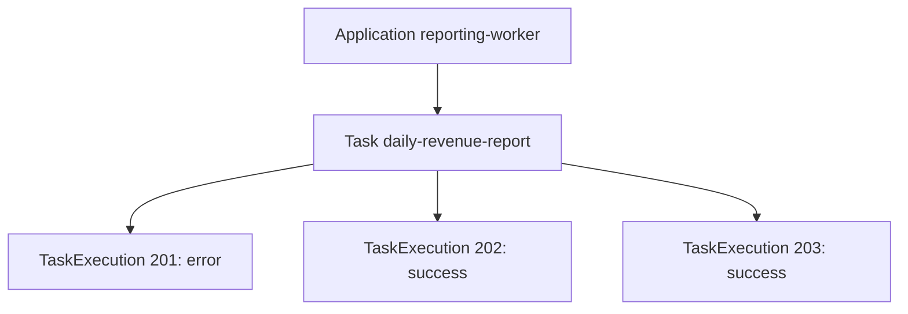

# Naming Applications and Tasks in Spring Cloud Task

## 1. Lesson Objectives

When building your **first task** with Spring Cloud Task, a small decision with long-term operational impact is **naming**. The application runs for a finite duration, exits after processing, and stores information about each run in a database. If names are unstable or confused, operators will struggle to look up history, aggregate errors, identify which task needs re-running, and correlate executions with schedules or Spring Batch jobs.

After this lesson, you will be able to:

- Distinguish between the Spring Boot application name, Spring Cloud Task name, artifact name, and execution identifier.
- Explicitly configure `spring.application.name` and `spring.cloud.task.name`.
- Explain why multiple runs of the same task share a name yet have distinct `executionId` values.
- Choose searchable naming conventions suitable for manual, scheduled, or orchestrated runs.
- Avoid naming mistakes that make history in `TaskRepository` difficult to use.

## 2. Why Distinguish Application Name and Task Name?

Suppose a development team has a program that fetches order data, aggregates revenue, and then exits. The program is deployed daily as `reporting-worker.jar`. Operators need to answer two questions:

1. **Which Spring Boot application was deployed?** This concerns the program, configuration, and deployment unit.
2. **Which business task ran?** This concerns the type of work to look up in execution history.

Both questions may have the same answer in a simple application, yet the two names serve different purposes:

| Element | Example | Primary Meaning |
| --- | --- | --- |
| `spring.application.name` | `reporting-worker` | Name of the Spring Boot application, commonly used in configuration and application observability systems. |
| `spring.cloud.task.name` | `daily-revenue-report` | Logical name of the task used by Spring Cloud Task when recording `TaskExecution`. |
| JAR file or container image | `reporting-worker.jar`, `reporting-worker:1.2.0` | Deployment artifact; its filename or version can change without changing the meaning of the task. |
| `TaskExecution.executionId` | `42` | Unique identifier for **a single run**, assigned by the repository. |
| Business parameter | `businessDate=2026-11-23` | Input specifying the data processed during that run. |

**The application name is not an identifier for individual runs.** Conversely, **the task name is not the JAR path or container name**. One application can run repeatedly; each run creates a separate record even though the task name remains unchanged.

In Spring Cloud Task, the lifecycle storage layer is `TaskRepository`. It stores `TaskExecution` records to track the start time, end time, and outcome of each execution. The `taskName` attribute on these records is why task names must be chosen intentionally.

## 3. Two Key Configuration Properties

### 3.1. `spring.application.name`: Spring Boot Application Name

This is a Spring Boot property. Example:

```yaml
spring:
  application:
    name: reporting-worker
```

This name helps tools that consume application metadata identify the running program. In a larger system, it may be used to group configurations, logs, metrics, or traces depending on integrated tooling.

It is **not** a business key for a report or an execution identifier. Do not rely solely on this property to decide how history for a unit of work is grouped in `TaskRepository`.

### 3.2. `spring.cloud.task.name`: Spring Cloud Task Logical Name

This is a Spring Cloud Task configuration property. Example:

```yaml
spring:
  cloud:
    task:
      name: daily-revenue-report
```

When a task is launched and an execution record is created, the configured name is used to identify the type of task. Subsequent launches with the same name create **new execution records** while still allowing them to be queried together via `taskName`.

Spring Cloud Task has a fallback mechanism to determine a name when `spring.cloud.task.name` is not declared, depending on configuration and library version. For a hands-on exercise or production application, **you should configure the task name explicitly** rather than relying on the default name. This also prevents unintended changes if startup methods or code structure change.

### 3.3. When Should Both Names Be Identical?

If a Spring Boot application performs exactly one task, you can choose:

```yaml
spring:
  application:
    name: daily-revenue-report
  cloud:
    task:
      name: daily-revenue-report
```

This is a straightforward choice, especially for your **first task**. However, the two properties remain independent in purpose. For a shared application executing a group of reporting jobs, you might use `reporting-worker` as the application name and `daily-revenue-report` as the task name. The practical rule is to **pick names that accurately reflect the entity being identified**, rather than forcing the two properties to match or differ.

## 4. Complete Configuration Example for Your First Task

Let's create a Spring Boot application named `reporting-worker` with a task `daily-revenue-report`. The program accepts `businessDate` from the command line, runs reporting logic, and terminates. This is a minimal example to observe naming; writing the report to a business system is replaced with illustrative console output.

### 4.1. `application.yml` Configuration

```yaml
spring:
  application:
    name: reporting-worker
  main:
    web-application-type: none
  cloud:
    task:
      name: daily-revenue-report
  datasource:
    url: ${TASK_DB_URL}
    username: ${TASK_DB_USER}
    password: ${TASK_DB_PASSWORD}
```

Meaning of the configuration groups:

- `spring.application.name` identifies the Spring Boot application in integrated systems that use the application name.
- `spring.cloud.task.name` names the task tracked by Spring Cloud Task.
- `spring.main.web-application-type: none` indicates the program does not need to keep an HTTP server running when work finishes.
- `spring.datasource` configures the database connection for storing execution metadata via `TaskRepository`.

The values `TASK_DB_URL`, `TASK_DB_USER`, and `TASK_DB_PASSWORD` must be provided from the deployment environment. The application also needs the appropriate Spring Boot dependencies, `spring-cloud-starter-task`, the JDBC driver for the database in use, and **the Spring Cloud Task table schema matching the library version**. Schemas should be managed with controlled migrations, especially in production.

### 4.2. Writing the Entry Point with `ApplicationRunner`

```java
import java.time.LocalDate;
import java.util.List;

import org.springframework.boot.ApplicationRunner;
import org.springframework.boot.SpringApplication;
import org.springframework.boot.autoconfigure.SpringBootApplication;
import org.springframework.cloud.task.configuration.EnableTask;
import org.springframework.context.annotation.Bean;

@SpringBootApplication
@EnableTask
public class ReportingWorkerApplication {

    public static void main(String[] args) {
        SpringApplication.run(ReportingWorkerApplication.class, args);
    }

    @Bean
    ApplicationRunner dailyRevenueReport() {
        return args -> {
            List<String> values = args.getOptionValues("businessDate");
            if (values == null || values.size() != 1) {
                throw new IllegalArgumentException(
                    "Must pass --businessDate=yyyy-MM-dd"
                );
            }

            LocalDate businessDate = LocalDate.parse(values.get(0));
            System.out.println("Aggregating revenue for date " + businessDate);

            // Example: call aggregation service and write report.
            // When processing fails, propagate the error to record a failed status.

            System.out.println("Completed report for date " + businessDate);
        };
    }
}
```

`@EnableTask` enables task lifecycle support. `ApplicationRunner` holds the business logic to run after the application initializes. The class `ReportingWorkerApplication` is a Java class name; it **does not need** to match the Spring Boot name or the task name. In this example, configuration determines the name recorded in metadata, not the method name `dailyRevenueReport()`.

### 4.3. Launching the Application

```bash
java -jar reporting-worker.jar --businessDate=2026-11-23
```

When the application initializes successfully and the `TaskRepository` connection is working, Spring Cloud Task records a `TaskExecution` with `taskName` set to `daily-revenue-report`. The application code uses `businessDate` as its business input. When work finishes normally, the infrastructure records the completion metadata for that run.

Running the same command again creates **a new execution**. Having the same `businessDate` does not mean the system automatically prevents duplicate runs or guarantees report data will not be written twice. Business logic must be designed for safe re-execution.

## 5. Relationship Between Names and Execution History

Suppose the program is launched three times. The table below contains illustrative data, not actual output from your machine:

| Run | `spring.application.name` | `taskName` | `businessDate` | `executionId` | Outcome |
| --- | --- | --- | --- | --- | --- |
| 08:00 | `reporting-worker` | `daily-revenue-report` | `2026-11-23` | `201` | Failed |
| 08:10 | `reporting-worker` | `daily-revenue-report` | `2026-11-23` | `202` | Succeeded |
| 08:00 next day | `reporting-worker` | `daily-revenue-report` | `2026-11-24` | `203` | Succeeded |

Here:

- The same **application** performs the work across different launches.
- The same **task name** groups the history of the `daily-revenue-report` job type.
- Different `executionId` values identify each **individual run**.
- The `businessDate` parameter may be identical or different across runs.



In a JDBC database using the standard Spring Cloud Task schema, history is stored in the `TASK_EXECUTION` table. For instance, you can query by task name using SQL:

```sql
SELECT TASK_EXECUTION_ID,
       TASK_NAME,
       START_TIME,
       END_TIME,
       EXIT_CODE,
       EXIT_MESSAGE
FROM TASK_EXECUTION
WHERE TASK_NAME = 'daily-revenue-report'
ORDER BY TASK_EXECUTION_ID DESC;
```

Column and table names should be checked against the deployed schema version. Inside a Java application, `TaskExplorer` provides an API to query history without requiring every component to write raw SQL. Regardless of how you query, a stable task name helps locate the right group of records.

**Note on outcomes:** a `TaskExecution` marked complete does not by itself prove the report was calculated accurately. `TaskRepository` records lifecycle metadata; report data resides in your business storage and must be verified separately.

## 6. Operational Naming Conventions

Spring Cloud Task does not require you to use fixed English phrases. However, you should agree on a **short, meaningful, and stable** convention across source code, schedules, alerts, dashboards, and operational documentation.

An easy-to-adopt option is lowercase words separated by hyphens describing **subject + action or frequency**:

| Purpose | Name to Consider | Rationale |
| --- | --- | --- |
| Daily revenue aggregation | `daily-revenue-report` | Indicates the report type and business cadence. |
| Product catalog synchronization | `product-catalog-sync` | States the data entity and operation. |
| Transaction reconciliation | `payment-reconciliation` | Ties to a business concept easy to search in logs and history. |
| Customer data import | `customer-data-import` | Distinguishes from data export tasks. |
| Expired record cleanup | `expired-record-cleanup` | States the condition and processing action. |

Avoid generic names like `task`, `job`, `app`, `process-data`, or version-only labels like `task-v2`. Those names fail to convey what work a history record pertains to.

Several practical guidelines:

1. **Task names describe a stable function.** Do not embed run dates, customer IDs, UUIDs, or timestamps into the name. Values that vary per run belong in business parameters or an appropriate tracing system.
2. **Application names describe the deployment unit.** If an application does one job, it can share a name with the task; if one codebase runs multiple jobs, clearly define how each job's name is selected and recorded.
3. **Separate logical names from software versions.** You can deploy image `reporting-worker:2.0.0` while keeping `daily-revenue-report` if the job's meaning has not changed. Only rename a task when there is a business reason or change in how history is categorized.
4. **Respect storage environment limits.** Keep names concise enough to fit within schema column limits and remain compatible with orchestration, search, metrics, and dashboard tools.
5. **Do not include secrets or personal data in names.** Names can appear in database tables, logs, and operational UIs.

### What If One Application Has Multiple Tasks?

Suppose `reporting-worker` can generate both revenue reports and inventory reports. There are two design options:

- **Split into separate applications/tasks** if independent deployment, scheduling, permissions, or retry mechanisms are needed. Each application gets its own fixed `spring.cloud.task.name`.
- **Use a single program supporting multiple modes** if code sharing is truly required. In that case, ensure the task name reflects the mode being executed, is determined before `TaskExecution` metadata is created, and stays consistent with the schedule.

Do not record all multi-purpose executions under one generic name if the goal is to track each job type individually. Likewise, do not invent a new name for each `businessDate`, as that destroys the ability to query the full history of the same task type.

## 7. Configuring Names by Environment at Deployment

Spring Boot supports loading configuration from multiple sources, including YAML files, environment variables, and command-line arguments. For example, when a deployment environment needs a different name, you can pass the Spring Cloud Task property at launch:

```bash
java -jar reporting-worker.jar \
  --spring.cloud.task.name=daily-revenue-report \
  --businessDate=2026-11-23
```

Or configure it via an environment variable using Spring Boot's property binding rules:

```bash
export SPRING_CLOUD_TASK_NAME=daily-revenue-report
java -jar reporting-worker.jar --businessDate=2026-11-23
```

Both approaches merely illustrate **configuration sources**. In production, manage task names through controlled deployment configuration. Avoid generating names dynamically from input parameters per run, as history will fragment into unnecessary groups.

If a system has `dev`, `staging`, and `prod` environments, whether to add an environment prefix to the task name depends on how databases and tracking systems are isolated. For instance, if each environment has its own `TaskRepository`, you can keep the same logical name `daily-revenue-report` across all environments. If multiple environments write to a shared store, clear identification and isolation rules are needed to avoid mixing history. Do not rely on naming alone to solve authorization or data isolation.

## 8. Task Names in Scheduled Runs, Retries, and Spring Batch

A stable name helps orchestrators and operators correlate runs, but it **does not provide scheduling by itself**. Spring Cloud Task tracks a single application launch; triggering at 02:00 daily, on an event, or manually is typically handled by cron, Kubernetes CronJob, or an orchestration system.

For example, a scheduler runs `daily-revenue-report` with `businessDate=2026-11-23`, and the process hits a network error. The scheduler decides to retry with the same parameters. The retry still has the name `daily-revenue-report`, but receives a new `executionId`. To avoid creating duplicate reports, the processing logic must implement **idempotency** and appropriate business constraints; the task name does not prevent concurrent executions.

If the application also integrates **Spring Batch**, job names and job execution IDs are introduced as well:

| Concept | Example | Responsibility |
| --- | --- | --- |
| Spring Cloud Task `taskName` | `daily-revenue-report` | Categorizes launch history of the finite application. |
| Spring Batch `jobName` | `aggregateRevenueJob` | Categorizes a job composed of batch processing steps. |
| Spring Cloud Task `executionId` | `202` | Identifies an application execution run. |
| Spring Batch `jobExecutionId` | `876` | Identifies a job execution run in the Batch repository. |

A task application may contain one or more Batch jobs depending on design. Spring Cloud Task and Spring Batch names and IDs belong to **two different tracking layers**. Do not assume they must match or have equal IDs; if cross-layer traceability is required, configure an explicit linking mechanism.

## 9. Troubleshooting Common Naming Issues

| Symptom | Cause to Check | Resolution |
| --- | --- | --- |
| Cannot find runs by expected name | Only `spring.application.name` was set, or `spring.cloud.task.name` was not loaded. | Check effective startup configuration; set the task name explicitly and re-query `TASK_NAME`. |
| One task appears under multiple names | Renamed across versions or generated from dates/arguments. | Standardize the logical name, use parameters for variable data, and document intentional renames. |
| Multiple job types lumped together in history | Different processing modes share a single task name. | Split applications or select the name by mode before execution begins. |
| Same name appears across many records | The application was launched multiple times. | This is normal behavior; distinguish runs by `executionId` and timestamps. |
| History shows a record with `endTime` missing | The process may have crashed abruptly or failed to update the repository. | Cross-check logs, process/container status, and the orchestrator. |
| Query returns no records | Database, schema, task name, or initialization did not match expectations. | Verify `DataSource` connectivity, metadata tables, startup errors, and which database is being queried. |

Note that changing `spring.cloud.task.name` only affects how **new** executions are categorized; existing records in the database are not automatically renamed. Therefore, renaming should be treated as a decision that affects the continuity of monitoring history.

## 10. Checklist for Your First Task

Before putting the application on a schedule, verify:

- [ ] `spring.application.name` has been chosen to fit the deployment unit.
- [ ] `spring.cloud.task.name` is set explicitly, is meaningful to the business, and is stable.
- [ ] `@EnableTask`, `TaskRepository`, `DataSource`, and metadata schemas are properly configured.
- [ ] The application actually exits after finishing work; no HTTP server needs to stay open.
- [ ] Data that varies per run is passed via parameters, not embedded in the task name.
- [ ] You have tested launching and querying `TaskExecution` by the expected `taskName`.
- [ ] Strategies exist for error handling, retries, duplicate-run prevention, and business result validation.

### Self-Check

**Question 1.** An application has `spring.application.name=reporting-worker` and `spring.cloud.task.name=daily-revenue-report`. Which name should you use to filter `TaskExecution` history?

**Question 2.** Two launches share `--businessDate=2026-11-23`. Will they have the same `executionId`? Does the task name need the date appended to distinguish the two runs?

**Question 3.** Upgrading the image from `reporting-worker:1.0` to `reporting-worker:2.0` while performing the exact same work. Must you change `spring.cloud.task.name`?

**Answer hints:** (1) Filter by `daily-revenue-report`, which is the task name written to metadata; (2) each run has its own execution ID, so embedding the date in the name is unnecessary; (3) no, you can keep the same logical name to preserve continuous history for the same job type.

**Key takeaway:** `spring.application.name` describes the **Spring Boot application**; `spring.cloud.task.name` describes the **task type in Spring Cloud Task**; `executionId` describes **a specific execution run**. Keeping these three concepts distinct is the foundation for tracking task outcomes in the database and operating safely on a schedule, on demand, or alongside Spring Batch.
