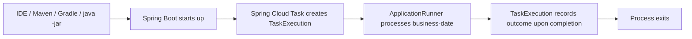

# Running Spring Cloud Task from an IDE, Maven, or Gradle

## 1. Objectives

In the **First Task** chapter, we will run a complete **Spring Cloud Task** application in three ways: the **Run** button in an IDE, **Maven** commands, and **Gradle** commands. The exercise uses the exact same program to demonstrate that the launch tool may differ, while the business logic and task lifecycle remain fundamentally the same.

After this lesson, you will be able to:

- Configure a finite-lived **Spring Boot** application and have **Spring Cloud Task** record each execution in a database.
- Run the `main` class from IntelliJ IDEA/Eclipse/VS Code and pass arguments via Run Configurations.
- Launch via Maven's `spring-boot:run` or Gradle's `bootRun`, as well as run a packaged JAR file.
- Read results from the console and `TaskRepository`, and check common startup errors.
- Know when to use an IDE for development, a build tool for testing, and a JAR/container for scheduled or on-demand deployment.

> **Scope:** This is a finite-lived application: it starts up, performs a task, records the outcome, and exits. Spring Cloud Task does not schedule runs automatically or turn an application into a Spring Batch job on its own. We are simply setting up a launch approach that can be reused when integrating Batch and orchestrators in later lessons.

## 2. Prerequisites Before Running

You need a **JDK compatible with your project's Spring Boot version**, a Java-capable IDE, and **Maven or Gradle**. If the project includes the Maven Wrapper (`mvnw`, `mvnw.cmd`) or Gradle Wrapper (`gradlew`, `gradlew.bat`), prefer using the wrapper to match the chosen build tool version. You only need **one** of Maven or Gradle—you do not have to maintain both side by side.

The Spring Boot project needs the following components:

| Component | Purpose |
| --- | --- |
| `spring-boot-starter` | Creates and bootstraps a Boot application without a web server. |
| `spring-cloud-starter-task` | Manages the `TaskExecution` lifecycle with Spring Cloud Task. |
| JDBC driver, e.g., PostgreSQL | Connects to the database containing `TaskRepository` tables. |
| Spring Boot Maven Plugin or Spring Boot Gradle Plugin | Supports running directly and building an executable JAR. |
| Compatible Spring Cloud dependency management/BOM | Manages Spring Cloud library versions aligned with the Boot version in use. |

Example **Maven** dependencies inside a `pom.xml` that already manages Spring Boot and Spring Cloud versions:

```xml
<dependencies>
    <dependency>
        <groupId>org.springframework.boot</groupId>
        <artifactId>spring-boot-starter</artifactId>
    </dependency>
    <dependency>
        <groupId>org.springframework.cloud</groupId>
        <artifactId>spring-cloud-starter-task</artifactId>
    </dependency>
    <dependency>
        <groupId>org.postgresql</groupId>
        <artifactId>postgresql</artifactId>
        <scope>runtime</scope>
    </dependency>
</dependencies>

<build>
    <plugins>
        <plugin>
            <groupId>org.springframework.boot</groupId>
            <artifactId>spring-boot-maven-plugin</artifactId>
        </plugin>
    </plugins>
</build>
```

For a **Gradle** project using the Spring Boot Gradle Plugin with a compatible Spring Cloud BOM imported, the corresponding dependencies could be:

```groovy
dependencies {
    implementation 'org.springframework.boot:spring-boot-starter'
    implementation 'org.springframework.cloud:spring-cloud-starter-task'
    runtimeOnly 'org.postgresql:postgresql'
}
```

The snippets above are **additions to an existing valid build configuration**, not the entire `pom.xml` or `build.gradle`. Do not pick the latest version of each library arbitrarily: verify the compatibility matrix across Spring Boot, Spring Cloud, and Spring Cloud Task. A Maven project imports the BOM via `dependencyManagement`; a Gradle project imports the BOM via its corresponding dependency management mechanism.

To observe task history **after the application exits**, this lesson uses a persistent PostgreSQL database. You can use an embedded database for quick practice, though an in-memory database loses records once the process stops. Before launching, make sure the database exists, the account has appropriate permissions, and the Task metadata schema has been initialized for your Spring Cloud Task version.

## 3. Building One Shared Task for All Three Launch Methods

### 3.1. The Main Class

Create `src/main/java/com/example/task/FirstTaskApplication.java`:

```java
package com.example.task;

import java.time.LocalDate;
import java.util.List;

import org.springframework.boot.ApplicationRunner;
import org.springframework.boot.SpringApplication;
import org.springframework.boot.autoconfigure.SpringBootApplication;
import org.springframework.cloud.task.configuration.EnableTask;
import org.springframework.context.annotation.Bean;

@SpringBootApplication
@EnableTask
public class FirstTaskApplication {

    public static void main(String[] args) {
        SpringApplication.run(FirstTaskApplication.class, args);
    }

    @Bean
    ApplicationRunner processBusinessDate() {
        return args -> {
            List<String> dates = args.getOptionValues("business-date");
            if (dates == null || dates.size() != 1) {
                throw new IllegalArgumentException(
                    "Must pass exactly one --business-date=yyyy-MM-dd");
            }

            LocalDate date = LocalDate.parse(dates.get(0));
            System.out.println("Starting processing for date: " + date);

            // Replace with exporting reports, syncing data, or calling an actual service.
            System.out.println("Completed processing for date: " + date);
        };
    }
}
```

**Key points in the example:**

1. `@SpringBootApplication` bootstraps the Boot application. `@EnableTask` enables Spring Cloud Task lifecycle tracking in the application.
2. `ApplicationRunner` runs after Spring initializes the context. It receives `ApplicationArguments`, where `--business-date=2026-11-24` can be read via `getOptionValues("business-date")`.
3. `LocalDate.parse` validates the ISO date (`yyyy-MM-dd`); a missing or malformed value causes an error instead of pretending the task succeeded.
4. Once the runner finishes and no components keep the process alive, the non-web application can terminate. Spring Cloud Task records run metadata in `TaskRepository` if storage is configured properly.

This is a sample task with no business data mutations yet. In real applications, invoke a Spring-managed service from the runner, separate processing logic from the startup class, and log with a proper logger.

### 3.2. Configuring the Non-Web Application and TaskRepository

Example `src/main/resources/application.yml`:

```yaml
spring:
  application:
    name: first-task
  main:
    web-application-type: none
  datasource:
    url: jdbc:postgresql://localhost:5432/task_demo
    username: task_user
    password: ${TASK_DB_PASSWORD}
  cloud:
    task:
      name: first-task-demo
```

`spring.main.web-application-type: none` prevents Boot from starting an HTTP server. `spring.datasource.*` provides the JDBC connection for task metadata. `spring.cloud.task.name` assigns a meaningful name to easily distinguish tasks in history. With PostgreSQL, you need the driver installed, the database/user created, and the Task Repository tables prepared; auto-initialization policies can vary across versions and environments, so never assume production is pre-migrated.

Example of supplying the password via an environment variable:

```bash
export TASK_DB_PASSWORD='your-local-password'
```

In **PowerShell** on Windows:

```powershell
$env:TASK_DB_PASSWORD = 'your-local-password'
```

The value above is only illustrative for a local development machine. In deployment environments, store credentials in a proper secret management mechanism; avoid committing passwords to repositories or printing passwords to logs.

**Expected lifecycle of each run:**



The lifecycle above represents a **typical success** model. If connection setup or context initialization fails too early, `TaskExecution` may not be created yet; if the process is terminated abruptly, metadata may also fail to record the completion timestamp properly.

## 4. Method 1 — Running from an IDE

In IntelliJ IDEA, Eclipse, or VS Code with the Java Extension Pack, the general steps are:

1. Open the project and let the IDE import Maven/Gradle dependencies; select the exact JDK required by the project.
2. Open `FirstTaskApplication.java`, click **Run** on the `main` method, or create a **Java Application/Spring Boot** run configuration.
3. Set **Main class** to `com.example.task.FirstTaskApplication`.
4. In **Program arguments**, enter `--business-date=2026-11-24`. This is an argument sent to the application, not a JVM VM option.
5. In **Environment variables**, configure `TASK_DB_PASSWORD` so the application can connect to the database. Check the working directory and active profile if the project has environment-specific configurations.
6. Click **Run** and watch the console. The task will print the processed date, then exit upon completion. Running the same configuration again constitutes a **new application launch**.

Example expected business output in the console:

```text
Starting processing for date: 2026-11-24
Completed processing for date: 2026-11-24
```

Spring startup logs and Task metadata messages depend on logging configuration. Seeing just the two printed lines above is **not enough** to conclude that writing `TaskExecution` to the database succeeded; see Section 7.

**Debugging:** set a breakpoint inside the `ApplicationRunner` lambda, run in **Debug** mode, and inspect `args.getOptionValues("business-date")` and the `date` variable. Clicking **Stop** or killing the process behaves differently from a natural exit: completion callbacks, transactions, and metadata updates may not finish executing.

## 5. Method 2 — Running from Maven

If the project uses `pom.xml` and the Spring Boot Maven Plugin, use the **`spring-boot:run`** goal to compile and run the application without locating the output JAR manually.

On macOS/Linux (in the root directory containing `mvnw`):

```bash
./mvnw spring-boot:run -Dspring-boot.run.arguments="--business-date=2026-11-24"
```

On Windows PowerShell (in the root directory containing `mvnw.cmd`):

```powershell
.\mvnw.cmd spring-boot:run "-Dspring-boot.run.arguments=--business-date=2026-11-24"
```

If the project has no Maven Wrapper, replace `./mvnw` or `.\mvnw.cmd` with an installed `mvn` command. The `spring-boot.run.arguments` parameter passes values starting with `--` to the **Spring Boot application**. It differs from JVM `-D...` system properties as well as direct Maven flags.

Example passing two arguments for later use by the application or a service:

```bash
./mvnw spring-boot:run -Dspring-boot.run.arguments="--business-date=2026-11-24 --request-id=req-001"
```

In the Java example in Section 3, `request-id` is not handled yet, so only `business-date` affects the output. Do not assume that adding a CLI argument automatically alters business metadata or creates a Spring Batch `JobParameters` entry.

### Packaging and Running with Java

You can also build an **executable JAR** using the Spring Boot Maven Plugin:

```bash
./mvnw clean package
java -jar target/first-task-0.0.1-SNAPSHOT.jar --business-date=2026-11-24
```

The JAR name `first-task-0.0.1-SNAPSHOT.jar` is just an example; replace it with the actual file in `target/`. On PowerShell, use `.\mvnw.cmd clean package` for the build step; the `java -jar` command remains the same for the matching filename.

Both `spring-boot:run` and `java -jar` launch the Boot application, though they differ in how the classpath and artifact are supplied. Running the JAR verifies the distribution package that will be used in production; `spring-boot:run` is convenient during development. When time and resource limits are needed, an external orchestrator can execute this exact JAR in an isolated process or container.

## 6. Method 3 — Running from Gradle

If the project uses `build.gradle` or `build.gradle.kts` with the Spring Boot Gradle Plugin, the **`bootRun`** task runs the application on the development classpath. In the root directory containing the Gradle Wrapper:

On macOS/Linux:

```bash
./gradlew bootRun --args='--business-date=2026-11-24'
```

On Windows PowerShell:

```powershell
.\gradlew.bat bootRun --args="--business-date=2026-11-24"
```

`--args` is the option that passes **application arguments** to the Java process launched by Gradle. For multiple arguments, place them in a single string:

```bash
./gradlew bootRun --args='--business-date=2026-11-24 --request-id=req-001'
```

The examples above assume your Gradle/Boot plugin version supports passing `--args` this way. If your build has custom `bootRun` settings (such as `mainClass`, profiles, or JVM options), inspect the project configuration to see what values are applied.

### Packaging and Running with Java

```bash
./gradlew bootJar
java -jar build/libs/first-task-0.0.1-SNAPSHOT.jar --business-date=2026-11-24
```

On Windows, use `.\gradlew.bat bootJar` when building. The filename in `build/libs/` depends on `project.name`, `version`, and the project's artifact settings. If using a globally installed Gradle, replace `./gradlew` with `gradle`.

`bootRun` is not a standalone `TaskExecution` at the Spring Cloud Task layer. It is merely a **Gradle task used to launch the application process**. Only once the application runs does Spring Cloud Task create the `TaskExecution` belonging to that run. Do not confuse a Gradle task (`bootRun`) with a Spring Cloud Task business execution.

## 7. Comparing Outcomes Across All Three Launch Methods

| Criterion | IDE | Maven (`spring-boot:run`) | Gradle (`bootRun`) |
| --- | --- | --- | --- |
| Entry point | `main` method | Spring Boot Maven Plugin | Spring Boot Gradle Plugin |
| Where `--business-date` is passed | Program arguments | `spring-boot.run.arguments` | `--args` |
| Compile/run | Managed by IDE | Maven on development classpath | Gradle on development classpath |
| Debugging | Most convenient via breakpoints | Configurable JVM/plugin debug | Configurable JVM/plugin debug |
| TaskRepository record | Yes, if properly configured | Yes, if properly configured | Yes, if properly configured |
| Used directly for deployment | Typically local only | Typically local only | Typically local only |

To verify the task was actually recorded in the database, open an SQL client and run the following query against the configured PostgreSQL database:

```sql
SELECT TASK_EXECUTION_ID,
       TASK_NAME,
       START_TIME,
       END_TIME,
       EXIT_CODE
FROM TASK_EXECUTION
ORDER BY TASK_EXECUTION_ID DESC;
```

With the default Spring Cloud Task schema, the `TASK_EXECUTION` table stores baseline details about each run. Table names and column details can be configured or vary across versions/schemas; when using a custom schema, adjust the query accordingly.

Run the same date sequentially from the IDE, Maven, and Gradle against the **same database**. You will typically see three distinct `TASK_EXECUTION_ID` values if all three launches and metadata writes succeeded. The `TASK_NAME` value may be identical due to `spring.cloud.task.name: first-task-demo`; timestamps and IDs distinguish the runs. If the application runs successfully yet the table has no rows, recheck the DataSource, effective user/schema, and Task initialization.

`EXIT_CODE` and completion status in the repository are **task-level** details; in production, you also need to check the actual process exit code (and, if Spring Batch is integrated, the job outcome). Do not assume that because business logs printed “Completed”, every state-saving, flushing, and shutdown step succeeded.

## 8. When Arguments Are Missing or Processing Fails

Try running the application **without** `--business-date`, or pass an invalid date:

```bash
./mvnw spring-boot:run -Dspring-boot.run.arguments="--business-date=not-a-date"
```

`ApplicationRunner` will throw `IllegalArgumentException` or a date-parsing error. Spring Boot typically logs a startup failure stack trace and terminates unsuccessfully. If Spring Cloud Task has already initialized the repository, task metadata may record the failure; if the error happens too early in startup or writing to the repository itself fails, do not expect a complete history row to always exist.

In business applications, never `catch` every exception just to `System.out.println("Error")` and let the runner return normally: external callers would see a false success. When explicit exit codes are needed, use Spring Boot mechanisms such as `ExitCodeGenerator` or a consistent error-handling/exit policy; then test actual exit codes across IDE, Maven, Gradle, and JAR execution in your target environment.

**Note on testing failures:** when running through Maven or Gradle, the shell receives the build tool's exit status rather than always directly receiving the `EXIT_CODE` stored by Spring Cloud Task. The build tool may add its own messages and error codes. With `java -jar`, the shell directly observes the Java process exit code. Therefore, cross-check the console, exit code, and database before setting up automated retry policies.

## 9. Common Troubleshooting

| Symptom | Possible Cause | How to Check and Resolve |
| --- | --- | --- |
| `Could not find or load main class` | Wrong package/main class name or `mainClass` setting | Open `FirstTaskApplication`, check the package, Run configuration, and Boot plugin settings. |
| `Failed to configure a DataSource` or JDBC connection error | Missing driver, wrong URL/user/password, DB not running | Check driver dependency, `TASK_DB_PASSWORD` variable, network, and DB permissions. |
| `relation ... does not exist`, `Table ... not found` | Spring Cloud Task metadata schema not initialized | Initialize/migrate the schema for the right version and connected database schema. |
| Task does not stop automatically | Application still runs an HTTP server, listener, or non-daemon thread | Set `web-application-type: none`, inspect active threads and background components. |
| Runs in IDE but fails in Maven/Gradle | Different JDK, environment variables, profiles, or build config | Compare Java versions, working directory, plugins, and environment across launch methods. |
| Console reports completion but no `TaskExecution` is visible | Connected to wrong DB/schema, Task not enabled, or metadata write failed | Check `@EnableTask`, DataSource config, and repository/transaction logs. |
| Forcibly stopped run still has null `END_TIME` | Process was killed before updating completion | Inspect system logs, container status, timeouts; build stuck-run detection. |
| Running twice for the same date causes duplicate side effects | Business logic is not idempotent | Use business keys, transactions/upserts, or proper deduplication mechanisms. |

In scheduled or on-demand environments, pay special attention to **idempotency**. Spring Cloud Task can record multiple launches with the same set of arguments; it does not stop two runners from writing duplicate data. If logic must execute once per business date, enforce deduplication policies in the scheduler, database, or business layer. Later, if Spring Batch is introduced inside the task, Batch's `JobRepository`, `JobInstance`, and `JobParameters` manage job identity and restartability.

## 10. Hands-On Checklist and Extension Exercise

Complete the lab in the following order:

1. Create a Spring Boot project with Spring Cloud Task and JDBC driver dependencies using compatible versions.
2. Add `FirstTaskApplication.java`, configure `application.yml`, set up the database, and prepare Task metadata tables.
3. From the IDE, run with `--business-date=2026-11-24`, verify the two console lines and one `TaskExecution` in the database.
4. Exit cleanly, then run again via Maven **or** Gradle. Confirm a new `TaskExecution` appears.
5. Build an executable JAR and run `java -jar` with the same arguments; compare results with direct runs.
6. Test omitting the argument or passing `--business-date=invalid`, observing the exception, build/process result, and metadata record (if created).
7. Try running again for the same date, and analyze why execution history grows while real business logic still needs deduplication.

**Extension exercise:** modify the runner to also accept `--request-id=<request-id>`, log the request ID, and pass it to a business service. Run the task from the IDE, Maven/Gradle, and JAR with the same arguments, then identify where `request-id` should be stored if the system needs to correlate external requests with each `TaskExecution`.

## 11. Summary

**IDE**, **Maven**, and **Gradle** are ways to **launch the exact same Spring Boot application**: an IDE suits development/debugging, `spring-boot:run` and `bootRun` are convenient when working with build tools, and an executable JAR is ideal for orchestrators or containers. **Spring Cloud Task** records application run history via `TaskRepository` when properly configured, allowing you to track timing and outcomes. For scheduled or on-demand execution, the orchestrator is responsible for **triggering the process**, while the task must terminate cleanly, report errors accurately, and handle re-invocations safely.
