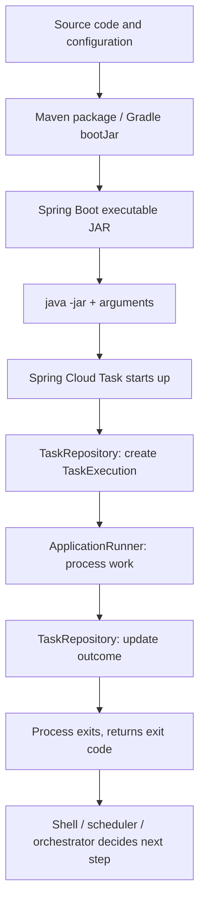

# Packaging a JAR and Launching with `java -jar`

In the **First Task** chapter, this lesson aims to turn a **Spring Cloud Task** application into a deployable JAR file, launch it from the command line, and verify the outcome of each execution. Unlike a continuously running web service, a Spring Cloud Task typically **starts up → processes finite work → records execution status to a database → terminates the process**. Therefore, packaging properly and passing arguments correctly determine whether a task can run reliably on a developer workstation, a server, or an orchestration platform.

After this lesson, you will be able to:

- Distinguish a plain Java JAR from a **Spring Boot executable JAR** runnable with `java -jar`.
- Configure a simple Spring Cloud Task that accepts a business date argument and writes metadata via `TaskRepository`.
- Build a JAR using Maven or Gradle, run it from a terminal, and inspect the process exit code.
- Check `TaskExecution` history in the database and troubleshoot common deployment errors.
- Integrate the same JAR into on-demand, scheduled, or Spring Batch/external launcher workflows.

## 1. What Does `java -jar` Actually Execute?

A JAR (Java ARchive) packages compiled code, configuration resources, and metadata. For the JVM to execute a file via `java -jar app.jar`, the JAR must include a manifest pointing to an appropriate main entry class and a mechanism to load dependent libraries.

With a **Spring Boot executable JAR**, the Spring Boot packaging plugin prepares a specialized layout: application code under `BOOT-INF/classes/`, dependencies under `BOOT-INF/lib/`, and the Spring Boot launcher. The manifest instructs the launcher on how to locate the application class containing `main`. You do not need to copy dozens of library JARs onto the classpath separately when launching this way.

| Artifact Type | Common Build Method | Running with `java -jar` |
| --- | --- | --- |
| Plain Java JAR | Maven `jar` or Gradle `jar`, without manifest and dependency packaging | May fail due to missing `Main-Class` or missing dependencies. |
| Spring Boot executable JAR | Maven `spring-boot:repackage` or Gradle `bootJar` | Runs directly when a compatible Java runtime and required configuration are present. |
| Docker/container image | Packages the application alongside a Java runtime inside an image | Container runs an entrypoint command; may invoke `java -jar` inside. |

**Key takeaway:** Successful packaging **does not guarantee** successful task execution. At runtime, the application must still connect to the metadata database, receive valid arguments, and exit with an appropriate status code.

## 2. Preparing Your First Spring Cloud Task Application

Running example throughout this lesson: a `dailyRevenueTask` that processes revenue figures for a date supplied via `--business-date=YYYY-MM-DD`. The implementation below prints illustrative messages; in a real application, this would be the step that reads data, performs calculations, and writes results to a business database.

### 2.1. Creating the Project and Adding Dependencies

Create a **Spring Boot** project using Java 17 or later and Maven, with source code in an example package `com.example.taskdemo`. Pick a Spring Boot version and a **compatible Spring Cloud release train** according to the compatibility matrix for your version set. Do not mix arbitrary Boot and Cloud versions.

In the `pom.xml` generated by Spring Initializr, add the required dependencies:

```xml
<dependencies>
    <!-- Tracks Spring Cloud Task lifecycle and execution history -->
    <dependency>
        <groupId>org.springframework.cloud</groupId>
        <artifactId>spring-cloud-starter-task</artifactId>
    </dependency>

    <!-- DataSource and JDBC database access -->
    <dependency>
        <groupId>org.springframework.boot</groupId>
        <artifactId>spring-boot-starter-jdbc</artifactId>
    </dependency>

    <!-- Local file database, for hands-on practice only -->
    <dependency>
        <groupId>com.h2database</groupId>
        <artifactId>h2</artifactId>
        <scope>runtime</scope>
    </dependency>
</dependencies>
```

If the project does not yet declare the Spring Cloud BOM, import the BOM in `dependencyManagement`; `spring-cloud.version` must be set to the **Spring Cloud version compatible with your selected Spring Boot version**:

```xml
<dependencyManagement>
    <dependencies>
        <dependency>
            <groupId>org.springframework.cloud</groupId>
            <artifactId>spring-cloud-dependencies</artifactId>
            <version>${spring-cloud.version}</version>
            <type>pom</type>
            <scope>import</scope>
        </dependency>
    </dependencies>
</dependencyManagement>
```

Keep `spring-boot-maven-plugin` in `build.plugins` of `pom.xml` to generate an executable JAR:

```xml
<build>
    <plugins>
        <plugin>
            <groupId>org.springframework.boot</groupId>
            <artifactId>spring-boot-maven-plugin</artifactId>
        </plugin>
    </plugins>
</build>
```

The snippets above are **sections to merge into an existing base POM**, not the complete `pom.xml`. The base POM must include `groupId`, `artifactId`, `version`, the Spring Boot parent or equivalent dependency management, and the `spring-cloud.version` property. The examples below assume `artifactId=first-cloud-task` and `version=0.0.1-SNAPSHOT`.

### 2.2. Writing the Entry Point and Business Logic

Create `src/main/java/com/example/taskdemo/FirstCloudTaskApplication.java`:

```java
package com.example.taskdemo;

import java.time.LocalDate;
import java.util.List;

import org.springframework.boot.ApplicationArguments;
import org.springframework.boot.ApplicationRunner;
import org.springframework.boot.SpringApplication;
import org.springframework.boot.autoconfigure.SpringBootApplication;
import org.springframework.cloud.task.configuration.EnableTask;
import org.springframework.context.annotation.Bean;

@SpringBootApplication
@EnableTask
public class FirstCloudTaskApplication {

    public static void main(String[] args) {
        SpringApplication.run(FirstCloudTaskApplication.class, args);
    }

    @Bean
    ApplicationRunner runDailyRevenue() {
        return args -> {
            LocalDate businessDate = LocalDate.parse(
                requiredOption(args, "business-date")
            );

            System.out.printf(
                "Processing revenue for date %s%n", businessDate
            );

            // TODO: Replace with actual business logic.
            // The following flag is only for practicing failure scenarios.
            if (args.containsOption("simulate-error")) {
                throw new IllegalStateException("Simulated error during processing");
            }

            System.out.println("Completed revenue processing");
        };
    }

    private static String requiredOption(ApplicationArguments args, String name) {
        List<String> values = args.getOptionValues(name);
        if (values == null || values.size() != 1
                || values.get(0) == null || values.get(0).isBlank()) {
            throw new IllegalArgumentException(
                "Must pass exactly one --" + name + "=YYYY-MM-DD"
            );
        }
        return values.get(0);
    }
}
```

In this example:

- `@SpringBootApplication` enables Spring Boot auto-configuration; `main` launches the application context.
- `@EnableTask` activates Spring Cloud Task execution lifecycle recording.
- `ApplicationRunner` executes after Spring initializes the application, retrieves parameters via `ApplicationArguments`, and runs the job.
- `LocalDate.parse` validates the date in ISO format such as `2026-11-24`; invalid formats or missing parameters raise an error.
- If no background service keeps the process alive, the finite application finishes, closes its context per Spring Cloud Task's mechanism, and exits. Do not add an infinite loop to "keep the task running."

When building real-world tasks, **never swallow exceptions and print "success."** Let errors propagate accurately into the termination mechanism and exit code; if custom error handling is used, explicitly return an appropriate failure status.

### 2.3. Configuring the Local Metadata Store

Create `src/main/resources/application.yml`:

```yaml
spring:
  application:
    name: first-cloud-task
  main:
    web-application-type: none
  datasource:
    url: jdbc:h2:file:./task-metadata
    driver-class-name: org.h2.Driver
    username: sa
    password: ""
  cloud:
    task:
      name: dailyRevenueTask
      initialize-enabled: true
```

Explanation of each choice:

- `web-application-type: none` treats the application as a command-line task without opening a web server.
- `jdbc:h2:file:./task-metadata` uses **file-based H2** to retain execution history across multiple runs. If `jdbc:h2:mem:...` were used, data would live only for the duration of the in-memory database and typically disappear when the process stops.
- `spring.cloud.task.name` gives runs a logical name; each run still gets its own `TaskExecution` and unique ID.
- `initialize-enabled` enables metadata table initialization as supported by the library version in a practice environment. In production, manage schemas through compatibility-tested migrations and avoid automatic table creation at startup.

**Path note:** `./task-metadata` is resolved relative to the *process's current working directory*, not the location of the JAR file. Running the JAR from a different directory causes H2 to create a different database, making it look like history vanished. File-based H2 works for single-machine practice; when multiple tasks run concurrently or across multiple containers, use a supported centralized database such as PostgreSQL or MySQL with proper schema and configuration.

## 3. Packaging into an Executable JAR

### 3.1. Maven

From the root directory containing `pom.xml`, run:

```bash
./mvnw clean package
```

On Windows PowerShell, use the corresponding Maven Wrapper:

```powershell
.\mvnw.cmd clean package
```

This command compiles code, runs configured tests, and outputs the artifact in `target/`. With the chosen example name and version, the output file is typically:

```text
target/first-cloud-task-0.0.1-SNAPSHOT.jar
```

In a project using the Spring Boot Maven Plugin, the `package` phase normally invokes the `repackage` goal per plugin configuration to build the executable JAR. If the project does not inherit the default Spring Boot parent configuration, ensure the `repackage` goal is bound to the packaging phase. Do not confuse the original JAR suffixed with `.jar.original` with the repackaged Spring Boot JAR.

### 3.2. Gradle

If the project uses Gradle with the Spring Boot Gradle Plugin and compatible dependency versions configured, the equivalent dependencies block can be written as:

```groovy
dependencies {
    implementation 'org.springframework.cloud:spring-cloud-starter-task'
    implementation 'org.springframework.boot:spring-boot-starter-jdbc'
    runtimeOnly 'com.h2database:h2'
}
```

Once the Spring Cloud BOM or corresponding dependency management is configured, package with:

```bash
./gradlew clean bootJar
```

The artifact typically resides in `build/libs/`. On Windows, use `.\gradlew.bat clean bootJar`. Choose **`bootJar`** when you need an executable JAR bundled with all dependencies; a plain `jar` is generally insufficient for Spring Boot `java -jar` deployment.

### 3.3. Inspecting the Packaged Result

Check the Java version on the target machine and inspect the JAR contents:

```bash
java -version
jar tf target/first-cloud-task-0.0.1-SNAPSHOT.jar
```

A valid Spring Boot JAR typically contains `BOOT-INF/classes/`, `BOOT-INF/lib/`, and launcher classes; exact contents vary by Spring Boot version. If the file lacks libraries or a proper startup manifest, check your plugin configuration instead of merely renaming a file to `.jar`.

## 4. Launching with `java -jar`

### 4.1. A Successful Run

From the **project root directory** (so the relative H2 path in the example remains consistent), run:

```bash
java -jar target/first-cloud-task-0.0.1-SNAPSHOT.jar \
  --business-date=2026-11-24
echo $?
```

On Windows PowerShell:

```powershell
java -jar .\target\first-cloud-task-0.0.1-SNAPSHOT.jar --business-date=2026-11-24
$LASTEXITCODE
```

Spring Boot feeds arguments starting with `--` into its configuration system/`ApplicationArguments`. In this example, `--business-date` is an **application-defined business parameter**, while `--spring.cloud.task.name` is a **Spring Cloud Task configuration property**. You can override the task name for a single run if truly needed:

```bash
java -jar target/first-cloud-task-0.0.1-SNAPSHOT.jar \
  --business-date=2026-11-24 \
  --spring.cloud.task.name=manualDailyRevenueTask
```

Expected behavior: the application prints the processing and completion messages, then returns control to the terminal. Under normal execution, the process exit code is typically **`0`**. Spring Boot/Spring Cloud Task logs may show startup details as well as task record creation and completion depending on version and log levels.

In Bash, `echo $?` must be run **immediately after** `java -jar` to capture the exit code of the Java process itself. In PowerShell, use `$LASTEXITCODE`. The “Completed revenue processing” message in stdout is merely an illustrative log; **exit codes and execution metadata** are the primary sources of truth for tracking status.

### 4.2. An Intentionally Failed Run

Run the same JAR with the `--simulate-error` flag:

```bash
java -jar target/first-cloud-task-0.0.1-SNAPSHOT.jar \
  --business-date=2026-11-24 \
  --simulate-error
echo $?
```

`ApplicationRunner` throws `IllegalStateException`. If the runtime and metadata database are operational, the application records the failed run via Spring Cloud Task's mechanism; the process exits unsuccessfully. The exact exit code depends on how the application and platform handle errors, though in a standard CLI a **non-`0` code** signals failure. The simulation flag is for learning only and should be removed from production applications.

If an error occurs before the metadata store initializes, there may be no corresponding `TaskExecution` record. That is why you should never assume "no metadata" means "no launch attempt ever occurred."

### 4.3. Environment-Specific Configuration

A single JAR can run across multiple environments with appropriate configuration:

```bash
java -jar target/first-cloud-task-0.0.1-SNAPSHOT.jar \
  --spring.profiles.active=prod \
  --business-date=2026-11-24
```

The example above only takes effect if the project defines a `prod` profile (such as `application-prod.yml` or externally provided config). In production, DB URLs, accounts, and secrets are typically passed via environment variables, secret managers, and controlled deployment configurations. **Never put passwords/tokens in command-line arguments** because they can appear in process lists, logs, or metadata.

## 5. Verifying Execution History in `TaskRepository`

Once connected to a database, Spring Cloud Task manages one `TaskExecution` record per run. A standard metadata table is `TASK_EXECUTION`. You can connect to the file-based H2 database after the application exits and query it (depending on the version's schema):

```sql
SELECT
    TASK_EXECUTION_ID,
    TASK_NAME,
    START_TIME,
    END_TIME,
    EXIT_CODE
FROM TASK_EXECUTION
ORDER BY TASK_EXECUTION_ID DESC;
```

A successful run and a failed run **do not overwrite each other**. They may share `TASK_NAME`, yet have distinct `TASK_EXECUTION_ID` values, timestamps, and exit codes.

| Observed Data | Practical Meaning |
| --- | --- |
| `START_TIME` is populated | The application successfully recorded the start timestamp. |
| `END_TIME` is populated | The framework updated completion; inspect alongside `EXIT_CODE`. |
| `EXIT_CODE = 0` | Typically indicates successful completion by application convention. |
| `EXIT_CODE != 0` | Typically indicates an error; cross-check error messages and logs. |
| Missing record or null `END_TIME` | May not have started, failed to connect to DB, was killed abruptly, or metadata update did not complete. |

**Make a clear distinction:** `TaskRepository` stores **execution metadata**, not business outputs like reconciled totals or generated report files. Business results must be persisted in their own destination; they can be linked to the run via `TASK_EXECUTION_ID`, request ID, or correlation ID. To query history in Java code, use `TaskExplorer` read methods; never mutate metadata tables directly with ad-hoc application SQL.



During a crash or database outage, execution may halt before metadata is fully written; the diagram above illustrates the **normal execution path**.

## 6. Troubleshooting Packaging and Launch Issues

| Symptom | Common Cause | How to Check and Fix |
| --- | --- | --- |
| `no main manifest attribute` | Running a plain JAR that was not repackaged by Spring Boot. | Use `spring-boot-maven-plugin`/`bootJar`; verify the right artifact is targeted. |
| `ClassNotFoundException`, `NoClassDefFoundError` | Missing dependency or JAR does not bundle required libraries. | Inspect `BOOT-INF/lib/`, dependencies, and packaging plugin config. |
| `UnsupportedClassVersionError` | Java runtime is older than the compiled bytecode target. | Compare `java -version` with the project's Java target version. |
| JAR file not found | Wrong `artifactId`, version, or working directory. | Check `target/` or `build/libs/` contents and use the exact path. |
| Task does not terminate automatically | Active web server, scheduler, listener, or non-daemon thread remains alive. | Identify what keeps the JVM alive; for finite tasks, avoid starting unnecessary background services. |
| Cannot create tables/write `TaskExecution` | Missing driver, wrong URL, missing permissions, or schema mismatch. | Inspect stack trace and DataSource config; run version-appropriate schema/migrations. |
| Data store looks empty after re-running | Using in-memory H2 or changing working directory/file path. | Use a consistent file-based H2 path or a centralized database. |
| Command returns non-`0` exit code | Missing argument, malformed date, or processing error. | Check stdout/stderr, logs, `EXIT_CODE`, and error messages in metadata. |
| Task runs twice for the same date | Schedule or retry re-invoked the application. | Design idempotency around business keys, concurrency controls, and retry schedules. |

When analyzing failures, follow the order: **JAR file → Java version → arguments/environment variables → metadata connection → business logs → exit code → infrastructure status**. Never treat a single log line as complete proof of execution outcome.

## 7. From Manual `java -jar` to Scheduled or On-Demand Operations

The `java -jar` command is the basic deployment unit that external systems can automate:

| Launch Pattern | Who Decides When? | Who Spawns the Process? |
| --- | --- | --- |
| Operator runs CLI | Operator | Shell on the target host. |
| Periodic run via cron or Kubernetes CronJob | Scheduler | Cron/container platform. |
| Run from an API or workflow | Backend/orchestrator | Launcher or execution platform. |
| Spring Cloud Data Flow | Schedule, request, or workflow configured in Data Flow | `TaskLauncher` matching the deployment infrastructure. |

Each new process launch creates **a new Spring Cloud Task execution** if the application starts and writes metadata successfully. The orchestrator must enforce timeouts, retry limits, alerts, and concurrency controls. `TaskRepository` provides history; **it does not schedule runs, automatically re-run tasks, or replace an orchestration system**.

**When integrating with Spring Batch:** a single executable JAR can still host a Spring Cloud Task application that launches a Batch `Job`. In that case:

- `TaskExecution` tracks the lifecycle of the **application process**.
- Spring Batch's `JobExecution`/`StepExecution` reflects the status of the **batch job**.
- Spring Batch's `JobLauncher` runs the Batch Job *inside the application*; the platform launcher runs *the entire JAR/container*.

Do not assume a Spring Cloud Task retry automatically performs a safe restart of a Spring Batch Job. You must consider `JobParameters`, `JobRepository` state, and safe replay behavior at every business step.

### Safe Operations Guidelines

1. **Pin versions:** the same artifact and configuration must produce reproducible behavior; record image/JAR version alongside request IDs.
2. **Trace inputs:** pass business date, request ID, and correlation ID; avoid passing secrets as arguments.
3. **Distinguish success levels:** a launcher starting a Job does not prove business success; combine exit codes, `TaskExecution`, and logs.
4. **Ensure idempotency:** the same `business-date` may be executed multiple times due to manual re-triggers or orchestrator retries.
5. **Keep metadata reliable:** use an appropriate database, version-matched schema, least-privilege permissions, and migrations/backups in production.

## 8. Self-Check Practice Exercise

Perform these steps sequentially with the sample project:

1. Build the executable JAR using `./mvnw clean package` or `./gradlew clean bootJar`; inspect `BOOT-INF/lib` inside the artifact.
2. Run the first execution with `--business-date=2026-11-24`; verify the process exits and note the exit code.
3. Run a second execution with `--business-date=2026-11-25`; inspect both independent runs in the `TASK_EXECUTION` table.
4. Run with `--business-date=2026-11-24 --simulate-error`; compare logs, exit code, and metadata against the successful run.
5. Try omitting `--business-date` or passing an invalid date format; verify the failure happens in parameter validation, not packaging.
6. Run the same JAR from a different working directory; explain why a relative H2 path leads to a different metadata store, then restore a consistent launch setup.

**Review questions:** Why do two runs sharing the name `dailyRevenueTask` still get different execution IDs? Why can a successfully built JAR still fail at runtime? If a scheduler re-launches after a timeout, which layer is responsible for detecting whether the old task is still alive and preventing duplicate data processing?

**Expected outcome:** You now have a Spring Cloud Task JAR executable via `java -jar`, know how to pass business parameters, inspect exit codes, and query `TaskExecution` records. This provides the foundation for deploying the same application as a scheduled job, an on-demand job, or alongside Spring Batch while maintaining visibility into every run.
