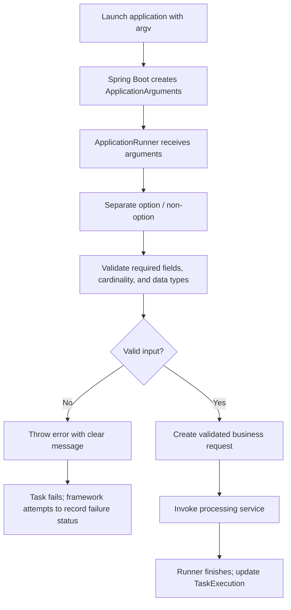

# Reading Named and Unnamed Arguments with ApplicationArguments

## 1. Role of Arguments in the Spring Cloud Task Processing Flow

**Spring Cloud Task** is used to build Spring Boot applications that run for a finite duration: start up, accept inputs, process work, record execution status in a database via `TaskRepository`, and terminate. A task may be invoked manually, from a schedule, or by an orchestrator; each run typically requires a different set of inputs.

For example, the same data import program might be invoked as follows:

```bash
java -jar import-task.jar --source=orders --batch-size=250 --dry-run north south
```

In the command above:

- `--source=orders` specifies the data source.
- `--batch-size=250` limits the number of records processed per batch.
- `--dry-run` requests simulation mode without writing business changes.
- `north` and `south` are the names of two data regions to process; they are **unnamed arguments**.

Spring Boot's `ApplicationArguments` provides an API to separate and validate these groups. Mastering this mechanism helps prevent misreading inputs, avoids processing the wrong data, and ensures argument errors are caught **before** the task performs irreversible changes.

After this lesson, you will know how to use `ApplicationRunner`, `containsOption()`, `getOptionValues()`, `getNonOptionArgs()`, `getOptionNames()`, and `getSourceArgs()`; distinguish named options from positional arguments; apply input validation; and relate validation results to the Spring Cloud Task lifecycle.

## 2. How Does Spring Boot Classify Arguments?

### 2.1. Named arguments (option arguments)

In Spring Boot's standard argument parser, named arguments begin with **two hyphens** `--`:

```text
--source=orders
--batch-size=250
--dry-run
--tag=urgent
--tag=nightly
```

There are two main forms:

1. **Option with a value:** `--key=value`, such as `--source=orders`.
2. **Option without a value:** `--flag`, such as `--dry-run`. Suitable for switches whose presence means enabled.

An option name can appear multiple times, for example `--tag=urgent --tag=nightly`. In that case `getOptionValues("tag")` returns a list of two values; the program must clearly define whether repetition is **valid** or an **error**.

**Common pitfall:** With Spring Boot's standard argument parser, `--source orders` is not equivalent to `--source=orders`. `--source` is parsed as an option **without a value**, while `orders` becomes a **non-option** argument. Use `--source=orders` when passing option values via the command line.

### 2.2. Unnamed arguments (non-option arguments)

Arguments not classified as options are placed into the **non-option** list, typically used as positional arguments:

```bash
java -jar import-task.jar north south
```

Here `getNonOptionArgs()` returns the list `["north", "south"]`. The program defines their semantics: the first argument might be a data source name, or both might be a list of regions to import.

`-v` has only **one** hyphen, so under `ApplicationArguments`'s default parsing behavior it does not become an option named `v` under the `--name` convention. If you want to support `-v`-style flags or more complex CLI syntax, define a custom converter or use an appropriate CLI library.

### 2.3. Syntax Comparison Table

| Argument passed after JAR name | Classification result | Important notes |
| --- | --- | --- |
| `--source=orders` | Option `source`, single value `orders` | Recommended form for options with a value |
| `--dry-run` | Option `dry-run`, no value | Suitable for presence-based flags |
| `--tag=A --tag=B` | Option `tag` with two values | Must handle as a list or reject duplicates |
| `north` | Non-option `north` | Positional argument |
| `--source orders` | Option `source` with no value; non-option `orders` | Not a key/value pair |
| `--source=` | Option `source` with empty string value | Has a name, but usually invalid |
| `-v` | Non-option `-v` | Not option `v` in the default parser |

**Note on spaces:** If a value contains spaces, the shell must pass it as **a single argument**. For example, in shells supporting double quotes:

```bash
java -jar import-task.jar "--source=orders archive" "north region"
```

Then `source` receives `"orders archive"` and `getNonOptionArgs()` contains one element `"north region"`. Exact escaping depends on the shell or launch platform; Java only sees the argument array provided by the caller.

## 3. ApplicationRunner and ApplicationArguments

### 3.1. Why Use ApplicationRunner?

Spring Boot supports two interfaces for running logic after the application starts:

| Interface | Method | Parameter Type Received |
| --- | --- | --- |
| `CommandLineRunner` | `run(String... args)` | Raw string array |
| `ApplicationRunner` | `run(ApplicationArguments args)` | API classifying options and non-options |

If you need to parse named and unnamed arguments, `ApplicationRunner` reduces manual string processing. Both run during application startup; with Spring Cloud Task, the Runner's logic is typically the core workload of an execution.

Minimal example:

```java
import org.springframework.boot.ApplicationArguments;
import org.springframework.boot.ApplicationRunner;
import org.springframework.stereotype.Component;

@Component
public class InspectArgumentsRunner implements ApplicationRunner {
    @Override
    public void run(ApplicationArguments args) {
        System.out.println("Option names: " + args.getOptionNames());
        System.out.println("Non-option args: " + args.getNonOptionArgs());
        System.out.println("Source args: "
                + java.util.Arrays.toString(args.getSourceArgs()));
    }
}
```

Suppose you launch:

```bash
java -jar import-task.jar --source=orders --dry-run north south
```

You will observe:

```text
Option names: [source, dry-run]
Non-option args: [north, south]
Source args: [--source=orders, --dry-run, north, south]
```

The iteration order of `getOptionNames()` should not be relied upon as a business rule. The example only illustrates the returned data shape.

### 3.2. Key APIs of ApplicationArguments

| Method | Return Type | Usage |
| --- | --- | --- |
| `containsOption("source")` | `boolean` | Checks the **presence** of the option, not whether its value is valid |
| `getOptionValues("source")` | `List<String>` or `null` | Reads one or more values of an option |
| `getOptionNames()` | `Set<String>` | Lists received option names |
| `getNonOptionArgs()` | `List<String>` | Retrieves unnamed arguments |
| `getSourceArgs()` | `String[]` | Retrieves the original raw argument array received by the application |

In particular, distinguish three states when calling `getOptionValues(name)`:

| Input | `containsOption("source")` | `getOptionValues("source")` |
| --- | --- | --- |
| No `--source` | `false` | `null` |
| `--source` | `true` | **Empty** list |
| `--source=orders` | `true` | `["orders"]` |
| `--source=` | `true` | `[""]` |
| `--source=A --source=B` | `true` | `["A", "B"]` |

These cases cannot be handled accurately using `containsOption()` alone. For example, if `source` requires exactly one value, `--source`, `--source=`, and `--source=A --source=B` must all be rejected.

When retrieving values, the option name passed to the method **does not include the `--` prefix**:

```java
boolean found = args.containsOption("source");
java.util.List<String> values = args.getOptionValues("source");
```

`getSourceArgs()` is useful when reproducing how the program was invoked, but you should not log the entire array if arguments may contain tokens, passwords, or personal data.

## 4. Safe Argument Processing Flow for Spring Cloud Task

A clean input pipeline should execute in order:



**Principle:** Validate the entire structure and input constraints **before** calling any data-writing service. If there is an argument error, fail the run explicitly; do not silently fall back to default values that could process the wrong data.

### 4.1. Argument Contract for the Running Example

Let us define a CLI contract for an order import task:

| Argument | Type | Rule |
| --- | --- | --- |
| `--source=<source name>` | Required option | Exactly one non-blank value |
| `--batch-size=<number>` | Optional option | Integer in range 1–10,000, default 100 |
| `--dry-run` | Flag option | Presence means simulation mode; takes no value |
| `north south ...` | Non-option | At least one region name |

Valid example:

```bash
java -jar import-task.jar --source=orders --batch-size=250 --dry-run north south
```

Invalid examples:

```bash
# Missing source
java -jar import-task.jar --batch-size=250 north

# Option source has no value
java -jar import-task.jar --source north

# source repeated twice, whereas contract requires exactly one
java -jar import-task.jar --source=A --source=B north

# batch-size value has wrong type
java -jar import-task.jar --source=orders --batch-size=many north

# dry-run flag given a value against convention
java -jar import-task.jar --source=orders --dry-run=false north
```

### 4.2. Creating a Validated Business Request Class

The Java example below uses a `record` (Java 17+) to hold parsed data; `ApplicationArguments` stays strictly in the input ingestion layer, while the business service receives strongly typed domain values.

```java
import java.util.List;
import org.springframework.boot.ApplicationArguments;

record ImportRequest(
        String source,
        int batchSize,
        boolean dryRun,
        List<String> regions) {

    static ImportRequest from(ApplicationArguments args) {
        String source = requiredSingle(args, "source");
        String sizeText = optionalSingle(args, "batch-size", "100");

        int batchSize;
        try {
            batchSize = Integer.parseInt(sizeText);
        } catch (NumberFormatException ex) {
            throw new IllegalArgumentException(
                    "--batch-size must be an integer", ex);
        }
        if (batchSize < 1 || batchSize > 10_000) {
            throw new IllegalArgumentException(
                    "--batch-size must be between 1 and 10000");
        }

        boolean dryRun = args.containsOption("dry-run");
        if (dryRun && !args.getOptionValues("dry-run").isEmpty()) {
            throw new IllegalArgumentException(
                    "--dry-run is a flag and does not accept a value");
        }

        List<String> regions = args.getNonOptionArgs();
        if (regions.isEmpty() || regions.stream().anyMatch(String::isBlank)) {
            throw new IllegalArgumentException(
                    "At least one non-blank region name is required");
        }

        return new ImportRequest(
                source, batchSize, dryRun, List.copyOf(regions));
    }

    private static String requiredSingle(
            ApplicationArguments args, String name) {
        if (!args.containsOption(name)) {
            throw new IllegalArgumentException(
                    "Missing required option --" + name + "=...");
        }
        List<String> values = args.getOptionValues(name);
        if (values == null || values.size() != 1
                || values.get(0).isBlank()) {
            throw new IllegalArgumentException(
                    "Option --" + name + " requires exactly one non-blank value");
        }
        return values.get(0);
    }

    private static String optionalSingle(
            ApplicationArguments args, String name, String defaultValue) {
        if (!args.containsOption(name)) {
            return defaultValue;
        }
        List<String> values = args.getOptionValues(name);
        if (values == null || values.size() != 1
                || values.get(0).isBlank()) {
            throw new IllegalArgumentException(
                    "Option --" + name + " requires exactly one non-blank value");
        }
        return values.get(0);
    }
}
```

Because `requiredSingle` checks both count and content, it will not accidentally take the first element when a user passes the option multiple times. `optionalSingle` applies the default only when the option is **absent**; passing an option with invalid syntax is still an error. `List.copyOf(regions)` prevents downstream processing from mutating the input list.

These checks only validate **format** and basic constraints. In a real application, you should also verify whether region names belong to an allowed catalog, whether `source` is authorized, and whether values match the target runtime environment.

### 4.3. Wiring the Parser into ApplicationRunner

Below is a minimal startup class; `ImportRequest` from section 4.2 can live in the same package. `ImportService` only simulates processing to keep the focus on argument reading.

```java
import org.springframework.boot.ApplicationRunner;
import org.springframework.boot.SpringApplication;
import org.springframework.boot.autoconfigure.SpringBootApplication;
import org.springframework.cloud.task.configuration.EnableTask;
import org.springframework.context.annotation.Bean;
import org.springframework.stereotype.Service;

@SpringBootApplication
@EnableTask
public class ImportTaskApplication {
    public static void main(String[] args) {
        SpringApplication.run(ImportTaskApplication.class, args);
    }

    @Bean
    ApplicationRunner importRunner(ImportService service) {
        return args -> {
            ImportRequest request = ImportRequest.from(args);
            service.execute(request);
        };
    }
}

@Service
class ImportService {
    void execute(ImportRequest request) {
        if (request.dryRun()) {
            System.out.println("[DRY RUN] Validating input only");
        }
        for (String region : request.regions()) {
            System.out.printf(
                    "source=%s, region=%s, batchSize=%d, dryRun=%s%n",
                    request.source(),
                    region,
                    request.batchSize(),
                    request.dryRun());
            // Replace with actual data processing when building the application.
        }
    }
}
```

To configure the application as a non-HTTP process, you can declare:

```yaml
spring:
  main:
    web-application-type: none
  cloud:
    task:
      closecontextEnabled: true
```

This example assumes the project includes the Spring Cloud Task starter, an appropriate `DataSource`/`TaskRepository` configuration, and initialized metadata tables matching the version in use. When backed by a persistent database, each run can be queried via `TaskExecution`. Exact property names and auto-configuration conditions should be verified against your project's Spring Cloud Task version.

When running the valid example, the service receives an object equivalent to:

```text
ImportRequest[
  source=orders,
  batchSize=250,
  dryRun=true,
  regions=[north, south]
]
```

Translating arguments into `ImportRequest` happens **once** before invoking business logic. The service does not need to read `System.getProperty(...)` or extract strings from `String[]`, making the code easier to test and preventing inconsistent parsing rules across layers.

**Production note:** In the example code, `ImportService` only prints information and performs no writes. In real deployments, the `dryRun()` branch must prevent writes along every execution path; printing a `DRY RUN` label while still calling write APIs is a critical bug.

## 5. Edge Cases to Handle Proactively

### 5.1. Failing to Distinguish "Absent" from "Missing Value"

The following two commands carry different meanings:

```bash
java -jar import-task.jar north
java -jar import-task.jar --source north
```

The first command lacks the `source` option. The second has the `source` option without a value; `north` ends up in the non-option list. Therefore, the following check is **insufficient**:

```java
if (args.containsOption("source")) {
    // Cannot yet conclude that the option has a valid value.
}
```

Instead, check `getOptionValues("source")`, the element count, and blank strings.

### 5.2. Options Passed Multiple Times

Some parameters are allowed to repeat, such as `--tag=A --tag=B`. Others should only have one value, such as `--source` or `--batch-size`. Carelessly taking `values.get(0)` or `values.get(values.size() - 1)` makes behavior depend on command-line order and easily hides configuration mistakes.

Define the **contract before coding**: does repeating an option build a list or trigger rejection? For list-valued options, validate each item, maximum count, and duplicates. For single-value options, check `values.size() == 1`.

### 5.3. Numeric, Date, and Typed Values

`ApplicationArguments` only provides **strings**; it does not automatically convert `--batch-size=250` into an integer. The parser layer must validate types and value ranges.

Example run date `--date=2026-11-24`:

```java
import java.time.LocalDate;
import java.time.format.DateTimeParseException;

String dateText = requiredSingle(args, "date"); // helper from section 4.2
LocalDate runDate;
try {
    runDate = LocalDate.parse(dateText); // ISO format yyyy-MM-dd
} catch (DateTimeParseException ex) {
    throw new IllegalArgumentException(
            "--date must follow yyyy-MM-dd format", ex);
}
```

This snippet must be placed inside parser logic where the `requiredSingle` helper is accessible; to reuse it from another class, adjust the helper's visibility accordingly. For time values, specify the timezone and how business dates are interpreted; a bare date does not imply a timezone.

### 5.4. Boolean Switches

There are two common conventions:

- **Presence flag:** `--dry-run` means enabled, omitting it means disabled. Under this rule `--dry-run=false` must be rejected because the string `"false"` does not mean disabled here.
- **Valued boolean option:** `--dry-run=true` or `--dry-run=false`. Here you must extract exactly one value and parse `true/false`; do not rely solely on `containsOption()`.

**Do not mix both conventions** in the same API without defining explicit precedence. The example in section 4 uses the presence-flag convention.

### 5.5. Arguments from Multiple Configuration Sources

Spring Boot has `Environment` and externalized configuration for YAML files, environment variables, Java system properties, and command-line arguments. They serve a different need than `ApplicationArguments`:

| Purpose | Appropriate Mechanism |
| --- | --- |
| Read the exact arguments passed to the program for this run | `ApplicationArguments` |
| Obtain configuration values from multiple sources according to precedence | `Environment` / `@ConfigurationProperties` |
| Read JVM system properties such as `-Dapp.mode=test` | `System.getProperty(...)` or `Environment` |
| Read environment variables such as `TASK_DB_PASSWORD` | Boot configuration mechanism / environment variables |

Example:

```bash
java -Dapp.mode=test -jar import-task.jar --source=orders north
```

`-Dapp.mode=test` is a JVM option **placed before `-jar`**, so it is not included in the application's `getSourceArgs()`. Conversely, `--source=orders` is an application argument and may also become a property in `Environment` via Boot's mechanism. Distinguish **configuration sources** from **job inputs** to avoid mixing infrastructure metadata into business requests.

## 6. Relation to TaskRepository, Failures, and Reruns

### 6.1. Position of ApplicationArguments in the Task Lifecycle

Spring Boot builds `ApplicationArguments` from the input array during startup. Once application infrastructure is ready, `ApplicationRunner` receives this object and invokes the processing logic.

When integrated with Spring Cloud Task, the framework tracks a run via `TaskExecution` and `TaskRepository`. When the repository is available, execution metadata typically includes run timestamps, status/exit code, and argument-related information. **One application launch** is one Task execution; it does not automatically create separate Tasks for each non-option or each data region.

If `ImportRequest.from(args)` throws `IllegalArgumentException` and the Runner does not swallow it, the run is considered failed; Spring Cloud Task attempts to record the error in the repository, and Spring Boot can terminate the process with an error exit code. If the error occurs before the repository is initialized, there may be no `TaskExecution` record to inspect. Therefore, the orchestration system must also monitor process logs and exit codes.

### 6.2. Do Not Turn Argument Errors into "Success"

This pattern easily skews monitoring:

```java
try {
    ImportRequest request = ImportRequest.from(args);
    service.execute(request);
} catch (IllegalArgumentException ex) {
    System.err.println("Invalid arguments: " + ex.getMessage());
    // Runner returns normally: the task may be recorded as succeeded.
}
```

For input errors that prevent the job from running, let the exception propagate or apply an explicit failure-marking/exit-code strategy. Skip a data region only when **business rules permit it** and the skipped result is recorded transparently.

Error messages should state the option name and validation rule, such as `--batch-size must be between 1 and 10000`. Do not include sensitive data in error messages.

### 6.3. Arguments Do Not Automatically Guarantee Idempotency

Suppose the orchestrator retries the command:

```bash
java -jar import-task.jar --source=orders north
```

The second run has the **same** `ApplicationArguments`, yet it is still a new launch. If the first run already committed data and failed before finishing metadata persistence, rerunning risks duplicate processing.

Therefore, the application must define a business key—such as `source + region + businessDate`—unique constraints/processed markers, or another suitable mechanism. `TaskRepository` helps track the lifecycle but does not replace deduplication and business transactions. If the same task integrates with **Spring Batch**, distinguish Boot's `ApplicationArguments` from Batch's `JobParameters`: the two types serve different purposes, and when invoking `JobLauncher` manually you must intentionally map the required parameters.

### 6.4. Command-Line Argument Security

Command-line arguments may appear in process inspection tools, startup logs, or application/task metadata storage. Do not pass database passwords, API keys, tokens, or sensitive data via `--password=...`. Place secrets in a secret manager or appropriate environment variables, and restrict who can view logs and metadata.

## 7. Passing Arguments in Scheduled or On-Demand Runs

`ApplicationArguments` does not care who launches the program. In all cases, Boot's mechanism reads the **actual application argument array**:

| Launch Method | Argument Passing Example | Points to Watch |
| --- | --- | --- |
| Manual | `java -jar import-task.jar --source=orders north` | The shell processes quoting before Java receives args |
| Cron / scheduler | Runs the same JAR command at a scheduled time | Scheduling belongs to the scheduler, not `ApplicationArguments` |
| Kubernetes Job | Declares `args` on the container | Each YAML item is one element of the argument array |
| API / orchestrator | Builds the argument array when spawning process/job | Validate arguments in the application even if the caller already checked |

Example `args` section of a Kubernetes Job/container:

```yaml
args:
  - "--source=orders"
  - "--batch-size=250"
  - "--dry-run"
  - "north"
  - "south"
```

The example assumes the image/container already configures an appropriate `ENTRYPOINT` or `command` to run the JAR. The element `"--source=orders"` must keep the equals sign together; splitting it into two elements `"--source"` and `"orders"` causes `ApplicationArguments` to classify them differently.

For safe reruns, the orchestrator should record the chosen configuration, run identifier, and final status. Connection settings, access permissions, and data scope must be governed independently of caller-supplied arguments.

## 8. Testing and Troubleshooting

### 8.1. Testing the Parser Without Starting a Database

Spring Boot's `DefaultApplicationArguments` can be instantiated directly in unit tests. Because parsing is isolated in `ImportRequest.from(...)`, you can test input logic without running `TaskRepository`:

```java
import static org.junit.jupiter.api.Assertions.*;

import java.util.List;
import org.junit.jupiter.api.Test;
import org.springframework.boot.DefaultApplicationArguments;

class ImportRequestTest {
    @Test
    void parsesNamedAndUnnamedArguments() {
        var args = new DefaultApplicationArguments(
            "--source=orders", "--batch-size=250",
            "--dry-run", "north", "south");

        ImportRequest request = ImportRequest.from(args);

        assertEquals("orders", request.source());
        assertEquals(250, request.batchSize());
        assertTrue(request.dryRun());
        assertEquals(List.of("north", "south"), request.regions());
    }

    @Test
    void rejectsMissingOptionValue() {
        var args = new DefaultApplicationArguments("--source", "north");
        assertThrows(IllegalArgumentException.class,
                () -> ImportRequest.from(args));
    }

    @Test
    void rejectsRepeatedSingleValueOption() {
        var args = new DefaultApplicationArguments(
            "--source=A", "--source=B", "north");
        assertThrows(IllegalArgumentException.class,
                () -> ImportRequest.from(args));
    }
}
```

The example uses **JUnit 5** and assumes the test module has the appropriate dependencies. Parser tests only prove argument-parsing logic; to verify `TaskExecution` persistence and exit codes, integration tests with Spring Cloud Task infrastructure and a database are required.

### 8.2. Quick Diagnostic Table

| Symptom | Common Cause | Fix |
| --- | --- | --- |
| `getOptionValues("source")` returns `null` | `--source` was not passed | Check option name and launch command |
| Value list is empty even though source name was entered | Used `--source orders` | Switch to `--source=orders` |
| Source value is an empty string | Used `--source=` | Enforce `isBlank()` validation |
| Multiple values for a single-valued option | Passed `--source=A --source=B` | Reject or define explicit duplicate-handling rules |
| `--dry-run=false` still enables dry-run | Only used `containsOption("dry-run")` | Use presence-flag convention and reject values; or parse boolean |
| `batch-size` throws `NumberFormatException` | Non-integer value | Validate type and return a contextual error |
| Positional args are not as expected | Shell split string with spaces | Check quoting and received argument array |
| Task reports success despite invalid arguments | Runner caught the error and exited normally | Let the exception propagate or return an appropriate error code |

## 9. Practice Exercises

1. **Classify arguments:** Given `--source=orders --tag=A --tag=B --dry-run north south`, list `getOptionNames()`, `getOptionValues("tag")`, and `getNonOptionArgs()`. Explain why `getOptionValues("dry-run")` is not `["true"]`.
2. **Validate arguments:** Extend `ImportRequest` with a required option `--business-date=yyyy-MM-dd`. Reject malformed dates and dates beyond today if business rules forbid processing future data.
3. **Test edge cases:** Add unit tests for `--source=`, `--batch-size=-1`, `--batch-size=0`, `--batch-size=10001`, and `--dry-run=false`.
4. **Integration:** Run the task with PostgreSQL storing metadata, intentionally pass `--source` without a value, and compare logs, exit code, and `TaskExecution` status (if repository infrastructure initialized successfully).
5. **Operations:** Design a Kubernetes Job receiving `--source=orders` and two regions `north`/`south`. Describe how to store operational settings without putting passwords on the CLI.

**Self-check:** You have mastered this topic when you can clearly explain the difference between `--name=value`, `--flag`, and positional arguments; know the `null`/empty-list states of `getOptionValues()`; write a validating parser; and explain why input errors must affect Spring Cloud Task execution status.

## References

- [Spring Boot — ApplicationRunner and CommandLineRunner](https://docs.spring.io/spring-boot/reference/features/spring-application.html): startup execution hooks and Runner types.
- [Spring Boot API — ApplicationArguments](https://docs.spring.io/spring-boot/api/java/org/springframework/boot/ApplicationArguments.html): method definitions and return types.
- [Spring Boot API — DefaultApplicationArguments](https://docs.spring.io/spring-boot/api/java/org/springframework/boot/DefaultApplicationArguments.html): implementation commonly used in tests.
- [Spring Cloud Task — Reference](https://docs.spring.io/spring-cloud-task/reference/): Task lifecycle, repository, arguments, and execution tracking.
- [Spring Boot — Externalized Configuration](https://docs.spring.io/spring-boot/reference/features/external-config.html): distinguishing program arguments from multi-source configuration.
