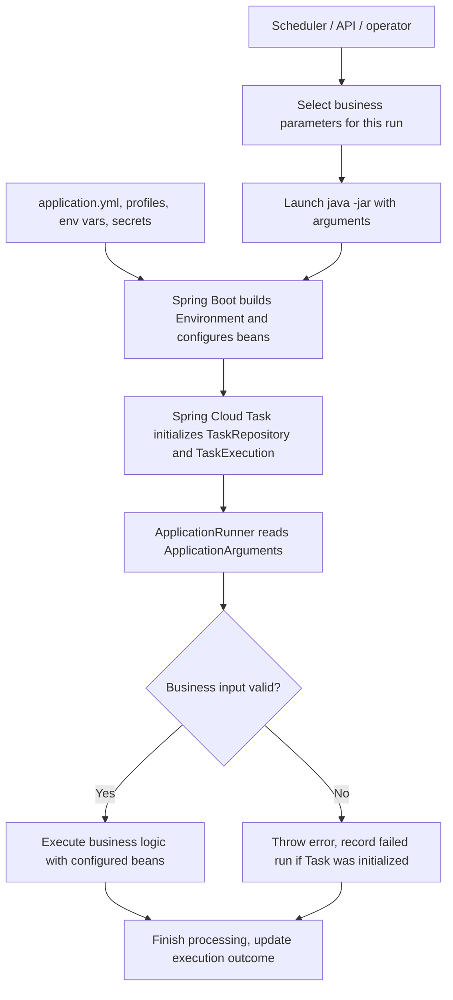
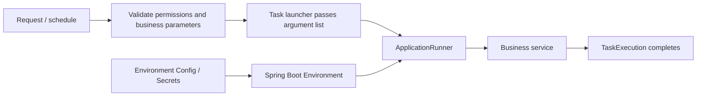

# Distinguishing Business Parameters from Spring Boot Configuration Properties

## Objectives and Context

**Spring Cloud Task** applications are designed for finite-duration jobs: receive a request, process work, update the execution result in `TaskRepository`, and terminate. A transaction reconciliation task, for example, may be invoked every night with a different **reconciliation date** while keeping the same database connection settings, retry policy, and batch chunk size.

When designing this flow, two questions must be separated:

- **What data should the task process in this run?** These are **business parameters**, typically provided by the caller and validated in application logic.
- **How should the application start up and operate?** These are **configuration properties**, used by Spring Boot and Spring Cloud to create beans, select environments, connect to services, and control infrastructure.

After this lesson, you will know how to design inputs for a Spring Cloud Task, use `ApplicationArguments` and `@ConfigurationProperties` in their proper roles, understand the impact of configuration precedence, handle input errors, and avoid exposing sensitive information in execution history.

## 1. Classify by Meaning, Not Syntax

| Criterion | Business Parameters | Spring Boot / Spring Cloud Configuration Properties |
| --- | --- | --- |
| Question answered | *What does this run do, and on which data?* | *Where does the application run, and with which settings?* |
| Examples | `business-date`, `tenant-id`, `dry-run`, `reconcile-id` | `spring.datasource.url`, `spring.profiles.active`, `spring.cloud.task.initialize-enabled`, `task.worker.chunk-size` |
| Who decides? | Scheduler, authorized user, trigger API, or orchestrator | Operations team, deployment config, infrastructure administrators |
| Change frequency | Can change on **every execution** | Usually stays stable for a given environment/deployment version |
| Common reading mechanism | `ApplicationArguments` in `ApplicationRunner`; validated input DTO | `@ConfigurationProperties`, `Environment`, occasionally `@Value` |
| What needs validation? | Proper format, date range, tenant authorization, duplicates/idempotency | Valid values, connectivity, schema, timeouts, resource permissions |
| Role in observability | Explains **why and what was processed** in that run | Helps reproduce the **environment and runtime setup** of that run |

Example with a `statement-close-task` task:

```text
java -jar statement-close-task.jar \
  --business-date=2026-11-23 \
  --tenant-id=shop-42 \
  --dry-run \
  --spring.profiles.active=prod
```

Here, `business-date`, `tenant-id`, and `dry-run` express the **business request for this run**; `spring.profiles.active=prod` selects the **application configuration profile**. Names prefixed with `spring.*` usually indicate framework properties; custom application properties should live in their own namespace, such as `task.worker.chunk-size`.

> **Common pitfall:** The two groups are not strictly separated by the `--` prefix. By default, **every `--name=value` command-line option** is added by Spring Boot to `Environment`, regardless of whether the name is `business-date` or `spring.datasource.url`. Therefore, separation relies primarily on **input contract design and handler code**. Do not treat `--` as a guaranteed indicator of a business parameter.

## 2. Processing Flow in a Spring Cloud Task Application



The steps are fundamentally distinct:

1. **Before running:** the trigger system selects the processing date, tenant ID, and simulation mode. Infrastructure configuration is supplied via files, profiles, environment variables, or a secret manager.
2. **During startup:** Spring Boot merges configuration sources and binds them into beans. Spring Cloud Task begins tracking `TaskExecution` via `TaskRepository` if the application successfully initializes the required infrastructure.
3. **During execution:** `ApplicationRunner` reads business parameters, validates them, and calls the service. Beans such as `DataSource`, transaction managers, or processing policies have already been configured by Spring Boot.
4. **Upon completion:** Spring Cloud Task updates execution metadata. Errors while `ApplicationRunner` runs can be recorded in `TaskExecution`; **errors occurring too early for `ApplicationContext` to initialize may leave no Task record**. The orchestrator must still monitor logs and the process exit code.

This is the key distinction between **a single run's history** and **environment configuration**: rerunning the same date with a new timeout configuration is still the same business request, even though the runtime environment has changed.

## 3. Reading Business Parameters with `ApplicationArguments`

Spring Boot passes `ApplicationArguments` into `ApplicationRunner.run(...)`. This API distinguishes:

- **Option arguments:** `--business-date=2026-11-23`, `--dry-run`; retrieve names with `getOptionNames()`, check presence via `containsOption(...)`, and retrieve values with `getOptionValues(...)`.
- **Non-option arguments:** strings not starting with `--`, such as `import`; retrieved via `getNonOptionArgs()`.
- **Full original arguments:** `getSourceArgs()`. Avoid printing this entire array to logs because it may contain sensitive information.

The return value of `getOptionValues("business-date")` must be handled deliberately:

| Passed Argument | Result | What to Do? |
| --- | --- | --- |
| No `--business-date` | `null` | Report missing required parameter |
| `--business-date` (no `=`) | Empty list `[]` | Report missing value |
| `--business-date=2026-11-23` | `['2026-11-23']` | Parse and validate the date |
| `--business-date=2026-11-23 --business-date=2026-11-24` | Two-element list | Reject if business rules allow only one date |

### Example of Strict Input Handling

The sample application below performs a statement-closing task. It requires `spring-cloud-starter-task`, an appropriate JDBC driver, and compatible Spring Boot/Spring Cloud versions in the build configuration. The code focuses on reading inputs and showing the boundary between parameter types; actual business transaction persistence is replaced by messages for visibility.

Place at `src/main/java/com/example/task/StatementCloseTaskApplication.java`:

```java
package com.example.task;

import java.time.LocalDate;
import java.time.format.DateTimeParseException;
import java.util.List;

import org.springframework.boot.ApplicationArguments;
import org.springframework.boot.ApplicationRunner;
import org.springframework.boot.SpringApplication;
import org.springframework.boot.autoconfigure.SpringBootApplication;
import org.springframework.boot.context.properties.ConfigurationProperties;
import org.springframework.boot.context.properties.EnableConfigurationProperties;
import org.springframework.context.annotation.Bean;

@SpringBootApplication
@EnableConfigurationProperties(StatementCloseTaskApplication.WorkerSettings.class)
public class StatementCloseTaskApplication {

    public static void main(String[] args) {
        SpringApplication.run(StatementCloseTaskApplication.class, args);
    }

    // Operational configuration: bound from application.yml, env, or other configuration sources.
    @ConfigurationProperties(prefix = "task.worker")
    public record WorkerSettings(int chunkSize) {
        public WorkerSettings {
            if (chunkSize <= 0) {
                throw new IllegalArgumentException("task.worker.chunk-size must be > 0");
            }
        }
    }

    @Bean
    ApplicationRunner closeStatements(WorkerSettings settings) {
        return args -> {
            // Business input: varies per Task invocation.
            LocalDate businessDate = requiredDate(args);
            String tenantId = requiredSingleValue(args, "tenant-id");
            boolean dryRun = flagPresent(args, "dry-run");

            if (!args.getNonOptionArgs().isEmpty()) {
                throw new IllegalArgumentException("Unnamed arguments are not supported");
            }

            // Real implementation must verify that tenantId belongs to an allowed scope.
            System.out.printf("tenant=%s date=%s dryRun=%s chunkSize=%d%n",
                    tenantId, businessDate, dryRun, settings.chunkSize());

            if (dryRun) {
                System.out.println("Simulation only, no business results persisted");
            } else {
                System.out.println("Invoke statement-closing service with transactions/idempotency here");
            }
        };
    }

    private static LocalDate requiredDate(ApplicationArguments args) {
        String value = requiredSingleValue(args, "business-date");
        try {
            return LocalDate.parse(value); // ISO-8601: YYYY-MM-DD
        } catch (DateTimeParseException ex) {
            throw new IllegalArgumentException(
                    "--business-date must follow YYYY-MM-DD format", ex);
        }
    }

    private static String requiredSingleValue(ApplicationArguments args, String name) {
        List<String> values = args.getOptionValues(name);
        if (values == null || values.size() != 1 || values.get(0).isBlank()) {
            throw new IllegalArgumentException(
                    "Exactly one value is required for --" + name + "=<value>");
        }
        return values.get(0);
    }

    private static boolean flagPresent(ApplicationArguments args, String name) {
        if (!args.containsOption(name)) {
            return false;
        }
        // Convention: --dry-run is a flag that takes no value.
        if (!args.getOptionValues(name).isEmpty()) {
            throw new IllegalArgumentException("--" + name + " does not accept a value");
        }
        return true;
    }
}
```

Three design choices in this example are intentional:

1. `business-date` and `tenant-id` are parsed/validated **in `ApplicationRunner`**, which understands the request for each run. Missing, duplicate, or malformed values produce traceable errors.
2. `dry-run` is a **presence flag**; `--dry-run` means enabled, and omitting it means `false`. The example rejects `--dry-run=false` to prevent misinterpretation. If you need a two-valued CLI boolean, define the contract explicitly and parse `true/false`.
3. `chunkSize` comes from `WorkerSettings` bound by `@ConfigurationProperties`. You should not manually read `chunk-size` from `ApplicationArguments` because it is an **operational policy**, not a target date or business entity.

**Example scope:** the code does not yet perform tenant authorization checks, date bounds validation, idempotency, or business database queries. In a production product, those checks belong in the service/validation layer and must run before modifying data.

## 4. Reading Configuration Properties via Spring Boot

Place `src/main/resources/application.yml`:

```yaml
spring:
  application:
    name: statement-close-task
  main:
    web-application-type: none
  datasource:
    url: jdbc:h2:mem:task_demo;DB_CLOSE_DELAY=-1
    username: sa
    password: ""
  cloud:
    task:
      initialize-enabled: true  # Illustrative only for an in-memory test database
      closecontext-enabled: true

task:
  worker:
    chunk-size: 500
```

Suppose you run the built JAR:

```bash
java -jar target/statement-close-task.jar \
  --business-date=2026-11-23 \
  --tenant-id=shop-42 \
  --dry-run
```

Expected logical outcome: `businessDate=2026-11-23`, `tenantId=shop-42`, `dryRun=true`, `settings.chunkSize()=500`. Because the example uses in-memory H2, `TaskExecution` records exist only for the JVM's lifetime; to retain history across runs, use a persistent database and configure the appropriate Task schema. In production, manage schema via migrations and set `spring.cloud.task.initialize-enabled=false` once you create the required tables explicitly.

You can temporarily override the processing policy using **command-line configuration properties**:

```bash
java -jar target/statement-close-task.jar \
  --business-date=2026-11-23 \
  --tenant-id=shop-42 \
  --task.worker.chunk-size=1000
```

In this case `settings.chunkSize()` equals `1000`, even though `application.yml` specifies `500`: the option `--task.worker.chunk-size=1000` is added to `Environment` by Boot and takes higher precedence than standard file configuration. **Its classification remains configuration**, because it alters how processing works rather than selecting business data. However, organizations should restrict callers or schedulers from arbitrarily overriding sensitive operational properties.

### Comparing Three Ways to Access Configuration

| API | Example | When to Use |
| --- | --- | --- |
| `@ConfigurationProperties` | Bind `task.worker.chunk-size` to `WorkerSettings.chunkSize` | Structured group of properties needing strong typing and validation |
| `@Value` | `@Value("${task.worker.chunk-size:500}") int chunkSize` | A small, standalone property; no need for a full configuration object |
| `Environment` | `env.getProperty("task.worker.chunk-size", Integer.class)` | Dynamic property lookup or infrastructure components reading properties |

With Spring Cloud Task, keys such as `spring.application.name`, `spring.datasource.*`, `spring.cloud.task.initialize-enabled`, and `spring.cloud.task.closecontext-enabled` are **framework configuration**. They affect task naming, the repository, database connectivity, and closing `ApplicationContext`; do not use them as business parameter names.

## 5. Configuration Source Precedence and Common Traps

Spring Boot supports `application.yml`, profile-specific files like `application-prod.yml`, environment variables, Java system properties, command-line options, and other sources. In typical scenarios, you can remember the precedence order as follows (sources on the right can override sources on the left):

```text
application.yml inside JAR
    -> active application-prod.yml / external configuration file outside JAR
    -> OS environment variables
    -> Java system properties (-D...)
    -> command-line options (--...)
```

This is a **simplified model** for common sources; exact ordering also depends on file location, profiles, `spring.config.import`, test properties, and other `PropertySource` types. When diagnosing a specific resolved value, inspect the actual configuration sources rather than treating this simplified model as an exceptionless rule.

Example of three ways to override `task.worker.chunk-size`:

```yaml
# application.yml
task:
  worker:
    chunk-size: 500
```

```bash
# Linux/macOS: environment variable, using Spring Boot's relaxed binding rules.
export TASK_WORKER_CHUNKSIZE=800
java -jar target/statement-close-task.jar \
  --business-date=2026-11-23 --tenant-id=shop-42

# Command-line option takes higher precedence than standard environment variables:
java -jar target/statement-close-task.jar \
  --business-date=2026-11-23 --tenant-id=shop-42 \
  --task.worker.chunk-size=1000
```

In these runs, `settings.chunkSize()` evaluates to `800` and `1000`, respectively. Under Spring Boot's rules, the canonical environment variable name is **`TASK_WORKER_CHUNKSIZE`**: replace dots with `_`, **remove hyphens**, and convert to uppercase. Do not assume `TASK_WORKER_CHUNK_SIZE` will always bind to the same property.

### `--key=value` and `-Dkey=value` Are Different

```bash
# --spring.profiles.active=prod is an application argument:
java -jar target/statement-close-task.jar \
  --spring.profiles.active=prod \
  --business-date=2026-11-23 --tenant-id=shop-42

# -Dspring.profiles.active=prod is a Java system property,
# and must appear BEFORE -jar:
java -Dspring.profiles.active=prod -jar target/statement-close-task.jar \
  --business-date=2026-11-23 --tenant-id=shop-42
```

`ApplicationArguments` sees arguments placed **after the JAR name**, including `--...` options; `-D...` before `-jar` is handled separately by the JVM and is not an `ApplicationArguments` option. When running in Kubernetes, secrets and infrastructure configuration are typically mounted via volumes, platform-managed environment variables, or a secret manager rather than appended to the command argument list.

### Can Command-Line Options Be Excluded from `Environment`?

Yes. Spring Boot allows calling `SpringApplication.setAddCommandLineProperties(false)`:

```java
public static void main(String[] args) {
    SpringApplication app = new SpringApplication(StatementCloseTaskApplication.class);
    app.setAddCommandLineProperties(false);
    app.run(args);
}
```

This choice still lets `ApplicationRunner` receive `ApplicationArguments`, but **does not** automatically add `--...` options to `Environment`. Consequently, `--task.worker.chunk-size=1000` and `--spring.profiles.active=prod` also **stop working as command-line configuration sources**. Enable this only when you intentionally block CLI configuration overrides and have moved all infrastructure properties to other supported sources. The `main` method above is an **alternative**, not to be placed alongside the default `main` from the earlier example.

## 6. What Argument Information Does TaskRepository Store?

In Spring Cloud Task, `TaskExecution` stores data such as execution ID, task name, start/end timestamps, exit code, and **the original list of command-line argument strings**. The Task database typically includes `TASK_EXECUTION` and `TASK_EXECUTION_PARAMS` tables for historical queries. This data serves operational tracking and is **not an authoritative record of all resolved configuration** from profiles, environments, or secret managers.

Suppose two invocations occur:

```text
Run A: --business-date=2026-11-23 --tenant-id=shop-42 --dry-run
Run B: --business-date=2026-11-23 --tenant-id=shop-42
```

Operations can use the argument list to distinguish a simulation run from a live run. You should add a **business execution key** or separate idempotency mechanism if the requirement forbids processing the same tenant/date twice; `TaskExecution` IDs only identify each JVM invocation and **do not prevent duplicate business processing**.

**Security note:** both business parameters and configuration values passed via CLI risk appearing in process listings, logs, orchestrators, and TaskRepository parameter tables. Never pass `--password=...`, `--api-token=...`, `--spring.datasource.password=...`, or sensitive personal data this way. Use platform secret mechanisms for confidential values and avoid logging them. If incident-investigation details must be recorded, prefer safe reference IDs with access controls and retention policies.

## 7. Design Mistakes and How to Fix Them

| Mistake | Consequence | Proper Design |
| --- | --- | --- |
| Using `@Value("${business-date}")` as input for the whole flow | Turns per-run requests into bean configuration; hard to detect duplicates, omissions, or bad formats | Parse via `ApplicationArguments`, wrap in a `BusinessRequest` DTO, validate before calling service |
| Letting users set `spring.datasource.*` through the task trigger API | Risk of redirecting DB connections or hitting the wrong environment | API accepts only an allowlist of business parameters; deployment supplies config and secrets separately |
| Reading `--dry-run=false` with `containsOption("dry-run")` | Still evaluates to `true` even though caller intended off | Define a presence-only flag, or parse an explicit valued boolean and validate |
| Using env var `BUSINESS_DATE` for per-run requests without recording inputs | Hard to reproduce runs; stale values may be reused unintentionally | Pass parameters per invocation; record sanitized metadata with access control |
| Appending passwords to `--spring.datasource.password` | Can leak in Task metadata and command history | Inject secrets from infrastructure; restrict logs and repository query access |
| Assuming every failure produces a `TaskExecution` record | Very early startup failures may never reach TaskRepository | Also monitor exit codes, stdout/stderr, and scheduler/container status |
| Equating Task arguments with Spring Batch `JobParameters` | Breaks job instance identification and restart logic | Build an explicit mapping; verify types, values, and restartability per Batch rules |

### When Tasks Run on a Schedule or On Demand

For a daily schedule, the scheduler should compute the business date in the agreed timezone, validate date logic, and pass a concrete argument such as `--business-date=2026-11-23`. For a manual trigger API, the server receives the request, verifies tenant permissions and parameters, and launches the task via the process/deployer **argument array**. Avoid concatenating shell command strings from user input.

Separating control flows:



When integrating with **Spring Batch**, a Cloud Task application can wrap a `Job`. However, `TaskExecution` and `JobExecution` are separate concepts; `JobParameters` govern job instance identity and restartability. Even though auto-launch mechanisms may convert certain arguments into `JobParameters` depending on Boot version/configuration, never assume every Task option is a Batch Job identifying parameter. Define the mapping explicitly and test failed-job restart scenarios.

## 8. Self-Check with Four Scenarios

Assume the active configuration has `task.worker.chunk-size: 500` and the `ApplicationRunner` example above.

**Scenario 1 — Valid:**

```bash
java -jar target/statement-close-task.jar \
  --business-date=2026-11-23 --tenant-id=shop-42 --dry-run
```

Expected: parses ISO date, tenant, `dryRun=true`, chunk size `500`; simulation branch performs no business writes.

**Scenario 2 — Missing data:**

```bash
java -jar target/statement-close-task.jar --tenant-id=shop-42
```

Expected: `requiredSingleValue` detects missing `business-date` and throws `IllegalArgumentException`; the caller system must recognize the failure via process status and logs. If Task infrastructure initialized, the failure may appear in Task history.

**Scenario 3 — Duplicate parameter:**

```bash
java -jar target/statement-close-task.jar \
  --business-date=2026-11-23 --business-date=2026-11-24 \
  --tenant-id=shop-42
```

Expected: the list has two values, so the application rejects it. Do not arbitrarily pick the first or last date when the contract requires exactly one value.

**Scenario 4 — Overridden configuration:**

```bash
java -jar target/statement-close-task.jar \
  --business-date=2026-11-23 --tenant-id=shop-42 \
  --task.worker.chunk-size=1000
```

Expected: business request stays unchanged while `chunkSize=1000`. This demonstrates that the boundary lies in **property meaning and ownership**, not in whether both use `--...` syntax.

## 9. Production Design Checklist

- [ ] Document the input contract: names, data types, required/optional status, defaults, date/time rules, tenant, valid ranges.
- [ ] Dedicate `ApplicationArguments`/DTOs to per-run requests; validate duplicates, missing values, invalid boolean flags, and authorization before touching data.
- [ ] Dedicate `@ConfigurationProperties` and Spring Boot configuration sources to connections, retries, chunk sizes, TaskRepository, profiles, and logging.
- [ ] Enforce an allowlist on trigger APIs/schedulers so callers cannot accidentally inject `spring.*`, `management.*`, or unintended settings.
- [ ] Never pass passwords/tokens/PII in command-line arguments or logs; restrict access to Task metadata.
- [ ] Store TaskRepository in a persistent database with schema migrations; also monitor process exit codes for early startup failures.
- [ ] Implement idempotency for combinations like `tenant-id` + `business-date` so retries do not create duplicate side effects.
- [ ] If using Spring Batch, separate Task arguments from `JobParameters` and test restarts with accurately identified job instances.

## Review Questions

1. Why can `--business-date=2026-11-23` still appear in Spring's `Environment` even though it is designed as a business parameter?
2. What happens if someone passes `--dry-run=false` when the application only checks `containsOption("dry-run")`?
3. If `application.yml` sets `task.worker.chunk-size=500`, an environment variable sets `800`, and the CLI sets `1000`, which value is typically bound into `@ConfigurationProperties`?
4. Why should JDBC passwords not be passed via `--spring.datasource.password` in a Spring Cloud Task application?
5. When `ApplicationContext` fails before TaskRepository is ready, what information does the orchestrator rely on to detect the failure?

**Short answers:** (1) Spring Boot adds `--...` options to `Environment` by default; (2) `containsOption` still returns `true`; (3) `1000`, assuming no higher-precedence source is active in that context; (4) arguments may be persisted in Task metadata or exposed via process listings/logs; (5) logs, container status, and the process exit code.

## References

- [Spring Boot — Externalized Configuration](https://docs.spring.io/spring-boot/reference/features/external-config.html): configuration sources, precedence, `@ConfigurationProperties`, handling of command-line options and environment variables.
- [Spring Boot — ApplicationArguments API](https://docs.spring.io/spring-boot/3.5/api/java/org/springframework/boot/ApplicationArguments.html): `containsOption`, `getOptionValues`, `getNonOptionArgs`, `getSourceArgs`.
- [Spring Cloud Task — Features](https://docs.spring.io/spring-cloud-task/reference/features.html): task lifecycle, `TaskExecution`, exit codes, `DataSource`, and configuration.
- [Spring Cloud Task — Reference](https://docs.spring.io/spring-cloud-task/reference/): integration guides for Spring Boot, TaskRepository, and Spring Batch.

**Key rule to remember:** *business parameters describe the run; configuration properties describe the environment and runtime policy*. Both may appear on the command line, so the application must enforce an explicit contract, validate inputs, and protect Task metadata.
