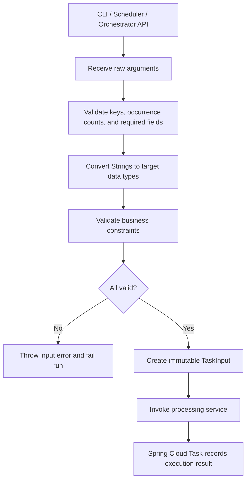

# Validating and Converting Input Parameters in Spring Cloud Task

## 1. Why Validate Parameters Before Execution?

**Spring Cloud Task** is used to build finite-duration Spring Boot applications: the application starts up, performs a job, and exits. `TaskRepository` records execution details such as start/end timestamps, exit code, and command-line arguments in `TaskExecution`. A Task may be triggered directly, on a schedule, or by an orchestrator; the same program often has to process many different parameter sets.

For example, a report-aggregation task might receive the target processing date, customer ID, run mode, and record limit:

```bash
java -jar report-task.jar \
  --task.run-date=2026-11-24 \
  --task.tenant=tenant_01 \
  --task.mode=DELTA \
  --task.max-items=500 \
  --task.dry-run=false
```

If `run-date` has the wrong format, `max-items` is negative, or `tenant` is invalid, catching the error **after data has already been written** can leave partial results, make reruns hard to control, or write to the wrong customer's data. Therefore, a sound design converts raw inputs into strongly typed objects and completes validation **before invoking business logic**.

After this lesson, you will know how to:

- Receive parameters with `ApplicationRunner` / `ApplicationArguments` and distinguish them from `Environment` configuration.
- Convert `String` values into `LocalDate`, `enum`, integers, and booleans according to explicit rules.
- Validate required fields, default values, valid ranges, duplicate parameters, or unsupported options.
- Report errors consistently so the scheduler or orchestrator can decide whether to retry.
- Avoid leaking secrets when arguments may be persisted in `TaskRepository`.

## 2. Designing an Input Contract

Before writing a parser, define an **input contract**. The following example uses the `task.` prefix to separate business parameters from Spring Boot configuration properties such as `spring.profiles.active`.

| Parameter | Required | Converted Type | Rule |
| --- | --- | --- | --- |
| `--task.run-date=YYYY-MM-DD` | Yes | `LocalDate` | ISO date, e.g. `2026-11-24`; rejects `24/11/2026` or nonexistent dates |
| `--task.tenant=tenant_01` | Yes | `String` | 2–32 characters; leading lowercase ASCII letter, followed by lowercase letters, digits, `_`, or `-` |
| `--task.mode=DELTA` | No | `Mode` (`FULL` or `DELTA`) | Default `DELTA`; case-insensitive input |
| `--task.max-items=500` | No | `int` | Integer in range 1–10,000; default `1000` |
| `--task.dry-run=false` | No | `boolean` | Accepts only `true` or `false`; default `false` |

In this contract, **every parameter uses the `--key=value` form**. If `--task.dry-run` is passed without a value, the parser raises an error instead of implicitly treating it as `true`. This is a design choice for the example, not a general limitation of Spring Boot.

The contract should also define behavior when data is invalid: the task must stop before calling business services, identify the offending field safely, and return a non-zero exit code. Do not auto-correct dates or truncate tenant IDs just to keep running.

### Recommended Processing Flow



There are three distinct validation layers:

1. **Syntax:** Is a parameter missing, passed without a value, or repeated?
2. **Data type:** Can the string be parsed into a date, integer, boolean, or enum?
3. **Business rules:** Is the record limit safe, is the tenant authorized for processing, and does the report date fall within supported data bounds?

Syntax and type validation happen locally. Constraints that depend on a database or tenant authorization should be checked right at the service boundary, before producing external side effects.

## 3. How Does `ApplicationArguments` Receive Arguments?

Spring Boot provides `ApplicationRunner` to run logic after application initialization. Its `run(ApplicationArguments args)` method receives the arguments passed at launch. Compared to `CommandLineRunner` (which receives `String... args`), `ApplicationArguments` provides built-in APIs separating options from free-form arguments:

| Method | Meaning |
| --- | --- |
| `getOptionNames()` | Set of option names, e.g., `task.run-date`, `task.tenant` |
| `containsOption("task.dry-run")` | Whether that option was passed |
| `getOptionValues("task.max-items")` | List of values for a given option |
| `getNonOptionArgs()` | List of arguments not starting with option syntax |
| `getSourceArgs()` | Raw original argument array; log with caution as it may contain sensitive data |

The easiest point to get wrong is the return value of `getOptionValues(name)`:

| Input | Result |
| --- | --- |
| Missing `--task.mode` | `null` |
| `--task.mode` | Empty list `[]` |
| `--task.mode=DELTA` | Single-element list `["DELTA"]` |
| `--task.mode=FULL --task.mode=DELTA` | List `["FULL", "DELTA"]` |

Do not take the first element and ignore the rest. Repeated parameters can cause the orchestrator and the application to interpret the run differently. In this lesson, the parser requires **exactly one value** whenever an option is present.

## 4. Java Example: Parse, Convert, and Validate Once

Assume the project already has `spring-cloud-starter-task` and an appropriate database for `TaskRepository`. The code below is an illustrative application targeting Java 17 or later. `ApplicationRunner` only hands off validated data; where a message is printed is where you substitute the actual report service call.

```java
package com.example.report;

import java.time.LocalDate;
import java.time.format.DateTimeFormatter;
import java.time.format.DateTimeParseException;
import java.util.List;
import java.util.Locale;
import java.util.Set;
import java.util.regex.Pattern;

import org.springframework.boot.ApplicationArguments;
import org.springframework.boot.ApplicationRunner;
import org.springframework.boot.ExitCodeExceptionMapper;
import org.springframework.boot.SpringApplication;
import org.springframework.boot.autoconfigure.SpringBootApplication;
import org.springframework.cloud.task.configuration.EnableTask;
import org.springframework.context.annotation.Bean;

@SpringBootApplication
@EnableTask
public class ReportTaskApplication {

    private static final Set<String> ALLOWED = Set.of(
        "task.run-date",
        "task.tenant",
        "task.mode",
        "task.max-items",
        "task.dry-run"
    );
    private static final Pattern TENANT =
        Pattern.compile("[a-z][a-z0-9_-]{1,31}");

    public static void main(String[] args) {
        SpringApplication.run(ReportTaskApplication.class, args);
    }

    @Bean
    ApplicationRunner reportRunner() {
        return arguments -> {
            TaskInput input = parse(arguments);

            if (input.dryRun()) {
                System.out.println("Dry run: configuration validated.");
                return;
            }

            // In a real application: reportService.generate(input);
            System.out.printf(
                "Processing tenant=%s, date=%s, mode=%s, maxItems=%d%n",
                input.tenant(),
                input.runDate(),
                input.mode(),
                input.maxItems()
            );
        };
    }

    static TaskInput parse(ApplicationArguments args) {
        if (!args.getNonOptionArgs().isEmpty()) {
            throw invalid("Unnamed arguments are not supported");
        }
        for (String name : args.getOptionNames()) {
            if (name.startsWith("task.") && !ALLOWED.contains(name)) {
                throw invalid("Unsupported parameter: " + name);
            }
        }

        String runDateText = option(args, "task.run-date", true, null);
        LocalDate runDate;
        try {
            runDate = LocalDate.parse(
                runDateText, DateTimeFormatter.ISO_LOCAL_DATE
            );
        } catch (DateTimeParseException ex) {
            throw invalid("task.run-date must follow YYYY-MM-DD format");
        }

        String tenant = option(args, "task.tenant", true, null);
        if (!TENANT.matcher(tenant).matches()) {
            throw invalid("task.tenant has an invalid format");
        }

        String modeText = option(args, "task.mode", false, "DELTA");
        Mode mode;
        try {
            mode = Mode.valueOf(modeText.toUpperCase(Locale.ROOT));
        } catch (IllegalArgumentException ex) {
            throw invalid("task.mode only accepts FULL or DELTA");
        }

        String maxText = option(args, "task.max-items", false, "1000");
        int maxItems;
        try {
            maxItems = Integer.parseInt(maxText);
        } catch (NumberFormatException ex) {
            throw invalid("task.max-items must be an integer");
        }
        if (maxItems < 1 || maxItems > 10_000) {
            throw invalid("task.max-items must be between 1 and 10000");
        }

        String dryRunText = option(args, "task.dry-run", false, "false")
            .toLowerCase(Locale.ROOT);
        if (!dryRunText.equals("true") && !dryRunText.equals("false")) {
            throw invalid("task.dry-run only accepts true or false");
        }

        return new TaskInput(
            runDate,
            tenant,
            mode,
            maxItems,
            Boolean.parseBoolean(dryRunText)
        );
    }

    private static String option(
        ApplicationArguments args,
        String name,
        boolean required,
        String defaultValue
    ) {
        List<String> values = args.getOptionValues(name);
        if (values == null) {
            if (required) {
                throw invalid("Missing required parameter: " + name);
            }
            return defaultValue;
        }
        if (values.size() != 1
            || values.get(0) == null
            || values.get(0).trim().isEmpty()) {
            throw invalid(name + " must appear exactly once and have a value");
        }
        return values.get(0).trim();
    }

    private static InvalidTaskInputException invalid(String message) {
        return new InvalidTaskInputException(message);
    }

    @Bean
    ExitCodeExceptionMapper exitCodeExceptionMapper() {
        return error -> {
            for (Throwable cause = error;
                 cause != null;
                 cause = cause.getCause()) {
                if (cause instanceof InvalidTaskInputException) {
                    return 2; // Input contract violation
                }
            }
            return 1; // Other error
        };
    }

    enum Mode {
        FULL, DELTA
    }

    record TaskInput(
        LocalDate runDate,
        String tenant,
        Mode mode,
        int maxItems,
        boolean dryRun
    ) {}

    static class InvalidTaskInputException
            extends IllegalArgumentException {
        InvalidTaskInputException(String message) {
            super(message);
        }
    }
}
```

### Explaining the Decisions in the Example

- **Only validate names starting with `task.`:** the application can still accept Spring Boot options such as `--spring.profiles.active=prod`. If you want to block all unknown options, design a whitelist that also includes allowed operational options.
- **Do not call `Boolean.parseBoolean(...)` immediately:** Java returns `false` for any string other than `"true"`, including `"yes"` or `"tru"`. The parser checks the exact `true/false` set before converting.
- **Duplicate check:** `getOptionValues` returns a list; passing two `--task.tenant` options is rejected rather than silently picking one value.
- **Immutable type:** `record TaskInput` ensures the business layer receives normalized data without re-parsing strings.
- **Exit codes:** `ExitCodeExceptionMapper` maps input contract errors to code `2`, and other errors to `1`. Code `2` is a convention chosen by the sample application, not a built-in Spring Cloud Task default reserved for invalid arguments.
- **Scope of illustration:** the example does not execute SQL statements or send reports; `dry-run` only validates and simulates. In a real system, ensure downstream services are called after the `parse` step.

Try running:

```bash
# Valid: uses defaults mode=DELTA, max-items=1000, dry-run=false
java -jar report-task.jar \
  --task.run-date=2026-11-24 \
  --task.tenant=tenant_01

# Valid: validates and simulates only, no business processing
java -jar report-task.jar \
  --task.run-date=2026-11-24 \
  --task.tenant=tenant_01 \
  --task.dry-run=true

# Invalid: nonexistent date
java -jar report-task.jar \
  --task.run-date=2026-02-30 \
  --task.tenant=tenant_01

# Invalid: max-items exceeds upper bound
java -jar report-task.jar \
  --task.run-date=2026-11-24 \
  --task.tenant=tenant_01 \
  --task.max-items=50000
```

## 5. When Inputs Come from Environment Variables or Configuration Files

`ApplicationArguments` reflects **runtime command-line arguments**. If a scheduler or deployment platform passes parameters via **environment variables**, they do not automatically appear in `getOptionValues`. When you want to share values across `application.yml`, environment variables, and the CLI, Spring Boot supports `@ConfigurationProperties` with *relaxed binding*, type conversion, and Bean Validation.

Configuration example as an **alternative to manual parsing**, using a record:

```java
package com.example.report;

import java.time.LocalDate;

import jakarta.validation.constraints.Max;
import jakarta.validation.constraints.Min;
import jakarta.validation.constraints.NotBlank;
import jakarta.validation.constraints.NotNull;
import jakarta.validation.constraints.Pattern;
import org.springframework.boot.context.properties.ConfigurationProperties;
import org.springframework.boot.context.properties.bind.DefaultValue;
import org.springframework.validation.annotation.Validated;

@Validated
@ConfigurationProperties(prefix = "task")
public record TaskProperties(
    @NotNull LocalDate runDate,
    @NotBlank
    @Pattern(regexp = "[a-z][a-z0-9_-]{1,31}")
    String tenant,
    @DefaultValue("DELTA") Mode mode,
    @Min(1) @Max(10000)
    @DefaultValue("1000") int maxItems,
    @DefaultValue("false") boolean dryRun
) {
    public enum Mode { FULL, DELTA }
}
```

To use this style, the application needs a Bean Validation dependency (usually `spring-boot-starter-validation`), along with `@ConfigurationPropertiesScan` on the `@SpringBootApplication` class or `@EnableConfigurationProperties(TaskProperties.class)`. You can then inject `TaskProperties` into `ApplicationRunner` or business services. When using this approach, do not run the manual `ApplicationArguments` parser from section 4 in parallel; choose a single authoritative input source.

Example `application.yml`:

```yaml
spring:
  main:
    web-application-type: none

task:
  mode: DELTA
  max-items: 1000
  dry-run: false
```

You can supply `--task.run-date=2026-11-24 --task.tenant=tenant_01` when launching the program, or pass environment variables `TASK_RUNDATE=2026-11-24` and `TASK_TENANT=tenant_01`. Spring Boot's environment variable naming rule: replace dots with `_`, remove hyphens `-`, and uppercase; thus `task.run-date` maps to **`TASK_RUNDATE`**, not `TASK_RUN_DATE`. Configuration values passed via CLI have higher precedence than values in `application.yml` under Spring Boot's default configuration order.

**When to use which?** `ApplicationArguments` fits best when the contract only accepts explicit per-run CLI arguments, needs duplicate detection, or must distinguish an absent option from an option without a value. `@ConfigurationProperties` fits best when the same parameter can come from multiple sources, needs environment-specific configuration, and benefits from automatic binding and validation. With either approach, business conditions involving access rights, supported date ranges, or data state must still be validated by the service.

## 6. Validating Business Constraints After Parsing

Valid syntax does not mean execution is permitted. For instance, `tenant_01` may match the regex yet not exist or not be allowed to run in production. An ISO date may be valid yet fall outside the data window to aggregate.

Suppose the reporting service only allows processing data up to yesterday in the business timezone. That constraint should use a `Clock` with an explicit timezone:

```java
LocalDate today = LocalDate.now(
    clock.withZone(java.time.ZoneId.of("Asia/Ho_Chi_Minh"))
);
if (!input.runDate().isBefore(today)) {
    throw new InvalidTaskInputException(
        "task.run-date must be before the current date in the business timezone"
    );
}
```

Here `clock` is injected into the service and configured for the real environment, allowing tests to use a fixed clock. The "yesterday or earlier only" rule is **just a business example**, not a default rule of Spring Cloud Task. If a system permits scheduling future runs or backfilling historical data, define the valid date range according to those requirements.

For multi-tenant tasks, verify access rights against an authenticated request source and authorized tenant data. Never rely solely on the caller-supplied `tenant` string to grant permissions. For scheduled tasks, tenant metadata can be checked against the job configuration or service account.

## 7. Input Errors, Task Status, and Rerun Strategies

Spring Cloud Task stores `TaskExecution` and the command-line arguments passed into the run. If the application initializes its context and an error later occurs in the runner, the failure can be recorded along with the exit code and error information. If `ApplicationContext` **fails to initialize**, a Task record might not be created; inspect the scheduler or runtime logs as well.

Do not catch every exception only to print an error and return normally:

```java
// Avoid: the scheduler may think the Task succeeded.
try {
    TaskInput input = parse(arguments);
    reportService.generate(input);
} catch (Exception ex) {
    System.err.println("Error: " + ex.getMessage());
    // Does not rethrow the error; flow finishes normally.
}
```

Instead, throw the appropriate exception so Spring Boot/Spring Cloud Task lifecycle handling recognizes the failure. If using `ExitCodeExceptionMapper`, keep exit code conventions consistent with the scheduler:

| Suggested Exit Code | Meaning in Example | What Should the Scheduler Do? |
| --- | --- | --- |
| `0` | Completed successfully | Record success |
| `2` | Invalid input | Do not auto-retry with the same parameters; fix the request |
| `1` | Other failure | Inspect cause; retry only if determined to be recoverable |

Do not treat every exit code `1` as transient. For instance, tenant authorization errors, incompatible database schemas, or programming bugs will not resolve themselves on retry. Conversely, brief network dropouts may warrant retries with backoff. An exit code is one signal; retry decisions also depend on error type, attempt count, data state, and idempotency.

### Idempotency and Rerun Parameters

Rerunning a Task with the same `run-date`/`tenant` normally creates **a new Task execution** in the repository; this does not guarantee that business results are written only once. For example, if a monthly report inserts a new row on every rerun, you could end up with duplicate rows.

Depending on the case, define a business key such as `(tenant, run_date, mode)`, use upserts or an appropriate lock/checkpoint mechanism, and handle transactions cleanly. With `dry-run=true`, make no business changes; a `TaskExecution` record may still be created because it was a valid Task run.

If the Task integrates with **Spring Batch**, distinguish Task-level parameters from Job-level `JobParameters`. Intentionally convert validated `TaskInput` into `JobParameters`; avoid passing all raw arguments directly to the Job because parameters like log level or `dry-run` may not belong in `JobInstance` identity. Choosing identifying parameters directly affects Spring Batch restart behavior.

## 8. Security, Observability, and Testing

### Do Not Pass Secrets via CLI Arguments

`TaskExecution` history can store the list of program launch arguments. In addition, command-line arguments can appear in shell history, process monitoring tools, or scheduler logs. Therefore:

- Pass only non-sensitive control data such as `run-date`, `max-items`, and publicly permitted business identifiers.
- Never pass passwords, access tokens, private keys, or connection strings containing passwords via `--task.*`.
- Retrieve secrets from the environment's secret management mechanism and restrict access to `TaskRepository`.
- When reporting errors, prefer displaying **the field name and violated rule**; do not print all of `getSourceArgs()` or raw user-supplied data.

A safe log entry can include `taskExecutionId` (if present), processing timestamp, permitted tenant identifier, error category, record count, and duration. Restrict logs according to data retention policies and do not treat `TaskRepository` as storage for entire input payloads.

### Key Test Cases Table

| Compact Input | Expected Outcome |
| --- | --- |
| `--task.run-date=2026-11-24 --task.tenant=tenant_01` | Valid; receives default values |
| Missing `task.run-date` | Reports missing parameter error; does not run business logic |
| `--task.run-date=2026-02-30` | Reports nonexistent date error |
| `--task.run-date=24/11/2026` | Reports non-ISO date format error |
| `--task.max-items=0` | Reports out-of-range error |
| `--task.max-items=abc` | Reports integer format error |
| `--task.dry-run=yes` | Reports boolean error instead of silently treating as `false` |
| `--task.mode=full` | Valid; normalized to `FULL` |
| `--task.mode=UNKNOWN` | Reports invalid enum error |
| Repeated `--task.tenant=tenant_01 --task.tenant=tenant_02` | Reports duplicate option error |
| `--task.dry-run` without a value | Reports error per `--key=value` contract |
| `--task.unknwon=x` | Reports unsupported parameter error (catches typos) |
| `--spring.profiles.active=dev` alongside valid `task.*` parameters | Permits Spring Boot operational options |

You should write unit tests for the parser using `new DefaultApplicationArguments(...)`, integration tests confirming `ApplicationRunner` does not invoke business logic on parse errors, and an end-to-end test backed by a repository to verify exit codes and persisted metadata. There is no need to boot a database for every string-parsing test; only lifecycle tests require the full Task infrastructure.

### Pre-Scheduling Checklist

1. Input contract documentation includes valid examples, defaults, value ranges, timezone, and duplicate-value rules.
2. The parser/binder produces typed data and rejects all invalid cases before any business side effect occurs.
3. Parameters from CLI, environment variables, or config files are used consistently; `ApplicationArguments` is not confused with `Environment`.
4. Input errors yield failure exit codes and messages clear enough to fix the request without leaking secrets.
5. Retry strategy, idempotency, and tenant authorization checks are in place.
6. Tested in a production-like environment with `TaskRepository`, the scheduler, and (if applicable) Spring Batch.

## References

- [Spring Boot — `ApplicationArguments` API](https://docs.spring.io/spring-boot/api/java/org/springframework/boot/ApplicationArguments.html): distinguishing missing, empty, and multi-valued options.
- [Spring Boot — Externalized Configuration](https://docs.spring.io/spring-boot/reference/features/external-config.html): configuration source precedence, relaxed binding, `@ConfigurationProperties`, and Bean Validation.
- [Spring Cloud Task — Reference Guide](https://docs.spring.io/spring-cloud-task/docs/current/reference/htmlsingle/): `TaskExecution`, argument persistence, exit codes, and lifecycle.
- [Spring Boot — `ExitCodeExceptionMapper` API](https://docs.spring.io/spring-boot/api/java/org/springframework/boot/ExitCodeExceptionMapper.html): rules for mapping exceptions to exit codes.
