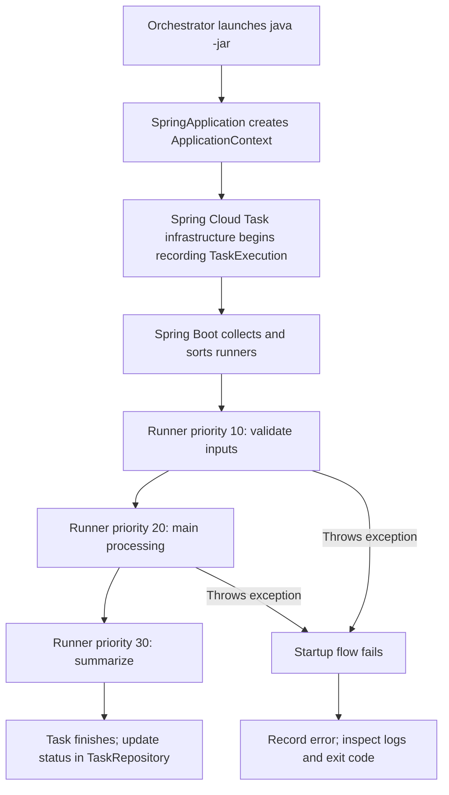
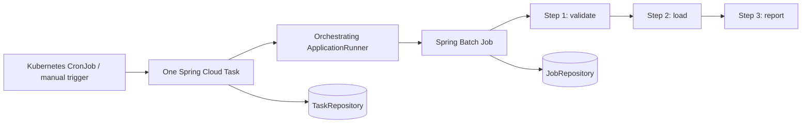

# Ordering Multiple Runners with `Ordered` and `@Order`

## Learning Objectives

After this lesson, you will be able to:

- Explain how Spring Boot invokes `ApplicationRunner` and `CommandLineRunner` beans in a Spring Cloud Task application.
- Use `@Order` and the `Ordered` interface to specify execution order among multiple runners, even across different runner interfaces.
- Understand the **lower order value runs first** rule, tie-breaking behavior when priorities match, and the limits of invocation ordering.
- Handle errors so subsequent steps do not run when a prior step fails, while tracking Task outcomes via `TaskRepository`.
- Know when to use runner ordering versus moving to an orchestrator with explicit dependencies or Spring Batch.

> **Context:** This lesson belongs to the **Processing Flow** chapter of the **SPRING_CLOUD_TASK** module. Spring Cloud Task is used for finite-duration Spring Boot applications that record each execution in a database via `TaskRepository`. When multiple startup steps use runners, explicit ordering ensures the task follows the expected workflow, reports errors accurately, and operates reliably on demand or under external schedules.

## 1. Why Order Multiple Runners?

Suppose an end-of-day process runs to reconcile transactions. The business workflow has three tasks:

1. Validate the processing date parameter and data source configuration.
2. Read the data to reconcile and execute the main job.
3. Aggregate figures and write the summary report.

We can implement these three tasks as three separate `ApplicationRunner`/`CommandLineRunner` beans. Without an explicit order, relying on class names, bean names, Java file placement, or component scan order is **unsafe**. Two dependent steps could be invoked in an unexpected order.

Spring Boot allows ordering runners using the `Ordered` and `@Order` mechanisms. Assigning a priority to each runner expresses intent: validate first, process next, summarize last.

**Important distinction:** Spring Cloud Task manages the Task lifecycle and history, whereas discovering and invoking runners is behavior of `SpringApplication` in Spring Boot. `@Order` is not a feature created exclusively by Spring Cloud Task.

## 2. How Are Both Runner Types Invoked?

| Runner Type | Primary Method | How Arguments Are Received | Typical Use Case |
| --- | --- | --- | --- |
| `ApplicationRunner` | `run(ApplicationArguments args)` | Object with parsed `--key=value` options, non-option args, and option names. | Validating parameters, selecting run modes, handling named options. |
| `CommandLineRunner` | `run(String... args)` | Raw string argument array passed to `SpringApplication`. | Executing simple logic or forwarding raw arguments to an existing library. |

Once the application finishes creating the `ApplicationContext`, Spring Boot collects beans implementing either interface, **sorts them within a single combined runner pool** by priority, and calls each `run` method sequentially. An `ApplicationRunner` may run before a `CommandLineRunner` or vice versa depending on order values; there is no rule that "all of one type run before the other."

General sequence of a Task application:



The diagram depicts the **logical** sequence. Spring Cloud Task lifecycle hooks operate through their own infrastructure; exact listener timing depends on version and configuration. Do not use `@Order` on runners to infer bean creation order or the timing of all framework lifecycle events.

## 3. `@Order`: Declaring a Fixed Priority

`@Order` is a Spring Framework annotation:

```java
import org.springframework.core.annotation.Order;
```

Place it directly on **the runner class** to assign a priority, for example:

```java
import org.springframework.boot.ApplicationArguments;
import org.springframework.boot.ApplicationRunner;
import org.springframework.core.annotation.Order;
import org.springframework.stereotype.Component;

@Component
@Order(10)
class ValidateInputRunner implements ApplicationRunner {

    @Override
    public void run(ApplicationArguments args) {
        System.out.println("1. Validate parameters");
    }
}
```

Key rules:

- **Smaller numbers mean higher priority and earlier invocation.** `@Order(10)` runs before `@Order(20)`.
- Negative values are permitted: `@Order(-100)` runs before `@Order(0)`.
- `Ordered.HIGHEST_PRECEDENCE` is the highest priority constant; `Ordered.LOWEST_PRECEDENCE` is the lowest.
- A runner without a declared priority is generally treated as having `Ordered.LOWEST_PRECEDENCE`. Therefore, explicitly assign orders to critical runners.
- When **multiple runners share the same order**, do not rely on the relative order between them for business logic. Use distinct values whenever ordering matters.

Leaving gaps like `10`, `20`, `30` lets you insert a step `15` later without renumbering everything.

## 4. `Ordered`: Defining Priority via Interface

Instead of an annotation, a runner can implement `org.springframework.core.Ordered`:

```java
import org.springframework.boot.CommandLineRunner;
import org.springframework.core.Ordered;
import org.springframework.stereotype.Component;

@Component
class ImportDataRunner implements CommandLineRunner, Ordered {

    @Override
    public int getOrder() {
        return 20;
    }

    @Override
    public void run(String... args) {
        System.out.println("2. Load and process data");
    }
}
```

`Ordered#getOrder()` returns the value Spring Boot uses when sorting runners. This is useful when you want priority baked into the class contract or computed from configuration at bean creation time. However, **do not mutate order while runners are running** expecting Spring Boot to re-sort the list: sorting happens before any runner is called.

### Quick Comparison

| Criterion | `@Order` | `Ordered` |
| --- | --- | --- |
| Declaration | Annotation, e.g., `@Order(10)` | Interface and `getOrder()` |
| Characteristic | Concise, static priority. | Priority returned by an object method. |
| When to use | Runner class with a fixed order. | Runner needing self-contained priority or priority computed from config during bean creation. |
| Used by Spring Boot | Yes. | Yes. |
| Comparison rule | Smaller number runs first. | Smaller number runs first. |

If the same object **both implements `Ordered` and carries `@Order`**, Spring's comparator generally gives precedence to `getOrder()`. Avoid declaring both with conflicting values because it creates confusion.

> **Note on `@Bean` and lambdas:** When returning an `ApplicationRunner`/`CommandLineRunner` as a lambda from a `@Bean` method, do not assume `@Order` on the **factory method** will be recognized when Spring Boot sorts the **runner instances**. The clearest and most verifiable approach is a runner class annotated with `@Order` or an object implementing `Ordered`.

## 5. Complete Example: Three Runners in a Spring Cloud Task

### 5.1. Dependency Configuration

The application needs Spring Boot, `spring-cloud-starter-task`, and a datasource to store metadata. Example core Maven dependencies:

```xml
<dependencies>
    <dependency>
        <groupId>org.springframework.cloud</groupId>
        <artifactId>spring-cloud-starter-task</artifactId>
    </dependency>

    <!-- For local testing with an embedded database only. -->
    <dependency>
        <groupId>com.h2database</groupId>
        <artifactId>h2</artifactId>
        <scope>runtime</scope>
    </dependency>
</dependencies>
```

The project must use **compatible** Spring Boot and Spring Cloud parent/BOM versions. Do not hardcode an independent version on `spring-cloud-starter-task` when using the Spring Cloud BOM for dependency management.

### 5.2. Defining the Application and Three Runners

The classes below can reside in the same package as the application class. The example groups them in one listing for readability; in a real project you can split them into separate Java files.

```java
package com.example.task;

import java.time.LocalDate;
import java.util.List;
import java.util.concurrent.CopyOnWriteArrayList;

import org.springframework.boot.ApplicationArguments;
import org.springframework.boot.ApplicationRunner;
import org.springframework.boot.CommandLineRunner;
import org.springframework.boot.SpringApplication;
import org.springframework.boot.autoconfigure.SpringBootApplication;
import org.springframework.cloud.task.configuration.EnableTask;
import org.springframework.core.Ordered;
import org.springframework.core.annotation.Order;
import org.springframework.stereotype.Component;

@SpringBootApplication
@EnableTask
public class DailyReconciliationApplication {

    public static void main(String[] args) {
        SpringApplication.run(DailyReconciliationApplication.class, args);
    }
}

// Used to record execution order in the example and in tests.
@Component
class RunTrace {
    private final List<String> events = new CopyOnWriteArrayList<>();

    void record(String event) {
        events.add(event);
        System.out.println(event);
    }

    List<String> snapshot() {
        return List.copyOf(events);
    }
}

// Runs first: uses @Order.
@Component
@Order(10)
class ValidateDateRunner implements ApplicationRunner {

    private final RunTrace trace;

    ValidateDateRunner(RunTrace trace) {
        this.trace = trace;
    }

    @Override
    public void run(ApplicationArguments args) {
        List<String> values = args.getOptionValues("business-date");
        if (values == null || values.size() != 1) {
            throw new IllegalArgumentException(
                "Exactly one --business-date=yyyy-MM-dd is required");
        }

        LocalDate.parse(values.get(0));
        trace.record("10 - validate");
    }
}

// Runs second: same runner pool, using Ordered and CommandLineRunner.
@Component
class LoadTransactionsRunner implements CommandLineRunner, Ordered {

    private final RunTrace trace;

    LoadTransactionsRunner(RunTrace trace) {
        this.trace = trace;
    }

    @Override
    public int getOrder() {
        return 20;
    }

    @Override
    public void run(String... args) {
        // In practice: call the business service and wait for processing to finish.
        trace.record("20 - load");
    }
}

// Runs last: uses ApplicationRunner with another @Order.
@Component
@Order(30)
class SummarizeRunner implements ApplicationRunner {

    private final RunTrace trace;

    SummarizeRunner(RunTrace trace) {
        this.trace = trace;
    }

    @Override
    public void run(ApplicationArguments args) {
        // In practice: export the report after loading succeeds.
        trace.record("30 - summary");
    }
}
```

How the example works:

- `ValidateDateRunner` is an `ApplicationRunner`, reading `--business-date` via `ApplicationArguments` and validating the date.
- `LoadTransactionsRunner` is a `CommandLineRunner`, declaring `Ordered#getOrder() = 20` so it runs **after** date validation.
- `SummarizeRunner` is an `ApplicationRunner` with `@Order(30)`, running **after** both other runners.
- `RunTrace` is solely for verifying order. In a real application, each runner should invoke a service with clear responsibilities; do not use a trace list to exchange business data.

The `run` methods in the example execute sequentially without spawning background threads. If asynchronous processing is involved, wait for work to finish before `run` returns so the "prior step finishes before next step" guarantee holds.

### 5.3. Configuration and Test Run

Example `application.yml` for a learning environment:

```yaml
spring:
  application:
    name: daily-reconciliation-task
  main:
    web-application-type: none
  datasource:
    url: jdbc:h2:mem:taskdemo;DB_CLOSE_DELAY=-1
    username: sa
    password: ""
  cloud:
    task:
      initialize-enabled: true
```

An embedded H2 database is convenient for quick tests, but **does not retain history across separate process launches**. In production, use a persistent database and manage the Task schema with migrations.

Run after packaging the application:

```bash
java -jar daily-reconciliation.jar --business-date=2026-11-24
```

Log lines written by the three runners must appear in order:

```text
10 - validate
20 - load
30 - summary
```

Other framework messages may appear in between. What matters is **the relative order of the three application lines**. Reordering class declarations or renaming beans is not a valid way to change execution order; change the `@Order`/`getOrder()` values instead.

## 6. What If the First Runner Fails?

Try passing an invalid date:

```bash
java -jar daily-reconciliation.jar --business-date=not-a-date
```

`ValidateDateRunner` throws an error during `LocalDate.parse(...)`. Because Spring Boot invokes runners sequentially, if the exception escapes `run` without being swallowed, the `load` and `summary` steps will **not be called**. Startup fails instead of continuing on unvalidated data.

Conversely, if a runner catches the exception and only logs it:

```java
try {
    processTransactions();
} catch (Exception ex) {
    log.error("Processing failed", ex);
    // Error not rethrown: subsequent runners may still be invoked.
}
```

Spring Boot may treat that runner as completed and proceed to the next runner. For critical errors, **rethrow the exception** or use an explicit failure-propagation mechanism to protect workflow integrity.

In Spring Cloud Task:

1. Check logs to identify which runner threw the error.
2. Query `TASK_EXECUTION` / `TaskExplorer` to view the execution, timestamps, exit code, and error info (if the Task started and the repository succeeded in writing).
3. Check the **process exit code** because orchestrators such as Kubernetes Jobs/CronJobs typically rely on it to determine success or failure.
4. If a Spring Batch Job runs inside, also inspect `BATCH_JOB_EXECUTION` and `BATCH_STEP_EXECUTION`; Job status and Task status are separate metadata layers.

Not every failure produces a Task record: for example, an `ApplicationContext` initialization error before Task infrastructure is set up may happen too early to record `TASK_EXECUTION`. Therefore, always collect stderr and startup logs as well.

## 7. Testing Runner Order

An integration test should verify **actual execution order**, not just inspect annotations on each class. Using `RunTrace` from the example and JUnit 5:

```java
package com.example.task;

import java.util.List;

import org.junit.jupiter.api.Test;
import org.springframework.beans.factory.annotation.Autowired;
import org.springframework.boot.test.context.SpringBootTest;

import static org.junit.jupiter.api.Assertions.assertEquals;

@SpringBootTest(args = "--business-date=2026-11-24")
class RunnerOrderingIntegrationTest {

    @Autowired
    private RunTrace trace;

    @Test
    void shouldRunAllRunnersInExpectedOrder() {
        assertEquals(
            List.of("10 - validate", "20 - load", "30 - summary"),
            trace.snapshot()
        );
    }
}
```

The test requires `spring-boot-starter-test` on the test classpath and appropriate Task database/schema setup; the H2 example above is suitable for small tests. When Task's automatic Spring context closing is enabled, check how the test framework initializes/retains the context for your version, and use a test profile to adjust context closing if needed.

Beyond the happy path, test these scenarios:

| Test Case | Expectation |
| --- | --- |
| Valid `--business-date` | Three events in exact order `validate → load → summary`. |
| Missing `--business-date` | `validate` throws an exception; neither `load` nor `summary` appears. |
| Malformed date value | Error is logged; no business processing runs. |
| Change Summary from `@Order(30)` to `@Order(5)` | Summary is invoked before Validate — proving lower values take priority. |
| Two runners both with `@Order(10)` | Do not rely on observed order as a business guarantee; assign distinct priority values. |
| `load` runner returns before background thread finishes | `summary` may start prematurely; wait for results or change the design. |

## 8. Limitations of `@Order` and `Ordered`

### Invocation Order Does Not Mean Completion Order Under Asynchrony

Dangerous example:

```java
@Order(20)
@Component
class AsyncLoadRunner implements ApplicationRunner {

    private final ImportService importService;

    AsyncLoadRunner(ImportService importService) {
        this.importService = importService;
    }

    @Override
    public void run(ApplicationArguments args) {
        importService.startAsyncImport(); // Returns immediately.
    }
}
```

Even though runner priority `20` is **invoked** before runner `30`, the summary step may execute while the import is still running. If completion before the next step is required, wait on the `CompletableFuture`/task handle or call the business service synchronously, with timeouts and error handling. Do not use runner ordering as a substitute for thread synchronization.

### `@Order` Is Not a Bean Dependency Relationship

**Bean instantiation** order, **runner invocation** order, and **business execution** order are distinct concerns:

| Need | Appropriate Tool |
| --- | --- |
| Order invocations of `ApplicationRunner`/`CommandLineRunner` | `@Order` or `Ordered`. |
| Ensure bean A is initialized before bean B | Constructor/field injection; `@DependsOn` when justified. |
| Ensure step B runs only after step A commits successfully | Orchestration in a service, state machine, or Spring Batch Job/Steps. |
| Run on a daily 1:00 AM schedule | External scheduler outside the Task (CronJob, scheduler, orchestrator). |
| Need rollback or checkpointed retries | Service-level transactions/retries, or Spring Batch `JobRepository` and `Step`. |

Do not put `@DependsOn` on runners just to force `run` order. That annotation primarily governs bean initialization dependencies and does not replace Spring Boot's runner ordering contract.

### Runner Ordering Does Not Create a Shared Transaction

Suppose `load` successfully writes 10,000 transactions and then `summary` fails: ordering `20` before `30` does not automatically roll back the effects of `load`. Therefore, clearly define:

- Transaction boundaries of each service, commit points, and recovery strategy.
- Idempotency when the scheduler reruns the same `business-date`.
- How to identify completed, incomplete, or partially processed data.
- When an error must halt the Task versus when retries are safe.

## 9. Coordinating with Spring Batch and Orchestrators

Spring Cloud Task stores **application execution** history; Spring Batch stores **Job/Step** history and step-level recovery mechanisms. When a workflow has tightly coupled steps, checkpoints, skip/retry, or restarts, a Spring Batch `Job` with sequential `Step`s usually models the requirement better than scattering logic across multiple runners.

Example:



In this design, a runner can serve as the **single entry point** that launches the Job. Batch Steps govern business order, while `TaskRepository` records the lifecycle of the entire process. When the `spring-cloud-task-batch` integration dependency is present and listeners are enabled, metadata linking `TaskExecution` to `JobExecution` aids error tracing.

**Watch out for the Batch auto-runner:** Adding `spring-boot-starter-batch` allows Spring Boot to auto-configure a runner that launches `Job`s. That runner participates in Spring Boot's ordering pool at a framework-defined priority. Do not guess whether it will always run before or after your application runners based on runner interface names. If you must guarantee the Job runs only after validation and before reporting, disable auto-launch with:

```properties
spring.batch.job.enabled=false
```

Then use **one orchestrating runner** to call `JobLauncher` in the proper sequence and inspect `JobExecution`. When calling `JobLauncher` yourself, pass appropriate `JobParameters`, await completion, handle failed `BatchStatus` outcomes, and propagate failure to the Task/process exit code so the scheduler detects errors. This also prevents a Job from being launched twice by both the auto-runner and application code.

Tasks triggered on a schedule or on demand by an orchestrator are **separate process executions**. `@Order` only orders runners **within a single execution**, not across two Pods, two processes, or two concurrent scheduled runs. If overlapping runs must be prevented, use proper locking, idempotency, or orchestration rules.

## 10. Common Pitfalls and How to Fix Them

| Symptom | Possible Cause | How to Check / Fix |
| --- | --- | --- |
| Runner B runs before A | No explicit order; B's number is lower than A's. | Add `@Order` on the class or implement `Ordered`, and verify logs. |
| `@Order` appears ignored | Annotation placed on a `@Bean` method returning a lambda, or instance has a different `Ordered#getOrder()`. | Inspect runtime bean type; use runner classes annotated directly or `Ordered` consistently. |
| Two runners swap order across environments | Equal order values or reliance on bean registration order. | Assign distinct order values; write an integration test. |
| Later runner starts while previous step is still processing | Previous runner kicked off async work and returned. | Wait for completion; propagate exceptions and timeouts. |
| Later runner still runs after previous step fails | Exception was caught and swallowed, or API only returned an error status. | Rethrow the error; check business outcomes explicitly. |
| Batch Job runs out of desired order | Batch auto-runner joined startup flow. | Check Batch configuration and use an orchestrating runner when strict control is needed. |
| Scheduler reports Task succeeded despite bad data | Failure was not surfaced via exception/exit code, or Batch Job failure was not propagated. | Compare logs, `TaskExecution`, `JobExecution`, and OS exit code. |

## 11. Practice Exercises

**Exercise 1 — Observing order:** Create three runners with `@Order(50)`, `@Order(10)`, and `Ordered#getOrder() = 30`. Mix `ApplicationRunner` and `CommandLineRunner`. Predict and verify the logged order. Explain why the interface type does not determine order.

**Exercise 2 — Error handling:** Add a runner validating `--business-date` at priority `10`. When the argument is missing, throw `IllegalArgumentException`. Run the application and verify runners at `20` and `30` do not execute; inspect logs, Task metadata, and the process exit code.

**Exercise 3 — Asynchronous bug:** Change the runner at `20` to spawn a `CompletableFuture` and return immediately. Observe how step `30` can run before the Future completes. Fix it by waiting for the result with a timeout, propagating exceptions, and verifying completion order.

**Exercise 4 — Choosing the architecture:** For a three-step reconciliation flow where each step needs its own checkpoint/retry and restart from the failed step, compare "three runners with `@Order`" against "one runner executing a three-Step Spring Batch Job." Describe the roles of `TaskRepository` and `JobRepository` in your chosen design.

## Key Takeaways

- Spring Boot sorts all `ApplicationRunner` and `CommandLineRunner` beans **together** by priority; **smaller order values run first**.
- `@Order` suits fixed class-level priorities; `Ordered#getOrder()` puts priority inside the instance itself.
- Assign distinct values to dependent runners and verify behavior with logs and integration tests.
- `@Order` only governs runner **invocation order**; it does not guarantee async task completion, control bean creation, or create a shared transaction.
- In Spring Cloud Task, safe operations require checking `TaskExecution` status, exit codes, idempotency, and rerun behavior. Use Spring Batch when managing Jobs/Steps with retry, restart, and checkpoints.

## References

- [Spring Boot — Using the ApplicationRunner or CommandLineRunner](https://docs.spring.io/spring-boot/reference/features/spring-application.html#features.spring-application.command-line-runner)
- [Spring Framework — `Ordered` interface](https://docs.spring.io/spring-framework/docs/current/javadoc-api/org/springframework/core/Ordered.html)
- [Spring Framework — `@Order` annotation](https://docs.spring.io/spring-framework/docs/current/javadoc-api/org/springframework/core/annotation/Order.html)
- [Spring Framework — `AnnotationAwareOrderComparator`](https://docs.spring.io/spring-framework/docs/current/javadoc-api/org/springframework/core/annotation/AnnotationAwareOrderComparator.html)
- [Spring Cloud Task — Features](https://docs.spring.io/spring-cloud-task/reference/features.html)
- [Spring Cloud Task — Batch integration](https://docs.spring.io/spring-cloud-task/reference/batch.html)
