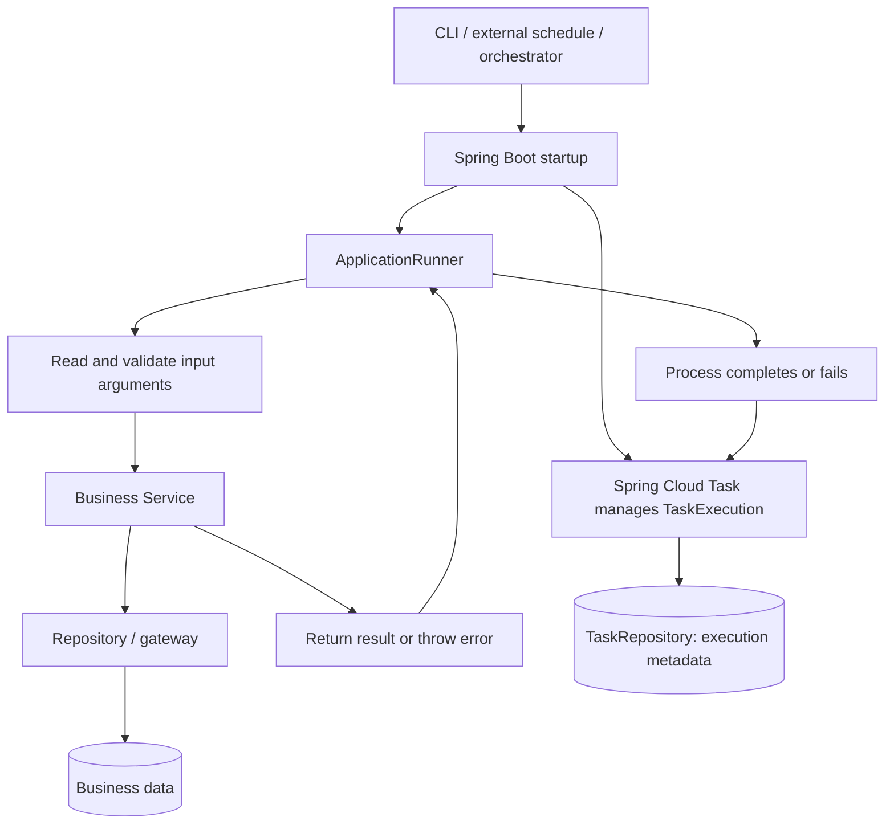

# Separating the Runner from the Business Service

## 1. Goal of Layer Separation

In **Spring Cloud Task**, a Spring Boot application executes a finite-duration job and then exits. The job can be triggered via a manual command, an external schedule, an orchestrator, or a request from another system. Spring Cloud Task tracks each execution via `TaskRepository`, while **the business logic** remains governed by application code.

A common pattern is placing all processing inside `CommandLineRunner` or `ApplicationRunner`: reading arguments, querying data, transforming records, writing to the database, calling APIs, and handling exceptions. This is fast for prototyping, but makes the runner hard to test, hard to reuse, and tightly couples business rules to how the task is launched.

**Separating the runner from the business service** means:

- **The runner** is the entry point for a single run: it reads and syntactically validates arguments, converts them into a request object, invokes the service, logs a summary, and lets failures surface at the run level.
- **The service** implements business rules: checking conditions, deciding operation order, coordinating repositories/gateways, managing business transactions, and returning meaningful results.
- **Repositories/gateways** handle access to databases, files, or external services; they do not hold task scheduling policies or decide process exit codes.
- **Spring Cloud Task and `TaskRepository`** track run lifecycle, start/end timestamps, exit codes, and errors; this data is distinct from the business results persisted by the service.

The goal is to make the same service callable from an on-demand task, from another processing flow, or in tests, while keeping the runner small and focused solely on **starting a single execution**.

## 2. Processing Flow and Responsibility Boundaries



| Component | Should Own | Should Not Absorb |
| --- | --- | --- |
| `ApplicationRunner` / `CommandLineRunner` | Reading `--option`s, checking format/presence, calling a use case, logging a summary | SQL, calculation algorithms, complex business rules |
| `@Service` | Business rules, business transactions, coordinating reads/writes, returning results or meaningful errors | Depending on `ApplicationArguments`, knowing `java -jar` commands, restarting the JVM |
| Repository / gateway | Specific SQL, API, or file operations | Deciding schedules, retrying the whole task, or defining exit codes |
| `TaskRepository` | `TaskExecution` metadata managed by the framework | Replacing business tables or guaranteeing exactly-once semantics |
| Scheduler / orchestrator | Deciding when to run, retry counts, resource allocation, progress monitoring | Replacing data constraints and service transactions |

The example below is a task that **aggregates the number of pending orders per day**. The runner accepts `--report.date` and `--report.request-id`; the service counts `PENDING` orders and persists the result to a business table. Spring Cloud Task separately records metadata for the run itself.

## 3. Designing the Contract Between Runner and Service

Instead of passing `ApplicationArguments` straight into the service, create a strongly typed request:

```java
// ReportRequest.java
import java.time.LocalDate;

public record ReportRequest(String requestId, LocalDate reportDate) {
}
```

```java
// ReportResult.java
import java.time.LocalDate;

public record ReportResult(
        String requestId,
        LocalDate reportDate,
        long pendingOrders) {
}
```

`ReportRequest` represents **business-meaningful input**. `ReportResult` is the processed outcome, suitable for logging, returning from an API, or persisting as its own record. Do not force the service to know CLI flag names or terminal string formatting.

Here `requestId` acts as the business request identifier. **It is not** `TASK_EXECUTION_ID`: a single request can be retried and produce multiple `TaskExecution` records, while the system still needs to detect duplicate processing under the same `requestId`.

## 4. Implementation Example from Runner to Database

### 4.1. Dependencies and Configuration

In a Spring Boot project already using a **Spring Cloud BOM compatible with the Spring Boot version**, add the main Maven dependencies:

```xml
<dependencies>
    <dependency>
        <groupId>org.springframework.cloud</groupId>
        <artifactId>spring-cloud-starter-task</artifactId>
    </dependency>
    <dependency>
        <groupId>org.springframework.boot</groupId>
        <artifactId>spring-boot-starter-jdbc</artifactId>
    </dependency>
    <dependency>
        <groupId>com.h2database</groupId>
        <artifactId>h2</artifactId>
        <scope>runtime</scope>
    </dependency>
</dependencies>
```

The example uses Java 17 or higher for `record` support and a Spring Boot application **without starting a web server**. Configuration at `src/main/resources/application.yml`:

```yaml
spring:
  application:
    name: daily-report-task
  main:
    web-application-type: none
  datasource:
    driver-class-name: org.h2.Driver
    url: jdbc:h2:file:./data/daily-report;DB_CLOSE_ON_EXIT=FALSE
    username: sa
    password: ""
  sql:
    init:
      mode: always
  cloud:
    task:
      name: daily-report-task
      initialize-enabled: true
```

File-backed H2 allows inspecting history across runs from **the same working directory**. `spring.sql.init.mode: always` instructs Spring Boot to execute the `schema.sql` script for business data. `spring.cloud.task.initialize-enabled: true` initializes Spring Cloud Task's metadata schema; the two sets of tables serve different roles and must be managed in alignment with the library version. Using `sa` and an empty password is suitable only for local learning environments.

In `src/main/resources/schema.sql`, create the business tables for the example:

```sql
CREATE TABLE IF NOT EXISTS business_orders (
    id BIGINT PRIMARY KEY,
    order_date DATE NOT NULL,
    status VARCHAR(20) NOT NULL
);

CREATE TABLE IF NOT EXISTS daily_report_results (
    request_id VARCHAR(80) PRIMARY KEY,
    report_date DATE NOT NULL,
    pending_orders BIGINT NOT NULL,
    created_at TIMESTAMP DEFAULT CURRENT_TIMESTAMP NOT NULL
);
```

Do not manually write `CREATE TABLE TASK_EXECUTION` in this script. `TASK_EXECUTION` belongs to framework metadata, whereas `business_orders` and `daily_report_results` belong to the business domain. In a real project, move table-creation scripts into controlled migrations and use PostgreSQL or an appropriate server database when multiple processes access it concurrently.

### 4.2. Application Startup

```java
// DailyReportTaskApplication.java
import org.springframework.boot.SpringApplication;
import org.springframework.boot.autoconfigure.SpringBootApplication;
import org.springframework.cloud.task.configuration.EnableTask;

@SpringBootApplication
@EnableTask
public class DailyReportTaskApplication {
    public static void main(String[] args) {
        SpringApplication.run(DailyReportTaskApplication.class, args);
    }
}
```

`@EnableTask` activates Spring Cloud Task configuration for the example. The framework manages the execution record during application startup/shutdown; the runner does not need to manually insert records into `TaskRepository` for each service call.

### 4.3. Runner Only Reads Parameters and Calls the Use Case

```java
// DailyReportRunner.java
import java.time.LocalDate;
import java.time.format.DateTimeParseException;
import java.util.List;

import org.springframework.boot.ApplicationArguments;
import org.springframework.boot.ApplicationRunner;
import org.springframework.stereotype.Component;

@Component
public class DailyReportRunner implements ApplicationRunner {

    private final DailyReportService reportService;

    public DailyReportRunner(DailyReportService reportService) {
        this.reportService = reportService;
    }

    @Override
    public void run(ApplicationArguments args) {
        String dateText = requiredOption(args, "report.date");
        String requestId = requiredOption(args, "report.request-id");

        LocalDate reportDate;
        try {
            reportDate = LocalDate.parse(dateText);
        } catch (DateTimeParseException ex) {
            throw new IllegalArgumentException(
                    "--report.date must have yyyy-MM-dd format", ex);
        }

        ReportRequest request = new ReportRequest(requestId, reportDate);
        ReportResult result = reportService.create(request);

        System.out.printf(
                "Completed requestId=%s, date=%s, pending=%d%n",
                result.requestId(), result.reportDate(), result.pendingOrders());
    }

    private static String requiredOption(ApplicationArguments args, String name) {
        List<String> values = args.getOptionValues(name);
        if (values == null || values.size() != 1 ||
                values.get(0) == null || values.get(0).isBlank()) {
            throw new IllegalArgumentException(
                    "Exactly one value must be passed for --" + name);
        }
        return values.get(0);
    }
}
```

The runner checks inputs **at the boundary layer**: missing parameters, duplicate flags, or malformed dates. Once `ReportRequest` is built, the runner has no knowledge of how orders are counted or how results are persisted. Exceptions are allowed to propagate out of `ApplicationRunner` instead of being swallowed with a printed message and a normal return.

`CommandLineRunner` can play a similar role, but receives `String... args`. `ApplicationRunner` is more convenient when extracting `--key=value` options via `ApplicationArguments`. Choose only **one** mechanism for the sample task; avoid creating multiple runners with overlapping business logic.

### 4.4. Service Handles Business Rules and Transactions

```java
// DailyReportService.java
import java.time.LocalDate;

import org.springframework.stereotype.Service;
import org.springframework.transaction.annotation.Transactional;

@Service
public class DailyReportService {

    private final DailyReportRepository repository;

    public DailyReportService(DailyReportRepository repository) {
        this.repository = repository;
    }

    @Transactional
    public ReportResult create(ReportRequest request) {
        if (request.requestId() == null || request.requestId().isBlank()
                || request.requestId().length() > 80) {
            throw new IllegalArgumentException("requestId must be 1-80 characters");
        }
        if (request.reportDate() == null ||
                request.reportDate().isAfter(LocalDate.now())) {
            throw new IllegalArgumentException("Invalid report date");
        }

        long pendingOrders = repository.countPendingOrders(request.reportDate());
        repository.saveResult(request, pendingOrders);

        return new ReportResult(
                request.requestId(), request.reportDate(), pendingOrders);
    }
}
```

The service owns conditions with **business meaning**: request ID length, ensuring the report date is not in the future, counting only `PENDING` status, and storing the aggregated record. In a real system, the business date timezone convention must be defined consistently; `LocalDate.now()` uses the JVM default timezone here to keep the example concise.

`@Transactional` is placed on the service because it marks the boundary of a business unit of work: reading metrics and persisting the result. If the write fails, the business transaction rolls back according to Spring's rules (defaulting to rollback on runtime exceptions). A production task may need tailored transaction isolation levels or chunked processing for large datasets; avoid holding open a single transaction for hours just to wrap an entire task.

### 4.5. Repository Owns SQL

```java
// DailyReportRepository.java
import java.sql.Date;
import java.time.LocalDate;

import org.springframework.jdbc.core.JdbcTemplate;
import org.springframework.stereotype.Repository;

@Repository
public class DailyReportRepository {

    private final JdbcTemplate jdbc;

    public DailyReportRepository(JdbcTemplate jdbc) {
        this.jdbc = jdbc;
    }

    public long countPendingOrders(LocalDate date) {
        Long count = jdbc.queryForObject(
                "SELECT COUNT(*) FROM business_orders " +
                "WHERE order_date = ? AND status = 'PENDING'",
                Long.class,
                Date.valueOf(date));
        return count == null ? 0L : count;
    }

    public void saveResult(ReportRequest request, long pendingOrders) {
        jdbc.update(
                "INSERT INTO daily_report_results " +
                "(request_id, report_date, pending_orders) VALUES (?, ?, ?)",
                request.requestId(),
                Date.valueOf(request.reportDate()),
                pendingOrders);
    }
}
```

The repository does not know whether the task came from the CLI or a schedule. When migrating from H2 to PostgreSQL, SQL adjustments or adapters stay isolated in this layer. The service continues using `countPendingOrders` and `saveResult`.

The example intentionally makes `request_id` the **primary key**: saving the same `requestId` twice will be rejected. That enables **duplicate detection**, though it is not yet a complete idempotent retry handler. For tasks requiring safe reruns, the service must define behavior when encountering an existing `requestId`: return the previously saved result, reject if input parameters changed, or reprocess in a controlled manner. Concurrency when two processes receive the same ID must also be handled using database uniqueness constraints.

## 5. Running and Observing Two Layers of Outcomes

Create the data directory in the working directory before running:

```bash
mkdir data
java -jar target/daily-report-task.jar --report.date=2024-01-15 --report.request-id=report-001
```

`target/daily-report-task.jar` is an illustrative name; substitute the actual executable JAR built by your project. If `business_orders` has no rows for that date yet, `pendingOrders = 0` is a **valid business result**, not an error.

After the process exits, connect to the H2 file in the same working directory (e.g., `jdbc:h2:file:./data/daily-report;IFEXISTS=TRUE`) and run:

```sql
-- Business results persisted by the service
SELECT request_id, report_date, pending_orders, created_at
FROM daily_report_results
ORDER BY created_at DESC;

-- Execution metadata managed by Spring Cloud Task
SELECT TASK_EXECUTION_ID, TASK_NAME, START_TIME, END_TIME,
       EXIT_CODE, EXIT_MESSAGE
FROM TASK_EXECUTION
ORDER BY TASK_EXECUTION_ID DESC;
```

These two queries answer two different questions:

| Question | Data Source |
| --- | --- |
| Which task ran, when did it start and finish, and did it fail? | Spring Cloud Task's `TASK_EXECUTION` |
| How many pending orders did request `report-001` count? | `daily_report_results` written by the service |
| How many times was the task retried? | Number of `TaskExecution` records correlated with `requestId` |
| Was a request processed exactly once in business terms? | Application-designed keys and idempotency rules; cannot be concluded from metadata alone |

To test non-zero data, after stopping the task use a SQL tool to insert sample rows (insert once only):

```sql
INSERT INTO business_orders (id, order_date, status) VALUES
    (1, DATE '2024-01-15', 'PENDING'),
    (2, DATE '2024-01-15', 'DONE'),
    (3, DATE '2024-01-15', 'PENDING');
```

Then close the SQL connection if H2 holds a file lock and run again with a **new request ID**:

```bash
java -jar target/daily-report-task.jar --report.date=2024-01-15 --report.request-id=report-002
```

The expected business result for `report-002` is `pendingOrders = 2`, while `TASK_EXECUTION` gains another run record. Reusing `report-001` will trigger a duplicate-key error in `daily_report_results`; this signals the need to define a retry or rerun policy, not a bug in `TaskRepository`.

## 6. Handling Exceptions at the Right Layer

Do not turn every failure into `System.out.println("Error")` and exit normally. If the runner catches an exception, logs it, and neither rethrows it nor signals failure via exit code, the orchestrator may observe a **false success**.

| Situation | Detecting Layer | Recommended Action |
| --- | --- | --- |
| Missing `--report.date` or invalid ISO format | Runner | Throw `IllegalArgumentException` clearly naming the parameter |
| Report date violates a business rule | Service | Reject the request with a specific business error |
| Database unreachable or duplicate `requestId` key | Repository/driver; service decides policy | Propagate the error or handle per designed idempotency policy |
| No `PENDING` orders found | Service | Return `ReportResult` with `pendingOrders = 0` if that is a valid outcome |
| Process forcibly killed | OS/orchestrator | Inspect logs, process status, and incomplete metadata to evaluate and decide on retry |

When an `ApplicationRunner` throws an unhandled exception, Spring Boot startup fails; Spring Cloud Task records completion/failure according to the framework lifecycle. The actual exit code depends on configuration, version, and exception mapping; verify both the **process exit status** and database metadata. Do not assume all errors produce the same `EXIT_CODE`.

`@Transactional` protects database operations within the service scope, but **cannot automatically roll back a sent email, an external API call, or an exported file**. Cases with external side effects require idempotency keys, outboxes, checkpoints, or compensating actions tailored to the domain. `TaskRepository` metadata does not replace those mechanisms; nor should you assume metadata transactions and business transactions always commit atomically together.

## 7. One Service, Multiple Trigger Mechanisms

With a decoupled design, `DailyReportService.create(ReportRequest)` does not depend on how it is triggered. However, **how the service is called determines whether a new `TaskExecution` is created**.

### On-Demand Execution

An orchestrator can launch the executable JAR with run-specific arguments. Every launch of the Spring Cloud Task application creates a new execution tracked by the framework.

### Scheduled Execution

Tools like cron, Kubernetes CronJobs, or an external scheduler can launch **a new task process** at scheduled times. The runner remains the argument entry point; the service has no need to know about schedules. Avoid infinite loops or `@Scheduled` inside the task process just to keep it alive forever if the goal is a finite Spring Cloud Task.

### Reusing the Service Elsewhere

A web application or message consumer can also invoke `DailyReportService` after converting an incoming request into `ReportRequest`. In that context, calling the service **does not automatically create a new `TaskExecution` record**; task metadata is driven by the Spring Cloud Task lifecycle, not by individual service method calls. If a request must be tracked as an independent task run, launch a task instance or design an appropriate tracking mechanism.

### Combining with Spring Batch

If the workload needs to read/write millions of records, process in chunks, restart from checkpoints, or retry step-by-step, move processing into a **Spring Batch job/step** and use a runner or appropriate integration hook to launch the job. In that setup, `TaskRepository` tracks the Spring Cloud Task application run while Spring Batch's `JobRepository` tracks jobs and steps; these are two distinct metadata layers requiring separate schemas and operational strategies.

## 8. Safe Operational Principles

1. **Keep the runner thin:** read arguments, convert into a request, invoke the service, log a high-level summary; avoid SQL, business loops, and manual transactions in the runner.
2. **Place transaction boundaries on the service:** transactions wrap a unit of business work that can commit/rollback; split long-running work into chunks to avoid holding DB locks or connections too long.
3. **Design for safe reruns:** distinguish `TaskExecution` from `requestId`, use uniqueness constraints and explicit retry policies. Schedulers may replay requests after timeouts even if business work partially executed.
4. **Trace outcomes bidirectionally:** log `requestId` and execution identifiers where helpful, but never put tokens or passwords in CLI arguments or metadata. Use secret management tools and limit sensitive data in logs.
5. **Separate error responsibilities:** parameter format in the runner, business rules in the service, infrastructure errors in adapters, and retry policies in the orchestrator coordinated with the service. Never swallow exceptions so a failed task looks successful.
6. **Monitor incidents:** watch for non-zero process exit codes, `TASK_EXECUTION` rows missing `END_TIME`, prolonged runtimes, and business output states. Forced JVM termination may prevent final status persistence.
7. **Manage schemas independently:** `TASK_*` tables are framework metadata, business tables hold service-managed outputs, and Spring Batch adds `BATCH_*` tables. Each set requires proper migrations and access controls.

## 9. Practice Exercises and Self-Check Questions

Work through the following in order:

1. Run the example with `--report.date=2024-01-15 --report.request-id=report-001`. Query `TASK_EXECUTION` and `daily_report_results` separately; explain why a single run has two perspectives on its outcome.
2. Insert the three sample orders shown above and run `report-002`. Observe `pendingOrders = 2` and confirm the runner contains no SQL.
3. Omit `--report.date`, pass an invalid date, and pass a future date. Identify whether each error originates in the runner or the service and inspect the recorded execution metadata.
4. Reuse `report-002` to trigger a duplicate-key error. Propose the desired behavior when an operator retries: return the previous result, reprocess, or reject? Sketch input and concurrency validation rules.
5. Suppose you switch from CLI execution to a nightly schedule or Spring Batch: identify which layers must change, which layers stay unchanged, and which metadata tables must be monitored separately.

Once complete, you should be able to trace **the path of a single execution**, distinguish **runner, service, repository, and `TaskRepository`**, pinpoint where arguments/errors/transactions are handled, and explain why an independent business service makes Spring Cloud Task easier to test, reuse, schedule, and operate safely.
