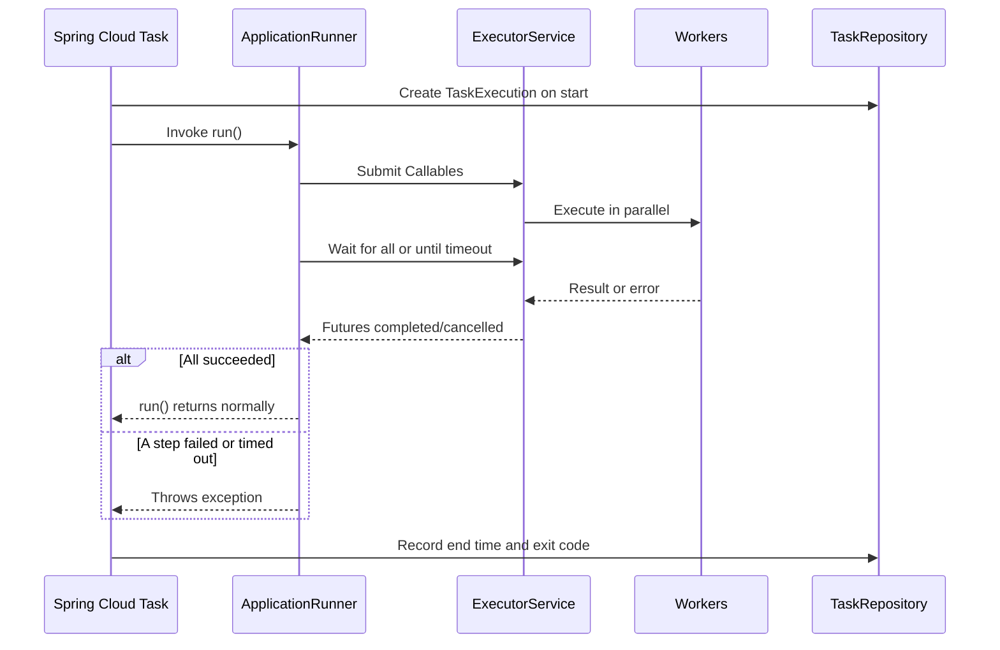

# Waiting for Asynchronous Work to Complete Before Returning

## 1. Goal and Real-World Scenario

In **Spring Cloud Task**, an application typically starts up, executes a finite job, and terminates. However, a processing step may need to call multiple independent services, read multiple files, or compute concurrently to shorten total runtime. Those subtasks often run on threads different from the thread executing `ApplicationRunner`.

Key problem: **submitting asynchronous work does not mean the work has completed**. If `run()` returns while child threads are still active, the lifecycle may proceed to shut down the application or record a completed status while data is still unfinished. This leads to misleading execution history, missing data, missed errors, or work cut off mid-flight.

After this lesson, you will be able to:

- Distinguish *work submitted*, *work completed*, and *work succeeded*.
- Wait for **all required child tasks** to finish before `ApplicationRunner.run()` returns.
- Bound wait times, detect timeouts, handle thread interruption, and propagate errors back to the main thread.
- Observe each run's outcome through Spring Cloud Task's `TaskRepository`.
- Choose among `ExecutorService`, `CompletableFuture`, and `@Async`; understand caveats when integrating **Spring Batch**.

The running example is a **data aggregation task across three sources**: `customers`, `orders`, and `payments`. Each source runs in parallel. The task reports success only after **all three sources return valid results**.

> In this lesson, "returning" means **returning control from `ApplicationRunner.run()`** back to Spring Boot's startup/completion cycle. It does not refer to an HTTP controller response. Spring Cloud Task tracks the lifecycle of one application run; it does not automatically wait for arbitrary threads or external tasks spawned by the application.

## 2. Why Must You Wait for Asynchronous Tasks?

Suppose a runner is written like this:

```java
@Override
public void run(ApplicationArguments args) {
    CompletableFuture.runAsync(() -> importCustomers());
    CompletableFuture.runAsync(() -> importOrders());
    System.out.println("Submitted two jobs");
}
```

This snippet only **launches** two tasks. `run()` can finish immediately after `println`. Nothing checks whether `importCustomers()` or `importOrders()` succeeded. An exception inside a `CompletableFuture` can sit inside the future without reaching the runner.

In a Spring Cloud Task application, `TaskExecution` status is managed by the framework around the lifecycle of the application and its runners. If the runner finishes too early, completion may occur before actual operations finish. Relying on a live thread to "keep" the JVM alive is unreliable: the timing of metadata updates, Spring context closing, and JVM exit do not necessarily align.

Three states to distinguish:

| State | Meaning | Can the Runner Report Success? |
| --- | --- | --- |
| Submitted (`submitted`) | Work has been queued or scheduled to run | Not yet |
| Completed (`completed`) | Work has stopped, but may have succeeded or failed | Only after checking results |
| Succeeded (`succeeded`) | All required tasks finished with no errors | Yes |

Desired processing flow:



**Principle:** `ApplicationRunner` must cover the **entire scope of required work**. If child work sits outside the awaited scope, the final `TaskExecution` status will not accurately reflect that business outcome.

## 3. Creating a Spring Cloud Task Project for the Example

The example uses **JDK 17**, **Spring Boot 3.4.5**, and **Spring Cloud 2024.0.2** from the same compatible release train. For projects using other versions, verify the Boot–Cloud compatibility matrix before changing release trains.

File layout:

```text
async-wait-task/
├── pom.xml
└── src/main/
    ├── java/com/example/asyncwait/
    │   ├── AsyncWaitTaskApplication.java
    │   └── AggregateRunner.java
    └── resources/
        └── application.yml
```

### 3.1. `pom.xml`

```xml
<?xml version="1.0" encoding="UTF-8"?>
<project xmlns="http://maven.apache.org/POM/4.0.0"
         xmlns:xsi="http://www.w3.org/2001/XMLSchema-instance"
         xsi:schemaLocation="http://maven.apache.org/POM/4.0.0 https://maven.apache.org/xsd/maven-4.0.0.xsd">
    <modelVersion>4.0.0</modelVersion>

    <parent>
        <groupId>org.springframework.boot</groupId>
        <artifactId>spring-boot-starter-parent</artifactId>
        <version>3.4.5</version>
        <relativePath/>
    </parent>

    <groupId>com.example</groupId>
    <artifactId>async-wait-task</artifactId>
    <version>0.0.1-SNAPSHOT</version>

    <properties>
        <java.version>17</java.version>
    </properties>

    <dependencyManagement>
        <dependencies>
            <dependency>
                <groupId>org.springframework.cloud</groupId>
                <artifactId>spring-cloud-dependencies</artifactId>
                <version>2024.0.2</version>
                <type>pom</type>
                <scope>import</scope>
            </dependency>
        </dependencies>
    </dependencyManagement>

    <dependencies>
        <dependency>
            <groupId>org.springframework.cloud</groupId>
            <artifactId>spring-cloud-starter-task</artifactId>
        </dependency>
        <dependency>
            <groupId>org.springframework.boot</groupId>
            <artifactId>spring-boot-starter-jdbc</artifactId>
        </dependency>
        <dependency>
            <groupId>com.h2database</groupId>
            <artifactId>h2</artifactId>
            <scope>runtime</scope>
        </dependency>
    </dependencies>

    <build>
        <plugins>
            <plugin>
                <groupId>org.springframework.boot</groupId>
                <artifactId>spring-boot-maven-plugin</artifactId>
            </plugin>
        </plugins>
    </build>
</project>
```

`spring-cloud-starter-task` provides `TaskExecution` tracking. JDBC and H2 provide storage for trial run metadata. `ExecutorService` and `Future` are part of standard Java, requiring no extra library for parallel execution.

### 3.2. `application.yml`

```yaml
spring:
  application:
    name: async-wait-task
  main:
    web-application-type: none
  datasource:
    url: jdbc:h2:file:./data/async-task-db;DB_CLOSE_ON_EXIT=FALSE
    driver-class-name: org.h2.Driver
    username: sa
    password: ""
  cloud:
    task:
      name: async-wait-task
      initialize-enabled: true
      closecontext-enabled: true
```

`web-application-type: none` ensures the application runs as a finite task without starting an HTTP server. File-backed H2 preserves history when the process stops. `initialize-enabled` is suitable for practice; in production use a persistent database and manage schemas via migrations. `closecontext-enabled` allows closing the Spring context after the task ends; therefore the runner must wait for all required work to finish **before returning**.

## 4. Proper Implementation: Submit in Parallel, Await All Results, Then Return

### 4.1. Startup Class

Create `AsyncWaitTaskApplication.java`:

```java
package com.example.asyncwait;

import org.springframework.boot.SpringApplication;
import org.springframework.boot.autoconfigure.SpringBootApplication;
import org.springframework.cloud.task.configuration.EnableTask;

@SpringBootApplication
@EnableTask
public class AsyncWaitTaskApplication {

    public static void main(String[] args) {
        SpringApplication.run(AsyncWaitTaskApplication.class, args);
    }
}
```

### 4.2. Runner with Timeout and Error Propagation

Create `AggregateRunner.java`:

```java
package com.example.asyncwait;

import java.util.ArrayList;
import java.util.List;
import java.util.concurrent.Callable;
import java.util.concurrent.ExecutionException;
import java.util.concurrent.ExecutorService;
import java.util.concurrent.Executors;
import java.util.concurrent.Future;
import java.util.concurrent.TimeUnit;
import java.util.concurrent.TimeoutException;

import org.springframework.boot.ApplicationArguments;
import org.springframework.boot.ApplicationRunner;
import org.springframework.stereotype.Component;

@Component
public class AggregateRunner implements ApplicationRunner {

    private static final List<String> SOURCES =
            List.of("customers", "orders", "payments");

    @Override
    public void run(ApplicationArguments args) throws Exception {
        String failSource = option(args, "fail", "");
        long timeoutSeconds = Long.parseLong(
                option(args, "timeout-seconds", "10"));

        if (timeoutSeconds <= 0) {
            throw new IllegalArgumentException(
                    "--timeout-seconds must be greater than 0");
        }

        ExecutorService executor = Executors.newFixedThreadPool(3);
        try {
            List<Callable<String>> jobs = new ArrayList<>();
            for (String source : SOURCES) {
                jobs.add(() -> fetchSource(source, failSource));
            }

            System.out.println("Starting " + jobs.size() + " jobs");

            // Wait for all jobs to complete or until the allowed timeout.
            // invokeAll(timeout) cancels unfinished Futures when the timeout expires.
            List<Future<String>> futures =
                    executor.invokeAll(jobs, timeoutSeconds, TimeUnit.SECONDS);

            List<String> results = new ArrayList<>();
            for (int i = 0; i < futures.size(); i++) {
                Future<String> future = futures.get(i);
                String source = SOURCES.get(i);

                if (future.isCancelled()) {
                    throw new TimeoutException(
                            "Timed out waiting for source " + source);
                }

                try {
                    // Future is done; get() retrieves the result or exception.
                    results.add(future.get());
                } catch (ExecutionException ex) {
                    throw new IllegalStateException(
                            "Processing source " + source + " failed",
                            ex.getCause());
                }
            }

            // Runs only after ALL results have been retrieved successfully.
            System.out.println("Aggregation complete: "
                    + String.join(", ", results));

        } catch (InterruptedException ex) {
            Thread.currentThread().interrupt();
            throw ex;
        } finally {
            // Request running workers to stop before the runner exits.
            executor.shutdownNow();
        }
    }

    private String fetchSource(String source, String failSource)
            throws InterruptedException {
        // Simulate an API call or reading data from a source.
        TimeUnit.MILLISECONDS.sleep(1_200);

        if (source.equals(failSource)) {
            throw new IllegalStateException("Simulated failure at " + source);
        }

        return source + "=OK";
    }

    private String option(ApplicationArguments args,
                          String name, String defaultValue) {
        List<String> values = args.getOptionValues(name);
        return values == null || values.isEmpty()
                ? defaultValue : values.get(0);
    }
}
```

The code makes several important choices:

1. **`newFixedThreadPool(3)`:** caps concurrency at three simultaneous jobs. Never spawn an unbounded thread per data record.
2. **`invokeAll(jobs, timeout, unit)`:** waits for every `Callable` to finish or until the deadline; once expired, unfinished `Future`s are cancelled.
3. **`future.isCancelled()`:** detects results cancelled due to timeout; never treats them as success.
4. **`future.get()`:** retrieves the value and surfaces worker exceptions to the runner via `ExecutionException`. Checking `isDone()` alone can overlook a failed outcome.
5. **`catch (InterruptedException)`:** restores the interrupt flag before propagating the error so callers can detect cancellation.
6. **`finally`:** always shuts down the executor, even when a source fails, times out, or the runner is interrupted.

`invokeAll` fits well when tasks are independent and you want **a complete collection of results**. It waits until every task completes or the timeout expires, so if one task fails early while others keep running, the runner waits for the remaining tasks to finish or time out. If you need fail-fast behavior on the first error, choose `ExecutorCompletionService` or another coordination pattern, cancelling remaining work and cleaning up resources.

### 4.3. Why Not Just Use `executor.shutdown()`?

`shutdown()` only **stops accepting new tasks**; it does not wait for currently running tasks to finish. Likewise, `CompletableFuture.runAsync(...)` only returns a tracking handle. To guarantee results, the runner must **wait** and **check statuses**.

`shutdownNow()` sends an interrupt request to running workers; it **does not guarantee** immediate termination of hung I/O or libraries that ignore interrupts. Therefore, production code also needs timeouts on HTTP clients and database drivers, cooperative cancellation, `awaitTermination` during cleanup, and alerts if a pool fails to stop. The example uses `sleep`, which responds to interrupts, to demonstrate cancellation behavior.

## 5. Testing Three Scenarios

From the project directory, package the application:

```bash
mvn clean package
```

### 5.1. All Succeed

```bash
java -jar target/async-wait-task-0.0.1-SNAPSHOT.jar
```

Illustrative business output:

```text
Starting 3 jobs
Aggregation complete: customers=OK, orders=OK, payments=OK
```

Because the three child tasks run in parallel, total processing time in the example is roughly the time of **one** source plus application startup overhead, rather than waiting sequentially for three sources. Regardless of completion order, the runner collects results in `SOURCES` order for consistent comparison.

### 5.2. One Source Fails

```bash
java -jar target/async-wait-task-0.0.1-SNAPSHOT.jar --fail=orders
```

The `orders` source throws an exception. `future.get()` surfaces that error via `ExecutionException`; the runner wraps it in `IllegalStateException` identifying the failed source. Spring Boot handles the runner failure, marks the task failed, and the process typically exits with a non-zero code. The lesson here is **never catch exceptions only to log and return normally**, as that misleads orchestrators about the outcome.

### 5.3. Timeout Expires

```bash
java -jar target/async-wait-task-0.0.1-SNAPSHOT.jar --timeout-seconds=1
```

Each source takes about 1.2 seconds, so a 1-second timeout is designed to trigger a timeout error. `invokeAll` cancels unfinished `Future`s; the runner throws `TimeoutException`, and the run status must reflect failure. On heavily loaded machines, exact timing may vary; do not write tests that depend on exact millisecond timings.

Note that cancellation only prevents you from treating the run as successful; **it does not undo database writes or external calls that have already occurred**. For safe reruns, design operations to be idempotent or provide compensating mechanisms.

## 6. Inspecting Results in `TaskRepository`

Spring Cloud Task stores metadata for each launch in `TASK_EXECUTION`, including `TASK_EXECUTION_ID`, `TASK_NAME`, `START_TIME`, `END_TIME`, `EXIT_CODE`, and error details. With file-backed H2 configured above, after the application stops, connect with an H2/JDBC tool to `jdbc:h2:file:./data/async-task-db` from **the same directory where the Java command ran**, using username `sa` and an empty password.

```sql
SELECT TASK_EXECUTION_ID,
       TASK_NAME,
       START_TIME,
       END_TIME,
       EXIT_CODE,
       ERROR_MESSAGE
FROM TASK_EXECUTION
ORDER BY TASK_EXECUTION_ID DESC;
```

Expected outcomes after the three runs:

| Run | Business Outcome | Exit Code Meaning |
| --- | --- | --- |
| No arguments | All three sources return `OK` | Success, typically `0` |
| `--fail=orders` | `orders` reports an error | Failure, non-`0` |
| `--timeout-seconds=1` | Fewer than three results before deadline | Failure, non-`0` |

`TaskRepository` tracks the **application execution**, not strings like `customers=OK`, nor does it automatically store all business data. If aggregated results are needed by downstream systems, persist them to a dedicated table or store **before the runner returns**; declare success only after required data is confirmed persisted.

Spring Cloud Task may also store arguments passed to the program. Never put passwords, API tokens, or sensitive data into command-line arguments or metadata that may be logged.

## 7. Alternative: `CompletableFuture.allOf`

If APIs already return `CompletableFuture`, there is no need to wrap them in `Callable` just to wait. Use `allOf` to construct one future representing **the entire group**:

```java
CompletableFuture<String> customers =
        customerService.fetchAsync();
CompletableFuture<String> orders =
        orderService.fetchAsync();
CompletableFuture<String> payments =
        paymentService.fetchAsync();

CompletableFuture<Void> all =
        CompletableFuture.allOf(customers, orders, payments);

// Wait for all or catch failure/timeout; place inside runner's run().
all.get(30, TimeUnit.SECONDS);

// Read results only after all has succeeded.
String result = customers.join() + ", "
              + orders.join() + ", "
              + payments.join();
saveResult(result);
```

This snippet illustrates **how to coordinate** existing APIs; `fetchAsync()` and `saveResult()` are business methods you implement yourself. `allOf` completes normally only when every future succeeds; if any future fails, the combined future fails and `get()` throws `ExecutionException`. `get(timeout, unit)` can also throw `TimeoutException` or `InterruptedException`. In a real runner, handle or propagate these exceptions, restore the interrupt flag, and cancel or stop remaining work on the executor.

Two common mistakes:

```java
// Wrong: only registers a callback; the runner may exit before the callback runs.
CompletableFuture.allOf(customers, orders, payments)
        .thenRun(() -> saveResult("done"));

// Wrong: joins one future and ignores the remaining futures.
customers.join();
// orders and payments may still be running or may have failed.
```

`join()` waits for a single future without a timeout parameter and wraps failures in `CompletionException`. `get()` supports a timeout and throws checked exceptions. Both must be awaited **before the runner finishes** if the final task status is to accurately reflect processing.

**Caution on cancellation:** Calling `CompletableFuture.cancel(true)` does not guarantee interrupting code currently running in an executor. For HTTP/database APIs, configure timeouts and cancellation at the client/driver layer, combined with bounded concurrency.

## 8. When Using Spring `@Async`

`@Async` is a natural fit when the application already uses a Spring-managed executor. The waiting rules stay the same:

1. Enable `@EnableAsync` and declare a bounded thread/queue executor.
2. Place the `@Async` method in **a separate Spring bean**, invoked by the runner through a Spring proxy. Calling `this.someAsyncMethod()` inside the same bean typically bypasses the proxy and runs synchronously.
3. Have the method return `CompletableFuture<T>` so the caller can wait and observe failures. Avoid `@Async void` for work that determines task success or failure.
4. Have the runner call `CompletableFuture.allOf(...).get(...)` or an equivalent wait mechanism, verify every outcome, and handle exceptions before returning.

Example declaring a bounded executor:

```java
@Configuration
@EnableAsync
public class AsyncConfig {

    @Bean("importExecutor")
    public ThreadPoolTaskExecutor importExecutor() {
        ThreadPoolTaskExecutor executor = new ThreadPoolTaskExecutor();
        executor.setCorePoolSize(3);
        executor.setMaxPoolSize(3);
        executor.setQueueCapacity(20);
        executor.setThreadNamePrefix("import-worker-");
        executor.initialize();
        return executor;
    }
}
```

Import the corresponding Spring classes `Configuration`, `Bean`, `EnableAsync`, and `ThreadPoolTaskExecutor`. Async methods can specify `@Async("importExecutor")` and return `CompletableFuture<Result>`. Spring manages the executor lifecycle; nevertheless, the application must still await business results before the task exits. A well-tuned thread pool **does not replace** the `await` step.

In addition, `ThreadLocal` context, transactions, and certain security details are **not automatically propagated in full** to worker threads. Do not assume `@Transactional` on the runner covers writes executed on other threads. Design explicit transaction boundaries per worker and at the result-aggregation point.

## 9. When Combining with Spring Batch

**Spring Cloud Task** and **Spring Batch** track two different levels:

| Component | Tracks |
| --- | --- |
| `TaskRepository` | Executions of the Spring Cloud Task application (`TaskExecution`) |
| Spring Batch's `JobRepository` | Job and step executions (`JobExecution`, `StepExecution`) |

When a Spring Cloud Task launches a Spring Batch job, pay attention to whether the launcher runs **synchronously or asynchronously**. A `JobLauncher` configured with an async executor can return a `JobExecution` **while the job is still running**. If the runner treats receiving `JobExecution` as completion and returns, the outer task may finish while the Batch job is still in progress.

To ensure task status reflects all work performed, there are two approaches:

- **Simple:** run the Batch job with a synchronous launcher so the call returns only after the job completes; inspect `BatchStatus` and `ExitStatus` before letting the runner succeed.
- **When async is needed:** retain the `JobExecution`, observe completion via an appropriate mechanism, and inspect the final outcome; bound the wait duration, handle errors, and avoid tight polling of `JobRepository` without backoff.

Never assume a successful `TaskExecution` implies an asynchronously launched `JobExecution` succeeded. Also guard against launching the same Batch job twice when an orchestrator retries the task.

## 10. Common Pitfalls and Safe Operation

| Symptom | Cause | Fix |
| --- | --- | --- |
| Task reports success despite missing data | Runner only submitted futures and returned | Await all work and verify outputs before returning. |
| Worker exception does not fail the Task | Neither `get()` nor `join()` was called, or error was swallowed | Collect results and propagate errors to the runner; exit code must reflect failure. |
| Process hangs past timeout | Blocked I/O or worker ignores interrupts | Set timeouts at the I/O layer, support cooperative cancellation, clean up and monitor executors. |
| Parallel runs overload downstream services | Unbounded thread pool or queue | Bound concurrency, queue capacity, connections, and retries. |
| Duplicate business records on rerun | Some workers persisted data before another source failed | Design idempotency keys, upserts, or compensating operations. |
| Batch job still running after Task finishes | Async launcher returned early | Wait for `JobExecution` completion and evaluate final status. |
| Root error masked | Callback or `finally` throws another exception | Log original error, clean up resources carefully, and preserve causal chains. |

In production, distinguish **overall task timeout** from **per-I/O call timeout**. `invokeAll`'s timeout only limits how long you *wait for results*; it does not automatically impose deadlines on active HTTP requests, SQL queries, or transactions. For write-heavy workloads, build retry-safe *at-least-once* mechanisms and monitor both `TaskExecution` and business outputs.

When scheduling is needed, the same JAR can be triggered by `cron`, a Kubernetes `Job`/`CronJob`, or an orchestrator. Spring Cloud Task **records executions**; it does not provide its own execution schedule. If runs may overlap, enforce concurrency policies and appropriate locks/execution identifiers.

## 11. Self-Check

- [ ] Explain why `runAsync()` or `submit()` alone is insufficient to confirm results.
- [ ] Run the example successfully and observe results from all three sources before the task exits.
- [ ] Trigger a failure with `--fail=orders` and observe the failed `TaskExecution`.
- [ ] Trigger a timeout with `--timeout-seconds=1` and verify no successful aggregation message is printed.
- [ ] Describe the difference between `shutdown()`, `shutdownNow()`, and **awaiting** a `Future`.
- [ ] Explain how to propagate errors from `CompletableFuture` or `@Async` back to the runner.
- [ ] Explain why `TaskRepository` and `JobRepository` cannot replace each other when integrating Spring Batch.
- [ ] Identify ways to prevent duplicate data, enforce I/O-level timeouts, and mitigate overlapping runs.

**Key takeaway:** For a Spring Cloud Task running asynchronous work, the runner's completion point must sit **after** all required tasks have completed, been checked for errors, and persisted necessary outputs. Only then is the run status trustworthy for operations, retries, and orchestration.
