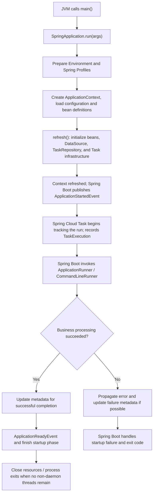
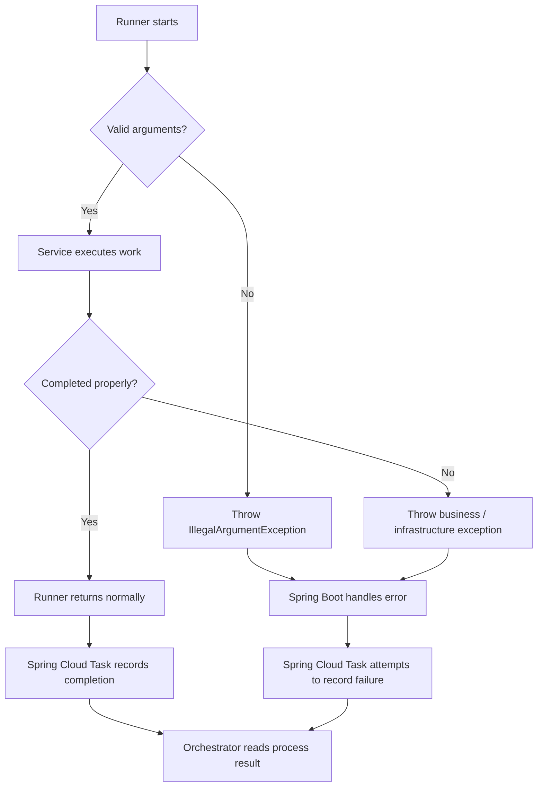

# ApplicationContext Initialization Sequence and Task Startup

## Lesson Objectives

**Spring Cloud Task (SPRING_CLOUD_TASK)** helps build Spring Boot applications with a **finite runtime**: the process starts up, performs a job, and terminates. The framework records information for each run in a database via `TaskRepository` to track timing, results, and errors. This is the foundation for scheduled or on-demand tasks, as well as workflows coordinated with Spring Batch.

In the **Lifecycle** chapter, this lesson explains in detail the **initialization sequence of `ApplicationContext` and the point at which a task starts**. After studying this lesson, you will be able to:

- Distinguish the environment preparation, `ApplicationContext` creation, and `refresh` phases from the business execution phase.
- Identify the roles of `DataSource`, `TaskRepository`, `TaskExecution`, and the Spring Cloud Task lifecycle tracking component.
- Understand where `ApplicationRunner`/`CommandLineRunner` fit into the Spring Boot startup lifecycle.
- Recognize which errors occur before or after task metadata is persisted and why the database sometimes contains no trace of a failed process.
- Organize code, arguments, logs, and process exit policies so that tasks operate safely.

## 1. Four Concepts to Separate

| Concept | Role | Relevant Timing |
| --- | --- | --- |
| `ApplicationContext` | Container managing beans, dependency injection, configuration, and Spring events. | Created and initialized during `SpringApplication.run(…)`. |
| `TaskRepository` | Component that accesses the Spring Cloud Task metadata repository. | Configured alongside infrastructure beans when the application context initializes; requires a `DataSource` and an appropriate schema. |
| `TaskExecution` | Record representing **a single run** of a task: name, ID, timestamps, exit code, error, etc. | Created when the Task lifecycle starts and updated upon completion/failure if the metadata repository remains accessible. |
| `ApplicationRunner` / `CommandLineRunner` | Execution point for logic after Spring Boot has initialized the context. | Invoked by Spring Boot **after context refresh**, before the `ApplicationReadyEvent`. |

Important: **initializing `ApplicationContext` does not mean the business task has run**. Likewise, having a `TaskRepository` bean does not mean a `TaskExecution` record already exists for the current startup.

For example: a daily order report export application. A run started at 02:00 and a manual rerun at 09:00 may share the same Task name, the same JAR, and the same production profile; they must have two separate `TaskExecution` records. The task succeeds only when the report processing completes according to business criteria.

## 2. Startup Sequence Overview

The following diagram illustrates the **logical order** typically seen in a Spring Boot application with Spring Cloud Task enabled. Internal callback details and listener ordering may vary across versions; you should not rely on the diagram to couple timing to individual internal methods.



The diagram intentionally places the **Task recording** step before **runner execution**. The framework needs a start timestamp to compute duration and record the job's outcome. However, do not assume that every custom callback on `ApplicationStartedEvent` or `ApplicationReadyEvent` observes Task metadata in a fixed state; listeners can execute in their own order.

Another perspective in timeline form:

| Phase | What Spring Boot/Spring Cloud Task Does | What Application Code Should Do |
| --- | --- | --- |
| 1. Process start | JVM loads the main class and calls `SpringApplication.run`. | Only bootstrap the application; do not perform business work directly in `main` before this call. |
| 2. Configuration preparation | Loads property sources, environment variables, profiles, and command-line arguments. | Declare connection settings and profiles through external configuration. |
| 3. Context creation | Registers bean definitions, auto-configuration, and dependencies. | Declare beans and configure services/repositories; do not place long-running side effects in constructors. |
| 4. Context refresh | Instantiates required singletons, initializes connections/infrastructure beans, and publishes `ContextRefreshedEvent`. | Ensure `DataSource`, schema, and required beans can initialize successfully. |
| 5. Task lifecycle start | Spring Cloud Task creates a `TaskExecution` once tracking is ready, before business runners are invoked. | Let the framework manage metadata instead of inserting SQL directly into Task tables. |
| 6. Business execution | Spring Boot sequentially invokes runners in their defined order. | Validate arguments, call services, and let critical errors propagate. |
| 7. Completion or failure | The framework records timestamps, status/exit code, and error details if the metadata connection is available. | Return normally on success; propagate an appropriate failure signal on error. |
| 8. Process termination | Spring Boot finishes the run phase; the JVM process can exit when no non-daemon threads remain. | Do not keep infinite loops, a web server, or unnecessary background threads alive. |

## 3. `Environment` and Profile Preparation Phase

When `SpringApplication.run(args)` begins, Spring Boot processes configuration before fully instantiating business beans:

1. Prepares the `Environment` and appropriate property sources.
2. Resolves active profiles (for example `local`, `test`, `prod`).
3. Loads application configuration and applies overrides according to Spring Boot's precedence order.
4. Prepares the context according to the application type (`none`, servlet, or reactive).

Example of a task application that does not need an HTTP server:

```yaml
# src/main/resources/application.yml
spring:
  application:
    name: daily-report-task
  main:
    web-application-type: none
  cloud:
    task:
      name: daily-report-task
```

Activating a profile at runtime:

```bash
java -jar daily-report-task.jar \
  --spring.profiles.active=local \
  --businessDate=2026-11-23
```

The two arguments serve different purposes: `spring.profiles.active` selects the **infrastructure configuration**; `businessDate` is the **input for a business run**. If the database URL or credentials are wrong, an error may occur right during initialization of the `DataSource`/`TaskRepository` beans, before any runner begins.

**Do not** place report-export work inside static code of the main class, `@Configuration` constructors, or profile selection logic: these locations can execute before Spring Cloud Task starts managing metadata for the run.

## 4. How `ApplicationContext` Creation and `refresh` Work

`ApplicationContext` is the core container managing the application's objects and dependencies. `SpringApplication` creates an appropriate context, loads bean definitions from `@SpringBootApplication`, component scanning, and auto-configuration, and then invokes the `refresh()` phase.

During this process, Spring may:

- Parse `@Configuration` classes and auto-configuration conditions.
- Instantiate required singleton beans and inject dependencies into one another.
- Invoke lifecycle callbacks such as `@PostConstruct` on beans when they are initialized.
- Initialize the `DataSource`, JDBC components, and infrastructure provided by Spring Cloud Task.
- Execute callbacks associated with context refresh and publish `ContextRefreshedEvent`.

If a required bean fails to be created, the refresh phase can abort. For instance, if the application has a `DataSource` pointing to an unreachable address or a missing dependency; in that case, runners are never invoked.

### Why shouldn't business logic run in `@PostConstruct`?

Consider this example of what **not to do**:

```java
@Service
class BadReportService {
    @PostConstruct
    void generateReportImmediately() {
        // Don't do this: running business logic when the bean is initialized.
    }
}
```

`@PostConstruct` is tied to the **bean** lifecycle, not the lifecycle of **a Task run**. The method can be invoked before Spring Boot finishes refreshing, before all infrastructure is ready, or before the current `TaskExecution` is recorded. Furthermore, an error here is a bean creation failure, which differs from an error inside a tracked runner.

Keep constructors and `@PostConstruct` limited to lightweight, necessary local state initialization. Report generation, API calls, data updates, event publishing, or file writing should start from a runner and delegate to a dedicated service.

## 5. When Is `TaskRepository` Ready?

When Spring Cloud Task integration is enabled, the framework adds beans that manage the Task lifecycle and execution repository. `TaskRepository` requires a `DataSource` along with metadata tables compatible with the Spring Cloud Task version. Successfully creating a repository bean does not guarantee that every subsequent SQL statement will succeed: the schema, permissions, and actual connection must still be valid.

Example test configuration for the local profile with H2:

```yaml
# src/main/resources/application-local.yml
spring:
  datasource:
    url: jdbc:h2:mem:taskdb;DB_CLOSE_DELAY=-1
    driver-class-name: org.h2.Driver
    username: sa
    password: ""
  cloud:
    task:
      initialize-enabled: true
```

This example assumes the project includes the Spring Cloud Task starter, JDBC, and the H2 driver, and uses a Spring Cloud Task version that supports the corresponding schema initialization option. **Verify the exact properties and DDL against your actual version**. An in-memory H2 database lets you test a single run, but does not preserve history after the process terminates.

In production, you should provision a persistent metadata database/schema, apply DDL through a controlled migration process, and typically disable automatic table creation:

```yaml
# src/main/resources/application-prod.yml
spring:
  datasource:
    url: ${TASK_DB_URL}
    username: ${TASK_DB_USER}
    password: ${TASK_DB_PASSWORD}
  cloud:
    task:
      initialize-enabled: false
```

Once the context is refreshed, Spring Boot continues with post-refresh steps. The Spring Cloud Task lifecycle tracking component writes a `TaskExecution` record for the current run **before runners execute business logic**. If writing this initial metadata fails, runners typically cannot proceed normally under tracking, and there may be **no** record at all for that startup in the database.

Information typically stored includes `TASK_EXECUTION_ID`, Task name, start time, end time, and exit code. If the application integrates Spring Batch, Task–Batch associations can also be recorded, though Batch's `JobRepository` is a separate component and does not replace `TaskRepository`.

## 6. From Initialized Context to Business Runner

Spring Boot invokes `ApplicationRunner` and `CommandLineRunner` **after `ApplicationContext` refreshes successfully**. This is the appropriate starting point for finite business work. The main differences:

| Runner Type | Input | When to Use |
| --- | --- | --- |
| `ApplicationRunner` | `ApplicationArguments`, supporting `--key=value` options. | When you need to separate option arguments from non-option arguments and inspect argument lists. |
| `CommandLineRunner` | `String... args` array. | When you want to handle the raw argument list directly. |

If multiple runners exist, you can use `@Order` or the `Ordered` interface to specify execution order. Even so, avoid building complex business dependencies by chaining many runners together. A single runner orchestrating a service or workflow is usually easier to maintain and verify.

### Complete Example: A Report-Generation Task Run

```java
package com.example.task;

import java.time.LocalDate;
import java.util.List;

import org.springframework.boot.ApplicationRunner;
import org.springframework.boot.SpringApplication;
import org.springframework.boot.autoconfigure.SpringBootApplication;
import org.springframework.cloud.task.configuration.EnableTask;
import org.springframework.context.annotation.Bean;
import org.springframework.stereotype.Service;

@SpringBootApplication
@EnableTask
public class DailyReportTaskApplication {

    public static void main(String[] args) {
        SpringApplication.run(DailyReportTaskApplication.class, args);
    }

    @Bean
    ApplicationRunner reportRunner(DailyReportService reportService) {
        return args -> {
            List<String> values = args.getOptionValues("businessDate");
            if (values == null || values.size() != 1) {
                throw new IllegalArgumentException(
                    "Exactly one --businessDate=yyyy-MM-dd is required");
            }

            LocalDate businessDate = LocalDate.parse(values.get(0));
            reportService.generate(businessDate);
        };
    }
}

@Service
class DailyReportService {
    void generate(LocalDate businessDate) {
        // Illustration only: replace with real queries, file generation, and result verification.
        System.out.println("Generated report for " + businessDate);
    }
}
```

**Step-by-step explanation:**

1. The JVM calls `main`, and Spring Boot starts the `ApplicationContext`.
2. Component scanning detects `DailyReportService`; the runner bean is created alongside the application beans.
3. Spring Cloud Task prepares the metadata repository and begins recording the execution.
4. Spring Boot invokes `reportRunner`. The runner validates `businessDate` and then calls `DailyReportService.generate()`.
5. When the method completes normally, the Task lifecycle can end successfully and persist completion metadata; if the method throws an exception that is not swallowed, failure handling is triggered.

This code snippet **only illustrates** invoking a service and does not perform real report generation. In production systems, the service must validate outputs, manage transactions, and ensure safe reruns; printing `Generated report` does not by itself prove business success.

## 7. Common Spring Boot Events

Several events help observe startup progress:

| Event/Callback | Relative Timing | Notes for Spring Cloud Task |
| --- | --- | --- |
| `ApplicationEnvironmentPreparedEvent` | `Environment` is prepared, before the context is finalized. | Useful for understanding the configuration phase; business logic does not run yet. |
| `ApplicationPreparedEvent` | Context has been created and prepared, before the refresh phase finishes. | Infrastructure and beans may not be ready yet. |
| `ContextRefreshedEvent` | Context has finished refreshing. | Does not mean runners have executed. |
| `ApplicationStartedEvent` | After refresh, **before** runners. | Useful for observing the startup milestone; avoid relying on execution order across listeners. |
| `ApplicationRunner` / `CommandLineRunner` | After `ApplicationStartedEvent`, before `ApplicationReadyEvent`. | Primary location for finite business logic. |
| `ApplicationReadyEvent` | When runners have completed and the application is considered ready. | Published **after** runners; do not put the main task logic here assuming it is timed the same way as a runner. |
| `ApplicationFailedEvent` | Spring Boot encounters an error during startup, including runner errors that cause `run` to fail. | Can be used to observe failures; Task metadata can only be updated if infrastructure is ready and the database remains reachable. |

**Caution:** Spring Boot events describe the lifecycle of the **application**, whereas `TaskExecution` describes the lifecycle of **a Task run**. Do not treat `ApplicationReadyEvent` as sole proof that business logic produced valid results, and do not rely on callback ordering across different listeners without an explicit ordering contract.

For Task applications without a web server, Spring Boot may still publish `ApplicationReadyEvent`; this does **not** mean an HTTP port must be opened or the process must stay alive to keep serving requests.

## 8. How Does a Task Succeed or Fail?

The runner's outcome is reflected through the lifecycle completion mechanism. If no error occurs, the framework can update the end time and a successful exit code in `TaskExecution`. If an exception occurs, the framework attempts to persist failure information. The process exit code observed by the scheduler and the exit code in metadata should be inspected together because both can be affected by infrastructure errors or how the application terminates.



| Scenario | Did the runner run? | What might Task metadata contain? | How to handle |
| --- | --- | --- | --- |
| Missing bean or misconfiguration during refresh | No | Possibly no record for the run yet. | Fix configuration/beans and check startup logs. |
| Task database unreachable at startup | Typically did not run normally | Possibly no record because INSERT failed. | Check connectivity, schema, permissions, and observe scheduler errors. |
| Invalid business argument, runner throws exception | Yes, but main work did not run | If initial metadata succeeded, it may record a failure result. | Validate and return clear errors; avoid infinite automatic retries. |
| Business service fails inside runner | Yes | May record end time, exit code, and error details. | Let the error propagate; define retry policies and duplicate-execution controls. |
| Process killed with `kill -9`, host lost, or container deleted abruptly | Possibly yes | Record may be missing the end time / final exit code. | Reconcile scheduler status, timeouts, and clean up orphaned records. |
| Runner finished but background threads keep running | Yes, may have completed | Metadata may show finished while the JVM is still running. | Shut down thread pools and resources; verify the process exits after the runner returns. |

### Why shouldn't errors be caught and ignored?

The following code makes the system **prone to reporting false success**:

```java
return args -> {
    try {
        reportService.generate(LocalDate.now());
    } catch (Exception ex) {
        logger.error("Report generation failed", ex);
        // Wrong: the runner returns normally even though business logic failed.
    }
};
```

In a Task, if an error is critical and the orchestrator needs to know, let the exception propagate or translate it into an appropriate failure signal. Only catch and handle an error locally when there is a **genuine recovery** and the work still meets its completion criteria.

On the other hand, do not call `System.exit(0)` from inside a runner right after the business step: terminating the JVM too early can prevent the framework from writing the final status, closing resources, or flushing logs. If a specific OS exit code is needed, design exit code mapping using Spring Boot's mechanism and verify it with an end-to-end run.

## 9. Logging and Monitoring at the Right Lifecycle Milestones

Use structured logging at **business start**, **business end**, and **exception** milestones, including the Task name, processing date, correlation ID, and result metrics. Do not use a constructor log as the sole evidence that the task has begun being tracked.

**Illustrative** timeline example, not the mandatory default log format of Spring Cloud Task:

```text
02:00:00.100  STARTUP     Loaded prod profile
02:00:00.800  CONTEXT     ApplicationContext refresh completed
02:00:00.910  TASK        TaskExecution metadata recorded
02:00:00.930  BUSINESS    Started processing businessDate=2026-11-23
02:00:04.600  BUSINESS    Completed: 157 records
02:00:04.680  TASK        TaskExecution metadata updated
02:00:04.700  PROCESS     Process completed
```

In the metadata database, you can refer to the following query (table/column names depend on the actual schema):

```sql
SELECT TASK_EXECUTION_ID,
       TASK_NAME,
       START_TIME,
       END_TIME,
       EXIT_CODE
FROM TASK_EXECUTION
WHERE TASK_NAME = 'daily-report-task'
ORDER BY TASK_EXECUTION_ID DESC;
```

Distinguish three layers of observability:

1. **Application:** runner logs indicate whether the work started and achieved expected results.
2. **Spring Cloud Task:** `TaskExecution` records timing and technical results of the run when the metadata store is working.
3. **Orchestrator:** whether the process/Job actually exited, timed out, was killed, or was retried.

When a task fails very early, relying only on `TASK_EXECUTION` will miss the incident. Conversely, a process exit code of `0` is not enough to confirm report data is accurate; business metrics must still be reconciled.

## 10. Constraints with Spring Batch and Schedulers

Spring Cloud Task is responsible for recording the lifecycle of a **finite process**. Spring Batch provides `Job`, `Step`, checkpoint, and restart concepts for multi-step data processing. When both frameworks participate in the same application:

- `ApplicationContext` may simultaneously contain both `TaskRepository` and `JobRepository`. Each repository uses its own framework's metadata schema.
- If `JobLauncherApplicationRunner` automatically launches Batch Jobs and another custom runner also manually invokes the Job, there is a risk of duplicate execution. Choose one clear launch mechanism.
- A `JobExecution` failure must be mapped to an appropriate failure signal for the Task process; simply logging that the Batch Job failed and letting the runner return normally can produce misleading Task outcomes.
- `Job` name, `JobParameters`, and `TaskExecution` are distinct concepts; a single Task run may relate to multiple Batch executions depending on design.

If a task runs on a schedule, an external system such as cron, Kubernetes CronJob, or an orchestration platform will **spawn a new process for each trigger**. The `main → Environment → ApplicationContext → TaskExecution → runner → exit` flow repeats on every run. Do not design a runner as an infinite loop waiting for the next schedule on its own; that violates the finite runtime requirement.

## 11. Common Design Mistakes

| Mistake | Consequence | Appropriate Approach |
| --- | --- | --- |
| Running business logic in a constructor or `@PostConstruct` | Work starts too early and is hard to track via Task metadata. | Move the work into `ApplicationRunner` or `CommandLineRunner`. |
| Treating `ContextRefreshedEvent` as task completion | Marks completion even though runners have not run. | Separate context ready, runner finish, and task metadata end milestones. |
| Using `ApplicationReadyEvent` as the main work entry point | Work happens after runners, easily skewing timing/Task status recording. | Use a runner to orchestrate business work. |
| Forgetting the `TaskRepository` schema | Task fails when writing metadata even though beans may be configured. | Apply the proper DDL before running and grant proper permissions. |
| Swallowing exceptions inside a runner | Scheduler/Task may report a false success status. | Only swallow errors on genuine recovery; otherwise propagate the error. |
| Enabling a web server or keeping unnecessary background threads | Runner finishes but the process does not stop. | `web-application-type: none`, close threads/connections, set timeouts. |
| Checking only the `TASK_EXECUTION` table | Misses errors that happen before metadata is written. | Collect both startup logs and process status. |
| Rerunning without locking/idempotency | Business outputs may be duplicated. | Use business keys, concurrency coordination, and controlled retries. |

## 12. Hands-On Exercise: Observing Each Startup Milestone

**Scenario:** build a `daily-report-task` application with a runner that accepts `--businessDate=yyyy-MM-dd`, generates a simple report, logs at the start/end of the method, and allows inspecting metadata.

1. Create the application with `@SpringBootApplication`, `@EnableTask`, `ApplicationRunner`, and a service as shown in Section 6. Configure `web-application-type: none`.
2. Prepare a `DataSource` for the `local` profile and ensure `TaskRepository` tables are initialized with a compatible schema.
3. Run with a valid date. Compare the logs when the context initializes, when the runner starts, when the runner finishes, and the new record in `TASK_EXECUTION`.
4. Run without `--businessDate`. Observe that the context can initialize successfully while the runner reports an error; check logs/exit code and metadata when available.
5. Try configuring an unreachable database URL. Observe the early failure and verify why no Task record may exist for this run.
6. Temporarily introduce an intentional exception in the service, rerun with valid arguments, and verify that the error is not caught and ignored.
7. Update the service to handle reruns for the same date safely; rerun and confirm results are not duplicated.
8. Optional: add a simple Spring Batch Job and observe the differences between Task execution, Job execution, and process status.

**Expected outcome:** you can explain why the startup order is **configuration → context creation/refresh → tracking infrastructure initialization → Task start → runner execution → result persistence → process termination**, as well as distinguish failures occurring before metadata is recorded from failures inside the business logic itself.

## Key Takeaways

- `ApplicationContext` is prepared and refreshed **before** Spring Boot invokes `ApplicationRunner` or `CommandLineRunner`.
- Spring Cloud Task connects the lifecycle of a **single execution** with `TaskRepository`; each run receives its own `TaskExecution` when metadata is persisted successfully.
- Finite business logic should be launched from a runner. Constructors, `@PostConstruct`, and startup event listeners are not suitable places to execute main work.
- Completing work, recording status, and **exiting the process** are related yet distinct milestones; always observe business data, Task metadata, and orchestrator status together.
