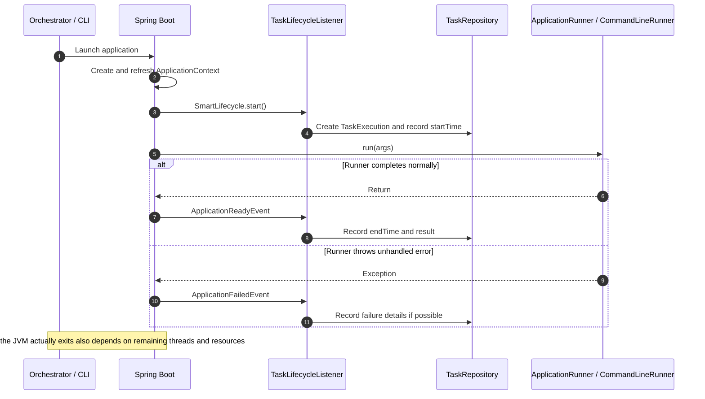

# Role of `TaskLifecycleListener` and `SmartLifecycle` in Spring Cloud Task

## 1. The Problem: How Do We Know How Far a Short-Lived Program Ran?

A Spring Cloud Task application typically stays alive only long enough to complete its job: aggregating reports, importing data, reconciling payments, or calling an external service. After the Java program terminates, operators still need to know **which run started, when it ended, and what the outcome was**.

Spring Cloud Task addresses this need by recording **`TaskExecution`** in **`TaskRepository`**. To know when to create and finalize the record, the framework must hook into the **Spring Boot application lifecycle**. Two key components are:

- **`TaskLifecycleListener`**: an infrastructure component provided by Spring Cloud Task that tracks startup and termination milestones of a task application and coordinates updates to `TaskRepository`.
- **`SmartLifecycle`**: a Spring Framework interface allowing a bean to participate in starting and stopping the `ApplicationContext`. `TaskLifecycleListener` implements this interface so it can record the start **before business runners execute**.

This lesson belongs to the **Lifecycle** chapter. The goal is to understand how Spring Boot, Spring Framework, and Spring Cloud Task coordinate; learn how to add your own observability logic; and properly handle scenarios such as startup failures, runner errors, abnormal termination, or scheduled reruns.

## 2. Big Picture of a Single Execution

Each normal startup of an application configured as a Spring Cloud Task can create a separate `TaskExecution` record. You must distinguish between the **lifecycle of the `ApplicationContext`**, the **lifecycle of the work inside the runner**, the **lifecycle of task metadata**, and the **lifecycle of the OS process**. They are related, yet do not always terminate at the exact same moment.



Key takeaways from the diagram:

1. `TaskLifecycleListener` begins recording once `ApplicationContext` is initialized enough for Spring to call `SmartLifecycle.start()`; it does **not** run prior to the entire bean creation process.
2. `ApplicationRunner` or `CommandLineRunner` executes **after the task start milestone**. Therefore, the execution already has an identifier for attaching logs and tracking while business logic runs.
3. `ApplicationReadyEvent` signals that Spring Boot has completed startup, including executing synchronous runners. For a typical task application, this is the milestone where Spring Cloud Task marks successful completion.
4. `ApplicationFailedEvent` is the failure completion signal when an unhandled error occurs during startup or inside a runner. Whether the repository can be updated depends on whether the infrastructure was initialized and the database remains reachable.

## 3. What Does `TaskLifecycleListener` Actually Do?

`TaskLifecycleListener` resides in package `org.springframework.cloud.task.listener`. It is an **important internal infrastructure class of Spring Cloud Task**, not a business listener that applications normally write themselves. In current versions, it implements `SmartLifecycle` and listens to application events to identify start/end milestones.

Primary responsibilities:

| Responsibility | Timing | Effect |
| --- | --- | --- |
| Resolve task name and arguments | At startup | Obtains the name from `TaskNameResolver` and startup arguments to attach to `TaskExecution`. |
| Record start | When `SmartLifecycle.start()` is invoked | Creates the record via `TaskRepository` and writes `startTime`. |
| Trigger extension callbacks | Around execution milestones | Invokes `TaskExecutionListener` or annotated methods if registered by the application. |
| Record normal completion | Upon receiving `ApplicationReadyEvent` | Updates the end time and exit information. |
| Record failure | Upon receiving `ApplicationFailedEvent` | Records the error and appropriate exit code if an execution exists and the repository is still functional. |
| Fallback termination | When `SmartLifecycle.stop()` occurs | Attempts to finalize the record if normal event handling has not already done so. |

In typical cases, the record includes fields such as `executionId`, `taskName`, `startTime`, `endTime`, `exitCode`, `exitMessage`, `errorMessage`, and startup arguments. They describe the **application execution**, not all the data produced by the task.

### 3.1. Why does the framework need a dedicated listener?

If each application called `TaskRepository` directly inside `main()` or `ApplicationRunner`, the following issues would easily occur:

- Failures during initialization before entering the runner would have nowhere to be recorded.
- Each development team would invent its own way to write start/end timestamps, creating inconsistent history.
- A missed exception-handling path could leave a record never marked as finished.
- Rerunning with different arguments could easily confuse **task type** with **execution instance**.

`TaskLifecycleListener` integrates metadata recording into the framework's standard lifecycle events. The application focuses on business work while standardized audit trails are handled consistently.

### 3.2. What does `TaskLifecycleListener` NOT handle?

This class **does not schedule tasks**, decide retry policies, guarantee idempotency, validate business data accuracy, or replace process monitoring systems. For example, `exitCode=0` only reflects how the execution ended according to the tracking mechanism; it does not prove that a generated report file contains accurate figures.

To run daily at 02:00, you typically need cron, a Kubernetes CronJob, or another orchestrator. To prevent duplicate reports on reruns, you must design transactions, data constraints, or appropriate locks in the business layer.

## 4. What Is `SmartLifecycle` and Why Is It a Good Fit?

`SmartLifecycle` is a Spring Framework interface extending `Lifecycle` and `Phased`. It allows beans with an explicit operational lifecycle to be managed by Spring alongside `ApplicationContext`.

| Method / Capability | Conceptual Meaning | Relation to Spring Cloud Task |
| --- | --- | --- |
| `start()` | Starts activity when the context starts. | `TaskLifecycleListener` uses this milestone to record the start of `TaskExecution`. |
| `stop()` | Stops activity when the context closes or is stopped. | Can serve as a fallback completion path if no completion event was received. |
| `stop(Runnable callback)` | Notifies Spring that stopping has finished by invoking the callback. | Useful for coordinated shutdown; the callback must be invoked properly. |
| `isAutoStartup()` | Determines whether Spring automatically starts the bean. | The Task listener infrastructure is designed to participate automatically when enabled. |
| `isRunning()` | Lifecycle state of the **bean**. | Not an API for querying the actual status of a remote task. |
| `getPhase()` | Controls startup and shutdown ordering among lifecycle beans. | Important when the application also has components managing connections, consumers, or schedulers. |

For `SmartLifecycle` beans, Spring starts them in **ascending phase order** and stops them in **descending phase order**. Bean dependency relationships can influence the actual order. In the source code of some Spring Cloud Task versions, `TaskLifecycleListener` uses phase `0`; this is a **version-specific implementation detail**, and you should not build business logic hard-coupled to a magic number without verifying the version in use.

`SmartLifecycle` is well-suited for **marking the moment application infrastructure is ready to begin**. Waiting until `ApplicationRunner` would deprive the framework of a clear marker before business logic runs. Relying solely on `ContextClosedEvent` to mark completion would miss cases where work finished yet the context remained open due to a background thread or another resource.

### 4.1. Does a custom `SmartLifecycle` bean replace the Task listener?

No. You can implement `SmartLifecycle` yourself to manage an application resource, such as starting/stopping a queue consumer, but doing so does not automatically write a `TaskExecution` to `TaskRepository`.

```java
import java.util.concurrent.atomic.AtomicBoolean;
import org.springframework.context.SmartLifecycle;

// Illustrative example of a regular bean's lifecycle mechanism.
// This bean does NOT replace TaskLifecycleListener.
public class WorkerResourceLifecycle implements SmartLifecycle {

    private final AtomicBoolean running = new AtomicBoolean(false);

    @Override
    public void start() {
        // Initialize required resources here.
        running.set(true);
    }

    @Override
    public void stop() {
        // Release resources here.
        running.set(false);
    }

    @Override
    public boolean isRunning() {
        return running.get();
    }

    @Override
    public boolean isAutoStartup() {
        return true;
    }

    @Override
    public void stop(Runnable callback) {
        try {
            stop();
        } finally {
            callback.run();
        }
    }

    @Override
    public int getPhase() {
        return 100;
    }
}
```

The example above demonstrates Spring's **lifecycle contract**, not a recommendation to add this bean to every task application. `getPhase() = 100` is an illustrative value and does not imply every resource should start at that phase. In real applications, review dependencies and safe shutdown behavior before setting a phase.

## 5. Start, Completion, and Failure Milestones

### 5.1. Start: `SmartLifecycle.start()`

After `ApplicationContext` has been created and refreshed successfully, Spring coordinates lifecycle beans. `TaskLifecycleListener.start()` records a run through `TaskRepository` **before** Spring Boot invokes `ApplicationRunner` and `CommandLineRunner` beans.

This explains why code inside a runner can correlate with an execution ID, whereas when the context **fails to initialize** (for example, due to an early configuration error), Spring Cloud Task may **not create any record at all**. Never assume every invocation of `java -jar` produces a row in the history table.

### 5.2. Success: `ApplicationReadyEvent`

Spring Boot publishes `ApplicationReadyEvent` once synchronous runners and normal startup have completed. Spring Cloud Task relies on this event to update completion metadata.

An important consequence: if a runner **merely spawns another thread and returns immediately**, `ApplicationReadyEvent` may fire before the work in that thread actually finishes. The repository might then record success prematurely. For finite tasks, the runner should **wait for the work to genuinely finish** or use an explicit coordination mechanism so recorded status reflects actual business completion.

### 5.3. Failure: `ApplicationFailedEvent`

If a runner throws an unhandled exception, Spring Boot publishes a failure event. `TaskLifecycleListener` handles the failure path, recording error details and an exit code when possible. If the error occurs before `TaskExecution` is created or the database is unreachable, the record may be missing or incomplete.

If the application **catches the error, only logs it, and returns normally**, Spring Boot may treat the runner as successful. Therefore, errors that prevent work from completing must be surfaced appropriately: propagate the exception, map an exit code, or design explicit failure signaling. Do not swallow errors just to make the application shut down quietly.

### 5.4. Context stop: `SmartLifecycle.stop()`

`stop()` acts as a fallback path to attempt finalizing the record in situations where ready/failure events were not processed. It does **not guarantee** persistence will always succeed, especially if the process is forcefully killed, the host loses power, or the database connection is lost.

Note that **completed metadata does not mean the JVM has exited**. An `ApplicationReadyEvent` can write `endTime` into the repository while a non-daemon thread is still running. Spring Cloud Task provides a setting to close the context after work finishes (for example, `spring.cloud.task.closecontextEnabled` per the corresponding version's documentation); enable it only when you understand how the application manages resources and no further background processing is needed.

### 5.5. Scenario Comparison Table

| Scenario | Likely Events or Lifecycle Path | Impact on `TaskExecution` |
| --- | --- | --- |
| Runner finishes normally | `SmartLifecycle.start()` → runner → `ApplicationReadyEvent` | Has start and end record, typically with a success exit code. |
| Runner throws unhandled error | `SmartLifecycle.start()` → runner error → `ApplicationFailedEvent` | Can update the failure record if the repository remains accessible. |
| Bean fails before context initializes | Bootstrap fails before `SmartLifecycle.start()` | May have no execution record. |
| Extension listener fails during startup | Recording/initialization path may be interrupted | Spring Cloud Task attempts to handle errors, but logs and actual outcomes must be checked. |
| JVM killed with `kill -9` or container forcefully stopped | No normal shutdown | Record may remain without `endTime`; reconcile with the orchestrator. |
| Runner spawns a background thread and returns early | `ApplicationReadyEvent` fires before the thread finishes | Metadata may mark completion while background work is still running. |

## 6. Hands-On: Tracking a Task's Lifecycle

The example below uses Spring Boot, Spring Cloud Task, and `ApplicationRunner`. It creates a simulated report based on the `businessDate` parameter. An application-defined listener logs execution milestones so you can observe how the infrastructure operates.

### 6.1. Minimal Configuration

```yaml
spring:
  application:
    name: daily-settlement-worker
  main:
    web-application-type: none
  cloud:
    task:
      name: daily-settlement
  datasource:
    url: ${TASK_DB_URL}
    username: ${TASK_DB_USER}
    password: ${TASK_DB_PASSWORD}

logging:
  level:
    org.springframework.cloud.task: DEBUG
```

The application needs `spring-cloud-starter-task`, an appropriate JDBC driver, compatible Spring Boot/Spring Cloud versions, and the corresponding Spring Cloud Task schema in the database. For production environments, use a persistent database and manage tables via migrations; in-memory H2 is useful for learning, but does not preserve history across runs once the process terminates.

### 6.2. Business Logic in `ApplicationRunner`

```java
import java.time.LocalDate;
import java.util.List;

import org.springframework.boot.ApplicationRunner;
import org.springframework.boot.SpringApplication;
import org.springframework.boot.autoconfigure.SpringBootApplication;
import org.springframework.cloud.task.configuration.EnableTask;
import org.springframework.context.annotation.Bean;

@SpringBootApplication
@EnableTask
public class DailySettlementTaskApplication {

    public static void main(String[] args) {
        SpringApplication.run(DailySettlementTaskApplication.class, args);
    }

    @Bean
    ApplicationRunner settlementRunner() {
        return arguments -> {
            List<String> dates = arguments.getOptionValues("businessDate");
            if (dates == null || dates.size() != 1) {
                throw new IllegalArgumentException(
                    "Exactly one --businessDate=yyyy-MM-dd must be passed"
                );
            }

            LocalDate businessDate = LocalDate.parse(dates.get(0));
            System.out.println("Starting settlement: " + businessDate);

            // Replace this section with retry-safe settlement logic.
            if (arguments.containsOption("simulateFailure")) {
                throw new IllegalStateException("Simulated settlement error");
            }

            System.out.println("Settlement completed: " + businessDate);
        };
    }
}
```

`@EnableTask` activates Spring Cloud Task lifecycle configuration. Runners only describe the work to execute; they are **not** the place to manually call `createTaskExecution()` or `completeTaskExecution()` in standard usage.

### 6.3. Registering an Application Observation Listener

**`TaskExecutionListener` differs from `TaskLifecycleListener`.** `TaskLifecycleListener` is the framework's lifecycle coordinator. `TaskExecutionListener` is an **extension point for your code** to react to task milestones.

Example creating the following bean in a configuration class or a Spring-scanned component:

```java
import org.slf4j.Logger;
import org.slf4j.LoggerFactory;
import org.springframework.cloud.task.listener.TaskExecutionListener;
import org.springframework.cloud.task.repository.TaskExecution;
import org.springframework.context.annotation.Bean;
import org.springframework.context.annotation.Configuration;

@Configuration
public class TaskAuditConfiguration {

    private static final Logger log =
        LoggerFactory.getLogger(TaskAuditConfiguration.class);

    @Bean
    TaskExecutionListener taskAuditListener() {
        return new TaskExecutionListener() {
            @Override
            public void onTaskStartup(TaskExecution execution) {
                log.info("Task started: id={}, name={}",
                    execution.getExecutionId(), execution.getTaskName());
            }

            @Override
            public void onTaskFailed(TaskExecution execution, Throwable error) {
                log.error("Task failed: id={}",
                    execution.getExecutionId(), error);
            }

            @Override
            public void onTaskEnd(TaskExecution execution) {
                log.info("Task completed: id={}, exitCode={}",
                    execution.getExecutionId(), execution.getExitCode());
            }
        };
    }
}
```

Here, the callbacks serve for logging. They do not replace the metadata persistence process themselves. If a custom listener throws an exception, the lifecycle flow can also be affected; therefore callbacks should be **fast, error-controlled, and independent of unstable external systems**.

You may use `@BeforeTask`, `@AfterTask`, and `@FailedTask` as supported by the library instead of implementing the interface directly. Method names `onTaskStartup()`, `onTaskFailed()`, and `onTaskEnd()` describe task callbacks; do not confuse them with `SmartLifecycle.start()`/`stop()` invoked by Spring on infrastructure beans.

### 6.4. Testing Both Termination Paths

Successful run:

```bash
java -jar daily-settlement-worker.jar --businessDate=2026-11-23
```

Simulated failure run:

```bash
java -jar daily-settlement-worker.jar \
  --businessDate=2026-11-23 \
  --simulateFailure
```

Logical expectations:

- Both runs are recorded as **two distinct `TaskExecution` records**, assuming the context and repository initialize successfully.
- The success case passes through startup and end callbacks.
- The failure case passes through startup, failure, and end callbacks when the listener has the necessary conditions to operate.
- The database records the status and timestamps of each run, while runner logs indicate which business step was reached.

This is an educational example. You must build the JAR with an appropriate build tool, prepare the database, and configure the connection before testing. Do not treat the JAR name or ID values in the illustration as values automatically generated by Spring Cloud Task.

## 7. Inspecting Metadata and Execution Results

With the standard Spring Cloud Task JDBC schema, the `TASK_EXECUTION` table stores columns describing the lifecycle. You can inspect runs by task name using a reference query:

```sql
SELECT TASK_EXECUTION_ID,
       TASK_NAME,
       START_TIME,
       END_TIME,
       EXIT_CODE,
       EXIT_MESSAGE,
       ERROR_MESSAGE
FROM TASK_EXECUTION
WHERE TASK_NAME = 'daily-settlement'
ORDER BY TASK_EXECUTION_ID DESC;
```

Verify table/column names against the exact schema of your deployed version. You can use `TaskExplorer` if you need to query history via the Java API.

| Operational Question | Appropriate Data Source |
| --- | --- |
| Was the run recorded? | `TaskRepository` / `TaskExplorer`, `TASK_EXECUTION` table. |
| At which step did the runner fail? | Application logs, exceptions, and `ERROR_MESSAGE` if recorded. |
| Is the Java process still running? | Operating system, container runtime, Kubernetes Job, or orchestrator. |
| Was the report generated accurately? | Business tables/files/storage and result reconciliation mechanisms. |
| Should the run be retried? | Retry policy, error details, idempotency, and actual data state. |

If `END_TIME` is empty, do not jump to the conclusion that the process is still active. The process might have been terminated abnormally before the listener could finalize the record. Conversely, a populated `END_TIME` does not guarantee all background threads have finished.

## 8. Synchronous Execution, Asynchronous Execution, and Saving Results at the Right Time

A common design mistake is using a runner to **kick off** work and then return while the main business processing runs afterward:

```java
// Example to avoid when you want TaskExecution to reflect business completion.
@Bean
ApplicationRunner fireAndForget(MyService service) {
    return args -> {
        new Thread(service::process).start();
        // Runner has returned even though process() may not have finished or succeeded.
    };
}
```

Once the runner returns, Spring Boot may publish `ApplicationReadyEvent`. `TaskLifecycleListener` observes the end of the **runner lifecycle** and has no automatic way to know work inside `new Thread(...)` is still continuing. If the task requires accurate outcomes, wait for the work to finish or use proper coordination and error propagation:

```java
@Bean
ApplicationRunner synchronousTask(MyService service) {
    return args -> {
        service.process(); // Returns only when work completes or throws an error.
    };
}
```

If work must run asynchronously, design a coordination mechanism capable of **awaiting completion and propagating failures** back to the runner, while ensuring shutdown closes resources in the proper order. Do not rely on lifecycle events alone to assume a background thread has finished processing data.

## 9. Error Handling and Safe Operations

### 9.1. When `TaskExecution` cannot be created

If the datasource is wrong, metadata tables are missing, database permissions are insufficient, or a configuration error prevents context initialization, the listener may fail to create a record. In that case, check **startup logs, process exit code, and orchestrator status**, rather than searching only the repository. `TaskRepository` is very helpful once infrastructure works, but it is not the sole source of truth for all startup failures.

### 9.2. When database connectivity is lost at completion

An execution may have finished processing business logic yet fail to update `endTime` or `exitCode` because the database connection dropped. The orchestrator needs a reconciliation strategy for this situation; never rerun unconditionally if the business action is not idempotent.

### 9.3. When forcefully terminated

When the JVM receives a normal termination signal, shutdown hooks and lifecycle callbacks may get a chance to run, though this is not guaranteed in every environment or resource teardown order. With `kill -9`, node power loss, or abrupt container eviction, `TaskLifecycleListener` cannot be expected to record completion.

To operate safely, reconcile unfinished records against Job/Pod/process status; configure task timeouts; alert on stalled runs; and clearly define when retries are allowed. Design business keys or idempotent operations so reruns do not generate duplicate data.

### 9.4. When coordinating with Spring Batch

A Spring Cloud Task application can execute a Spring Batch job. In that case:

- `TaskLifecycleListener` records the **application run** via `TaskExecution`.
- Spring Batch records **`JobExecution` and `StepExecution`** to track the job, processing steps, checkpoints, or restart capabilities.
- Completing the application lifecycle does not replace reading job status and verifying Batch data outputs.

If the application launches a job asynchronously and the runner returns before the job finishes, the Task completion milestone can appear too early. Ensure job execution, awaiting completion, and propagating failures to the task lifecycle are designed cohesively.

## 10. Common Misconceptions

**Misconception 1 — `TaskLifecycleListener` is a listener developers must write themselves.** It is a built-in Spring Cloud Task component. To attach logging or react to business milestones, use `TaskExecutionListener` and framework-supported extension points.

**Misconception 2 — `SmartLifecycle.start()` runs right at the start of `main()`.** It is invoked by Spring during context refresh and startup once required beans have been created. Very early failures may leave no history record.

**Misconception 3 — `ApplicationReadyEvent` always means all background work succeeded.** The event reflects startup and synchronous runners. Detached threads may still be executing; the runner must wait or coordinate results properly.

**Misconception 4 — `SmartLifecycle.stop()` always updates the result when the program dies.** The callback can only run if the JVM and context have a chance to handle shutdown; it cannot survive every form of forced termination.

**Misconception 5 — `isRunning()` is how you check whether a task is currently running in the database.** It is the bean's lifecycle state in the current context. To inspect a task orchestrated elsewhere, check the repository and the runtime system hosting the process.

**Misconception 6 — A `TaskExecution` record contains enough information to restart Spring Batch.** Spring Cloud Task's repository manages application metadata; job/step restart state belongs to Spring Batch's persistence mechanism.

## 11. Self-Check and Reasoning Exercises

1. **Why does Spring Cloud Task record `startTime` via `SmartLifecycle.start()` instead of waiting until the start of `ApplicationRunner`?**
2. **If `ApplicationRunner` succeeds while a background thread is still processing data, what risk can `ApplicationReadyEvent` introduce?**
3. **Why shouldn't you create another `TaskLifecycleListener` just to log each run?**
4. **When a `TaskExecution` record has an empty `endTime`, what else should you inspect?**
5. **In an application integrating Spring Batch, what scopes do `TaskExecution` and `JobExecution` record?**

**Answer hints:** (1) The start timestamp must exist before runners execute for consistent tracking; (2) metadata may record success before business work finishes or fails; (3) use the `TaskExecutionListener` extension point rather than interfering with framework infrastructure; (4) check process/container state, logs, database, orchestrator, and business outcomes; (5) application execution versus Batch job/step execution.

## 12. Summary

In Spring Cloud Task, **`TaskLifecycleListener` is the bridge between the Spring Boot lifecycle and `TaskRepository`**. Implementing **`SmartLifecycle`** enables it to record startup when Spring initializes lifecycle beans, before executing logic in `ApplicationRunner`/`CommandLineRunner`. Subsequently, events such as `ApplicationReadyEvent`, `ApplicationFailedEvent`, and the fallback `stop()` path allow the framework to update the execution outcome.

Application authors should leverage `TaskExecutionListener` for observability, keep finite work inside runners, and ensure all critical processing finishes before the runner returns. When deploying on a schedule or on demand, combine `TaskExecution` history with logs, orchestrator status, output data checks, and safe retry policies. If using Spring Batch, keep the application lifecycle distinct from the job/step lifecycle.

**Official references:**

- [Spring Cloud Task — Features: lifecycle, TaskExecution, and listeners](https://docs.spring.io/spring-cloud-task/reference/features.html)
- [Spring Cloud Task — Getting Started: configuration and sample application](https://docs.spring.io/spring-cloud-task/reference/getting-started.html)
- [Spring Framework — `SmartLifecycle` API](https://docs.spring.io/spring-framework/docs/current/javadoc-api/org/springframework/context/SmartLifecycle.html)
