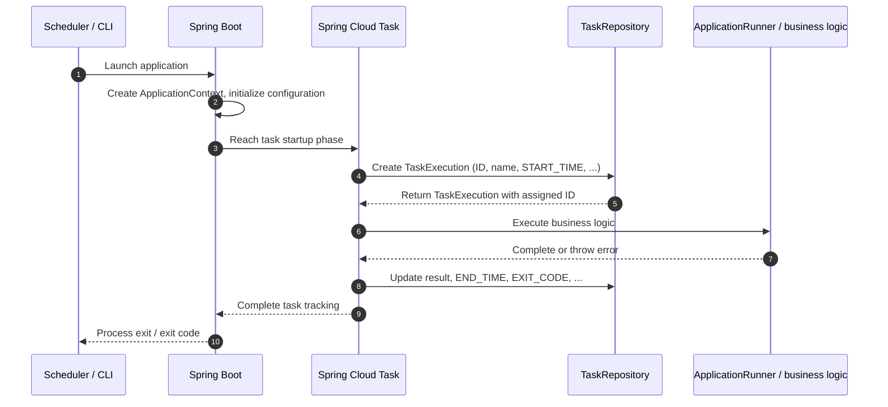
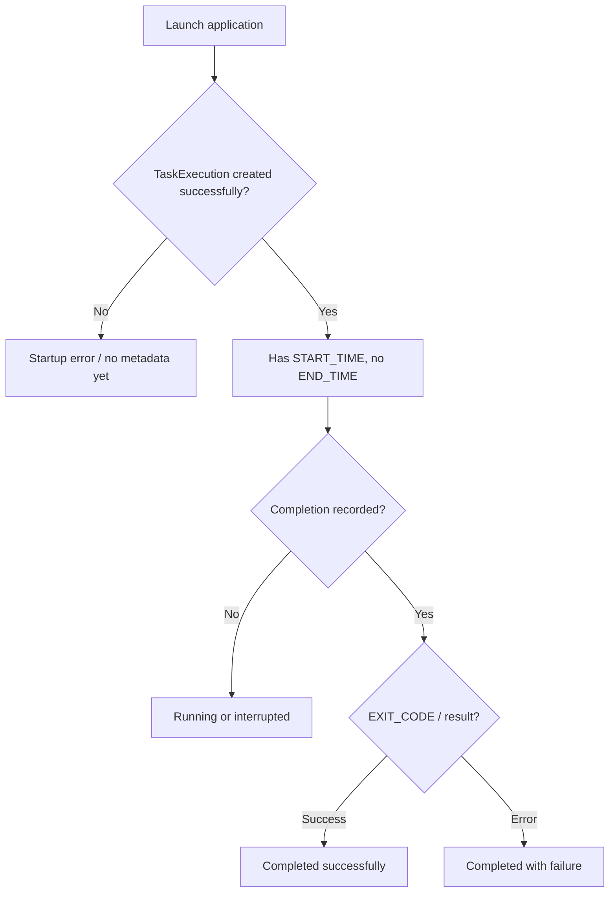
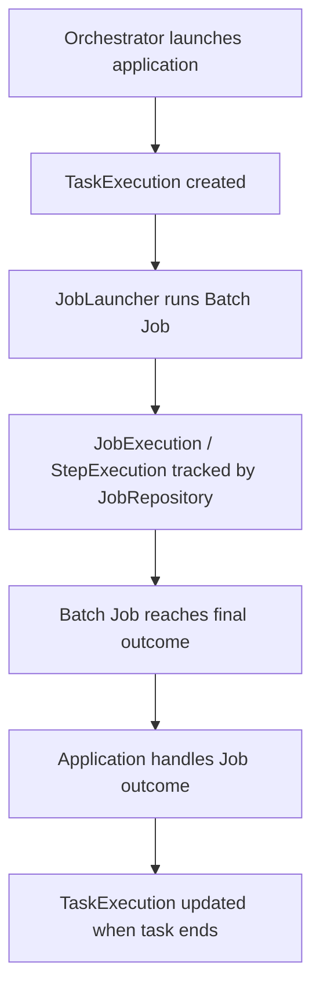

# When `TaskExecution` Is Created and Updated in Spring Cloud Task

## Lesson Objectives

In the **Lifecycle** chapter, the critical question is not just "Did the Task run?" but also **"When does Spring Cloud Task create the execution record, when does it update the outcome, and how much can you trust the fields you read?"** This is foundational for building applications with a finite runtime, querying execution history in a database, and operating safely on a schedule or on demand.

After this lesson, you will be able to:

- Distinguish the **`TaskExecution` object**, **metadata record**, and **application process**.
- Describe the milestones for creating, updating, and closing an execution in `TaskRepository`.
- Interpret the meanings of `START_TIME`, `END_TIME`, `EXIT_CODE`, `EXIT_MESSAGE`, and arguments accurately.
- Use `TaskExecutionListener` to observe lifecycle milestones while understanding callback limitations.
- Diagnose cases where a task fails, is abruptly killed, executes asynchronously, or fails to persist metadata.
- Relate task tracking to reruns, orchestration, and Spring Batch `JobExecution`.

## 1. What Does `TaskExecution` Represent?

A **Spring Boot** application can run once and exit. When integrated with **Spring Cloud Task**, the framework can record each run as a **`TaskExecution`** in **`TaskRepository`**. One `TaskExecution` represents the history of **a single task application launch**; it does not represent individual Java methods, individual data rows, or individual Batch processing steps.

For example, a system runs `daily-reconciliation` at 02:00 every day. On Nov 24 the run fails, and the orchestrator retries at 02:10. These are **two separate launches**, so there will normally be **two distinct `TaskExecution` records**, even though both use the same business date argument.

To avoid confusing concepts, distinguish among:

| Concept | Meaning |
| --- | --- |
| Java process / container | The OS or infrastructure unit actually running; has a PID, resources, and a process exit code. |
| `TaskExecution` | Metadata unit for a single Spring Cloud Task application run, assigned an ID and persisted via the repository. |
| `TaskRepository` | Storage API/layer that creates, updates, and queries task metadata, typically backed by JDBC and a relational database. |
| `TaskExecutionListener` | Extension point for receiving callbacks at task startup, completion, or failure milestones. |
| Spring Batch `JobExecution` | Metadata for a single execution of a **Batch job** inside or outside a task, managed separately by `JobRepository`. |

A single process can sequentially perform multiple business operations and still correspond to **one application-level `TaskExecution`**. If the process is launched again, Spring Cloud Task records a new run. When you need checkpoints, read/write counts, and step-level restarts, use **Spring Batch** mechanisms instead of expecting `TaskExecution` to handle them.

## 2. Key Milestones: Created Before Processing, Updated on Completion

With standard Spring Cloud Task configuration and a healthy repository, the lifecycle looks like this:



The diagram depicts the **logical sequence**. Spring Boot event names, exact callback ordering, and repository persistence operations may vary by version/configuration. Do not hard-couple expectations to a single Boot event like `ApplicationReadyEvent` to infer the exact persistence moment across all versions.

### Milestone A — Application Startup

The JVM invokes `main`, and Spring Boot creates `ApplicationContext`, loads beans, configures the datasource, and initializes required components. **Starting the JVM does not mean a `TaskExecution` already exists**. If an error happens very early—such as an invalid classpath, invalid profile, or context initialization failure—Spring Cloud Task may not have saved any record yet.

The `START_TIME` in the repository is recorded at the **point when the framework begins tracking the Task**, which does not necessarily match the exact instant the OS spawned the process or when a user clicked Run. When measuring JVM/context startup latency, inspect logs and orchestrator metrics as well.

### Milestone B — Creating `TaskExecution`

When reaching the task execution startup phase, Spring Cloud Task's lifecycle mechanism calls `TaskRepository` to create metadata for the run. In a Spring Boot application using `ApplicationRunner`/`CommandLineRunner`, tracking is set up to capture the task logic execution phase. Each record receives a unique identifier (`TASK_EXECUTION_ID`) assigned by the repository.

Information typically saved initially includes the task name, start timestamp, and command-line arguments. **`END_TIME` does not yet have a completion value** while the task is running; the final exit code/outcome cannot be concluded yet either. Do not infer "failure" solely because `END_TIME IS NULL` or an exit code is absent.

Successful persistence also depends on the datasource and `TaskRepository` schema. If the database is unreachable or metadata tables have not been initialized, the task can fail during startup before running any business logic.

### Milestone C — Business Execution

Once the task has started, the configured `ApplicationRunner`, `CommandLineRunner`, or business flow carries out its work. During this time, the same `TaskExecution` represents the **entire run**. The repository **does not automatically update progress row by row or percentage by percentage** just because a method finishes.

If progress reporting is needed, use logs/metrics, business status tables, or Spring Batch for job/step tracking. `TaskRepository` primarily answers *whether an application run is in progress or finished*, not *how many records have been processed*.

### Milestone D — Normal Completion

When task execution finishes according to the lifecycle mechanism, Spring Cloud Task updates the corresponding metadata, typically including the end timestamp and result code. A successful run is normally recorded with an `EXIT_CODE` representing success, but **do not assume every exit code follows an immutable default**: applications can customize `ExitCodeGenerator`, exit events, and result mapping policies.

`END_TIME` marks **when the framework recorded that the task ended**, not a guarantee that the container was destroyed at that exact moment. An application that still has an HTTP server, internal scheduler, or non-daemon thread can keep the JVM alive after task logic finishes; therefore, monitor process lifecycle as well.

### Milestone E — Failure Completion

If a runner throws an exception or the framework observes a task-related error, the lifecycle mechanism attempts to update failure results and error details. However, a complete record may not exist if the exception happened **before `TaskExecution` was created**, the database connection broke, or the JVM was forcefully terminated.

In particular, if the application catches an exception, **swallows it**, and exits normally, the framework may record success even though business logic failed. Translate business errors into an appropriate task failure and exit code rather than merely printing an error message.

## 3. Metadata Fields and How to Interpret Them

Spring Cloud Task's default schema typically includes the `TASK_EXECUTION` table. Table names, column types, extension columns, and argument storage may vary across versions or customized project schemas. The following fields are essential in operations:

| Field or Property | At Creation | At Update / Completion | Notes |
| --- | --- | --- | --- |
| `TASK_EXECUTION_ID` | Assigned to the new run | Unchanged within the same run | Two reruns receive different IDs. |
| `TASK_NAME` | Bound to the task name | Usually unchanged | Multiple IDs can share the same name. |
| `START_TIME` | Records when task tracking starts | Kept as start anchor | Not the moment a user clicked Run or JVM spawned. |
| `END_TIME` | No completion value yet | Populated when completion is recorded | `NULL` alone is insufficient to conclude the task is alive. |
| `EXIT_CODE` | No final result to interpret yet | Reflects outcome per framework/application policy | Must be reconciled with process exit code during orchestration. |
| `EXIT_MESSAGE` | Usually no error/result message yet | May hold error message or supplemental info | Do not treat as a log store or store sensitive data. |
| Execution arguments | May be recorded at creation time | Used to reconcile request/run | Not automatically Spring Batch `JobParameters`. |

**Common pitfall:** Spring Cloud Task does not include a `STATUS` column like `STARTED`/`COMPLETED` across all schemas for you to assume at will. When checking status, you typically inspect **record presence, `START_TIME`, `END_TIME`, `EXIT_CODE`, and actual process state**.

Quick interpretation guide:

| Observed Situation | Reasonable Interpretation | What to Check Next |
| --- | --- | --- |
| No record found | Might not have reached TaskExecution creation, querying wrong DB/schema, or metadata write failed | Startup logs, datasource, schema, permissions. |
| `START_TIME` present, no `END_TIME` | Task completion has not been recorded yet | Is the process still running or crashed/killed; is the DB connection healthy? |
| `END_TIME` present and success exit code | Framework recorded successful completion | Reconcile business outputs and process state for end-to-end certainty. |
| `END_TIME` present and error exit code | Run recorded as failed | Analyze `EXIT_MESSAGE`, logs, and business root cause. |
| Logs say "Completed" but record is not closed | Business log does not guarantee framework updated the repository | Final callbacks, transactions, shutdown, and DB. |

## 4. State Model for Monitoring

Because Task metadata does not inherently contain every business state, monitoring systems usually need **conditional inference**:



An empty `END_TIME` has **two very different possibilities**: (1) the process is still processing; (2) the process vanished before the framework could update the record. Combine scheduler data, container runtime status, PID/heartbeat, or monitoring systems to tell them apart. Never manually edit `END_TIME` in the database to "clean up" a dashboard, as that erases incident evidence.

## 5. Example: Observing `TaskExecution` in a Finite Application

### 5.1. Initializing the Application and Sample Job

The following example uses Spring Boot + Spring Cloud Task. The project requires `spring-cloud-starter-task`, a JDBC driver, and compatible Spring Boot/Spring Cloud versions. The class below uses `ApplicationRunner` to accept a business date, simulate a few seconds of processing, and provide an option to trigger a failure for verification.

```java
package com.example.lifecycle;

import java.time.LocalDate;
import java.util.List;

import org.slf4j.Logger;
import org.slf4j.LoggerFactory;
import org.springframework.boot.ApplicationRunner;
import org.springframework.boot.SpringApplication;
import org.springframework.boot.autoconfigure.SpringBootApplication;
import org.springframework.cloud.task.configuration.EnableTask;
import org.springframework.context.annotation.Bean;

@SpringBootApplication
@EnableTask
public class TaskLifecycleApplication {
    private static final Logger log = LoggerFactory.getLogger(TaskLifecycleApplication.class);

    public static void main(String[] args) {
        SpringApplication.run(TaskLifecycleApplication.class, args);
    }

    @Bean
    ApplicationRunner reconcile() {
        return args -> {
            List<String> dates = args.getOptionValues("business-date");
            if (dates == null || dates.size() != 1) {
                throw new IllegalArgumentException("Requires --business-date=yyyy-MM-dd");
            }

            LocalDate businessDate = LocalDate.parse(dates.get(0));
            log.info("Starting business logic for {}", businessDate);

            // Simulate a task long enough to observe the in-flight execution record.
            Thread.sleep(8_000);

            if (args.containsOption("fail")) {
                throw new IllegalStateException("Simulated reconciliation failure");
            }

            log.info("Completed business logic for {}", businessDate);
        };
    }
}
```

The `Thread.sleep` simulation is **strictly for observing the lifecycle**. In production, replace it with real processing services and design appropriate timeouts, cancellation, and idempotency. If multiple runners are used, note that ordering/synchronization between them can affect when the task actually completes.

### 5.2. Configuring the Repository

In `application.yml`, configure a PostgreSQL database that already has the Spring Cloud Task metadata schema:

```yaml
spring:
  application:
    name: lifecycle-demo
  main:
    web-application-type: none
  datasource:
    url: jdbc:postgresql://localhost:5432/task_demo
    username: task_user
    password: ${TASK_DB_PASSWORD}
  cloud:
    task:
      name: lifecycle-demo
```

The database, user account, and schema must be prepared in advance; how metadata tables are initialized/migrated depends on the library version and environment policy. Use a persistent database so you can query records after the application exits. Never store real passwords directly in documentation or source code.

### 5.3. Success, In-Progress, and Failure Runs

Package an executable JAR using your project's Maven/Gradle build, then run it:

```bash
java -jar lifecycle-demo.jar --business-date=2026-11-24
```

During the simulated processing window, use **another** SQL client connected to the same database:

```sql
SELECT TASK_EXECUTION_ID,
       TASK_NAME,
       START_TIME,
       END_TIME,
       EXIT_CODE,
       EXIT_MESSAGE
FROM TASK_EXECUTION
ORDER BY TASK_EXECUTION_ID DESC;
```

Compare **before and after the runner finishes**:

1. While processing is underway, the corresponding row already has `TASK_EXECUTION_ID` and `START_TIME`; `END_TIME` is not yet updated to a completion timestamp.
2. When the runner finishes and the framework completes writing metadata, `END_TIME` and the run's outcome are updated.
3. Run the same JAR again with `--fail` added to simulate an exception; the new record will show a failure outcome **if the lifecycle mechanism can persist error metadata**.

```bash
java -jar lifecycle-demo.jar --business-date=2026-11-24 --fail
```

To inspect unfinished executions in the database, you can run:

```sql
SELECT TASK_EXECUTION_ID, TASK_NAME, START_TIME
FROM TASK_EXECUTION
WHERE END_TIME IS NULL
ORDER BY START_TIME DESC;
```

This query result is only a **list of runs not yet marked finished**. You cannot rely on it alone to claim "currently running" without checking the corresponding process or container.

## 6. Observing Callbacks with `TaskExecutionListener`

Spring Cloud Task provides `TaskExecutionListener` for executing auxiliary logic at lifecycle milestones. Commonly used callbacks are:

- `onTaskStartup(TaskExecution)` — receives details when the task starts.
- `onTaskEnd(TaskExecution)` — receives details when the task ends per the lifecycle mechanism.
- `onTaskFailed(TaskExecution, Throwable)` — receives details when an error is caught by the framework in the task lifecycle.

Example logging-only listener:

```java
package com.example.lifecycle;

import org.slf4j.Logger;
import org.slf4j.LoggerFactory;
import org.springframework.cloud.task.listener.TaskExecutionListener;
import org.springframework.cloud.task.repository.TaskExecution;
import org.springframework.stereotype.Component;

@Component
public class LifecycleAuditListener implements TaskExecutionListener {
    private static final Logger log = LoggerFactory.getLogger(LifecycleAuditListener.class);

    @Override
    public void onTaskStartup(TaskExecution execution) {
        log.info("Task started: id={}, name={}",
                execution.getExecutionId(), execution.getTaskName());
    }

    @Override
    public void onTaskEnd(TaskExecution execution) {
        log.info("Task reached end milestone: id={}", execution.getExecutionId());
    }

    @Override
    public void onTaskFailed(TaskExecution execution, Throwable throwable) {
        log.error("Task failed: id={}", execution.getExecutionId(), throwable);
    }
}
```

**Notes when using listeners:**

1. Listeners assist with observability and side tasks (auditing, metrics, internal notifications). Do not assume the callback sees a **fully committed DB record** at the exact moment it is invoked; ordering and transactions may depend on the version.
2. Do not place long-running business logic, unbounded blocking operations, or network calls without timeouts inside lifecycle callbacks. Errors in a listener can complicate task startup/teardown.
3. Do not treat `onTaskFailed` as a catch-all for every infrastructure failure: power loss, `SIGKILL`, `kill -9`, or JVM crashes can prevent the callback from running.
4. Do not log or store all arguments, exceptions, or sensitive data into metadata/logs. Filter out tokens, passwords, and personal data.

A listener is an **event hook**, whereas `TaskRepository` remains the standard metadata manager. Avoid issuing ad-hoc `UPDATE TASK_EXECUTION` SQL statements inside a listener, as doing so easily breaks ordering, consistency, and reconciliation.

## 7. Scenarios Where Metadata Is Easily Misinterpreted

### 7.1. Application fails before `TaskExecution` is created

If datasource settings are invalid, the schema is missing, or a bean fails during initialization, the framework may never reach the metadata creation phase. The orchestration system still records a process failure, yet querying the Task Repository shows no record. Thus, **not finding a `TaskExecution` does not mean no run was ever requested**.

For scheduled runs or API-triggered runs, persist a request ID and trigger logs in the orchestrator; once the task starts successfully, link that ID to the Task Execution if end-to-end traceability is required.

### 7.2. Process killed or crashed after creating the record

If the process is forcefully terminated mid-execution, the repository may have saved only `START_TIME`. `END_TIME` remains empty and end callbacks never run. This state cannot resolve itself merely by querying the database. Monitoring must confirm the process is gone and record the incident per operational procedures instead of treating that row as "running forever."

When deploying a Kubernetes CronJob or a scheduler, track **job/container completion**, timeouts, retry counts, and Task metadata together. Multiple task runs can exist for the same business date if the scheduler retries; apply appropriate request/date locks.

### 7.3. Catching an exception and returning as success

Example to avoid:

```java
try {
    importBusinessData();
} catch (Exception ex) {
    log.error("Data import failed", ex);
    // Nothing else done: the runner can still exit normally.
}
```

If an error should fail the entire task, allow the exception to reach error-handling infrastructure or translate it into an intentional exit code/outcome. If certain faulty records are allowed to be skipped, explicitly define the business error policy and reporting mechanism rather than arbitrarily treating every exception as success.

### 7.4. Asynchronous work and the runner exiting too early

Example:

```java
executor.submit(this::performLongRunningWork);
// ApplicationRunner returns immediately while real work has not finished.
```

When sub-work executes on another thread, the moment the runner returns **does not prove** the sub-work is finished. Depending on configuration, the application might record task completion early, or the process might linger because the executor was never shut down. For a finite task, `join`/await the `Future`, propagate child failures back to the runner, and shut down resources cleanly.

If using Spring Batch with an asynchronous `JobLauncher`, keep the same rule in mind: you must know `JobExecution` has reached a terminal state before considering the business task complete.

### 7.5. Database failure at completion time

It is possible to create `TaskExecution` and complete business processing successfully, yet lose DB connectivity right when updating `END_TIME` or `EXIT_CODE`. In that case, Task history may not reflect the true outcome. You cannot infer that business data rolled back purely from Task metadata: business transactions and Task Repository update transactions can have independent scopes.

Monitor repository write errors, maintain stable connection configurations, and design idempotent business logic to avoid duplicate writes if the orchestrator decides to retry due to unclear status.

### 7.6. Concurrent executions

Two `daily-reconciliation --business-date=2026-11-24` processes running concurrently normally produce two `TaskExecution` records with two different IDs. Task metadata **does not automatically acquire a business lock by date**. When data does not allow parallel runs, enforce deduplication in the scheduler, queue, database, or service layer, and handle retries safely.

## 8. Relation to Spring Batch: Two Completion Milestones Can Differ

When a Spring Cloud Task launches **Spring Batch**, two metadata scopes exist:



**A successful `JobExecution` does not automatically guarantee `TaskExecution` ended successfully**, because the application can still fail after the job finishes or fail to write Task metadata. The reverse also matters: if the application does not propagate Batch failures up to the task level, `TaskExecution` can be recorded as successful even though the Batch job failed.

With an asynchronous launcher, the job may still be running when the `launch` call returns. Properly await/reconcile job status before letting the application terminate. When a scheduler retries the same request, Spring Cloud Task typically creates a **new `TaskExecution`**, whereas Spring Batch decides whether to restart a `JobInstance` or create a new instance based on job name, identifying `JobParameters`, and the status of prior executions.

## 9. Safe Operational Principles

| Practice | Why It Relates to When `TaskExecution` Is Recorded |
| --- | --- |
| Use a persistent metadata database, compatible schema, and controlled migrations | History is not lost when containers exit, preventing write errors during startup or shutdown. |
| Monitor process/container alongside Task Repository | Distinguishes running tasks from unclosed rows caused by crashes or kills. |
| Map business errors to clear terminal statuses and exit codes | Prevents reporting false success when business processing fails. |
| Never let the runner return before async work completes | Metadata completion time must reflect real work. |
| Design idempotency and business locks when needed | Task reruns create new history rows but do not automatically prevent duplicate data writes. |
| Restrict and sanitize data in arguments, messages, and logs | Metadata and logs may be retained long-term and read by many people. |
| Enforce timeouts and policies for hung tasks | An empty `END_TIME` row alone is insufficient for safe retry decisions. |
| Verify repository persistence after test runs | Business completion logs do not guarantee metadata was committed. |

## 10. Self-Check Exercises

1. A container runs for 25 seconds, yet querying `TASK_EXECUTION` shows `START_TIME` is 4 seconds later than the container start time. Is the data necessarily wrong? Why?
2. When `END_TIME IS NULL`, name at least two real-world scenarios that can lead to that state and the additional data sources you should inspect.
3. A runner logs "Processing completed" and then the application fails to update `EXIT_CODE` due to a lost database connection. Can you conclusively tell from task metadata alone whether business work completely failed or succeeded?
4. Why can't `onTaskFailed` be guaranteed to run if the JVM is forcefully killed? What additional telemetry should be monitored?
5. If a task invokes a Batch job asynchronously, is `JobLauncher` returning sufficient to record "business work completed"?
6. The same `business-date` parameter is passed across two retries. How might Spring Cloud Task and Spring Batch create different metadata units?

**Takeaway:** `TaskExecution` is **created when Spring Cloud Task begins tracking the run** and **updated when the framework records completion**, provided the repository is reachable. `START_TIME`, `END_TIME`, `EXIT_CODE`, and `EXIT_MESSAGE` reflect task lifecycle metadata, but **do not replace** signals from the OS process, orchestrator, or business/Batch job state. Understanding the exact timing and limits of these fields is fundamental to running tasks on schedule, on demand, and handling retries safely.
