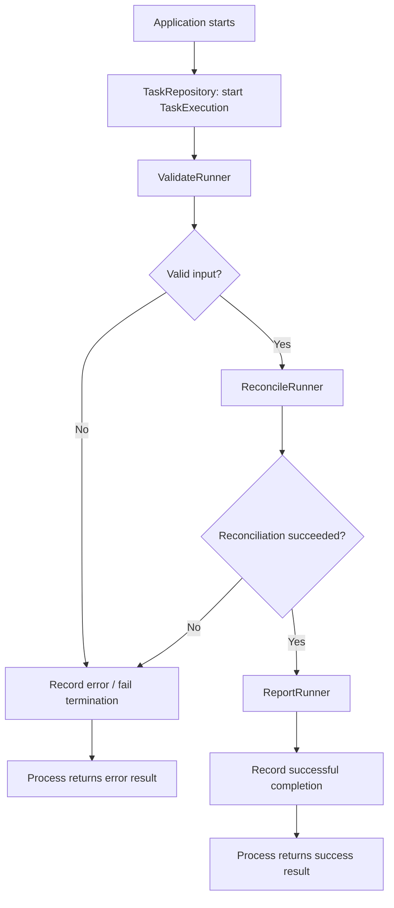

# Executing Multiple Runners Within a Single Application Run

In **Spring Cloud Task**, a single application process can execute several small tasks sequentially and then exit. For instance, a revenue reconciliation task needs to **validate arguments**, **reconcile data**, and **generate an outcome notification**. Spring Boot lets you register multiple `ApplicationRunner` or `CommandLineRunner` beans to perform these tasks when the application starts up.

The key distinction in the **Lifecycle** chapter is between two levels:

- **One application launch** (such as one `java -jar` command) is one Spring Cloud Task execution, typically recorded as **one `TaskExecution`** in the database via `TaskRepository`.
- **Multiple runners** are multiple callbacks running **inside that very same launch**. They do not independently create separate `TaskExecution` records.

This lesson explains how to register and order runners, how Spring Cloud Task records the overall outcome, and how to avoid terminating incorrectly when a runner fails or launches asynchronous work.

## 1. What Are Runners in Spring Boot?

Spring Boot provides two common interfaces to run work right after the application context is prepared:

| Interface | Method | Input Received | When Is It Appropriate? |
| --- | --- | --- | --- |
| `ApplicationRunner` | `run(ApplicationArguments args)` | Arguments parsed by Spring Boot into option and non-option args | When reading `--business-date=...`, toggle flags, or named arguments. |
| `CommandLineRunner` | `run(String... args)` | Raw command-line string array | When parsing syntax manually or forwarding raw arguments to another tool. |

Example command:

```bash
java -jar multi-runner-task.jar --business-date=2026-11-24 --dry-run input.csv
```

An `ApplicationRunner` can call `args.getOptionValues("business-date")` to get `2026-11-24`, `args.containsOption("dry-run")` to check for the flag, and `args.getNonOptionArgs()` to retrieve `input.csv`. A `CommandLineRunner` receives the raw strings in `String... args`.

**They are not two different lifecycles.** Both runner types are invoked by Spring Boot during application startup, after the context is created and required beans are ready. Both can throw exceptions outward and fail the run.

### How does a runner differ from `TaskExecution`?

`TaskExecution` is metadata for the **entire Spring Cloud Task application run**: task name, execution ID, start and end times, exit code, and related fields depending on version/configuration. It does not hold an individual success/failure status list per runner.

Example of one process containing three runners:

```text
java -jar multi-runner-task.jar
  |
  +-- ValidateRunner       (ApplicationRunner)
  +-- ReconcileRunner      (ApplicationRunner)
  +-- ReportRunner         (CommandLineRunner)
  |
  +-- Application exits

TaskRepository: records one TaskExecution for the entire process
```

If you run the same JAR again, Spring Cloud Task can record a new `TaskExecution` with a different ID. The number of records depends on the number of **recorded application launches**, not the number of registered runners.

## 2. Execution Order with Multiple Runners

Spring Boot collects `ApplicationRunner` and `CommandLineRunner` beans, sorts them via the `Ordered`/`@Order` mechanism, and invokes them sequentially. Therefore:

1. Runners with a **lower order number** are called before runners with a higher order number.
2. Both runner interfaces participate in the same ordering mechanism; do not assume *all* `ApplicationRunner` beans run before any `CommandLineRunner`.
3. If runners have the same order or declare no order, do not rely on their invocation order. Use distinct `@Order` values whenever dependencies exist.
4. `@Order` controls **invocation order of the `run` method**, not bean initialization order or completion order of asynchronous work.

In this example, the desired order is:

<svg xmlns="http://www.w3.org/2000/svg" width="690" height="156" viewBox="0 0 690 156" role="img" aria-label="Three runners inside one TaskExecution, ordered as input validation, reconciliation, and reporting">
  <rect x="6" y="7" width="678" height="142" rx="12" fill="#f6f8fc" stroke="#c8d4e4"/>
  <text x="21" y="30" font-family="Arial,sans-serif" font-size="16" font-weight="bold" fill="#253858">One process / one TaskExecution</text>
  <rect x="20" y="50" width="193" height="75" rx="8" fill="#e8f2ff" stroke="#91b7df"/>
  <rect x="248" y="50" width="193" height="75" rx="8" fill="#e6f5eb" stroke="#9acbaa"/>
  <rect x="476" y="50" width="193" height="75" rx="8" fill="#fff1df" stroke="#e3bf87"/>
  <g font-family="Arial,sans-serif" fill="#253858" font-size="14">
    <text x="34" y="75">1. ValidateRunner</text>
    <text x="34" y="99">@Order(10)</text>
    <text x="262" y="75">2. ReconcileRunner</text>
    <text x="262" y="99">@Order(20)</text>
    <text x="490" y="75">3. ReportRunner</text>
    <text x="490" y="99">@Order(30)</text>
  </g>
  <path d="M215 87 L244 87 M240 83 L244 87 L240 91" fill="none" stroke="#657b99" stroke-width="2"/>
  <path d="M443 87 L472 87 M468 83 L472 87 L468 91" fill="none" stroke="#657b99" stroke-width="2"/>
</svg>

The sequence above only describes the normal execution path, when runners work synchronously and throw no errors.

## 3. Complete Example: Three Runners in One Spring Cloud Task

Let's build a finite-running Java application that accepts `--business-date=YYYY-MM-DD` and performs three steps:

- `ValidateRunner`: verifies the date argument is valid.
- `ReconcileRunner`: simulates reconciliation and can optionally simulate an error.
- `ReportRunner`: logs completion of the report.

### 3.1. Dependencies and Configuration

In a Spring Boot project already configured with a Maven parent/plugin and a **Spring Cloud BOM compatible with the Spring Boot version**, add dependencies:

```xml
<dependencies>
    <dependency>
        <groupId>org.springframework.cloud</groupId>
        <artifactId>spring-cloud-starter-task</artifactId>
    </dependency>
    <dependency>
        <groupId>org.springframework.boot</groupId>
        <artifactId>spring-boot-starter-jdbc</artifactId>
    </dependency>
    <dependency>
        <groupId>com.h2database</groupId>
        <artifactId>h2</artifactId>
        <scope>runtime</scope>
    </dependency>
</dependencies>
```

Create `src/main/resources/application.yml` for the practice environment:

```yaml
spring:
  application:
    name: multi-runner-task
  main:
    web-application-type: none
  datasource:
    url: jdbc:h2:file:./multi-runner-metadata
    driver-class-name: org.h2.Driver
    username: sa
    password: ""
  cloud:
    task:
      name: dailyRevenuePipeline
      initialize-enabled: true
```

File-based H2 preserves history across runs, provided you launch from the same working directory. Automatic table creation is suitable for practice; production environments must manage version-appropriate schemas and use a reliably operated database.

### 3.2. Writing the Application

Create `src/main/java/com/example/task/MultiRunnerTaskApplication.java`. For easy viewing in one place, the three runners are written as `static` nested classes inside the main application class; in a real project, they can be split into three files:

```java
package com.example.task;

import java.time.LocalDate;
import java.util.List;

import org.springframework.boot.ApplicationArguments;
import org.springframework.boot.ApplicationRunner;
import org.springframework.boot.CommandLineRunner;
import org.springframework.boot.SpringApplication;
import org.springframework.boot.autoconfigure.SpringBootApplication;
import org.springframework.cloud.task.configuration.EnableTask;
import org.springframework.core.annotation.Order;
import org.springframework.stereotype.Component;

@SpringBootApplication
@EnableTask
public class MultiRunnerTaskApplication {

    public static void main(String[] args) {
        SpringApplication.run(MultiRunnerTaskApplication.class, args);
    }

    // Shared helper to read and validate business input.
    private static LocalDate requiredBusinessDate(ApplicationArguments args) {
        List<String> values = args.getOptionValues("business-date");
        if (values == null || values.size() != 1
                || values.get(0) == null || values.get(0).isBlank()) {
            throw new IllegalArgumentException(
                "Must pass --business-date=YYYY-MM-DD"
            );
        }
        return LocalDate.parse(values.get(0));
    }

    @Component
    @Order(10)
    public static class ValidateRunner implements ApplicationRunner {
        @Override
        public void run(ApplicationArguments args) {
            LocalDate date = requiredBusinessDate(args);
            System.out.println("1. Valid argument: " + date);
        }
    }

    @Component
    @Order(20)
    public static class ReconcileRunner implements ApplicationRunner {
        @Override
        public void run(ApplicationArguments args) {
            LocalDate date = requiredBusinessDate(args);
            System.out.println("2. Reconciling date " + date);

            if (args.containsOption("simulate-error")) {
                throw new IllegalStateException(
                    "Simulated error during reconciliation step"
                );
            }

            System.out.println("2. Reconciliation succeeded");
        }
    }

    @Component
    @Order(30)
    public static class ReportRunner implements CommandLineRunner {
        @Override
        public void run(String... args) {
            System.out.println("3. Report completed");
        }
    }
}
```

The `@Component` classes are managed as beans by Spring. Spring Boot will invoke all three runners in order `@Order(10)`, `@Order(20)`, and `@Order(30)`. The example uses no asynchronous tasks, so the second runner's `run` call only begins after the first runner completes.

`requiredBusinessDate` is called in two places to keep the example resilient against missing or malformed arguments. In larger applications, extract input parsing into a validated configuration/value bean checked once; `@Order` should not be the sole safeguard ensuring data validity.

### 3.3. Packaging and Running

Assuming a Maven project with artifact `multi-runner-task`, version `0.0.1-SNAPSHOT`, and `spring-boot-maven-plugin` configured, package it:

```bash
./mvnw clean package
```

Launch from the project root directory:

```bash
java -jar target/multi-runner-task-0.0.1-SNAPSHOT.jar \
  --business-date=2026-11-24
echo $?
```

Expected ordered business output:

```text
1. Valid argument: 2026-11-24
2. Reconciling date 2026-11-24
2. Reconciliation succeeded
3. Report completed
```

In a normal successful run, the process exit code is `0`. If running on PowerShell, you can use:

```powershell
java -jar .\target\multi-runner-task-0.0.1-SNAPSHOT.jar --business-date=2026-11-24
$LASTEXITCODE
```

Actual output also includes Spring Boot and Spring Cloud Task startup logs. They do not change the principle: the three runners execute **in the same process** and share **the same Spring Cloud Task execution**.

## 4. What Happens If One Runner Fails?

Try simulating an error during the reconciliation step:

```bash
java -jar target/multi-runner-task-0.0.1-SNAPSHOT.jar \
  --business-date=2026-11-24 \
  --simulate-error
echo $?
```

Expected flow:

1. `ValidateRunner` completes.
2. `ReconcileRunner` starts, then throws `IllegalStateException`.
3. Spring Boot does not proceed to invoke `ReportRunner` in that synchronous runner pass.
4. Application startup fails; the system reflects the error via logs, execution result, and a **non-`0` exit code** when no custom mechanism masks the error.



**Be careful when catching exceptions:** If `ReconcileRunner` catches every `Exception`, only logs it, and returns normally, Spring Boot considers that runner finished. Subsequent runners are still invoked, and the entire task may report success even though business logic actually failed.

```java
// Wrong if you want the task to fail when business logic fails:
try {
    reconcile();
} catch (Exception e) {
    log.error("Reconciliation failed", e);
    // Swallowed error -> the next runner can still run.
}

// Common approach: log context and rethrow the error.
try {
    reconcile();
} catch (Exception e) {
    log.error("Reconciliation failed", e);
    throw e;
}
```

The illustration above assumes a `reconcile()` method and a logger object in the business class; it clarifies the **difference in error propagation**, not a standalone snippet to paste directly.

If the JVM is abruptly killed, metadata repository connectivity is lost, or an error happens too early during startup, `TaskExecution` may not be created or updated with an end time. You must cross-check database records against exit codes, logs, and container/process status.

## 5. Observing a Shared Execution in the Database

When the application is configured with `TaskRepository`, each run receives a `TaskExecution` ID. You can inspect historical records in the metadata table, for example:

```sql
SELECT
    TASK_EXECUTION_ID,
    TASK_NAME,
    START_TIME,
    END_TIME,
    EXIT_CODE
FROM TASK_EXECUTION
ORDER BY TASK_EXECUTION_ID DESC;
```

After one successful run and one simulated failure run, expect **two execution records** (assuming both started up and wrote metadata successfully), **not six records** corresponding to three runners per run.

| What to Track | Where to Check? | Limitation |
| --- | --- | --- |
| Overall run start/end, exit code | `TaskExecution` via `TaskRepository`/`TaskExplorer` | No per-runner status. |
| Which runner started or failed | Logs containing runner name, request ID, and timestamp | Logs can be lost without centralized collection. |
| Timing and outcome of each step | Metrics, tracing, or custom business tables | Requires explicit instrumentation. |
| Reconciliation results and report files | Business databases/data stores | Task metadata does not store business data for you. |
| Whether container or process was killed/OOM | Launch/orchestration platform | May differ from what metadata managed to record. |

`TaskExecutionListener` provides callbacks at the **task lifecycle** level—such as startup, completion, and failure. Do not interpret these callbacks as events corresponding to *individual runners*. If you need per-step history, add step-named logs/tracing/metrics or adopt an appropriate step-modeling tool.

## 6. Common Pitfalls When Using Multiple Runners

### 6.1. `@Order` does not create a shared business transaction

Suppose `ReconcileRunner` writes partial results to the business database and then `ReportRunner` fails. The fact that the entire Spring Cloud Task ends with an error exit code **does not automatically roll back** changes already committed by an earlier runner.

If consistency is required, define transactions at the service layer, split work into safely rerunnable steps, or use compensation mechanisms when transactions span multiple systems. For scheduled processing, especially guarantee **idempotency** by business key (such as `business-date` and report code) so retries never produce duplicate outputs.

### 6.2. Asynchronous runners can return too early

`@Order` only sorts **invocation order**; it does not wait for background work to finish if a runner spawns a thread, calls `@Async`, or opens a `CompletableFuture` and returns right away.

```java
// Unsuitable if the task must wait for data processing to finish:
public void run(ApplicationArguments args) {
    CompletableFuture.runAsync(() -> processData());
    // The run method returns before processData completes.
}
```

The solution is to **wait for completion**, manage timeouts, and bring errors from background work back to the main execution thread:

```java
public void run(ApplicationArguments args) {
    CompletableFuture<Void> work =
        CompletableFuture.runAsync(() -> processData(), executor);
    work.join(); // Waits and propagates errors so the task knows about failures.
}
```

In the second example, `processData()` and `executor` are assumed to be declared and lifecycle-managed components. In practice, use a Spring-managed executor and configure proper timeouts; `join()` without a timeout can block the task indefinitely if work hangs. When time limits are needed, use timeout-aware wait APIs and handle task cancellation properly.

### 6.3. Do not overuse runners as a complex workflow engine

Multiple runners fit small, short, relatively independent tasks, or when initializing a few operations in a clear sequence. For tightly coupled steps, placing all orchestration logic across many startup beans quickly becomes hard to control and test. An alternative is using **a single `ApplicationRunner`** that calls business services sequentially:

```java
@Component
public class RevenuePipelineRunner implements ApplicationRunner {
    private final RevenuePipelineService service;

    public RevenuePipelineRunner(RevenuePipelineService service) {
        this.service = service;
    }

    @Override
    public void run(ApplicationArguments args) {
        service.validateInput(args);
        service.reconcile(args);
        service.publishReport(args);
    }
}
```

This snippet illustrates an architectural option; `RevenuePipelineService` is a business service you implement yourself. If you adopt this approach, replace the three older runners to avoid duplicate execution.

When a workflow requires **step-level restart, checkpoints, and high-volume data processing**, Spring Batch is usually a better fit with `Job`, `Step`, and `JobRepository`. In that setup, **Spring Cloud Task** still records the lifecycle of the **finite-running application**, while **Spring Batch** records the lifecycle and results of the internal **job/step**. The two metadata stores address two distinct observability levels.

### 6.4. Auto-configured runners from libraries must also be accounted for

An application may include additional runners from library auto-configuration. For example, when integrating Spring Batch, Spring Boot can configure a runner to launch Batch Jobs automatically if conditions are met. Therefore, when unexpected work runs, inspect **all registered `ApplicationRunner` and `CommandLineRunner` beans**, their ordering, and auto-configuration settings. You can disable automatic batch job execution via `spring.batch.job.enabled=false` if the application needs to control when `JobLauncher` is called.

## 7. Scheduled Runs, On-Demand Runs, and Retries

When `java -jar` is invoked by cron, a Kubernetes Job, Spring Cloud Data Flow, or a platform launcher, **each process spawn** is a new application run. If the previous run failed in the second runner, a retry will normally **restart from the first runner**, unless you design detection of already-completed work or move business steps into a stateful restart mechanism.

| Scenario | Consequence | Mitigation |
| --- | --- | --- |
| User triggers two runs for the same date | Two processes, two `TaskExecution` records; risk of duplicate writes | Business keys, idempotency, concurrency control. |
| Scheduler retries after second runner fails | Earlier runners may run again | Make steps safe to repeat, persist checkpoints if needed. |
| Task times out while still running | Risk of two processes handling the same period simultaneously | Verify infrastructure state before retrying, use appropriate lock/lease mechanisms. |
| Runner ends before background task finishes | Metadata may fail to reflect actual background outcome | Await the Future, manage timeouts, and propagate errors to the main flow. |

**`TaskRepository` does not orchestrate retries or schedules.** It stores execution history and supports tracking and status queries. External schedulers/launchers/orchestrators decide when to spawn processes; the application is responsible for ensuring business steps behave correctly and remain safe to rerun.

## 8. Hands-On Practice and Self-Check Questions

Practice with the sample project:

1. Build the application, run with `--business-date=2026-11-24`, and confirm the output order `1 → 2 → 3`.
2. Add `--simulate-error`, confirm step `3` does not appear, and observe a non-`0` exit code.
3. Run the application again; query `TASK_EXECUTION` and explain why there is one more run record rather than one record per runner.
4. Swap `@Order(20)` and `@Order(30)` to observe the changed order; then restore the proper order.
5. Try catching and ignoring the error inside `ReconcileRunner`; check whether the completion message and overall result become misleading.
6. Draft a proposal for the scenario where the report was saved yet the process was killed before recording completion: what evidence should a safe retry rely on?

Questions to answer:

- If an application has two `ApplicationRunner` beans and one `CommandLineRunner`, how many `TaskExecution` records does a single `java -jar` invocation create?
- Does `@Order` guarantee the **runner invocation** order or the **completion order of asynchronous Futures**?
- Why does one runner succeeding not mean the entire task succeeded?
- When restarting from an already-completed step is needed, should you prefer adding more runners or using Spring Batch's `Job`/`Step` model?

**Core takeaway:** Inside a Spring Cloud Task application, multiple runners are internal execution units sharing **the same application lifecycle**. Establish explicit ordering, let errors propagate properly, wait for required work to finish, and protect business data from duplicate retries. `TaskRepository` tracks the overall run; when fine-grained step monitoring or restartability is required, adopt appropriate tooling and models.
