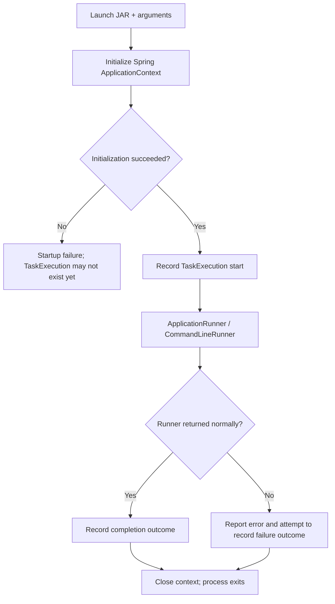

# Normal Completion and Unhandled Exceptions

## 1. Why Distinguish Ways a Spring Cloud Task Terminates?

**Spring Cloud Task** is a foundation for building Spring Boot applications with a finite runtime: starting up, processing work, recording execution progress via `TaskRepository`, and exiting. A task may be launched on a schedule, on demand, or from an orchestrator; after each run, operators must know whether it **succeeded**, **failed**, or has an **undetermined outcome**.

Seeing that the Java process stopped is not enough to conclude the work succeeded. A program can complete normally, throw an unhandled exception, fail during startup, be forcefully killed, or lose its database connection while writing the final status. These situations affect business data and `TaskExecution` records differently.

**Learning objectives:** After this lesson, you will be able to:

- Describe a task's lifecycle from startup to recording terminal status.
- Distinguish a Runner completing normally from an exception escaping `ApplicationRunner` or `CommandLineRunner`.
- Interpret `START_TIME`, `END_TIME`, `EXIT_CODE`, `EXIT_MESSAGE`, and `ERROR_MESSAGE` in the repository.
- Explain the relationship between exceptions, rollbacks, Task outcomes, and process exit codes.
- Choose strategies for error handling, status monitoring, retries, and safe operations.

## 2. Three Types of Outcomes to Distinguish

| Scope | Determining Component | Question to Answer |
| --- | --- | --- |
| **Business outcome** | Services, transactions, data, and external systems | Were orders, files, or data processed accurately? |
| **Task outcome** | Spring Cloud Task, `TaskRepository`, and `TaskExecution` | Did the framework record the run as completed or failed? |
| **Process outcome** | Spring Boot, JVM, operating system, scheduler | Is the process still running or did it exit with a specific exit code? |

These three scopes are related yet not identical. For instance, a service that logs and ignores an exception can let the Runner finish normally even though data is incomplete. Conversely, committed data can still exist if the process is killed before updating the Task record.

A reliable system reconciles **data state + Task metadata + logs + exit code**. Never infer the entire outcome from a single source alone.

## 3. Startup and Termination Lifecycle

### 3.1. Main Steps

A typical Spring Cloud Task application goes through:

1. Cron, a user, or an orchestration system launches the JAR with arguments and environment variables.
2. `SpringApplication.run(...)` initializes `ApplicationContext`, beans, datasource, and Task infrastructure.
3. Once infrastructure is ready, Spring Cloud Task records the start time of a `TaskExecution` in `TaskRepository`.
4. Spring Boot invokes `ApplicationRunner`/`CommandLineRunner` to run business logic.
5. When the Runner completes or raises an unhandled error, the framework attempts to persist the Task's final outcome.
6. The context closes according to configuration; once no threads or components keep the JVM alive, the process exits.



The diagram describes **typical** phases without guaranteeing every callback always executes. If the database is unreachable, the Task schema is invalid, the process is forcefully killed, or the JVM hits a fatal error, some steps may not happen.

### 3.2. Runner completion does not always mean the JVM stopped

`ApplicationRunner.run(...)` returning means the Runner completed its synchronous work. If the application still keeps a web server, non-daemon threads, an active executor, or other keep-alive resources, the JVM may not exit yet.

Task applications commonly configure:

```yaml
spring:
  main:
    web-application-type: none
  cloud:
    task:
      closecontextEnabled: true
```

`spring.main.web-application-type=none` prevents the task from starting an unnecessary web server. Spring Cloud Task's context-closing option should be checked against the version in use; application-created executors and resources must still have their lifecycles managed properly.

Spring Cloud Task records a single execution; it **does not schedule runs itself**. When nightly or fixed-interval runs are needed, cron, Kubernetes CronJob, or an orchestrator is responsible for spawning new executions.

## 4. Normal Completion

### 4.1. When is a Runner considered complete?

At the Spring Boot level, a Runner completes normally when `run(...)` **returns without throwing an exception outward**. A well-designed application should let a Runner return only after:

- Input has been validated and the work confirmed valid.
- Mandatory business steps have finished.
- Transactions intended to commit have committed successfully.
- Critical asynchronous operations have been awaited and their outcomes checked.
- Skipped cases (if any) follow explicit business rules.

Example:

```java
import org.springframework.boot.ApplicationRunner;
import org.springframework.context.annotation.Bean;
import org.springframework.context.annotation.Configuration;

@Configuration
public class ImportRunnerConfig {
    @Bean
    ApplicationRunner importRunner(ImportService service) {
        return args -> {
            int count = service.importPendingData();
            System.out.println("Completed, record count: " + count);
        };
    }
}
```

Assuming `importPendingData()` returns only after all mandatory steps complete, the Runner also finishes normally. Spring Cloud Task attempts to record a successful completion status. Under common default configuration, the exit code on success is **0**.

**Limitation to understand:** A log line saying `Completed` does not prove metadata was saved successfully, and normal-completion metadata does not by itself prove business correctness if code swallowed errors.

### 4.2. What does `TaskExecution` record?

`TaskRepository` manages one `TaskExecution` per **Task execution**, not per individual step inside a Runner. Common properties:

| Property | Meaning |
| --- | --- |
| `taskExecutionId` | Unique identifier for the run |
| `taskName` | Logical name of the task |
| `startTime` | Timestamp when the framework recorded startup |
| `endTime` | Timestamp when completion was recorded; may be absent if the Task was interrupted |
| `exitCode` | Task-level result code |
| `exitMessage` | Exit message, if present |
| `errorMessage` | Recorded exception details, if present |

With a compatible Spring Cloud Task schema, you can inspect the metadata table:

```sql
SELECT TASK_EXECUTION_ID,
       TASK_NAME,
       START_TIME,
       END_TIME,
       EXIT_CODE,
       EXIT_MESSAGE,
       ERROR_MESSAGE
FROM TASK_EXECUTION
ORDER BY TASK_EXECUTION_ID DESC;
```

Do not rely solely on `START_TIME` to conclude a Task finished. A row missing `END_TIME` could still be running, have been killed, or have failed to save the final outcome.

## 5. Unhandled Exceptions

### 5.1. An exception escaping the Runner

Example of a Runner that does not catch errors:

```java
@Bean
ApplicationRunner failingRunner() {
    return args -> {
        throw new IllegalStateException(
                "Invalid input data");
    };
}
```

When `IllegalStateException` escapes `run(...)`, Spring Boot treats the application run as failed. If `TaskRepository` was initialized and remains reachable, Spring Cloud Task has a chance to write failure status, exit code, and error details to `TaskExecution`. The process usually exits with a **non-zero** exit code, though the exact number depends on exit code mapping and the runtime environment.

**There is no guarantee** every exception yields an error record. If the context fails before the repository initializes, or the database disconnects when updating the final result, the repository may lack a record or have no `END_TIME`.

### 5.2. Comparing Termination Scenarios

| Scenario | Runner Status | Task Metadata | Business Data |
| --- | --- | --- | --- |
| All steps complete | Returns normally | Usually has end time and success code | Committed changes are preserved |
| Runtime exception escapes Runner | Abnormal | Framework attempts to record failure | Active transactions may roll back |
| Exception caught and swallowed | Returns normally | May record success despite business failure | Data may be partially missing |
| Error initializing `ApplicationContext` | Runner did not run | May have no `TaskExecution` yet | Business work typically not started |
| Process killed or power lost | Normal path interrupted | May miss `END_TIME`/final code | Committed changes stay; uncommitted work usually rolls back |
| Runner spawns async work and returns early | Returns normally | May record completion prematurely | Background work may not be finished yet |

These outcomes represent typical behavior. Actual callback ordering and metadata persistence depend on the JVM state, repository health, and framework version.

### 5.3. Why shouldn't errors be hidden?

The following example easily skews Task status:

```java
@Bean
ApplicationRunner misleadingRunner(ImportService service) {
    return args -> {
        try {
            service.importPendingData();
        } catch (RuntimeException ex) {
            System.err.println("Encountered error: " + ex.getMessage());
            // Swallowed error: Runner still completes normally.
        }
    };
}
```

If an error prevents the job from completing, let the exception propagate or log it and **rethrow**:

```java
@Bean
ApplicationRunner correctRunner(ImportService service) {
    return args -> service.importPendingData();
}
```

If certain faulty records are **allowed to be skipped** under business rules, track skipped record counts separately and continue. Explicitly define what constitutes success rather than letting every exception be ignored.

## 6. Hands-On: Observing Success, Failure, and Rollback

Let's build a Spring Cloud Task accepting `--record-id` and a `--fail` flag that writes one row into PostgreSQL. When `--fail` is passed, the service intentionally throws a runtime exception before committing to illustrate the distinction between Task metadata and business data.

### 6.1. Preparing Data and Configuration

The project requires compatible Spring Boot and Spring Cloud Task versions; add `spring-cloud-starter-task`, `spring-boot-starter-jdbc`, and the PostgreSQL driver. Prepare the `TASK_*` tables using DDL matching your Spring Cloud Task version, alongside the following business table:

```sql
CREATE TABLE task_messages (
    id BIGINT PRIMARY KEY,
    body VARCHAR(200) NOT NULL
);
```

Example `application.yml`:

```yaml
spring:
  application:
    name: lifecycle-demo-task
  main:
    web-application-type: none
  datasource:
    url: ${TASK_DB_URL:jdbc:postgresql://localhost:5432/taskdb}
    username: ${TASK_DB_USER:task_user}
    password: ${TASK_DB_PASSWORD}
  cloud:
    task:
      closecontextEnabled: true
      initialize-enabled: false
```

`initialize-enabled: false` is appropriate only when metadata tables have already been created. If the Task schema is missing, the application may fail before the Runner executes. `TASK_DB_PASSWORD` must be supplied via environment variables or a secret manager; never pass passwords via command-line arguments.

### 6.2. Transactional Business Service

```java
import org.springframework.jdbc.core.JdbcTemplate;
import org.springframework.stereotype.Service;
import org.springframework.transaction.annotation.Transactional;

@Service
public class MessageService {
    private final JdbcTemplate jdbc;

    public MessageService(JdbcTemplate jdbc) {
        this.jdbc = jdbc;
    }

    @Transactional
    public void process(long id, boolean fail) {
        jdbc.update(
                "INSERT INTO task_messages (id, body) VALUES (?, ?)",
                id, "Processed");

        if (fail) {
            throw new IllegalStateException(
                    "Simulated error before commit, id=" + id);
        }
    }
}
```

With a properly configured transaction manager and invocation passing through a Spring proxy, `IllegalStateException` triggers a rollback under default rules. The inserted row will not be committed.

### 6.3. ApplicationRunner Handling Both Branches

```java
import java.util.List;
import org.springframework.boot.ApplicationArguments;
import org.springframework.boot.ApplicationRunner;
import org.springframework.boot.SpringApplication;
import org.springframework.boot.autoconfigure.SpringBootApplication;
import org.springframework.cloud.task.configuration.EnableTask;
import org.springframework.context.annotation.Bean;

@SpringBootApplication
@EnableTask
public class LifecycleDemoTaskApplication {

    public static void main(String[] args) {
        SpringApplication.run(LifecycleDemoTaskApplication.class, args);
    }

    @Bean
    ApplicationRunner runner(MessageService service) {
        return args -> {
            long id = parseRecordId(args);

            if (args.containsOption("fail")
                    && !args.getOptionValues("fail").isEmpty()) {
                throw new IllegalArgumentException(
                        "--fail is a flag that accepts no value");
            }
            boolean fail = args.containsOption("fail");

            service.process(id, fail);
            System.out.println("Completed processing id=" + id);
        };
    }

    private static long parseRecordId(ApplicationArguments args) {
        List<String> values = args.getOptionValues("record-id");
        if (values == null || values.size() != 1
                || values.get(0).isBlank()) {
            throw new IllegalArgumentException(
                    "Requires exactly one --record-id=<integer>");
        }
        try {
            return Long.parseLong(values.get(0));
        } catch (NumberFormatException ex) {
            throw new IllegalArgumentException(
                    "--record-id must be a 64-bit integer", ex);
        }
    }
}
```

Here there is only **one business Runner**. If an application has multiple Runners, a single Task launch still does not automatically create separate `TaskExecution` records per Runner. Nor is data committed by an earlier Runner automatically rolled back if a later Runner fails.

### 6.4. Running the Success Branch

After building, replace the example JAR name with the actual artifact name and run:

```bash
java -jar target/lifecycle-demo-task.jar --record-id=101
```

When all configurations are valid:

1. `MessageService.process(101, false)` inserts row `101` and commits.
2. The Runner prints `Completed processing id=101` and returns normally.
3. Spring Cloud Task attempts to persist the successful completion result to the repository.

Verify:

```sql
SELECT id, body FROM task_messages WHERE id = 101;
SELECT TASK_EXECUTION_ID, TASK_NAME, END_TIME, EXIT_CODE
FROM TASK_EXECUTION
ORDER BY TASK_EXECUTION_ID DESC;
```

Expect business row `101` and one successfully completed `TaskExecution`, typically with exit code `0`.

### 6.5. Running the Failure Branch

Pick a different ID to avoid unrelated duplicate-key errors:

```bash
java -jar target/lifecycle-demo-task.jar --record-id=102 --fail
```

Flow of events:

1. The Runner parses input and calls `service.process(102, true)`.
2. The Service executes `INSERT` and then throws `IllegalStateException` before committing.
3. The transaction manager rolls back the `INSERT`.
4. The exception escapes the Runner; Spring Boot reports the failure and Spring Cloud Task attempts to record the failure.

Check both tables:

```sql
SELECT id, body FROM task_messages WHERE id IN (101, 102);

SELECT TASK_EXECUTION_ID, TASK_NAME, START_TIME, END_TIME,
       EXIT_CODE, ERROR_MESSAGE
FROM TASK_EXECUTION
ORDER BY TASK_EXECUTION_ID DESC;
```

Expect the business table to contain only `id=101`; row `102` does not exist because of the rollback. Metadata typically shows **two separate runs**: one successful and one failed. Never conclude "the task never ran" just because business row `102` is absent.

## 7. Exceptions, Rollback, and Transaction Scope

### 7.1. A Task error does not mean undoing all work

`@Transactional` defaults to rolling back on `RuntimeException` or `Error` when the exception escapes a Spring-managed method. For **checked exceptions**, the default rule does not roll back unless `rollbackFor` is configured.

Example:

```java
import java.io.IOException;
import org.springframework.transaction.annotation.Transactional;

@Transactional(rollbackFor = IOException.class)
public void importFile() throws IOException {
    // Perform SQL operations belonging to the same transaction.
    // An IOException escaping the method will trigger a rollback.
}
```

This is a **method pattern meant to live inside a Spring bean**, invoked through a proxy; it is not a complete Java class. If you omit `rollbackFor` and the method writes data before throwing `IOException`, the Runner can fail while the service transaction still commits under default rules.

A transaction governs only operations that genuinely participate in it. If the Task already committed part A before failing in part B, rolling back transaction B does **not** undo A. Likewise, HTTP calls, emails, or messages sent to external systems are not rolled back alongside JDBC.

### 7.2. Designing against duplicate processing on retries

Suppose a Task processed and committed 80 orders, then failed on order 81. A scheduler retrying the entire program may touch the first 80 orders again. Use one or more safeguards:

- State-based conditional updates, business keys, and database unique constraints.
- Recording checkpoints or processed markers.
- Small transactions per unit of data rather than holding one gigantic transaction.
- Outbox/idempotency key patterns when interacting with external systems.

**`TaskRepository` tracks execution history**; it does not provide exactly-once semantics for business changes. Each retry can create a new `TaskExecution`, but data must be designed for safe reruns.

## 8. Exit Codes, Exceptions, and Signals to the Orchestrator

### 8.1. What do exit codes mean?

`exitCode` inside `TaskExecution` belongs to Task metadata; the OS exit code is what the shell/Kubernetes Job/scheduler receives from the **process**. Typically `0` indicates success and non-`0` indicates failure. However:

- Specific error codes can be customized using Spring Boot's `ExitCodeGenerator` or `ExitCodeExceptionMapper`.
- How exceptions are caught, processes are exited, or contexts are closed can affect the code observed by the orchestrator.
- If the process is hard-killed or the repository becomes unwritable, the process code and Task metadata may diverge or miss data.

Example of a **suggested internal convention**, not a mandatory Spring Cloud Task standard:

| Code | Meaning in Application | Retry |
| --- | --- | --- |
| `0` | Completed | Not needed |
| `2` | Invalid input arguments | Usually fix inputs first |
| `3` | Downstream infrastructure temporarily unavailable | May retry after checking |
| `4` | Business error requiring intervention | Depends on situation and policy |

Never call `System.exit(0)` after a critical error: the orchestrator could misinterpret it as success. If custom error code mapping is required, configure it via Spring Boot's exit code mechanism and verify in the actual runtime environment.

### 8.2. Do not call `System.exit` abruptly inside a Runner

The approach below loses the chance to execute the standard error path:

```java
if (invalidInput) {
    System.exit(2); // Do not call directly inside a Runner.
}
```

Express the error explicitly instead:

```java
if (invalidInput) {
    throw new IllegalArgumentException(
            "Missing required argument --source");
}
```

Allowing the exception to propagate gives Spring Boot/Spring Cloud Task the chance to handle it, log it, close the context, and update status. A `System.exit(...)` call from business logic can cut across normal lifecycle flow; never assume callbacks or `finally` blocks will definitely execute once a process is forcefully halted.

## 9. Observing Lifecycle with `TaskExecutionListener`

Spring Cloud Task provides `TaskExecutionListener` to receive notifications around startup, completion, and errors. It can be used for logging or metrics, for example:

```java
import org.slf4j.Logger;
import org.slf4j.LoggerFactory;
import org.springframework.cloud.task.listener.TaskExecutionListener;
import org.springframework.cloud.task.repository.TaskExecution;
import org.springframework.stereotype.Component;

@Component
public class TaskLogListener implements TaskExecutionListener {
    private static final Logger log =
            LoggerFactory.getLogger(TaskLogListener.class);

    @Override
    public void onTaskStartup(TaskExecution execution) {
        log.info("Task started, id={}", execution.getExecutionId());
    }

    @Override
    public void onTaskEnd(TaskExecution execution) {
        log.info("Task ended, id={}, exitCode={}",
                execution.getExecutionId(), execution.getExitCode());
    }

    @Override
    public void onTaskFailed(
            TaskExecution execution, Throwable throwable) {
        log.error("Task failed, id={}",
                execution.getExecutionId(), throwable);
    }
}
```

This example uses Spring Cloud Task's standard listener API; verify exact method names and registration setup against your actual dependency version. Listeners help capture events **when the framework can invoke callbacks**, but they are not guaranteed to run if the JVM crashes, the process is killed, or an error occurs before the listener initializes.

Do not place critical business operations solely inside a listener expecting them to execute strictly once. Recovering from system failures requires scheduler support, durable data state, and proper retry mechanisms.

## 10. Distinguishing Early Failures, Runtime Errors, and Forced Stops

| Phase | Example | Potential Impact |
| --- | --- | --- |
| Before context is ready | Bad classpath, configuration error, bean creation failure | No `TaskExecution` exists yet |
| During `TaskRepository` initialization | Unreachable database, missing `TASK_*` schema | Metadata cannot be persisted properly |
| Inside Runner | Invalid arguments, SQL error, API timeout | Task failure can be recorded if repository works |
| During context close | Resource cleanup failure, lost connection | Metadata may not reflect the full issue |
| Forced kill | `kill -9`, container terminated, power loss | Do not expect callbacks or `finally` blocks to run |

### 10.1. Graceful shutdown

When time allows for controlled shutdown, the application should stop accepting new work, wait for in-flight work to reach a safe point, release connections/executors, and let the framework record status if possible. Even so, signals like `SIGTERM` do not guarantee the JVM always gets enough time to finish; an orchestrator may kill it after a grace period.

### 10.2. Records without `END_TIME`

A useful query:

```sql
SELECT TASK_EXECUTION_ID, TASK_NAME, START_TIME, EXIT_CODE
FROM TASK_EXECUTION
WHERE END_TIME IS NULL
ORDER BY START_TIME;
```

These rows may represent Tasks still running or interrupted Tasks. **Do not retry immediately just because `END_TIME` is empty**: inspect process status, schedule history, logs, timeouts, and business locks. Retrying while the previous run is still alive can result in two processes modifying the same data concurrently.

## 11. Coordinating with Spring Batch and Schedules

When a Spring Cloud Task launches a Spring Batch Job, two metadata layers typically exist:

- `TaskExecution` records the **Task process lifecycle**.
- `JobExecution` and `StepExecution` record the **Batch Job/Step lifecycle**; Spring Batch uses this metadata to support restarts.

Do not assume a `FAILED` status on `JobExecution` always produces a failure exit code at the Task level across every integration style. If the application manually launches the Job, catches the error, and returns normally, the Runner may still be treated as successful. In that case, deliberately decide when to signal failure to the Runner and orchestrator.

```text
Spring Cloud Task
  └── ApplicationRunner
        └── Spring Batch Job
              ├── Step A
              └── Step B (may fail)

Check:
  - What status do JobExecution/StepExecution have?
  - Does the Runner translate Batch failure into a Task failure?
  - Should the scheduler retry the Task or restart the Batch Job?
```

With cron or Kubernetes CronJob, the orchestrator typically uses exit codes and Job/Pod status to decide on retries. Spring Cloud Task adds execution history in the database. Combine both sources and design idempotency, avoiding blind retries of a Batch Job that already has its own restart mechanism and `JobParameters`.

## 12. Safe Error Handling in Production

### 12.1. Design rules

1. **Validate inputs early:** reject missing, mistyped, or out-of-range arguments right inside the Runner before writing data.
2. **Define success by business criteria:** never assume "no exception" means every record was processed properly.
3. **Scope transactions appropriately:** give each unit of work proper commit/rollback boundaries; explicitly handle work committed prior to failures.
4. **Never swallow critical errors:** let exceptions propagate or represent failures via framework-supported mechanisms.
5. **Keep observability sources independent:** logs with run IDs, exit codes, Task metadata, and business metrics.
6. **Conditional retries:** rerun only after confirming the prior run is no longer processing concurrently and the retry operation is safe.
7. **Avoid leaking secrets:** never pass passwords/tokens via CLI flags; arguments may appear in logs or Task metadata.

### 12.2. Investigating a failed run

Ask questions in order:

- Are there process startup logs? Was the Runner invoked?
- Does a `TaskExecution` exist, and what are its `START_TIME`/`END_TIME`/`EXIT_CODE`?
- Is there an `ERROR_MESSAGE` or stack trace? Did the repository encounter write errors?
- Is the process still alive, timed out, or marked failed by the orchestrator?
- Which business changes were committed, rolled back, or left uncertain?
- If a retry is needed, is there a business lock or idempotency mechanism preventing duplicates?

## 13. Hands-On Exercises

**Exercise 1 — Normal completion:** Run the `--record-id=101` example and reconcile logs, `task_messages`, `TASK_EXECUTION`, and process exit code.

**Exercise 2 — Unhandled exception:** Run `--record-id=102 --fail`. Explain why `task_messages` lacks row `102` while the repository can still record the failed Task history.

**Exercise 3 — Catch and swallow error:** Write a Runner that intentionally catches `IllegalStateException` and only logs it, then observe the Task result. Next, modify the code so the exception escapes and compare.

**Exercise 4 — Checked exception:** Have a `@Transactional` service execute SQL and then throw `IOException`. Predict business data changes under default settings and fix it with `rollbackFor`.

**Exercise 5 — Startup failure:** In a test environment, intentionally configure an invalid database URL. Inspect process logs and explain why `TaskExecution` may be absent.

**Exercise 6 — Rerun:** A Task committed 80/100 records before failing. Design a safe retry strategy when the job runs again on schedule.

**Exercise 7 — Batch:** Diagram the Task → Runner → Job → Step relationship. When a Step fails, identify where to inspect `JobExecution`, how to surface failure at the Task level, and conditions for retry.

## 14. Key Takeaways

- **A Runner returning normally** is trustworthy only when business logic has verified all mandatory conditions.
- **An exception escaping a Runner** signals Spring Boot and Spring Cloud Task to handle failure, though metadata persistence still depends on an operational repository.
- **Transaction rollback** cannot erase previously committed changes or side effects already sent to external systems.
- **A `TaskExecution` without `END_TIME`** is insufficient to conclude whether the process is still alive or dead.
- **Task outcomes, process exit codes, and business data** must all be reconciled before deciding to retry.

## References

- [Spring Cloud Task Reference](https://docs.spring.io/spring-cloud-task/reference/): Task lifecycle, `TaskRepository`, and execution result handling.
- [Spring Cloud Task — Features](https://docs.spring.io/spring-cloud-task/reference/features.html): `TaskExecution`, listeners, and Task configuration.
- [Spring Boot — SpringApplication](https://docs.spring.io/spring-boot/reference/features/spring-application.html): `ApplicationRunner`, `CommandLineRunner`, and exit codes.
- [Spring Framework — Declarative Transaction Management](https://docs.spring.io/spring-framework/reference/data-access/transaction/declarative.html): transactions and rollback rules.
- [Spring Batch Reference](https://docs.spring.io/spring-batch/reference/): `JobExecution`, `StepExecution`, and Batch restarts.
