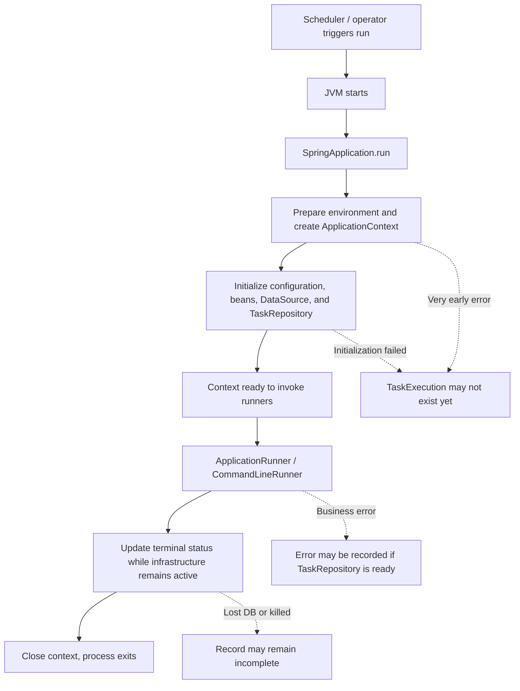
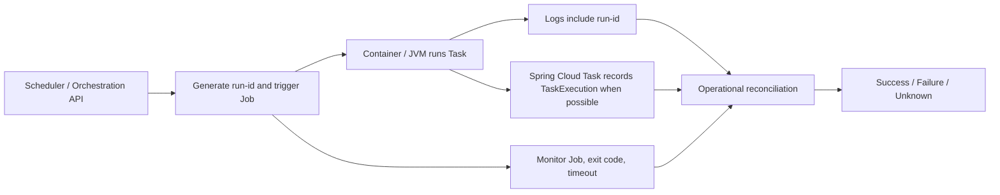

# ApplicationContext Initialization Failures and Execution Tracking Limits

In the **SPRING_CLOUD_TASK** module, a task is a Spring Boot application with a finite runtime: it starts up, performs work, records the outcome, and exits. Spring Cloud Task supports tracking each run via `TaskExecution` and `TaskRepository`. However, there is a critical limitation: **if the application fails right while creating the `ApplicationContext`, the task-tracking infrastructure may not yet be initialized or able to persist an execution record**.

This lesson belongs to the **Lifecycle** chapter and focuses on the relationship between the OS process, Spring Boot startup, and metadata recorded by Spring Cloud Task. Understanding this boundary helps you design error handling, scheduled or on-demand execution, Spring Batch reconciliation, and safe task operations.

## 1. Learning Objectives

After this lesson, you will be able to:

- Outline the stages from JVM launch until `ApplicationContext` is ready, runners execute, and the application exits.
- Explain why bean creation errors, JDBC misconfigurations, or Spring configuration errors can prevent a run from **appearing** in `TaskRepository`.
- Distinguish a **non-existent** record, a record **without an end timestamp**, and a record that **recorded failure**.
- Build examples that trigger errors during context creation and inside `ApplicationRunner`, then analyze logs, exit codes, and metadata.
- Design monitoring from the scheduler/container, reconcile task history, and handle retries without duplicating business side effects.

## 2. Application Lifecycle and Where `TaskRepository` Sits

A Spring Cloud Task application typically begins with `SpringApplication.run(...)`. Inside this call, Spring Boot prepares the environment, creates `ApplicationContext`, loads configuration, instantiates beans, finalizes the context, and runs registered `ApplicationRunner`/`CommandLineRunner` beans. Spring Cloud Task infrastructure participates in managing metadata during startup and termination.



**This is a conceptual diagram**, not a guarantee of the exact order of internal callbacks across every Spring Boot/Spring Cloud Task version. Exactly when `TaskExecution` is created and updated depends on lifecycle mechanics and library versions. What you can safely rely on in design is: **only components that are already initialized and still reachable can persist metadata**.

Three related yet distinct concepts:

| Component | Responsible For | Limitation |
| --- | --- | --- |
| **JVM process / container** | Launching the program, providing PID, runtime duration, and exit code | May terminate before Spring finishes initializing |
| **`ApplicationContext`** | Loading configuration, creating beans, managing application lifecycle | May fail before runners are invoked |
| **`TaskRepository`** | Saving `TaskExecution` information via configured persistence | Cannot write before readiness, without connectivity, or when the process dies abruptly |

Therefore, **Spring Cloud Task cannot by itself guarantee a database row for every attempt the OS makes to start the program**. The scheduler or container runtime observes a broader scope than `TaskRepository` can observe.

## 3. What Are `ApplicationContext` Initialization Failures?

`ApplicationContext` holds and manages the application's beans. While building the context, Spring can encounter errors before handing control over to business logic.

Common examples:

1. **Misconfiguration:** missing required properties, invalid type binding, wrong profile.
2. **Bean creation error:** constructor, `@Bean` method, or `@PostConstruct` throws an exception.
3. **Missing dependency:** a required bean does not exist, or unresolvable circular dependency.
4. **Broken infrastructure connectivity:** DataSource fails authentication, database is not ready, metadata schema is invalid.
5. **Migration failure:** schema changes fail or the database user lacks permissions.
6. **Classpath / version mismatch:** missing classes or incompatible Spring Boot and Spring Cloud versions.

Example of a bean failing immediately upon creation:

```java
@Bean
Object failingBean() {
    throw new IllegalStateException("Failed to load business configuration");
}
```

If Spring must instantiate this bean during context refresh, the exception causes `SpringApplication.run` to fail. `ApplicationRunner` never gets a chance to process work. In that case, **you must not assume a failed `TaskExecution` record will exist**.

Compare that with another case:

```java
@Bean
ApplicationRunner failingRunner() {
    return args -> {
        throw new IllegalStateException("Invalid input data");
    };
}
```

The runner executes after Spring has prepared the context up to the runner phase. Task infrastructure **has the opportunity** to record the run and error if set up, though the final record still depends on `TaskRepository` accessibility and how the library version handles failure events.

The distinguishing factor is **when the error happens relative to task-tracking infrastructure initialization**, not just the exception class name.

## 4. Metadata States Easily Misinterpreted

When querying history, three cases commonly arise:

### 4.1. No `TaskExecution` record found

This can happen for several reasons:

- The scheduler never actually spawned the process.
- The JVM failed before Spring Boot started (such as a missing main class or corrupted JAR).
- `ApplicationContext` failed too early.
- `TaskRepository` was not created yet, the database was unreachable, or the schema did not exist.
- The application wrote to a **different database/schema** than the one the operator is querying.
- Data was purged by a retention policy, or an in-memory database vanished when the JVM exited.

**Absence of a record does not prove the task never ran**; nor does it prove it succeeded.

### 4.2. Record exists but lacks `END_TIME`

A `TaskExecution` may have been created yet lack an end timestamp because:

- The task is legitimately still running.
- The process received `SIGKILL`, ran out of memory, or the node/container was lost.
- Power failed or the runtime stopped abruptly.
- The system could not update the final record because the database disconnected.

`END_TIME = NULL` is a **signal requiring further investigation**, insufficient on its own to claim the task is running or failed. You must cross-check the actual state of the PID/container/Job and configured time limits.

### 4.3. Completed record with failure exit code

When the lifecycle mechanism functions and metadata persistence succeeds, the record may contain a non-`0` exit code, end timestamp, and error details. This case is convenient for monitoring, yet still requires business verification: the system might have updated part of the data before raising the error.

| Observation | What Can Be Concluded | What Cannot Yet Be Concluded |
| --- | --- | --- |
| No `TaskExecution` | The queried repository contains no matching record | That the task was never launched |
| `START_TIME` present, `END_TIME` missing | Startup was recorded, but no completion exists in the repository | That the process is currently alive |
| `END_TIME` present, error exit code | The system recorded a failed termination | That all business side effects were rolled back |
| Container exit code equals `0` | The runtime considered the process to exit cleanly | That business data is definitely accurate and metadata was definitely saved |
| Successful `TaskExecution` present | Infrastructure recorded a completed run per its criteria | That all business data validations passed |

## 5. Hands-On: Triggering Two Different Failure Types

The example below lets you **intentionally trigger an error during context creation** and **trigger an error inside `ApplicationRunner`**. The goal is to observe the difference without relying on a specific database row as a hard requirement.

### 5.1. Preparation

Use a Spring Boot project compatible with Spring Cloud Task. Minimal Maven dependencies for the example:

```xml
<dependencies>
    <dependency>
        <groupId>org.springframework.boot</groupId>
        <artifactId>spring-boot-starter</artifactId>
    </dependency>
    <dependency>
        <groupId>org.springframework.cloud</groupId>
        <artifactId>spring-cloud-starter-task</artifactId>
    </dependency>
    <dependency>
        <groupId>org.springframework.boot</groupId>
        <artifactId>spring-boot-starter-jdbc</artifactId>
    </dependency>
    <dependency>
        <groupId>com.h2database</groupId>
        <artifactId>h2</artifactId>
        <scope>runtime</scope>
    </dependency>
</dependencies>
```

Use a Spring Boot parent/BOM and Spring Cloud BOM from **compatible release trains**, and configure `spring-boot-maven-plugin` to package an executable JAR. H2 is strictly for short local experimentation.

Create `src/main/resources/application.yml`:

```yaml
spring:
  application:
    name: lifecycle-failure-demo
  main:
    web-application-type: none
  datasource:
    url: jdbc:h2:mem:taskdb
    driver-class-name: org.h2.Driver
    username: sa
    password: ""
  cloud:
    task:
      name: lifecycle-failure-demo
      initialize-enabled: true
```

`web-application-type: none` keeps the process from holding an active web server open. `initialize-enabled` enables Task schema initialization in test environments when the library version's conditions are met. In production, use a migration-managed schema and a persistent database.

### 5.2. Java Code

Create `src/main/java/com/example/task/LifecycleFailureDemoApplication.java`:

```java
package com.example.task;

import org.springframework.beans.factory.annotation.Value;
import org.springframework.boot.ApplicationRunner;
import org.springframework.boot.SpringApplication;
import org.springframework.boot.autoconfigure.SpringBootApplication;
import org.springframework.cloud.task.configuration.EnableTask;
import org.springframework.context.ConfigurableApplicationContext;
import org.springframework.context.annotation.Bean;

@SpringBootApplication
@EnableTask
public class LifecycleFailureDemoApplication {

    public static void main(String[] args) {
        ConfigurableApplicationContext context =
                SpringApplication.run(LifecycleFailureDemoApplication.class, args);

        int exitCode = SpringApplication.exit(context);
        System.exit(exitCode);
    }

    @Bean
    Object initializationProbe(
            @Value("${demo.fail-during-init:false}") boolean fail) {

        if (fail) {
            throw new IllegalStateException("Simulated ApplicationContext initialization failure");
        }

        return new Object();
    }

    @Bean
    ApplicationRunner businessRunner(
            @Value("${demo.fail-in-runner:false}") boolean fail) {

        return arguments -> {
            if (fail) {
                throw new IllegalStateException("Simulated error inside ApplicationRunner");
            }

            System.out.println("Work completed");
        };
    }
}
```

**Role of the two switches:**

- `--demo.fail-during-init=true` causes creation of the `initializationProbe` bean to fail while building `ApplicationContext`.
- `--demo.fail-in-runner=true` allows the context to initialize, then throws an exception inside `ApplicationRunner`.

The `SpringApplication.exit(context)` call in `main` runs only if `SpringApplication.run` returns a context successfully. If an error occurs while creating the context or running a runner, `SpringApplication.run` can throw an exception outward and subsequent statements will not execute. With a standard Java launcher, an unhandled exception terminates the process with failure; never assume exit codes and metadata are always updated by the exact same mechanism.

### 5.3. Running and Observing

Package the project:

```bash
./mvnw clean package
```

On Windows, use `mvnw.cmd clean package` instead of `./mvnw`. The commands below use an assumed JAR name `target/lifecycle-failure-demo.jar`; replace it with the actual artifact path produced by Maven.

**Run 1 — Success:**

```bash
java -jar target/lifecycle-failure-demo.jar
```

Expected business output:

```text
Work completed
```

**Run 2 — Context initialization error:**

```bash
java -jar target/lifecycle-failure-demo.jar --demo.fail-during-init=true
```

Observe the bean-creation exception and note that the runner does not print the completion line. In this case, **never assume** a failed `TaskExecution` was recorded.

**Run 3 — Runner error:**

```bash
java -jar target/lifecycle-failure-demo.jar --demo.fail-in-runner=true
```

Observe the error originating from the runner. Verify Spring Cloud Task's metadata recording behavior under your configuration and version rather than assuming it behaves identically to a context initialization failure.

**Important note on H2:** `jdbc:h2:mem:taskdb` loses data when the JVM exits; therefore, you cannot use this in-memory database to compare records across three separate processes after they terminate. To compare history across runs, use a persistent database, prepare the corresponding schema, and point all three runs at the same repository.

### 5.4. Results Table to Record

| Scenario | Did Runner Run? | Most Reliable Signal to Inspect | `TaskExecution` |
| --- | --- | --- | --- |
| No failure flags | Yes | Business logs, exit code, record if repository works | Usually completes when infrastructure is ready |
| `fail-during-init=true` | No | Bean creation logs, exit code, Job/container state | May not be created |
| `fail-in-runner=true` | Yes, but throws error | Runner logs, exit code, record if repository works | May contain failure metadata if writable |
| Process hard-killed | May have started/been running | Container/Job events and actual process state | May lack completion |

Remarks in the final column describe **possibilities**, not rigid outcomes across every version.

## 6. Monitoring from Outside the Application

To avoid missing errors before the context is ready, you need an observability source that **does not depend on the task's `ApplicationContext`**. This can be a Kubernetes Job, scheduler, orchestration system, or process supervisor.

A practical model:



An implementation should follow these steps:

1. **Generate a run request ID before launch:** such as a `run-id` or business request ID created in the scheduler/orchestration API.
2. **Record the request at the orchestration source:** job name, request timestamp, sanitized inputs, and caller identity.
3. **Pass the correlation ID to the task:** for example `--run-id=report-2026-11-24-001`; application logs include this ID to correlate events.
4. **Track externally:** whether the job/container was created, whether it started, whether it is still running, and which exit code it returned.
5. **Reconcile with the repository:** locate the matching `TaskExecution` when a row exists; never assume every `run-id` always has a `TASK_EXECUTION_ID`.
6. **Classify unknown states:** if the job is no longer running yet lacks metadata or `END_TIME`, route to inspection and reconciliation rather than reporting success automatically.

Systems can store `run-id` in logs, orchestration tables, or appropriate extension metadata. Avoid passing passwords, tokens, or sensitive personal information on the command line because arguments can appear in logs, process history, or task metadata.

### Does `ApplicationFailedEvent` replace `TaskRepository`?

Spring Boot provides startup failure signals such as `ApplicationFailedEvent`. A listener registered early on `SpringApplication` can help log or send alerts on a **best-effort basis** when startup fails.

However, the listener still runs **inside the failing process**. If the JVM fails to start, runs out of resources, gets forcefully terminated, or loses connectivity to logging/alerting systems, it may fail to emit any event visible externally. Thus, in-app alerts are useful, but do not replace scheduler/container monitoring.

## 7. Reconciling `TaskRepository` and Handling Incomplete Records

Assume the task uses a **persistent** JDBC database and the Spring Cloud Task schema was created for the right version. You can query basic history:

```sql
SELECT TASK_EXECUTION_ID,
       TASK_NAME,
       START_TIME,
       END_TIME,
       EXIT_CODE
FROM TASK_EXECUTION
ORDER BY TASK_EXECUTION_ID DESC;
```

Find records missing `END_TIME`:

```sql
SELECT TASK_EXECUTION_ID,
       TASK_NAME,
       START_TIME,
       END_TIME,
       EXIT_CODE
FROM TASK_EXECUTION
WHERE END_TIME IS NULL
ORDER BY START_TIME ASC;
```

**Interpretation warning:** the SQL queries above only list what the repository can return. `END_TIME IS NULL` does not automatically mean the task failed. You must determine whether the process/container is still alive, legitimately processing, or past its allowed deadline.

A reconciliation workflow you can apply:

| Data from Orchestrator | `TaskRepository` Metadata | Appropriate Action |
| --- | --- | --- |
| Job never launched | No record | Check triggers, launch permissions, runtime resources |
| Job failed before running code | No record | Record failure in scheduler, classify boot/bean/config error |
| Job still running | Unclosed record present | Monitor deadline, resources, and live logs |
| Job died | Unclosed record | Investigate crash/timeout/DB, consider controlled metadata recovery |
| Job finished, exit code `0` | Completed record | Further verify business success criteria |
| Job failed | Record says success or is missing | Investigate timing mismatch, metadata write errors, and exit code rules |

For orphaned records (lacking `END_TIME` even though the process died), **do not run arbitrary ad-hoc SQL updates to patch status**. Manual remediation must follow independent reconciliation data, audit policies, and proper repository procedures. A hasty edit can erase timestamps/events needed for investigation.

If the application has multiple instances or environments, verify you are querying the **right database, schema, task name, and time range**, because looking in the wrong place also creates the illusion of "missing records."

## 8. Designing Errors at the Right Layer

Not every error should cause `ApplicationContext` initialization to fail.

**Configuration errors required for the application to operate:** an invalid JDBC URL, missing required secret, or inability to instantiate a core service can legitimately lead to startup failure. Let the error surface clearly and ensure the orchestrator observes it; never try to "fake" context startup just to get a Task record.

**Errors of a single business processing run:** an invalid report date, malformed input file, or data failing validation are **run-level** errors. Whenever possible, accept and validate business inputs inside `ApplicationRunner` or a service invoked by the runner so failure boundaries remain tied to that execution. Return a proper failure status instead of catching exceptions and silently returning success.

**Transient infrastructure errors:** network drops, overloaded databases, or unresponsive brokers can happen in both phases. Retry policies should depend on error category and rerun safety, not merely on a raw exception string.

Example of an error-handling pattern **to avoid**:

```java
try {
    reportService.generate(businessDate);
} catch (Exception e) {
    logger.error("Report generation failed", e);
    // Not rethrown => runner may finish normally.
}
```

For unhandled errors, preserve the failure signal:

```java
try {
    reportService.generate(businessDate);
} catch (Exception e) {
    logger.error("Report generation failed for date {}", businessDate, e);
    throw e;
}
```

Both snippets assume `reportService`, `businessDate`, and `logger` are declared in the service or runner. They strictly illustrate the principle: **never let the orchestrator treat a task as successful when business logic actually failed**.

## 9. Retries, Spring Batch, and Business Consistency

When `TaskExecution` is missing or unclosed, it is tempting to immediately rerun. Yet **missing metadata does not mean the work had no side effects**. Data may already have been written before the application died or lost repository connectivity.

For example, a payment reconciliation task follows these steps:

1. Read reconciliation date `businessDate`.
2. Generate adjustment records.
3. Save business results.
4. Update completion metadata in `TaskRepository`.

If step 3 succeeds but step 4 fails, the next run might write duplicate adjustments. Mitigate this with **business keys**, database unique constraints, sound transactions, and checking prior results before retrying. For tasks sending network requests, idempotency keys supported by the target system may be needed.

If using **Spring Batch** inside a Spring Cloud Task application, distinguish:

- `TaskExecution` describes the **task application** lifecycle.
- Spring Batch's `JobExecution` and `StepExecution` track **batch jobs** at the job/step level and can support checkpoints and restarts per job design.
- If the context fails before Batch infrastructure is built, **you cannot assume** a `JobExecution` exists.
- If a Batch job processed partially before the JVM died, restartability depends on `JobRepository`, transactions, checkpoints, and job configuration; it **does not automatically repair** an incomplete `TaskExecution`.

When a task is triggered on a schedule by a Kubernetes `CronJob` or another orchestrator, separate three decisions: **whether to retry**, **whether retrying is safe without duplicates**, and **whether root-cause investigation is needed before retrying**. Bounded retries, backoff, and overlap prevention are commonly needed operational controls.

## 10. Incident Scenarios and Diagnosis

### Scenario A: Kubernetes Job reports Failed, but `TaskRepository` dashboard is empty

**Likely causes:** image failed to start, missing secret, wrong main class, very early Spring configuration failure, or unreachable repository.

**Approach:** start from Job/Pod status, exit code, events, and startup logs. Verify image, command, environment, and database connectivity. Expect corresponding metadata only once Task infrastructure initializes.

### Scenario B: `TaskRepository` shows a record running for hours, yet the Pod is gone

**Likely causes:** killed, crashed, OOM, lost connection, or failed to complete the end-recording step.

**Approach:** check start time, Pod termination reason, last logs, and business outcomes. Mark the incident in the orchestration system and verify retry conditions. Never conclude "still running" solely because `END_TIME` is null.

### Scenario C: Report file was produced, yet `TaskExecution` ended with failure

**Likely causes:** the file was exported, then a subsequent step (status persistence, notification, resource cleanup) failed.

**Approach:** check file integrity, output codes, business keys, and error details. Choose compensation, manual completion, or idempotent retry; avoid emitting duplicate files simply because the exit code was non-`0`.

### Scenario D: Tasks occasionally vanish from history

**Likely causes:** multiple profiles pointing to different databases, in-memory H2, schema changes, data cleanup, or initialization-phase errors.

**Approach:** verify `DataSource`, database/schema, migration pipeline, retention period, and correlation IDs. Only then investigate Spring Cloud Task behavior.

## 11. Operational Checklist

Before deploying a finite task to production, check:

- [ ] Does the scheduler/Job runtime retain history of **launch requests** and process/container outcomes?
- [ ] Is there a `run-id` linking the launch request, logs, business outputs, and `TaskExecution` when present?
- [ ] Does `TaskRepository` use a persistent database, the right schema, and a connection with proper permissions?
- [ ] Do context-startup errors appear in external logs/monitoring even when no `TaskExecution` exists?
- [ ] Are timeouts, resource limits, and distinctions among "running", "failed", and "unknown" states enforced?
- [ ] Can the task handle a rerun after writing **partial** business data?
- [ ] Do dashboards/alerts avoid treating missing rows or `END_TIME = NULL` as success?
- [ ] Is there a reconciliation and investigation procedure before editing metadata or triggering retries?

## 12. Self-Check Questions

1. A container exits with code `1` yet no `TASK_EXECUTION` exists. List at least three possibilities and the data sources to check.
2. Why does throwing an exception inside a `@Bean` method versus inside an `ApplicationRunner` differ in metadata recording capability?
3. Is `END_TIME IS NULL` enough to conclude a task is hung? What additional evidence is required?
4. Why is a scheduler-generated `run-id` needed instead of relying solely on `TASK_EXECUTION_ID`?
5. Does Spring Batch guarantee that an `ApplicationContext` creation error is always recorded as a `JobExecution`? Why or why not?
6. If business logic updated the database yet `TaskRepository` failed to record completion, how would you design a retry to prevent duplicate data?

**Exercise:** Extend the Section 5 example to include three scenarios: `success`, `context-failure`, and `runner-failure`. Use an external scheduler or script to persist a `run-id`, start/end timestamps, and exit code for each run. Use a persistent database with an initialized schema to observe `TaskExecution`. Build a comparison table of evidence from both sources and clearly explain the case with missing metadata.

## 13. Key Takeaways

- **`ApplicationContext` initialization failures can happen before Spring Cloud Task is ready to record execution**; the absence of `TaskExecution` does not negate that the JVM was launched.
- **`TaskRepository` reflects only the portion of the lifecycle it actually observed and persisted**. Records lacking `END_TIME` must also be reconciled against actual runtime status.
- **External monitoring** from the scheduler/container, combined with correlated logs, is essential telemetry for catching early startup failures, crashes, and lost metadata.
- **Technical success, metadata, and business outcomes are three separate layers of evidence**. All must be reconciled during incident investigation.
- **Retries must be safe against partially processed data**; Spring Batch can assist with checkpoints/restarts for batch jobs, yet does not eliminate limits when the application has not finished initializing.
