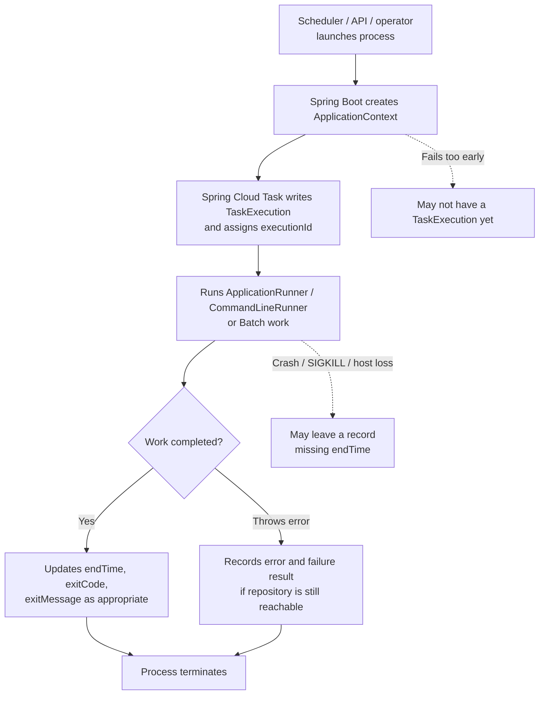
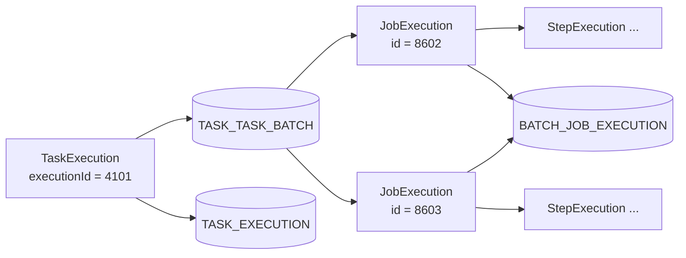

# The `TaskExecution` Model and the `executionId` Identifier

## Learning Objectives

After this lesson, you will be able to:

- Describe how `TaskExecution` represents **a single execution** of a Spring Cloud Task application and distinguish it from the Task name or an OS process identifier.
- Explain the startup, completion, and failure lifecycle of an execution; read the meaning of key fields such as `executionId`, `taskName`, timestamps, exit code, and arguments.
- Understand how `TaskRepository` persists an execution to the database, how `TaskExplorer` queries it back, and how `TaskExecutionListener` helps log by identifier.
- Look up an execution with SQL, correlate logs, and distinguish a Task's `executionId` from Spring Batch's `JOB_EXECUTION_ID`.
- Design on-demand or scheduled runs with traceability, error handling, duplicate detection, and protection for sensitive data.

> **Scope:** This lesson belongs to the **Execution Data** chapter of the **SPRING_CLOUD_TASK** module. Spring Cloud Task serves finite-lived Spring Boot applications: start up, perform work, and terminate; the result of each execution is recorded in a database. The `TaskExecution` model is the foundation for tracking runs requested by users, triggered by an external scheduler, or containing Spring Batch Jobs.

## 1. What is `TaskExecution`?

A **Task** is typically understood as a program/job with a defined name, such as `daily-reconciliation`. When triggered, each Spring Cloud Task process performs that job once within a finite lifecycle. **`TaskExecution` is the metadata record representing this specific execution**, including its identifier, start/end timestamps, arguments, and result.

Suppose the `daily-reconciliation` application is invoked at 02:00 and 03:00 to process the date 2026-11-24:

| Characteristic | Run A | Run B |
| --- | --- | --- |
| `taskName` | `daily-reconciliation` | `daily-reconciliation` |
| Business parameter | `--business-date=2026-11-24` | `--business-date=2026-11-24` |
| `executionId` | `4101` | `4102` |
| Observed status | Completed, exit code `0` | Completed, non-zero exit code |

**The numeric values above are illustrative data only.** Two runs can have the same name and the same parameters yet have **two different `executionId` values**. Run B may be a retry triggered by a scheduler after an error or an intentional rerun command. When answering "which run processed this data?", you must identify the specific run rather than relying solely on `taskName`.

A `TaskExecution` object does not contain all business data, does not store every processed record, and does not replace application logs. It reflects **Task-lifecycle-level metadata**; if per-step details, business outcomes, or transactions are needed, they must be stored in their respective sources.

### Four Commonly Confused Concepts

| Concept | What does it identify? | Characteristics |
| --- | --- | --- |
| Task name (`taskName`) | The type of program/job, e.g. `daily-reconciliation`. | Multiple executions can share the same name. |
| `executionId` | **A specific `TaskExecution` record in a repository.** | Assigned by the repository when writing metadata; used to trace a single run. |
| Business key, e.g. `businessDate` | The data/batch of work to be processed. | May repeat across retries; defined by the application. |
| PID, container/pod ID | An OS or platform process or deployment unit. | Belongs to the runtime/operations system; not the `TaskExecution` key. |

`executionId` is a technical identifier for looking up metadata, **not a key that guarantees business data is processed only once**. Duplicate control still requires idempotency, transactions, business keys, or separate orchestration mechanisms.

## 2. Key Fields in the `TaskExecution` Model

The model class belongs to the `org.springframework.cloud.task.repository.TaskExecution` package. Depending on the Spring Cloud Task version, API shapes and additional fields may vary; the common data groups are:

| Field/property | Meaning | How to interpret it properly |
| --- | --- | --- |
| `executionId` | Run identifier assigned by `TaskRepository`. | Key for joining logs, Task tables, and observability data for the **same run**. |
| `taskName` | Task name associated with the run. | Used to filter groups of runs; **not unique**. |
| `startTime` | Timestamp when the Task start was recorded. | May differ from when the container started creating or environment setup began. |
| `endTime` | Timestamp when the Task recorded completion. | May be absent if the Task is still running or the process terminated abnormally. |
| `exitCode` | Exit result recorded at the Task level; typically `0` means success. | Must be cross-checked against business state and the actual process exit code. |
| `exitMessage` | Message describing the exit result. | Useful for summarizing errors, though it does not replace logs/stack traces. |
| `errorMessage` | Error details recorded when a failure occurs. | May be empty; stored content and length depend on schema/configuration. |
| `arguments` | Arguments attached to the run. | Use only safe data; do not pass tokens or passwords via CLI arguments. |
| `externalExecutionId` | External identifier, when supplied by the application/orchestrator. | Helps correlate with the launching system; does not replace `executionId`. |
| `parentExecutionId` | Reference to the parent run in a parent–child Task model when configured. | Not inferred automatically from Task name or start time. |

**Note on status:** `TaskExecution` should not be equated with Spring Batch's `BatchStatus` enum. In Task data, operators typically infer state from `startTime`, `endTime`, `exitCode`, and error information. Do not establish a rule that "an empty `endTime` definitely means still running" because the application may have been killed before updating metadata.

### Sample Data for Visualization

```text
TaskExecution
  executionId:        4101
  taskName:           daily-reconciliation
  startTime:          2026-11-24T02:00:03Z
  endTime:            2026-11-24T02:01:14Z
  exitCode:           0
  exitMessage:        (empty or success message)
  arguments:          ["--business-date=2026-11-24"]
  externalExecutionId: (depends on launching system)
  parentExecutionId:   (none if this is a standalone Task)
```

This is illustrative data in a human-readable format, not the exact `toString()` representation of any specific framework version.

## 3. Where is `executionId` Generated and How Unique is It?

In the standard JDBC implementation, Spring Cloud Task uses `TaskRepository` to write metadata into the `TASK_EXECUTION` table. When creating a record, the repository assigns an `executionId` using a key generation mechanism appropriate for the database/schema and library version. The application accesses this key after the run has been successfully registered.

Key rules:

1. **Identifies a single run within one repository:** two distinct records in the same repository never share the same `TASK_EXECUTION_ID` primary key.
2. **Not a system-wide sequence:** production, staging, and local databases can all have `executionId=4101`. When aggregating logs across environments, include the environment, cluster, or data source identifier.
3. **Do not assume consecutive numbers:** sequence mechanisms, rolled-back transactions, parallel runs, or older data can create gaps between IDs.
4. **Do not infer business order from IDs alone:** IDs may increase with key allocation time, but they do not prove which job finished first. For timing analysis, inspect `startTime` and `endTime`.
5. **Do not reuse the ID as a business key:** a retry for the same `businessDate` still gets a new ID; idempotency must evaluate the business key.
6. **Do not assign IDs manually in normal Task flows:** let `TaskRepository` allocate and manage keys. Manually inserting or modifying metadata can break links and execution history.

If the repository cannot create a record due to connection errors, schema mismatches, or missing permissions, the application may fail before obtaining a valid ID. Therefore, do not assume every launch request produces a `TASK_EXECUTION` record.

## 4. Metadata Lifecycle of an Execution

The following diagram illustrates the typical behavior of a Spring Boot application with Spring Cloud Task:



Actual behavior may differ by version, listeners, and configuration; the diagram focuses on metadata changes during execution. For example:

| Stage | `startTime` | `endTime` | `exitCode` | Meaning |
| --- | --- | --- | --- | --- |
| Before the Task registers with the repository | No record yet | None | None | Cannot look up `executionId` from the repository. |
| Started, runner is executing | Present | Usually absent | Usually absent | The run is in progress from the repository's perspective. |
| Normal completion | Present | Present | Usually `0` | Task infrastructure recorded completion; business outcome still needs verification. |
| Ended due to an error handled by Task lifecycle | Present | Present if update succeeds | May be non-zero | Check logs, error/exit message, and process exit code. |
| Process terminated abruptly | May be present | May be empty | May be empty | Metadata risks lingering even though no process remains. |

In particular, `TaskExecution` **is not a heartbeat**. A row with `endTime = NULL` after many hours does not prove the process is still running; cross-check with the pod/container, job scheduler, logs, and runtime limits.

## 5. What Are the Responsibilities of `TaskRepository` and `TaskExplorer`?

| Component | Responsibility | Usage |
| --- | --- | --- |
| `TaskRepository` | Creates/updates Task lifecycle metadata, allocates and stores IDs, persists outcomes. | Typically invoked automatically by Spring Cloud Task infrastructure. |
| `TaskExplorer` | Reads and queries persisted `TaskExecution` records. | Supports operations UIs, lookup tools, and reporting/reconciliation. |
| `TaskExecutionListener` | Receives callbacks along the Task lifecycle. | Logs `executionId`, records observability metrics, and correlates with external requests. |

In normal flows, **you do not need to call `TaskRepository` directly to create an execution**. When a Task application is configured properly, Spring Cloud Task manages the lifecycle. Calling the repository manually without understanding its contract can produce records that do not match the actual execution.

### 5.1. Logging `executionId` with a Listener

Assuming the project uses `spring-cloud-starter-task`, with a configured `DataSource` and Task metadata tables, create a listener bean:

```java
package com.example.reconciliation;

import org.slf4j.Logger;
import org.slf4j.LoggerFactory;
import org.springframework.cloud.task.listener.TaskExecutionListener;
import org.springframework.cloud.task.repository.TaskExecution;
import org.springframework.stereotype.Component;

@Component
public class TaskAuditListener implements TaskExecutionListener {

    private static final Logger log =
            LoggerFactory.getLogger(TaskAuditListener.class);

    @Override
    public void onTaskStartup(TaskExecution execution) {
        log.info(
            "Task started: executionId={}, taskName={}",
            execution.getExecutionId(),
            execution.getTaskName()
        );
    }

    @Override
    public void onTaskEnd(TaskExecution execution) {
        log.info(
            "Task ended: executionId={}, exitCode={}",
            execution.getExecutionId(),
            execution.getExitCode()
        );
    }

    @Override
    public void onTaskFailed(TaskExecution execution, Throwable throwable) {
        log.error(
            "Task failed: executionId={}",
            execution.getExecutionId(),
            throwable
        );
    }
}
```

The `onTaskStartup` callback is suitable for logging the ID right after the Task has registered in the repository; `onTaskEnd` and `onTaskFailed` help group logs under the same ID. In production environments, push `executionId` into structured logging or MDC if multiple service layers need to log it; if using MDC, remember to clear the value after processing completes and handle propagation across asynchronous threads carefully.

Do not use `TaskExecutionListener` to turn all business logic into side-effect events; keep core logic inside runners or services. Listeners support lifecycle observability, whereas correctness and idempotency belong to business logic.

### 5.2. Looking Up an Execution via `TaskExplorer`

You can create a service to look up `executionId` from the configured database:

```java
package com.example.reconciliation;

import java.util.Optional;

import org.springframework.cloud.task.repository.TaskExecution;
import org.springframework.cloud.task.repository.TaskExplorer;
import org.springframework.stereotype.Service;

@Service
public class TaskExecutionLookup {

    private final TaskExplorer taskExplorer;

    public TaskExecutionLookup(TaskExplorer taskExplorer) {
        this.taskExplorer = taskExplorer;
    }

    public Optional<TaskExecution> find(long executionId) {
        return Optional.ofNullable(
            taskExplorer.getTaskExecution(executionId)
        );
    }
}
```

Usage example in an internal tool:

```java
TaskExecution execution = lookup.find(4101L)
    .orElseThrow(() ->
        new IllegalArgumentException("executionId not found"));

System.out.println("Task: " + execution.getTaskName());
System.out.println("Exit: " + execution.getExitCode());
System.out.println("Started: " + execution.getStartTime());
```

The final snippet illustrates how to use a `lookup` object injected into a service, **not standalone Java code that runs immediately when pasted**. Depending on the release, how missing records are reported may differ; check the API of your version.

When building a dashboard to inspect all runs, paginate and filter by Task name/time rather than loading the entire metadata table into memory. If exposing an internal HTTP endpoint, add authentication and authorization because arguments or error messages may contain sensitive data.

## 6. Database Tables and Queries by `executionId`

Spring Cloud Task with JDBC typically stores metadata in these tables:

| Table | Purpose |
| --- | --- |
| `TASK_EXECUTION` | One row per Task execution; holds `TASK_EXECUTION_ID`, name, timestamps, and result. |
| `TASK_EXECUTION_PARAMS` | Arguments for each run, linked to `TASK_EXECUTION_ID`. |
| `TASK_TASK_BATCH` | Association table linking a `TASK_EXECUTION_ID` with Spring Batch `JOB_EXECUTION_ID` when integrated. |

Column names, data types, sequences, and how parameters are stored may vary by database or schema/release; always use the DDL matching your version and verify against the actual database.

### 6.1. Finding a Run by Identifier

```sql
SELECT
    TASK_EXECUTION_ID,
    TASK_NAME,
    START_TIME,
    END_TIME,
    EXIT_CODE,
    EXIT_MESSAGE,
    ERROR_MESSAGE
FROM TASK_EXECUTION
WHERE TASK_EXECUTION_ID = 4101;
```

When the ID is known, this query is more accurate than searching solely by `TASK_NAME`. If using JDBC `PreparedStatement`, replace the constant `4101` with `?` and bind the ID as a parameter, avoiding string concatenation of user-supplied input into SQL.

### 6.2. Listing Recent Runs by Task Name

```sql
SELECT
    TASK_EXECUTION_ID,
    TASK_NAME,
    START_TIME,
    END_TIME,
    EXIT_CODE
FROM TASK_EXECUTION
WHERE TASK_NAME = 'daily-reconciliation'
ORDER BY START_TIME DESC, TASK_EXECUTION_ID DESC;
```

The table can accumulate many rows over scheduled runs; in production code, add pagination/limits using your database's syntax and appropriate indexes. `ORDER BY START_TIME` reflects start times; the ID column only breaks ties for identical timestamps and does not define completion order.

### 6.3. Filtering Runs Without a Recorded End Time

```sql
SELECT
    TASK_EXECUTION_ID,
    TASK_NAME,
    START_TIME,
    END_TIME,
    EXIT_CODE
FROM TASK_EXECUTION
WHERE END_TIME IS NULL
ORDER BY START_TIME ASC;
```

This is a **list requiring inspection**, not a list of processes guaranteed to still be active. A run may lack `END_TIME` because the container was killed, the node failed, the repository lost connectivity at completion, or the Task is still executing normally.

### 6.4. Querying Parameters by ID

```sql
SELECT
    TASK_EXECUTION_ID,
    TASK_PARAM
FROM TASK_EXECUTION_PARAMS
WHERE TASK_EXECUTION_ID = 4101;
```

If `TASK_EXECUTION_PARAMS` is configured under a different version's schema, verify the corresponding columns before writing queries. Do not record parameters containing passwords, access tokens, or sensitive data in logs, dashboards, or the metadata store unless proper protections are designed.

## 7. Distinguishing Task `executionId` from Spring Batch IDs

Spring Cloud Task and Spring Batch answer two different questions:

- `TASK_EXECUTION_ID`: "**Which Task application run?**"
- `JOB_EXECUTION_ID`: "**Which Spring Batch Job execution?**"
- `JOB_INSTANCE_ID`: "**Which logical Job instance**, identified by Job name and identifying JobParameters?"

A Task process may run zero Batch Jobs, one Job, or multiple Jobs. Therefore, never assume `TASK_EXECUTION_ID` equals `JOB_EXECUTION_ID` or that one Task always corresponds to exactly one Job.



With the `spring-cloud-task-batch` integration enabled, the `TASK_TASK_BATCH` table records the linked ID pairs. Example query:

```sql
SELECT
    t.TASK_EXECUTION_ID,
    t.TASK_NAME,
    t.EXIT_CODE AS TASK_EXIT_CODE,
    x.JOB_EXECUTION_ID,
    j.STATUS AS JOB_STATUS,
    j.EXIT_CODE AS JOB_EXIT_CODE
FROM TASK_EXECUTION t
LEFT JOIN TASK_TASK_BATCH x
    ON x.TASK_EXECUTION_ID = t.TASK_EXECUTION_ID
LEFT JOIN BATCH_JOB_EXECUTION j
    ON j.JOB_EXECUTION_ID = x.JOB_EXECUTION_ID
WHERE t.TASK_EXECUTION_ID = 4101;
```

If the query returns multiple rows, it may indicate **one Task linked to multiple JobExecutions**; it does not mean multiple TaskExecutions share the same ID. If no matching rows appear in `TASK_TASK_BATCH`, check whether the Job actually ran, whether the integration library is on the classpath, and whether the Task–Batch listener is active.

**Regarding failures:** Spring Batch can record `JobExecution.status=FAILED` while the Task or process exit code remains `0` if errors are not propagated properly. When the orchestrator must know a Job failed, evaluate the `spring.cloud.task.batch.fail-on-job-failure=true` integration setting and test all three layers: Job, Task, and process. Do not rely on a single ID or status alone to conclude the entire flow succeeded.

## 8. Incorporating `executionId` into Scheduled and On-Demand Operations

The same `daily-reconciliation` application can be run in two ways:

- **On demand:** an operator or API system launches a process for `--business-date=2026-11-24`.
- **Scheduled:** a Kubernetes CronJob or another scheduler launches a process with the same Task name on a preset schedule.

Spring Cloud Task **does not provide a cron scheduler itself**. Both trigger sources can create separate `TaskExecution` records if each request starts a process and the Task infrastructure successfully writes to the repository.

Typical request tracing flow:

1. The launching system generates a distinct **request ID/correlation ID** (e.g., `recon-20261124-request-17`) or records the scheduler's ID.
2. When the `onTaskStartup` listener receives `TaskExecution`, it logs `executionId` alongside the correlation ID if available; if supported by the system, the external ID can be stored in `externalExecutionId` metadata.
3. When the process finishes, the system compares `TaskExecution.exitCode`, the business outcome, and the container exit code.
4. On retries, **retain the business correlation ID** if you want to group retry attempts of the same request, while each execution keeps its own `executionId`.
5. Operational tools display `taskName`, `executionId`, safe business parameters, timestamps, and outcomes for accurate diagnostics.

Do not let an orchestrator set `executionId` in place of the repository and expect them to match. `externalExecutionId` is meant for linking to external sources, while `executionId` is the internal key of `TaskRepository`. If a parent–child flow is configured, `parentExecutionId` can represent the parent Task relationship, provided the parent ID belongs to the right repository/design scope.

### Running in Parallel

Two Tasks with the same name and the same parameters can run concurrently, each with a different ID. Assigning distinct keys in the repository **does not automatically prevent duplicate data processing**. Define idempotency rules by business key, limit scheduler concurrency, or use Spring Cloud Task's single-instance mechanism when appropriate for your version and locking infrastructure.

`executionId` is useful for tying logs and results to the right run, but the question "has date X already been processed?" should be answered from reliable business state, not by comparing the largest ID.

## 9. Common Pitfalls When Analyzing Execution Data

| Symptom | Possible Cause | Resolution |
| --- | --- | --- |
| `executionId` not found in the database | Task failed to register due to bootstrap error; querying wrong database/schema; metadata purged by retention. | Check datasource, startup logs, migrations, target repository, and history retention policy. |
| Multiple rows with the same `taskName`/parameters | Task ran multiple times or was retried. | Use `TASK_EXECUTION_ID` to distinguish each run; compare against business request ID. |
| `END_TIME` empty for a long time | Task is still running, was killed, or failed to update the repository. | Cross-check logs, process/pod status, timeouts, and scheduler; do not label "RUNNING" from DB alone. |
| `EXIT_CODE=0` despite business failure | Exception was caught and swallowed, async tasks did not finish, or Batch failure did not propagate. | Inspect logic, await async completion, and test failure paths and process exit codes. |
| `TASK_EXECUTION_ID` does not match `JOB_EXECUTION_ID` | These are two identifiers allocated by different repositories. | Join through `TASK_TASK_BATCH` when Batch integration is enabled. |
| Identical IDs appear in staging and production | Identifiers are meaningful only within a repository's scope. | Always attach environment/repository metadata when centralizing logs. |
| Sensitive parameters appear in metadata | Secrets passed via CLI args and persisted with the run. | Move secrets to secure injection mechanisms; restrict view/log access and enforce retention. |
| Slow dashboard queries | Reading full Task history, missing indexes, or missing pagination. | Filter by time/name, paginate, and create indexes based on actual workload. |

**Do not directly edit `TASK_EXECUTION_ID` or error statuses in the table** to make a dashboard look "clean". If data reconciliation is needed after an incident, keep a separate adjustment trail and follow an auditable operational procedure.

## 10. Hands-On Verification Procedure

### Preparation

Create a Spring Boot application with the `spring-cloud-starter-task` dependency and an appropriate JDBC driver. You can use H2 to inspect the table structure within a single startup, but use PostgreSQL or a persistent database if you want to **compare multiple consecutive runs**. Configure the Task schema for your release; in production, use migrations instead of creating tables on every startup.

Example configuration with PostgreSQL where tables are pre-created:

```yaml
spring:
  application:
    name: daily-reconciliation
  main:
    web-application-type: none
  datasource:
    url: jdbc:postgresql://localhost:5432/taskdb
    username: ${DB_USER}
    password: ${DB_PASSWORD}
  cloud:
    task:
      initialize-enabled: false
      name: daily-reconciliation
```

Note: `initialize-enabled=false` here assumes the Task metadata tables already exist. If the schema is missing, the first run will fail; do not conclude `TaskExecution` is broken simply because the database is not ready.

Simple runner example:

```java
package com.example.reconciliation;

import java.time.LocalDate;

import org.springframework.boot.ApplicationArguments;
import org.springframework.boot.ApplicationRunner;
import org.springframework.boot.SpringApplication;
import org.springframework.boot.autoconfigure.SpringBootApplication;
import org.springframework.cloud.task.configuration.EnableTask;
import org.springframework.context.annotation.Bean;

@SpringBootApplication
@EnableTask
public class DailyReconciliationApplication {

    public static void main(String[] args) {
        SpringApplication.run(DailyReconciliationApplication.class, args);
    }

    @Bean
    ApplicationRunner reconcile() {
        return (ApplicationArguments args) -> {
            String day = args.getOptionValues("business-date") == null
                    ? null
                    : args.getOptionValues("business-date").get(0);
            if (day == null) {
                throw new IllegalArgumentException(
                    "Missing --business-date=yyyy-MM-dd");
            }

            LocalDate.parse(day);
            System.out.println("Reconciling businessDate=" + day);
            // Invoke business service; throw an exception if processing fails.
        };
    }
}
```

Add `TaskAuditListener` from Section 5 to print `executionId` in the logs. For production, validate exactly one parameter value and handle input more safely; the snippet above is simplified to focus on metadata.

### Execution and Observation

1. Package the application with a compatible release and run `java -jar daily-reconciliation.jar --business-date=2026-11-24`.
2. Record the `executionId` printed by the listener, and use the SQL from Section 6 to inspect `TASK_EXECUTION` and `TASK_EXECUTION_PARAMS`.
3. Rerun with the **same arguments**. Compare: `taskName` and business date are identical, while `executionId` must differ.
4. Run once with an invalid value, such as `--business-date=invalid`. Observe the exception, logs, `errorMessage`/`exitCode` if recorded, and the process exit code.
5. Simulate an abrupt process termination during execution in a test environment. Verify that metadata lacks `endTime` and cross-check with logs/orchestration platform.
6. If running a Batch Job inside the Task, join `TASK_TASK_BATCH` to confirm the exact `JobExecution` linked to the observed Task.

### Self-Check Questions

1. Why must two runs with the same `taskName` and `businessDate` have two different `executionId` values?
2. Is `executionId=4101` in production sufficient to distinguish it from `executionId=4101` in staging?
3. Why is `END_TIME IS NULL` insufficient to conclude a Task is still running?
4. If a Task runs three Spring Batch Jobs, how is the relationship between `TASK_EXECUTION_ID` and `JOB_EXECUTION_ID` represented?
5. When a scheduler retries after a failure, which ID should change and which key can stay the same to avoid duplicate data processing?

## Key Takeaways

- **`TaskExecution` is the metadata of a single Task run**, containing name, timestamps, parameters, and outcome; it is not the job definition or a business record.
- **`executionId` uniquely identifies an execution within a `TaskRepository`**. Every retry gets a new ID, even when the name and business parameters are identical.
- `TaskRepository` manages writes; `TaskExplorer` reads metadata back; `TaskExecutionListener` helps attach the ID to logs.
- Never equate Task `executionId` with Spring Batch `JOB_EXECUTION_ID`, PID/container ID, or a business request code.
- Combine metadata with logs, process state, Batch Jobs, and business data to verify success; design idempotency and protect sensitive parameters for safe operations.

## References

- [Spring Cloud Task — Reference Documentation](https://docs.spring.io/spring-cloud-task/reference/)
- [Spring Cloud Task — Features](https://docs.spring.io/spring-cloud-task/reference/features.html)
- [Spring Cloud Task — TaskRepository schema](https://docs.spring.io/spring-cloud-task/docs/current/reference/html/appendix-task-repository-schema.html)
- [Spring Cloud Task — Batch integration](https://docs.spring.io/spring-cloud-task/reference/batch.html)
- [Spring Batch — Metadata schema](https://docs.spring.io/spring-batch/reference/schema-appendix.html)
