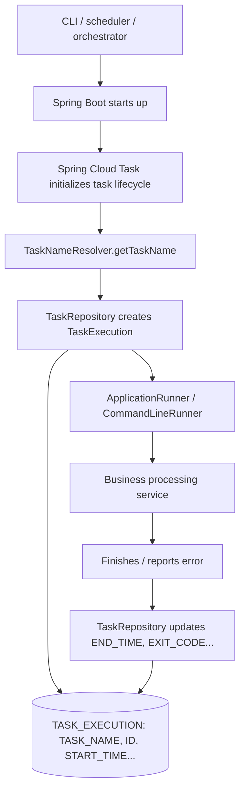

# Task Names and TaskNameResolver

## 1. What Role Does the Task Name Play in Execution Data?

**Spring Cloud Task** helps build Spring Boot applications with a finite execution duration: receive a request, perform work such as importing data, generating reports, or reconciling, and then terminate. When configured with a data store, Spring Cloud Task records metadata for each run using **`TaskRepository`**. The task name (`taskName`) is key information for grouping and tracing these executions.

Suppose the system has an order-processing job that runs at 02:00 every day:

| Run | Task Name | Execution ID | Outcome |
| --- | --- | --- | --- |
| Day 1 | `orders-daily-import` | `101` | Succeeded |
| Day 2 | `orders-daily-import` | `102` | Failed |
| Day 3 | `orders-daily-import` | `103` | Succeeded |

The three runs belong to **one job type** yet have **three different IDs**. The task name identifies the stable job type; the ID identifies a specific run. The IDs above are illustrative only and not framework-generated data.

`TaskNameResolver` is the strategy Spring Cloud Task uses to determine the name attached to a `TaskExecution`. You can use the default resolver or provide a naming strategy suited to your business domain.

### Distinguishing Names and Related Identifiers

| Information | Meaning | Changes across runs? |
| --- | --- | --- |
| `taskName` / `TASK_EXECUTION.TASK_NAME` | Logical name of the task type | Usually kept stable for the same type of job |
| `TaskExecution.executionId` / `TASK_EXECUTION_ID` | Identifier of an execution record | Each new run usually receives its own ID |
| `spring.application.name` | Spring Boot application name; may be used as the default task name | Usually fixed per application |
| `spring.cloud.task.name` | Property configuring the task name when using the default resolver | May vary by profile or launch |
| `spring.cloud.task.executionid` | Pre-allocated execution ID in special integration flows | Not a way to name a task; requires the matching record to be managed properly |
| Business parameters `--date`, `--customer`, `--request-id` | Input data for a processing run | May differ on each run |

The key point: **the task name is not the unique key of a run**, does not replace input parameters, and does not hold business processing outcomes.

## 2. How Does TaskNameResolver Participate in the Execution Lifecycle?



Once the `ApplicationContext` initializes successfully and the framework starts the task lifecycle, Spring Cloud Task uses the name provided by `TaskNameResolver` to write the `TaskExecution` record. Next, the runners execute their logic. When the task completes, the framework updates the execution result. If an error occurs too early and prevents `ApplicationContext` initialization, there may be no task record in the metadata store yet.

Because the name is resolved during the **execution initialization phase**, you should not wait until `ApplicationRunner` finishes processing to decide to rename the record itself. If the name must depend on a parameter, that parameter should come from a configuration source the resolver can read at application startup.

For example: a single JAR performs the `orders-daily-import` job. Each run may receive `--business.date=2026-11-24` or `--business.date=2026-11-25`, while the name `orders-daily-import` should remain unchanged; the date should be stored in arguments, business outputs, or a separate tracing system.

## 3. Default Resolver: SimpleTaskNameResolver

Spring Cloud Task provides **`SimpleTaskNameResolver`** (package `org.springframework.cloud.task.repository.support`) as the default naming strategy. Its precedence order is:

1. The **`spring.cloud.task.name`** property value, if configured.
2. If no configured name value is set, it uses the **`ApplicationContext` ID** via Spring Boot's mechanism; this ID typically reflects `spring.application.name` when that property is set.

This is the precedence order of the **default resolver**. A custom `TaskNameResolver` can apply different rules.

### 3.1. Setting the Name Directly in application.yml

Example for an order-import task:

```yaml
spring:
  application:
    name: order-processing-app
  main:
    web-application-type: none
  cloud:
    task:
      name: orders-daily-import
```

When running with the configuration above, the task name recorded in metadata is `orders-daily-import`, even though the Spring Boot application name is `order-processing-app`.

In a learning environment, this is usually the **simplest and easiest option to control**: all runs of the same task type share a consistent name, making history filtering and alerting straightforward.

### 3.2. Overriding the Name at Launch

Spring Boot allows passing properties via program arguments. Assuming the JAR is built as `target/order-task.jar`:

```bash
java -jar target/order-task.jar --spring.cloud.task.name=orders-backfill
```

In this case, when using the default resolver and with no higher-priority configuration source overriding it, the selected name is `orders-backfill`. This fits systems that deploy a single artifact to run **well-defined task types**; avoid choosing arbitrary names for every request.

Similarly, you can use environment variables following Spring Boot's property binding rules:

```bash
# Example on a Bash/Linux shell
export SPRING_CLOUD_TASK_NAME=orders-daily-import
java -jar target/order-task.jar
```

When multiple configuration sources provide the same property, **Spring Boot's Environment precedence rules** determine the final value. Check profiles, CLI arguments, environment variables, and deployment platform configurations if the name in the database differs from expectations.

### 3.3. What If spring.cloud.task.name Is Omitted?

If `spring.cloud.task.name` is omitted, the default resolver uses the `ApplicationContext` ID. With `spring.application.name: order-processing-app`, the name is usually reflected as `order-processing-app`. However, the context ID also depends on application startup or framework configuration; to **keep names consistent across environments**, set `spring.cloud.task.name` explicitly and verify the actual `TASK_EXECUTION.TASK_NAME`.

## 4. Complete Example to Record and Observe Task Names

### 4.1. Preparing Dependencies

In a Maven Spring Boot project, use a Spring Cloud version compatible with Spring Boot via the project BOM. Key dependencies for this exercise:

```xml
<dependencies>
    <dependency>
        <groupId>org.springframework.cloud</groupId>
        <artifactId>spring-cloud-starter-task</artifactId>
    </dependency>
    <dependency>
        <groupId>com.h2database</groupId>
        <artifactId>h2</artifactId>
        <scope>runtime</scope>
    </dependency>
</dependencies>
```

Do not pick a random starter version without confirming compatibility with the Spring Boot version in your project.

### 4.2. Creating a Finite Task

Create `OrderTaskApplication.java`:

```java
import java.util.List;

import org.springframework.boot.ApplicationArguments;
import org.springframework.boot.ApplicationRunner;
import org.springframework.boot.SpringApplication;
import org.springframework.boot.autoconfigure.SpringBootApplication;
import org.springframework.context.annotation.Bean;

@SpringBootApplication
public class OrderTaskApplication {

    public static void main(String[] args) {
        SpringApplication.run(OrderTaskApplication.class, args);
    }

    @Bean
    ApplicationRunner importOrders() {
        return args -> {
            String input = "demo";
            if (args.containsOption("input")) {
                List<String> values = args.getOptionValues("input");
                if (values == null || values.size() != 1
                        || values.get(0) == null || values.get(0).isBlank()) {
                    throw new IllegalArgumentException("A valid --input value is required");
                }
                input = values.get(0);
            }
            System.out.println("Importing orders; input=" + input);
            // In a real application, invoke the business processing service here.
            System.out.println("Finished one task execution.");
        };
    }
}
```

The code focuses on illustrating **task names**. `ApplicationRunner` runs once and returns; a real task would call a business service to process data and throw an exception on failure. The `--input` argument belongs to runner logic and **does not become the task name by default**.

### 4.3. Using File-Based H2 to View History Across Multiple Runs

Configure `src/main/resources/application.yml`:

```yaml
spring:
  application:
    name: order-processing-app
  main:
    web-application-type: none
  datasource:
    driver-class-name: org.h2.Driver
    url: jdbc:h2:file:./data/task-names;DB_CLOSE_ON_EXIT=FALSE
    username: sa
    password: ""
  cloud:
    task:
      name: orders-daily-import
      initialize-enabled: true
```

`initialize-enabled: true` is for this lab: metadata schemas are initialized as supported by your Spring Cloud Task version. Real environments should manage schemas with migrations matching the framework version, use database accounts with appropriate privileges, and avoid embedded H2 when multiple processes share a metadata store.

Assuming an executable JAR is built, create a `data` directory in the **working directory** and run:

```bash
mkdir data
java -jar target/order-task.jar --input=file-a.csv
java -jar target/order-task.jar --input=file-b.csv
java -jar target/order-task.jar --spring.cloud.task.name=orders-backfill --input=old.csv
```

These three launches can create three `TaskExecution` records with distinct IDs. The first two carry the name `orders-daily-import`; the third carries `orders-backfill` if no custom resolver overrides the default strategy. All three share the same H2 file when launched from the same working directory.

After the processes finish, use the H2 Shell or an IDE database client to open the **exact file** at `jdbc:h2:file:./data/task-names;IFEXISTS=TRUE` with user `sa`, then run:

```sql
SELECT TASK_EXECUTION_ID,
       TASK_NAME,
       START_TIME,
       END_TIME,
       EXIT_CODE
FROM TASK_EXECUTION
ORDER BY TASK_EXECUTION_ID DESC;
```

To group history by task name:

```sql
SELECT TASK_NAME,
       COUNT(*) AS TOTAL_EXECUTIONS,
       SUM(CASE WHEN EXIT_CODE = 0 THEN 1 ELSE 0 END) AS SUCCESSFUL
FROM TASK_EXECUTION
GROUP BY TASK_NAME
ORDER BY TASK_NAME;
```

This query only illustrates grouping executions; `EXIT_CODE` may still be unset while a task is running. Concluding a task truly completed requires checking `END_TIME` as well and accounting for forcibly terminated processes. Identical task names **do not guarantee** that two runs had the same parameters, same results, or no duplicate business data.

## 5. When Should You Write a Custom TaskNameResolver?

The `spring.cloud.task.name` property covers most needs for setting a fixed name or varying the name by profile/run. Customize `TaskNameResolver` only when **the naming rule** cannot be expressed conveniently as a single configuration value, for example:

- One artifact has two defined job modes (`daily-import` and `reconcile`) and needs to map environment names to standardized business names.
- An orchestration platform supplies its own *task type* identifier and you want to normalize it before persisting metadata.
- You want to restrict naming to an allowed catalog, avoiding hundreds of invalid variants typed manually by operators.

The official API is:

```java
package org.springframework.cloud.task.repository;

public interface TaskNameResolver {
    String getTaskName();
}
```

This is a **condensed contract** illustrating the method signature, not an instruction to create the interface yourself in your project. In real code, `import` the interface provided by the Spring Cloud Task dependency.

### 5.1. Example Resolver Standardizing Names by Job Mode

Suppose the application receives `app.task.operation` at startup. You want two valid values normalized into two easily queryable names:

| `app.task.operation` | Persisted task name |
| --- | --- |
| `daily` | `orders-daily-import` |
| `reconcile` | `orders-reconcile` |
| Any other value | Do not start the task with an arbitrary name; reject configuration |

Create `TaskNamingConfiguration.java`:

```java
import org.springframework.beans.factory.annotation.Value;
import org.springframework.cloud.task.repository.TaskNameResolver;
import org.springframework.context.annotation.Bean;
import org.springframework.context.annotation.Configuration;
import org.springframework.context.annotation.Primary;

@Configuration(proxyBeanMethods = false)
public class TaskNamingConfiguration {

    @Bean
    @Primary
    TaskNameResolver businessTaskNameResolver(
            @Value("${app.task.operation:daily}") String operation) {
        String taskName = switch (operation) {
            case "daily" -> "orders-daily-import";
            case "reconcile" -> "orders-reconcile";
            default -> throw new IllegalArgumentException(
                    "Unsupported app.task.operation=" + operation);
        };
        return () -> taskName;
    }
}
```

`@Bean` registers the custom strategy; `@Primary` ensures Spring picks this bean when multiple `TaskNameResolver` beans match type-based injection, such as when the default resolver is still registered. The bean name `businessTaskNameResolver` is **distinct** from the default bean name `taskNameResolver`, avoiding bean identifier collisions. Specific wiring details should be verified against the Spring Cloud Task version your project actually uses. The example requires Java 17 or later due to the arrow-syntax `switch` expression.

When applying this strategy, the name returned by `businessTaskNameResolver` becomes the task name. The `spring.cloud.task.name` value in YAML **is no longer the precedence rule** for the custom resolver. To avoid confusion, remove `spring.cloud.task.name` from configurations of variants using the custom resolver and supply only `app.task.operation`.

```bash
java -jar target/order-task.jar --app.task.operation=daily
java -jar target/order-task.jar --app.task.operation=reconcile
```

When reusing the `OrderTaskApplication` class, the runner still executes the illustrative logic as before; changing `app.task.operation` in the example only determines **the name on the metadata record**. To have two genuinely different business workflows, design the runner/service to dispatch by mode and validate the `operation` catalog where business logic runs. The resolver is **not** responsible for choosing or executing a business service.

### 5.2. Principles for Writing a Resolver

1. **Return a non-empty, business-meaningful, and stable name:** names like `orders-daily-import` identify the job type across runs.
2. **Do not append timestamps, UUIDs, or customer IDs to the name:** those belong in execution IDs, arguments, or correlation IDs (`requestId`). If every run gets a new name, grouping history and alerting by name loses meaning.
3. **Do not call slow or error-prone systems just to pick a name:** the resolver is invoked during task startup; making HTTP calls or complex SQL queries can break the ability to record runs.
4. **Do not embed sensitive data:** passwords, tokens, personal data, or free-form user input should not appear in `taskName`, as names may be stored in databases, logs, or metrics depending on configuration.
5. **Keep rules consistent across environments:** avoid giving the same job type different names in dev/staging/prod, adding environment suffixes only if observability systems truly require them; environment metadata usually exists at the deployment layer.
6. **Avoid renaming identifiers after going live:** renaming requires updating or adding compatibility handling for historical queries, dashboards, and alerts tied to the old name.

## 6. How Does the Task Name Relate to Scheduling, Error Handling, and Spring Batch?

### Scheduled or On-Demand Execution

If a scheduler launches `orders-daily-import` every night, each normal process creates a new `TaskExecution` carrying the same name. The scheduler may use the name to display or filter history, but **the name does not schedule runs itself**. Schedules and retries are determined by cron, Kubernetes CronJob, Spring Cloud Data Flow, or your orchestration platform.

If the same artifact contains two genuinely distinct job types, you can assign separate `spring.cloud.task.name` values for each or use a rule-based resolver as in Section 5. Most importantly, the name must reflect the **task type**, not an arbitrary launch instance.

### Restricting Concurrent Runs by Name

According to Spring Cloud Task documentation, `spring.cloud.task.single-instance-enabled=true` can be configured to allow only one running instance for the **same task name** at a time, provided the feature's required dependencies and infrastructure conditions are met. By default, this feature is **disabled**. Because the check relies on the name, constantly changing names can prevent this guard from protecting the same job type.

However, stable names and single-instance limits **do not replace** unique constraints, transactions, idempotency, or business invariants. Those safeguards remain necessary when schedulers retry after timeouts, systems run multiple replicas, or processes terminate unexpectedly.

### Relating Status and Errors

`TaskRepository` stores metadata such as `START_TIME`, `END_TIME`, `EXIT_CODE`, and error messages. To answer "how many times did `orders-daily-import` fail this week?", filter by `TASK_NAME`, time range, and outcome fields.

```sql
SELECT TASK_EXECUTION_ID, START_TIME, END_TIME, EXIT_CODE
FROM TASK_EXECUTION
WHERE TASK_NAME = 'orders-daily-import'
  AND START_TIME >= TIMESTAMP '2026-11-01 00:00:00'
  AND START_TIME < TIMESTAMP '2026-12-01 00:00:00'
ORDER BY START_TIME DESC;
```

This example illustrates filtering by a time range on databases supporting `TIMESTAMP` syntax. For accurate statistics, also inspect records still running or missing `END_TIME` after a forced process termination; such records do not necessarily have a final `EXIT_CODE`.

### Combining with Spring Batch

A Spring Cloud Task process can launch a Spring Batch job. When it does:

- **`TaskExecution.taskName`** identifies the task application/execution mode monitored by Spring Cloud Task.
- **Spring Batch job name** is the logical identifier of the Batch job, used alongside job parameters to manage job instances and restartability in `JobRepository`.
- **`TaskExecution` and `JobExecution`** are two distinct execution data units; giving the task and the Batch job the same name does not automatically merge their metadata.

For example, `TaskNameResolver` may return `orders-daily-import`, while the Batch job might be named `importOrdersJob`. When investigating a failure, inspect both task history and the related Batch job/step records. Spring Batch requires preparing its own `BATCH_*` metadata schema matching the version in use.

## 7. Common Naming Pitfalls

| Symptom | Possible Cause | How to Check / Resolve |
| --- | --- | --- |
| `TASK_NAME` differs from `spring.application.name` | `spring.cloud.task.name` or a custom resolver is configured | Check the resolved Environment value and which `TaskNameResolver` bean is active |
| Runs of the same job type appear under multiple names | Platform passes different names, inconsistent profiles, or names include varying arguments | Standardize logical names and isolate parameters per execution |
| All tasks record generic names | Missing `spring.cloud.task.name`, falling back to the default context ID | Set explicit task names by business job type |
| No `TASK_EXECUTION` rows appear | `TaskRepository` unconfigured/uninitialized, context startup failure, or checking the wrong database | Check bootstrap logs, JDBC URL, schema, and active profile |
| Custom resolver declared but app still uses default name | Bean not scanned/selected, or multiple beans of the same type exist | Check component scan scope, `@Bean` registration, bean precedence, and version-specific wiring |
| Task refuses to start when single-instance limit is enabled | An instance with the same name is already running, or feature dependencies/configuration are incomplete | Inspect running records, lock mechanism, Spring Integration dependency, and stale-run handling policy |
| Dashboard reports inaccurate failure counts | Filtering by a renamed task, counting only `EXIT_CODE != 0`, or missing unfinished records | Check name history, time range, exit code, and `END_TIME` |

## 8. Hands-On Lab and Self-Check Questions

Practice on a project with compatible Spring Boot/Spring Cloud Task versions and persist metadata to file-based H2 or a database capable of retaining history:

1. Set `spring.application.name=order-processing-app` and `spring.cloud.task.name=orders-daily-import`, and run twice. Query `TASK_EXECUTION` to explain why there are **two IDs** but **one task name**.
2. Run a third time with `--spring.cloud.task.name=orders-backfill`. Check which name is persisted, then explain the precedence order of `SimpleTaskNameResolver`.
3. Remove `spring.cloud.task.name`, run once, and observe how the name is derived from `ApplicationContext`. Restore an explicit name before continuing the lab.
4. Apply `businessTaskNameResolver` and test `--app.task.operation=daily`, `reconcile`, and `invalid` in turn. Identify when the framework can create a record and when a configuration error occurs too early to produce a `TaskExecution`.
5. Write a query counting successful runs by `TASK_NAME`. Add conditions handling records missing `END_TIME` instead of treating them as successful.
6. Answer: why should you avoid creating names like `orders-import-2026-11-24-tenant-42`? If you need to trace a specific customer request, where should that identifier be placed?
7. Suppose a task triggers a Spring Batch job: distinguish `taskName`, `TASK_EXECUTION_ID`, the Batch job name, and `JobExecution` ID in a retry scenario.

After this lesson, you should understand how **Spring Cloud Task determines `taskName`**, the role and API of **`TaskNameResolver`**, the precedence order of **`SimpleTaskNameResolver`**, how to change names via configuration or custom strategies, and how names impact **metadata querying, scheduling, error handling, monitoring, and safe operations**.

## 9. References

- [Spring Cloud Task Reference Guide — Features](https://docs.spring.io/spring-cloud-task/reference/features.html): `TaskExecution` lifecycle, metadata, and task configuration.
- [Javadoc `TaskNameResolver`](https://docs.spring.io/spring-cloud-task/docs/current/apidocs/org/springframework/cloud/task/repository/TaskNameResolver.html): package and `getTaskName()` signature.
- [Javadoc `SimpleTaskNameResolver`](https://docs.spring.io/spring-cloud-task/docs/current/apidocs/org/springframework/cloud/task/repository/support/SimpleTaskNameResolver.html): precedence between `spring.cloud.task.name` and the `ApplicationContext` ID.
