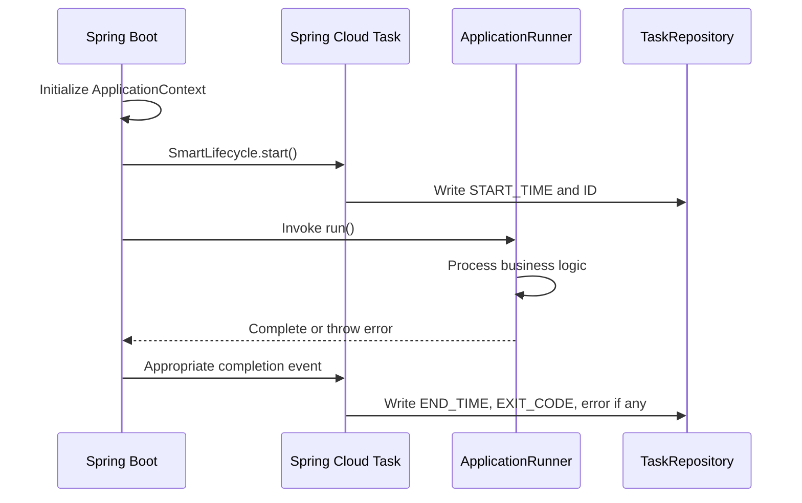

# startTime, endTime, and Execution Duration

## 1. Why Track Start and End Timestamps?

**Spring Cloud Task** fits Spring Boot applications with a finite runtime: importing partner data, syncing orders, generating reports, running scheduled jobs, or handling requests from an orchestrator. After each run, operators typically need to answer:

- When did the task start, and has it finished?
- How long did it take to execute? Is this run slower than usual?
- Did the run succeed or fail, and does it need a retry?
- If the task has no end time yet, is it still running or did it terminate abnormally?

Spring Cloud Task stores the lifecycle information of each run in **`TaskRepository`**. The **`TaskExecution`** object holds `startTime` and `endTime`; from these two timestamps, execution duration can be calculated. This data is critical for monitoring, alerting, operations, and performance analysis over time.

**Goal:** After this lesson, you will be able to interpret `startTime`/`endTime` accurately, calculate duration in Java and SQL, handle missing timestamps, distinguish overall task duration from individual phase durations, and combine duration with `exitCode` to evaluate execution outcomes.

## 2. Which Timestamps Does `TaskExecution` Record?

Each time a Spring Cloud Task application launches, the framework manages a separate `TaskExecution` record. Common time-related and associated fields:

| Field in `TaskExecution` | Column in `TASK_EXECUTION` | Meaning |
| --- | --- | --- |
| `executionId` | `TASK_EXECUTION_ID` | Unique identifier for **a single run**. |
| `taskName` | `TASK_NAME` | Task name, usually determined by configuration. |
| `startTime` | `START_TIME` | Timestamp when Spring Cloud Task began tracking the execution. |
| `endTime` | `END_TIME` | Timestamp when the framework marked the execution as finished. |
| `exitCode` | `EXIT_CODE` | Exit code of the run; may be absent while the task is still running. |
| `errorMessage` | `ERROR_MESSAGE` | Error information if the framework recorded an execution failure. |
| `lastUpdated` (metadata column) | `LAST_UPDATED` | Timestamp when the metadata record was updated; not runtime duration. |

In modern Spring Cloud Task versions, `TaskExecution.getStartTime()` and `getEndTime()` return **`java.time.LocalDateTime`**. At the database level, the schema provides corresponding date-time columns, typically `DATETIME` or `TIMESTAMP` depending on the DBMS and schema version.

### 2.1. Where the Timestamps Sit in the Lifecycle

According to the Spring Cloud Task lifecycle:

1. Spring Boot initializes the `ApplicationContext` and required beans.
2. When the task infrastructure's `SmartLifecycle.start()` is called, Spring Cloud Task creates/updates `TaskExecution` with **`startTime`**; this happens **before** `CommandLineRunner` and `ApplicationRunner` execute their work.
3. The runners execute business logic. Once they complete, the framework records completion through the application lifecycle, including the `ApplicationReadyEvent`; at that point **`endTime`** and the corresponding exit code are recorded. If an application error occurs, `ApplicationFailedEvent` can lead to a failure status.
4. Recorded data is persisted in `TaskRepository` for querying after the process exits.



> **Measurement boundary:** `startTime` is not the exact instant the OS created the JVM, because part of Spring Boot startup already occurred before the task infrastructure wrote the record. `endTime` reflects completion according to the task lifecycle, not necessarily including all subsequent resource cleanup time or external orchestrator latency.

If the application fails to initialize `ApplicationContext` far enough, there may be **no `TaskExecution` record at all**. Therefore, the absence of timing data does not prove the program was never launched.

### 2.2. What Does `endTime == null` Mean?

A newly created record typically has `startTime` but **no `endTime` yet**. During execution, `exitCode` may also be `null`. That is normal.

However, an empty `endTime` **does not always mean the task is still running**. If the JVM is forcibly stopped, the server loses power, or the process is killed before the framework updates metadata, the record can remain indefinitely with `END_TIME = NULL`. To distinguish *running* from an *orphaned record*, cross-check process state, logs, the scheduler/Kubernetes, and the last update timestamp.

`startTime` can also be `null` for certain records initialized externally that have not actually started yet. Verify data completeness before calculating duration.

## 3. Duration Formula and Visual Example

For a run with valid start and end timestamps:

\[
\text{duration} = \text{endTime} - \text{startTime}
\]

Hypothetical example:

| Property | Value |
| --- | --- |
| `TASK_EXECUTION_ID` | `42` |
| `TASK_NAME` | `import-orders` |
| `START_TIME` | `2026-11-24 10:00:00.150` |
| `END_TIME` | `2026-11-24 10:00:01.410` |
| Duration | **1,260 ms**, equivalent to **1.26 seconds** |

This duration is the **elapsed wall-clock time of the overall execution recorded by Spring Cloud Task**, not total CPU time and not the sum of all workers' times. If three subtasks process concurrently in 2 seconds, total task duration may be close to 2 seconds plus overhead—not 6 seconds by default.

To read results accurately, distinguish:

| Metric | Measurement Scope | How to Obtain |
| --- | --- | --- |
| `TaskExecution` duration | Span from task `startTime` to `endTime` | `TaskRepository` / `TASK_EXECUTION` |
| Specific business step duration | Individual file read, API call, or DB write step | `System.nanoTime()`, application timers/metrics |
| Queue wait time | From orchestrator request to when the task actually starts running | Scheduler/orchestrator data, if available |
| JVM/process lifetime | From OS process creation to process exit | Process monitoring or orchestration system |

Do not use `startTime` and `endTime` as a substitute for microsecond-accurate performance profiling. Both timestamps follow the system clock and can be affected by clock adjustments, time zones, or how the DBMS handles timestamps.

## 4. Creating a Spring Cloud Task to Collect Duration

This hands-on example uses **JDK 17**, **Spring Boot 3.4.5**, **Spring Cloud 2024.0.2**, and a file-based H2 database. These are matching-generation versions; when using newer releases, choose a Spring Cloud release train compatible with Spring Boot.

The `duration-demo` application will sleep for a duration passed via `--sleep-ms`, then exit or simulate an error via `--fail`. Each run is recorded independently.

### 4.1. Project Structure

```text
duration-demo/
├── pom.xml
└── src/main/
    ├── java/com/example/duration/
    │   ├── DurationDemoApplication.java
    │   └── DurationRunner.java
    └── resources/
        └── application.yml
```

### 4.2. Maven Configuration

Create `pom.xml`:

```xml
<?xml version="1.0" encoding="UTF-8"?>
<project xmlns="http://maven.apache.org/POM/4.0.0"
         xmlns:xsi="http://www.w3.org/2001/XMLSchema-instance"
         xsi:schemaLocation="http://maven.apache.org/POM/4.0.0 https://maven.apache.org/xsd/maven-4.0.0.xsd">
    <modelVersion>4.0.0</modelVersion>

    <parent>
        <groupId>org.springframework.boot</groupId>
        <artifactId>spring-boot-starter-parent</artifactId>
        <version>3.4.5</version>
        <relativePath/>
    </parent>

    <groupId>com.example</groupId>
    <artifactId>duration-demo</artifactId>
    <version>0.0.1-SNAPSHOT</version>

    <properties>
        <java.version>17</java.version>
    </properties>

    <dependencyManagement>
        <dependencies>
            <dependency>
                <groupId>org.springframework.cloud</groupId>
                <artifactId>spring-cloud-dependencies</artifactId>
                <version>2024.0.2</version>
                <type>pom</type>
                <scope>import</scope>
            </dependency>
        </dependencies>
    </dependencyManagement>

    <dependencies>
        <dependency>
            <groupId>org.springframework.cloud</groupId>
            <artifactId>spring-cloud-starter-task</artifactId>
        </dependency>
        <dependency>
            <groupId>org.springframework.boot</groupId>
            <artifactId>spring-boot-starter-jdbc</artifactId>
        </dependency>
        <dependency>
            <groupId>com.h2database</groupId>
            <artifactId>h2</artifactId>
            <scope>runtime</scope>
        </dependency>
    </dependencies>

    <build>
        <plugins>
            <plugin>
                <groupId>org.springframework.boot</groupId>
                <artifactId>spring-boot-maven-plugin</artifactId>
            </plugin>
        </plugins>
    </build>
</project>
```

`spring-cloud-starter-task` provides the task lifecycle mechanism, `spring-boot-starter-jdbc` supports database access, and H2 retains history for the hands-on exercise.

### 4.3. Configuring `application.yml`

```yaml
spring:
  application:
    name: duration-demo
  main:
    web-application-type: none
  datasource:
    url: jdbc:h2:file:./data/duration-db;DB_CLOSE_ON_EXIT=FALSE
    username: sa
    password: ""
    driver-class-name: org.h2.Driver
  cloud:
    task:
      name: duration-demo
      initialize-enabled: true
      closecontext-enabled: true
```

`web-application-type: none` keeps the application from starting a web server. `initialize-enabled: true` allows creating metadata tables for practice. `closecontext-enabled: true` instructs Spring to close the context after the task finishes.

**Note on the H2 path:** `./data/duration-db` is relative to the directory where the Java command is executed. Create the `data` directory beforehand and keep the same working directory for every run so queries read the right database file. In production, replace file-based H2 with a durable database supporting concurrent access, manage schemas via migrations, and enforce least-privilege accounts.

### 4.4. Enabling the Task and Writing the Runner

Create `src/main/java/com/example/duration/DurationDemoApplication.java`:

```java
package com.example.duration;

import org.springframework.boot.SpringApplication;
import org.springframework.boot.autoconfigure.SpringBootApplication;
import org.springframework.cloud.task.configuration.EnableTask;

@SpringBootApplication
@EnableTask
public class DurationDemoApplication {

    public static void main(String[] args) {
        SpringApplication.run(DurationDemoApplication.class, args);
    }
}
```

Create `src/main/java/com/example/duration/DurationRunner.java`:

```java
package com.example.duration;

import java.util.List;

import org.springframework.boot.ApplicationArguments;
import org.springframework.boot.ApplicationRunner;
import org.springframework.stereotype.Component;

@Component
public class DurationRunner implements ApplicationRunner {

    @Override
    public void run(ApplicationArguments args) throws Exception {
        List<String> values = args.getOptionValues("sleep-ms");
        long delayMs = (values == null || values.isEmpty())
                ? 1200L
                : Long.parseLong(values.get(0));

        if (delayMs < 0 || delayMs > 60000L) {
            throw new IllegalArgumentException(
                    "--sleep-ms must be between 0 and 60000");
        }

        System.out.println("Starting work, sleep=" + delayMs + " ms");
        try {
            Thread.sleep(delayMs);
        } catch (InterruptedException ex) {
            Thread.currentThread().interrupt();
            throw ex;
        }

        if (args.containsOption("fail")) {
            throw new IllegalStateException("Simulating task failure");
        }

        System.out.println("Work completed");
    }
}
```

The application intentionally uses `Thread.sleep()` to make timing differences between runs clear. In a real application, replace this with finite processing logic and ensure any required asynchronous tasks complete before `run()` returns.

## 5. Test Runs and Reading Timing Records

Inside the `duration-demo` directory, create the H2 storage directory:

```bash
mkdir -p data
mvn clean package
```

On PowerShell, you can use `New-Item -ItemType Directory -Force data` instead of `mkdir -p data`.

Run three times:

```bash
# Run 1: normal run with a 1200 ms delay
java -jar target/duration-demo-0.0.1-SNAPSHOT.jar --sleep-ms=1200

# Run 2: longer run
java -jar target/duration-demo-0.0.1-SNAPSHOT.jar --sleep-ms=3000

# Run 3: business error after waiting
java -jar target/duration-demo-0.0.1-SNAPSHOT.jar --sleep-ms=500 --fail
```

After each run, Spring Cloud Task records a new `TASK_EXECUTION_ID`. The third run throws an exception; when handled as a runner failure, the exit code is recorded as failed. **Do not assume actual duration equals `--sleep-ms`**: between `startTime` and `endTime` there is also framework, runner, and metadata persistence overhead.

After the Java processes finish, use the H2 console or a SQL client to connect to:

```text
JDBC URL: jdbc:h2:file:./data/duration-db
Username: sa
Password: (leave blank)
```

Query the history:

```sql
SELECT TASK_EXECUTION_ID,
       TASK_NAME,
       START_TIME,
       END_TIME,
       EXIT_CODE,
       ERROR_MESSAGE
FROM TASK_EXECUTION
ORDER BY TASK_EXECUTION_ID DESC;
```

Illustrative output (IDs and timestamps are examples only):

| ID | Task Name | `START_TIME` | `END_TIME` | `EXIT_CODE` |
| ---: | --- | --- | --- | ---: |
| 3 | duration-demo | 10:05:00.100 | 10:05:00.680 | 1 |
| 2 | duration-demo | 10:04:00.100 | 10:04:03.180 | 0 |
| 1 | duration-demo | 10:03:00.100 | 10:03:01.380 | 0 |

In Run 2, `END_TIME - START_TIME` is around 3.08 seconds—longer than the 3-second delay due to additional runner overhead. Actual results depend on machine, JVM, and database access.

## 6. Calculating Duration with SQL

### 6.1. Duration of Each Run in H2

H2 provides the `DATEDIFF` function. Use the `MILLISECOND` unit to get milliseconds:

```sql
SELECT TASK_EXECUTION_ID,
       TASK_NAME,
       START_TIME,
       END_TIME,
       EXIT_CODE,
       CASE
           WHEN START_TIME IS NOT NULL AND END_TIME IS NOT NULL
           THEN DATEDIFF('MILLISECOND', START_TIME, END_TIME)
           ELSE NULL
       END AS DURATION_MS
FROM TASK_EXECUTION
ORDER BY TASK_EXECUTION_ID DESC;
```

`DURATION_MS` will be `NULL` if either timestamp is missing. For valid records, a positive number shows the elapsed interval between the two timestamps. If you receive a negative value, investigate system clocks, time zones, corrupted data, or external metadata edits; do not clamp it to `0` automatically because that hides incidents.

In PostgreSQL, for example, the equivalent calculation is typically:

```sql
SELECT TASK_EXECUTION_ID,
       EXTRACT(EPOCH FROM (END_TIME - START_TIME)) * 1000
           AS DURATION_MS
FROM TASK_EXECUTION
WHERE START_TIME IS NOT NULL
  AND END_TIME IS NOT NULL;
```

**Date functions and column types depend on the DBMS.** Write SQL tailored to your actual database and schema instead of copying an H2 query verbatim to MySQL, SQL Server, or PostgreSQL.

### 6.2. Average Duration and Completion Count

A simple operational report can count runs and calculate average duration:

```sql
SELECT TASK_NAME,
       COUNT(*) AS TOTAL_RUNS,
       SUM(CASE
           WHEN END_TIME IS NOT NULL AND EXIT_CODE = 0
           THEN 1 ELSE 0
       END) AS SUCCESS_RUNS,
       SUM(CASE
           WHEN END_TIME IS NULL
           THEN 1 ELSE 0
       END) AS NO_END_TIME_RUNS,
       AVG(CASE
           WHEN START_TIME IS NOT NULL
                AND END_TIME IS NOT NULL
                AND END_TIME >= START_TIME
           THEN DATEDIFF('MILLISECOND', START_TIME, END_TIME)
           ELSE NULL
       END) AS AVG_DURATION_MS
FROM TASK_EXECUTION
GROUP BY TASK_NAME;
```

Because `AVG` ignores `NULL` values, the result averages only runs with valid timestamps. **Do not include unfinished runs in the average by substituting 0 for a missing duration**; doing so skews statistics.

When comparing performance, group by data type, input size, and run schedule. A plain average can hide a few very slow runs; when enough data exists, also compute percentiles such as p95 and p99 using appropriate analytical tools.

### 6.3. Finding Records Without an End Time

```sql
SELECT TASK_EXECUTION_ID,
       TASK_NAME,
       START_TIME,
       LAST_UPDATED,
       EXIT_CODE
FROM TASK_EXECUTION
WHERE END_TIME IS NULL
ORDER BY START_TIME;
```

This is a **list requiring inspection**, not a definitive list of failures. One task may still be running legitimately; another may have been forcibly terminated and left incomplete metadata behind. When alerting, combine expected duration thresholds, process status, and information from the orchestrator.

## 7. Calculating Duration via the Java `TaskExplorer` API

When duration is needed inside a monitoring service or separate reporting program, Spring Cloud Task provides `TaskExplorer` to read `TaskExecution` records saved by `TaskRepository`. The example below assumes the service is configured to connect to the same database as the monitored task.

```java
package com.example.duration;

import java.time.Duration;
import java.time.LocalDateTime;
import java.util.Optional;

import org.springframework.cloud.task.repository.TaskExecution;
import org.springframework.cloud.task.repository.TaskExplorer;
import org.springframework.stereotype.Service;

@Service
public class TaskDurationService {

    private final TaskExplorer taskExplorer;

    public TaskDurationService(TaskExplorer taskExplorer) {
        this.taskExplorer = taskExplorer;
    }

    public Optional<Duration> findCompletedDuration(long executionId) {
        TaskExecution execution = taskExplorer.getTaskExecution(executionId);
        if (execution == null) {
            return Optional.empty();
        }

        LocalDateTime start = execution.getStartTime();
        LocalDateTime end = execution.getEndTime();
        if (start == null || end == null || end.isBefore(start)) {
            return Optional.empty();
        }

        return Optional.of(Duration.between(start, end));
    }
}
```

Example using the service **after the observed run has finished**:

```java
taskDurationService.findCompletedDuration(42L)
        .ifPresent(duration ->
                System.out.println("Duration: "
                        + duration.toMillis() + " ms"));
```

`TaskExplorer.getTaskExecution(id)` may return `null` if no record is found. The method returns `Optional.empty()` when a valid duration cannot be computed; callers can display "not finished" or "missing data" after checking the reason.

**Important note:** If you call `TaskExplorer` directly inside the current run's `ApplicationRunner`, that run's `endTime` is usually **not yet recorded** because the runner has not returned. To query completed duration, read from a separate monitoring/reporting application, from a subsequent run, or after the task has updated its final state.

`Duration.between(start, end)` works on two `LocalDateTime` values, but `LocalDateTime` **carries no time zone or UTC offset**. If multiple machines run with different time zone settings or the system clock is adjusted, timestamp comparisons can skew. Standardize time zones (commonly UTC), synchronize clocks, and clearly define how JDBC maps timestamps.

## 8. When You Need to Measure a Code Block Precisely: `System.nanoTime()`

Overall `TaskExecution` duration is useful for operations. However, if you want to know how long an API call step alone took, measure inside the code block:

```java
long startNanos = System.nanoTime();
try {
    importOrders();
} finally {
    long elapsedNanos = System.nanoTime() - startNanos;
    long elapsedMs = java.util.concurrent.TimeUnit.NANOSECONDS
            .toMillis(elapsedNanos);
    System.out.println("importOrders took " + elapsedMs + " ms");
}
```

`importOrders()` is a custom business method. `System.nanoTime()` is designed to measure **elapsed time within the same process**; it is not a wall-clock date-time to store in place of `startTime` or compare across different machines.

If you need multi-step analysis, record metrics by step name, status, duration, and processed record count. You can use Micrometer/timers to aggregate duration distributions, while avoiding high-cardinality labels like per-run IDs on every metric.

## 9. Interpreting Data During Errors, Retries, and Concurrency

### 9.1. Failed Runs Still Have a Duration

A task that throws an exception **after Spring Cloud Task has started tracking it** can still have both `startTime` and `endTime`. Therefore:

- **Having a duration** does not mean **success**.
- **Missing `endTime`** is not enough to conclude whether a task failed or is still running.
- **`exitCode = 0`** indicates successful termination per the application's status reporting mechanism, but does not guarantee business data is accurate or complete.

When reporting statistics, display at least `taskName`, `executionId`, `startTime`, `endTime`, `duration`, and `exitCode` together. If the business logic produces a separate result (such as synced order count), store that result appropriately and tie it to the run via a clear identifier.

### 9.2. Retries and Overlapping Runs

Every retry creates a new `TaskExecution`. Never subtract the second run's `startTime` from the first run's `endTime`; they are **two separate executions**. When a scheduler allows concurrent runs, `startTime..endTime` intervals can overlap, even though each run has its own ID.

A task taking 8 minutes may be normal when importing 2 million records, yet abnormal when processing 10 records. To build meaningful alerts, combine duration with input size, retry count, exit code, and task priority.

### 9.3. Asynchrony and Spring Batch

If a runner simply submits work to an executor and returns, Spring Cloud Task's `endTime` can be recorded **before** the subtasks finish. When those tasks are mandatory parts of the job, await completion, handle timeouts, and propagate errors **before the runner exits**.

When integrating **Spring Batch**, `TaskRepository` tracks the overall application, whereas `JobRepository` tracks individual `JobExecution` and `StepExecution` records. These durations have **different boundaries**. With an asynchronous Batch launcher, ensure the runner awaits job completion if `TaskExecution` must reflect the entire processing lifecycle.

## 10. Monitoring and Troubleshooting Checklist

| Symptom | Likely Possibility | What to Check |
| --- | --- | --- |
| `END_TIME` is `NULL` and process is alive | Task is running slowly | Compare against SLA, data volume, per-step timeouts, and take a thread dump if needed. |
| `END_TIME` is `NULL` but no process is found | Killed/crashed or metadata update failed | Inspect JVM logs, Kubernetes/scheduler events, infrastructure, and DB connectivity. |
| No rows in `TASK_EXECUTION` | Very early context creation failure or wrong DB | Check startup logs and datasource URL; verify schema. |
| `END_TIME` is earlier than `START_TIME` | Inconsistent data or system clocks | Check time zones, NTP, per-node clocks, and manual metadata edits. |
| Duration increases while `EXIT_CODE = 0` | Task succeeded but ran slowly | Profile steps, check database/queries/APIs and input size. |
| Task reports completion too early | Runner returned before async work or skipped steps | Check awaiting `Future`/`CompletableFuture`, logs, and data state. |
| Multiple rows with the same task name | Multiple runs/retries/overlaps | Use `TASK_EXECUTION_ID` to distinguish; review concurrency policy. |

In production environments, use a durable database and controlled migrations for the task schema. Also track failure rates, runs missing `endTime` beyond a threshold, duration percentiles, and external wait times. Do not put secrets in command-line arguments because task metadata may persist the argument list.

## 11. Knowledge Self-Check

1. Is `startTime` set before or after `ApplicationRunner` executes its work? Why does that matter when computing duration?
2. What does a record with `startTime` set and `endTime = NULL` tell you for sure, and what can you **not yet conclude**?
3. Why must two runs with the same `TASK_NAME` be distinguished by `TASK_EXECUTION_ID`?
4. Given `START_TIME = 14:00:00.250` and `END_TIME = 14:00:02.000`, what is the duration in milliseconds?
5. How does `Duration.between(startTime, endTime)` differ from `System.nanoTime()` in intended use?
6. How do you avoid marking an unfinished asynchronous task or Spring Batch job as completed?
7. When should you compare `EXIT_CODE` and business record counts alongside duration?

### Hands-On Exercises

- Run `duration-demo` three times with `--sleep-ms=500`, `--sleep-ms=2000`, and `--sleep-ms=500 --fail`.
- Write SQL displaying `TASK_EXECUTION_ID`, both timestamps, duration in milliseconds, and exit code.
- Calculate average duration across only successfully completed runs.
- Add separate logging for runner processing time using `System.nanoTime()`; compare it with the total duration in `TASK_EXECUTION`.
- Suppose an `END_TIME` record was left blank after a JVM crash. List the information sources to cross-check before deciding to rerun.

**Key Takeaway:** `startTime` and `endTime` describe **the lifecycle of a single `TaskExecution`**, and duration is the difference between them when both are valid. Read them together with `executionId`, `exitCode`, business outcomes, and orchestrator state to understand accurately how the process ran.

## References

- [Spring Cloud Task — Features](https://docs.spring.io/spring-cloud-task/reference/3.2/features.html): when `TaskExecution` is created/updated, and the meaning of `startTime` and `endTime`.
- [Spring Cloud Task — Task Repository Schema](https://docs.spring.io/spring-cloud-task/docs/current/reference/html/appendix-task-repository-schema.html): `TASK_EXECUTION` columns.
- [Spring Cloud Task — TaskExecution API](https://docs.spring.io/spring-cloud-task/docs/current/apidocs/org/springframework/cloud/task/repository/TaskExecution.html): timestamp return types and accessor methods.
