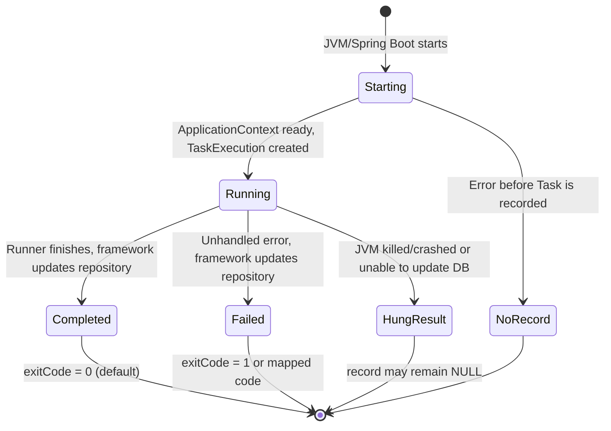
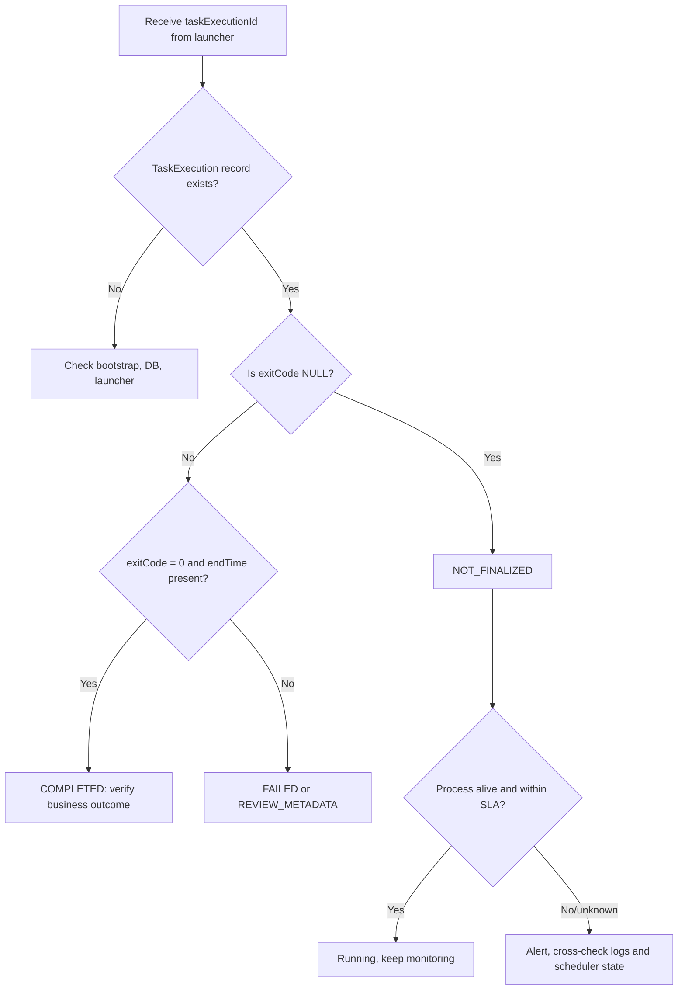

# Unset `exitCode` and Outcome When a Task Completes

## Lesson Objectives

In **Spring Cloud Task**, every run of a finite-lived application is recorded as a `TaskExecution`. This record lets operations know when a task started, whether it has finished, which exit code it returned, and whether error details were captured. This is essential for tracking scheduled runs, on-demand runs, or tasks coordinated with Spring Batch.

The most common point of confusion is: **while a task is running, `exitCode` has no value yet (`null`)**. Spring Cloud Task writes the appropriate exit code only when the process passes through the framework's completion flow. Therefore, `null`, `0`, and non-zero codes must be interpreted in three distinct ways.

After this lesson, you will be able to:

- Explain the lifecycle of a `TaskExecution` and when `exitCode` is updated.
- Distinguish `NULL` from `0`, non-zero error codes, and the case where no execution record exists.
- Read results using SQL or `TaskExplorer` without hitting `null` unboxing errors.
- Control exit codes for business errors using `ExitCodeExceptionMapper` and record safe completion messages.
- Detect abnormal runs when the JVM is killed or the repository is not updated, and understand the relationship with Spring Batch.

## 1. What Does `exitCode` Represent?

`TaskExecution` models a **physical execution** of a Spring Boot application configured to use Spring Cloud Task. The Java getter `getExitCode()` returns **`Integer`**, not `int`; therefore, it can be `null`. In the database, the corresponding column is `TASK_EXECUTION.EXIT_CODE`, which is nullable.

| Value in `TaskExecution` | How to Interpret | Should You Conclude the Task Succeeded? |
| --- | --- | --- |
| `null` / SQL `NULL` | **No final result persisted yet**; typically the task is still executing | **No**. Insufficient evidence to judge success or failure |
| `0` | By default convention, the task flow ended successfully | **Potentially**, if it completed, persisted valid results, and business logic truly succeeded |
| Non-zero (usually `1`, or a custom code) | Flow ended with a failure or a status defined as unsuccessful | No. Inspect the code, `errorMessage`, `exitMessage`, and logs |
| Record not found | May not have launched, wrong `executionId`, wrong DB queried, or failed too early before Task registration | No. This is **different** from a record with `exitCode = NULL` |

**Do not equate `null` with `0`:** in Java, `Integer exitCode = null` means *no value yet*, whereas `exitCode = 0` means *a concrete value is present*. The same applies in SQL: `EXIT_CODE = NULL` is not a valid check; always use `EXIT_CODE IS NULL`.

The [Spring Cloud Task – Features](https://docs.spring.io/spring-cloud-task/reference/features.html) documentation confirms that the exit code is stored as `null` while the task is running and updated upon completion. This distinction prevents reporting "success" for a process that has only been running for a few seconds.

## 2. Lifecycle of an Execution



Key points in the flow:

1. **Startup:** Spring Boot creates the `ApplicationContext`, sets up the `DataSource`, `TaskRepository`, and required beans. If the context fails to bootstrap, the framework **may not create a `TaskExecution` record**.
2. **Start recorded:** after initializing sufficient infrastructure and before invoking `ApplicationRunner`/`CommandLineRunner`, Spring Cloud Task creates the record with `startTime` populated, `endTime = null`, and **`exitCode = null`**.
3. **Execution:** business code runs inside the runners. During this phase, the record has no final outcome yet, even if the application has already processed part of the data.
4. **Normal completion:** when runners finish, the framework updates the end time, exit code, and related messages in `TaskRepository`. Unless an error event or custom code is configured, **the default is `0`**.
5. **Recorded failure:** when an unhandled error occurs and the framework receives the failure event, the default code is typically **`1`**, or a code provided by an error-mapping mechanism. Error description fields may be updated.
6. **Abnormal termination:** `SIGKILL`, out-of-memory errors, killed machines/containers, power loss, or an unreachable DB can leave **a record sitting with `exitCode = NULL` indefinitely**. Thus, `NULL` does not prove the JVM is still running.

Cases 1 and 6 must be monitored via process/container status, logs, and scheduler information; you cannot rely solely on the Task table. Per the documentation, recording an execution requires the `ApplicationContext` to initialize successfully. [Source: Task lifecycle](https://docs.spring.io/spring-cloud-task/reference/features.html#the-lifecycle-of-a-spring-cloud-task).

### Example of Two Snapshots of the Same Record

Suppose the system aggregates transactions for `2026-11-23` with `TASK_EXECUTION_ID = 281`. The following values are **illustrative**, not real system data:

| Observation Time | `START_TIME` | `END_TIME` | `EXIT_CODE` | Interpretation |
| --- | --- | --- | --- | --- |
| 02:00:02, right after start | `2026-11-24 02:00:01` | `NULL` | `NULL` | No final outcome yet |
| 02:00:10, writing data | `2026-11-24 02:00:01` | `NULL` | `NULL` | Still no final outcome |
| 02:00:40, completed successfully | `2026-11-24 02:00:01` | `2026-11-24 02:00:40` | `0` | Success recorded |

If that execution threw an unhandled exception at 02:00:30, the final record could be `END_TIME = 2026-11-24 02:00:30`, `EXIT_CODE = 1`, and an `ERROR_MESSAGE`. Exact processing duration depends on business logic; the example only illustrates how metadata evolves.

## 3. Reading Data Fields Alongside `exitCode`

`exitCode` is an important signal, yet **insufficient** on its own to evaluate an entire execution.

| Field / API | Meaning | Operational Question |
| --- | --- | --- |
| `executionId` | Unique ID for a Task run | Which run is this, and which request does it correspond to? |
| `taskName` | Task name, typically based on `spring.application.name` | Which type of job ran? |
| `startTime` | When the Task was recorded as started | Did the schedule start on time? |
| `endTime` | When the Task was recorded as finished | Has the framework finished updating the outcome? |
| `exitCode` | Exit code, **nullable** while running | Is the final outcome success, error, or not yet available? |
| `exitMessage` | Message the application can supply via `TaskExecutionListener` | What brief summary do operators need? |
| `errorMessage` | Error details, potentially containing a stack trace on failure | Where is the failure path, and which logs should be checked? |
| `arguments` | Command-line argument list passed to the Task | Which date/tenant did the run process? |

In the default schema, `TASK_EXECUTION` contains `TASK_EXECUTION_ID`, `TASK_NAME`, `START_TIME`, `END_TIME`, `EXIT_CODE`, `EXIT_MESSAGE`, `ERROR_MESSAGE`, `LAST_UPDATED`, etc.; arguments reside in `TASK_EXECUTION_PARAMS`. Table names may differ if a project configures a **table prefix**, so check against the actual schema. See [Task Repository Schema](https://docs.spring.io/spring-cloud-task/reference/appendix-task-repository-schema.html).

Distinguish three concepts:

- **`exitCode`** is the **numeric execution result code** stored by Spring Cloud Task. `null` is not a special error code.
- **`exitMessage`** is an **explanatory message** populated by the application. It does not automatically flip `exitCode` from `0` to `1`.
- **`errorMessage`** aids exception investigation, though content is not always guaranteed. Business code that swallows an exception may exit `0` and produce no framework error message.

`TaskExecution` primarily answers **"how did the execution process go?"**. For business domains such as payments or reconciliation, you also need domain-level outcomes: processed record counts, totals, request IDs, checkpoints, and transaction states. Such data is not guaranteed just because `exitCode = 0`.

## 4. Querying Status Safely with SQL

The examples below assume `TaskRepository` uses a **persistent PostgreSQL database** with the Spring Cloud Task schema created and write permissions granted to the application. Do not use in-memory H2 to inspect history across multiple processes: the database disappears when the JVM exits.

### Viewing Recent Executions

```sql
SELECT
    TASK_EXECUTION_ID,
    TASK_NAME,
    START_TIME,
    END_TIME,
    EXIT_CODE,
    EXIT_MESSAGE,
    LAST_UPDATED
FROM TASK_EXECUTION
WHERE TASK_NAME = 'invoice-summary-task'
ORDER BY TASK_EXECUTION_ID DESC
LIMIT 20;
```

To retrieve records **without an exit code yet**:

```sql
SELECT TASK_EXECUTION_ID, TASK_NAME, START_TIME, END_TIME
FROM TASK_EXECUTION
WHERE EXIT_CODE IS NULL
ORDER BY START_TIME;
```

Do not write `WHERE EXIT_CODE = NULL` or `WHERE EXIT_CODE != NULL`: in SQL, direct comparisons with `NULL` never evaluate to `TRUE`, causing unexpectedly empty results. Always use `IS NULL`/`IS NOT NULL`.

### Displaying Status Labels Derived by a Monitoring System

```sql
SELECT
    TASK_EXECUTION_ID,
    TASK_NAME,
    START_TIME,
    END_TIME,
    EXIT_CODE,
    CASE
        WHEN EXIT_CODE IS NULL AND END_TIME IS NULL
            THEN 'NOT_FINALIZED'
        WHEN EXIT_CODE = 0 AND END_TIME IS NOT NULL
            THEN 'COMPLETED'
        WHEN EXIT_CODE <> 0 AND END_TIME IS NOT NULL
            THEN 'FAILED'
        ELSE 'REVIEW_METADATA'
    END AS OBSERVED_STATE
FROM TASK_EXECUTION
ORDER BY TASK_EXECUTION_ID DESC
LIMIT 50;
```

`NOT_FINALIZED` means **no final result yet**, not `RUNNING`. To display `RUNNING`, you need **additional evidence**: a live process/container, scheduler confirmation, application heartbeat, or an equivalent signal. `REVIEW_METADATA` helps catch inconsistent field states, such as `END_TIME` populated while `EXIT_CODE` remains `NULL`.

### Detecting Records Unfinished for Too Long

PostgreSQL example flagging tasks **started more than 30 minutes ago** without a result:

```sql
SELECT TASK_EXECUTION_ID, TASK_NAME, START_TIME, LAST_UPDATED
FROM TASK_EXECUTION
WHERE END_TIME IS NULL
  AND EXIT_CODE IS NULL
  AND START_TIME < CURRENT_TIMESTAMP - INTERVAL '30 minutes'
ORDER BY START_TIME;
```

This list contains **candidates for investigation** only. A 2-hour task may still be valid, while a task killed in its first minute may linger indefinitely. Time thresholds should reflect each `taskName`'s SLA, historical runtimes, and scheduler state. Do not run bulk `UPDATE ... SET EXIT_CODE = 1` statements merely because 30 minutes elapsed: editing metadata directly corrupts history and can conflict with a still-running process.

## 5. Reading via Java `TaskExplorer` Without `NullPointerException`

`TaskExplorer` provides an API to read data from the repository, such as `getTaskExecution(long executionId)`. Outside the worker process, a monitoring service can use this API to query status. `getTaskExecution` can return `null` if the ID is not found.

```java
package com.example.monitoring;

import org.springframework.cloud.task.repository.TaskExecution;
import org.springframework.cloud.task.repository.TaskExplorer;
import org.springframework.stereotype.Service;

@Service
public class TaskStatusReader {
    private final TaskExplorer taskExplorer;

    public TaskStatusReader(TaskExplorer taskExplorer) {
        this.taskExplorer = taskExplorer;
    }

    public String getObservedState(long executionId) {
        TaskExecution execution = taskExplorer.getTaskExecution(executionId);
        if (execution == null) {
            return "NOT_FOUND";
        }

        // Use Integer: getExitCode() may be null.
        Integer exitCode = execution.getExitCode();
        if (exitCode == null && execution.getEndTime() == null) {
            return "NOT_FINALIZED";
        }
        if (exitCode == null || execution.getEndTime() == null) {
            return "REVIEW_METADATA";
        }
        return exitCode == 0 ? "COMPLETED" : "FAILED (" + exitCode + ")";
    }
}
```

`exitCode == 0` at the end of the example is safe **because `null` was already checked**. Writing `if (execution.getExitCode() == 0)` directly causes Java to auto-convert `Integer` to `int` (*unboxing*), throwing `NullPointerException` while the task is still running.

In APIs serving dashboards or external systems, return an **enum/DTO with an explicit status field** (`NOT_FOUND`, `NOT_FINALIZED`, `COMPLETED`, `FAILED`, `REVIEW_METADATA`) instead of ad-hoc string concatenation. These are **monitoring application labels**, not a status enum pre-stored by Spring Cloud Task.

## 6. Example: Success, Default Failure, and Custom Exit Codes

Consider the `invoice-summary-task`: it accepts `--business-date=YYYY-MM-DD`, simulates 15 seconds of processing to give time to inspect the record while running, and supports `--simulate-failure` to exercise the failure path.

The sample application uses `spring-cloud-starter-task` with a compatible Spring Boot/Spring Cloud BOM and an appropriate JDBC driver. Use artificial delays only in labs; production must execute real business logic.

File `src/main/java/com/example/task/InvoiceSummaryTaskApplication.java`:

```java
package com.example.task;

import java.time.LocalDate;
import java.time.format.DateTimeParseException;
import java.util.List;

import org.springframework.boot.ApplicationRunner;
import org.springframework.boot.ExitCodeExceptionMapper;
import org.springframework.boot.SpringApplication;
import org.springframework.boot.autoconfigure.SpringBootApplication;
import org.springframework.cloud.task.configuration.EnableTask;
import org.springframework.context.annotation.Bean;

@SpringBootApplication
@EnableTask
public class InvoiceSummaryTaskApplication {

    public static void main(String[] args) {
        SpringApplication.run(InvoiceSummaryTaskApplication.class, args);
    }

    @Bean
    ApplicationRunner invoiceSummary() {
        return args -> {
            List<String> values = args.getOptionValues("business-date");
            if (values == null || values.size() != 1) {
                throw new InvalidTaskInputException("One --business-date is required");
            }

            LocalDate businessDate;
            try {
                businessDate = LocalDate.parse(values.get(0));
            } catch (DateTimeParseException ex) {
                throw new InvalidTaskInputException("Date must follow YYYY-MM-DD", ex);
            }

            // For experiment only: allows time to query EXIT_CODE IS NULL.
            Thread.sleep(15_000);

            if (args.containsOption("simulate-failure")) {
                throw new IllegalStateException("Simulated processing failure");
            }

            System.out.println("Invoice summary succeeded for " + businessDate);
        };
    }

    @Bean
    ExitCodeExceptionMapper taskExitCodes() {
        return error -> {
            // Spring Boot may wrap exceptions from ApplicationRunner.
            for (Throwable cause = error; cause != null; cause = cause.getCause()) {
                if (cause instanceof InvalidTaskInputException) {
                    return 12; // Application-defined code: invalid input.
                }
            }
            return 1; // Other errors.
        };
    }

    static final class InvalidTaskInputException extends RuntimeException {
        InvalidTaskInputException(String message) {
            super(message);
        }

        InvalidTaskInputException(String message, Throwable cause) {
            super(message, cause);
        }
    }
}
```

`ExitCodeExceptionMapper` is Spring Boot's mechanism for translating **unhandled exceptions** into exit codes. Spring Cloud Task can persist the mapped code into `TaskExecution`. This example assigns `12` to invalid input; **the number 12 is an application choice**, not a standard Spring Cloud Task code. For finer error categorization, Spring Boot also offers `ExitCodeGenerator`, and Spring Cloud Task handles `ExitCodeEvent`.

### Configuring the Repository to Observe Records Across Runs

In your test environment, prepare PostgreSQL and the Task schema matching your library version beforehand; the following `application.yml` sample assumes that DB already exists:

```yaml
spring:
  application:
    name: invoice-summary-task
  main:
    web-application-type: none
  datasource:
    url: ${TASK_DB_URL}
    username: ${TASK_DB_USER}
    password: ${TASK_DB_PASSWORD}
  cloud:
    task:
      initialize-enabled: false   # Schema already created via migrations.
      closecontext-enabled: true
logging:
  level:
    org.springframework.cloud.task: DEBUG
```

The `TASK_DB_*` variables are example environment-supplied settings; never pass credentials via command-line arguments to avoid exposing them in shell history and `TASK_EXECUTION_PARAMS`. `closecontext-enabled: true` closes the context once the framework completes updates; real applications must also clean up any other threads/resources so the process terminates cleanly.

After building the JAR with the matching name, run the three scenarios in turn (replace `target/invoice-summary-task.jar` with your actual artifact):

```bash
# A: expected success, final exitCode = 0
java -jar target/invoice-summary-task.jar --business-date=2026-11-23

# B: missing argument, expected mapped code = 12
java -jar target/invoice-summary-task.jar

# C: simulated unhandled business error, default/mapper code = 1
java -jar target/invoice-summary-task.jar \
  --business-date=2026-11-23 --simulate-failure
```

While scenario A or C is sleeping for 15 seconds, run the queries from Section 4 from **another connection** to the same PostgreSQL instance. You will observe `EXIT_CODE IS NULL` and `END_TIME IS NULL`. After the runner and update flow finish, query the same `TASK_EXECUTION_ID` again to see `0`, `12`, or `1` depending on the path taken.

Note: your actual runner, Spring Boot/Cloud version, additional listeners, and infrastructure errors can affect the final code. The example only shows how to **design and test** the three primary outcomes and does not guarantee every application uses the same code table. In particular, if the application fails before the Task is created, you cannot observe `exitCode` on a nonexistent record.

## 7. Completion Messages: `exitMessage` and `errorMessage`

In some situations, `0` or `1` conveys too little detail. You want to know *how many invoices were summarized*, *what category of error occurred*, or *which request ID to trace*.

Spring Cloud Task lets you register a `TaskExecutionListener` or use the `@BeforeTask`, `@AfterTask`, and `@FailedTask` annotations. `@AfterTask` runs **before** the framework writes the final status to the repository; `@FailedTask` receives the exception in the failure path.

Example listener recording only a safe error reference:

```java
package com.example.task;

import org.springframework.cloud.task.listener.annotation.FailedTask;
import org.springframework.cloud.task.repository.TaskExecution;
import org.springframework.stereotype.Component;

@Component
public class TaskFailureDetails {

    @FailedTask
    public void onFailure(TaskExecution execution, Throwable error) {
        // Use a classification code/ID; avoid storing tokens, personal data, or sensitive stack traces.
        execution.setExitMessage(
                "Failure recorded; taskExecutionId=" + execution.getExecutionId());
    }
}
```

Setting `exitMessage` in a listener does not replace `exitCode`. If an `@AfterTask` listener also calls `setExitMessage`, the message from the final phase may **overwrite the failure message** according to framework precedence rules. Design consistent messages and verify what is actually persisted in the DB.

`errorMessage` is populated by the framework when corresponding error details exist. This field has a schema-defined length limit, so do not rely on it to hold an entire stack trace. Maintain centralized logs carrying `taskExecutionId` and a correlation ID for detailed investigation. When building APIs or dashboards, restrict access and sanitize messages before display.

## 8. How Does the DB Exit Code Differ from the Process Exit Code?

Two common sources exist:

| Source | Timing / Meaning | Risk If Used Alone |
| --- | --- | --- |
| `TaskExecution.exitCode` / `TASK_EXECUTION.EXIT_CODE` | Written by Spring Cloud Task when the framework runs through completion and can save to the repository | No result mid-run; can go stale on kill/crash/DB connection loss |
| **Process exit code** returned by OS, scheduler, or container | Indicates termination status of the **process** per platform convention | Lacks business context; value is dictated by signals/launchers and may not match the DB |

On the happy path, both codes usually reflect the same outcome. However, never assume they are **always equal**:

- **JVM receives `SIGKILL` or container is forcibly terminated:** the scheduler sees the process die, while `TaskExecution` stays at `EXIT_CODE = NULL` because there was no chance to update the repository.
- **Database connection lost at completion:** business work may have finished while the repository could not write `END_TIME`/`EXIT_CODE`; investigate to avoid reruns causing duplicate data.
- **Exception caught and ignored:** the runner merely logs the exception without rethrowing or setting a failure status, so the framework considers the run successful and records `0` despite faulty processing.
- **Calling `System.exit(n)` abruptly in business code:** risks preventing listeners and repository updates from completing properly. Never use it as a standard mechanism to report business errors.
- **Startup failure before Task registration:** the scheduler/container reports an error, yet the database has no matching `TASK_EXECUTION` row.

Therefore, in production, conclude a task's outcome by cross-checking **the `TaskRepository` record + launcher/process state + logs and business outcomes**. Specifically, a `SIGTERM` signal does not automatically mean Task `exitCode` is recorded as `1`; the outcome depends on how the application handles shutdown and whether the repository update executes.

## 9. When Running Alongside Spring Batch

Spring Cloud Task records **`TaskExecution`** (one process execution), while Spring Batch records **`JobExecution`** and `StepExecution` (job and processing step states). These two layers can link together but are not identical.

| Scenario | What to Check |
| --- | --- |
| Runner finishes normally, without Batch | `TaskExecution.exitCode` defaults to `0` |
| Runner throws an unhandled exception | `TaskExecution.exitCode` is typically `1` or a custom code |
| Spring Batch Job has `BatchStatus.FAILED` while Boot app finishes normally | Task **may still receive `0`** under default configuration, even though the Job failed |
| Want a failed Batch Job to make Task report a non-zero code | Review `spring.cloud.task.batch.fail-on-job-failure=true` and verify behavior for your version |

Example configuration when the application actually includes Spring Batch and the Task/Batch integration:

```yaml
spring:
  cloud:
    task:
      batch:
        fail-on-job-failure: true
```

When controlling outcomes, inspect `JobExecution`'s `BatchStatus`/`ExitStatus`, retry/restart details, and `TaskExecution`'s final code. You cannot use `EXIT_CODE IS NULL` to conclude a Batch Job is waiting, nor rely on `TaskExecution.exitCode = 0` to prove all business steps succeeded if configuration does not propagate Batch failures to the Task. See [Spring Cloud Task – Batch Job Exit Codes](https://docs.spring.io/spring-cloud-task/reference/batch.html#batch-job-exit-codes).

## 10. Designing Monitoring and Alerting

Suppose a task runs every 15 minutes and normally completes in 2–5 minutes. A dashboard might apply the following rules:



Operational principles:

1. **Trace with a single ID:** store `taskExecutionId` and the request/scheduler ID to correlate DB records, logs, containers, and, if applicable, Spring Batch `JobExecution`.
2. **Alert based on per-Task SLAs:** `exitCode = NULL` after 15 minutes is normal for a 1-hour job but suspicious for a 2-minute job. Avoid applying a single fixed threshold to all tasks.
3. **Verify whether the process is alive or dead:** `exitCode IS NULL` only means metadata is **not yet finalized**. Combine with Kubernetes Pod/Job status, process exit code, or scheduler-reported state.
4. **Never manually edit historical outcomes to tidy up dashboards:** when encountering a stuck record, open an investigation incident, determine root cause, and follow a dedicated operational procedure to mark exceptions if truly needed.
5. **Design idempotency before retrying:** if a Task persisted partial business changes but was killed before updating metadata, rerunning can create duplicate invoices or transfers. Use transactions, business keys, checkpoints, and appropriate idempotency keys.
6. **Limit sensitive data:** `arguments`, `exitMessage`, `errorMessage`, and logs may contain confidential information. Do not pass passwords/tokens via CLI or exit messages; enforce access controls on the repository.

### Four Scenarios for Self-Evaluation

**Scenario A.** `EXIT_CODE = NULL`, `END_TIME = NULL`, run started 15 seconds ago. **Conclusion:** no final outcome yet; if the process is still running, you may display "running". Do not display "succeeded".

**Scenario B.** `EXIT_CODE = 0`, `END_TIME` populated, yet the business report lacks expected data. **Conclusion:** the framework recorded completion; check business conditions, swallowed-exception logic, output reporting, and potential uncommitted transactions.

**Scenario C.** `EXIT_CODE = NULL`, `END_TIME = NULL` after 4 hours; the scheduler confirms the container was terminated. **Conclusion:** the unfinalized record likely reflects abnormal termination; raise an investigation/alert and inspect affected data before retrying. Do not assume the process is still running.

**Scenario D.** Spring Batch Job failed while `TaskExecution.exitCode = 0`. **Conclusion:** inspect configuration propagating Batch status to Task, including `spring.cloud.task.batch.fail-on-job-failure`, and the launcher's handling/exception path.

## 11. Pre-Production Scheduling Checklist

- [ ] `TaskRepository` connects to a persistent DB with the right schema version; does not rely on an in-memory DB if history across processes is needed.
- [ ] Dashboards handle all three states—`null`, `0`, and non-zero—without unboxing `Integer` before checking `null`.
- [ ] SQL queries use `IS NULL`, never `= NULL`; distinguish "not finalized" from "actively running".
- [ ] Critical business errors are not swallowed; exit code mappings are documented and tested on real failure paths.
- [ ] Monitoring also covers launcher/container state, OS exit codes, and startup failures occurring before `TaskRepository` is ready.
- [ ] `exitMessage`/`errorMessage` carry enough diagnostic context without exposing tokens, passwords, or sensitive personal data.
- [ ] SLAs, overdue-run detection, stuck-record investigation procedures, and safe retry capabilities are in place.
- [ ] If integrated with Spring Batch, `TaskExecution`–`JobExecution` links, `BatchStatus`/`ExitStatus`, and settings affecting the final exit code are verified.

## Review Questions

1. Why does `TaskExecution.getExitCode()` return `Integer` instead of always returning `int`?
2. When `EXIT_CODE IS NULL` after 10 seconds, can you state for sure that the task is running? What extra data is required?
3. Why is `WHERE EXIT_CODE = NULL` incorrect, and what is the proper SQL clause to find records with no exit code yet?
4. If an `ApplicationRunner` catches a business error without rethrowing it, what might the default `exitCode` be?
5. Why is `TaskExecution.exitCode = 0` not always enough to conclude a Spring Batch Job or business process succeeded?
6. When `exitCode` is still `NULL` yet the container has died, what must be verified before retrying?

**Suggested Answers:** (1) Because an in-progress run has no final code yet and needs `null` representation; (2) No, you must cross-check process/scheduler state and SLA; (3) Use `IS NULL`; (4) It may be `0` if the framework sees the runner exit normally; (5) Because the Task code and Batch Job/business outcomes represent different layers of information; (6) Check logs, termination cause, side effects, and idempotency guards to prevent duplicate processing.

## Official Documentation

1. [Spring Cloud Task – Features: Lifecycle, TaskExecution, Mapping Exit Codes](https://docs.spring.io/spring-cloud-task/reference/features.html) — explains when `TaskExecution` is created/updated, `exitCode = null` while running, error mapping, and listeners.
2. [Spring Cloud Task – Getting Started](https://docs.spring.io/spring-cloud-task/reference/getting-started.html) — sample logs progressing from `exitCode=null` at creation to `exitCode=0` on update.
3. [Spring Cloud Task – Task Repository Schema](https://docs.spring.io/spring-cloud-task/reference/appendix-task-repository-schema.html) — `TASK_EXECUTION` structure, nullable columns, and related tables.
4. [Spring Cloud Task – Batch Job Exit Codes](https://docs.spring.io/spring-cloud-task/reference/batch.html) — relationship between Batch Job outcomes and Task exit codes.
5. [Spring Cloud Task – `TaskExecution` API](https://docs.spring.io/spring-cloud-task/docs/current/apidocs/org/springframework/cloud/task/repository/TaskExecution.html) and [`TaskExplorer` API](https://docs.spring.io/spring-cloud-task/docs/current/apidocs/org/springframework/cloud/task/repository/TaskExplorer.html) — methods for reading program results.

**Guiding Principle:** **`NULL` means no final result has been recorded yet; `0` means conventional success; non-zero means termination with an error or application-defined state.** To know whether a task is genuinely still running or stopped abnormally, look at both the repository and the execution platform.
