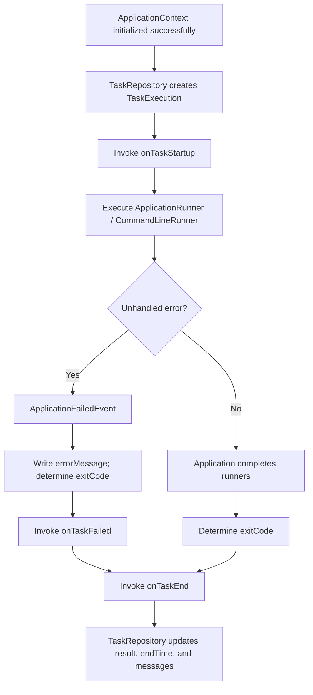

# Distinguishing exitMessage and errorMessage in Spring Cloud Task

## 1. Context: What Does a Task Run Store?

**Spring Cloud Task** is used to build Spring Boot processes with a finite runtime: start up, perform work, and then exit. A task can be triggered on a schedule, via an orchestration API, or manually. Spring Cloud Task stores lifecycle data for each run in **TaskRepository** as a **`TaskExecution`** object.

Suppose an order-import application runs every night. The first run imports 1,200 records successfully; the next fails because the input file has an invalid format. Operators need to know at the same time:

- Which run it was, and when it started and ended?
- Did the task **succeed or fail**, as represented by `exitCode`?
- If it finished, what is the brief summary message, as represented by `exitMessage`?
- If an unhandled error caused the application to fail, where are the technical details for investigation, as represented by `errorMessage`?

The two fields most easily confused are `exitMessage` and `errorMessage`. Both are strings stored in execution metadata, yet they have different origins and purposes.

After this lesson, you will be able to explain the difference, record `exitMessage` with a listener, query metadata in the database, distinguish scenarios with and without `errorMessage`, and design safe monitoring when integrating with Spring Batch.

## 2. Accurately Distinguishing exitCode, exitMessage, and errorMessage

| `TaskExecution` Property | Type and Meaning | Common Data Source | What Is It Used For? |
| --- | --- | --- | --- |
| `exitCode` | `Integer`, may be unset while the Task is running | Spring Cloud Task exit code rules, `ExitCodeEvent`, `ExitCodeGenerator`, or corresponding exception mapping | Machine-level outcome determination and orchestration decisions |
| `exitMessage` | `String`, nullable | Explicitly assigned by the application via `TaskExecutionListener`, e.g., `setExitMessage(...)` | Describing the final outcome in a short, readable sentence |
| `errorMessage` | `String`, nullable | When the application terminates due to an exception reflected by `ApplicationFailedEvent`, the framework typically stores the **stack trace** here | Diagnosing the technical root cause of a failed run |

According to Spring Cloud Task documentation, **`exitMessage`** is "information available at the time of termination" and can be set by a listener; **`errorMessage`** holds the stack trace if the cause of termination was an exception reported via `ApplicationFailedEvent`. Without a custom exit code, a failed process typically receives `exitCode=1`; a normal run typically receives `exitCode=0`.

In short:

- **`exitCode` = numeric result** for schedulers, CI/CD, or monitoring systems to make decisions.
- **`exitMessage` = explanation/summary the application chooses to save** upon completion.
- **`errorMessage` = error diagnostic details** captured by the lifecycle mechanism when applicable.

**There is no rule requiring only one of the two messages to be populated.** A failed run can easily have both `exitMessage="IMPORT_FAILED; reason=INVALID_INPUT"` and `errorMessage` holding the stack trace of an `IllegalArgumentException`. Conversely, a successful run may have no `exitMessage` if the application did not set one.

> Note: exact values depend on how the application exits, listeners, framework version, and configuration. Do not assume that `exitCode != 0` always implies `errorMessage` is present, or that `errorMessage == null` guarantees business logic succeeded.

### Illustrative Data Examples

| Task execution | `exitCode` | `exitMessage` | `errorMessage` |
| --- | ---: | --- | --- |
| Imported 1,200 records successfully; listener sets summary | `0` | `IMPORT_OK; imported=1200` | `null` |
| Import succeeded without a listener | `0` | `null` | `null` |
| Run failed due to unhandled exception; listener records error type | `1` | `IMPORT_FAILED; reason=INVALID_FORMAT` | Exception stack trace |
| Returned application-defined error code without throwing an exception | E.g. `2` | May or may not be present | Possibly `null` |
| Application caught an exception and silently exited normally | Possibly `0` | Possibly `null` | Usually `null` |

The rows above are **illustrative scenarios**, not values automatically assigned to `exitMessage` by Spring Cloud Task.

## 3. At Which Stage Are These Fields Recorded?

Basic lifecycle:



When the Task starts, the `TaskExecution` record usually already has `taskName`, `startTime`, parameters, and ID; `endTime` and `exitCode` do not yet have final values. When runners finish or a failure event occurs, Spring Cloud Task resolves the final data and updates the repository.

`TaskExecutionListener` callbacks:

| Callback | Timing | Appropriate Role |
| --- | --- | --- |
| `onTaskStartup(TaskExecution)` | Right as the Task starts | Set initialization info if needed |
| `onTaskFailed(TaskExecution, Throwable)` | Unhandled exception during execution | Classify the error into a short `exitMessage` without leaking sensitive data |
| `onTaskEnd(TaskExecution)` | Before writing final status to the repository | Set success summary or finalize the result message |

One crucial detail: **`onTaskEnd` is also invoked in failure flows** after `onTaskFailed`. Setting `exitMessage` unconditionally inside `onTaskEnd` can **overwrite** the message set in `onTaskFailed`. Spring Cloud Task documentation specifies the `exitMessage` precedence order: `onTaskEnd`, then `onTaskFailed`, then `onTaskStartup`. Therefore, to preserve failure messages, the final listener should set a success summary only when the run truly succeeded.

Do not rely on `errorMessage` as a guaranteed record for every failure:

- If the application fails **before `ApplicationContext` initializes far enough to create `TaskExecution`**, the repository may have no corresponding record.
- If the OS forcibly terminates the process, power fails, or `SIGKILL` is sent, completion callbacks may not run; the record may retain unupdated `endTime`/`exitCode`.
- If code catches an exception without signaling failure, Spring Cloud Task may observe only a normal completion flow.

Consequently, production monitoring should combine **repository records, process exit codes, logs, timeouts, and scheduler data**.

## 4. Java Example: Setting exitMessage and Letting the Framework Record errorMessage

The example below uses a Java 17+ application with `spring-cloud-starter-task` added and a database configured for `TaskRepository`. To avoid version mismatches, use compatible Spring Boot/Spring Cloud versions from your project BOM.

### 4.1. Task Application Simulating Success and Failure

File `ImportTaskApplication.java`:

```java
package com.example.importtask;

import org.springframework.boot.ApplicationArguments;
import org.springframework.boot.ApplicationRunner;
import org.springframework.boot.SpringApplication;
import org.springframework.boot.autoconfigure.SpringBootApplication;
import org.springframework.cloud.task.configuration.EnableTask;
import org.springframework.context.annotation.Bean;

@SpringBootApplication
@EnableTask
public class ImportTaskApplication {

    public static void main(String[] args) {
        SpringApplication.run(ImportTaskApplication.class, args);
    }

    @Bean
    ApplicationRunner importOrders() {
        return arguments -> {
            if (arguments.containsOption("demo.fail")) {
                // Simulate an unhandled error in business logic.
                throw new IllegalArgumentException(
                    "Input data is not in the expected format"
                );
            }
            System.out.println("Simulated order import succeeded");
        };
    }
}
```

This Task only demonstrates lifecycle behavior; in a real application, replace the simulation with an import service, transaction outcome persistence, and rerun controls.

### 4.2. Listener Attaching Completion Messages

File `ImportResultListener.java`:

```java
package com.example.importtask;

import org.springframework.cloud.task.listener.TaskExecutionListener;
import org.springframework.cloud.task.repository.TaskExecution;
import org.springframework.stereotype.Component;

@Component
public class ImportResultListener implements TaskExecutionListener {

    @Override
    public void onTaskStartup(TaskExecution taskExecution) {
        // No need to set exitMessage in this example.
    }

    @Override
    public void onTaskFailed(
            TaskExecution taskExecution, Throwable throwable) {
        // Do not write throwable.getMessage() or stack traces into exitMessage.
        // Store only a stable, safe reason code for the monitoring system.
        taskExecution.setExitMessage(
            "IMPORT_FAILED; reason=PROCESSING_ERROR"
        );
    }

    @Override
    public void onTaskEnd(TaskExecution taskExecution) {
        // onTaskEnd can still run after onTaskFailed.
        // Do not overwrite the failure message.
        if (Integer.valueOf(0).equals(taskExecution.getExitCode())
                && taskExecution.getErrorMessage() == null) {
            taskExecution.setExitMessage(
                "IMPORT_COMPLETED; result=SUCCESS"
            );
        }
    }
}
```

Key points to notice:

1. `@Component` lets Spring manage the listener. Spring Cloud Task discovers beans implementing `TaskExecutionListener` and invokes the appropriate callbacks.
2. `onTaskFailed` sets **`exitMessage`** to a concise business/technical message; there is no need to set **`errorMessage`** manually because the lifecycle mechanism captures the stack trace when receiving `ApplicationFailedEvent`.
3. `onTaskEnd` checks `exitCode` and `errorMessage` before assigning the success message. This prevents failures from being mislabeled `IMPORT_COMPLETED`.
4. The final repository update is performed by Spring Cloud Task; the sample code does not call `TaskRepository.completeTaskExecution(...)` manually.

Test with the built JAR:

```bash
# Normal path
java -jar import-task.jar

# Failure path: runner throws an exception
java -jar import-task.jar --demo.fail=true
```

With a configured database and active listener, expected results are:

| Scenario | Expected `exitMessage` | Expected `errorMessage` | Typical `exitCode` |
| --- | --- | --- | --- |
| Without `--demo.fail=true` | `IMPORT_COMPLETED; result=SUCCESS` | `null` | `0` |
| With `--demo.fail=true` | `IMPORT_FAILED; reason=PROCESSING_ERROR` | Stack trace containing `IllegalArgumentException` | `1` unless mapped otherwise |

**Testing note:** Depending on Spring Boot configuration, `ApplicationArguments.containsOption("demo.fail")` only checks whether the option is present. The example passes `--demo.fail=true` to trigger the error; passing `--demo.fail=false` still leaves the option present and **still triggers the error**. In real applications, read and validate the boolean value rather than only checking key presence.

### 4.3. Turning exitMessage into Useful Information

When a task has real summary statistics, a good message might look like:

```text
IMPORT_COMPLETED; processed=1200; skipped=4; reportDate=2026-11-24
```

This is an **example string**, not a value automatically generated by Spring Cloud Task. To produce such a message, the application can store aggregated outcomes in a per-run reporting bean and let the listener read them after the runner completes. Do not hardcode numbers like `1200` inside a production listener.

Keep `exitMessage` short, simply structured, readable, and free of stack traces. If thousands of metrics or business outcomes need to be stored, use business tables or a dedicated metrics system linked via `taskExecutionId`.

## 5. Reading and Interpreting Messages from the Database

With Spring Cloud Task's default relational schema, metadata resides in the `TASK_EXECUTION` table. You can inspect recent records using SQL:

```sql
SELECT
    TASK_EXECUTION_ID,
    TASK_NAME,
    START_TIME,
    END_TIME,
    EXIT_CODE,
    EXIT_MESSAGE,
    ERROR_MESSAGE
FROM TASK_EXECUTION
ORDER BY TASK_EXECUTION_ID DESC;
```

Avoid displaying full `ERROR_MESSAGE` contents on a general dashboard because stack traces can be lengthy and expose internal details. An operations overview often only needs to know whether an error message exists:

```sql
SELECT
    TASK_EXECUTION_ID,
    TASK_NAME,
    END_TIME,
    EXIT_CODE,
    EXIT_MESSAGE,
    CASE
        WHEN ERROR_MESSAGE IS NULL OR ERROR_MESSAGE = ''
            THEN 'NO'
        ELSE 'YES'
    END AS HAS_ERROR_MESSAGE
FROM TASK_EXECUTION
ORDER BY TASK_EXECUTION_ID DESC;
```

These table/column names apply to the standard Task schema; if your organization uses a table prefix or customized schema, adjust the SQL accordingly. Operators should have appropriate read privileges without necessarily having permission to modify `TASK_EXECUTION`.

### Workflow for Investigating a Failed Run

1. **Identify the run** via `TASK_EXECUTION_ID`, `TASK_NAME`, timestamps, and scheduler/container IDs.
2. **Check `END_TIME` and `EXIT_CODE`** to see whether completion was recorded or the run is hung/unfinished.
3. **Read `EXIT_MESSAGE`** for the application-generated summary, such as `reason=INVALID_INPUT` or imported record counts.
4. **Read `ERROR_MESSAGE` selectively** when a stack trace is required; locate the exception type and root cause, then correlate with logs and trace IDs.
5. **Check business impact** in the database before deciding to retry. Partial data may have been committed even though the Task ended in failure.

If `ERROR_MESSAGE` is empty while `EXIT_CODE` is non-zero, do not assume the repository failed: exit code conventions or termination events may not have passed through an unhandled exception. Conversely, if `EXIT_CODE=0` while data is missing, check whether code swallowed an exception, left async work unawaited, or marked success prematurely.

## 6. Exit Code Is Not the Same as exitMessage

Their names look similar, yet **`exitCode` is numeric** while **`exitMessage` is a string**. A scheduler should not parse `exitMessage` strings like `IMPORT_OK` to decide on retries; rely on the final exit code and operational conventions.

Example policy for a data-import application:

| Application-Defined Exit Code | Meaning | Scheduler Action |
| ---: | --- | --- |
| `0` | Success | Record completion |
| `2` | Invalid arguments or input data | Do not retry as-is; fix input request |
| `3` | Transient infrastructure error classified as recoverable | Retry with bounded backoff |
| `1` | Other unclassified error | Investigate before automatic retry |

Codes `2` and `3` are merely **suggested application conventions**, not fixed meanings mandated by Spring Cloud Task. When mapping specific errors, Spring Boot provides `ExitCodeExceptionMapper`; Spring Cloud Task can capture the mapped code. Example:

```java
import org.springframework.boot.ExitCodeExceptionMapper;
import org.springframework.context.annotation.Bean;

@Bean
ExitCodeExceptionMapper taskExitCodeMapper() {
    return exception -> {
        Throwable cause = exception;
        while (cause != null) {
            if (cause instanceof IllegalArgumentException) {
                return 2;
            }
            cause = cause.getCause();
        }
        return 1;
    };
}
```

This is an illustrative bean method to place **inside a `@Configuration` or `@SpringBootApplication` class**; it is not a complete Java file. In production systems, use a dedicated business exception like `InvalidTaskInputException` instead of mapping every `IllegalArgumentException` as an input error, since programming bugs can throw that exception as well.

**You cannot change an error code merely by calling `setExitMessage("SUCCESS")`.** Likewise, setting `errorMessage` to an arbitrary string does not tell the system the process failed. To indicate failure, there must be a real failure signal and consistently configured exit codes.

### Example of a Swallowed Error

```java
// Wrong if the goal is to report Task failure.
try {
    importService.importOrders();
} catch (Exception ex) {
    log.error("Order import failed", ex);
    // Did not rethrow or return a failure status.
}
```

In this case, the runner can exit normally; the framework never receives the corresponding `ApplicationFailedEvent`. As a result, `exitCode=0` and `errorMessage=null` may be stored even though the log recorded an error. The fix is to emit an appropriate failure signal (such as rethrowing a controlled exception) while keeping transactions and retry logic safe.

## 7. Interaction with Spring Batch and Orchestration Systems

Spring Cloud Task tracks **a process run**, whereas Spring Batch tracks **`JobExecution`**, `StepExecution`, checkpoints, and job restart policies. When combining both, failure data can exist across multiple layers:

| Layer | Related Data | Question Answered |
| --- | --- | --- |
| Spring Cloud Task | `TaskExecution.exitCode`, `exitMessage`, `errorMessage` | How did the overall Task process terminate? |
| Spring Batch Job | `JobExecution.status` and `exitStatus` / `exitDescription` | With what status and description did the Batch Job end? |
| Spring Batch Step | `StepExecution`, read/write/skip counts, failure info | Which processing step failed or how many records were handled? |
| Scheduler/orchestrator | Process exit code, timeouts, retry history | Should an alert fire or should the job rerun? |

**Task's `exitMessage` is not Batch's `ExitStatus.exitDescription`**, and Task's `errorMessage` is not Batch's list of failure exceptions. A Batch Job can have its errors caught and handled separately; if the runner finishes normally despite a `FAILED` Batch Job, the Task may still be recorded as successful. When designing integration, define clearly **when a Job failure must cause a Task failure** and propagate that signal out of the runner.

Example operational policy: when a Job fails due to invalid input, the Task records exit code `2` and summary `exitMessage` `JOB_FAILED; reason=INVALID_INPUT`, while technical details remain in Batch metadata/logs. Avoid copying entire Batch errors into `exitMessage` to prevent excessive length and duplication.

For scheduled or on-demand Tasks:

- Use `taskExecutionId` and the scheduler's ID to link the execution with logs and business records.
- Set alert thresholds based on exit codes, execution duration, or missing `endTime` past timeout—do not just search strings for the word `FAILED`.
- Design bounded retries with idempotency, since each retry can create a new `TaskExecution`.
- Enforce permissions and metadata retention policies, especially for `errorMessage` containing stack traces.

## 8. Security and Data Limits

`errorMessage` can expose class names, SQL statements, file paths, environment details, and even sensitive data if an exception is built from raw input. Prevent leaks at the source: never embed passwords/tokens in exception messages, log and trace under security policies, and restrict query permissions on Task tables.

`exitMessage` should also avoid storing personal data or secrets. A string like `IMPORT_FAILED; reason=INVALID_FORMAT` is usually far more useful than copying a raw offending data line. Store only a stable error code and a non-sensitive record identifier if linking to where details live.

Additionally, the database schema may cap column lengths for `EXIT_MESSAGE` and `ERROR_MESSAGE`. Long stack traces can be truncated or leak unnecessary details. Check the schema used by your Spring Cloud Task version rather than assuming these fields hold unlimited log text. A centralized logging system is the right place to retain full diagnostic details under retention policies.

## 9. Exercises and Self-Check Questions

### Hands-On Exercises

1. Create a Task using `ApplicationRunner` with two modes: `--demo.fail=true` and normal execution. Enable `TaskRepository` with a queryable database.
2. Add a `TaskExecutionListener` writing a success `exitMessage` in `onTaskEnd` and a failure message in `onTaskFailed`. Ensure `onTaskEnd` does not overwrite the failure message.
3. Run both cases, query `TASK_EXECUTION`, and fill in a table with: `taskExecutionId`, `exitCode`, `exitMessage`, presence of `errorMessage`, and `endTime`.
4. Modify the runner to **catch and swallow the error**, rerun, and compare the metadata with the case where the exception was thrown.
5. Propose an exit code convention for argument errors vs. database connection errors; explain when retries are safe.

### Self-Assessment Questions

**Question 1:** A Task has `exitCode=1`, `exitMessage=null`, and `errorMessage` containing a stack trace. Is this data contradictory?

*Hint:* No. An application can fail with an exception without any listener setting `exitMessage`.

**Question 2:** Why shouldn't you check `exitMessage="SUCCESS"` instead of checking `exitCode`?

*Hint:* `exitMessage` is an arbitrary descriptive string; it does not determine the process's final exit code.

**Question 3:** If a Batch Job fails while the Task shows `exitCode=0`, what should you inspect?

*Hint:* Check whether runner logic inspects `JobExecution` status, throws an exception, or propagates the appropriate failure signal.

**Question 4:** Why might a Task forcibly stopped by the OS have neither `errorMessage` nor `endTime`?

*Hint:* Lifecycle listeners have no opportunity to update the repository if the process terminates before events and persistence complete.

**Completion Criteria:** You can explain the distinct origins of `exitMessage` and `errorMessage`, observe them in real metadata, set `exitMessage` at the proper lifecycle hook, and avoid misinterpreting Task outcomes from a single message field alone.

## Official References

- [Spring Cloud Task — Features: TaskExecution, Mapping Exit Codes, Exit Messages](https://docs.spring.io/spring-cloud-task/reference/features.html).
- [TaskExecution Java API](https://docs.spring.io/spring-cloud-task/docs/current/apidocs/org/springframework/cloud/task/repository/TaskExecution.html).
- [Spring Cloud Task — Reference Documentation](https://docs.spring.io/spring-cloud-task/reference/).
- [Spring Batch — Reference Documentation](https://docs.spring.io/spring-batch/reference/).
