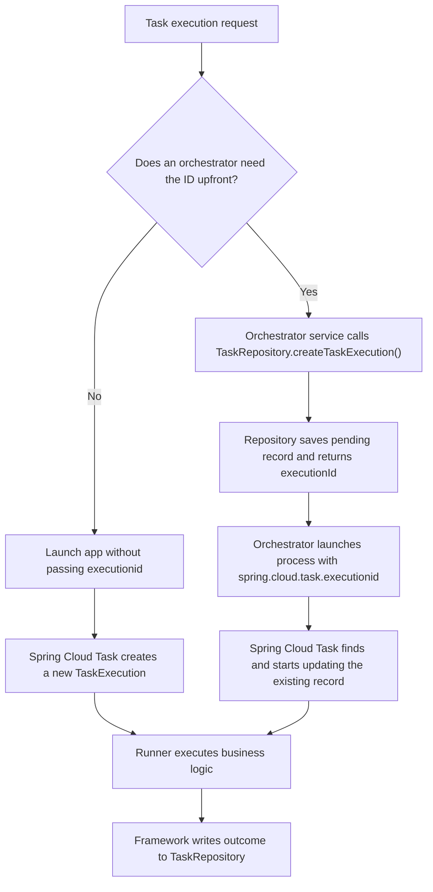
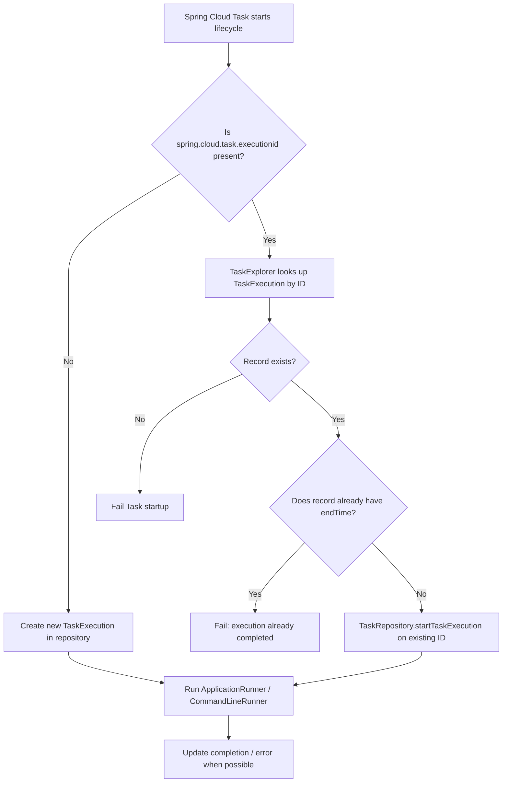
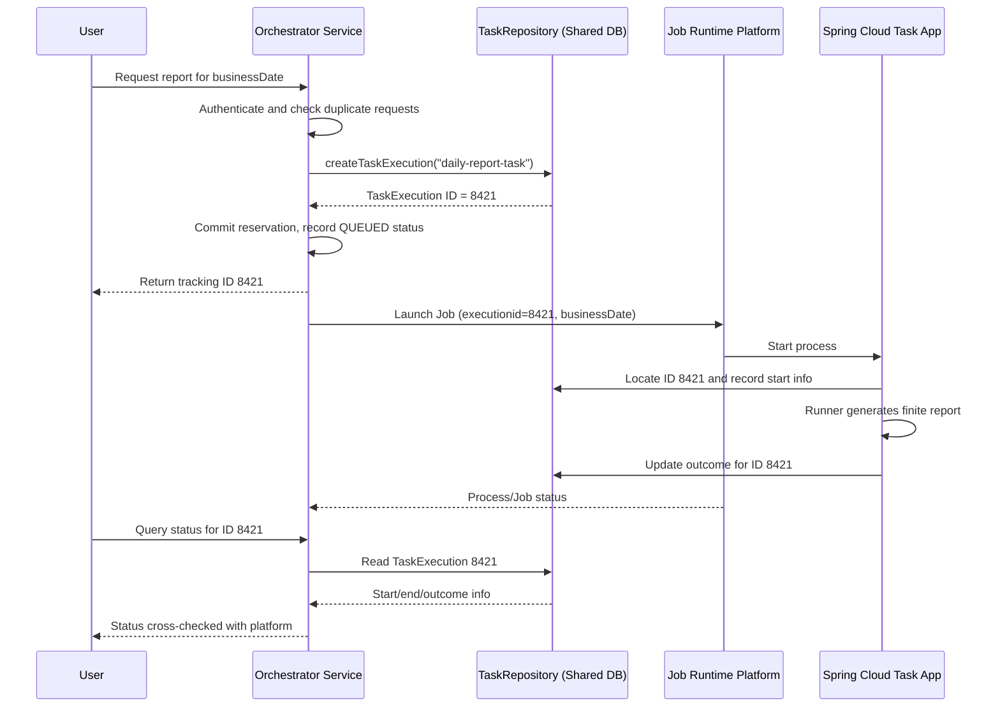

# Pre-Generating executionId and Using spring.cloud.task.executionid

## Objectives

In the **SPRING_CLOUD_TASK (Spring Cloud Task)** module, a Spring Boot application performs a **finite** unit of work and then terminates. Spring Cloud Task records data for each run in `TaskRepository`: task name, start/end timestamps, outcome, and error information. This data helps track scheduled or on-demand tasks, troubleshoot incidents, and coordinate with Spring Batch.

This lesson belongs to the **Execution Data** chapter and focuses on a specific pattern: **pre-creating a `TaskExecution` record and passing its ID to the Task process** via `spring.cloud.task.executionid`. After this lesson, you will be able to:

- Explain why an orchestration system needs an `executionId` **before** the task's JVM starts.
- Create a pending execution record using `TaskRepository.createTaskExecution(…)`, obtain the repository-generated ID, and pass that exact ID at launch.
- Distinguish `spring.cloud.task.executionid` from `spring.cloud.task.external-execution-id`, `spring.cloud.task.parent-execution-id`, and business arguments.
- Track a record from a not-yet-started state through completion, or detect requests stuck prior to launch.
- Diagnose errors involving nonexistent IDs, already-completed IDs, wrong databases, ID reuse, and unsafe retries.

## 1. Why Pre-Generate an executionId?

Under normal execution, when a Spring Cloud Task application starts up and reaches its lifecycle management stage, the framework **automatically creates** a `TaskExecution` record and acquires a new ID. Thus, `executionId` only appears after the process has already started initializing.

However, in a real-world system, the moment a **run request is received** and the moment the **infrastructure actually runs the process** can be separated by seconds, minutes, or longer:

1. An operator requests a run of `daily-report-task` for `2026-11-23`.
2. The orchestrator validates permissions, accepts the request, and enqueues deployment.
3. The platform provisions resources, pulls the image, and creates the Job/Pod.
4. The task's JVM finally begins running.

If you wait until step 4 to generate `executionId`, during steps 1–3 the orchestrator has no Spring Cloud Task ID to return to the requester, attach to orchestration logs, or look up later. **Pre-creating `TaskExecution`** bridges this gap: the requester receives an ID immediately upon acceptance, and the executing process later updates **that existing record**.

Example:

| Time | Event | Observable Data |
| --- | --- | --- |
| 09:00:00 | API receives report generation request | Request validated; no Task JVM yet. |
| 09:00:01 | `TaskRepository` creates `TaskExecution` ID `8421` | Record ID `8421` exists without actual runtime timestamps yet. |
| 09:00:02 | Orchestrator returns ID `8421` and queues deployment | Can look up or request support using that ID. |
| 09:02:10 | Container launches with `--spring.cloud.task.executionid=8421` | Process locates record ID `8421` and updates start metadata. |
| 09:03:25 | Runner completes | The same record ID `8421` is updated with end time and outcome. |

Timestamps and IDs in the table are **illustrative examples**, not values the framework always generates.

## 2. Distinguishing Different Types of IDs

In Spring Cloud Task, the following IDs serve distinct purposes:

| Value | Example | Meaning |
| --- | --- | --- |
| `TaskExecution.executionId` | `8421` | Key identifying **a single Task execution** in the metadata store, typically `TASK_EXECUTION.TASK_EXECUTION_ID`. |
| `spring.cloud.task.executionid` | `8421` | Instructs the process to use the **pre-created `TaskExecution` record** with this ID. |
| `spring.cloud.task.external-execution-id` | `job-abc123` | ID issued by an external platform, such as a Job/container ID; stored for operational correlation. |
| `spring.cloud.task.parent-execution-id` | `8300` | Parent Task ID, used when one Task launches or orchestrates a child Task. |
| `spring.cloud.task.name` or name resolved by `TaskNameResolver` | `daily-report-task` | Name of the **job type**, potentially shared across many runs. |
| Business `businessDate` or `requestId` | `2026-11-23` | Business input or deduplication key for incoming requests; **not** the `TaskExecution` key. |
| Spring Batch `JobExecution.id` | `312` | Key for a Spring Batch Job execution, belonging to the separate Batch metadata model. |

**Key takeaway:** Regarding `spring.cloud.task.executionid`, the phrase "external generation" in Spring Cloud Task documentation means **the Task record is generated outside the Task process** via `TaskRepository`. It does **not** mean taking an arbitrary Kubernetes Job ID, business batch code, or client-supplied UUID and stuffing it into the internal ID.

`spring.cloud.task.executionid` and `spring.cloud.task.external-execution-id` can be used at the same time, yet their values and functions differ. Example:

```properties
spring.cloud.task.executionid=8421
spring.cloud.task.external-execution-id=k8s-job-daily-report-6df4
```

Here `8421` identifies the Spring Cloud Task record to update; `k8s-job-daily-report-6df4` is the correlation ID pointing to the orchestration platform. Do not swap the two values.

## 3. Two Flows: Generating the ID at Startup vs. Pre-Creating



In the **default flow**, the application does not receive `spring.cloud.task.executionid`; the framework creates a fresh `TaskExecution` when lifecycle tracking begins.

In the **pre-creation flow**, the orchestrator must first create a real record in the same metadata store, receive the generated ID, and pass that ID to the Task process. Upon receiving the property, the framework takes the existing-record update path instead of generating a standalone record.

Pre-creation **does not launch the application by itself**. `TaskRepository` manages metadata only—it is not a service for creating containers, scheduling, or submitting Jobs to a deployment platform.

## 4. Prerequisites Before Creating a Record

The two participating sides are typically:

- **Orchestrator/launcher service**: receives requests, accesses `TaskRepository` to create a pending `TaskExecution`, and invokes the platform's deployment mechanism.
- **Task application**: a Spring Boot application with Spring Cloud Task, connecting to **the same metadata database and schema**, accepting the existing ID, and running finite logic.

For reliable operation:

1. Lock compatible Spring Boot, Spring Cloud Task, and JDBC driver versions across the participating applications.
2. Prepare Spring Cloud Task tables and ID generation objects using DDL matching your framework version and DBMS.
3. Configure `DataSource` on both sides to point to the **same metadata store**; if using a custom schema or table prefix, keep them aligned.
4. Ensure the orchestrator account has permission to create metadata records, and the Task account has permission to read and update required records.
5. Design how business requests map to `executionId` in your own orchestration data, along with retry policies and launch timeouts.

Do not use in-memory H2 across **two separate JVMs** to demonstrate this mechanism: even if JDBC URLs look identical, each JVM gets its own isolated in-memory database. Use PostgreSQL, MariaDB, SQL Server, or another supported shared database. For production, run schema migrations ahead of time rather than letting each container auto-create tables.

Example production metadata configuration for the **Task application**:

```yaml
# application-prod.yml
spring:
  datasource:
    url: ${TASK_DB_URL}
    username: ${TASK_DB_USER}
    password: ${TASK_DB_PASSWORD}
  cloud:
    task:
      name: daily-report-task
      initialize-enabled: false
```

The orchestrator application must configure its `TaskRepository` to point to the same database/schema. Environment variable names in the example are project choices; **never** hardcode passwords in configuration files or on the command line.

## 5. Pre-Creating `TaskExecution` with `TaskRepository`

The Spring Cloud Task API provides execution creation methods, among which `createTaskExecution(String name)` fits when you want to persist the Task name upfront. The repository manages ID generation; you do not compute `MAX(TASK_EXECUTION_ID) + 1` or write manual SQL inserts.

The example below lives in the **orchestrator service**, assuming it has configured and injected a `TaskRepository` pointing to the shared metadata store:

```java
package com.example.dispatcher;

import org.springframework.cloud.task.repository.TaskExecution;
import org.springframework.cloud.task.repository.TaskRepository;
import org.springframework.stereotype.Service;

@Service
public class ExecutionReservationService {

    private final TaskRepository taskRepository;

    public ExecutionReservationService(TaskRepository taskRepository) {
        this.taskRepository = taskRepository;
    }

    public long reserveDailyReportExecution() {
        TaskExecution pending =
                taskRepository.createTaskExecution("daily-report-task");

        return pending.getExecutionId();
    }
}
```

Suppose the call returns `8421`. The repository has created a metadata record with that ID; the orchestrator needs to **save/commit it successfully** before sending the ID to the launcher. One approach is:

1. Validate the request and check duplicates by business key/idempotency key.
2. Call `reserveDailyReportExecution()` to create the record.
3. Commit the record-creation transaction, then persist the request → `executionId` mapping in the orchestration system.
4. Instruct the platform to run the application with `--spring.cloud.task.executionid=8421`.
5. Monitor deployment and results to update orchestration status.

**Transaction warning:** If the orchestrator wraps both record creation **and process launch** in an uncommitted transaction, a fast-starting Task may look up the ID before the row is visible. Ensure the record is committed before the process starts reading it. Conversely, when record creation succeeds but invoking the launcher fails, the record remains in an unstarted state; the orchestrator must detect and handle that case.

No-arg `createTaskExecution()` can also create an empty record; the example uses the named overload for clearer lookups. Verify exact interfaces and behaviors against the library version used in your project.

## 6. Passing `spring.cloud.task.executionid` at Launch

After obtaining `8421` from `TaskRepository`, the orchestrator launches the Task application with:

```bash
java -jar daily-report-task.jar \
  --spring.profiles.active=prod \
  --spring.cloud.task.executionid=8421 \
  --businessDate=2026-11-23
```

The JAR path and ID are examples. In Kubernetes or another platform, the orchestrator puts the same arguments in the container's `args` list or supplies them via a compatible Spring Boot configuration source.

With this exact property, Spring Cloud Task knows the record with ID `8421` **was pre-created**. When the Task lifecycle starts, the framework locates the record and updates start info, arguments, and related fields; upon completion, it updates the outcome for the **same ID**.

The documented property is written as:

```properties
spring.cloud.task.executionid=<ID-created-by-TaskRepository>
```

Do not pick a random number to pass in. Likewise, do not assume passing `--spring.cloud.task.executionid=8421` will **auto-insert** a record with ID `8421` if the metadata store lacks it. The ID must already exist as a key in the exact database/schema.

To avoid mixing infrastructure and business data:

- `spring.cloud.task.executionid` is a metadata-binding parameter **supplied by the orchestrator**.
- `businessDate` and other options are data for the runner to generate the report.
- `spring.profiles.active` selects the environment; change profiles only when certain both orchestrator and Task still point to the intended shared metadata store.

**Security note:** Spring Cloud Task can persist launch arguments into `TASK_EXECUTION_PARAMS`. Never pass passwords, API keys, or sensitive data on the command line; use environment variables/secret managers and proper access controls.

### Task Application Runner Example

The Task still executes business logic in the usual way. Do not call `createTaskExecution(…)` again inside the runner:

```java
package com.example.report;

import java.time.LocalDate;
import java.util.List;
import org.springframework.boot.ApplicationRunner;
import org.springframework.boot.SpringApplication;
import org.springframework.boot.autoconfigure.SpringBootApplication;
import org.springframework.cloud.task.configuration.EnableTask;
import org.springframework.context.annotation.Bean;

@SpringBootApplication
@EnableTask
public class DailyReportTaskApplication {

    public static void main(String[] args) {
        SpringApplication.run(DailyReportTaskApplication.class, args);
    }

    @Bean
    ApplicationRunner reportRunner() {
        return arguments -> {
            List<String> dates = arguments.getOptionValues("businessDate");
            if (dates == null || dates.size() != 1) {
                throw new IllegalArgumentException(
                        "--businessDate=yyyy-MM-dd is required");
            }

            LocalDate businessDate = LocalDate.parse(dates.get(0));
            // Illustrative example: replace with an actual report generation service.
            System.out.println("Processed report for " + businessDate);
        };
    }
}
```

The framework manages `TaskExecution` in the application lifecycle before runners run. Runners must not alter `executionId`, should not write directly to metadata tables, and must let serious business exceptions propagate so the system records failure outcomes.

## 7. Mechanism for Using an Existing ID at Task Startup

Conceptual behavior can be understood via these branches:



In Spring Cloud Task implementations described in reference documentation/source, when `executionid` is present the framework can:

1. Use `TaskExplorer.getTaskExecution(id)` to locate the record.
2. Fail if **the ID is not found**.
3. Fail if the record **already has an end time**.
4. Use `TaskRepository.startTaskExecution(…)` to update the existing record at startup; at the end of the lifecycle, use the repository's completion mechanism.

This is a **behavioral description for understanding and operations**, not advice to call `startTaskExecution(…)` directly from a runner. Let the framework manage metadata in the Task process.

Spring Cloud Task versions may differ in concurrency checks and internal callbacks. **Specifically, never assume an ID lacking `endTime` is definitely free to launch another process.** If two launchers supply the same ID simultaneously, they can race while updating metadata. The orchestrator must control claiming/launching atomically.

## 8. Observing Data Before, During, and After Execution

A freshly pre-created `TaskExecution` is usually a **pending** record: it has an ID and possibly a Task name, yet lacks an actual start time and final result. Once the Task process claims the ID, metadata is progressively filled in.

| Stage | `TASK_EXECUTION_ID` | `START_TIME` | `END_TIME` | `EXIT_CODE` |
| --- | --- | --- | --- | --- |
| After pre-creation | `8421` | Usually absent | Absent | Absent |
| Once Task actually starts | `8421` | Present | Absent | Undetermined |
| When Task completes successfully | `8421` | Present | Present | Typically `0` |
| When Task fails and persists metadata | `8421` | Present | Present | Failure code per error handling |

This is a **typical state interpretation**, not a guarantee that every column matches this table in every version or termination mode. For example, a process killed abruptly mid-run may still leave `END_TIME` empty.

With default metadata tables, inspect via SQL:

```sql
SELECT TASK_EXECUTION_ID,
       TASK_NAME,
       START_TIME,
       END_TIME,
       EXIT_CODE,
       LAST_UPDATED,
       EXTERNAL_EXECUTION_ID
FROM TASK_EXECUTION
WHERE TASK_EXECUTION_ID = 8421;
```

To inspect stored parameters (which should never contain secrets):

```sql
SELECT TASK_EXECUTION_ID, TASK_PARAM
FROM TASK_EXECUTION_PARAMS
WHERE TASK_EXECUTION_ID = 8421;
```

Or use the lookup API instead of querying directly:

```java
import org.springframework.cloud.task.repository.TaskExecution;
import org.springframework.cloud.task.repository.TaskExplorer;

// taskExplorer injected from the shared repository configuration.
TaskExecution execution = taskExplorer.getTaskExecution(8421L);
if (execution == null) {
    throw new IllegalStateException("TaskExecution 8421 not found");
}

System.out.println("taskName=" + execution.getTaskName());
System.out.println("startTime=" + execution.getStartTime());
System.out.println("endTime=" + execution.getEndTime());
System.out.println("exitCode=" + execution.getExitCode());
```

Check `TASK_EXECUTION_ID` across all three stages to confirm the framework **updates the exact same record**. You can also include `EXTERNAL_EXECUTION_ID` if the platform provides an external ID to correlate with Job/Pod logs.

Do not use a check like `END_TIME IS NULL` as an absolute definition of "running": it can equally mean **not started yet**, **lost connectivity during execution**, or **process died without recording completion**. Cross-check scheduling timestamps, platform IDs, process status, and time limits.

## 9. Failure Scenarios and Recovery

| Scenario | Common Cause | Resolution |
| --- | --- | --- |
| Passed ID not found in repository | Orchestrator has not committed yet, wrong ID used, or Task connected to wrong DB/schema. | Confirm the record committed; check database/schema/table prefix, logged ID, and launch point. |
| ID already completed | Another Task run already used that ID and set `END_TIME`. | Create a new execution for a new run; never reuse an ID from a finished run. |
| Two processes use the same pending ID | Two dispatchers issued commands or retried without locking. | Use idempotency keys and exclusive claiming in the orchestrator; control platform retries. |
| Pre-creation succeeded but launcher failed to create Job | Platform auth error, quota, image, or API failure. | Record the error and launch state in the orchestration store; perform bounded retry or alert operators. |
| Pending record lacks `START_TIME` for too long | Queue congestion, Job unscheduled, or container failed to start. | Set deadlines, inspect Job/Pod/logs; distinguish "pending" from "failed". |
| Task started but `END_TIME` never updated | Database loss, abrupt kill, node crash, or timeout. | Compare `TaskExecution` with platform state; design reconciliation and alerting. |
| Task succeeded yet business logic wrote duplicates | Retry for the same date produced duplicate output without a business key. | Design idempotency/upserts/checkpoints; `executionId` only tracks runs and does not deduplicate business data. |
| Wrong task name or mismatched metadata config | Orchestrator and Task app disagree on name, schema, or version. | Lock down job names and config; run two-sided integration tests before rollout. |

### 9.1. Pre-Created Yet Never Launched

`TaskRepository.createTaskExecution(…)` only records that an execution was **reserved**. If the orchestrator fails right afterward, Spring Cloud Task **cannot automatically tell** whether the user canceled the request or the platform is still waiting. The row can sit without `START_TIME`.

Therefore, maintain an orchestration table or system tracking additional milestones: `REQUESTED`, `QUEUED`, `LAUNCHING`, `PLATFORM_RUNNING`, `PLATFORM_FAILED`, `TIMED_OUT`, along with error codes and transition timestamps. These are **orchestrator-designed statuses**, not default `TaskExecution` status enums.

Periodically monitor requests exceeding wait timeouts, check actual Job status, and handle according to policy. Never automatically overwrite `END_TIME` or set `EXIT_CODE=0` to "close" a record that never ran; metadata changes must reflect real events and respect your repository/version contract.

### 9.2. Retries and Reruns

Distinguish two decisions:

- **Retrying a launch command before startup:** you may continue processing a previously reserved request, **provided you guarantee** only one process can claim that ID. Never retry blindly without knowing whether the platform accepted the first command.
- **Business rerun after a Task has started or finished:** as a rule, create a **new `TaskExecution`**, linking attempts in the orchestrator via `requestId`/business date. Attempting to reuse an ID with `END_TIME` already set will be rejected; reusing an unfinished ID after an incident also risks colliding with a still-alive old process.

Suppose execution `8421` generating the `2026-11-23` report failed; a rerun can receive ID `8422` with the same `businessDate`. Both executions should remain visible in history, while business logic ensures no duplicate data is emitted.

## 10. Interaction with Spring Batch

A Task can launch a multi-step Batch Job, yet:

- `TaskExecution.executionId` (e.g., `8421`) is the ID of the Spring Cloud Task application lifecycle.
- `JobExecution.id` is the ID of a Spring Batch run in `JobRepository`.
- `JobParameters` (such as `businessDate`) govern Spring Batch identification and restart semantics; they are not replaced by `spring.cloud.task.executionid`.
- When integrated properly, metadata links the Task to the Job; querying and monitoring must use the appropriate ID type.

For example, a report request might create Task execution `8421`, inside which Batch Job execution `312` runs. The two IDs belong to **two repositories with different roles**. Passing `--spring.cloud.task.executionid=312` under the mistaken belief that `312` is the Task ID will look up the wrong record or overwrite an unrelated row if that ID happens to exist.

If a Batch Job reports `FAILED` while the application swallows the error and exits normally, Task monitoring may fail to reflect the true business outcome. Inspect and map Batch status to the appropriate process exit outcome.

## 11. End-to-End Design Scenario

**Problem:** An API lets users request daily report generation, returning a tracking ID immediately while the report runs as a Spring Cloud Task on Kubernetes.



In this design, the API call and Task execution **do not need to happen in the same process**. The critical bridge is the **ID generated by the shared `TaskRepository`**. The orchestrator still manages request states and handles cases where the Job never launches.

For safe operations, enforce these rules:

1. Never accept an arbitrary client-supplied `executionId` as authorization to modify any Task; authenticate users/permissions on the request and issue IDs server-side.
2. Persist `requestId → executionId → platformJobId` durably with deduplication constraints and recovery logic when any step fails.
3. Ensure both sides use the same repository/schema; configure connection pools and run migrations prior to launch.
4. Never pass secrets in arguments persisted to metadata; avoid logging sensitive data.
5. Keep business outcomes, `TaskExecution` status, and platform Job status distinct so discrepancies are handled properly.

## 12. Hands-On Verification

**Preparation:** Two separate applications or components: an orchestrator service authorized to call `TaskRepository`, and a Spring Cloud Task application with a finite runner. Both access the same supported metadata database/schema.

| Test Case | How to Execute | What to Confirm |
| --- | --- | --- |
| A. Pre-create | Call `createTaskExecution("daily-report-task")` and note the returned ID. | Record exists before the Task JVM starts. |
| B. Run with ID | Launch Task with `--spring.cloud.task.executionid=<ID-A>`. | Record ID-A is updated; no extra standalone Task record is created for that run. |
| C. Run without ID | Restart the application omitting `executionid`. | Framework creates a new `TaskExecution` with a different ID. |
| D. Nonexistent ID | Pass an ID that was never created. | Task fails instead of silently creating a record with an arbitrary ID. |
| E. Completed ID | Pass ID-A again after A has finished. | Task refuses to reuse an already-completed ID. |
| F. Wrong metadata DB | Point Task to a different schema than where the orchestrator created the ID. | Confirm why lookup fails to find the record. |
| G. Launcher failure | Pre-create an execution without actually submitting the Job. | Orchestrator detects the overdue pending request; does not falsely mark success. |
| H. Runner failure | Create a new execution and run a runner that intentionally throws an exception. | Metadata and process status reflect failure while infrastructure remains reachable. |

Do not intentionally launch **two** concurrent processes with the same `executionId` against live data. If testing race-condition behavior, use an isolated environment and verify the launcher's locking/claiming mechanism.

### Self-Check Questions

1. Why is `spring.cloud.task.executionid` meaningful only when a `TaskExecution` record was created beforehand?
2. What distinguishes **request accepted** from **execution started**?
3. If a Job is queued by the platform before its Pod is created, does `END_TIME IS NULL` mean the Job is processing business logic?
4. When a report for the same date needs to be rerun, should you create a new Task ID or reuse the old one? Why?
5. Can `spring.cloud.task.external-execution-id` or Batch's `JobExecution.id` replace `TaskExecution.executionId`?

## 13. References

- [Spring Cloud Task — Features: Externally Generated Task ID](https://docs.spring.io/spring-cloud-task/reference/features.html): explains pre-generating `TaskExecution` before launch and the `spring.cloud.task.executionid` property.
- [Spring Cloud Task — TaskRepository API](https://docs.spring.io/spring-cloud-task/docs/current/apidocs/org/springframework/cloud/task/repository/TaskRepository.html): methods for creating, starting, and completing executions (verify API version against your dependency).
- [Spring Cloud Task — TaskExplorer API](https://docs.spring.io/spring-cloud-task/docs/current/apidocs/org/springframework/cloud/task/repository/TaskExplorer.html): looking up executions by ID and related queries.
- [Spring Cloud Task — TaskExecution API](https://docs.spring.io/spring-cloud-task/docs/current/apidocs/org/springframework/cloud/task/repository/TaskExecution.html): run data structure.

## Key Takeaways

- **Pre-generating `executionId`** means using `TaskRepository` to create a **pending record** before the process runs, not picking a number arbitrarily.
- `spring.cloud.task.executionid` tells the application to **update an existing record**; omit it to let the framework generate a new execution normally.
- The orchestrator service and Task application must use **the same metadata repository**, and the record must be committed before the process starts.
- An execution without `END_TIME` may be pending, running, or unreachable. Cross-check Task metadata, launcher status, and business outcomes.
- **Every independent rerun must have its own Task ID**; duplicate prevention/idempotency and launch-failure handling belong to the orchestrator and business application.
