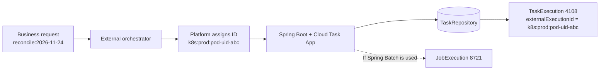
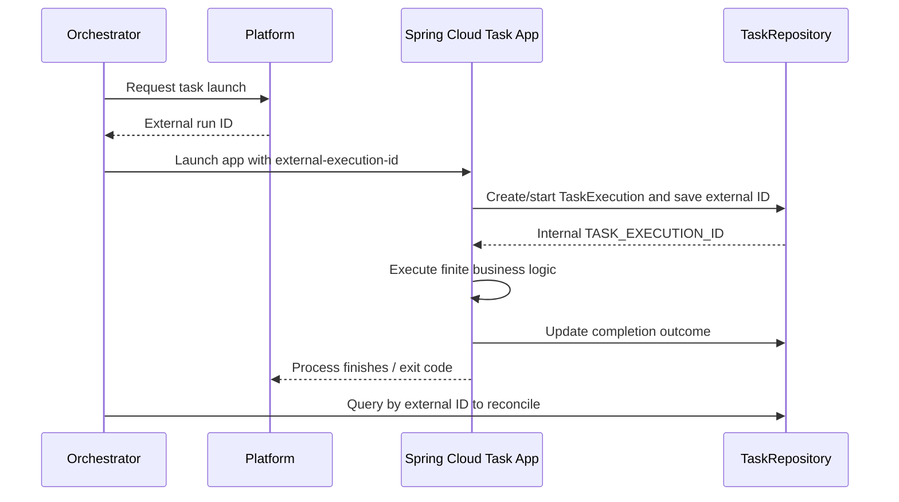
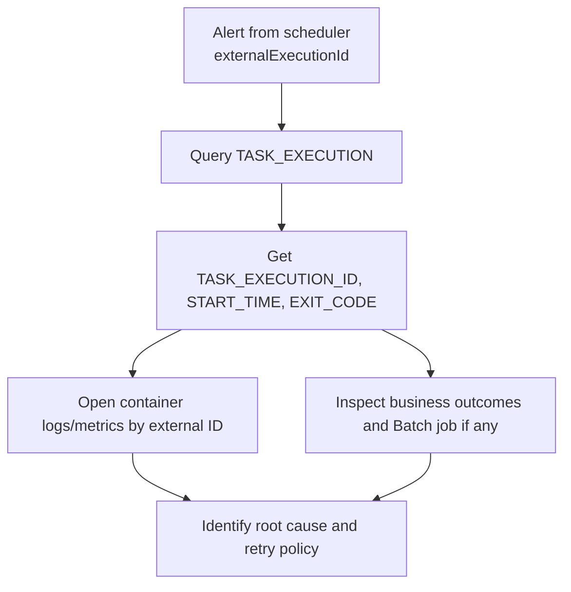
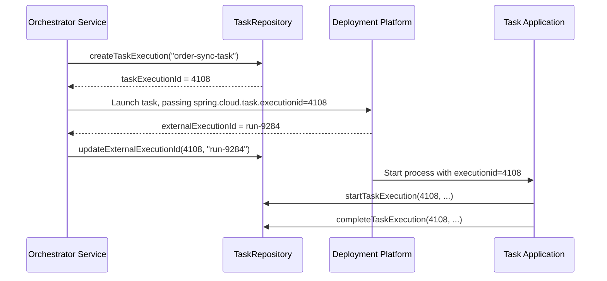

# Linking External Systems with `externalExecutionId` in Spring Cloud Task

## 1. Why Do We Need an Execution ID from an External System?

In the **Execution Data** chapter of **Spring Cloud Task**, `TaskExecution` tells us when a finite-lived Spring Boot application started, finished, and what outcome it returned. However, the application rarely appears on its own: it may be launched by a Kubernetes Job/CronJob, an orchestration engine, an API-driven service, or a task management platform. Those systems typically issue **their own run identifiers**.

For example, an orchestrator receives a request to sync orders for `2026-11-24`, then creates a container to run the application. When investigating a failure, an operator may hold the **platform's container/job ID**, while Spring Cloud Task's database only shows **`TASK_EXECUTION_ID`**. Without storing the link between the two IDs, correlating logs, configuration, infrastructure status, and business outcomes quickly turns manual.

Spring Cloud Task solves this correlation using **`externalExecutionId`**, represented on `TaskExecution` and persisted into the **`EXTERNAL_EXECUTION_ID`** column of `TASK_EXECUTION` when using the corresponding JDBC schema.

After this lesson, you will be able to:

- Distinguish `externalExecutionId` from `TASK_EXECUTION_ID`, business request IDs, `parentExecutionId`, and Spring Batch's `JobExecution`.
- Pass an execution ID from an orchestrator into the application via `spring.cloud.task.external-execution-id`.
- Read, query, and update this relationship in `TaskRepository` when the external ID arrives later.
- Design safe correlation across concurrent runs, retries, killed containers, or when the external system fails to supply an ID.
- Cross-check results from the Task database against logs and status from the scheduler/deployment platform.

## 2. Distinguishing Commonly Confused ID Types

A single processing request can involve several kinds of identifiers. Similar names do not mean they are interchangeable.

| Identifier | Issuer | Scope and Meaning | Illustrative Example |
| --- | --- | --- | --- |
| `TASK_EXECUTION_ID` | Spring Cloud Task `TaskRepository` | Internal key for **one task execution record** | `4108` |
| `externalExecutionId` | External system (scheduler, cloud platform, container orchestrator…) | Externally managed run ID attached to the Task Execution | `k8s:prod:pod-uid-abc` |
| Business request ID | Business application/API | Identifies a request, processing period, or business entity; may be retried multiple times | `reconcile:2026-11-24` |
| `parentExecutionId` | Spring Cloud Task | ID of the **parent Task Execution** when a task is triggered by another task, if configured | `4099` |
| `JOB_EXECUTION_ID` | Spring Batch `JobRepository` | ID of **one Batch job execution**, not a Task Execution | `8721` |

Relationship diagram for an example:



**`externalExecutionId` is correlation data, not a primary key replacing `TASK_EXECUTION_ID`.** When a task retries after an error, `TaskRepository` usually creates a new Task Execution; the external ID should reflect that specific launch. If the external system shares one ID across an entire retry group, add an *attempt*-level ID or supplemental metadata to tell them apart.

## 3. Where and When Is `externalExecutionId` Recorded?

Spring Cloud Task documentation defines the configuration property:

```properties
spring.cloud.task.external-execution-id=<externalTaskId>
```

When the application starts with this property, Spring Cloud Task can populate `TaskExecution` and persist it via `TaskRepository` during execution creation/startup. In the standard JDBC schema, `TASK_EXECUTION.EXTERNAL_EXECUTION_ID` is a nullable string column with a **declared length of 250 characters** in documented schema versions. Verify the DDL for your **project's actual version** before designing ID formats or altering schemas.

Related columns on a `TASK_EXECUTION` row typically include:

| Column | Role |
| --- | --- |
| `TASK_EXECUTION_ID` | Internal ID allocated within Task Repository. |
| `TASK_NAME` | Application/task name used to categorize runs. |
| `START_TIME`, `END_TIME` | Start and end timestamps recorded by the framework. |
| `EXIT_CODE`, `EXIT_MESSAGE`, `ERROR_MESSAGE` | Execution outcome and error details, if any. |
| `EXTERNAL_EXECUTION_ID` | ID of the corresponding run in the external system. |
| `PARENT_TASK_EXECUTION_ID` | Parent task relationship if any; not synonymous with external ID. |

`EXTERNAL_EXECUTION_ID` **can be `NULL`** when unconfigured or unupdated, such as when launched directly from an IDE. In many default schemas, this field is also **not globally unique**. Therefore, do not assume a single external ID value maps to at most one record; the application must define the appropriate uniqueness scope (platform, environment, namespace, attempt) and enforce controls if business rules require it.

### Creation and Update Timing



This is the typical flow when the external system **already knows the ID before the application starts**. If the platform issues the ID only after the launch request is submitted, see Section 7 for updating afterward or pre-reserving an internal Task Execution. The diagram does not claim every platform assigns IDs in this exact order.

## 4. Example: Passing the External ID via Launch Arguments

### 4.1. Simple Spring Cloud Task Application

Assume a Spring Boot project already includes `spring-cloud-starter-task`, a JDBC driver, metadata schemas, and compatible Spring Boot/Spring Cloud versions. The application starts no HTTP server, accepts a business date, and logs a processing run:

```java
package com.example.externalid;

import java.time.LocalDate;
import java.util.List;

import org.slf4j.Logger;
import org.slf4j.LoggerFactory;
import org.springframework.boot.ApplicationRunner;
import org.springframework.boot.SpringApplication;
import org.springframework.boot.autoconfigure.SpringBootApplication;
import org.springframework.cloud.task.configuration.EnableTask;
import org.springframework.context.annotation.Bean;

@SpringBootApplication
@EnableTask
public class ExternalIdTaskApplication {
    private static final Logger log =
            LoggerFactory.getLogger(ExternalIdTaskApplication.class);

    public static void main(String[] args) {
        SpringApplication.run(ExternalIdTaskApplication.class, args);
    }

    @Bean
    ApplicationRunner synchronizeOrders() {
        return args -> {
            List<String> dates = args.getOptionValues("business-date");
            if (dates == null || dates.size() != 1) {
                throw new IllegalArgumentException(
                        "Exactly one --business-date=yyyy-MM-dd is required");
            }

            LocalDate businessDate = LocalDate.parse(dates.get(0));
            log.info("Starting order sync for {}", businessDate);
            // Invoke the actual service here; handle errors and transactions in the business layer.
            log.info("Completed order sync for {}", businessDate);
        };
    }
}
```

`application.yml` uses a persistent database so history remains after the process exits:

```yaml
spring:
  application:
    name: order-sync-task
  main:
    web-application-type: none
  datasource:
    url: jdbc:postgresql://localhost:5432/task_demo
    username: task_user
    password: ${TASK_DB_PASSWORD}
```

In this example, the PostgreSQL database, user account, JDBC driver, and Spring Cloud Task metadata tables must be prepared beforehand. `spring.cloud.task.external-execution-id` **is not hardcoded into a shared config file** because each run can receive a different ID from the orchestration platform.

### 4.2. Supplying the External ID in the Launch Command

Suppose an external system assigns `scheduler:prod:run-9284` to a run:

```bash
java -jar order-sync-task.jar \
  --spring.cloud.task.external-execution-id=scheduler:prod:run-9284 \
  --business-date=2026-11-24
```

Upon successful startup, `TASK_EXECUTION.EXTERNAL_EXECUTION_ID` holds the passed value if Spring Cloud Task and the repository are configured correctly. `TASK_EXECUTION_ID` is still assigned by `TaskRepository`; these are two **separate** fields.

The same value can also be configured via a Spring Boot environment variable, for example:

```bash
export SPRING_CLOUD_TASK_EXTERNAL_EXECUTION_ID='scheduler:prod:run-9284'
java -jar order-sync-task.jar --business-date=2026-11-24
```

Spring Boot supports relaxed binding between environment variables and properties. If both an environment variable and a command-line option are set, understand Spring Boot's property source precedence; normally **command-line options take higher precedence**. The orchestrator should pick one clear source of truth to avoid misattributed traces.

Never use a fixed value such as `external-execution-id=nightly-import` for **every run**. That is merely a job type name and cannot distinguish two runs or two retries. The value should come from an actual **execution/attempt** ID.

### 4.3. Printing the Correlation at Startup

You can use a `TaskExecutionListener` to log both the internal and external IDs for reconciliation:

```java
package com.example.externalid;

import org.slf4j.Logger;
import org.slf4j.LoggerFactory;
import org.springframework.cloud.task.listener.TaskExecutionListener;
import org.springframework.cloud.task.repository.TaskExecution;
import org.springframework.stereotype.Component;

@Component
public class ExternalExecutionAuditListener implements TaskExecutionListener {
    private static final Logger log =
            LoggerFactory.getLogger(ExternalExecutionAuditListener.class);

    @Override
    public void onTaskStartup(TaskExecution execution) {
        log.info("taskExecutionId={}, externalExecutionId={}",
                execution.getExecutionId(), execution.getExternalExecutionId());
    }

    @Override
    public void onTaskEnd(TaskExecution execution) {
        log.info("Reached end for taskExecutionId={}",
                execution.getExecutionId());
    }

    @Override
    public void onTaskFailed(TaskExecution execution, Throwable throwable) {
        log.error("Task failed, taskExecutionId={}", execution.getExecutionId(), throwable);
    }
}
```

`getExternalExecutionId()` is a built-in getter on `TaskExecution`. Logged values should only be **non-sensitive identifiers**. Never put access tokens, passwords, customer details, or URLs containing credentials into `externalExecutionId`. Also note that listeners are not guaranteed to run if the JVM is forcibly killed.

## 5. Kubernetes Case: Choosing the Right ID for Each Run Attempt

Suppose a Kubernetes Job creates a Pod to run the executable JAR. You can pull the **Pod UID** from the Kubernetes Downward API and pass it into application arguments. Each Pod has its own UID; when the Job creates another Pod on retry, the Pod UID changes.

Example manifest **illustrating ID passing**, assuming the image already has an entrypoint accepting Spring Boot arguments:

```yaml
apiVersion: batch/v1
kind: Job
metadata:
  name: order-sync-20261124
spec:
  template:
    spec:
      restartPolicy: Never
      containers:
        - name: task
          image: registry.example.com/order-sync-task:1.0.0
          env:
            - name: POD_UID
              valueFrom:
                fieldRef:
                  fieldPath: metadata.uid
          args:
            - "--spring.cloud.task.external-execution-id=$(POD_UID)"
            - "--business-date=2026-11-24"
```

Kubernetes can substitute `$(POD_UID)` from the declared environment variable inside `args`. The application receives an attempt-level Pod ID. A complete manifest must also fit your image, DB/secret credential injection mechanism, RBAC, resource limits, and cluster retry policies. If the image has no entrypoint invoking the Java app directly, configure `command` accordingly.

**Choose identifiers based on traceability needs:**

| Kubernetes ID | Scope | When to Use? |
| --- | --- | --- |
| CronJob name | Schedule type, reusable | Use as `taskName`/classification label; insufficient to identify individual runs. |
| Job UID | One Job object | Trace a specific Job creation; may span multiple Pods/attempts. |
| Pod UID | One Pod object | Distinguish individual Pods created on retries or replacements. |

If you store only the Job UID while a Job spawns **multiple Pods** or retry attempts, **multiple Task Executions can share the same external ID**. In systems requiring exact per-process identification, prefer Pod UID or also record an attempt code in a business table. Across multiple clusters/namespaces, consider a prefix like `k8s:<cluster>:<namespace>:<uid>`, while ensuring it does not exceed the metadata column length.

## 6. Bidirectional Lookup Between TaskRepository and External Systems

### 6.1. Finding a Task Execution by External ID

When an external system reports `scheduler:prod:run-9284` failed, querying the metadata database identifies the corresponding Task run:

```sql
SELECT TASK_EXECUTION_ID,
       TASK_NAME,
       EXTERNAL_EXECUTION_ID,
       START_TIME,
       END_TIME,
       EXIT_CODE,
       EXIT_MESSAGE
FROM TASK_EXECUTION
WHERE EXTERNAL_EXECUTION_ID = :externalId
ORDER BY START_TIME DESC, TASK_EXECUTION_ID DESC;
```

`:externalId` is an **illustrative named parameter** for a JDBC abstraction (such as `NamedParameterJdbcTemplate`), not a placeholder syntax understood by every SQL client. When running directly in a SQL client, use that tool's bind parameter syntax or substitute a safe literal in a test environment. **Never concatenate untrusted input strings into SQL.**

If the query returns multiple rows, verify whether the external ID was shared across a retry group or reused improperly. Do not blindly pick the first record and declare it the sole execution.

### 6.2. Finding the External ID from an Internal Task Execution

When Spring Cloud Task logs show `TASK_EXECUTION_ID=4108`, query:

```sql
SELECT TASK_EXECUTION_ID,
       EXTERNAL_EXECUTION_ID,
       START_TIME,
       END_TIME,
       EXIT_CODE,
       ERROR_MESSAGE
FROM TASK_EXECUTION
WHERE TASK_EXECUTION_ID = :taskExecutionId;
```

If the internal ID is already known, `TaskExplorer` also offers `getTaskExecution(long)` to fetch the object and call `getExternalExecutionId()`:

```java
import org.springframework.cloud.task.repository.TaskExecution;
import org.springframework.cloud.task.repository.TaskExplorer;

public String findExternalId(TaskExplorer taskExplorer, long taskExecutionId) {
    TaskExecution execution = taskExplorer.getTaskExecution(taskExecutionId);
    return execution == null ? null : execution.getExternalExecutionId();
}
```

This is an example **method placed inside a valid service**; `TaskExplorer` is injected via standard Spring wiring. The standard `TaskExplorer` API provides lookups by **Task Execution ID** and by **task name**, so do not assume it includes a built-in `findByExternalExecutionId` method. When you need to search by external ID, use a parameterized JDBC query or a dedicated read repository with access controls.

### 6.3. Linking with Logs, Metrics, or Dashboards

Example incident investigation flow:



If the application runs Spring Batch, you can look up `JobExecution` records linked to a Task Execution via the framework's Task–Batch integration. `externalExecutionId` is **not** `JOB_EXECUTION_ID` and does not replace the Batch link key.

## 7. When the External ID Arrives Only After Creating the Task Execution

In some architectures, the orchestrator creates a request first and receives an ID from the platform API only afterward. Spring Cloud Task provides `TaskRepository.updateExternalExecutionId(long executionId, String externalExecutionId)` to attach the link to an existing Task Execution.

Example internal service authorized to update the repository:

```java
package com.example.externalid;

import org.springframework.cloud.task.repository.TaskRepository;
import org.springframework.stereotype.Service;

@Service
public class ExternalIdLinkService {
    private final TaskRepository taskRepository;

    public ExternalIdLinkService(TaskRepository taskRepository) {
        this.taskRepository = taskRepository;
    }

    public void attach(long taskExecutionId, String platformExecutionId) {
        if (taskExecutionId <= 0) {
            throw new IllegalArgumentException("Invalid task execution ID");
        }
        if (platformExecutionId == null || platformExecutionId.isBlank()) {
            throw new IllegalArgumentException("External execution ID must not be blank");
        }
        taskRepository.updateExternalExecutionId(taskExecutionId, platformExecutionId);
    }
}
```

This snippet demonstrates the **update API**, assuming the service knows the right `taskExecutionId` and accesses the same `TaskRepository` as the running application. In production, verify the record exists, update permissions, ID length/format, consistency when multiple components update concurrently, and transaction error handling. The simple input checks above **do not enforce uniqueness or prevent race conditions**.

### Advanced Option: Pre-Reserving a Task Execution

Spring Cloud Task supports cases where **a run request arrives before the application actually starts**. The orchestrator can pre-create a `TaskExecution` via `TaskRepository.createTaskExecution(String name)` to obtain `TASK_EXECUTION_ID` upfront, then pass that ID to the application via:

```properties
spring.cloud.task.executionid=<preCreatedTaskExecutionId>
```

When the application starts, Spring Cloud Task can update the **pre-reserved record** instead of creating a brand-new one, provided it shares the same repository and the record is in a valid state. This mechanism differs from `external-execution-id`:

- `spring.cloud.task.executionid` is an **existing internal ID** that the task must continue updating.
- `spring.cloud.task.external-execution-id` is the **external run ID** to associate with the Task Execution.

A sequence scenario might look like:



**Note on real-world ordering:** many platforms start the container right after the launch API call, even before the orchestrator receives a response. `startTaskExecution` and `updateExternalExecutionId` may occur nearly simultaneously. Design ID-passing protocols, transaction control, and race-condition tests carefully; never rely on the diagram to assume the platform waits for the service to finish updating the repository before launching the app. If the external ID is already known upfront, passing it directly via the property is usually simpler.

If pre-reserving a Task Execution succeeds yet the launch fails or never occurs, the repository can retain an **unstarted** record. The orchestrator needs timeouts, request statuses, and handling policies, rather than treating an unfinished record as a live process.

## 8. Designing Safe IDs for Concurrency and Retries

### 8.1. Distinguishing Request, Run, and Attempt

Suppose a single reconciliation request is retried twice:

| Stage | Business Request ID | External execution ID | Task Execution ID |
| --- | --- | --- | --- |
| Initial run | `req-20261124-01` | `scheduler:attempt-1` | `4108` |
| Retry 1 | `req-20261124-01` | `scheduler:attempt-2` | `4109` |
| Retry 2 | `req-20261124-01` | `scheduler:attempt-3` | `4110` |

One **request** can have multiple **attempts**. A good design supports bidirectional lookups: from a request to all attempts, from each attempt to one Task Execution, and from a Task Execution to platform logs/metrics. `externalExecutionId` is a single string field, so if you must encode request ID, workflow ID, cluster ID, and attempt ID together, choose an explicit namespaced format or manage a dedicated mapping table.

### 8.2. Never Treat External ID as a Deduplication Key by Default

Spring Cloud Task stores the external ID for **traceability**; placing an ID in that column does not automatically stop duplicate runs or make business logic idempotent. In an order-processing system, two distinct Task Executions could both read and write the same business date. Implement business locks/unique constraints/transactions or define an appropriate idempotency key for concurrent runs or retries.

If you need **each `externalExecutionId` to map to only one Task Execution**, enforce constraints within a defined scope (e.g., `provider + environment + attemptId`) using a mapping table or suitable index after assessing existing data and migration impact. Avoid adding an arbitrary unique index onto the default column if existing flows permit external ID reuse.

### 8.3. Never Use Sensitive Data as an ID

Task metadata can persist long-term, get backed up, surface in dashboards, or be queried by operators. External IDs should be low-sensitivity **opaque identifiers** free of access tokens, passwords, cookies, payment details, or personal data. If a provider's ID is unsuitable for direct storage, use an appropriate surrogate ID/hash and a strictly access-controlled mapping table.

### 8.4. Handling Missing External IDs, Missing Records, and Hung Records

| Symptom | Possible Explanation | What to Check |
| --- | --- | --- |
| `EXTERNAL_EXECUTION_ID IS NULL` | Task launched from IDE, missing property, or external ID not updated yet | Check launch arguments, environment, and ID attachment step. |
| External ID exists but expected Task Execution is missing | Querying wrong database/schema, task failed to write metadata, or updated wrong ID | Check datasource, task logs, repository, and update privileges. |
| One external ID maps to multiple Task Executions | ID was reused or assigned at Job level instead of attempt level | Separate namespace/run/attempt and review retry policy. |
| `START_TIME` present while `END_TIME` stays empty | Task still running, was killed, or failed to persist completion metadata | Cross-check container status, logs, and DB connectivity. |
| Platform reports failed while Task exit code shows success | Exit code and business errors propagated inconsistently, or failure happened after Task update | Cross-check timestamps, logs, process exit code, and `ERROR_MESSAGE`. |
| External ID too long | Exceeds column length or mapping convention | Check schema limits, shorten/hash-map cleanly without truncation collisions. |

## 9. Operations Workflow and Incident Tracing

Suppose the orchestrator reports that run `scheduler:prod:run-9284` failed. A sound investigation workflow includes:

1. **Identify the exact provider and environment** of the external ID; if multiple clusters/systems exist, avoid looking in the wrong namespace.
2. **Query `TASK_EXECUTION`** by external ID. If multiple records match, cross-check `TASK_NAME`, timestamps, request parameters, and attempt.
3. **Read `START_TIME`, `END_TIME`, `EXIT_CODE`, and errors** to see how far Spring Cloud Task recorded progress; never claim a task is still alive merely because `END_TIME` is empty.
4. **Open platform logs/metrics using the external ID**, checking container creation time, completion status, signals/timeouts, and actual exit code.
5. **If Spring Batch is present**, query `JobExecution`/`StepExecution` via the Task–Batch link to see which step was reached and restartability conditions.
6. **Verify idempotency before retrying**: the same request might have written partial data even though the Task or container reported an error.
7. **Record ID relationships in audit trails** so incident tickets trace cleanly back to request, attempt, Task Execution, and platform without storing secrets.

In high-volume systems, frequent queries by `EXTERNAL_EXECUTION_ID` may require an appropriate index. Before creating an index, inspect the actual schema, row count, `NULL` ratio, ID reuse rate, and retention policy. Runs failing during early bootstrap sometimes **have no Task Execution**, in which case orchestrator records are the only proof a run was requested.

## 10. Hands-On Self-Check Lab

Practice on a Spring Cloud Task application backed by a persistent metadata database:

1. Run via `java -jar` with `--spring.cloud.task.external-execution-id=local:run-001` and `--business-date=2026-11-24`.
2. Query `TASK_EXECUTION` to verify the row contains an internal `TASK_EXECUTION_ID` and the external ID you passed.
3. Run a second time with external ID `local:run-002` and the same business date; compare both internal IDs and run timestamps.
4. Run a third time **without passing** an external ID; verify how the repository represents that column.
5. Attach a hypothetical external ID via `TaskRepository.updateExternalExecutionId` for a known internal ID; read it back with SQL and `TaskExplorer.getTaskExecution`.
6. Try reusing the **exact same** external ID for two runs and observe that linking does not automatically prevent business logic from running again.
7. Simulate a mid-run failure or container termination, then reconcile Task Repository against actual process state before deciding to retry.

Questions you should be able to answer afterward:

- Why are `spring.cloud.task.executionid` and `spring.cloud.task.external-execution-id` not interchangeable?
- Given only a CronJob name, can you uniquely identify a single failed run?
- When a Kubernetes Job spawns multiple Pods due to retries, would you pick Job UID or Pod UID for Task Execution–level correlation?
- If `TaskExplorer` only accepts `TASK_EXECUTION_ID`, how do you query by external ID while preventing SQL injection?
- If a request must be retried three times, how would you structure request ID and attempt ID for easy reconciliation while preventing duplicate business processing?

## 11. References

- [Spring Cloud Task — Features: External Task Id and Externally Generated Task ID](https://docs.spring.io/spring-cloud-task/reference/3.2/features.html).
- [Spring Cloud Task — Task Repository Schema](https://docs.spring.io/spring-cloud-task/reference/3.2/appendix-task-repository-schema.html).
- [`TaskExecution` API](https://docs.spring.io/spring-cloud-task/docs/current/apidocs/org/springframework/cloud/task/repository/TaskExecution.html), [`TaskRepository` API](https://docs.spring.io/spring-cloud-task/docs/current/apidocs/org/springframework/cloud/task/repository/TaskRepository.html), and [`TaskExplorer` API](https://docs.spring.io/spring-cloud-task/docs/current/apidocs/org/springframework/cloud/task/repository/TaskExplorer.html). Verify API versions against actual project dependencies.

**Key Takeaway:** `externalExecutionId` is the **traceability bridge** between a Spring Cloud Task `TaskExecution` and an ID issued by an external system. Passing `spring.cloud.task.external-execution-id` at launch is simplest when the ID is already known; `TaskRepository.updateExternalExecutionId` supports updating afterward. Keep internal IDs, external IDs, and business keys distinct, enforce retry/idempotency controls, and always reconcile Task metadata with actual orchestrator state.
