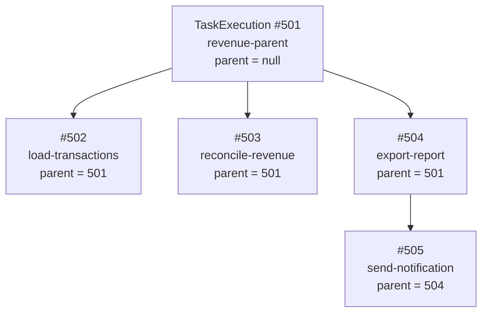
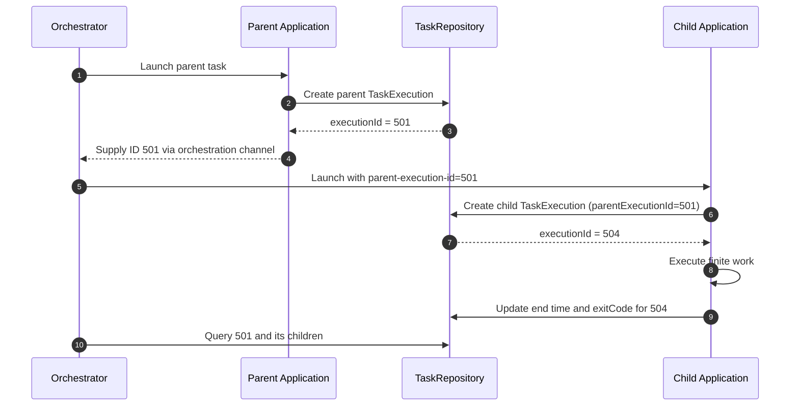

# Parent–Child Relationships Using `parentExecutionId`

In the **Execution Data** chapter, an important question arises: when a **Spring Cloud Task** application launches additional tasks, how do we know which runs belong to the same workflow? For example, a revenue reconciliation workflow might ingest data, perform calculations, and export a report. Each piece of work can be **a finite-lived application** with its own status and outcome persisted in the database. Looking at each `TaskExecution` record in isolation makes it hard for operators to trace their origin.

Spring Cloud Task supports the **`parentExecutionId`** property on `TaskExecution` to represent **parent–child relationships between executions**. A child task can record the `TaskExecution` ID of its parent task. This allows monitoring systems or orchestrators to trace related runs, even when each application launches as a separate process or container.

Lesson objectives:

- Understand the meaning, scope, and limitations of `parentExecutionId`.
- Pass the parent ID when launching a child application and inspect the `PARENT_EXECUTION_ID` column.
- Query one-parent–many-children relationships, nested levels, and records missing a parent.
- Distinguish parent–child links from execution ordering, infrastructure IDs, and Spring Batch restartability.
- Design error tracking, retries, and safe operations across multiple Spring Cloud Task applications.

## 1. A `TaskExecution` Describes One Execution

When an application integrated with Spring Cloud Task starts, the lifecycle mechanism uses **`TaskRepository`** to create a `TaskExecution` record in the metadata database. When the application finishes normally, this mechanism updates the end timestamp and outcome. Every launch that successfully reaches metadata persistence typically receives **a new execution ID**, even if the task name and business arguments match a previous run.

Fields relevant to parent–child relationships:

| Field in `TaskExecution` | Typical Metadata Column | Role |
| --- | --- | --- |
| `executionId` | `TASK_EXECUTION_ID` | Identifier of the **current execution** in the metadata store. |
| `taskName` | `TASK_NAME` | Logical name of the task; many runs can share the same name. |
| `parentExecutionId` | `PARENT_EXECUTION_ID` | ID of the **direct parent execution**; may be empty. |
| `startTime` / `endTime` | `START_TIME` / `END_TIME` | Used for lifecycle tracking, duration, and timing correlation. |
| `exitCode` | `EXIT_CODE` | Completion outcome of the run per application/platform conventions. |
| `externalExecutionId` (if present) | `EXTERNAL_EXECUTION_ID` | External execution ID used by the launching platform; **distinct** from parent ID. |

Column names and schema characteristics depend on the Spring Cloud Task version and database platform. In production deployments, always verify the schema against your project's library version.

### A Child-to-Parent Link

Suppose the execution store contains:

| `TASK_EXECUTION_ID` | `TASK_NAME` | `PARENT_EXECUTION_ID` | `EXIT_CODE` |
| ---: | --- | ---: | ---: |
| 501 | `revenue-parent` | `NULL` | 0 |
| 502 | `load-transactions` | 501 | 0 |
| 503 | `reconcile-revenue` | 501 | 0 |
| 504 | `export-report` | 501 | 1 |
| 505 | `send-notification` | 504 | 0 |

Interpret the table as follows:

- **501** is the root execution, declaring no parent.
- **502, 503, and 504** all have `parentExecutionId = 501`, so all three are **direct children** of 501.
- **505** has **504** as its direct parent, making it a **grandchild** of 501. It does not need to store both parent and grandparent IDs simultaneously.
- Even though the three child tasks have different names, relationships are determined by **execution ID**, not by task name.
- Record 504 has exit code `1`, yet that **does not automatically alter** the exit code of 501 or 505.



This relationship is a **logical link tree between execution records**, not necessarily a description of execution order. For example, `load-transactions` might finish before `reconcile-revenue`, yet that must be determined from timestamps, statuses, or the orchestrator; `parentExecutionId` only states **who the direct parent is**.

## 2. What Can and Cannot `parentExecutionId` Do?

A `TaskExecution` usually has **at most one direct parent**, whereas one parent can have **many children**. The reference is stored on the **child** record. When no parent is assigned, `parentExecutionId` is typically `null`.

**What this field supports:**

1. Tracing child tasks spawned by or linked to a parent execution.
2. Grouping execution history across multiple applications into a single workflow.
3. Building UI views displaying execution trees, finding all children/descendants, and comparing retries.
4. Correlating logs, metrics, and alerts back to the right root execution.

**What this field does not do automatically:**

- **Does not launch child applications.** Spawning processes/containers remains the responsibility of the launcher, scheduler, or orchestrator.
- **Does not enforce sequential execution.** Two records sharing the same parent gain no automatic before/after ordering constraint.
- **Does not propagate outcomes or errors upward to the parent.** A failed child does not automatically turn the parent `TaskExecution` into a failure.
- **Does not perform retries, rollbacks, or deduplication.** Orchestration policies and idempotency are needed at the business layer.
- **Cannot replace business data tables.** Metadata only captures execution history; reconciliation results, report files, and checkpoints must be stored separately.

> **Rule:** `parentExecutionId` is a **relationship between two specific runs**, not a relationship between two task definitions. If you rerun an application, the new run receives a different `executionId` and must be assigned the appropriate `parentExecutionId` if it should belong to the same tree.

## 3. Assigning the Parent ID When Launching a Child Task

Spring Cloud Task supports the **`spring.cloud.task.parent-execution-id`** configuration property to assign a parent ID to the launching application's `TaskExecution`. This value must be supplied **before the child application creates its execution record**; you cannot expect setting a variable inside `ApplicationRunner` after startup to retroactively update the persisted relationship.

For example, assuming the parent task already has ID **501**, a child application can be launched with:

```bash
java -jar export-report-task.jar \
  --spring.cloud.task.name=export-report \
  --spring.cloud.task.parent-execution-id=501 \
  --business-date=2026-11-24
```

For a child application using Spring Cloud Task connected to the same metadata store, `TaskRepository` saves a new `TaskExecution` (e.g., ID 504) with `parentExecutionId = 501`.

On Windows PowerShell, you can write the command on one line:

```powershell
java -jar .\export-report-task.jar --spring.cloud.task.name=export-report --spring.cloud.task.parent-execution-id=501 --business-date=2026-11-24
```

**All of the following conditions must be met:**

- **501 must be the actual ID** of a parent execution, obtained from a trusted source or `TaskExplorer`.
- Both parent and child must **see the same `TaskRepository` store or the same metadata ID space** if links are to be queryable. ID 501 in database A is not ID 501 in database B.
- The child application must have Spring Cloud Task and an appropriate database configured; merely running `java -jar` creates no metadata if the app does not integrate the framework.
- The launch mechanism must pass arguments, database access privileges, and correlation details consistently.
- Never assume a **foreign key** or mandatory parent-ID validation exists in every version/schema; the orchestrating application should verify the parent ID before assigning it.

### Step-by-Step Sequence



The diagram depicts how **metadata links are recorded**, without forcing the parent to still be running when the child starts. Depending on design, the parent may invoke the launcher while running, or the orchestrator may spawn children after the parent finishes. **Awaiting children**, aggregating statuses, and deciding next steps must be programmed explicitly.

## 4. Hands-On Example: One JAR Creating Multiple Linked Executions

To stay focused on execution data, we run **the same JAR** multiple times in either the `parent` or `child` role. This makes it clear that parent–child relationships belong to **runs**, rather than depending on two separate codebases.

### 4.1. Preparing Dependencies and Metadata Database

Create a Spring Boot project using a Java version compatible with your chosen Spring Cloud version, along with a compatible Spring Cloud BOM, the Spring Boot Maven Plugin, and these dependencies:

```xml
<dependencies>
    <dependency>
        <groupId>org.springframework.cloud</groupId>
        <artifactId>spring-cloud-starter-task</artifactId>
    </dependency>
    <dependency>
        <groupId>org.springframework.boot</groupId>
        <artifactId>spring-boot-starter-jdbc</artifactId>
    </dependency>
    <dependency>
        <groupId>com.h2database</groupId>
        <artifactId>h2</artifactId>
        <scope>runtime</scope>
    </dependency>
</dependencies>
```

These XML snippets represent the dependencies section of a properly versioned `pom.xml`, not a complete POM.

In `src/main/resources/application.yml`:

```yaml
spring:
  application:
    name: task-hierarchy-demo
  main:
    web-application-type: none
  datasource:
    url: jdbc:h2:file:./task-hierarchy-metadata
    driver-class-name: org.h2.Driver
    username: sa
    password: ""
  cloud:
    task:
      initialize-enabled: true
```

**File-based** H2 lets you inspect multiple runs after the JVM exits. Because `./task-hierarchy-metadata` is relative to the **working directory**, run all commands in the example from the same directory. H2 suits local learning; production environments should manage schemas with migrations and use a centralized metadata store with secured credentials and connections.

### 4.2. Writing the Finite Task

Create `src/main/java/com/example/task/TaskHierarchyApplication.java`:

```java
package com.example.task;

import java.time.LocalDate;
import java.util.List;

import org.springframework.boot.ApplicationArguments;
import org.springframework.boot.ApplicationRunner;
import org.springframework.boot.SpringApplication;
import org.springframework.boot.autoconfigure.SpringBootApplication;
import org.springframework.cloud.task.configuration.EnableTask;
import org.springframework.context.annotation.Bean;

@SpringBootApplication
@EnableTask
public class TaskHierarchyApplication {

    public static void main(String[] args) {
        SpringApplication.run(TaskHierarchyApplication.class, args);
    }

    @Bean
    ApplicationRunner runWork() {
        return args -> {
            String role = requiredOption(args, "role");
            if (!role.equals("parent") && !role.equals("child")) {
                throw new IllegalArgumentException(
                    "--role must be parent or child"
                );
            }

            LocalDate date = LocalDate.parse(
                requiredOption(args, "business-date")
            );
            System.out.printf(
                "Running role %s for date %s%n", role, date
            );

            if (args.containsOption("simulate-error")) {
                throw new IllegalStateException("Simulated error");
            }

            System.out.println("Work completed");
        };
    }

    private static String requiredOption(
            ApplicationArguments args, String name) {
        List<String> values = args.getOptionValues(name);
        if (values == null || values.size() != 1
                || values.get(0) == null || values.get(0).isBlank()) {
            throw new IllegalArgumentException(
                "Must pass --" + name + "=..."
            );
        }
        return values.get(0);
    }
}
```

`@EnableTask` enables Spring Cloud Task lifecycle tracking. `ApplicationRunner` handles finite business work; the example prints logs and provides an error-simulation flag to observe metadata. **Establishing the parent–child link** lives not in this business code, but in each process's **launch properties**.

### 4.3. Running the Parent First and Capturing Its Execution ID

Assuming `artifactId=task-hierarchy-demo`, `version=0.0.1-SNAPSHOT`, and the plugin produces a Spring Boot executable JAR, package it:

```bash
./mvnw clean package
```

Launch the first run **without passing a parent ID**:

```bash
java -jar target/task-hierarchy-demo-0.0.1-SNAPSHOT.jar \
  --spring.cloud.task.name=revenue-parent \
  --role=parent \
  --business-date=2026-11-24
```

After the task exits, connect to the H2 metadata database and query:

```sql
SELECT
    TASK_EXECUTION_ID,
    TASK_NAME,
    PARENT_EXECUTION_ID,
    EXIT_CODE,
    START_TIME,
    END_TIME
FROM TASK_EXECUTION
ORDER BY TASK_EXECUTION_ID DESC;
```

**Note the `TASK_EXECUTION_ID` of the `revenue-parent` run just created**, say **501**. The number 501 is illustrative only; your actual ID may be 1, 2, or another value depending on existing data. When multiple runs share the same name, select the exact ID by timestamp and request context rather than blindly grabbing "the latest run" in a concurrent system.

### 4.4. Launching Two Children Under the Same Parent

Assuming the actual parent ID is **501**, launch the first child:

```bash
java -jar target/task-hierarchy-demo-0.0.1-SNAPSHOT.jar \
  --spring.cloud.task.name=load-transactions \
  --spring.cloud.task.parent-execution-id=501 \
  --role=child \
  --business-date=2026-11-24
```

Launch the second child, simulating an error:

```bash
java -jar target/task-hierarchy-demo-0.0.1-SNAPSHOT.jar \
  --spring.cloud.task.name=export-report \
  --spring.cloud.task.parent-execution-id=501 \
  --role=child \
  --business-date=2026-11-24 \
  --simulate-error
```

Query `TASK_EXECUTION` again. The expected relationship results are:

- `revenue-parent` has `PARENT_EXECUTION_ID` set to `NULL`.
- Both `load-transactions` and `export-report` have `PARENT_EXECUTION_ID = 501`.
- Each run has its own `TASK_EXECUTION_ID`; `export-report`'s failure appears on **its own record**.
- `revenue-parent` retains the outcome recorded when it completed earlier, unless you build workflow status updates at another layer.

**Never hardcode ID 501** when running against real data; always substitute the ID queried from the metadata store. Running a child task with a nonexistent parent ID can create invalid links or fail depending on the schema and system rules.

## 5. Querying Parents, Children, and the Full Execution Tree

### 5.1. Finding Direct Children

Assuming parent ID 501:

```sql
SELECT
    TASK_EXECUTION_ID,
    TASK_NAME,
    PARENT_EXECUTION_ID,
    START_TIME,
    END_TIME,
    EXIT_CODE
FROM TASK_EXECUTION
WHERE PARENT_EXECUTION_ID = 501
ORDER BY START_TIME, TASK_EXECUTION_ID;
```

This query returns **direct children** only and does not automatically fetch grandchildren or deeper levels.

### 5.2. Displaying Parent Together with Children via Self-Join

```sql
SELECT
    p.TASK_EXECUTION_ID AS parent_id,
    p.TASK_NAME AS parent_name,
    c.TASK_EXECUTION_ID AS child_id,
    c.TASK_NAME AS child_name,
    c.EXIT_CODE AS child_exit_code
FROM TASK_EXECUTION p
JOIN TASK_EXECUTION c
    ON c.PARENT_EXECUTION_ID = p.TASK_EXECUTION_ID
WHERE p.TASK_EXECUTION_ID = 501
ORDER BY c.TASK_EXECUTION_ID;
```

The `JOIN` here is a **self-join** because both parent and child live in the **same table**. If you also want to include parents that have no children yet, change `JOIN` to `LEFT JOIN`.

### 5.3. Traversing Multiple Parent–Child Levels

On databases supporting recursive CTEs such as PostgreSQL, MySQL 8+, or compatible H2 versions, a tree query can be illustrated as:

```sql
WITH RECURSIVE task_tree (
    TASK_EXECUTION_ID,
    TASK_NAME,
    PARENT_EXECUTION_ID,
    depth
) AS (
    SELECT
        TASK_EXECUTION_ID,
        TASK_NAME,
        PARENT_EXECUTION_ID,
        0
    FROM TASK_EXECUTION
    WHERE TASK_EXECUTION_ID = 501

    UNION ALL

    SELECT
        c.TASK_EXECUTION_ID,
        c.TASK_NAME,
        c.PARENT_EXECUTION_ID,
        t.depth + 1
    FROM TASK_EXECUTION c
    JOIN task_tree t
        ON c.PARENT_EXECUTION_ID = t.TASK_EXECUTION_ID
    WHERE t.depth < 20
)
SELECT *
FROM task_tree
ORDER BY depth, TASK_EXECUTION_ID;
```

The query uses `depth` to track nesting level and caps recursion at 20 for this exercise. CTE syntax, recursion limits, and column names may need adjustments for your **SQL dialect**, especially across different schemas or database versions. Do not rely on a depth limit as your sole safeguard if data contains invalid cycles; validate relationship integrity before building trees.

### 5.4. Detecting Dangling Parent References

If the data store allows storing parent references without a foreign key constraint, you can check:

```sql
SELECT
    child.TASK_EXECUTION_ID,
    child.TASK_NAME,
    child.PARENT_EXECUTION_ID
FROM TASK_EXECUTION child
LEFT JOIN TASK_EXECUTION parent
    ON parent.TASK_EXECUTION_ID = child.PARENT_EXECUTION_ID
WHERE child.PARENT_EXECUTION_ID IS NOT NULL
  AND parent.TASK_EXECUTION_ID IS NULL;
```

A non-empty result points to **orphaned metadata**: a mistyped parent ID, data sitting in a different store, or a parent deleted during archival cleanup. Treat this as a signal to investigate rather than overwriting `PARENT_EXECUTION_ID` based on guesswork.

### 5.5. Reading Relationships via `TaskExplorer`

At the Java layer, `TaskExplorer` exposes APIs to read metadata. Example given an existing `TaskExplorer` bean:

```java
import org.springframework.cloud.task.repository.TaskExecution;
import org.springframework.cloud.task.repository.TaskExplorer;

public TaskExecution findParent(TaskExplorer explorer, long childId) {
    TaskExecution child = explorer.getTaskExecution(childId);
    if (child == null || child.getParentExecutionId() == null) {
        return null; // Child not found or child has no parent.
    }

    return explorer.getTaskExecution(child.getParentExecutionId());
}
```

This is an **illustrative method** to place inside an appropriate class/service; it reads only the **direct parent**. To retrieve an entire tree, use an appropriate query or build a relationship traversal service while avoiding excessive per-node queries on large stores.

## 6. When Do You Obtain the Parent ID?

If **a parent task launches child tasks itself**, it needs to know its own `executionId`. One approach is observing the **`TaskExecutionListener.onTaskStartup(TaskExecution)`** lifecycle callback, once the framework has created the parent execution record, and passing that ID to the application's launcher layer. Illustrative example capturing the ID:

```java
import org.springframework.cloud.task.listener.TaskExecutionListener;
import org.springframework.cloud.task.repository.TaskExecution;
import org.springframework.stereotype.Component;

@Component
public class ParentExecutionContext implements TaskExecutionListener {
    private volatile Long executionId;

    @Override
    public void onTaskStartup(TaskExecution taskExecution) {
        executionId = taskExecution.getExecutionId();
    }

    @Override
    public void onTaskEnd(TaskExecution taskExecution) {
    }

    @Override
    public void onTaskFailed(
            TaskExecution taskExecution, Throwable throwable) {
    }

    public long requireExecutionId() {
        if (executionId == null) {
            throw new IllegalStateException(
                "TaskExecution has not been initialized yet"
            );
        }
        return executionId;
    }
}
```

From a runner or child-launching service, call `requireExecutionId()` and pass `--spring.cloud.task.parent-execution-id=<ID>` to the launcher. **Launch children only after obtaining a valid ID.** When deploying on Kubernetes or Spring Cloud Data Flow, launchers typically talk to infrastructure APIs rather than calling `ProcessBuilder` directly; the ID-passing principle remains the same.

When an **external orchestrator** launches the parent and then the children, the orchestrator must store the mapping among the business request, infrastructure IDs, and actual `TaskExecution` IDs. Never guess a parent ID from application name or start time, because tasks with the same name can run concurrently.

## 7. Failures, Retries, and Tree Consistency

### Child Failure Does Not Automatically Fail the Parent

If the parent finished with `exitCode = 0` and a child launched afterward fails, metadata may look like:

```text
TaskExecution #501  revenue-parent       exitCode = 0
  ├─ #502          load-transactions      exitCode = 0
  └─ #504          export-report          exitCode = 1
```

This is not necessarily contradictory: the parent's exit code reflects the **parent process**; the child's exit code reflects the **child process**. If business rules consider the **entire workflow** failed whenever any child fails, maintain a dedicated workflow status in the orchestrator or have the parent actively await children and determine its own exit code.

If the parent must wait for children, design timeouts and handle cases where a child fails to spawn a process, fails to write metadata, or dies abruptly. Checking merely for the existence of a child record is insufficient to conclude it succeeded.

### Retries Create a New Execution

When `export-report` fails and is rerun, Spring Cloud Task normally creates a new record, for example:

| `TASK_EXECUTION_ID` | `TASK_NAME` | `PARENT_EXECUTION_ID` | `EXIT_CODE` |
| ---: | --- | ---: | ---: |
| 504 | `export-report` | 501 | 1 |
| 506 | `export-report` | 501 | 0 |

Both are **two distinct executions of the same task type**. If the retry still belongs to workflow 501, the launcher must **pass `parent-execution-id=501` again**. `parentExecutionId` does not automatically indicate that 506 is a retry of 504; to capture retry relationships, use correlation IDs, request IDs, business keys, or supplemental orchestration metadata.

### Common Linking Pitfalls

| Scenario | Consequence | Prevention |
| --- | --- | --- |
| Forgetting to pass `parent-execution-id` | Child looks like a root task or lacks a parent link. | Treat it as a mandatory orchestration parameter whenever building a tree. |
| Passing a parent ID from another database | Tree splits apart or points to an unrelated record sharing the ID. | Use the same metadata store and isolate environments cleanly. |
| Passing a nonexistent ID | May create orphaned records or data errors depending on schema. | Verify the parent via `TaskExplorer` before launching. |
| Child fails while parent stays `exitCode=0` | Dashboards inspecting only the parent miss workflow failures. | Aggregate status across all children at the orchestration layer. |
| Parent or child dies abruptly | `END_TIME` may remain empty and metadata incomplete. | Cross-check container, process, logs, and timeouts. |
| Retrying a child multiple times for the same date | Risk of duplicate business data processing. | Idempotency, business keys, retry limits, and concurrency controls. |
| Purging parent history before children | Loses traceability root or violates data constraints. | Design retention per whole tree and archive before purging metadata. |

## 8. Distinguishing Parent ID, Infrastructure ID, and Spring Batch

In a scheduled or on-demand system, several identifier types coexist:

| Identifier | Attached To | Purpose |
| --- | --- | --- |
| `TaskExecution.executionId` | One Spring Cloud Task run | Look up status metadata in `TaskRepository`. |
| `TaskExecution.parentExecutionId` | Direct parent run of the current task | Traverse the tree of related executions. |
| `externalExecutionId` or Kubernetes Job ID | Infrastructure process/job | Correlate provisioning resources, infrastructure events, and logs. |
| Spring Batch `JobExecution.id` | One Batch Job execution | Track jobs, steps, and checkpoints via Spring Batch `JobRepository`. |
| Business request ID or correlation ID | One business request or workflow | Link multiple runs and retries at the application level. |

**Do not substitute these IDs for one another.** When a Spring Cloud Task application also runs a Spring Batch Job, both maintain separate metadata. `parentExecutionId` links **two `TaskExecution` records**, not `JobExecution` or `StepExecution` IDs. Spring Batch manages steps and restarts with Batch semantics; it does not automatically build a `TaskExecution` parent–child tree for each step.

Similarly, when using **Spring Cloud Data Flow** or another orchestrator to launch multiple task applications, the platform may manage execution flows and metadata links in its own way. Verify how `parent-execution-id` is passed and actual behavior in your deployed version rather than assuming every launched task knows its parent automatically.

## 9. Safe Operational Principles

**Validate the source of parent IDs.** Accept parent IDs only from trusted orchestration flows. In multi-team or multi-tenant systems, check access permissions and data scope before allowing a request to link to another task.

**Keep metadata repository scope consistent.** `TaskExecution` IDs are meaningful within one store/schema. Provision separate stores for dev, staging, and production; never transfer IDs across environments without explicit mapping.

**Combine parent ID with a correlation ID.** Parent ID builds direct execution trees; correlation ID traces end-to-end from user requests through schedulers, launchers, containers, logs, and business systems. Avoid putting secrets or unnecessary personal data in command-line arguments and metadata.

**Design independent workflow status.** A single parent record cannot substitute for aggregated outcomes of all children. Track expected child counts, completed/failed child counts, timeouts, and retries in the orchestrator or a business table.

**Do not treat links as transactional guarantees.** Parent–child metadata does not create a distributed transaction across processes. When a child already committed business data before being retried, rely on idempotency and outcome verification to avoid duplicates.

**Monitor and archive by tree.** Build dashboards around root executions and descendants; monitor still-running children, children missing parents, abnormally long durations, and mismatches between exit codes and infrastructure states. When purging history, archive or export link data beforehand.

## 10. Hands-On Lab and Self-Check

1. Build the sample JAR, run a `revenue-parent` task, and note its actual ID from `TASK_EXECUTION`.
2. Using that ID, launch two runs named `load-transactions` and `export-report`; verify both share the same `PARENT_EXECUTION_ID`.
3. Launch a third task using **`export-report`'s ID** as its parent. Write SQL confirming it is a grandchild of `revenue-parent`.
4. Rerun `export-report` with `--simulate-error` and observe: where does the failure appear, and does the parent change its exit code automatically?
5. Try running a child **without** `parent-execution-id`; compare its position in the tree.
6. Practice `self-join` and recursive CTE queries to list direct children and all descendants. Try detecting a nonexistent parent ID if your practice schema permits it.
7. Design a workflow tracking table with `businessRequestId`, root execution ID, expected child count, succeeded child count, failed child count, and overall status. Explain why this cannot be inferred completely from `PARENT_EXECUTION_ID` alone.

**Review questions:**

- Must two runs sharing the same `TASK_NAME` be in a parent–child relationship? Why or why not?
- When `parentExecutionId = null`, can you conclude for sure this is the first task of a workflow, or only that the record declared no parent?
- If a child has `EXIT_CODE = 1` and the parent has `EXIT_CODE = 0`, which component owns aggregating the failure?
- Why is a parent ID reliable only when parent and child share the same `TaskRepository` scope?
- When a retry creates a new `TaskExecution`, which field must be passed again and what additional data is needed to recognize it as a retry?

**Target outcome:** You can use `parentExecutionId` to link Spring Cloud Task application runs into trees, persist and query relationships in the database, and clearly separate **traceability metadata** from **actual orchestration, error handling, and retry mechanisms**. This forms the foundation for operating scheduled or on-demand finite task chains, including when combined with Spring Batch.
