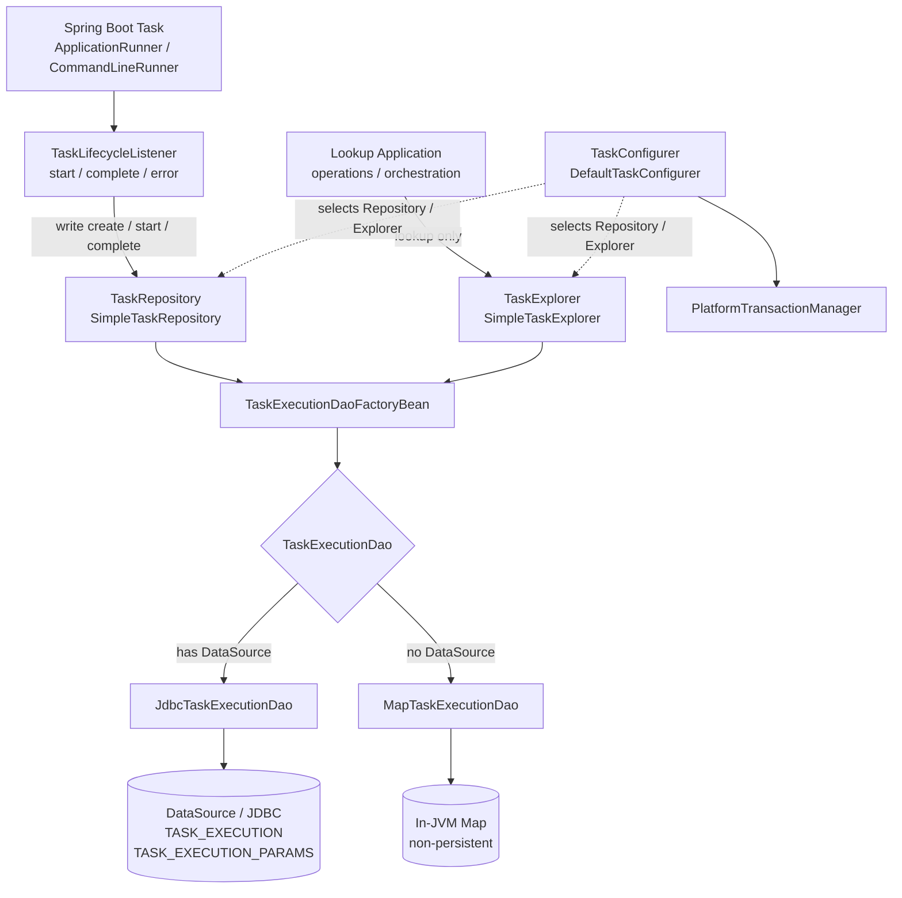
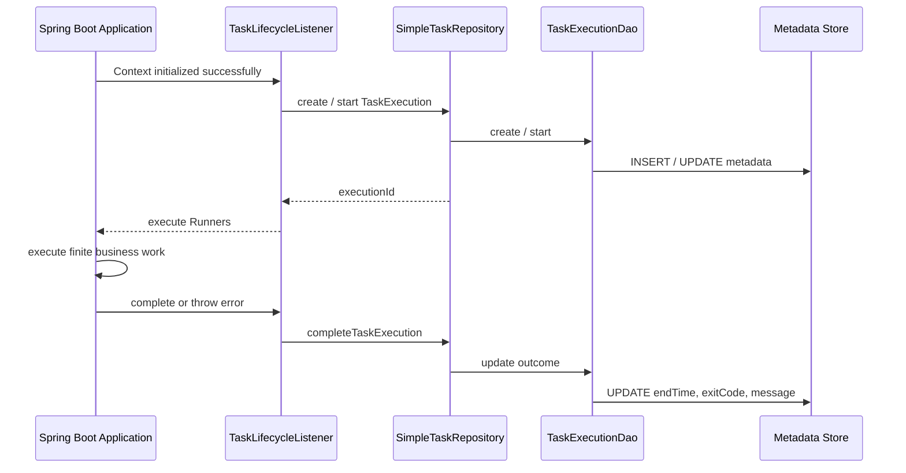
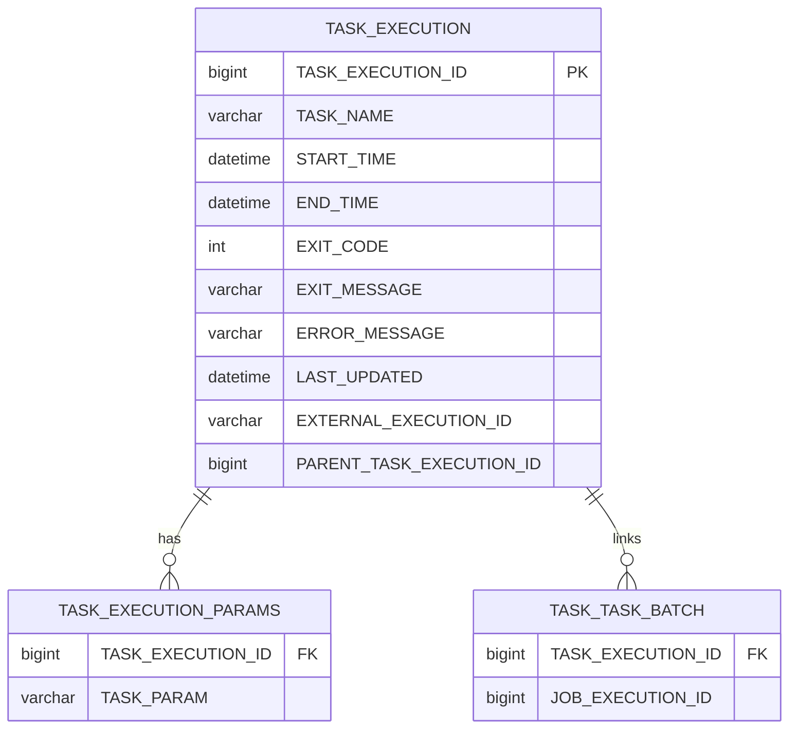

# SimpleTaskRepository, SimpleTaskExplorer, and Data Access Components

## Lesson Objectives

In the **Repository and Schema** chapter of the **Spring Cloud Task** module, this lesson delves into how the framework persists and reads **metadata for finite task executions**. After this lesson, you will be able to:

- Distinguish `TaskRepository` from `TaskExplorer`, and explain the roles of the two default implementations `SimpleTaskRepository` and `SimpleTaskExplorer`.
- Describe the data flow from `TaskLifecycleListener` through `TaskExecutionDao` to the database tables.
- Understand the choice between `JdbcTaskExecutionDao`, `MapTaskExecutionDao`, and `TaskExecutionDaoFactoryBean`, avoiding confusion between an in-memory Map and an in-memory H2 database.
- Look up `TaskExecution` records using Java or SQL; understand how parameters and Spring Batch information are linked.
- Configure the datasource, transaction manager, table prefix, and schema for both development and operations environments, while identifying data access errors.

## 1. Why Is a Dedicated Repository Layer Needed for Tasks?

Suppose a payment reconciliation application runs at 02:00. One execution receives `--businessDate=2026-11-23`, processes transactions, exports a report, and terminates. After the process has exited, operations still needs to know:

1. Which ID did the run receive, and what time did it finish?
2. What were the exit code and error message of the run?
3. What other runs exist for the same task?
4. What arguments were used, and which Spring Batch job (if any) was associated with it?

`ApplicationRunner` or `CommandLineRunner` code handles the **business work**; `TaskRepository`, `TaskExplorer`, and the Spring Cloud Task data access layer handle **execution history**. These are two distinct kinds of data: the Task tables hold process metadata, while payment/report data still belongs in the business tables designed by your system.

**Do not equate “Spring Cloud Task stores TaskExecution” with “Spring Cloud Task automatically stores business results”.** The framework may record `exitCode=0`, yet it has no idea whether the reconciled amounts are accurate unless the application explicitly checks and persists the appropriate business outcomes.

## 2. Data Access Architecture



This diagram shows how the **default implementations** collaborate. Applications should depend on the `TaskRepository` and `TaskExplorer` **interfaces**; there is no need to call `new SimpleTaskRepository(...)` or manually instantiate DAOs when default configuration suffices.

| Layer/Component | Responsibility | Primary Interaction |
| --- | --- | --- |
| `TaskLifecycleListener` | Monitors the actual runtime lifecycle of the application | Calls `TaskRepository` |
| `TaskRepository` | Contract for **creating, starting, updating, and completing** an execution | `SimpleTaskRepository` |
| `SimpleTaskRepository` | Default implementation of the write contract; logs and delegates operations to the DAO | `TaskExecutionDao` |
| `TaskExplorer` | Contract for **reading/looking up** execution metadata | `SimpleTaskExplorer` |
| `SimpleTaskExplorer` | Default implementation of the read contract; searches, counts, and fetches history | `TaskExecutionDao` |
| `TaskExecutionDaoFactoryBean` | Creates the appropriate DAO for the configured storage backend | `JdbcTaskExecutionDao` or `MapTaskExecutionDao` |
| `TaskConfigurer` | Selects repository, explorer, datasource, and transaction manager components | `DefaultTaskConfigurer` if uncustomized |
| `DataSource` | Provides connections to the database containing Task metadata | JDBC |
| `PlatformTransactionManager` | Manages transactions for metadata updates | JDBC or resourceless mechanism, depending on configuration |

The benefit of this architecture: **developers writing business logic do not have to write INSERT/UPDATE statements for Task tables**; developers building monitoring screens can query through `TaskExplorer` without directly mutating execution state.

## 3. `SimpleTaskRepository`: The Write Path of a Run

`SimpleTaskRepository` resides in the `org.springframework.cloud.task.repository.support` package and implements the `org.springframework.cloud.task.repository.TaskRepository` interface. Its Javadoc describes that it logs execution information and passes it to the supplied `TaskExecutionDao`.

Key method groups in the API:

| Operation Group | Representative Methods | Meaning |
| --- | --- | --- |
| Registration | `createTaskExecution()`, `createTaskExecution(String name)` | Creates a record with a new ID; includes forms for pre-registration by an orchestrator |
| Recording at start | `startTaskExecution(...)` | Writes task name, start time, arguments, and external system ID into metadata |
| Completion | `completeTaskExecution(executionId, exitCode, endTime, exitMessage)` | Persists the result and completion timestamp |
| Completion with error | `completeTaskExecution(..., errorMessage)` | Appends error details when present |
| Execution platform link | `updateExternalExecutionId(...)` | Updates the ID assigned by a scheduler or deployment platform |

Some versions have overloads accepting a `TaskExecution` or `parentExecutionId`. **Method signatures, time types, and overloads may vary by version**: modern APIs use `LocalDateTime`, whereas very old branches used `Date`. Do not copy manual repository-creation code from old blogs without checking the Javadoc of the release you are using.

### 3.1. Illustrative Timeline



While a Task is executing, `exitCode` usually remains `null`; after completion, the framework updates the result code, `endTime`, and related details. **A record with `endTime = null` does not guarantee the process is still alive**: the JVM could have been forcibly terminated, lost its DB connection, or crashed before writing the final update.

### 3.2. Should You Call `createTaskExecution` Yourself?

For typical Task applications using `@EnableTask`, **let the lifecycle listener manage metadata recording**. Calling `createTaskExecution(...)` yourself inside a runner may inadvertently create **an extra record** that does not correspond to a new process.

Manual creation is intended for **orchestrators**: the system receives a launch request, pre-registers a `TaskExecution`, and passes the generated ID to the actual process. Spring Cloud Task documentation describes the `spring.cloud.task.executionid` property for this scenario. Stitching these steps together requires matching the database, ID, and version; avoid fabricating “completed” records via SQL outside the repository.

### 3.3. Responsibilities and Boundaries

`SimpleTaskRepository` maintains **metadata**; it does not schedule runs, decide business retries, enforce uniqueness of `businessDate`, or provide record-by-record data checkpointing. To recover large data processing jobs, consider Spring Batch; to prevent duplicate imports, use idempotency, unique constraints, or business-data transactions.

## 4. `SimpleTaskExplorer`: The Read and History Search Path

`SimpleTaskExplorer` also lives in `org.springframework.cloud.task.repository.support`, but implements the **`TaskExplorer` interface**. This is the **read** API for execution details, suited for monitoring screens, query services, and incident investigation.

Commonly used methods include:

| Method | Return Data / Purpose |
| --- | --- |
| `getTaskExecution(long executionId)` | A `TaskExecution` by ID; may return `null` if not found |
| `getTaskNames()` | List of task names that have been persisted |
| `getLatestTaskExecutionForTaskName(String taskName)` | Most recent execution for a task name |
| `getLatestTaskExecutionsByTaskNames(String... names)` | Latest execution for multiple task names |
| `findTaskExecutionsByName(String taskName, Pageable pageable)` | Paginated executions by task name |
| `findAll(Pageable pageable)` | Executions within the page range; documentation specifies ordering by start time descending, then ID descending |
| `findRunningTaskExecutions(String taskName, Pageable pageable)` | Executions considered currently running by the repository for a task name |
| `getTaskExecutionCount()`, `getRunningTaskExecutionCount()` | Counts total or currently running records |
| `getTaskExecutionIdByJobExecutionId(long jobId)` | Looks up the TaskExecution associated with a Spring Batch JobExecution |
| `getJobExecutionIdsByTaskExecutionId(long id)` | Looks up the Batch JobExecutions linked to a TaskExecution |

**`TaskExplorer` is a read interface, but using it alone does not mean you have implemented security.** The API does not automatically verify whether a user is authorized to view task details, arguments, or error messages; that must be enforced by the calling application and database access permissions.

### 4.1. Read-Only Java Service Example

Suppose an admin application needs to inspect the history of `inventory-snapshot`. It can inject the `TaskExplorer` configured by Spring Cloud Task:

```java
package com.example.taskhistory;

import org.springframework.cloud.task.repository.TaskExecution;
import org.springframework.cloud.task.repository.TaskExplorer;
import org.springframework.data.domain.Page;
import org.springframework.data.domain.PageRequest;
import org.springframework.stereotype.Service;

@Service
public class TaskHistoryService {

    private final TaskExplorer taskExplorer;

    public TaskHistoryService(TaskExplorer taskExplorer) {
        this.taskExplorer = taskExplorer;
    }

    public TaskExecution findById(long executionId) {
        return taskExplorer.getTaskExecution(executionId);
    }

    public TaskExecution latest(String taskName) {
        return taskExplorer.getLatestTaskExecutionForTaskName(taskName);
    }

    public Page<TaskExecution> recent(String taskName, int page) {
        return taskExplorer.findTaskExecutionsByName(
            taskName,
            PageRequest.of(Math.max(page, 0), 20)
        );
    }
}
```

This code demonstrates using the **interface**, without coupling directly to `SimpleTaskExplorer`. When exposing this in a real HTTP API, validate `taskName`, enforce authorization before returning data, cap page/page-size bounds, and avoid returning raw error strings or arguments containing sensitive data.

If you run this lookup **inside the Task's own runner**, that runner's new record will likely still be in an **unfinished** state. To observe a completed Task, query after the process exits or from a separate monitoring application.

### 4.2. “Running” Is Only a Metadata State

Methods that count or find running Tasks rely on persisted records; they **do not directly check whether the PID, container, or pod is still alive**. Therefore, a run missing `endTime` due to `SIGKILL` can appear in “running” results even though the process is dead. Monitoring systems should combine repository data with scheduler/container status and overdue-run detection rules.

## 5. The DAO Layer: From Interface to Physical Store

Both default classes rely on `TaskExecutionDao`, an internal data access contract in the `org.springframework.cloud.task.repository.dao` package.

### 5.1. `TaskExecutionDaoFactoryBean`

`TaskExecutionDaoFactoryBean` is a Spring `FactoryBean` that creates the DAO matching the configuration. In published API versions:

- `DataSource` present → typically creates `JdbcTaskExecutionDao`.
- No `DataSource` → may create `MapTaskExecutionDao`.
- The table prefix and repository settings are passed down to the DAO so it uses the right table names.

Most applications **do not instantiate this factory directly**. `DefaultTaskConfigurer` and Spring Cloud Task configuration wire the components together. Relying on interfaces at the application layer avoids coupling to a specific database type.

### 5.2. `JdbcTaskExecutionDao`

`JdbcTaskExecutionDao` reads and writes Task data through a `DataSource`. This is the standard choice for applications needing history across multiple runs and multiple processes:

- Operates on `TASK_EXECUTION` and related tables via JDBC.
- Uses an execution ID generation strategy suited to the database/schema type.
- Allows multiple independent processes to share metadata when the database and table schema are properly configured.
- Depends on DB availability, permissions, transaction manager, and schema migrations.

**Do not manually modify tables with `UPDATE TASK_EXECUTION SET EXIT_CODE=0...` to mask errors.** Doing so breaks audit integrity and can cause the repository/explorer to return status that does not match reality.

### 5.3. `MapTaskExecutionDao`

`MapTaskExecutionDao` stores data in a **JVM-local `Map`**. It is handy when experimenting without setting up a database yet, but:

- Data vanishes when the JVM terminates.
- Two separate processes do not share a single Map.
- It cannot be used for centralized history tracking or multiple parallel replicas.

Be sure to distinguish an **in-JVM Map** from **in-memory H2**:

| Mode | Uses JDBC? | Survives JVM Exit? | Best Suited For |
| --- | --- | --- | --- |
| `MapTaskExecutionDao` | No | No | Simple unit tests / local dev demos |
| `JdbcTaskExecutionDao` + H2 in-memory | Yes | Usually no | Testing JDBC/schema flows locally |
| `JdbcTaskExecutionDao` + H2 file | Yes | Yes, if pointing to the same retained file | Local dev needing post-run history checks |
| `JdbcTaskExecutionDao` + PostgreSQL/MySQL/... | Yes | Yes, per DB policy | Production, long-term history, and multiple processes |

Do not assume that “it runs without declaring a datasource” means you have a repository suitable for auditing. The actual DAO type must be verified through configuration and persistence behavior.

## 6. Metadata Tables and Key Relationships

The default schema in Spring Cloud Task uses the `TASK_` prefix. The primary tables/components documented are:



This is a **logical relationship** diagram; physical data types, constraints, and DDL can differ by DBMS, dialect, and Spring Cloud Task version.

| Table/Component | Role |
| --- | --- |
| `TASK_EXECUTION` | One row per execution: ID, name, timestamps, exit code, error, external ID, and parent relationship |
| `TASK_EXECUTION_PARAMS` | Stores parameter strings belonging to each TaskExecution |
| `TASK_TASK_BATCH` | Links TaskExecution to Spring Batch JobExecution when integrated |
| `TASK_LOCK` | Supports single-instance concurrency locking (`single-instance-enabled`), depending on configuration |
| `TASK_SEQ` or equivalent ID generator | Supports assigning execution IDs; structure can vary across databases and releases |

Notable fields of `TASK_EXECUTION`:

- `TASK_EXECUTION_ID`: unique identifier for **a single run**, not the ID of the task definition.
- `TASK_NAME`: usually derived from the application name or `TaskNameResolver`.
- `START_TIME`, `END_TIME`: start/end timestamps; the end timestamp may be missing if the process died abruptly.
- `EXIT_CODE`: termination status via the recorded error/exit code.
- `EXIT_MESSAGE`, `ERROR_MESSAGE`: additional descriptions; may be length-limited by the schema.
- `LAST_UPDATED`: tracks when metadata was last updated.
- `EXTERNAL_EXECUTION_ID`: ID from the orchestrator/deployment platform.
- `PARENT_TASK_EXECUTION_ID`: parent relationship when one Task triggers another.

This schema **does not store detailed data for inventory reports, payments, or processing steps of a Spring Batch Job**. Investigating exact row counts processed requires application data and/or the Spring Batch `JobRepository`.

### 6.1. SQL Queries for Task Lookups

Query the latest runs:

```sql
SELECT
    TASK_EXECUTION_ID,
    TASK_NAME,
    START_TIME,
    END_TIME,
    EXIT_CODE,
    LAST_UPDATED
FROM TASK_EXECUTION
ORDER BY TASK_EXECUTION_ID DESC;
```

Filter history for a single task:

```sql
SELECT
    TASK_EXECUTION_ID,
    START_TIME,
    END_TIME,
    EXIT_CODE,
    ERROR_MESSAGE
FROM TASK_EXECUTION
WHERE TASK_NAME = 'inventory-snapshot'
ORDER BY START_TIME DESC, TASK_EXECUTION_ID DESC;
```

Check runs missing `END_TIME`:

```sql
SELECT
    TASK_EXECUTION_ID,
    TASK_NAME,
    START_TIME,
    LAST_UPDATED
FROM TASK_EXECUTION
WHERE END_TIME IS NULL
ORDER BY START_TIME;
```

The final query's output is **a list requiring verification**, not proof that the corresponding processes are active. Cross-check with the orchestrator and timeouts before labeling a run “hung”.

### 6.2. Linking Parameters to a Run

```sql
SELECT
    e.TASK_EXECUTION_ID,
    e.TASK_NAME,
    e.EXIT_CODE,
    p.TASK_PARAM
FROM TASK_EXECUTION AS e
LEFT JOIN TASK_EXECUTION_PARAMS AS p
    ON p.TASK_EXECUTION_ID = e.TASK_EXECUTION_ID
WHERE e.TASK_EXECUTION_ID = 42;
```

`42` is merely an illustrative ID and must be replaced with an actual ID. If a run has multiple arguments, the JOIN can return **multiple rows for the same TaskExecution**. `TASK_PARAM` stores argument strings, not a normalized business key/value schema.

### 6.3. Linking Spring Batch

With proper integration, `TASK_TASK_BATCH` links a Task run with `JobExecution` IDs:

```sql
SELECT
    TASK_EXECUTION_ID,
    JOB_EXECUTION_ID
FROM TASK_TASK_BATCH
WHERE TASK_EXECUTION_ID = 42;
```

To know which Steps a Batch Job ran, where checkpoints sit, and how many records were read/written, query the **Spring Batch JobRepository** and Batch APIs. `TaskExplorer` has methods to look up linked IDs, but it does not replace Spring Batch's `JobExplorer`.

## 7. Configuring `DefaultTaskConfigurer`, DataSources, and Schemas

### 7.1. Single DataSource: The Common Case

If an application has a single `DataSource` used for both business access and Task metadata, Spring Cloud Task can usually reuse the datasource configured by Spring Boot:

```yaml
spring:
  application:
    name: inventory-snapshot
  main:
    web-application-type: none
  datasource:
    url: jdbc:postgresql://localhost:5432/appdb
    username: task_app
    password: "${TASK_DB_PASSWORD}"
  cloud:
    task:
      initialize-enabled: false
```

This example assumes the application already includes the PostgreSQL JDBC driver dependency, database, user account, and **a Task schema pre-created via migrations**. `initialize-enabled: false` means Spring Cloud Task does not run table initialization logic at startup; **it does not create the tables for you**. The environment variable name here is illustrative; configure secrets according to your runtime platform.

During development, you can use in-memory H2 for fast iteration, but in-memory H2 loses metadata when the JVM exits; **do not use it if your goal is inspecting history across multiple launches**.

### 7.2. Role of `DefaultTaskConfigurer`

According to configuration documentation, if the application does not provide a custom `TaskConfigurer`, `DefaultTaskConfigurer` selects:

- `SimpleTaskRepository` as the `TaskRepository` implementation.
- `SimpleTaskExplorer` as the `TaskExplorer` implementation.
- A Map-backed DAO when no datasource exists, or a JDBC DAO when a datasource is present.
- A transaction manager matching the backend. Newer branches document `JdbcTransactionManager` for JDBC and `ResourcelessTransactionManager` when no datasource is used; older branches may mention `DataSourceTransactionManager`.

`TaskConfigurer` also exposes `getTaskRepository()`, `getTaskExplorer()`, `getTransactionManager()`, and `getTaskDataSource()`. This is an **infrastructure wiring strategy**, not an API for business steps to call getters repeatedly.

### 7.3. Multiple DataSources: Explicitly Selecting the Task Store

If an application reads business data from `businessDataSource` while writing metadata to `taskDataSource`, the framework cannot infer the right choice in every configuration. You must define a `TaskConfigurer` compatible with your version, select the Task datasource, and ensure the transaction manager points to the same metadata store.

In branches with a `DefaultTaskConfigurer(DataSource)` constructor, the configuration idea looks like:

```java
import javax.sql.DataSource;

import org.springframework.beans.factory.annotation.Qualifier;
import org.springframework.cloud.task.configuration.DefaultTaskConfigurer;
import org.springframework.cloud.task.configuration.TaskConfigurer;
import org.springframework.context.annotation.Bean;
import org.springframework.context.annotation.Configuration;

@Configuration
public class TaskInfrastructureConfiguration {

    @Bean
    TaskConfigurer taskConfigurer(
            @Qualifier("taskDataSource") DataSource taskDataSource) {
        return new DefaultTaskConfigurer(taskDataSource);
    }
}
```

**Precondition for this snippet:** the application **already declares a `taskDataSource` bean** with the matching driver and schema; this snippet does not create the second datasource. Constructor APIs can change across releases, so check the Javadoc for your chosen version. With multiple transaction managers, configure enough to ensure metadata updates use the Task transaction manager.

### 7.4. Table Prefix and Migrations

By default, tables start with `TASK_`. You can change the prefix to separate two sets of Task metadata in the same schema or target a specific schema:

```yaml
spring:
  cloud:
    task:
      tablePrefix: APP_TASK_
      initialize-enabled: false
```

When changing the prefix to `APP_TASK_`, you must provide **tables/sequences with the corresponding names**, matching the DDL of your Spring Cloud Task version. Changing only the property in application YAML while leaving old `TASK_EXECUTION` tables causes query or write errors. Use a migration tool like Flyway/Liquibase or an organization-approved DDL process to deploy schemas consistently.

**Avoid hand-writing DDL by guessing column types.** Spring Cloud Task ships schema scripts for different databases. In particular, ID generation and sequence syntax vary across H2, PostgreSQL, MySQL, Oracle, and SQL Server; verify the scripts for your exact library version and dialect.

## 8. Transactions, Consistency, and Failure Cases

### 8.1. Task Metadata Transactions Do Not Equal Business Transactions

`TaskRepository` manages TaskExecution create/update operations, usually through the transaction manager provided by `TaskConfigurer`. However, that **does not automatically make the entire business process and metadata a single atomic transaction**.

For example:

1. A task updates 700 out of 1,000 business records.
2. The JVM is terminated before recording `endTime`/`exitCode`.
3. The business database has committed 700 rows, while Task metadata may still show as running.
4. A rerun needs to know where to resume and avoid duplicating already-processed rows.

The solution lies in application (or Spring Batch) transaction/chunk/checkpoint design and idempotency, combined with alerting and Task state reconciliation.

### 8.2. When the Metadata Store Is Misconfigured or Unavailable

| Symptom | Possibilities to Check | Action |
| --- | --- | --- |
| Startup reports “table not found” | DDL not executed, wrong schema or prefix | Verify migrations/schema and `tablePrefix` |
| Unable to connect to DB | URL, DNS, account, permissions, connection pool | Check datasource, driver, and connection privileges |
| Business results exist but no persistent history | Using `MapTaskExecutionDao` or in-memory H2 | Switch to JDBC with a persistent DB |
| `TaskExplorer` does not see the run | Reading wrong DB/schema, wrong Task name, or no record created | Verify datasource and `TASK_NAME` |
| Run missing `END_TIME` | Process killed or final update failed | Compare with scheduler/container state; do not assume success |
| Unable to generate IDs under concurrency | Schema or sequence/locking strategy mismatch | Use DB-appropriate DDL/sequence; check transactions and contention |
| Slow paginated queries | Growing row count, missing index, or overly broad filters | Cap page sizes, partition/archive per policy, and tune indexes for workload |
| Metadata contains sensitive error strings/arguments | Tokens passed in CLI or logged in exceptions | Strip secrets from arguments, restrict access, and mask data in UI |

Monitor **process exit codes**, orchestrator runtime status, logs, business outcomes, and `TaskExecution` metadata together. Never rely on a single table alone to conclude success.

### 8.3. Essential Operational Policies

**Retention and capacity.** If cron jobs run thousands of times per day, Task, parameter, and error tables can grow quickly. Define retention periods, archiving, backups, and **controlled deletion plans that preserve foreign-key integrity**. Never delete Task records while a run is active or delete from individual tables without considering relationships.

**Read/write permissions.** Task-writing processes need appropriate privileges on metadata tables; read-only lookup services should follow the principle of least privilege. Monitoring dashboards must not blindly expose `TASK_PARAM` or `ERROR_MESSAGE` to every user.

**Idempotency.** Two runs with the same `--businessDate` generate two different `executionId` values. `TaskRepository` records both; preventing duplicate reports requires business keys, constraints, or safe-retry mechanisms.

**Spring Batch.** When a Task runs a Batch Job, `TASK_TASK_BATCH` is the lookup bridge; Task does not replace `JobRepository`, and a failed Job must be reflected accurately in the process exit code if the orchestrator depends on it.

## 9. Hands-On Self-Check

Once you have configured a Task with a persistent database:

1. Run the application twice with the same `taskName` but different `businessDate` values.
2. Verify there are **two distinct `TASK_EXECUTION_ID`s**, accurate timestamps, and corresponding parameter strings.
3. Use `TaskExplorer.getLatestTaskExecutionForTaskName(...)` to fetch the most recent run; cross-check with SQL.
4. Intentionally make the runner throw an exception **in a dev environment**; check the recorded exit code and error details.
5. Forcibly terminate the JVM in a test environment and inspect whether a record lacks `END_TIME`; cross-check with actual process state.
6. Switch the datasource to Map or in-memory H2 in an isolated experiment; verify data disappears after the JVM exits.

### Review Questions

**1. To view the 20 most recent runs for a Task name, should you use `SimpleTaskRepository` or `TaskExplorer`?**

> Use the `TaskExplorer` interface, for example `findTaskExecutionsByName(taskName, PageRequest.of(0, 20))`. Do not call write-repository methods just to query data.

**2. Why does a Task work on in-memory H2, yet a dashboard cannot find its history a few hours later?**

> An in-memory H2 database does not persist after the JVM exits. You must use JDBC with a persistent store. This differs from `MapTaskExecutionDao`, although neither preserves history across process lifetimes.

**3. Does changing `spring.cloud.task.tablePrefix` automatically create a new set of tables?**

> Not by default. You must deploy the corresponding schema/prefix with DDL matching your library version and table initialization settings.

**4. Why is `findRunningTaskExecutions` insufficient to know whether a pod is still active?**

> The API queries metadata persisted in the repository; a terminated process can still leave behind a record whose `END_TIME` was never updated.

**5. Why shouldn't `TASK_EXECUTION` be used as a reconciliation results table?**

> It only holds process lifecycle metadata. Business outcomes, unique constraints, and detailed processing state must be stored by the application or Spring Batch.

## Key Takeaways

- **`SimpleTaskRepository` is the write path**, **`SimpleTaskExplorer` is the read path**, and both rely on `TaskExecutionDao`.
- **`DefaultTaskConfigurer`** picks default implementations; with a `DataSource` it typically uses `JdbcTaskExecutionDao`, and without one it may use `MapTaskExecutionDao`.
- **Map, in-memory H2, and persistent databases are three distinct options**, even though both Map and in-memory H2 lose data when the process exits.
- **`TASK_EXECUTION` stores metadata for a single run; `TASK_EXECUTION_PARAMS` stores arguments; `TASK_TASK_BATCH` links Batch Jobs.**
- Safe operation requires **version-matched schemas, an appropriate transaction manager, proper permissions, retention policies, and monitoring beyond the repository**.

## References

1. [Spring Cloud Task — Features: DataSource, TaskConfigurer, metadata, and lifecycle](https://docs.spring.io/spring-cloud-task/reference/features.html)
2. [Spring Cloud Task — Task Repository Schema](https://docs.spring.io/spring-cloud-task/docs/current/reference/html/appendix-task-repository-schema.html)
3. [Javadoc — SimpleTaskRepository](https://docs.spring.io/spring-cloud-task/docs/current/apidocs/org/springframework/cloud/task/repository/support/SimpleTaskRepository.html)
4. [Javadoc — SimpleTaskExplorer](https://docs.spring.io/spring-cloud-task/docs/current/apidocs/org/springframework/cloud/task/repository/support/SimpleTaskExplorer.html)
5. [Javadoc — DefaultTaskConfigurer](https://docs.spring.io/spring-cloud-task/docs/current/apidocs/org/springframework/cloud/task/configuration/DefaultTaskConfigurer.html)
6. [Javadoc — TaskExecutionDaoFactoryBean](https://docs.spring.io/spring-cloud-task/docs/current/apidocs/org/springframework/cloud/task/repository/support/TaskExecutionDaoFactoryBean.html)
7. [Spring Cloud Task — Getting Started](https://docs.spring.io/spring-cloud-task/reference/getting-started.html)
