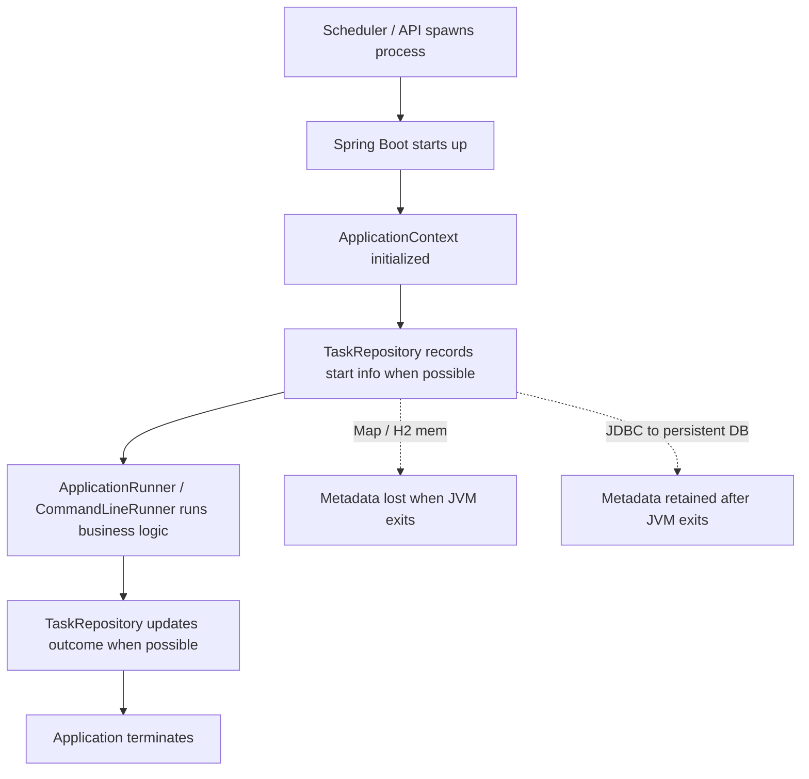
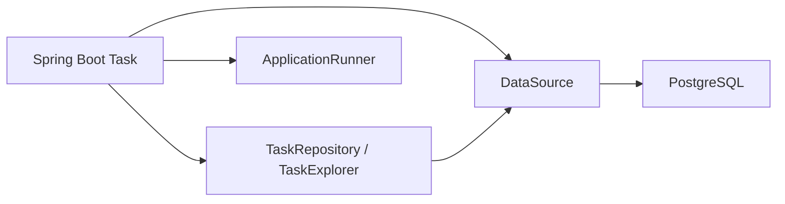
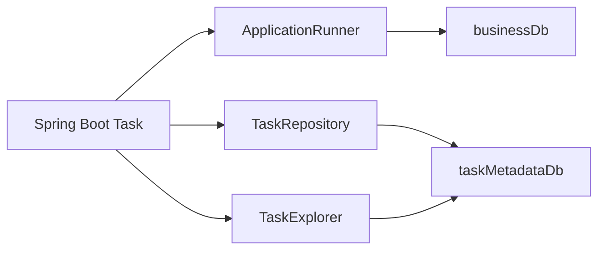

# In-Memory Repository and Configured JDBC Storage

In the **Repository and Schema** chapter of the **SPRING_CLOUD_TASK** module, we explore how Spring Cloud Task records the status and outcome of a Spring Boot application **with a finite execution lifetime**. Each run needs a start point, an end point, an exit code, and lookup metadata. This information belongs to `TaskExecution` and is managed through `TaskRepository`.

A common practical question is: **why did a task succeed, yet upon reopening the application no history of the previous run appears?** The answer lies in the storage mechanism. Spring Cloud Task can operate with **in-memory** data for fast development, or use **JDBC to a persistent database** to track runs across multiple processes, machines, and deployments.

This lesson distinguishes three scenarios that are often conflated: **an in-JVM Map**, **an in-memory H2 database via JDBC**, and **JDBC to a persistent database**. From there, you will know how to choose, configure, verify, and operate the metadata repository suited to your needs.

## 1. Learning Objectives

After this lesson, you will be able to:

- Explain the roles of `TaskRepository`, `TaskExplorer`, and `TaskExecution` in Spring Cloud Task.
- Distinguish an in-memory Map, H2 `jdbc:h2:mem:...`, and PostgreSQL/MySQL over JDBC.
- Understand how `DefaultTaskConfigurer` selects storage components based on available `DataSource` beans.
- Configure example tasks running without a `DataSource`, using in-memory H2, and migrating to PostgreSQL.
- Prepare a schema matching the library version and decide when to use `spring.cloud.task.initialize-enabled`.
- Verify metadata across two runs, analyze connection/schema errors, and understand transaction, security, and operational boundaries.

## 2. What Does TaskRepository Store?

Spring Cloud Task is designed for finite-running processes: an application is launched on a schedule, on demand, or by an orchestrator; executes its work; and terminates. `TaskRepository` writes and updates **application execution** metadata; `TaskExplorer` lets you read back stored metadata.

| Component | Meaning | Example |
| --- | --- | --- |
| `TaskExecution` | Information model for a single run | Task name, execution ID, start/end times, exit code, arguments, error message |
| `TaskRepository` | Writes and updates execution details | Creates a record when the task starts and updates it upon completion |
| `TaskExplorer` | Queries persisted metadata | Lists recent runs of a task |
| `TaskConfigurer` | Customization point for repository, explorer, and transaction manager setup | Selects a dedicated datasource when the app has multiple datasources |
| `DataSource` | JDBC connection to a database | H2, PostgreSQL, MySQL, or another supported database |

A `TaskExecution` represents **one physical run**, not a schedule definition. If a scheduler triggers the same application on two different days, a persistent repository can store two separate records.

Data in the repository is primarily **operational metadata** and does not automatically include business results. For example, a revenue aggregation task might generate a CSV file or write to a `DAILY_REVENUE` table; `TaskRepository` only records execution metadata. Never treat a successful `TaskExecution` record as a substitute for verifying generated files and figures.

### Recording Timeline



Recording metadata is only possible once the repository infrastructure is active. If `ApplicationContext` initialization fails too early or the process is forcibly terminated, there may be no record or the record may lack an end timestamp. Always cross-check the repository against logs and scheduler/container statuses.

## 3. Three Storage Mechanisms and Their Differences

This is the core of the lesson.

### 3.1. In-JVM Map: No DataSource Required

When no `DataSource` is present and default configuration applies, Spring Cloud Task can use a `Map`-based mechanism to hold metadata inside the running process itself. `DefaultTaskConfigurer` provides `SimpleTaskRepository`, whose DAO layer chooses a storage strategy suited to the environment: this can be a `Map`-backed DAO when JDBC is absent.

This does not mean a SQL-queryable database exists. Data in the `Map` lives only within process memory and the application's lifecycle; once the task exits, that history disappears. This mode is mainly suited for experiments or development when cross-run history is not yet needed.

> **Note:** Do not call `MapTaskRepository` the default repository type. The standard component is `SimpleTaskRepository`; when no `DataSource` is present, the **DAO** component may use `MapTaskExecutionDao`. Keep repository interfaces, repository implementations, and DAO storage strategies distinct.

### 3.2. In-Memory H2: Uses JDBC, Not Persistent Storage

When adding H2 and JDBC, you might configure:

```yaml
spring:
  datasource:
    url: jdbc:h2:mem:taskdb
    driver-class-name: org.h2.Driver
    username: sa
    password: ""
```

Here, **a real `DataSource` and JDBC exist**. Metadata is written into H2 SQL tables in memory; you can query those tables **while the database is still alive**. However, with this `mem:` configuration, once the JVM shuts down, the data is gone for any subsequent process.

Therefore, saying “Spring Cloud Task writes to a database” is **not enough** to conclude data is kept permanently. You must check which mode the database runs in, where it stores data, and whether the data survives process exit.

### 3.3. JDBC to a Persistent Database

When `DataSource` points to PostgreSQL, MySQL, or another supported database configured with persistent storage, executions are preserved across JVM restarts. Both the scheduler and operations dashboards can query the same database to view history.

In this case, durability also depends on database administration: disk storage, backups, access permissions, migration workflows, and retention policies. JDBC **does not automatically guarantee** zero metadata loss if database infrastructure fails or writes fail.

### 3.4. Comparison

| Criterion | In-JVM Map | H2 `mem:` over JDBC | JDBC to Persistent DB |
| --- | --- | --- | --- |
| Requires `DataSource`? | No | Yes | Yes |
| Where metadata lives | Process-internal Map | SQL tables in JVM memory | SQL tables in persistent database |
| Can use SQL? | No | Yes, while database exists | Yes |
| Data remains after task exits? | No | No for H2 `mem:` | Normally yes if write succeeded |
| Multiple processes share history? | No | No for per-JVM H2 `mem:` | Yes, if sharing DB/schema with proper permissions |
| Best suited for | Quick tests, simple development | Testing schemas/JDBC locally | History tracking, multi-run operations |
| Key caveats | Lost immediately on JVM exit | Easy to confuse JDBC with persistence | Requires managing schemas, migrations, credentials, DB availability |

Another variant is **file-backed H2** (e.g., `jdbc:h2:file:...`). This uses JDBC and writes to disk, yet you still must account for multi-process access, file locks, paths, and host reliability. In multi-container or multi-host deployments, a shared database server is usually far more appropriate.

## 4. How Does Spring Cloud Task Select the Repository?

In standard configuration, `DefaultTaskConfigurer` sets up three main components:

- `TaskRepository` (typically `SimpleTaskRepository`), used to update run metadata.
- `TaskExplorer` (typically `SimpleTaskExplorer`), used to query metadata.
- `PlatformTransactionManager`, coordinating metadata writes according to the storage backend.

**No `DataSource` case:** the default mechanism may select a `Map`-based DAO with a resourceless transaction manager (not using JDBC resources).

**Single `DataSource` case:** Spring Cloud Task normally uses that data source for the JDBC repository. For example, a PostgreSQL connection created by Spring Boot from `spring.datasource.*` properties is used by Spring Cloud Task to persist execution data.

**Multiple `DataSource` case:** never guess that Spring Cloud Task will pick the right metadata database. Explicitly configure the repository's datasource via a `TaskConfigurer` or customization approach compatible with your version. Exact configuration class syntax depends on the Spring Cloud Task version and transaction manager type; check your project's API version before copying a custom example.

**Practical rule:** to know where data is stored, inspect the actual `DataSource` used by `TaskConfigurer`, rather than just reading a database name in a YAML file.

## 5. Hands-On Exercise: Hello Repository Application

We will create a finite task application that prints a business date argument, reusing the same business logic across three storage modes.

### 5.1. Maven Dependencies

The project needs compatible Spring Boot and Spring Cloud versions. Add basic dependencies to `pom.xml`:

```xml
<dependencies>
    <dependency>
        <groupId>org.springframework.boot</groupId>
        <artifactId>spring-boot-starter</artifactId>
    </dependency>
    <dependency>
        <groupId>org.springframework.cloud</groupId>
        <artifactId>spring-cloud-starter-task</artifactId>
    </dependency>
</dependencies>
```

Use a Spring Boot parent/BOM and import the Spring Cloud BOM **compatible with your Boot version**. To package an executable JAR, the project needs `spring-boot-maven-plugin`:

```xml
<build>
    <plugins>
        <plugin>
            <groupId>org.springframework.boot</groupId>
            <artifactId>spring-boot-maven-plugin</artifactId>
        </plugin>
    </plugins>
</build>
```

In the initial step, do not declare a JDBC driver or H2 yet. If the project already has auto-configuring database dependencies, ensure they do not accidentally create a `DataSource` when you want to test Map mode.

### 5.2. Java: Runner and Shutdown Lifecycle

Create `src/main/java/com/example/task/HelloRepositoryApplication.java`:

```java
package com.example.task;

import java.util.List;

import org.springframework.boot.ApplicationRunner;
import org.springframework.boot.SpringApplication;
import org.springframework.boot.autoconfigure.SpringBootApplication;
import org.springframework.cloud.task.configuration.EnableTask;
import org.springframework.context.annotation.Bean;

@SpringBootApplication
@EnableTask
public class HelloRepositoryApplication {

    public static void main(String[] args) {
        SpringApplication.run(HelloRepositoryApplication.class, args);
    }

    @Bean
    ApplicationRunner helloRunner() {
        return arguments -> {
            String date = "not-specified";
            if (arguments.containsOption("businessDate")) {
                List<String> values = arguments.getOptionValues("businessDate");
                if (values == null || values.size() != 1
                        || values.get(0).isBlank()) {
                    throw new IllegalArgumentException(
                            "--businessDate=YYYY-MM-DD must be provided");
                }
                date = values.get(0);
            }

            System.out.println("Processing businessDate = " + date);
        };
    }
}
```

The application executes business logic once using `ApplicationRunner`. The example validates that a single non-blank value is passed; in production tasks, also validate date format (e.g., via `LocalDate.parse`), time zones, and business rules.

With Spring Cloud Task, you can configure the context to close after the runner finishes. Basic `application.yml` example:

```yaml
spring:
  application:
    name: hello-repository
  main:
    web-application-type: none
  cloud:
    task:
      name: hello-repository
      closecontextEnabled: true

logging:
  level:
    org.springframework.cloud.task: DEBUG
```

The `spring.cloud.task.closecontextEnabled` property requests closing `ApplicationContext` when the task finishes (in Spring Cloud Task versions supporting that property). Non-web mode with no background threads typically lets the application exit cleanly. If you need specific OS exit codes, integrate with Spring Boot's exit code mechanism; never assume business validation passed merely because the process exited.

### 5.3. Experiment A: No DataSource

Keep the dependencies from Section 5.1 and the basic `application.yml`; run:

```bash
./mvnw clean package
java -jar target/hello-repository-0.0.1-SNAPSHOT.jar --businessDate=2026-11-24
```

The JAR name is illustrative and depends on `artifactId` and `version` in `pom.xml`. On Windows, use `mvnw.cmd` instead of `./mvnw`.

In the logs, look for messages about creating/updating `TaskExecution`. Without a `DataSource`, the Map repository may log activity, yet **there are no SQL tables** available after the process ends. Running the command a second time spawns a different process and a fresh Map without restoring prior metadata.

> **Verify configuration:** if you see HikariCP startup logs or a `jdbc:h2:mem:...` URL, your environment actually has a `DataSource`. In that case, it is no longer a pure Map test.

## 6. Experiment B: JDBC with In-Memory H2

Add two dependencies:

```xml
<dependency>
    <groupId>org.springframework.boot</groupId>
    <artifactId>spring-boot-starter-jdbc</artifactId>
</dependency>
<dependency>
    <groupId>com.h2database</groupId>
    <artifactId>h2</artifactId>
    <scope>runtime</scope>
</dependency>
```

Keep the base configuration from Section 5.2 and add:

```yaml
spring:
  datasource:
    url: jdbc:h2:mem:taskdb
    driver-class-name: org.h2.Driver
    username: sa
    password: ""
  cloud:
    task:
      initialize-enabled: true
```

This is a **snippet to merge into `application.yml`**, not a standalone YAML file replacing the earlier configuration. A complete file should have only one root-level `spring:` key.

`spring.cloud.task.initialize-enabled: true` allows Spring Cloud Task to initialize metadata tables from bundled scripts when environment conditions and library versions allow. Run again:

```bash
./mvnw clean package
java -jar target/hello-repository-0.0.1-SNAPSHOT.jar --businessDate=2026-11-24
```

In DEBUG logs, you can observe the H2 connection, schema initialization, and `TaskExecution` create/update operations. H2 `mem:` holds tables while the application runs, but **once the JVM terminates, this database vanishes as well**. A second run with the same URL creates a brand-new database in a new JVM rather than reloading prior history.

### How Can You Inspect SQL When a Task Finishes Too Fast?

Avoid starting with arbitrary sleep calls inside the task expecting to query it from an external JVM. Choose one of two learning approaches:

1. Use a debugger or run a query snippet **inside the same application, before the context closes**, to inspect the internal H2 database.
2. Switch to a persistent database in Section 7, then query it from a standalone SQL tool.

For learning **cross-run history**, the second option is more intuitive and closer to production.

## 7. Experiment C: JDBC with Persistent PostgreSQL

Keep Spring Cloud Task and JDBC, and replace the H2 runtime driver with the PostgreSQL JDBC driver:

```xml
<dependency>
    <groupId>org.postgresql</groupId>
    <artifactId>postgresql</artifactId>
    <scope>runtime</scope>
</dependency>
```

Create a database, a dedicated user for the task repository, and prepare the Spring Cloud Task schema **matching your exact version**. In production, create/update tables via migrations independent of each run. You can configure `application-prod.yml`:

```yaml
spring:
  datasource:
    url: ${TASK_DB_URL}
    username: ${TASK_DB_USERNAME}
    password: ${TASK_DB_PASSWORD}
    driver-class-name: org.postgresql.Driver
  cloud:
    task:
      initialize-enabled: false
```

Example value for the `TASK_DB_URL` environment variable:

```text
jdbc:postgresql://db.example.internal:5432/task_metadata
```

The YAML above supplements the shared configuration in Section 5.2 when the `prod` profile is active. Account credentials and database hostnames are **example values** that must be supplied by your runtime environment; never hard-code passwords in git or command-line arguments.

Launch with the profile active:

```bash
java -jar target/hello-repository-0.0.1-SNAPSHOT.jar   --spring.profiles.active=prod --businessDate=2026-11-24
```

This shows line continuation / spacing for POSIX shells. In PowerShell, run the command on **one line** or use PowerShell's line continuation syntax.

Run a second time with a different date. After both processes finish, connect to PostgreSQL with a SQL client to inspect metadata. **Prerequisites:** the database is reachable, permissions are valid, tables were created with the proper script, and metadata writes succeeded.

## 8. How Should the JDBC Schema Be Managed?

Spring Cloud Task stores `TaskExecution` and related details in framework-defined tables. Common names include:

- `TASK_EXECUTION`: primary metadata for a run such as task name, timestamps, exit code, status/error message.
- `TASK_EXECUTION_PARAMS`: argument details linked to an execution, depending on schema and version.
- Other objects such as lock tables or sequences may exist depending on the database, version, and enabled features.

**Do not hand-write a “one-size-fits-all” DDL script.** Column types, lengths, indexes, keys, and object lists depend on the schema scripts shipped with your Spring Cloud Task version. When using PostgreSQL or another database, extract the **official DDL matching your database type and artifact version**, put it into your project's migration tool, and test it in staging.

### Automatic Initialization Mechanism

| Environment | `spring.cloud.task.initialize-enabled` | Management Approach |
| --- | --- | --- |
| Simple H2 for practice | `true` (appropriate) | Framework initializes tables from bundled scripts |
| Shared dev database | May be `true` when lifecycle is controlled, but avoid concurrent table-creation races | Agree on who owns schema management |
| Staging/production | Usually `false` | Independent migrations executed before app launch, matching version |

Production example:

```yaml
spring:
  cloud:
    task:
      initialize-enabled: false
```

When disabling auto-initialization, **you must prepare the schema beforehand**. If tables are missing or permissions are wrong, the application can fail when attempting to write `TaskExecution`.

### Changing the Table Prefix

By default, tables usually begin with `TASK_`. Spring Cloud Task supports changing the prefix:

```properties
spring.cloud.task.tablePrefix=OPS_TASK_
```

Changing the prefix **does not rename existing tables automatically**. Operators must ensure actual DDL, table names, sequences, and operational queries match the setting. A common mistake is setting a new prefix in YAML while leaving default table names in the schema, causing the repository to report table-not-found errors.

## 9. Querying History and Verifying Persistence

After running at least **two separate processes** with the same persistent JDBC configuration, run basic SQL (for the default schema):

```sql
SELECT TASK_EXECUTION_ID,
       TASK_NAME,
       START_TIME,
       END_TIME,
       EXIT_CODE
FROM TASK_EXECUTION
ORDER BY TASK_EXECUTION_ID DESC;
```

Illustrative sample output:

| TASK_EXECUTION_ID | TASK_NAME | START_TIME | END_TIME | EXIT_CODE |
| ---: | --- | --- | --- | ---: |
| 102 | hello-repository | 2026-11-25 01:00:00 | 2026-11-25 01:00:03 | 0 |
| 101 | hello-repository | 2026-11-24 01:00:00 | 2026-11-24 01:00:02 | 0 |

This is purely a **hypothetical example**, not actual execution output. IDs and timestamps are determined by your database and runtime.

You can filter unfinished runs:

```sql
SELECT TASK_EXECUTION_ID, TASK_NAME, START_TIME, END_TIME
FROM TASK_EXECUTION
WHERE END_TIME IS NULL
ORDER BY START_TIME;
```

Do not assume `END_TIME IS NULL` means “still running”. A process could have been killed or lost connectivity before writing its completion update. Cross-check with Job/container status and logs.

### Lab Verification Criteria

1. Run twice using PostgreSQL or a persistent database, confirming each run creates an independent record.
2. Exit the application completely, reconnect to the database from a separate tool, and confirm both records are still readable.
3. Launch a third time and verify a new record is added without losing older records.
4. Intentionally pass invalid input in a test environment and inspect logs, exit code, and repository status.
5. Verify the task writes to the exact database/schema that your SQL tool is connected to.

Distinguish **persistent storage** from **guaranteed writes**. When a database is unreachable or the schema is missing, records may not be saved; the orchestrator needs independent monitoring to catch early startup failures.

## 10. Single DataSource or Multiple DataSources?

### Single DataSource Case

If an application has exactly one `DataSource` and uses it for metadata, Spring Cloud Task usually selects it for the JDBC repository. Example:



Sharing a database for business data and metadata is simple to configure, though you must consider permissions, migrations, and recovery impact. Do not assume metadata and business writes share a single atomic transaction: that depends on the transaction manager and how work is structured.

### Two DataSources Case

For example, an application reads transactions from `businessDb` while writing task history to `taskMetadataDb`:



This is where you must **explicitly** choose the repository datasource via a `TaskConfigurer` and matching transaction manager. Merely adding two `DataSource` beans and expecting default auto-configuration to guess right can cause startup failures or metadata written to the wrong database.

When using two independent databases, also do not assume distributed atomic transactions across metadata and business data. For instance, business writes may commit while the final `TaskExecution` update fails; retries must handle the possibility that business results already exist.

## 11. Common Mistakes

| Symptom | Likely Cause | How to Check |
| --- | --- | --- |
| Task runs, but no `TASK_EXECUTION` table exists | Using in-JVM Map; no `DataSource` present | Check JDBC dependencies, `DataSource` bean, and startup logs |
| H2 and tables exist on first run, empty on next run | Using `jdbc:h2:mem:...`, DB vanishes on JVM exit | Switch to a persistent database |
| “table not found” error | Migrations not run, wrong DB/schema, or `tablePrefix` changed without DDL update | Verify URL, schema, script version, and table names |
| Table creation permission error | DB user lacks DDL rights while `initialize-enabled=true` | Run migrations with a privileged account; disable auto-init at runtime |
| Connection error | Wrong URL/credentials, DB not ready, TLS/network issue | Test DB connectivity from task runtime and verify secrets |
| Multiple `DataSource`s, TaskRepository uses wrong DB | Metadata source not explicitly specified | Configure `TaskConfigurer` for your version; inspect logs/config |
| No record even though container shows Failed | Failed before Task infrastructure started, or JDBC write failed | Cross-check startup logs, Job/Pod state, and database |
| Record missing `END_TIME` | Task still running or killed before final update | Cross-check PID/Job and timeout; never conclude from SQL alone |
| Exit code 0 but business data is wrong | Missing validation or swallowed exception | Add data checks, proper error handling, and logging |

### Configuration Pitfalls to Avoid

Even when testing with H2, never conclude that simply adding `spring-boot-starter-jdbc` yields persistent history. Inspect the JDBC URL, database mode, process lifecycle, and database server setup.

Likewise, switching from Map to JDBC **does not retroactively populate history from prior runs**. Records that existed only in the Map of an exited JVM cannot be recovered by pointing to PostgreSQL on a later run.

## 12. Operating Safely with a JDBC Repository

A JDBC repository in production should be treated as operational infrastructure:

1. **Reliable database:** ensure connectivity from the task runtime; monitor latency and connection errors.
2. **Versioned schema:** apply migrations matching your Spring Cloud Task version and DBMS; test before rolling out upgrades.
3. **Least privilege:** runtime users get only required DML permissions; schema creation/modification is controlled by the migration pipeline.
4. **Secure credentials:** load URL, username, and password from secrets/environment variables; avoid passing tokens or private data in CLI args since `TaskExecution` can persist arguments.
5. **External tracking:** schedulers/containers should record run IDs, spawn timestamps, and exit codes. Absence of a repository record does not prove the task never started.
6. **Storage limits:** define retention, archiving, and cleanup honoring table relationships; avoid ad-hoc uncontrolled deletes.
7. **Duplicate-run protection:** when retries or scheduler overlaps occur, protect results with business keys/idempotency rather than relying solely on metadata.
8. **Backup and recovery:** verify backup/restore of the metadata database if execution history is needed for audits or investigations.

When integrating with **Spring Batch**, distinguish `TaskRepository` from `JobRepository`. `TaskRepository` records the Spring Cloud Task application lifecycle; Batch's `JobRepository` records jobs/steps, execution contexts, and checkpoints as configured. Both repositories may share a database or use separate stores depending on architecture; sharing JDBC does not merge them into the same persistence mechanism.

## 13. Self-Practice Exercises

**Exercise 1 — Distinguishing Map and JDBC.** Run an application with only the Task starter, inspect the logs, and verify whether a `DataSource` exists. Add H2 + JDBC and rerun; explain why SQL tables appear yet history is still non-persistent.

**Exercise 2 — Post-Restart Verification.** Using PostgreSQL with the version-matched schema prepared, run the task with two different `--businessDate` values. After both JVMs exit, query the record count with SQL and explain why H2 `mem:` cannot produce the same result.

**Exercise 3 — Intentional Schema Error.** In a test environment, set `initialize-enabled: false` without preparing tables. Observe the error and explain why changing configuration alone is insufficient for the repository to work.

**Exercise 4 — Two DataSources.** Sketch an architecture that reads business data from `businessDb` and stores metadata in `taskMetadataDb`. Identify how to select the repository datasource, transaction manager, and a recovery plan when business commits succeed but metadata updates fail.

**Exercise 5 — Scheduled Runs.** Have a scheduler run the task twice. Design a way to reconcile scheduler history with `TASK_EXECUTION`, including cases where a run fails before `ApplicationContext` is ready.

### Review Questions

1. What is the core difference between storing metadata in a `Map` versus H2 `mem:`? Why are both unsuitable for retaining history after JVM exit?
2. Are `SimpleTaskRepository` and `JdbcTaskExecutionDao` at the same layer of responsibility?
3. When an application has one `DataSource`, what enables Spring Cloud Task to write metadata using JDBC?
4. Why is `spring.cloud.task.initialize-enabled: false` commonly used in production?
5. If you change `spring.cloud.task.tablePrefix`, which parts of the schema must operators synchronize?
6. Why do two runs with the same task name still require two distinct `TaskExecution` records?
7. Why can't `TaskRepository` be treated as the primary store for Spring Batch job output data?

## 14. Key Takeaways

- **In-JVM Map**, **in-memory H2 over JDBC**, and **JDBC to a persistent database** are three distinct scenarios, even though the first two both lose history when the process ends.
- `TaskRepository` manages run metadata; `TaskExplorer` serves lookups. `DefaultTaskConfigurer` selects appropriate components, while multiple `DataSource` setups usually require explicit metadata source configuration.
- Viewing history across runs requires a **persistent JDBC database**, a version-matched schema, and connectivity remaining valid after the application process exits.
- Automatic schema initialization is convenient for demos; production should use **controlled migrations** and typically set `spring.cloud.task.initialize-enabled: false`.
- Persistent storage does not replace scheduler/container monitoring, business outcome verification, error handling, or safe retry strategies.

## References

- [Spring Cloud Task — Getting started](https://docs.spring.io/spring-cloud-task/reference/getting-started.html): task examples and limitations of the in-memory repository.
- [Spring Cloud Task — Features / Configuration](https://docs.spring.io/spring-cloud-task/reference/features.html): `DataSource`, `TaskConfigurer`, table prefix, schema initialization, and task lifecycle.

When using a specific Spring Cloud Task version, consult the documentation, APIs, and schema scripts corresponding to that exact version.
