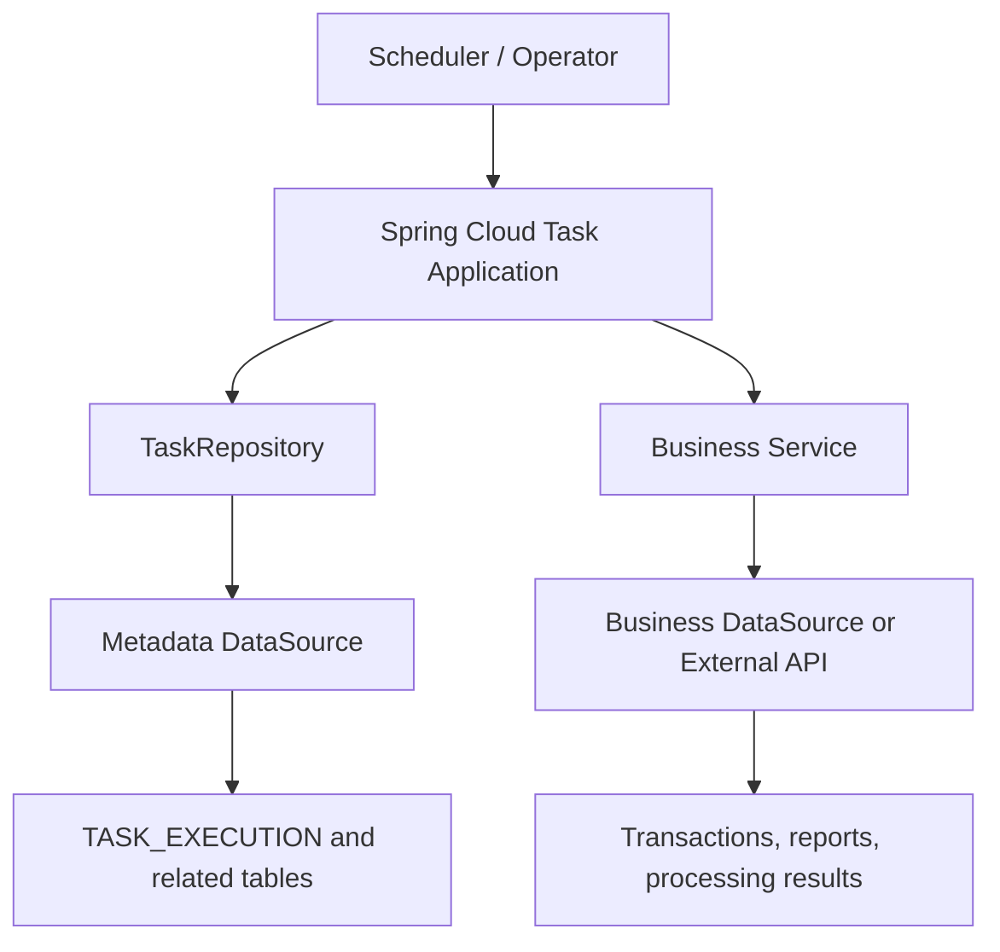
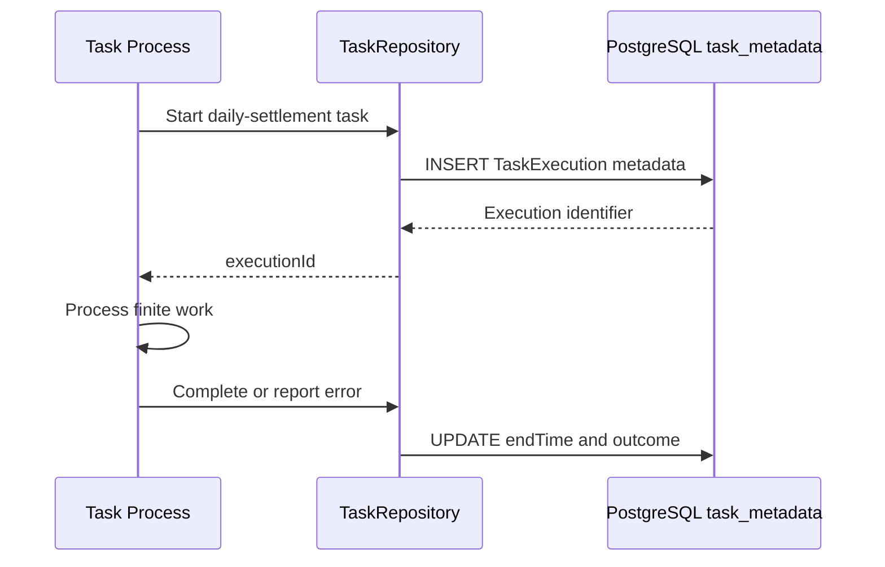

# Choosing a `DataSource` for Execution Data in Spring Cloud Task

## 1. Why Is `DataSource` a Critical Decision?

A **Spring Cloud Task** application is launched to perform finite work: importing data files, reconciling transactions, aggregating reports, or syncing information. Once the application exits, the Java process disappears, yet operations still need to know **which run started, when it completed, whether it failed, and how many times it has been rerun**.

Spring Cloud Task handles this audit trail through **`TaskRepository`**, which writes each **`TaskExecution`**'s metadata into a database. The `DataSource` is the JDBC connection object used by the repository infrastructure. Choosing the right `DataSource` determines where execution history is written, whether it persists across runs, and who has permission to read and write that data.

This lesson in the **Repository and Schema** chapter focuses on choosing a `DataSource` for **execution data**, covering both single-database applications and multi-database applications. The goal is not merely connecting successfully, but designing appropriately for scheduled runs, on-demand runs, error handling, retries, and Spring Batch coordination.

After this lesson, you will be able to:

- Explain the relationship between `DataSource`, `TaskRepository`, `TaskExecution`, and the metadata schema.
- Configure a default data source for your first task.
- Decide when to share a database with business data and when to separate them.
- Designate the dedicated data source for Spring Cloud Task in a multi-`DataSource` application.
- Verify where execution history is written and identify common configuration mistakes.

## 2. Distinguishing Execution Metadata from Business Data

Consider a `daily-settlement` task: reading transactions, reconciling with partners, and writing settlement results. During this run there are **two very different groups of data**:

| Data Group | Typical Content | Managing Component |
| --- | --- | --- |
| **Execution Metadata** | `executionId`, task name, start/end timestamps, exit code, error info, and launch arguments. | Spring Cloud Task's `TaskRepository` / `TaskExplorer`. |
| **Business Data** | Transactions, reconciled amounts, output reports, imported files, partner submission status. | Application repositories/JDBC/JPA or business services. |

`TaskRepository` **does not replace** the business data store. A run recorded with `exitCode = 0` only tells you the infrastructure completed along the success path; the application still must verify the contents of the reports or transactions it processed.



These two branches can point to **the same database** or **two different databases**. Spring Cloud Task only needs to know which data source to use for metadata. Whichever approach you choose, execution history must still be stored persistently enough to be queried after the process terminates.

## 3. How Does `TaskRepository` Use `DataSource`?

Each involved component has a distinct role:

| Component | Responsibility |
| --- | --- |
| `DataSource` | Provides JDBC connections to a specific database. |
| `TaskRepository` | Creates and updates `TaskExecution` records as the application starts, runs, and finishes. |
| `TaskExplorer` | Enables querying historical execution metadata via API. |
| Spring Cloud Task Schema | Supplies the tables, keys, and ID-generation mechanism required by the repository. |
| `TaskExecution` | Model representing **one concrete execution**, not the whole application or task type. |

In a standard JDBC setup, `TASK_EXECUTION` stores lifecycle metadata; `TASK_EXECUTION_PARAMS` holds recorded arguments; additional tables support features such as Spring Batch linking. Table names, column types, indexes, and ID generation mechanisms must come from the **schema scripts for your exact Spring Cloud Task version and database management system**.

An application run three times typically produces three distinct `TaskExecution` records, even when all use the task name `daily-settlement`. With a persistent database, those records remain after all three processes have exited.

## 4. Simple Case: Only One `DataSource`

For a **first task**, the most straightforward setup is configuring a single database through `spring.datasource`. When an application has only one eligible `DataSource`, Spring Cloud Task can use it as the default metadata store.

### 4.1. PostgreSQL Configuration Example

```yaml
spring:
  application:
    name: daily-settlement-worker
  main:
    web-application-type: none
  cloud:
    task:
      name: daily-settlement
  datasource:
    url: ${TASK_DB_URL}
    username: ${TASK_DB_USER}
    password: ${TASK_DB_PASSWORD}
    driver-class-name: org.postgresql.Driver
```

Environment variables can be supplied at deployment time:

```bash
export TASK_DB_URL='jdbc:postgresql://db.example.internal:5432/task_metadata'
export TASK_DB_USER='task_runtime'
export TASK_DB_PASSWORD='replace-with-secret-from-secret-manager'
java -jar daily-settlement-worker.jar --businessDate=2026-11-23
```

The hostnames and account details above are **illustrative examples only**; never put real passwords in documentation or source code. In production, use a secret manager or your deployment platform's secret injection mechanism.

The application requires compatible versions of Spring Boot and Spring Cloud Task, the `spring-cloud-starter-task` dependency, the PostgreSQL JDBC driver, and a properly prepared Spring Cloud Task schema. `@EnableTask` or equivalent task-enabling configuration for your version must be active.

### 4.2. Path of a Single Execution



If `TASK_DB_URL` points to a different database on each run, history gets scattered. For scheduled applications, ensure **all runs that need to be tracked together access the exact same repository**, regardless of which host or container spawns the new process.

### 4.3. When Is an Embedded Database Appropriate?

H2 or another embedded database can be convenient for learning and quick trials. However, **an in-memory database tied to each process** typically loses data when the process ends. Two independent runs cannot automatically see each other's history. Therefore, this model is unsuitable if your goal is monitoring scheduled tasks or investigating failures across multiple runs.

When you need real history tracking, use a persistent database with appropriate backup policies, access permissions, and monitoring. Do not assume Spring Cloud Task will automatically create the schema in PostgreSQL: initialization behavior depends on version, configuration, and migration strategy.

## 5. Share or Separate the Metadata Database?

This is an architectural decision to make before configuring multiple data sources.

| Criterion | Shared Database with Business Data | Dedicated Metadata Database |
| --- | --- | --- |
| Initial setup | Fewer components and connection configs. | Requires additional database/schema, credentials, and connection setup. |
| Permissions | Must restrict access between business tables and task tables in the same store. | Can grant dedicated permissions for metadata. |
| Operations and backups | Can leverage existing infrastructure. | Easier to tailor retention, monitoring, and backup policies for task history. |
| Failure/load isolation | Metadata and business transactions share database resources. | Can reduce interference between workloads, at the cost of managing more components. |
| Transactions | Some operations share a database, but the framework still does not wrap everything into one transaction automatically. | Metadata writes and business writes usually occur in independent transactions. |
| Multiple task apps | Simple when only a few tasks share infrastructure. | Ideal when multiple services need a centralized history store with clear access control. |

**When to share:** small applications, a single stable database, and simple operational requirements. Tables can still be separated by schema or database privileges if the DBMS supports it.

**When to separate:** large systems, strict security and privilege boundaries, many tasks needing centralized tracing, or a business database with a different lifecycle and backup policy. Separation does not create high availability on its own: both data sources must still be operated and monitored.

One important note: **a successful `TaskExecution` write does not automatically guarantee that the business transaction committed**, and vice versa. When using two data sources, implement partial-failure handling, idempotency, and outcome reconciliation; never assume distributed atomic transactions.

## 6. Multiple `DataSource`s: Designating the Metadata Store with `@TaskDataSource`

When an application accesses business data while also recording execution metadata, having multiple `DataSource` beans without a clear selection mechanism can cause ambiguity or cause the repository to connect to the wrong store. Spring Cloud Task provides the **`@TaskDataSource`** annotation to designate the `DataSource` dedicated to Task infrastructure in versions that support this feature.

### 6.1. Configuring Two Data Sources

Example `application.yml`:

```yaml
spring:
  application:
    name: daily-settlement-worker
  main:
    web-application-type: none
  cloud:
    task:
      name: daily-settlement

app:
  business:
    datasource:
      url: ${BUSINESS_DB_URL}
      username: ${BUSINESS_DB_USER}
      password: ${BUSINESS_DB_PASSWORD}
  task:
    datasource:
      url: ${TASK_DB_URL}
      username: ${TASK_DB_USER}
      password: ${TASK_DB_PASSWORD}
```

The `app.business.datasource` and `app.task.datasource` prefixes are **application-defined conventions**. Spring Boot does not automatically create two `DataSource` beans from these prefixes alone; they must be bound to beans defined by the application.

### 6.2. Defining Connection Beans and Marking `@TaskDataSource`

```java
import javax.sql.DataSource;

import org.springframework.beans.factory.annotation.Qualifier;
import org.springframework.boot.autoconfigure.jdbc.DataSourceProperties;
import org.springframework.boot.context.properties.ConfigurationProperties;
import org.springframework.cloud.task.configuration.TaskDataSource;
import org.springframework.context.annotation.Bean;
import org.springframework.context.annotation.Configuration;
import org.springframework.context.annotation.Primary;

@Configuration(proxyBeanMethods = false)
public class DataSourceConfiguration {

    @Bean
    @Primary
    @ConfigurationProperties("app.business.datasource")
    DataSourceProperties businessProperties() {
        return new DataSourceProperties();
    }

    @Bean("businessDataSource")
    @Primary
    DataSource businessDataSource(
            @Qualifier("businessProperties") DataSourceProperties properties) {
        return properties.initializeDataSourceBuilder().build();
    }

    @Bean
    @ConfigurationProperties("app.task.datasource")
    DataSourceProperties taskMetadataProperties() {
        return new DataSourceProperties();
    }

    @Bean("taskMetadataDataSource")
    @TaskDataSource
    DataSource taskMetadataDataSource(
            @Qualifier("taskMetadataProperties") DataSourceProperties properties) {
        return properties.initializeDataSourceBuilder().build();
    }
}
```

In this example:

- `businessDataSource` is marked `@Primary` to serve as the default for unqualified `DataSource` injections in the application.
- `taskMetadataDataSource` is marked `@TaskDataSource`, signaling Spring Cloud Task infrastructure to choose it for `TaskRepository`.
- `DataSourceProperties` reads `url`, `username`, and `password`; `initializeDataSourceBuilder()` constructs the connection from the corresponding configuration.
- The two data sources can point to two different databases or two independent schemas, depending on your privilege design.

This example relies on the `@TaskDataSource` mechanism in Spring Cloud Task versions that support this annotation. When targeting a specific release line, verify packages, APIs, and auto-configuration selection behavior against the **official documentation for that exact version**. If configuring `TaskConfigurer` or `TaskRepository` manually, ensure those beans use the chosen data source.

### 6.3. Preventing Business Logic from Accidentally Using the Metadata Store

When two `DataSource`s exist, explicitly specify the `JdbcTemplate`, transaction manager, or entity manager for business logic. Example:

```java
import javax.sql.DataSource;
import org.springframework.beans.factory.annotation.Qualifier;
import org.springframework.context.annotation.Bean;
import org.springframework.context.annotation.Configuration;
import org.springframework.jdbc.core.JdbcTemplate;

@Configuration(proxyBeanMethods = false)
public class BusinessJdbcConfiguration {

    @Bean("businessJdbcTemplate")
    JdbcTemplate businessJdbcTemplate(
            @Qualifier("businessDataSource") DataSource businessDataSource) {
        return new JdbcTemplate(businessDataSource);
    }
}
```

Then inject it using `@Qualifier("businessJdbcTemplate")` in the reconciliation service. Avoid assuming every `JdbcTemplate`, JPA repository, or `@Transactional` will automatically pick the data source you expect, especially when the application has multiple transaction managers.

**Distinction with Spring Batch:** if the application also uses Spring Batch, Batch has its own repository for `JobExecution`, `StepExecution`, and checkpoint state. In multi-datasource setups, separately verify how Spring Batch selects its `DataSource` (such as `@BatchDataSource` in supported Spring Boot versions) and matching transaction manager. `@TaskDataSource` does not automatically configure the entire Batch infrastructure.

## 7. Schema for the Selected Database

**Choosing the right `DataSource` is necessary, not sufficient.** The chosen database must also contain Spring Cloud Task's exact tables and ID-generation mechanism. If the application connects successfully yet `TASK_EXECUTION` is missing, the run can fail when the framework attempts to persist the start record.

### 7.1. Objects to Prepare

A typical Spring Cloud Task schema contains:

| Object | Role |
| --- | --- |
| `TASK_EXECUTION` | History of each execution, including start/end timestamps and outcome. |
| `TASK_EXECUTION_PARAMS` | Recorded parameters for an execution. |
| Additional link tables | May be used to link tasks with Spring Batch or version-specific features. |
| Sequences / key-generation tables | Safely issue unique identifiers under concurrent process runs; specifics depend on DBMS and version. |

Do not hand-write an “approximate” schema from memory or copy old-version scripts without checking. Spring Cloud Task distributes schemas per database type and library version. When upgrading versions, review schema changes and plan migrations.

### 7.2. Who Creates the Tables?

In learning environments, certain configurations and embedded databases can have tables initialized automatically by the framework. In production, **manage migrations separately** using tools like Flyway, Liquibase, or your organization's DBA workflow.

In multi-`DataSource` configurations, verify that migrations actually execute against the **metadata database**, because migration tools may default to `@Primary` or a separately configured source. Running migrations onto the business database by mistake can make the app start fine in dev while failing to write metadata in other environments.

A clear deployment sequence is: prepare database → create version-matched schema → grant runtime permissions → configure data source → run a short test task → verify the execution record.

### 7.3. Access Permissions to Consider

The account used by Spring Cloud Task must have sufficient privileges to read/write metadata tables and use the schema's key-generation mechanism. Meanwhile, the normal runtime account **does not need** table creation/deletion privileges when schemas are managed through independent migrations.

Separate migration and runtime roles where security requirements allow:

- **Migration account**: creates/alters table structures during controlled deployments.
- **Runtime account**: holds only privileges needed to write/read execution metadata.
- **Read/monitoring account**: queries history without being able to alter outcomes.

Launch arguments can be recorded in the metadata store, so **never pass passwords, tokens, or secrets via command-line arguments** if they may be persisted in `TASK_EXECUTION_PARAMS`, logs, or process monitors.

## 8. Verifying the Right Database After Running

After building and launching the application, verify in practice that `TaskRepository` wrote to the **intended data source**.

### 8.1. Performing Two Runs

Example:

```bash
java -jar daily-settlement-worker.jar --businessDate=2026-11-23
java -jar daily-settlement-worker.jar --businessDate=2026-11-24
```

In a complete sample application, the runner must process the argument and exit; `@EnableTask` and the metadata connection must work. Then open a SQL connection to the **metadata database** and run:

```sql
SELECT TASK_EXECUTION_ID,
       TASK_NAME,
       START_TIME,
       END_TIME,
       EXIT_CODE,
       EXIT_MESSAGE
FROM TASK_EXECUTION
WHERE TASK_NAME = 'daily-settlement'
ORDER BY TASK_EXECUTION_ID DESC;
```

This query is illustrative using common column names; verify against your actual schema. If connecting to the business database reveals these rows, check whether both `DataSource`s point to the same database/schema or Spring Cloud Task picked the wrong data source.

The expected result is **two records with distinct `TASK_EXECUTION_ID`s** in the metadata database. For runs that completed normally and persisted results, `END_TIME` is populated. The exit code and exit message reflect the program's actual result.

### 8.2. Cross-Checking Three Layers of Information

| What to Verify | How to Check | Reason |
| --- | --- | --- |
| Where is the app connecting? | Inspect effective config, JDBC URL, and selected `DataSource` bean; mask credentials. | Distinguish intended config from actual loaded config. |
| Where is metadata stored? | Query `TASK_EXECUTION` in the designated database. | Confirm `TaskRepository`'s `DataSource` selection. |
| Did the job process correctly? | Inspect business results, logs, and orchestrator status. | Metadata does not replace output validation. |

Never use “no record found” as proof that the application never started: if a failure occurs before `TaskRepository` initializes, no record may exist; or you might be querying the wrong database.

## 9. Troubleshooting Common Configuration Errors

| Symptom | Possible Cause | How to Investigate |
| --- | --- | --- |
| Fails to create `TaskExecution` at startup | Wrong URL/credentials, DB not ready, missing permissions, or missing schema. | Inspect root exception, test connectivity, and check runtime account privileges. |
| Multiple `DataSource`s and Spring doesn't know which bean to pick | Missing proper designation or inconsistent auto-config setup. | Mark `@TaskDataSource` explicitly, apply `@Qualifier`/`@Primary` properly, and check version docs. |
| Metadata appears in the business database | Only `@Primary` set for business, none designated for task; or manual repo config points wrongly. | Check `@TaskDataSource`, `TaskConfigurer`, bean names, URL, and connection schema. |
| Only some runs have history | Processes use different DB configs, or DB storage is non-persistent. | Compare per-environment configs, connection strings, and run schedules. |
| Record has empty `END_TIME` | Process stopped abnormally or failed to update DB upon exit. | Check logs, Job/Pod/process status, and connection error history. |
| Cannot allocate `executionId` under concurrency | Wrong key-generation schema or missing permissions on sequence/key table. | Use official version-matched schema script; verify privileges and DBMS settings. |
| Task fails with SQL error after library upgrade | Old schema incompatible with new code. | Check migrations and review release notes for schema changes. |

Example: a task runs via a Kubernetes CronJob spawned fresh every night. If each Pod uses an in-memory H2 database, subsequent runs cannot read prior history. If Pods connect to a stable PostgreSQL server but credentials expired, the application fails to write metadata. Both incidents look similar on a dashboard yet have completely different causes.

## 10. Choosing a `DataSource` for Retries, Parallel Runs, and Spring Batch

### 10.1. Reruns Do Not Overwrite Past Executions

When an orchestrator retries the same task, the new run typically receives a new `executionId` and is saved as a new row in the same `TaskRepository`. If each retry's history lands in a different database, operators cannot reconstruct the retry chain.

Never use `executionId` as a business key to prevent duplicate reports. Idempotency should rely on an appropriate key, such as `(report_type, business_date)`, and update rules in the business store.

### 10.2. Multiple Processes Updating the Repository Concurrently

When multiple application instances share a metadata store, the database and schema must support **concurrency-safe ID allocation**. Connection pools must fit load and database connection limits. Monitor latency and metadata write failures, because an unavailable metadata database can cause task launches to fail even while the business database is healthy.

Sharing a `TaskRepository` **does not automatically limit how many tasks can run concurrently**. Concurrency policies, processing locks, and deduplication still belong to the application or orchestrator.

### 10.3. When Using Spring Batch

Spring Cloud Task tracks the **application lifecycle**, whereas Spring Batch tracks **job and step lifecycles** via `JobExecution`, `StepExecution`, and Batch tables. Both repository systems can share a database if configuration/schema/transactions allow, or use different data sources.

When using multiple data sources, explicitly define:

1. Which `DataSource` `TaskRepository` uses to persist `TaskExecution`.
2. Which `DataSource` and transaction manager Spring Batch's `JobRepository` uses.
3. Which `DataSource` business processing uses, and where transaction boundaries lie.
4. If one repository succeeds while the other fails, how the orchestrator detects and recovers.

Never assume both repositories share a single transaction merely because they live in the same Spring Boot application. Likewise, never equate `TaskExecution.executionId` with a `JobExecution` ID.

## 11. Design Scenario: Choosing Metadata Storage for a Reconciliation System

Suppose a company has a `payments_prod` database holding transactions and an `operations_prod` database dedicated to operational metadata. The `payment-reconciliation-task` application runs nightly, and can be launched manually to re-reconcile a past date.

A sound design is:

- **`businessDataSource`** points to `payments_prod`, scoped to reading transactions and writing required result tables.
- **`taskMetadataDataSource`** points to `operations_prod`, annotated with `@TaskDataSource` and provisioned with the version-matched Spring Cloud Task schema.
- **`TaskRepository`** writes history to `operations_prod`; `TaskExplorer` powers queries or dashboards.
- **Orchestrator** runs the app on schedule or demand, logs the run identifier, and reconciles logs with metadata.
- **Reconciliation logic** uses a stable business key for the processing date to prevent duplicate outputs on retry.

If a separate operations database is not permitted, a single database can be used with separate schemas, roles, and retention policies. The decisive factor is being able to **explicitly specify and verify where metadata lives**, not necessarily running two separate database servers.

## 12. Pre-Deployment Checklist

- [ ] Identified where `TaskExecution` metadata and business data will be stored.
- [ ] The `DataSource` chosen for `TaskRepository` has the proper URL, account, and access permissions.
- [ ] With multiple `DataSource`s, designated the source for Spring Cloud Task and configured business/Batch sources separately.
- [ ] Spring Cloud Task schema, related tables, and ID allocation match the exact version and DBMS.
- [ ] Migrations run against the intended database without accidentally targeting another data source.
- [ ] Metadata database persists across new launches of the JAR/container.
- [ ] Tested multiple runs and queried distinct `TaskExecution` records via `TaskExplorer` or SQL.
- [ ] Tested error paths, exit codes, logs, and behavior when metadata cannot be written due to DB issues.
- [ ] No secrets passed through arguments that may be persisted or logged; runtime account follows least privilege.
- [ ] Policies exist for backups, retention, load limits, error alerts, and recovery procedures.

### Self-Check Questions

**Question 1.** An application has one `DataSource` pointing to in-memory H2. Why might nightly run history disappear after the Pod terminates?

**Question 2.** An application has `businessDataSource` marked `@Primary` and `taskMetadataDataSource`. What is needed for Spring Cloud Task to use the metadata source in versions supporting `@TaskDataSource`?

**Question 3.** `TaskExecution` was written successfully to a separate database, yet updating the business table failed. Can the business report be considered complete?

**Question 4.** In an application that also includes Spring Batch, why is selecting `@TaskDataSource` insufficient to conclude Batch metadata is stored in the right place?

**Hints:** (1) an in-memory database is tied to the process lifecycle; (2) mark the Task source with `@TaskDataSource` and verify repository configuration; (3) no, you must check business outcomes and transactions; (4) Batch's `JobRepository` has its own connection and transaction configuration.

## 13. Summary

With Spring Cloud Task, **choosing a `DataSource` means choosing where execution lifecycle history lives**. Simple apps can use `spring.datasource`; when multiple data sources exist, explicitly designate the `TaskRepository` source and keep it distinct from business connections. Once selected, prepare the version-matched schema, grant permissions, verify actual writes, and design recovery for database or process failures.

The operational rule is: **keep execution history persistent, know for certain where it is stored, and never substitute metadata for business outcome verification**. This enables scheduled or on-demand tasks to be monitored, debugged, and safely coordinated with Spring Batch.

**References:** [Spring Cloud Task Reference](https://docs.spring.io/spring-cloud-task/reference/), [Spring Boot Reference](https://docs.spring.io/spring-boot/reference/), [Spring Batch Reference](https://docs.spring.io/spring-batch/reference/).
