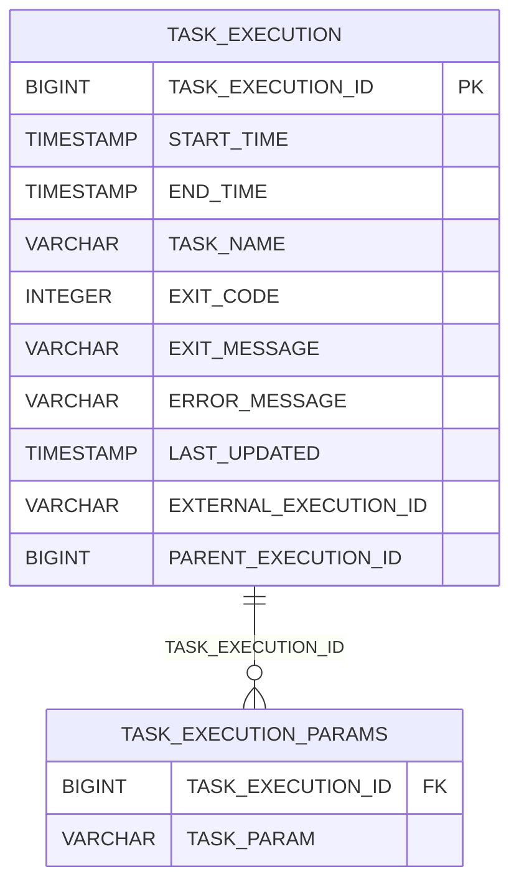
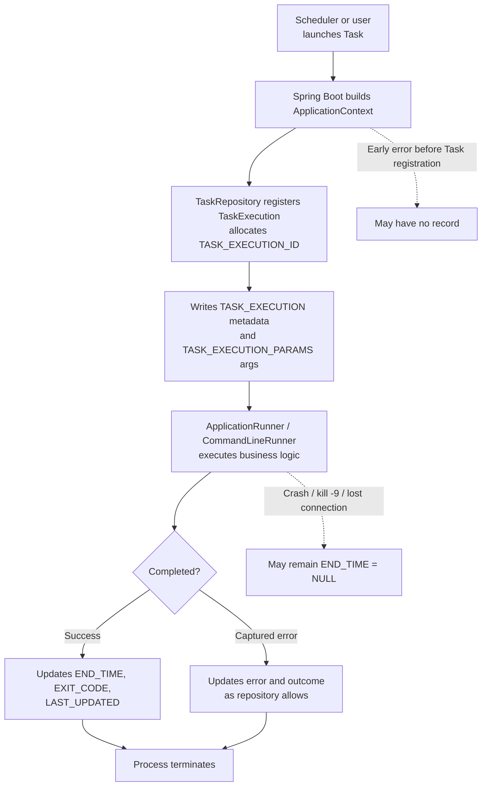
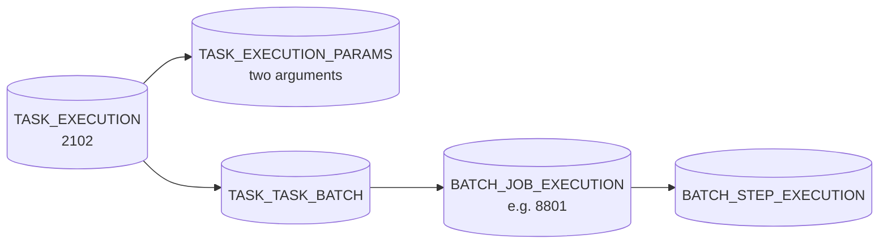

# Structure of `TASK_EXECUTION` and `TASK_EXECUTION_PARAMS`

## Learning Objectives

After this lesson, you will be able to:

- Explain why Spring Cloud Task uses metadata tables to track a Spring Boot application with a finite lifetime.
- Describe the roles, keys, and key columns of the two tables `TASK_EXECUTION` and `TASK_EXECUTION_PARAMS`.
- Understand the **one Task run – many parameters** relationship, distinguishing `executionId` from task name, business parameters, and Spring Batch IDs.
- Write SQL queries to look up timestamps, outcomes, errors, and parameters of a run; accurately interpret unfinished runs or abnormal failures.
- Configure schema initialization, check version compatibility, manage permissions, and apply safe retention practices when running Tasks on a schedule or on demand.

> **Context:** This lesson belongs to the **Repository and Schema** chapter of the **SPRING_CLOUD_TASK** module. Spring Cloud Task enables building finite-running Spring Boot processes that store execution status and results via `TaskRepository`. With a persistent database, repository tables help operations trace runs, handle errors, and coordinate with Spring Batch without relying solely on logs from a terminated process.

## 1. What Problem Do These Two Tables Solve?

Suppose the system launches a `daily-settlement` application nightly to reconcile payments. Today there are two runs:

- 02:00: `java -jar settlement.jar --business-date=2026-11-24 --region=apac`.
- 02:10: rerun for the same date and region after the first run failed.

Both share the Task name `daily-settlement` yet must have **two separate execution records**. Each record needs a start time, end time, exit code, error message, and the arguments passed in. That is why two tables exist:

| Table | Question Answered | Data Unit |
| --- | --- | --- |
| `TASK_EXECUTION` | “Which specific run was this, when did it run, and what was its outcome?” | **One row per Task execution.** |
| `TASK_EXECUTION_PARAMS` | “Which arguments were attached to that run?” | **Typically one row per argument** of the run. |

`TaskRepository` is responsible for writing/updating metadata; `TaskExplorer` helps read back stored `TaskExecution` records. These two tables **are not a business data store**: they do not hold reconciled transactions, processed record counts, or the Task's output data.

**Distinguish three identifiers:**

- `TASK_NAME`: the name of a Task type, which may be identical across many runs.
- `TASK_EXECUTION_ID` (in Java, `TaskExecution.executionId`): the key representing **one execution** within the repository scope.
- `business-date`, `region`, `customerId`...: business values defined by the application; reruns may carry the exact same parameters.

`executionId` is normally allocated by the repository when creating metadata. Never use it as an idempotency key: the same business data may be processed by two runs with different IDs.

## 2. Relationship Diagram Between the Two Tables



This is an **illustrative logical model**, using common Spring Cloud Task JDBC column names. One `TASK_EXECUTION_ID` in the parent table can relate to **zero, one, or many** rows in `TASK_EXECUTION_PARAMS`. The `TASK_PARAM` field holds an argument as a single string; in the standard schema there are no separate normalized `PARAM_NAME` and `PARAM_VALUE` columns.

Sample data:

**`TASK_EXECUTION` table**

| TASK_EXECUTION_ID | TASK_NAME | START_TIME (UTC) | END_TIME (UTC) | EXIT_CODE |
| ---: | --- | --- | --- | ---: |
| 2101 | daily-settlement | 2026-11-24 02:00:01 | 2026-11-24 02:03:40 | 1 |
| 2102 | daily-settlement | 2026-11-24 02:10:05 | 2026-11-24 02:13:13 | 0 |

**`TASK_EXECUTION_PARAMS` table**

| TASK_EXECUTION_ID | TASK_PARAM |
| ---: | --- |
| 2101 | `--business-date=2026-11-24` |
| 2101 | `--region=apac` |
| 2102 | `--business-date=2026-11-24` |
| 2102 | `--region=apac` |

The IDs, timestamps, and exit codes above are hypothetical data. Two runs having identical parameters does not mean they are the same execution; the `TASK_EXECUTION_ID` key groups each parameter set with its corresponding run.

## 3. Structure of the `TASK_EXECUTION` Table

This table stores `TaskExecution` metadata, written by Spring Cloud Task when the process starts and updated when it finishes or encounters an error that the framework can capture.

| Common Column | Reference Data Type | Meaning |
| --- | --- | --- |
| `TASK_EXECUTION_ID` | `BIGINT` | Primary key of the run record; assigned by the repository. |
| `START_TIME` | `TIMESTAMP` | Timestamp when the Task was recorded starting. |
| `END_TIME` | `TIMESTAMP` | Timestamp when the Task was recorded ending; may be `NULL` if not yet updated. |
| `TASK_NAME` | `VARCHAR(100)` | Configured Task/application name. |
| `EXIT_CODE` | `INTEGER` | Task-level result code; `0` typically indicates success. |
| `EXIT_MESSAGE` | `VARCHAR(2500)` | Message describing the exit outcome. |
| `ERROR_MESSAGE` | `VARCHAR(2500)` | Error message associated with the run, if recorded. |
| `LAST_UPDATED` | `TIMESTAMP` | Timestamp when metadata was last updated. |
| `EXTERNAL_EXECUTION_ID` | `VARCHAR(255)` | Identifier from an external orchestrator or platform when used. |
| `PARENT_EXECUTION_ID` | `BIGINT` | Logical reference to the parent run in parent–child Task flows when configured. |

**Types and lengths in this table are examples from the common JDBC schema**, not an immutable contract across every release and every database. When deploying, always inspect the schema script **for your exact Spring Cloud Task version and dialect** (PostgreSQL, MySQL/MariaDB, SQL Server, Oracle...). Some schemas include extra structures for key generation and optimization; never guess from table names alone.

### 3.1. The `TASK_EXECUTION_ID` Key

`TASK_EXECUTION_ID` is the primary key of `TASK_EXECUTION`, allowing exact lookup of a single run:

```sql
SELECT TASK_EXECUTION_ID, TASK_NAME, START_TIME, END_TIME, EXIT_CODE
FROM TASK_EXECUTION
WHERE TASK_EXECUTION_ID = 2102;
```

Points to remember:

1. IDs are only guaranteed unique **within a repository**. Dev and production environments on different databases can both have `2102`.
2. Do not assume consecutive or gap-free IDs: sequence/table incrementers, transactions, rollbacks, and concurrent runs can cause IDs to skip.
3. Do not infer which Task **finished first** from IDs alone. Compare `END_TIME` and logs.
4. Never manually insert or modify `TASK_EXECUTION_ID` in normal business flows. `TaskRepository` infrastructure manages ID allocation.
5. When aggregating logs from multiple clusters, include environment, repository, or cluster context to avoid confusing a local ID with a global identifier.

### 3.2. `START_TIME`, `END_TIME`, and `LAST_UPDATED` Timestamps

These three columns answer different questions:

- `START_TIME`: When was the Task recorded starting?
- `END_TIME`: When did the repository record the run finishing?
- `LAST_UPDATED`: When was metadata most recently written/updated?

`END_TIME IS NULL` **does not always mean currently running**. The Task might still be processing, or the process may have received `SIGKILL`, the container may have been deleted, or the database may have lost connectivity before the final update. Always cross-check process state and scheduler records.

Duration can be calculated for runs **that have both timestamps**:

```sql
-- PostgreSQL syntax; returns an interval.
SELECT TASK_EXECUTION_ID,
       TASK_NAME,
       END_TIME - START_TIME AS DURATION
FROM TASK_EXECUTION
WHERE START_TIME IS NOT NULL
  AND END_TIME IS NOT NULL
ORDER BY START_TIME DESC
LIMIT 20;
```

When systems span multiple time zones, standardize how timestamps are written/displayed in JDBC/database configuration and reports. Never assume a timezone-naive `TIMESTAMP` is UTC without verifying.

### 3.3. `EXIT_CODE`, `EXIT_MESSAGE`, and `ERROR_MESSAGE`

`EXIT_CODE` is the Task-level signal saved by Spring Cloud Task. Normally `0` corresponds to success, while non-zero values reflect errors as configured by the application/framework. However:

- `EXIT_CODE = 0` does not guarantee business data is correct if code swallowed exceptions or spawned async work and exited early.
- `ERROR_MESSAGE` can be empty even if the process failed very early, crashed abruptly, or infrastructure could not write metadata.
- `EXIT_MESSAGE`/`ERROR_MESSAGE` are length-limited by the schema; do not expect full stack traces to fit.
- The code in the Task table and **the OS/container process exit code** must be cross-checked in operations. They can diverge if error propagation or Batch integration is misconfigured.

Example Task row for a failed run:

```text
TASK_EXECUTION_ID: 2101
TASK_NAME:         daily-settlement
START_TIME:        2026-11-24 02:00:01
END_TIME:          2026-11-24 02:03:40
EXIT_CODE:         1
EXIT_MESSAGE:      Validation failed
ERROR_MESSAGE:     Business date is not available
```

This is illustrative; actual message/error values depend on your program and how the framework receives exceptions.

### 3.4. `EXTERNAL_EXECUTION_ID` and `PARENT_EXECUTION_ID`

Two columns help correlate with broader systems:

- `EXTERNAL_EXECUTION_ID` can hold an identifier supplied by an external orchestrator (such as a launcher/worker platform); useful for linking a Task run to an external request.
- `PARENT_EXECUTION_ID` can express a parent–child Task relationship. This value **is not populated automatically** simply because Task A finished and Task B started; a mechanism must propagate/configure the relationship.

Do not treat `EXTERNAL_EXECUTION_ID` as an alternative primary key. Nor assume the database always has a self-referencing foreign key on `PARENT_EXECUTION_ID`; inspect the DDL for your specific version.

## 4. Structure of the `TASK_EXECUTION_PARAMS` Table

The parameters table typically has two main columns:

| Column | Reference Type | Role |
| --- | --- | --- |
| `TASK_EXECUTION_ID` | `BIGINT` | Foreign key or reference column pointing to `TASK_EXECUTION.TASK_EXECUTION_ID`. |
| `TASK_PARAM` | `VARCHAR(2500)` | **One input argument** stored as a string. |

Example Task launch:

```bash
java -jar settlement.jar --business-date=2026-11-24 --region=apac --dry-run
```

In the standard storage layout, parameter rows look like:

```text
(2102, "--business-date=2026-11-24")
(2102, "--region=apac")
(2102, "--dry-run")
```

Note these distinctions:

1. `TASK_EXECUTION_PARAMS` **does not have separate `NAME` and `VALUE` columns by default** like some Spring Batch tables.
2. `TASK_PARAM` reflects **string arguments**. To interpret what `--business-date=2026-11-24` means, application code must parse it according to defined parameter conventions.
3. The standard table **has no argument ordering column**. A `SELECT` without `ORDER BY` is not guaranteed to reproduce the original CLI order. If order matters, design custom ordered storage or enforce clear business rules.
4. `TASK_EXECUTION_ID` **can appear multiple times** in the child table; that is expected for a one-to-many relationship. Do not add a `UNIQUE(TASK_EXECUTION_ID)` constraint, as it would break storing multiple parameters.
5. When a Task takes no arguments, the `TASK_EXECUTION` record still exists while `TASK_EXECUTION_PARAMS` has **zero rows**.

### 4.1. Fetching Parameters by `executionId`

```sql
SELECT TASK_EXECUTION_ID, TASK_PARAM
FROM TASK_EXECUTION_PARAMS
WHERE TASK_EXECUTION_ID = 2102;
```

To inspect metadata alongside parameters in rows:

```sql
SELECT e.TASK_EXECUTION_ID,
       e.TASK_NAME,
       e.START_TIME,
       e.END_TIME,
       e.EXIT_CODE,
       p.TASK_PARAM
FROM TASK_EXECUTION e
LEFT JOIN TASK_EXECUTION_PARAMS p
    ON p.TASK_EXECUTION_ID = e.TASK_EXECUTION_ID
WHERE e.TASK_EXECUTION_ID = 2102;
```

Use `LEFT JOIN` so a run with zero parameters still appears in the result. The query returns **multiple rows** when multiple `TASK_PARAM` entries exist; that is a one-to-many join result, not duplicated `TASK_EXECUTION` rows in the database.

### 4.2. Do Not Mix Task Metadata with Spring Batch Parameters

Spring Batch has `JobParameters` and its own metadata tables, typically in the `BATCH_JOB_EXECUTION_PARAMS` family. Batch `JobParameters` are tied to `JobInstance`/`JobExecution` and include identifying-parameter rules governing restarts.

Meanwhile, `TASK_EXECUTION_PARAMS` stores parameters for **the Task launch**. A Task argument does not automatically become a `JobParameter` merely because Spring Batch is on the classpath. Depending on how the application launches the Batch Job, convert parameters intentionally and test retry/restart scenarios.

## 5. Illustrative DDL and Relational Constraints

To visualize both tables, conceptual SQL can be written as follows:

```sql
-- Illustrative logical structure; DO NOT use in place of official migration scripts.
CREATE TABLE TASK_EXECUTION (
    TASK_EXECUTION_ID    BIGINT NOT NULL PRIMARY KEY,
    START_TIME           TIMESTAMP NULL,
    END_TIME             TIMESTAMP NULL,
    TASK_NAME            VARCHAR(100),
    EXIT_CODE            INTEGER,
    EXIT_MESSAGE         VARCHAR(2500),
    ERROR_MESSAGE        VARCHAR(2500),
    LAST_UPDATED         TIMESTAMP NULL,
    EXTERNAL_EXECUTION_ID VARCHAR(255),
    PARENT_EXECUTION_ID  BIGINT
);

CREATE TABLE TASK_EXECUTION_PARAMS (
    TASK_EXECUTION_ID BIGINT NOT NULL,
    TASK_PARAM        VARCHAR(2500),
    FOREIGN KEY (TASK_EXECUTION_ID)
        REFERENCES TASK_EXECUTION (TASK_EXECUTION_ID)
);
```

This example only shows common data structures and relational constraints. **For a Spring Cloud Task application to actually run**, the repository also needs the database/dialect's ID-allocation mechanism (such as a sequence or incrementer table) and may have other DDL details. Never copy this illustration into production or create tables missing key-generation objects and then conclude the library is broken.

**Proper workflow:** use the schema script for your **exact Spring Cloud Task version**, matching your database, and manage it with a migration tool (Flyway/Liquibase or equivalent). In production, grant DDL privileges to the migration account while keeping runtime accounts restricted to minimal required DML privileges.

### Primary Keys and Foreign Keys

In the logical design:

- `TASK_EXECUTION.TASK_EXECUTION_ID` is the **primary key** for each execution.
- `TASK_EXECUTION_PARAMS.TASK_EXECUTION_ID` references the parent Task record; one ID may have many parameters.
- `TASK_EXECUTION_PARAMS` may not define its own primary key in some scripts. Do not assume row ordering, uniqueness of `TASK_PARAM`, or deduplication constraints if the DDL does not specify them.

Physical constraints (such as foreign-key names or presence) can vary across dialects and releases. Before modifying the schema, inspect the **actual applied DDL** and repository behavior. Avoid “tightening” constraints in ways that block the framework from writing valid parameters.

## 6. When Is Data Written to the Two Tables?

When an application has `spring-cloud-starter-task` and an active JDBC repository, the typical flow is:



Exact create/update behavior depends on framework version and listener ordering. The diagram highlights that **the parent table and parameters table form metadata for the same run**, not that every operation runs in one atomic transaction or that every crash leaves complete metadata.

Before runners execute, Task infrastructure must be able to register the record. If the schema has not been initialized, credentials are wrong, or connectivity fails, the application can fail **before a `TASK_EXECUTION_ID` exists**. Those cases must be diagnosed via application logs, platform logs, and database logs.

### Relationship with `TaskRepository` and `TaskExplorer`

| Component | Role |
| --- | --- |
| `TaskRepository` | Writes/updates `TaskExecution` and accompanying info in the Task schema. |
| `TaskExplorer` | Queries past runs to display history or investigate failures. |
| `TaskExecutionListener` | Receives lifecycle callbacks to log `executionId`, read results, and emit metrics. |

For normal Task flows, do not insert manually into these two tables. Let the framework maintain consistency between the `TaskExecution` object and repository metadata. SQL queries are great for read-only operations; manually editing metadata can corrupt history and related links.

Example service querying a single run inside an application:

```java
import java.util.Optional;

import org.springframework.cloud.task.repository.TaskExecution;
import org.springframework.cloud.task.repository.TaskExplorer;
import org.springframework.stereotype.Service;

@Service
public class TaskExecutionLookup {
    private final TaskExplorer taskExplorer;

    public TaskExecutionLookup(TaskExplorer taskExplorer) {
        this.taskExplorer = taskExplorer;
    }

    public Optional<TaskExecution> findById(long executionId) {
        return Optional.ofNullable(
            taskExplorer.getTaskExecution(executionId)
        );
    }
}
```

This illustrates the `TaskExplorer` API for reading metadata by ID; APIs and bean configurations can differ across release lines, so verify against your project's dependencies. When building dashboards, enforce pagination and user authorization over Task metadata.

## 7. Schema Configuration for Learning and Production Environments

### 7.1. PostgreSQL Example with Pre-Applied Schema

Assume a PostgreSQL database already exists with migrations applied for your Spring Cloud Task release:

```yaml
spring:
  application:
    name: daily-settlement
  main:
    web-application-type: none
  datasource:
    url: jdbc:postgresql://localhost:5432/taskdb
    username: ${DB_USER}
    password: ${DB_PASSWORD}
  cloud:
    task:
      initialize-enabled: false
```

`spring.cloud.task.initialize-enabled=false` is used here to prevent runtime auto-creation scripts from running when migrations already manage the schema. This choice **requires tables and ID-generation structures to exist beforehand** when launching the Task.

While learning, you can enable auto-initialization if supported and database privileges permit. Do not treat that as a long-term migration strategy; upgrading Spring Cloud Task versions may require DDL upgrades.

### 7.2. Safe Deployment Workflow

1. Choose compatible Spring Boot and Spring Cloud versions; let dependency management/BOM govern `spring-cloud-starter-task`.
2. Identify the database dialect and Task schema script from the **exact release** the application will run.
3. Apply migrations before rolling out the app; verify `TASK_EXECUTION`, `TASK_EXECUTION_PARAMS`, and mandatory key-generation objects.
4. Ensure the app's `DataSource` points to the migrated database and schema; verify `SELECT/INSERT/UPDATE` privileges needed by the repository.
5. Run one small succeeding Task and one intentionally failing Task; verify rows, parameters, `EXIT_CODE`, `END_TIME`, and process exit code.
6. Test concurrent execution and archiving/retention plans before enabling high-frequency schedules.

If using a non-default table prefix, both repository configuration and schema/migrations must agree on that exact prefix. Never rename tables manually in the database while the app still queries default names.

### 7.3. What Are the Limitations of Automatic Schema Initialization?

Running a schema init script at boot is handy in development because it reduces setup steps. In multi-replica or concurrent Task environments, however, multiple processes may attempt DDL simultaneously, causing race conditions or permission errors. Moreover, enabling auto-init does not automatically **upgrade all schema changes for a new release**.

Separating migrations from runtime enables version control, pre-change review, planned rollbacks, and restricted DDL privileges. For execution data needing long-term retention, avoid in-memory databases if lookups are required after processes exit.

## 8. Common Operational SQL Queries

The queries below use default table names and PostgreSQL or standard SQL syntax. If using another DBMS or a custom table prefix, adjust `LIMIT`, timestamp functions, and column names accordingly.

### 8.1. Latest 20 Runs

```sql
SELECT TASK_EXECUTION_ID,
       TASK_NAME,
       START_TIME,
       END_TIME,
       EXIT_CODE
FROM TASK_EXECUTION
ORDER BY START_TIME DESC, TASK_EXECUTION_ID DESC
LIMIT 20;
```

This query is handy for checking recent history. Once the table grows to millions of rows, filter by Task name and time range, and design indexes around real queries to avoid frequent full table scans.

### 8.2. Recorded Failed Runs

```sql
SELECT TASK_EXECUTION_ID,
       TASK_NAME,
       START_TIME,
       END_TIME,
       EXIT_CODE,
       EXIT_MESSAGE,
       ERROR_MESSAGE
FROM TASK_EXECUTION
WHERE EXIT_CODE IS NOT NULL
  AND EXIT_CODE <> 0
ORDER BY START_TIME DESC
LIMIT 50;
```

Results include only runs whose non-zero exit code was persisted. Runs that were killed or failed before updating metadata may **not appear**; combine this with `END_TIME IS NULL` queries and external orchestrator data.

### 8.3. Runs Not Recorded as Finished

```sql
SELECT TASK_EXECUTION_ID,
       TASK_NAME,
       START_TIME,
       LAST_UPDATED,
       END_TIME
FROM TASK_EXECUTION
WHERE END_TIME IS NULL
ORDER BY START_TIME ASC;
```

Do not automatically treat these rows as “currently running” without verifying the process/pod still exists. Likewise, `LAST_UPDATED` only reflects metadata updates, not a periodic heartbeat.

### 8.4. Fetching All Parameters and Task Records

```sql
SELECT e.TASK_EXECUTION_ID,
       e.TASK_NAME,
       e.START_TIME,
       e.EXIT_CODE,
       p.TASK_PARAM
FROM TASK_EXECUTION e
LEFT JOIN TASK_EXECUTION_PARAMS p
    ON p.TASK_EXECUTION_ID = e.TASK_EXECUTION_ID
WHERE e.TASK_NAME = 'daily-settlement'
ORDER BY e.START_TIME DESC, e.TASK_EXECUTION_ID DESC;
```

Do not rely on the ordering of `TASK_PARAM` values in the result because the table provides no general order column. Also avoid displaying raw parameters to all dashboard users: parameters may carry data that must be masked.

### 8.5. Checking Orphaned Parameters (If Schema Permits)

```sql
SELECT p.TASK_EXECUTION_ID, p.TASK_PARAM
FROM TASK_EXECUTION_PARAMS p
LEFT JOIN TASK_EXECUTION e
    ON e.TASK_EXECUTION_ID = p.TASK_EXECUTION_ID
WHERE e.TASK_EXECUTION_ID IS NULL;
```

If the applied DDL has **foreign keys enabled and valid data**, this query normally returns zero rows. If rows appear, investigate manual imports/deletes, disabled constraints, or faulty migration scripts. Run this read-only and never auto-delete data based blindly on the output.

## 9. Spring Batch Integration: Another Link Table Is Needed

If a Task runs a Spring Batch Job, job details live in `BATCH_JOB_INSTANCE`, `BATCH_JOB_EXECUTION`, `BATCH_STEP_EXECUTION`, and other `BATCH_*` tables. When Task–Batch integration is enabled, `TASK_TASK_BATCH` links `TASK_EXECUTION_ID` to `JOB_EXECUTION_ID`.



Do not confuse these:

- `TASK_EXECUTION_PARAMS.TASK_PARAM` holds arguments **of the Task**.
- `BATCH_JOB_EXECUTION_PARAMS` holds parameter metadata **of the Spring Batch Job**.
- `TASK_EXECUTION_ID` and `JOB_EXECUTION_ID` are issued by **two separate repositories** and need not match.

A Task can run multiple Jobs or zero Jobs. `TASK_TASK_BATCH` may exist in the schema even when a particular Task does not use Batch. If a Batch Job fails while the Task exit code remains `0`, verify error propagation and integration properties (e.g., `spring.cloud.task.batch.fail-on-job-failure=true`) so the scheduler receives the accurate outcome.

## 10. Security, Retention, and Consistency

### 10.1. Command-Line Arguments Can Be Persisted

Because `TASK_EXECUTION_PARAMS` captures data from the command line, commands like this carry risk:

```bash
# Example you MUST NOT use in real environments.
java -jar settlement.jar --db-password=plain-text-secret
```

Passwords can leak into the metadata database, logs, shell command history, and process listings. Use your platform's secure secret mechanisms (Kubernetes Secrets, Vault, or approved secret stores), secure environment variables, and design tasks to avoid passing secrets as arguments. Also restrict `SELECT`/export privileges on `TASK_EXECUTION_PARAMS`.

### 10.2. Designing History Retention Over Time

A Task running every minute can generate huge numbers of rows in `TASK_EXECUTION` and even more in `TASK_EXECUTION_PARAMS`. Define:

- How long history must be retained for incident investigation, reconciliation, and auditing.
- Which parameter types are allowed; whether error messages could contain personal data or secret keys.
- Query patterns (Task name, time range, `executionId`) to design indexes and pagination.
- Backup, cold-archiving, and post-retention deletion respecting foreign-key relationships.

When deleting an old run, the parameters table may reference the parent row, and `TASK_TASK_BATCH` or parent–child links may also reference that ID. Therefore, **never delete `TASK_EXECUTION` rows directly before checking referencing tables**. If the schema lacks cascade deletes, design an ordered cleanup plan inside a transaction or approved admin tool. Never assume deleting Task metadata automatically requires deleting all Spring Batch metadata as well.

### 10.3. Reruns and Concurrent Executions

Two Tasks with the same name and `--business-date` can execute concurrently in two processes; the repository still assigns two different `TASK_EXECUTION_ID`s. Writing metadata successfully **does not imply a business lock exists**.

If work must not be duplicated, the application needs business-key idempotency, scheduler concurrency limits, or an appropriate locking mechanism. On retries, consider passing a request/correlation ID linking attempts, while each execution is recorded as a new `TaskExecution`.

## 11. Common Issues and Diagnostics

| Symptom | Causes to Check | Action |
| --- | --- | --- |
| Missing `TASK_EXECUTION` table | Migrations not run, auto-init disabled, or wrong DB/schema connected. | Verify datasource, current schema, release-matched script, and migration DDL permissions. |
| Error allocating `TASK_EXECUTION_ID` | Missing/wrong sequence or incrementer table, DB permissions, or dialect mismatch. | Apply full official DDL; verify key-generation objects and runtime privileges. |
| `TASK_EXECUTION` has rows, `TASK_EXECUTION_PARAMS` is empty | Task received no arguments, passed improperly, or metadata failed to finish writing. | Check actual launch command, bootstrap logs, and `TaskRepository`. |
| One `executionId` yields multiple rows on join | One-to-many relationship with parameters. | Query parent table separately or aggregate children as needed; avoid counting runs by joined row count. |
| `END_TIME` empty even though container stopped | Killed, crashed, or failed to update repository. | Cross-check pod/process and logs, rely on timeouts/monitoring; never conclude from SQL alone. |
| Task reports `EXIT_CODE=0` but reconciliation failed | Code swallowed exceptions or Batch Job failure did not propagate to Task/process. | Check exception handling, Batch status, process exit code, and test failure paths. |
| Foreign key error when deleting history | Parameters or link tables still reference Task. | Design ordered cleanup, transactions, and constraint checks. |
| Large database and slow queries | High-frequency schedule, many parameters, missing filters/retention/indexes. | Bound query time windows, paginate, index, and archive on schedule. |
| Sensitive data exposed in parameter queries | Passwords/tokens passed via CLI args. | Move secrets out of args; audit read permissions, logs, and retention. |

## 12. Hands-On Exercises

### Exercise 1 — Observing Two Runs with Identical Parameters

Create a Task named `daily-settlement` with a runner accepting `--business-date`. Run it twice with identical arguments against a persistent database. Query SQL for `TASK_EXECUTION_ID`, `TASK_NAME`, `START_TIME`, `END_TIME`, and all `TASK_PARAM` rows. Explain why the parent table has two IDs while the arguments are identical.

### Exercise 2 — Distinguishing Parent and Child Tables

Suppose `TASK_EXECUTION` has 3 rows, with those runs having 0, 2, and 4 parameters respectively. Predict:

1. How many rows are in `TASK_EXECUTION_PARAMS`?
2. How many rows does a `LEFT JOIN` of the two tables return?
3. Why is `COUNT(*)` over the joined result not the number of Task runs?

*Hint:* a Task with zero parameters still produces one result row under `LEFT JOIN`.

### Exercise 3 — Diagnosing Abnormally Failed Tasks

Simulate a runner throwing an exception and a scenario where the Task is abruptly terminated in a test environment. Compare `EXIT_CODE`, `ERROR_MESSAGE`, and `END_TIME` against application logs and process exit code. Explain why querying `END_TIME IS NULL` only yields **a list requiring verification**.

### Exercise 4 — Migrations and Permissions

Draft a PostgreSQL deployment checklist: selecting the version-matched schema, verifying `TASK_EXECUTION_ID` allocation, runtime `SELECT/INSERT/UPDATE` privileges, protecting `TASK_PARAM`, and an archiving plan. Explain what can break if you only copy the illustrative DDL in Section 5 without the sequence/incrementer table.

### Exercise 5 — Integrating Spring Batch

Consider a Task running two Batch Jobs and receiving three Task arguments. Diagram the relationships among `TASK_EXECUTION`, `TASK_EXECUTION_PARAMS`, `TASK_TASK_BATCH`, and `BATCH_JOB_EXECUTION`. Explain why you cannot join directly on `TASK_EXECUTION_ID = JOB_EXECUTION_ID`.

## Key Takeaways

- **`TASK_EXECUTION` stores one record per run**, with ID, name, timestamps, and outcome.
- **`TASK_EXECUTION_PARAMS` stores arguments linked to `TASK_EXECUTION_ID`**, typically one row per argument; it is not a split key–value table by default.
- `TASK_EXECUTION_ID` is a technical key scoped to the repository; a Task rerun with identical parameters still receives a new ID.
- `END_TIME IS NULL` and `EXIT_CODE` must be analyzed alongside logs, process state, and business outcomes.
- Production schemas must come from **version- and dialect-matched scripts**, including ID allocation; migrations, least-privilege permissions, retention, and protection of sensitive arguments are essential.
- If the app uses Spring Batch, use the `TASK_TASK_BATCH` link table to trace Jobs; Task metadata and Batch metadata serve two different purposes.

## References

- [Spring Cloud Task — Reference Documentation](https://docs.spring.io/spring-cloud-task/reference/)
- [Spring Cloud Task — Features and TaskRepository](https://docs.spring.io/spring-cloud-task/reference/features.html)
- [Spring Cloud Task — Task Repository Schema (reference)](https://docs.spring.io/spring-cloud-task/docs/current/reference/html/appendix-task-repository-schema.html)
- [Spring Cloud Task — Batch Integration](https://docs.spring.io/spring-cloud-task/reference/batch.html)
- [Spring Batch — Metadata Schema](https://docs.spring.io/spring-batch/reference/schema-appendix.html)
