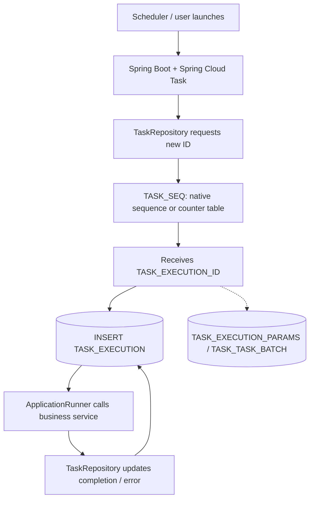

# Auto-Increment Identifiers, Sequences, and Differences Across Databases

## 1. Why Does TaskRepository Need to Allocate Identifiers?

A **Spring Cloud Task** application is a Spring Boot program that performs finite work and then terminates: importing files, processing requests, syncing data, or generating reports. When using a JDBC-backed `TaskRepository`, the framework stores **metadata for each execution** in a database to query start/end timestamps, arguments, and success/failure status.

Each run needs a unique identifier, even when the task name and arguments match a previous run. This identifier is **`TASK_EXECUTION_ID`** in the `TASK_EXECUTION` table, corresponding to `TaskExecution.getExecutionId()` in Java.

| Concept | Meaning | Example |
| --- | --- | --- |
| `TASK_NAME` | Job type, typically stable across multiple runs | `daily-import` |
| `TASK_EXECUTION_ID` | Key identifying **a single run** in the TaskRepository store | `101`, `102`, `103` |
| `EXTERNAL_EXECUTION_ID` | Correlation ID provided by an external orchestrator, when configured | `job-run-abc` |
| `PARENT_TASK_EXECUTION_ID` | Metadata link to a parent task execution, when present | `98` |
| Spring Batch `JOB_EXECUTION_ID` | Identifies a Batch job run, stored in the Batch metadata repository | `802` |
| `order_id`, `report_id`... | Business data key managed by the application itself | `ORD-2026-1001` |

**Never use `TASK_EXECUTION_ID` as a business key**, because retrying a job creates a new execution. Conversely, never use `TASK_NAME` as a primary key either: many valid runs share the same name.

In the standard schema, common components include:

- `TASK_EXECUTION`: one row per execution, including `TASK_EXECUTION_ID`, name, timestamps, exit code, and error details.
- `TASK_EXECUTION_PARAMS`: arguments attached to an execution, referencing `TASK_EXECUTION_ID`.
- `TASK_TASK_BATCH`: table linking `TASK_EXECUTION_ID` with `JOB_EXECUTION_ID` when Spring Cloud Task integrates with Spring Batch.
- `TASK_SEQ`: ID allocation object for runs (may be implemented as a **counter table** or a **database sequence**, depending on version and dialect).
- `TASK_LOCK`: lock metadata supporting single-instance concurrency limits per task name when enabled and properly configured.

Table names, column definitions, ID generation, and optional supporting tables depend on the **Spring Cloud Task version**, DBMS type, and prefix settings. When deploying, always use the schema script bundled with your exact library version instead of inferring DDL from a generic example.

## 2. Three ID Generation Approaches Commonly Confused

Database management systems provide several auto-increment mechanisms. They solve similar problems yet **do not share identical SQL APIs, state storage, or concurrency behavior**.

### 2.1. IDENTITY / AUTO_INCREMENT: Column-Bound Increment

With this mechanism, the primary key column generates a value automatically when the application executes `INSERT` without supplying an ID. **Separate business-table illustration**:

```sql
-- PostgreSQL: example table, NOT TaskRepository DDL
CREATE TABLE demo_events (
    id BIGINT GENERATED BY DEFAULT AS IDENTITY PRIMARY KEY,
    event_type VARCHAR(60) NOT NULL
);

INSERT INTO demo_events (event_type) VALUES ('IMPORT_STARTED');
```

Similar example for MySQL:

```sql
-- MySQL: MySQL-specific syntax, do not use in place of framework schema
CREATE TABLE demo_events (
    id BIGINT NOT NULL AUTO_INCREMENT PRIMARY KEY,
    event_type VARCHAR(60) NOT NULL
);

INSERT INTO demo_events (event_type) VALUES ('IMPORT_STARTED');
```

The DB engine assigns numbers to the `id` column. This is common in CRUD applications, yet **you must not arbitrarily replace** `TASK_EXECUTION_ID` with `IDENTITY` or `AUTO_INCREMENT`: Spring Cloud Task retrieves IDs through the framework's own incrementer component. Altering DDL on one side alone will cause code and schema to fall out of sync.

### 2.2. Native Sequence: Table-Independent Number Generator

PostgreSQL, Oracle, SQL Server, and many other DBMSs support standalone **sequences**. Applications can request a number before inserting a row. Standalone PostgreSQL example:

```sql
-- Example to learn PostgreSQL syntax, does not represent Task schema script
CREATE SEQUENCE demo_event_seq START WITH 1 INCREMENT BY 1;

CREATE TABLE demo_sequence_events (
    id BIGINT PRIMARY KEY,
    event_type VARCHAR(60) NOT NULL
);

INSERT INTO demo_sequence_events (id, event_type)
VALUES (nextval('demo_event_seq'), 'IMPORT_STARTED');
```

One sequence can supply numbers for many inserts. Calling `nextval` normally **consumes a value even if the transaction later rolls back**; thus numbers can skip. A sequence guarantees ID allocation according to DB rules, **not** that transactions commit in strict ID order.

### 2.3. Sequence Table: Table Simulating a Counter

In databases or schema versions that do not use a native sequence, the framework can use a **table holding a counter value**. The ID allocator accesses that table via appropriate SQL to fetch the next number and persist the counter state.

**Mental-model example**, not the exact script or allocator algorithm of Spring Cloud Task:

```text
COUNTER_TABLE
+--------------+
| NEXT_VALUE   |
+--------------+
| 101          |
+--------------+

App A requests ID -> allocator returns 101, updates counter
App B requests ID -> allocator returns 102, updates counter
```

To be safe under concurrent processes, updating the counter table requires proper locking/transactions performed by a dialect-compatible incrementer. The example above **is not guidance to hand-roll `SELECT MAX(id) + 1`**: two processes could read the exact same `MAX(id)` and insert duplicates.

| Criterion | Identity / auto-increment | Native sequence | Sequence table |
| --- | --- | --- | --- |
| Object managing the counter | Usually bound to a column/table | Standalone sequence in DB | A counter table/row |
| Requesting number before `INSERT` | Depends on DB features; usually generated on insert | Can usually be called directly | Possible via incrementer SQL operations |
| Contention under concurrent requests | Depends on engine/locks | Usually optimized for allocation | Can suffer lock contention on counter row/table |
| Can ID gaps occur? | Yes | Yes | Possible, depending on transactions/allocator |
| Used directly for `TASK_EXECUTION_ID`? | Only if framework/schema actually supports it | When framework dialect/script uses it | When framework dialect/script uses it |

**Key point:** regardless of mechanism, an incrementing numeric ID is **not** a wall clock, a success counter, or an *exactly-once* processing guarantee. Never use `MAX(TASK_EXECUTION_ID)` to conclude which task finished last; inspect `START_TIME`, `END_TIME`, exit codes, and matching metadata.

## 3. `TASK_SEQ` and the Lifecycle of Creating a `TaskExecution`

Spring Cloud Task schema documentation notes that `TASK_EXECUTION` IDs are obtained from **`TASK_SEQ`** when a new `TaskExecution` is created. The object name `TASK_SEQ` is the common conceptual anchor; **the actual object type and SQL operations can differ** across H2, PostgreSQL, MySQL, Oracle, and SQL Server, as well as framework versions.



Example of two processes running with the same name `daily-import`:

1. Process A starts, repository requests an ID, creating `TaskExecution` with ID `501`.
2. Process B starts nearly simultaneously, repository requests an ID, creating `TaskExecution` with ID `502`.
3. B finishes before A. `END_TIME` of record `502` is earlier than `501`.
4. If A fails, `501` may record an error code while `502` succeeds. The ID value **does not describe the outcome**.

Numbers `501` and `502` are illustrative only. Depending on incrementer strategy, caching, transactions, and aborted runs, IDs may be non-contiguous; what must be guaranteed is **uniqueness within the same execution repository**. When retrying after a timeout, a single business request can correspond to **multiple** `TaskExecution` records.

### When the ID Is Pre-Allocated by an Orchestrator

Spring Cloud Task supports an integration flow where an external system creates `TaskExecution` upfront and passes `spring.cloud.task.executionid` to the process so it updates that matching record. This mechanism is **different** from arbitrarily picking an ID:

```bash
# Syntax illustration only; ID 501 must already exist in the matching TaskRepository
java -jar target/daily-import-task.jar --spring.cloud.task.executionid=501
```

The pre-creating system must coordinate with the exact same metadata store, schema, and framework ID-allocation mechanism. Avoid manually inserting IDs or reusing an ID from a different DB, which risks updating the wrong record or colliding when the repository creates new rows.

## 4. Differences Across Common Databases

Spring Cloud Task supports multiple RDBMSs, including H2, HSQLDB, PostgreSQL, MySQL, Oracle, SQL Server, and DB2. This section describes **each DB's underlying capabilities**, without claiming every `schema-*.sql` script version uses a single uniform mechanism.

| DBMS | Common ID Capabilities | Notes When Using TaskRepository |
| --- | --- | --- |
| **H2** | `IDENTITY`, `CREATE SEQUENCE` | `mem:` loses data after JVM stops; `file:` persists on disk but depends on path and file locks; verify the H2 script shipped with your Task version |
| **PostgreSQL** | Native sequence, `GENERATED ... AS IDENTITY` | Sequence is an independent object with permissions and current value to manage during backup/restore; check effective `search_path`/schema |
| **MySQL** | `AUTO_INCREMENT` on columns; table-simulated sequences when needed | Do not assume MySQL has PostgreSQL-style `CREATE SEQUENCE`; watch storage engine, counter write locks, and collation/table casing |
| **Oracle** | Native sequence, identity in modern versions | Schema/user and sequence privileges matter; syntax/schema must match Oracle version and Task script |
| **SQL Server** | `IDENTITY`, native `CREATE SEQUENCE`, or counter table in older schemas | Some older versions/schemas use a `TASK_SEQ` table, which can deadlock when many tasks start together; read migration guides before switching to a native sequence |
| **DB2 / HSQLDB** | DB-specific identity/sequence mechanisms | Use only the official dialect-matched script and confirm schema initialization behavior |

### 4.1. H2: Fast Testing and ID Persistence

With `jdbc:h2:mem:task_demo`, the database lives inside the JVM; restarting the process creates a brand-new metadata store. Hence IDs may **start over** on a fresh run even with the same task name. This is not an allocator bug: the two runs hit **two different databases**.

With `jdbc:h2:file:./data/task_demo`, data resides in an H2 file. Keeping the same working directory, file, and schema lets separate runs share history and incrementer state. Changing the `working directory` or deleting the file can make IDs start from the beginning because you switched to a new store.

File-based H2 works well for labs; when running multiple processes across multiple hosts, use a database server supporting concurrent access and centralized operations.

### 4.2. PostgreSQL and Oracle: Watch Sequence State

With dialects using native sequences, the counter state **cannot necessarily be inferred from `MAX(TASK_EXECUTION_ID)`**. After restoring table data while omitting sequences, the sequence value may lag behind existing IDs. Creating a new run can then trigger duplicate-key or ID-allocation errors.

Never tweak the current value with a guessed number in production. Identify the sequence used by your Spring Cloud Task version, inspect its current value, account for existing IDs and active processes, and run a migration inside an appropriate maintenance/locking window. PostgreSQL and Oracle use different syntax to inspect/adjust sequences.

### 4.3. MySQL: Counter Tables and Contention Risk

MySQL is famous for `AUTO_INCREMENT`, yet `TaskRepository` may use a **standalone counter table** per framework scripts. When multiple instances request IDs simultaneously, a single counter row/table becomes a contention point; long transactions or differing lock orders can increase lock waits or cause deadlocks. This is why you should never replace the framework allocator with ad-hoc `MAX(id)+1` or `AUTO_INCREMENT`.

If timeouts or deadlocks occur, inspect DB logs, transactions, indexes, and driver/framework versions; handle retries per policy and **never re-run full business logic** without checking idempotency.

### 4.4. SQL Server: When Is a Native Sequence Needed?

Spring Cloud Task documentation previously noted cases where concurrent SQL Server processes deadlocked on the `TASK_SEQ` table, recommending a native sequence of the same name to reduce contention. Migration guides for newer release lines also describe changing SQL Server DDL from a simulated table to a real sequence.

**Reference syntax example for a SQL Server native sequence**, not a replacement script for the entire schema:

```sql
-- Syntax example; DO NOT run directly on an active TaskRepository store
CREATE SEQUENCE dbo.demo_execution_seq
    AS BIGINT
    START WITH 1
    INCREMENT BY 1;

SELECT NEXT VALUE FOR dbo.demo_execution_seq;
```

If an existing store uses a `TASK_SEQ` table and needs migrating to a native sequence, **do not simply `DROP TABLE TASK_SEQ` and create a sequence starting at 1**. Review source structure, framework/driver versions, highest issued ID, permissions, and official migration guides; ensure no task instances allocate IDs during cutover. For systems with existing history, the starting number must exceed all previously used IDs and related allocator state.

## 5. Lab: Observing IDs in H2 Across Multiple Runs

### 5.1. Setting Up a Small Spring Cloud Task Application

Create a Spring Boot project with a compatible JDK and **Spring Cloud version**; use the Spring Cloud BOM for your chosen release line. Minimal Maven dependencies for the lab:

```xml
<dependencies>
    <dependency>
        <groupId>org.springframework.cloud</groupId>
        <artifactId>spring-cloud-starter-task</artifactId>
    </dependency>
    <dependency>
        <groupId>com.h2database</groupId>
        <artifactId>h2</artifactId>
        <scope>runtime</scope>
    </dependency>
</dependencies>
```

Example `IdDemoApplication.java`:

```java
import org.springframework.boot.ApplicationRunner;
import org.springframework.boot.SpringApplication;
import org.springframework.boot.autoconfigure.SpringBootApplication;
import org.springframework.context.annotation.Bean;

@SpringBootApplication
public class IdDemoApplication {
    public static void main(String[] args) {
        SpringApplication.run(IdDemoApplication.class, args);
    }

    @Bean
    ApplicationRunner runOnce() {
        return args -> {
            System.out.println("Starting short run processing.");
            // In a real application: call processing service and save business results.
            System.out.println("Task completed.");
        };
    }
}
```

Create `src/main/resources/application.yml`:

```yaml
spring:
  application:
    name: id-demo-task
  main:
    web-application-type: none
  datasource:
    driver-class-name: org.h2.Driver
    url: jdbc:h2:file:./data/id-demo;DB_CLOSE_ON_EXIT=FALSE
    username: sa
    password: ""
  cloud:
    task:
      name: id-demo-task
      initialize-enabled: true
```

`initialize-enabled: true` suits the lab when the library can create the H2 schema. Depending on the Spring Cloud Task version, ensure the database initializes with that version's script. `sa`/empty password is for local use only.

Assuming you built an executable JAR `target/id-demo-task.jar`, create the `data` directory in your **working directory** and run sequentially:

```bash
mkdir data
java -jar target/id-demo-task.jar
java -jar target/id-demo-task.jar
java -jar target/id-demo-task.jar
```

After all three processes exit, open H2 Shell or a SQL client with JDBC URL `jdbc:h2:file:./data/id-demo;IFEXISTS=TRUE` from the same working directory. `IFEXISTS=TRUE` helps catch wrong paths instead of silently creating a brand-new database.

### 5.2. Observing Primary Keys and Chronological Order

```sql
SELECT TASK_EXECUTION_ID,
       TASK_NAME,
       START_TIME,
       END_TIME,
       EXIT_CODE
FROM TASK_EXECUTION
ORDER BY TASK_EXECUTION_ID;
```

You should see three records (if all three runs succeeded and hit the same database), sharing `TASK_NAME` yet having **three distinct `TASK_EXECUTION_ID`s**. The IDs do not have to be `1, 2, 3`: the allocator may start elsewhere, have gaps, or reflect prior data.

Check for duplicate IDs and count records:

```sql
SELECT COUNT(*) AS TOTAL_ROWS,
       COUNT(DISTINCT TASK_EXECUTION_ID) AS DISTINCT_IDS,
       MIN(TASK_EXECUTION_ID) AS MIN_ID,
       MAX(TASK_EXECUTION_ID) AS MAX_ID
FROM TASK_EXECUTION;
```

`TOTAL_ROWS = DISTINCT_IDS` confirms no duplicate ID values exist in the result set; the actual schema's `PRIMARY KEY` constraint is what protects integrity when concurrent processes write simultaneously. `MAX_ID - MIN_ID + 1` can be **greater than** total rows due to sequence gaps; that does not mean records were lost.

### 5.3. Determining Whether `TASK_SEQ` Is a Table or a Native Sequence

Do not run `SELECT * FROM TASK_SEQ` right away, as that only works if `TASK_SEQ` **is actually a table**. First inspect H2 metadata:

```sql
-- H2: tables with TASK_ prefix
SELECT TABLE_NAME
FROM INFORMATION_SCHEMA.TABLES
WHERE TABLE_SCHEMA = 'PUBLIC'
  AND TABLE_NAME LIKE 'TASK%'
ORDER BY TABLE_NAME;

-- H2: sequences with TASK-related names
SELECT SEQUENCE_NAME
FROM INFORMATION_SCHEMA.SEQUENCES
WHERE SEQUENCE_SCHEMA = 'PUBLIC'
  AND SEQUENCE_NAME LIKE 'TASK%'
ORDER BY SEQUENCE_NAME;
```

If `TASK_SEQ` appears in the table list, inspect its contents according to the **DDL of your version**; if it appears in the sequence list, use your DB/client sequence introspection tools. **Never invoke the next-value function just to inspect**: doing so mutates state and creates ID gaps.

If `TASK_SEQ` is missing, check schemas other than `PUBLIC`, custom table prefixes, executed scripts, connection URL, and version configuration; never hand-create a new sequence to mask an error without diagnosing the root cause.

## 6. Inspecting Sequences in Other Databases

The queries below **read metadata only**. They do not mutate counter values; always cross-check results against your actual schema and prefix names.

### PostgreSQL

```sql
-- Sequences visible in the current database
SELECT schemaname, sequencename
FROM pg_catalog.pg_sequences
WHERE lower(sequencename) LIKE '%task%'
ORDER BY schemaname, sequencename;

-- Task-related tables
SELECT table_schema, table_name
FROM information_schema.tables
WHERE lower(table_name) LIKE 'task%'
ORDER BY table_schema, table_name;
```

### MySQL

```sql
-- Distinguish task tables in the selected database
SELECT TABLE_SCHEMA, TABLE_NAME, ENGINE
FROM information_schema.TABLES
WHERE TABLE_SCHEMA = DATABASE()
  AND TABLE_NAME LIKE 'TASK%'
ORDER BY TABLE_NAME;
```

MySQL does not have `pg_sequences`; if the Task script uses a `TASK_SEQ` table, its name appears in the table list. If absent, cross-check against the script for your exact framework version and schema/prefix settings.

### Oracle

```sql
-- Sequences owned by the current user's schema
SELECT SEQUENCE_NAME, LAST_NUMBER
FROM USER_SEQUENCES
WHERE SEQUENCE_NAME LIKE '%TASK%';
```

`LAST_NUMBER` can reflect cached state and is **not** always the most recently committed ID. When authorized and using another schema, inspect the corresponding owner/schema metadata views.

### SQL Server

```sql
-- Name and schema of native sequences
SELECT s.name AS schema_name, q.name AS sequence_name
FROM sys.sequences AS q
JOIN sys.schemas AS s ON s.schema_id = q.schema_id
WHERE q.name LIKE '%TASK%';

-- Check counter tables in the schema
SELECT s.name AS schema_name, t.name AS table_name
FROM sys.tables AS t
JOIN sys.schemas AS s ON s.schema_id = t.schema_id
WHERE t.name LIKE 'TASK%';
```

If both object types exist, inspect migration scripts and framework configuration to determine **which object is actually active**, avoiding accidental deletion just because names look similar.

## 7. Safe Schema Deployment and Upgrades

During learning, the framework can auto-initialize the schema. In operational environments—especially with scheduled jobs or multiple task instances—**manage schemas via migrations** and use a persistent RDBMS.

PostgreSQL configuration example for a Task process:

```yaml
spring:
  application:
    name: daily-import
  main:
    web-application-type: none
  datasource:
    url: ${TASK_DB_URL}
    username: ${TASK_DB_USER}
    password: ${TASK_DB_PASSWORD}
  cloud:
    task:
      name: daily-import
      initialize-enabled: false
```

Also declare the PostgreSQL JDBC driver at runtime. `initialize-enabled: false` is only valid when the **official schema has already been created or upgraded beforehand**; if tables or sequences are missing, the repository can fail immediately at startup.

Safe deployment workflow:

1. **Lock versions** of Spring Boot, Spring Cloud Task, JDBC driver, and RDBMS type/version; obtain the matching official DDL or migration scripts. Never copy scripts from a blog post for a different version line.
2. **Inspect existing objects**: `TASK_EXECUTION`, `TASK_SEQ`, parameter/Batch/lock tables, schema, and table prefix. With multiple `DataSource`s, verify the exact `DataSource` used by `TaskRepository`/`TaskConfigurer`.
3. **Back up completely**—both tables and allocator state; test restores in staging. Backing up `TASK_EXECUTION` without sequence state can cause subsequent runs to collide with old IDs.
4. **Assess issued IDs** and active processes before adjusting sequences. When migrating between mechanisms, ensure the next number cannot overlap any existing `TASK_EXECUTION_ID` or ID still allocatable by older processes.
5. **Apply controlled migrations** with proper permissions, schedule freezes/locks during upgrades, and a rollback plan. Never create a `TASK_SEQ` table alongside a native sequence of the same name.
6. **Verify in practice** with two sequential runs plus a controlled concurrency test; confirm distinct IDs, proper record completion, and zero deadlocks or duplicate keys.
7. **Set up monitoring** for ID allocation errors, deadlocks, timeouts, lost connections, unfinished record counts, and metadata growth; maintain archiving/retention policies respecting foreign-key constraints.

> **Important:** `spring.cloud.task.tablePrefix` can change the metadata table prefix. When changing prefixes, creating matching tables usually falls to the deployer; also check how your version references the sequence/allocator. Never change prefixes to work around a missing-schema error before diagnosing the cause.

### What Happens When a Task Reruns?

A failed task run may have already written business data before stopping. A retry receives a new `TASK_EXECUTION_ID` even when task name and arguments stay unchanged. **Unique metadata ID allocation does not mean once-only business processing.** Use business keys, idempotency keys, transactions, and appropriate retry policies. If integrating Spring Batch, also manage `JobRepository` and `BATCH_*` metadata; allocators like `JOB_SEQ`, `JOB_EXECUTION_SEQ`... (depending on version) are separate mechanisms and must not be merged with `TASK_SEQ`.

## 8. Common Errors and Diagnostics

| Symptom | Possible Cause | Resolution |
| --- | --- | --- |
| `Table "TASK_EXECUTION" not found` or `TASK_SEQ` missing | Schema uninitialized, wrong DB/schema connected, prefix mismatch | Check JDBC URL, `TaskConfigurer`, schema, and version-matched DDL script |
| Duplicate key on `TASK_EXECUTION_ID` after restore | Allocator not restored/adjusted to match existing data | Pause ID allocation, inspect sequence/counter table, and apply safe migration |
| Two H2 runs both show lowest ID as if brand new | Each JVM creates a fresh in-memory H2 or hits a different H2 file path | Use a shared persistent DB and verify exact absolute file paths |
| MySQL shows lock waits/deadlocks | Contention on counter table or concurrent transactions | Analyze deadlock logs, transactions, concurrency level, and version incrementer behavior |
| SQL Server deadlock on `TASK_SEQ` | Older schema uses simulated table under concurrent launches | Check official migrations; consider native sequence per release line rather than hot-patching DDL |
| PostgreSQL / Oracle reports missing sequence privilege | Connection account lacks rights on allocator object | Grant appropriate rights on the right schema/sequence and verify runtime account |
| IDs increase non-contiguously | Sequence caching, rollbacks, pre-fetched IDs without insert, or prior state | Do not treat gaps as bugs; cross-check data and logs without resetting the allocator |
| Larger ID has an earlier `END_TIME` | Concurrent tasks finished out of start order | Trace using timestamps, status, and execution ID; never infer completion order from ID |
| Table created with `AUTO_INCREMENT`, yet repository fails | Code's allocator does not match altered DDL | Restore official dialect/version schema and retest |

## 9. Self-Check Exercises

1. Explain why two tasks with the same `TASK_NAME` must still get two different `TASK_EXECUTION_ID`s. Give an example with one succeeding run and one failing run.
2. On file-based H2, run the task three times, query `TASK_EXECUTION`, and check row counts and distinct IDs. Must IDs be strictly contiguous? Why or why not?
3. Inspect H2 metadata to determine whether `TASK_SEQ` is a table or a sequence in **your current version**. Explain why you should not invoke `NEXT VALUE` just to read state.
4. Compare inserting into a demo table using `IDENTITY`/`AUTO_INCREMENT` versus the framework requesting an ID from `TASK_SEQ`. What can break if you only modify `TASK_EXECUTION`'s DDL?
5. A PostgreSQL database had `TASK_EXECUTION` data restored up to ID `900`, yet the sequence remains at an older state. Describe investigation steps and a safe migration plan **without blindly running ad-hoc fixes**.
6. A scheduler launches 20 concurrent processes on SQL Server and deadlocks occur on `TASK_SEQ`. Contrast reducing concurrency, migrating properly to a native sequence, and hand-rolling `MAX(id)+1`.
7. In a task running Spring Batch, distinguish `TASK_EXECUTION_ID`, `JOB_EXECUTION_ID`, and business IDs. Why must these allocators be maintained separately?
8. Draft a checklist for moving a lab from H2 to PostgreSQL: JDBC driver, version-matched Task schema, allocator object, permissions, migrations, transactions, backups, and concurrency testing.

You have mastered this lesson when you can explain **where a run's ID is allocated**, distinguish `IDENTITY`, native sequences, and counter tables; identify database differences without applying mismatched DDL; and provision/migrate **`TaskRepository`** safely enough to track scheduled, on-demand, or Spring Batch–coordinated tasks.

## 10. References

- [Spring Cloud Task — Task Repository Schema](https://docs.spring.io/spring-cloud-task/docs/current/reference/html/appendix-task-repository-schema.html): metadata tables, `TASK_EXECUTION_ID`, `TASK_SEQ`, and SQL Server notes.
- [Spring Cloud Task — Configuration](https://docs.spring.io/spring-cloud-task/docs/current/reference/htmlsingle/): `DataSource`, `TaskConfigurer`, table prefix, automatic schema initialization, and `spring.cloud.task.executionid`.
- [Spring Cloud Task — Getting started](https://docs.spring.io/spring-cloud-task/reference/getting-started.html): `TaskRepository` examples with H2 and task lifecycle.
- [Spring Cloud Task 3.0 Migration Guide](https://github.com/spring-cloud/spring-cloud-task/wiki/Spring-Cloud-Task-3.0-Migration-Guide): examples of DDL changes and sequence transitions across release lines.

In real deployments, prioritize the DDL bundled with the **exact Spring Cloud Task artifact you are running** and that release's migration guide over any illustrative snippet in learning materials.
