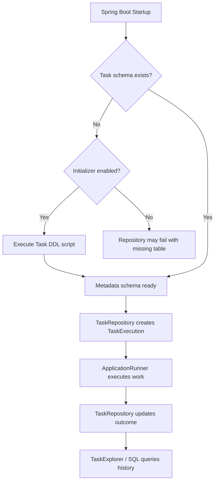

# Initializing the Schema with `spring.cloud.task.initialize-enabled`

## 1. Learning Objectives

A **Spring Cloud Task** application typically runs finite work and then exits: syncing data, importing files, generating reports, or executing a command from an orchestrator. To monitor and inspect runs, Spring Cloud Task uses **`TaskRepository`** to persist information such as start time, end time, arguments, status, and exit code.

To store that information, the database must contain the **Spring Cloud Task metadata schema**. The **`spring.cloud.task.initialize-enabled`** property controls whether Spring Cloud Task infrastructure initializes the metadata schema automatically when the application starts.

After this lesson, you will be able to:

- Understand why `TaskRepository` requires metadata tables before writing `TaskExecution`.
- Enable `spring.cloud.task.initialize-enabled: true` to create the schema for a practice database.
- Disable initialization when the schema is already managed by migrations or a DBA.
- Distinguish the Spring Cloud Task schema from business schemas, the Spring Batch schema, and other Spring Boot SQL initialization mechanisms.
- Inspect tables and records, and troubleshoot missing tables, missing permissions, wrong datasources, or mismatched scripts.
- Choose a safe workflow for scheduled, on-demand, or multi-node tasks.

Throughout this lesson, examples use the `schema-demo-task` application with a file-backed H2 database: the first run activates the `init` profile, and subsequent runs operate normally with the initializer turned off.

## 2. What Does the Spring Cloud Task Metadata Schema Contain?

**`TaskRepository`** writes and updates execution data; **`TaskExplorer`** reads and queries runs. Both depend on the metadata structure expected by your Spring Cloud Task version.

Common objects in the standard schema include:

| Object | Role |
| --- | --- |
| `TASK_EXECUTION` | Stores one record per **execution**: ID, name, timestamps, exit code, and error info. |
| `TASK_EXECUTION_PARAMS` | Stores parameters linked to an execution. |
| `TASK_TASK_BATCH` | Links task metadata with Spring Batch jobs when integration is used. |
| Sequence, ID-allocation table, or identity mechanism depending on DBMS | Supports generating unique execution identifiers. |

Column names, data types, and supporting objects depend on the library version and database management system. When managing the schema manually, take DDL **matching the exact version** of Spring Cloud Task you are running.



**Metadata schema is distinct from business schema.** Spring Cloud Task's initialization property does not create tables like `CUSTOMERS`, `ORDERS`, or report output tables. Those tables require your application's own migrations or DDL.

## 3. Understanding `spring.cloud.task.initialize-enabled` Correctly

Declared in YAML:

```yaml
spring:
  cloud:
    task:
      initialize-enabled: true
```

Or in properties format:

```properties
spring.cloud.task.initialize-enabled=true
```

This property is **a switch allowing Spring Cloud Task infrastructure to initialize the metadata schema**. It does not control whether runners execute, does not generate business data, and does not replace `TaskRepository`.

| Value | Behavior | Use Case |
| --- | --- | --- |
| `true` | Allows schema initialization via scripts supported by the Spring Cloud Task version. | Initializing a practice database or a controlled setup step. |
| `false` | Prevents Spring Cloud Task from creating metadata structures itself; the app uses a pre-created schema. | Production runtime or environments where Flyway/Liquibase/DBA manages DDL. |

Configure it explicitly instead of relying on assumptions about **default values**, because different project setups and documentation across versions may differ.

Misconceptions to avoid:

1. **`initialize-enabled=true` is not a database reset command.** It is not meant to wipe history and recreate tables.
2. **Not all DDL scripts are safe to rerun.** If tables already exist, table-creation statements may fail depending on the script and how the initializer executes.
3. **`initialize-enabled=false` does not disable the repository.** It simply requires the needed schema to exist before metadata writes begin.
4. **Enabling the initializer cannot fix broken database connectivity.** Wrong URLs, permissions, dialects, or drivers will still fail initialization.
5. **The initializer is not a versioned migration system.** Version-to-version schema upgrades must be managed intentionally.

## 4. Sample Spring Boot Project

This example uses **JDK 17**, **Spring Boot 3.4.5**, **Spring Cloud 2024.0.2**, and H2. When creating a project with other versions, select a Spring Cloud release train compatible with your Spring Boot version.

Structure:

```text
schema-demo-task/
├── pom.xml
└── src/main/
    ├── java/com/example/schemademo/
    │   ├── SchemaDemoApplication.java
    │   └── SampleTaskRunner.java
    └── resources/
        ├── application.yml
        └── application-init.yml
```

### 4.1. `pom.xml` File

```xml
<?xml version="1.0" encoding="UTF-8"?>
<project xmlns="http://maven.apache.org/POM/4.0.0"
         xmlns:xsi="http://www.w3.org/2001/XMLSchema-instance"
         xsi:schemaLocation="http://maven.apache.org/POM/4.0.0 https://maven.apache.org/xsd/maven-4.0.0.xsd">
    <modelVersion>4.0.0</modelVersion>

    <parent>
        <groupId>org.springframework.boot</groupId>
        <artifactId>spring-boot-starter-parent</artifactId>
        <version>3.4.5</version>
        <relativePath/>
    </parent>

    <groupId>com.example</groupId>
    <artifactId>schema-demo-task</artifactId>
    <version>0.0.1-SNAPSHOT</version>

    <properties>
        <java.version>17</java.version>
    </properties>

    <dependencyManagement>
        <dependencies>
            <dependency>
                <groupId>org.springframework.cloud</groupId>
                <artifactId>spring-cloud-dependencies</artifactId>
                <version>2024.0.2</version>
                <type>pom</type>
                <scope>import</scope>
            </dependency>
        </dependencies>
    </dependencyManagement>

    <dependencies>
        <dependency>
            <groupId>org.springframework.cloud</groupId>
            <artifactId>spring-cloud-starter-task</artifactId>
        </dependency>
        <dependency>
            <groupId>org.springframework.boot</groupId>
            <artifactId>spring-boot-starter-jdbc</artifactId>
        </dependency>
        <dependency>
            <groupId>com.h2database</groupId>
            <artifactId>h2</artifactId>
            <scope>runtime</scope>
        </dependency>
    </dependencies>

    <build>
        <plugins>
            <plugin>
                <groupId>org.springframework.boot</groupId>
                <artifactId>spring-boot-maven-plugin</artifactId>
            </plugin>
        </plugins>
    </build>
</project>
```

`spring-cloud-starter-task` provides Task infrastructure, `spring-boot-starter-jdbc` provides JDBC connectivity, and H2 serves as the test database.

### 4.2. Default Configuration: Do Not Re-Initialize

Create `src/main/resources/application.yml`:

```yaml
spring:
  application:
    name: schema-demo-task
  main:
    web-application-type: none
  datasource:
    url: jdbc:h2:file:./data/taskdb;DB_CLOSE_ON_EXIT=FALSE
    driver-class-name: org.h2.Driver
    username: sa
    password: ""
  cloud:
    task:
      name: schema-demo-task
      initialize-enabled: false
      closecontext-enabled: true
```

The H2 **file-backed** URL preserves metadata after the JVM stops. The path `./data/taskdb` is relative to the **Java command's current working directory**; keep the same working directory on subsequent runs or when opening a SQL client.

`web-application-type: none` prevents starting a web server. `closecontext-enabled` closes the Spring context once the task finishes.

### 4.3. `init` Profile for Initial Schema Creation

Create `src/main/resources/application-init.yml`:

```yaml
spring:
  cloud:
    task:
      initialize-enabled: true
```

When running with the `init` profile, `true` in the profile file overrides `false` in the base config. Normal runs without this profile use the existing schema.

This clearly separates the **schema preparation step** from the **schema usage step** in a learning setup; production should delegate DDL to migrations or a dedicated deployment step.

### 4.4. Application Class and Runner

`src/main/java/com/example/schemademo/SchemaDemoApplication.java`:

```java
package com.example.schemademo;

import org.springframework.boot.SpringApplication;
import org.springframework.boot.autoconfigure.SpringBootApplication;
import org.springframework.cloud.task.configuration.EnableTask;

@SpringBootApplication
@EnableTask
public class SchemaDemoApplication {
    public static void main(String[] args) {
        SpringApplication.run(SchemaDemoApplication.class, args);
    }
}
```

`src/main/java/com/example/schemademo/SampleTaskRunner.java`:

```java
package com.example.schemademo;

import java.util.List;

import org.springframework.boot.ApplicationArguments;
import org.springframework.boot.ApplicationRunner;
import org.springframework.stereotype.Component;

@Component
public class SampleTaskRunner implements ApplicationRunner {

    @Override
    public void run(ApplicationArguments args) {
        List<String> values = args.getOptionValues("item");
        String item = (values == null || values.isEmpty())
                ? "default" : values.get(0);

        if (item.isBlank()) {
            throw new IllegalArgumentException("--item must not be blank");
        }

        System.out.println("Processed item: " + item);
    }
}
```

`@EnableTask` activates Spring Cloud Task infrastructure. `ApplicationRunner` defines the finite work. Output goes to stdout so the example stays focused on the schema; in real applications, business results must be persisted or dispatched as designed.

## 5. Initializing the Schema and Running the Task

From the `schema-demo-task` directory, create the H2 data folder and package the JAR:

```bash
mkdir -p data
mvn clean package
```

On PowerShell, you can use:

```powershell
New-Item -ItemType Directory -Force data
```

### 5.1. First Run Against a Database Without the Task Schema

```bash
java -jar target/schema-demo-task-0.0.1-SNAPSHOT.jar --spring.profiles.active=init --item=first
```

Expected sequence:

1. Spring Boot configures `DataSource` pointing to `./data/taskdb`.
2. Spring Cloud Task infrastructure, with the initializer enabled, prepares the required metadata structures.
3. `TaskRepository` creates the `TaskExecution` record.
4. The runner prints `Processed item: first` and terminates.
5. The repository updates the final status and timestamps for that run.

H2 typically creates a file such as `data/taskdb.mv.db`. Exact filenames/aux files depend on the H2 version. Seeing the database file shows the connection was used, yet you should **check both tables and records** to confirm the Task schema is ready.

> The initialization command above also executes the runner. For applications that mutate real data, never use a business-logic run as a DDL preparation step in production.

### 5.2. Subsequent Runs Using the Existing Schema

Without activating the `init` profile:

```bash
java -jar target/schema-demo-task-0.0.1-SNAPSHOT.jar --item=second
```

Here, `spring.cloud.task.initialize-enabled=false`. Spring Cloud Task still writes a **new** execution into the existing schema; disabling the initializer does not stop metadata recording.

If the second run reports missing tables, first verify both commands ran from the same directory and same JDBC URL. With file-backed H2, changing the working directory can cause it to connect to a brand-new database by mistake.

## 6. Inspecting Schema and Metadata with SQL

After the Java process exits, open H2 Console or a JDBC client and connect:

```text
JDBC URL: jdbc:h2:file:./data/taskdb
User: sa
Password: (leave blank)
```

**Note:** `./data/taskdb` is also relative to the SQL tool's working directory. If launching the tool from elsewhere, supply the absolute path to the H2 file just created.

### 6.1. Listing Tables

```sql
SELECT TABLE_SCHEMA, TABLE_NAME
FROM INFORMATION_SCHEMA.TABLES
WHERE TABLE_NAME LIKE 'TASK%'
ORDER BY TABLE_SCHEMA, TABLE_NAME;
```

You should see metadata tables matching your Spring Cloud Task version, typically `TASK_EXECUTION`, `TASK_EXECUTION_PARAMS`, and related tables.

Inspect columns of `TASK_EXECUTION`:

```sql
SELECT COLUMN_NAME, DATA_TYPE, IS_NULLABLE
FROM INFORMATION_SCHEMA.COLUMNS
WHERE TABLE_NAME = 'TASK_EXECUTION'
ORDER BY ORDINAL_POSITION;
```

If tables live in a non-default namespace or use a custom prefix, adjust query conditions accordingly.

### 6.2. Inspecting Individual Executions

```sql
SELECT TASK_EXECUTION_ID,
       TASK_NAME,
       START_TIME,
       END_TIME,
       EXIT_CODE,
       ERROR_MESSAGE
FROM TASK_EXECUTION
ORDER BY TASK_EXECUTION_ID DESC;
```

Example after two successful runs (IDs and timestamps will vary in practice):

| `TASK_EXECUTION_ID` | `TASK_NAME` | `END_TIME` | `EXIT_CODE` |
| ---: | --- | --- | ---: |
| 2 | schema-demo-task | Populated | 0 |
| 1 | schema-demo-task | Populated | 0 |

Inspect saved parameters:

```sql
SELECT TASK_EXECUTION_ID, TASK_PARAM
FROM TASK_EXECUTION_PARAMS
ORDER BY TASK_EXECUTION_ID;
```

Metadata can retain CLI arguments, so **never pass passwords, tokens, or secrets via task arguments**. Use a proper secrets mechanism and restrict read permissions on metadata tables.

### 6.3. Verifying History Is Not Reset

```sql
SELECT TASK_NAME, COUNT(*) AS TOTAL_EXECUTIONS
FROM TASK_EXECUTION
GROUP BY TASK_NAME;
```

If you ran exactly twice as above against a new database, the expected result is `TOTAL_EXECUTIONS = 2` for `schema-demo-task`. Additional rows are not necessarily errors: every new launch can create another `TaskExecution`.

## 7. Using PostgreSQL or MySQL in Real Deployments

H2 is convenient for practice, but systems needing long-term history or multi-container execution should use a persistent database accessible across instances.

PostgreSQL example **after the schema has been created via migrations**:

```yaml
spring:
  datasource:
    url: jdbc:postgresql://db.example.internal:5432/task_metadata
    username: task_runtime
    password: ${TASK_DB_PASSWORD}
  cloud:
    task:
      initialize-enabled: false
```

Declare the JDBC driver in Maven:

```xml
<dependency>
    <groupId>org.postgresql</groupId>
    <artifactId>postgresql</artifactId>
    <scope>runtime</scope>
</dependency>
```

Hostnames, database names, accounts, and secrets are examples only; substitute real infrastructure values. Never store passwords in your source repository.

When switching DBMSs, pay attention to:

- **Dialect-matched scripts:** identity, sequences, timestamp types, and naming rules differ across H2, PostgreSQL, and MySQL.
- **Version-matched schema:** DDL must match the Spring Cloud Task version; never guess structure from an outdated article.
- **Permissions:** task runtime accounts typically only need read/write metadata rights and sequence usage rights; the migration account owns DDL rights.
- **Concurrency:** multiple instances can write `TaskExecution` rows concurrently, yet they must never race on `CREATE TABLE` statements.
- **Namespace and prefix:** database schema names, search paths, and table prefixes must align across DDL, repository, and JDBC settings.

The word “schema” here can mean either the **metadata structure** or a database **namespace**, such as `public` in PostgreSQL. Enabling the initializer does not automatically solve namespace creation privileges or `search_path`.

## 8. Managing the Schema with Flyway/Liquibase for Production

In environments with repeated deployments, use **versioned migrations** or a DBA-controlled DDL process. At runtime, set:

```yaml
spring:
  cloud:
    task:
      initialize-enabled: false
```

Recommended workflow:

1. **Lock versions:** explicitly pin Spring Boot, Spring Cloud, and Spring Cloud Task versions for the release.
2. **Extract matching DDL:** use the schema script bundled with that exact version and DBMS; verify required sequences, tables, and indexes.
3. **Package migration:** put the DDL into a versioned migration, such as `V1__create_task_metadata.sql` in Flyway. This filename is illustrative; contents must come from a supported schema.
4. **Deploy before runtime:** the migration/DBA pipeline applies DDL once before task containers are permitted to run.
5. **Verify:** inspect tables/sequences and test writing one `TaskExecution` using a short task.
6. **Maintain:** keep `initialize-enabled=false` on all instances; when upgrading dependencies, review new schema migrations before deploying.


**Why separate DDL?** Table and sequence creation often require elevated privileges, whereas tasks only need to read and write metadata. Migrations provide change history, controlled upgrades, and prevent races when multiple tasks start simultaneously.

`spring.cloud.task.initialize-enabled=true` is not an automated production schema-upgrade tool: it does not provide migration versioning, rollbacks, or cross-application coordination.

## 9. Distinguishing Spring Initialization Mechanisms

Spring Boot and Spring Cloud offer several mechanisms to create tables or load data. They serve different purposes:

| Mechanism | Managed Target | Notes |
| --- | --- | --- |
| `spring.cloud.task.initialize-enabled` | **Spring Cloud Task** metadata schema | Serves `TaskRepository` and `TaskExplorer`. |
| `spring.sql.init.mode` with `schema.sql` / `data.sql` | General SQL scripts supplied by the application | Not automatically equivalent to Task metadata scripts. |
| `spring.jpa.hibernate.ddl-auto` | Tables mapped from JPA/Hibernate entities | Not the standard mechanism for creating Task JDBC metadata tables. |
| Flyway / Liquibase | Versioned migrations for managed schemas | Suited for production schema deployments. |
| Spring Batch schema initialization | `JobRepository` and step/job metadata | Separate from the `TaskRepository` schema. |

In particular, **Spring Cloud Task and Spring Batch store two different execution levels**:

- `TaskRepository` tracks finite application runs, i.e., `TaskExecution`.
- Spring Batch's `JobRepository` tracks `JobExecution`, `StepExecution`, restarts, and per-step processing state.

If an application combines both frameworks, prepare the corresponding metadata tables **for both**. The presence of `TASK_TASK_BATCH` does not mean `BATCH_JOB_EXECUTION` or `BATCH_STEP_EXECUTION` tables have been initialized.

## 10. Common Errors and Diagnostics

| Symptom | Possible Cause | Resolution |
| --- | --- | --- |
| `TASK_EXECUTION not found` | Tables missing, wrong profile active, or pointing to wrong database | Verify effective `initialize-enabled`, JDBC URL, and schema. |
| `Table already exists` on restart | DDL re-executed against an existing schema | Initialize once; keep initializer off for normal runs. |
| `Permission denied` or `Not authorized` | Connection user lacks table/sequence creation privileges | Run migrations with a DDL-privileged account; grant runtime only needed DML rights. |
| SQL syntax error during init | Script/dialect mismatch with database | Verify SQL engine, driver, and Task version. |
| Tables exist, yet execution fails to write | Missing sequence, wrong schema version, or missing DML rights | Audit DDL against library version and check repository logs. |
| No history after JVM exits | In-memory H2 or accessing wrong H2 file | Use file-backed H2 with a consistent working directory/URL. |
| Two instances run initializer and one fails | Concurrent DDL contention during startup | Move DDL to migration pipeline before scaling tasks. |
| Task tables exist, Batch tables missing | Spring Batch schema not initialized | Manage and apply Batch DDL separately. |
| Missing `TaskExecution` for failed run | Application failed before task infrastructure recorded metadata | Inspect startup logs, datasource, and migration results. |

Diagnostic steps should flow from infrastructure to application:

1. Check `initialize-enabled` settings and the **actually active profile**.
2. Verify the **exact database** and namespace via the JDBC URL; avoid leaking secrets in logs.
3. Read the **root exception** from startup logs, especially when schema creation fails before runners are called.
4. Inspect tables, sequences, and permissions using a SQL client.
5. Cross-check the Spring Cloud Task version against the installed schema, especially after upgrades.

Never drop all metadata tables just to rerun a failed task. Dropping tables destroys `TaskExecution` history and Spring Batch links. If you need a clean rerun test, use a **separate, fresh test H2 database**.

## 11. Operating Safely on Schedules or On Demand

A Spring Cloud Task application may be triggered by `cron`, Kubernetes `Job`/`CronJob`, or an orchestrator, yet Spring Cloud Task itself **does not perform scheduling**. When running repeatedly or across multiple nodes, prepare the metadata schema ahead of time:

- **Durability:** use a database with backups and retention policies; file-backed H2 is only for single-machine practice.
- **Reruns:** preserve old `TaskExecution` rows to distinguish retries, track errors, and analyze durations.
- **Concurrency:** control instance counts and ensure the DB allocates IDs safely when multiple processes write metadata; avoid running DDL per instance.
- **Security:** separate DDL privileges from DML privileges, and restrict read access on parameter and error tables.
- **Monitoring:** alert when `TaskExecution` creation fails, `END_TIME` stays blank too long, or `EXIT_CODE` indicates failure.
- **Upgrades:** verify schema differences in staging before running a new library version in production.
- **Spring Batch:** safeguard both Task and Batch metadata to preserve traceability, job restarts, and incident analysis.

The Task schema is part of **application infrastructure**, so it must be permissioned, backed up, and updated as carefully as business schemas.

## 12. Hands-On Exercises and Self-Check Questions

### Exercise 1: Initialize the Schema Exactly Once

1. Create the `schema-demo-task` project as instructed.
2. Run the `init` profile with `--item=first`.
3. Query `INFORMATION_SCHEMA.TABLES` and `TASK_EXECUTION` to confirm tables and the execution exist.
4. Run again without the `init` profile using `--item=second`.
5. Verify history contains both runs in the same database.

### Exercise 2: Observing a Missing-Schema Error

Create **a brand-new test H2 database**, keep `initialize-enabled=false`, and run the task. Observe repository error logs when tables are missing. Then enable the `init` profile to create the schema, rerun, and compare outcomes.

Do not perform this exercise on a database holding data you want to keep or shared with another application.

### Exercise 3: Multi-Instance Design

Suppose three Kubernetes replicas of the application run against PostgreSQL. Specify who owns schema creation, when migrations execute, runtime database permissions, how to verify the schema before scaling, and how multi-run history is preserved.

### Self-Check

1. Why can't `TaskRepository` write `TaskExecution` if metadata tables are missing?
2. Does `spring.cloud.task.initialize-enabled=true` automatically create business data tables?
3. Why shouldn't multiple instances initialize the schema concurrently at startup?
4. Does setting `initialize-enabled=false` stop Spring Cloud Task from tracking tasks? Under what condition?
5. How does `spring.sql.init.mode` differ from `spring.cloud.task.initialize-enabled`?
6. If integrating Spring Batch, which additional metadata group must be prepared?
7. Why might a `TaskExecution` record be missing for a failed startup?

**Key Takeaway:** `spring.cloud.task.initialize-enabled` controls **metadata schema initialization** for Spring Cloud Task. For practice, it can be turned on to create tables in a fresh database and turned off for subsequent runs. For production, manage schemas via migrations, keep `initialize-enabled=false`, and ensure `TaskRepository` always accesses version-matched metadata structures.
