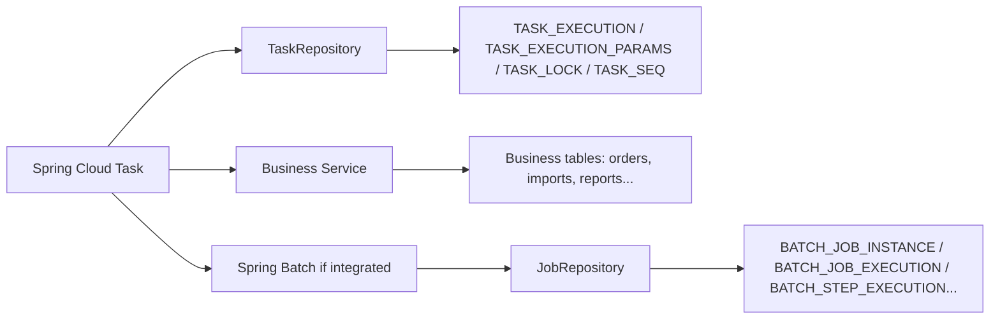
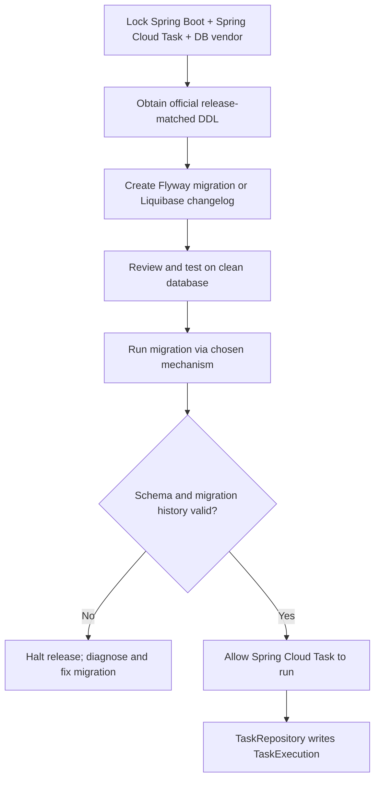

# Managing DDL with Flyway or Liquibase

## 1. Why Does Spring Cloud Task Need Schema Versioning?

**Spring Cloud Task** helps build Spring Boot applications with a finite execution lifetime: start up, perform work, record execution status and outcomes in a database through `TaskRepository`, and terminate. A task may be invoked on a schedule, on demand, or by an orchestrator. Unlike purely in-memory applications, execution history must be persisted **durably** so it can be queried, reconciled, and operated safely.

To achieve this, `TaskRepository` requires tables, keys, indexes, and an ID-generation mechanism matching both the **Spring Cloud Task version** and **database type**. The statements creating or modifying those structures are called **DDL** (*Data Definition Language*), such as `CREATE TABLE`, `ALTER TABLE`, `CREATE INDEX`, and `CREATE SEQUENCE`.

In development, letting the framework auto-create tables at startup can be convenient. In staging/production, multiple task processes may launch concurrently or share one database. In that setting, each run must not create, alter, or guess data structures on its own. **Flyway** and **Liquibase** are two versioned schema-management tools that let teams place DDL into source control, review changes, and apply them through an auditable workflow.

After this lesson, you will be able to:

- Distinguish the `TaskRepository` schema from business data and Spring Batch metadata tables.
- Explain why Spring Cloud Task's default schema initializer must be disabled when using a migration tool.
- Organize Flyway migrations or Liquibase changelogs using the framework's official DDL.
- Apply and verify migrations before running tasks; handle existing schemas, version upgrades, and migration failures.
- Design deployment workflows for PostgreSQL, multiple `DataSource`s, multiple instances, and CI/CD pipelines.

## 2. Understanding the TaskRepository Schema Properly

### 2.1. Important Objects

In a standard JDBC setup, Spring Cloud Task uses the following objects:

| Object | Role | Migration Notes |
| --- | --- | --- |
| `TASK_EXECUTION` | Start/end timestamps, task name, exit code, error info, and run identifier | Primary table for tracking lifecycle |
| `TASK_EXECUTION_PARAMS` | Parameters attached to an execution | Requires exact columns, lengths, constraints, and relationships expected by that framework version |
| `TASK_TASK_BATCH` | Links a Task execution with a Spring Batch `JobExecution` | Useful when integrating Task and Batch |
| `TASK_LOCK` | Supports limiting execution to one active instance per configuration | Pay attention when using `single-instance-enabled` |
| `TASK_SEQ` | Allocates execution IDs; implemented as an object matching that database/DDL version | Can be a sequence or counter table depending on vendor; never reset arbitrarily |

Exact names and structures **depend on the release**. The table above is a guide; it **does not replace** the official DDL. Extract the `schema-<vendor>.sql` scripts from the `spring-cloud-task-core` artifact of the **exact version** declared in your project. For instance, for PostgreSQL, inspect the `org/springframework/cloud/task/schema-postgresql.sql` resource from the release you use.

**Never hand-write all `TASK_*` tables from memory.** A column with the wrong type/length, a missing key/sequence, or a missing index can cause subtle errors when the framework writes `TaskExecution`, queries metadata, links Batch jobs, or runs concurrently.

### 2.2. Distinguishing Three Types of Schemas



- **Task schema:** required by Spring Cloud Task to persist task-process metadata.
- **Business schema:** designed by the application, such as `orders` or `import_results`.
- **Batch schema:** if using Spring Batch, `JobRepository` maintains `BATCH_*` tables independent of `TASK_*`.

Flyway or Liquibase can manage all three schema groups in the same pipeline, provided **each uses DDL from its rightful owner and version**. `TASK_TASK_BATCH` is a link table; it does not replace the `BATCH_*` tables. If repositories live in separate databases, keep connection sources and migration ordering distinct.

## 3. Two Ways to Create Tables: Auto-Initialization and Migrations

### 3.1. Auto-Initialization by Spring Cloud Task

Spring Cloud Task can automatically initialize metadata tables at startup, depending on configuration and environment. When choosing **Flyway or Liquibase as schema owner**, turn that auto-initialization path off:

```yaml
spring:
  cloud:
    task:
      initialize-enabled: false
```

Equivalent property:

```properties
spring.cloud.task.initialize-enabled=false
```

Turning this off **does not disable TaskRepository**: the framework still uses the existing schema to write `TaskExecution` records. The prerequisite is that migrations have already created **all** compatible objects before the task runs. If a table or sequence is missing, the run can fail immediately when recording metadata.

The older property name `spring.cloud.task.initialize.enable` was deprecated in versions that supported it; use `initialize-enabled` per the documentation for your deployed version.

### 3.2. Configuring Other Initialization Mechanisms

Spring Boot may encounter multiple tools attempting to create tables at once:

| Mechanism | Example | When Using Flyway/Liquibase for Schema Management |
| --- | --- | --- |
| Spring Cloud Task initializer | `spring.cloud.task.initialize-enabled` | **`false`** |
| Spring Boot general SQL scripts | `schema.sql`, `data.sql` | Do not run alongside migrations for the same objects; consider `spring.sql.init.mode=never` |
| Hibernate/JPA DDL auto | `spring.jpa.hibernate.ddl-auto` | Avoid `create`/`update` on migration-managed schemas |
| Spring Batch schema initializer | `spring.batch.jdbc.initialize-schema` | `never` if Batch tables are also migration-managed |
| Flyway | `spring.flyway.enabled` | Enabled when Flyway is the chosen tool |
| Liquibase | `spring.liquibase.enabled` | Enabled when Liquibase is the chosen tool |

**Do not enable both Flyway and Liquibase to manage the same `TASK_*` tables.** Each tool maintains its own history and does not synchronize the other's state. Switching tools requires a dedicated handoff/baseline plan.

### 3.3. Who Runs the Migrations?

Two patterns are common:

1. **Migrations run at Spring Boot startup.** Convenient in demos, dev, or small systems: Spring Boot detects Flyway/Liquibase on the classpath and runs migrations before schema-dependent business logic runs.
2. **Migrations run as a separate release step.** Suited for production: a pipeline or database migration Job executes DDL **once**, verifies success, and only then allows tasks/Jobs/CronJobs to run. Runtime apps need zero DDL privileges.

The second pattern makes it much easier to control DDL locks, downtime windows, access privileges, and compatibility across multiple app versions. In both patterns, set `spring.cloud.task.initialize-enabled=false`.

## 4. Choosing Flyway or Liquibase?

| Criterion | Flyway | Liquibase |
| --- | --- | --- |
| Unit of change | Versioned migration, e.g., `V1__create_task_repository.sql` | `changeSet` identified by `id`, `author`, and changelog path |
| Authoring style | Very natural SQL; also supports Java migrations | YAML, XML, JSON, or formatted SQL; can reference SQL files |
| Execution history | Typically `flyway_schema_history` | `DATABASECHANGELOG` |
| Concurrency control | Uses DB-appropriate migration locking | Uses `DATABASECHANGELOGLOCK` |
| Verifying prior changes | Based on version and checksum | Based on changeSet ID and checksum |
| Best suited when | Team prefers raw SQL and vendor-specific DDL control | Team wants structured change definitions and preconditions/contexts |

**Both are well suited** for managing Spring Cloud Task DDL. If your project already uses one reliably, stick with it. Pick **one** tool for a given object set and keep migration history in Git.

In the examples below, we use **PostgreSQL** and assume:

- The project already has compatible Spring Boot, Spring Cloud Task, and JDBC driver versions.
- Database `taskdb` and a connection account already exist.
- This is a fresh database **without Task tables yet**; Section 9 covers already-existing schemas.
- Official PostgreSQL DDL has been extracted from the **exact `spring-cloud-task-core` release** used by the application.

## 5. Option A — Managing DDL with Flyway

### 5.1. Organizing the Migration Directory

Flyway uses filenames formatted as `V<version>__<description>.sql`, with two underscores between version and description. Sample layout:

```text
src/main/resources/
└── db/
    └── migration/
        ├── V1__create_task_repository.sql
        ├── V2__create_task_run_audit.sql
        └── V3__add_audit_source_index.sql
```

For `V1__create_task_repository.sql`, **copy the official DDL verbatim** from `schema-postgresql.sql` of your selected Spring Cloud Task version, adjusting schema/search path if needed. The `V1...` filename is chosen by the **project**; Spring Cloud Task's source file simply supplies the DDL.

Never replace `V1` with a stripped-down `CREATE TABLE TASK_EXECUTION` snippet or create only that one table. Retain all objects, constraints, sequences, and indexes defined in the official DDL. If a future library release changes the schema, add a **new** migration to update it; never edit an already-applied `V1`.

### 5.2. Adding Dependencies

With **Spring Boot 4.x** dedicated starters, Maven example:

```xml
<dependencies>
    <dependency>
        <groupId>org.springframework.boot</groupId>
        <artifactId>spring-boot-starter-flyway</artifactId>
    </dependency>
    <dependency>
        <groupId>org.flywaydb</groupId>
        <artifactId>flyway-database-postgresql</artifactId>
    </dependency>
</dependencies>
```

Spring Cloud Task, Spring JDBC, and PostgreSQL JDBC driver dependencies must also be present in the project. **Do not copy Boot 4.x starters verbatim into a Boot 3.x project without checking:** Boot 3.x projects typically declare `org.flywaydb:flyway-core` alongside the database module required by that Flyway version. Use compatible Boot and Spring Cloud BOMs/dependency management to avoid unsupported combinations.

### 5.3. Configuring Flyway Alongside TaskRepository

Example `application.yml`:

```yaml
spring:
  application:
    name: nightly-import-task
  main:
    web-application-type: none
  datasource:
    url: ${TASK_DB_URL:jdbc:postgresql://localhost:5432/taskdb}
    username: ${TASK_DB_USER:task_app}
    password: ${TASK_DB_PASSWORD}
  cloud:
    task:
      initialize-enabled: false
      closecontextEnabled: true
  sql:
    init:
      mode: never
  flyway:
    enabled: true
    locations: classpath:db/migration
    baseline-on-migrate: false
    validate-on-migrate: true
```

In this **run-migrations-at-startup** example, `task_app` needs DDL privileges; avoid using that privileged account for long-term runtime in production. In production, run Flyway with a migration account in a separate deployment step, and set `spring.flyway.enabled=false` on runtime Task instances; Section 8 covers that workflow.

`baseline-on-migrate: false` preserves a safeguard when Flyway encounters a schema that **already has objects but lacks Flyway history**. Never blindly turn on `baseline-on-migrate: true` just to silence warnings, as that risks mis-baselining a database or treating unapplied migrations as completed.

### 5.4. Example Migration for an Additional Table

`V2__create_task_run_audit.sql` below is a **PostgreSQL-runnable** migration creating a dedicated business audit table. It **does not replace** `V1`, which holds the full official `TASK_*` DDL:

```sql
CREATE TABLE task_run_audit (
    audit_id BIGINT GENERATED ALWAYS AS IDENTITY PRIMARY KEY,
    task_execution_id BIGINT,
    source_name VARCHAR(80) NOT NULL,
    processed_count BIGINT NOT NULL DEFAULT 0,
    created_at TIMESTAMPTZ NOT NULL DEFAULT CURRENT_TIMESTAMP
);
```

Here `task_execution_id` can link a business audit row to a Task run. **Do not blindly add a foreign key** to `TASK_EXECUTION` if business data has a different retention/cleanup policy or if the task repository sits in a separate database; if you want a FK, design and test deletion rules, schemas, and transactions first.

A follow-up migration `V3__add_audit_source_index.sql`:

```sql
CREATE INDEX ix_task_run_audit_source_created
    ON task_run_audit (source_name, created_at);
```

After running `V1`, `V2`, and `V3` on an empty database, Flyway records execution history in `flyway_schema_history`. Each versioned migration runs once under Flyway rules and is checksum-verified. **Never modify `V1` after it has been applied in another environment**; if structural changes are needed later, create `V4__...sql`.

### 5.5. What Happens When the Application Runs Again?

1. Flyway inspects history and migration files in the configured location.
2. Valid already-applied migrations **are not executed again**.
3. Any new migrations run in version order.
4. Once the schema is ready, Spring Cloud Task uses `TaskRepository` to record the new execution.

Inspect history with SQL (default table name):

```sql
SELECT installed_rank, version, description, success, installed_on
FROM flyway_schema_history
ORDER BY installed_rank DESC;
```

If `V1` is missing from history or `V1` has a checksum mismatch against what ran earlier, **never bypass the error by deleting history**. Check the connection, project version, and source DDL file first.

## 6. Option B — Managing DDL with Liquibase

### 6.1. Organizing the Changelog

Liquibase tracks history by **changeSet**. A changeSet is typically identified by `(id, author, changelog file path)`; Liquibase stores history in `DATABASECHANGELOG`.

Example structure:

```text
src/main/resources/
└── db/
    └── changelog/
        ├── db.changelog-master.yaml
        └── sql/
            └── schema-postgresql.sql
```

`sql/schema-postgresql.sql` is a **complete copy** of Spring Cloud Task's official PostgreSQL DDL for your release. Commit this copy into Git alongside the changelog so all environments receive the **exact same content**, rather than pulling shifting DDL from a framework development branch at deploy time.

### 6.2. Adding Dependency and Configuration

With **Spring Boot 4.x**, illustrative Maven dependency:

```xml
<dependency>
    <groupId>org.springframework.boot</groupId>
    <artifactId>spring-boot-starter-liquibase</artifactId>
</dependency>
```

With Spring Boot 3.x, the dependency may be `org.liquibase:liquibase-core`; check documentation for your exact version. Example application configuration selecting **Liquibase** without simultaneously enabling Flyway:

```yaml
spring:
  application:
    name: nightly-import-task
  datasource:
    url: ${TASK_DB_URL:jdbc:postgresql://localhost:5432/taskdb}
    username: ${TASK_DB_USER:task_app}
    password: ${TASK_DB_PASSWORD}
  cloud:
    task:
      initialize-enabled: false
  sql:
    init:
      mode: never
  liquibase:
    enabled: true
    change-log: classpath:db/changelog/db.changelog-master.yaml
```

Spring Boot detects Liquibase and executes the changelog at startup if enabled. Like Flyway, this setup is mainly for learning or environments that accept startup-time migrations. Production normally uses a separate migration step and an account with dedicated DDL rights.

### 6.3. Changelog Referencing Official DDL

`db.changelog-master.yaml`:

```yaml
databaseChangeLog:
  - changeSet:
      id: 001-create-task-repository
      author: platform-team
      changes:
        - sqlFile:
            path: sql/schema-postgresql.sql
            relativeToChangelogFile: true
            splitStatements: true
            stripComments: true

  - changeSet:
      id: 002-create-task-run-audit
      author: platform-team
      changes:
        - createTable:
            tableName: task_run_audit
            columns:
              - column:
                  name: audit_id
                  type: BIGINT
                  autoIncrement: true
                  constraints:
                    primaryKey: true
                    nullable: false
              - column:
                  name: source_name
                  type: VARCHAR(80)
                  constraints:
                    nullable: false
              - column:
                  name: processed_count
                  type: BIGINT
                  defaultValueNumeric: 0
                  constraints:
                    nullable: false
```

This example illustrates **how to organize** the changelog: the first changeSet creates the exact Task schema from locked vendor SQL; the second adds a custom business table. For the real file to succeed, place the **exact source contents** into `sql/schema-postgresql.sql` and test DDL parsing through Liquibase's `sqlFile` parser. If DDL contains special commands, function bodies, or non-semicolon delimiters, adjust `splitStatements`/`endDelimiter` after testing against the target database.

Once a changeSet has been applied, **never arbitrarily alter its `id`, `author`, path, or DDL content**. For structural updates, append a new changeSet; Liquibase uses checksums to detect changes.

### 6.4. Two Dedicated Liquibase Tables

Liquibase typically creates:

| Table | Role |
| --- | --- |
| `DATABASECHANGELOG` | History of executed changeSets, including identifiers and checksums |
| `DATABASECHANGELOGLOCK` | Prevents multiple Liquibase sessions from updating the schema concurrently |

This is **migration-tool metadata**, distinct from Spring Cloud Task's `TASK_EXECUTION`. A successfully applied changeSet **does not mean** any Task has run yet.

Example PostgreSQL queries:

```sql
SELECT ID, AUTHOR, FILENAME, DATEEXECUTED, MD5SUM
FROM DATABASECHANGELOG
ORDER BY DATEEXECUTED DESC;

SELECT ID, LOCKED, LOCKGRANTED, LOCKEDBY
FROM DATABASECHANGELOGLOCK;
```

If `DATABASECHANGELOGLOCK` is locked, **first verify** whether a migration process is actively running. Never delete the table or clear the lock before confirming the prior migration has stopped and any partial DDL changes have been addressed.

## 7. Startup Order and Schema Ownership

### 7.1. Proper Deployment Flow



In projects that run migrations inside Spring Boot startup, ensure Flyway/Liquibase executes before components accessing `TASK_*` tables. With standard auto-configuration and a single `DataSource`, Boot runs migrations during startup; if using a custom `TaskConfigurer`, multiple `DataSource`s, or beans querying the DB at initialization, verify and configure explicit dependency ordering.

### 7.2. Two Database Roles in Production

| Role | Typical Privileges Needed | When Used |
| --- | --- | --- |
| **Migration account** | Create/alter tables, indexes, sequences, and required objects | During controlled DDL deployment step |
| **Runtime account** | Query and insert/update/delete required metadata, plus use sequences per enabled features | Every time the Task application runs |

You do not need to grant `CREATE TABLE` or `ALTER TABLE` to every Task instance when migrations run separately. Exact privileges depend on the database and schema layout.

To run migrations separately, configure the runtime app as:

```yaml
spring:
  cloud:
    task:
      initialize-enabled: false
  sql:
    init:
      mode: never
  flyway:
    enabled: false
```

This is a **runtime configuration when the pipeline has already run Flyway beforehand**. If using Liquibase, replace `spring.flyway.enabled` with `spring.liquibase.enabled: false`. Never apply both settings as though both migration tools must run together.

### 7.3. Recommended CI/CD Workflow

1. **Build:** lock Spring Boot/Spring Cloud Task versions, validate migration files, and review DDL changes.
2. **Test:** spin up a clean PostgreSQL instance, apply all migrations, and verify the schema. Run a real Task.
3. **Staging:** test upgrading from the schema/metadata of the currently live version to the new version; observe active or unfinished Tasks too.
4. **Release DDL:** run a migration Job with dedicated credentials; retain version, log, and outcome records.
5. **Verify:** inspect migration history, tables/sequences, and ability to write a `TaskExecution`.
6. **Release app:** only now allow schedulers/CronJobs to launch the new Task version.
7. **Monitor:** watch for connection errors, unapplied migrations, tasks with empty `END_TIME`, and ID anomalies.

With multiple pods/instances, Flyway and Liquibase provide their own migration locking, yet you should not intentionally make **every short-lived task** contend over DDL on each run. A dedicated migration step reduces risk and surfaces DDL errors before business processing starts.

## 8. Compatibility Between Schema and Spring Cloud Task Versions

### 8.1. An Application Version Must Use a Matching Schema

When upgrading Spring Cloud Task, never assume every version shares an identical schema. Upgrades can alter columns, lengths, constraints, indexes, or ID allocation mechanisms. Recommended workflow:

1. Record both the **current** and **target** library versions.
2. Extract both matching vendor DDL scripts and diff them.
3. Identify required `ALTER TABLE`/`CREATE INDEX`/data-migration statements.
4. Author the next migration, e.g., `V4__upgrade_task_schema.sql` or a new changeSet.
5. Test the migration against a **copy of the schema containing real metadata**; verify history remains intact.
6. Verify the new application version can read/write and complete Tasks properly before broad rollout.

Never copy the new version's `CREATE TABLE` statements and rerun them on existing tables. Only create new objects or alter differences according to an upgrade plan.

### 8.2. Non-Breaking Changes for Existing Data

Suppose a new Task version needs an extra column. If multiple versions may coexist during rollout, follow an **expand → migrate → contract** strategy:

1. **Expand:** add the column allowing `NULL` or with a suitable default; keep old app queries working.
2. **Migrate:** deploy the new app, backfill data if needed, and monitor.
3. **Contract:** only once no old version remains active, apply stricter constraints or drop old structures.

Never drop tables, rename columns, or narrow column types while older Task processes might still be running.

### 8.3. TASK_SEQ and IDs Must Never Be Reset

`TASK_EXECUTION_ID` identifies execution history. When changing sequences or importing data from another environment, never configure an ID generator starting below existing IDs. Duplicate ID allocation can prevent tasks from recording new runs or mislink metadata.

Before modifying a sequence, check:

```sql
SELECT MAX(TASK_EXECUTION_ID) AS max_task_execution_id
FROM TASK_EXECUTION;
```

Then cross-check the **actual ID allocator object** for that vendor and framework version. `TASK_SEQ` may be implemented differently across databases; never run a single generic `ALTER SEQUENCE` across all DBMSs or reset `START WITH 1` in production.

### 8.4. SQL Server Case

Spring Cloud Task documentation notes contention on `TASK_SEQ` when running concurrent Tasks on SQL Server, along with using a native sequence in supporting configurations/versions. This is a classic example of why **PostgreSQL DDL must never be applied to SQL Server**. Before changing ID allocation, check official guidance and keep the next value above all previously issued IDs.

## 9. Bringing an Existing Schema Under Flyway or Liquibase

### 9.1. The Problem to Solve

A legacy system may have let Spring Cloud Task auto-create tables for months. When adopting Flyway/Liquibase, the database already has `TASK_EXECUTION`, `TASK_EXECUTION_PARAMS`, `TASK_SEQ`, and historical data, yet **no migration history**.

Running `V1__create_task_repository.sql` directly fails with `relation already exists`. Blindly enabling baseline can cause the tool to record “schema exists” while required tables or constraints are actually missing.

### 9.2. Safe Onboarding Workflow

1. **Create a backup** of the metadata schema and data, with a tested restore procedure.
2. **Pause/freeze** new Task launches during the required cutover window.
3. **Inspect actual state**—objects, columns, constraints, indexes, and sequences—against official DDL for the current version.
4. **Fix drift** via a reviewed transition migration before marking the schema as baselined.
5. **Intentional baseline/changelog sync:** the tool records that the current schema matches a verified milestone without re-running existing `CREATE` statements.
6. **Dry-run** the next migration against a production copy and launch a Task with the runtime user to verify it can create and complete a `TaskExecution`.

With Flyway, **`baseline`** writes a milestone row into `flyway_schema_history`; migrations with versions **less than or equal to the baseline version** are treated as already applied and skipped. Therefore, choose the baseline version based on what is truly in the database; an inaccurate baseline hides missing tables or constraints.

With Liquibase, establish changeSet history matching a verified schema using the changelog sync workflow appropriate to your Liquibase version. Never mark a changeSet as executed if actual database structures do not match what that changeSet defines.

### 9.3. Migration History Must Be Immutable

Flyway verifies migration checksums, and Liquibase maintains checksums on changeSets. If someone edits a migration that already ran in staging/production:

- New environments may build a schema different from older environments.
- The tool can report a checksum mismatch and refuse further updates.
- Running `repair` or clearing checksums **does not automatically fix actual table structure**.

The standard fix is to **restore the released migration file** and create a new migration going forward. Only use history-repair tools after verifying actual differences, performing required remediation, and obtaining change approval.

## 10. Multiple DataSources, Dedicated Schemas, and Table Prefixes

### 10.1. Do Not Assume a Single Database

A Task may write business data to DB A while storing `TaskRepository` metadata in DB B. In that case:

- Flyway/Liquibase must execute Task migrations on **DB B**.
- Business table migrations must target **DB A**.
- `TaskConfigurer` and the transaction manager must point to the `DataSource` dedicated to the repository.
- The runtime account needs permissions on the right schema; misconfiguration can make the Task look for tables in the wrong database.

Spring Boot supports `@FlywayDataSource` or `@LiquibaseDataSource` (depending on version) to designate a separate migration datasource; you can also configure `spring.flyway.url/user/password` or `spring.liquibase.url/user/password` per documentation. **Never assume** migrations automatically use the same connection as `TaskRepository` when multiple datasources exist.

### 10.2. Custom Prefix

Spring Cloud Task lets you change the table prefix via `spring.cloud.task.tablePrefix`, which defaults to `TASK_`.

```properties
spring.cloud.task.tablePrefix=ACME_TASK_
```

This is merely an example prefix. When changing it, **migrations must create the exact object names the repository will query**; do not change the property while leaving unmodified default DDL. Review tables, indexes, ID allocators, and schema-qualified prefixes according to your version's guide.

### 10.3. Environment Isolation

Production and staging must never share a metadata schema; if sharing a database server, provision separate databases/schemas and credentials. Likewise, guard against test-environment Flyway or Liquibase runs pointing at production via misconfigured environment variables.

In multi-tenant designs, never spin up multiple Task schemas per tenant without redesigning ID allocation, repository wiring, and per-schema migration management.

## 11. Coordinating with Spring Batch

If a Task launches Spring Batch, both frameworks maintain separate repositories:

```text
Spring Cloud Task
  TaskRepository -> TASK_*
         |
         +---- TASK_TASK_BATCH (link)
                           |
Spring Batch               v
  JobRepository  -> BATCH_*
```

When migrations own the schema:

```yaml
spring:
  cloud:
    task:
      initialize-enabled: false
  batch:
    jdbc:
      initialize-schema: never
```

Obtain the **version-matched Spring Batch DDL** and apply it as a separate migration group or changeSet, keeping links and permissions aligned across both table sets. One `TaskExecution` can link to a `JobExecution`, yet Spring Cloud Task does not create `BATCH_*` tables for Spring Batch.

If the two repositories use different datasources, define their linking and deployment explicitly. Never add cross-database foreign keys or assume distributed transactions unless your architecture supports them.

## 12. Verifying the Schema After Migration

### 12.1. Inspecting Objects in PostgreSQL

With the default `public` schema and default prefix, inspect the table list:

```sql
SELECT table_schema, table_name
FROM information_schema.tables
WHERE table_schema = 'public'
  AND table_name IN (
      'task_execution',
      'task_execution_params',
      'task_task_batch',
      'task_lock'
  )
ORDER BY table_name;
```

This is a quick check for common objects, **insufficient** to confirm the entire DDL is correct. Also check columns, primary keys, indexes, ID allocators, and migration versions.

To inspect `TASK_SEQ` in PostgreSQL—since it can be either a table or a sequence depending on DDL:

```sql
SELECT n.nspname AS schema_name,
       c.relname AS object_name,
       c.relkind AS object_kind
FROM pg_class c
JOIN pg_namespace n ON n.oid = c.relnamespace
WHERE n.nspname = 'public'
  AND c.relname = 'task_seq';
```

In PostgreSQL catalogs, `relkind = 'S'` usually denotes a sequence, while `relkind = 'r'` denotes a regular table. Never manually adjust ID values based solely on a single catalog check.

### 12.2. Verifying TaskRepository Actually Works

After migration, launch a simple Task with an `ApplicationRunner`:

```java
import org.springframework.boot.ApplicationRunner;
import org.springframework.context.annotation.Bean;
import org.springframework.context.annotation.Configuration;

@Configuration
class RepositorySmokeTestConfiguration {

    @Bean
    ApplicationRunner smokeRunner() {
        return args -> System.out.println("TaskRepository smoke test OK");
    }
}
```

In a real application, isolate this bean in a test profile or dedicated smoke-test program; do not leave it running automatically in production unnecessarily.

Once the Task exits normally, query:

```sql
SELECT TASK_EXECUTION_ID, TASK_NAME, START_TIME, END_TIME, EXIT_CODE
FROM TASK_EXECUTION
ORDER BY TASK_EXECUTION_ID DESC
LIMIT 5;
```

You should see a new execution with a unique ID, valid `START_TIME` and `END_TIME`, and a success exit code (typically `0`). Also verify process exit code and logs; tables having the right names yet missing constraints or ID generation can surface errors only during actual execution.

### 12.3. Testing the Failure Path Too

A useful test is having the runner throw `IllegalStateException` and checking whether the repository records the failure status. If a migration created only the main table while omitting parameters, indexes, or sequences, errors may appear at startup or during status updates.

Test on a **dedicated test database**—never simulate failures by dropping production tables.

## 13. Common DDL Errors and Resolutions

| Symptom | Possible Cause | Resolution |
| --- | --- | --- |
| `relation "task_execution" does not exist` | Migrations never ran, wrong schema, or wrong `DataSource` | Inspect migration history, `search_path`, and repository datasource |
| `relation already exists` running V1 | Schema previously created by framework or someone else | Inspect schema and follow a verified baseline process |
| `TASK_SEQ` error or duplicate key | Missing ID allocator, reset allocator, or wrong vendor DDL | Compare against official DDL and max ID; fix via dedicated migration |
| Flyway checksum mismatch | Applied migration file was edited or wrong branch deployed | Restore released file and add a new migration |
| Liquibase checksum mismatch | changeSet content or identifier modified | Inspect history, diff schema, and fix via new changeSet |
| Liquibase waiting on `DATABASECHANGELOGLOCK` | Another migration running or stale lock after crash | Verify active processes and DDL state before touching lock |
| Task fails when runtime user accesses tables | User lacks DML/sequence privileges | Grant least-privilege rights after migrations finish |
| Migrations run concurrently across tasks | Each pod/task runs migrations at startup | Move migrations to a dedicated release Job |
| Batch Job fails with missing `BATCH_*` | Only Task schema migrated or wrong initializer enabled | Add version-matched Batch DDL and check `initialize-schema` |
| Migration succeeded, yet Task still fails | Wrong DDL version, missing object, custom tablePrefix, or multiple datasources | Compare actual schema with release DDL and run a smoke test |

**Note on failed migrations:** Not all databases roll back DDL identically. PostgreSQL supports transactional DDL for many statements, whereas some engines auto-commit DDL or have restrictions. After a failed migration, always inspect the **actual schema state** before rerunning, calling `repair`, or clearing locks.

## 14. Pre-Release Checklist

| Check | Passing Criterion |
| --- | --- |
| Library versions | Spring Boot/Spring Cloud Task/Flyway or Liquibase pinned and compatible |
| Source DDL | Exact `schema-<vendor>.sql` from deployed `spring-cloud-task-core` release used |
| Table creation switches | `spring.cloud.task.initialize-enabled` and overlapping initializers turned off |
| Migration history | Prior migrations have valid checksums; new migrations have unique IDs/versions |
| Deployment order | DDL applied and verified before new Task version runs |
| DB privileges | Migration account owns DDL; runtime account holds least-privilege rights |
| Additional schemas | If using Batch, `BATCH_*` tables created for the matching version |
| Compatibility | Upgrade tested against schema with existing data; rollback plan prepared |
| Smoke test | Task records both successful and failed `TaskExecution`s with unique IDs |
| Operational safety | Backups, migration logs, concurrency controls, and monitoring in place |

## 15. Hands-On Exercises

**Exercise 1 — DDL Lifecycle.** Diagram a Task run from a database lacking `TASK_EXECUTION` through completed migration and runner execution. Explain why `spring.cloud.task.initialize-enabled=false` must pair with migrations.

**Exercise 2 — Flyway.** Create a sample project on PostgreSQL, pin a Spring Cloud Task version, and place official DDL in `V1__create_task_repository.sql`. Add `V2__create_task_run_audit.sql`, run twice, and inspect `flyway_schema_history`. Explain why `V1` executes only once.

**Exercise 3 — Liquibase.** Convert the setup above into a YAML changelog with two changeSets. Inspect `DATABASECHANGELOG` and `DATABASECHANGELOGLOCK`. Discuss what happens when two instances launch migrations simultaneously.

**Exercise 4 — Existing Schema.** Suppose a production database already has Task tables auto-created by the framework, without Flyway/Liquibase history. Outline step-by-step how to bring that schema under versioned management without deleting `TaskExecution` history.

**Exercise 5 — Upgrades.** When the framework's schema changes from version A to B, list the steps to diff DDL, author a new migration, test on a database copy, and handle older still-running Tasks.

**Exercise 6 — Batch and Two Databases.** Design a layout where DB A holds business data and DB B holds `TASK_*` and `BATCH_*`. Identify where each migration executes, which datasource `TaskRepository` uses, and database privileges for each role.

**Exercise 7 — Incident.** A deployment reports `TASK_SEQ` does not exist even though `TASK_EXECUTION` is present. Describe the ordered diagnostic chain: right database/schema, migration history, DDL source, ID allocator object, and safe recovery plan.

## 16. Key Principles to Remember

- **Flyway or Liquibase is the source of truth for DDL history** once an application adopts a migration model.
- **Spring Cloud Task continues using `TaskRepository` normally** when `initialize-enabled=false`, provided required schemas already exist.
- **DDL must match vendor and version**; never guess `TASK_*` table structures or reuse another DBMS's SQL file.
- **Never edit released migrations**; future changes require new migrations/changeSets.
- **Running migrations and running Tasks should be two clearly ordered operational steps** in production.
- **Task metadata, Batch metadata, and migration-tool metadata** serve different purposes and must never be conflated.
- **Testing actual execution** matters more than checking table existence: tasks must allocate IDs, store arguments, and record both success and failure outcomes without losing prior history.

## References

- [Spring Cloud Task — Task Repository Schema](https://docs.spring.io/spring-cloud-task/reference/appendix-task-repository-schema.html): Task table structures, object roles, and links to per-database DDL.
- [Spring Cloud Task — Features](https://docs.spring.io/spring-cloud-task/reference/features.html): `spring.cloud.task.initialize-enabled`, `tablePrefix`, and repository configuration.
- [Spring Cloud Task — Official Vendor DDL](https://github.com/spring-cloud/spring-cloud-task/tree/main/spring-cloud-task-core/src/main/resources/org/springframework/cloud/task): source reference; when adding to a project, pick the **tag/release** matching your dependencies.
- [Spring Boot — Database Initialization](https://docs.spring.io/spring-boot/how-to/data-initialization.html): Flyway/Liquibase auto-configuration, migration locations, datasources, and Batch interaction.
- [Flyway — Schema History Table](https://documentation.red-gate.com/flyway/flyway-concepts/migrations/flyway-schema-history-table): history, version/checksum validation, and drift diagnosis.
- [Flyway — Baseline](https://documentation.red-gate.com/fd/baseline-277578867.html): onboarding an existing schema into migration history.
- [Liquibase — DATABASECHANGELOG](https://docs.liquibase.com/secure/deliver-changes-6-0-1/what-is-the-databasechangelog-table): tracking executed changeSets.
- [Liquibase — DATABASECHANGELOGLOCK](https://docs.liquibase.com/secure/user-guide-5-0/what-is-the-database-changelog-lock-table): locking concurrent migration sessions.
