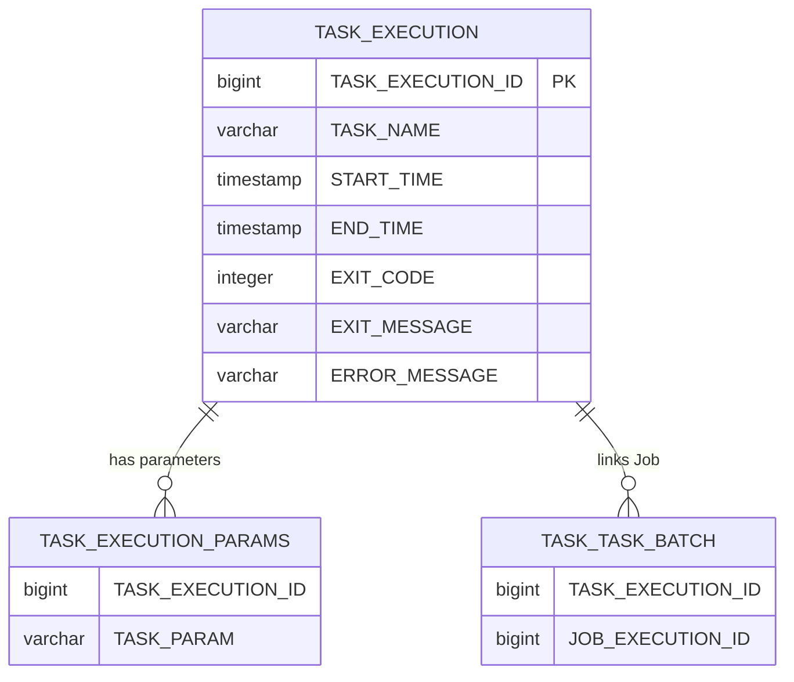
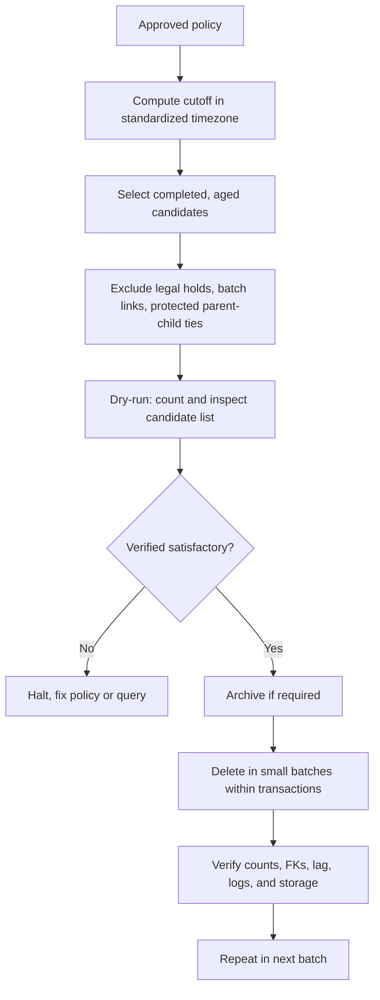

# Querying History, Pagination, and Data Retention Policies in Spring Cloud Task

## 1. The Problem: Execution History Grows Over Time

In **Spring Cloud Task**, every application run is a finite execution. Once `ApplicationContext` initializes successfully, Spring Cloud Task creates a `TaskExecution` record; when the Task finishes, the framework updates the outcome in **`TaskRepository`**. Details such as Task name, start/end timestamps, `exitCode`, and error messages help operations answer: *Did the Task run, when, did it succeed or fail, and does it need to be rerun?*

Suppose a system runs three job types daily: order synchronization, commission calculation, and report delivery. One task may run hundreds of times due to schedules, manual triggers, or retries. After several months, `TASK_EXECUTION` holds hundreds of thousands of rows, while parameter and Batch-link tables grow even larger. If dashboards always fetch full history or operators purge old metadata indiscriminately, the system becomes both slow and hard to debug during incidents.

This lesson in the **Repository and Schema** chapter focuses on three skills:

1. **Querying properly:** using `TaskExplorer` or SQL to locate runs by ID, Task name, time window, and outcome; understanding links to Spring Batch.
2. **Paginating properly:** returning bounded result sets with deterministic ordering, distinguishing offset and cursor pagination.
3. **Retaining properly:** defining retention windows, protecting data still needed for investigations, and purging in verified batches without breaking table relationships.

This knowledge is foundational for operating scheduled or on-demand Spring Cloud Task applications while tracking execution state and outcomes in a long-lived database.

## 2. Understanding the TaskRepository Schema Before Querying

Spring Cloud Task defines its own metadata tables; this is **execution-tracking data**, not business tables holding orders, transactions, or report outputs.

| Component | Content | Things to Watch |
| --- | --- | --- |
| `TASK_EXECUTION` | One row per Task execution: ID, name, timestamps, exit code, messages | Primary table for filtering history |
| `TASK_EXECUTION_PARAMS` | CLI arguments recorded per `TASK_EXECUTION_ID` | Can hold sensitive data if callers pass secrets via CLI |
| `TASK_TASK_BATCH` | Links `TASK_EXECUTION_ID` with Spring Batch `JOB_EXECUTION_ID` | One Task may relate to multiple `JobExecution`s |
| `TASK_LOCK` | Lock metadata when single-instance mode is enabled | Must not be treated as run history to delete by `END_TIME` age |
| `TASK_SEQ` or equivalent sequence | Allocates execution IDs | Never reset when purging history |

Most commonly queried columns of `TASK_EXECUTION`:

| Column | Meaning |
| --- | --- |
| `TASK_EXECUTION_ID` | Unique identifier for a single run |
| `TASK_NAME` | Task name determined by the resolver or application config |
| `START_TIME` | Start timestamp stored in the repository |
| `END_TIME` | End timestamp; may be `NULL` if unfinished or failed to update |
| `EXIT_CODE` | Exit code; typically `0` on success, non-zero on failure; may be `NULL` while running |
| `EXIT_MESSAGE` | Exit message set by the application; may be `NULL` |
| `ERROR_MESSAGE` | Technical error details, such as stack trace; may be `NULL` |
| `LAST_UPDATED` | Timestamp of most recent metadata update per repository mechanism |
| `EXTERNAL_EXECUTION_ID` | Correlation ID supplied by the orchestration platform, if any |
| `PARENT_TASK_EXECUTION_ID` | Link to a parent `TaskExecution`, if used by the application |

Current schema documentation shows typical column lengths of `VARCHAR(2500)` for `EXIT_MESSAGE`, `ERROR_MESSAGE`, and `TASK_PARAM`. Always inspect the **actual DDL of your exact version** before adding indexes or building cleanup tools; structure, ID allocation, and table names can differ across versions or custom setups.



The diagram above shows **logical relationships** for querying and cleanup; it does not assert that every DDL variant enforces physical foreign keys as depicted. `TASK_TASK_BATCH.JOB_EXECUTION_ID` links into **Spring Batch** metadata, which maintains its own tables (`BATCH_JOB_EXECUTION`, `BATCH_STEP_EXECUTION`, ...).

> **Critical limitation:** `END_TIME IS NULL` does not prove the process is still alive. A killed application, power loss, or crash before writing outcomes can leave an unfinished run in the database. Cross-check scheduler, container, logs, and timeouts.

### Custom Table Names and Schema Initialization

Some deployments use a prefix other than `TASK_`, such as `OPS_TASK_EXECUTION`, via `spring.cloud.task.tablePrefix`. In that case, substitute exact table names in all SQL queries in this lesson. Prefix settings and schema initialization must match your active version; in production, prefer migration tools and controlled DDL rights instead of letting each Task run alter table structures itself.

## 3. Querying History via TaskExplorer

**`TaskRepository`** handles lifecycle writes; **`TaskExplorer`** is the metadata read API. When building operations screens or lookup services, start with `TaskExplorer` whenever it covers the needed queries.

Key methods:

| API | Purpose |
| --- | --- |
| `getTaskExecution(long executionId)` | Look up a single run by ID |
| `getLatestTaskExecutionForTaskName(String name)` | Fetch the most recent run by Task start time |
| `findTaskExecutionsByName(String name, Pageable pageable)` | Fetch a page of history for one Task |
| `findAll(Pageable pageable)` | Fetch a page of system-wide history |
| `findRunningTaskExecutions(String name, Pageable pageable)` | Query records considered running for a Task name |
| `getTaskExecutionCount()` | Count total `TaskExecution` records |
| `getTaskExecutionCountByTaskName(String name)` | Count records by Task name |
| `getJobExecutionIdsByTaskExecutionId(long id)` | Find Spring Batch `JobExecution`s linked to a Task |

In the documented `findAll(Pageable)` API, results are ordered by `startTime` descending, then `taskExecutionId` descending. For other APIs or arbitrary filters by time window and `exitCode`, check your version's documentation or use SQL queries with an explicit `ORDER BY`.

**Java 17+ example**, implementing a query service that returns only needed fields:

```java
package com.example.taskhistory;

import java.time.LocalDateTime;

import org.springframework.cloud.task.repository.TaskExecution;
import org.springframework.cloud.task.repository.TaskExplorer;
import org.springframework.data.domain.Page;
import org.springframework.data.domain.PageRequest;
import org.springframework.stereotype.Service;

@Service
public class TaskHistoryService {

    private final TaskExplorer explorer;

    public TaskHistoryService(TaskExplorer explorer) {
        this.explorer = explorer;
    }

    public Page<TaskRunSummary> history(String taskName, int page, int size) {
        if (taskName == null || taskName.isBlank()) {
            throw new IllegalArgumentException("taskName is required");
        }
        if (page < 0 || size < 1 || size > 100) {
            throw new IllegalArgumentException(
                "page must be >= 0; size must be between 1 and 100"
            );
        }

        Page<TaskExecution> executions =
            explorer.findTaskExecutionsByName(
                taskName, PageRequest.of(page, size)
            );

        return executions.map(TaskHistoryService::toSummary);
    }

    public TaskRunSummary byId(long executionId) {
        if (executionId <= 0) {
            throw new IllegalArgumentException("executionId must be positive");
        }
        TaskExecution execution = explorer.getTaskExecution(executionId);
        return execution == null ? null : toSummary(execution);
    }

    private static TaskRunSummary toSummary(TaskExecution execution) {
        return new TaskRunSummary(
            execution.getExecutionId(),
            execution.getTaskName(),
            execution.getStartTime(),
            execution.getEndTime(),
            execution.getExitCode()
        );
    }

    public record TaskRunSummary(
        long executionId,
        String taskName,
        LocalDateTime startTime,
        LocalDateTime endTime,
        Integer exitCode
    ) {}
}
```

Key points to remember:

- `PageRequest.of(page, size)` uses **0-based pages**; `page=0,size=20` returns the first 20 records.
- `Page<TaskRunSummary>` exposes `getContent()`, `getTotalElements()`, and `getTotalPages()` to drive paginated UIs. Computing totals can cause the database to execute an extra count query.
- `TaskExecution` objects can carry `arguments` and `errorMessage`. The `TaskRunSummary` DTO deliberately omits those fields to minimize exposing technical or sensitive data on list views.
- The snippet above is a **data-reading service**; it does not expose REST endpoints, handle user authentication, enforce tenant scoping, or restrict history viewing permissions. When exposing via a public API, add those controls.
- The `TaskExplorer` API is not a data-deletion tool. Retention should have its own job/migration, dedicated transactions, and operational approval workflow.

### Distinguishing “Latest Run” from “Latest Completed Run”

`getLatestTaskExecutionForTaskName(...)` fetches the latest run by **start timestamp**; the result may still be running. It does not mean “latest successful run”.

Example:

| ID | Start | End | Exit code |
| ---: | --- | --- | ---: |
| 803 | 10:15 | `NULL` | `NULL` |
| 802 | 10:10 | 10:13 | `0` |
| 801 | 10:00 | 10:05 | `1` |

Fetching the latest by name may return **803**, whereas the “latest successful run” is **802**. To fetch the most recent successful run, add explicit query predicates such as `END_TIME IS NOT NULL AND EXIT_CODE = 0`.

## 4. Conditional History Queries in SQL

When building operational reports by date, Task name, or status, SQL gives fine-grained control over filtering and sorting. The following queries assume the default schema and uppercase table names. Depending on DBMS, pagination syntax varies; parameters like `:taskName` and `:fromTime` must be **bound via JDBC/framework**, never concatenated from user input.

### 4.1. Fast Lookup of a Task by Time Window

```sql
SELECT
    TASK_EXECUTION_ID,
    TASK_NAME,
    START_TIME,
    END_TIME,
    EXIT_CODE,
    EXIT_MESSAGE,
    EXTERNAL_EXECUTION_ID
FROM TASK_EXECUTION
WHERE TASK_NAME = :taskName
  AND START_TIME >= :fromTime
  AND START_TIME <  :toTime
ORDER BY START_TIME DESC, TASK_EXECUTION_ID DESC;
```

Use a half-open interval **[fromTime, toTime)** (inclusive start, exclusive end) to avoid double-counting at day boundaries. Across multiple time zones, clearly define whether timestamp columns store UTC or system time before converting user date ranges into query parameters.

### 4.2. Querying Finished Non-Zero Failures

```sql
SELECT
    TASK_EXECUTION_ID,
    TASK_NAME,
    START_TIME,
    END_TIME,
    EXIT_CODE,
    EXIT_MESSAGE
FROM TASK_EXECUTION
WHERE END_TIME IS NOT NULL
  AND EXIT_CODE <> 0
ORDER BY END_TIME DESC, TASK_EXECUTION_ID DESC;
```

`EXIT_CODE <> 0` excludes `NULL`. That is desirable when looking strictly for runs with recorded error codes; rows missing `END_TIME` or `EXIT_CODE` need their own view and alerts.

### 4.3. Aggregating Success and Failure Counts

```sql
SELECT
    TASK_NAME,
    COUNT(*) AS TOTAL_RUNS,
    SUM(CASE
        WHEN END_TIME IS NOT NULL AND EXIT_CODE = 0 THEN 1
        ELSE 0
    END) AS SUCCEEDED,
    SUM(CASE
        WHEN END_TIME IS NOT NULL AND EXIT_CODE <> 0 THEN 1
        ELSE 0
    END) AS FAILED,
    SUM(CASE
        WHEN END_TIME IS NULL OR EXIT_CODE IS NULL THEN 1
        ELSE 0
    END) AS INCOMPLETE_OR_UNKNOWN
FROM TASK_EXECUTION
WHERE START_TIME >= :fromTime
  AND START_TIME <  :toTime
GROUP BY TASK_NAME
ORDER BY TASK_NAME;
```

The name `INCOMPLETE_OR_UNKNOWN` is chosen deliberately: this bucket means **insufficiently classified**, not that every row is still running. If an application catches and swallows exceptions, metadata may report a success exit code even though business outcomes failed.

### 4.4. Linking with Spring Batch

```sql
SELECT
    t.TASK_EXECUTION_ID,
    t.TASK_NAME,
    t.START_TIME,
    t.EXIT_CODE,
    b.JOB_EXECUTION_ID
FROM TASK_EXECUTION t
JOIN TASK_TASK_BATCH b
  ON b.TASK_EXECUTION_ID = t.TASK_EXECUTION_ID
WHERE t.TASK_EXECUTION_ID = :taskExecutionId;
```

This relationship bridges a Task run to Spring Batch Job runs. One `TaskExecution` can link to multiple `JobExecution`s, so the `JOIN` may return multiple rows; never use this query's row count to count unique Tasks. Job/Step metadata remains managed by Spring Batch under its own retention rules.

## 5. Pagination: Offset vs. Cursor

Once a table reaches millions of rows, unpaginated queries like `SELECT * FROM TASK_EXECUTION` create heavy load, consume bandwidth and RAM, and slow down UIs. Cap `size`, bound query depth, and return only genuinely needed columns.

### Approach A: Offset Pagination

In PostgreSQL, one way to write it is:

```sql
SELECT
    TASK_EXECUTION_ID,
    TASK_NAME,
    START_TIME,
    END_TIME,
    EXIT_CODE
FROM TASK_EXECUTION
WHERE TASK_NAME = :taskName
ORDER BY START_TIME DESC, TASK_EXECUTION_ID DESC
LIMIT :limit OFFSET :offset;
```

For example, `limit=20, offset=40` fetches page 3 with 0-based page numbering. This query suits UIs needing page numbers and total counts, but has two limitations:

1. Large `OFFSET` values can force the database to scan and discard many rows before returning the current page.
2. If new runs are inserted between two queries, offset boundaries shift; users can see duplicate rows or miss rows while paging.

Do not treat `LIMIT/OFFSET` as universal SQL syntax: SQL Server and Oracle have different syntax and semantics. `TaskExplorer` abstracts away part of this difference when its API methods suffice.

### Approach B: Keyset / Cursor Pagination

When users repeatedly click “Load more” and new records arrive frequently, use a **cursor** based on the sort key pair (`START_TIME`, `TASK_EXECUTION_ID`). Records sharing the same `START_TIME` still have a deterministic order via ID:

```sql
-- First page (PostgreSQL):
SELECT TASK_EXECUTION_ID, TASK_NAME, START_TIME, END_TIME, EXIT_CODE
FROM TASK_EXECUTION
WHERE TASK_NAME = :taskName
  AND START_TIME IS NOT NULL
ORDER BY START_TIME DESC, TASK_EXECUTION_ID DESC
LIMIT :limit;

-- Next page: use startTime and ID from the last row of the previous page.
SELECT TASK_EXECUTION_ID, TASK_NAME, START_TIME, END_TIME, EXIT_CODE
FROM TASK_EXECUTION
WHERE TASK_NAME = :taskName
  AND START_TIME IS NOT NULL
  AND (
      START_TIME < :cursorStartTime
      OR (
          START_TIME = :cursorStartTime
          AND TASK_EXECUTION_ID < :cursorExecutionId
      )
  )
ORDER BY START_TIME DESC, TASK_EXECUTION_ID DESC
LIMIT :limit;
```

Incoming cursors must be parsed/validated and bound to the right filters (`taskName`, time range, access rights). Never allow users to tamper with cursor values to read another tenant's history. For continuation cursors, encode payloads as signed, expiring tokens; plain base64 encoding **is not an authorization mechanism**.

Limitations to note:

- If `START_TIME` can be `NULL`, the query above intentionally excludes those rows; provide a separate flow to inspect timestamp-missing metadata.
- Keyset pagination is more stable than offset under concurrent inserts when sort keys stay unchanged. If rows get updated in ways changing sort keys, deleted mid-scroll, or an exact snapshot of the full result set is required, you may still need snapshot isolation or a fixed upper time bound.
- If sorting strictly by `TASK_EXECUTION_ID DESC`, an `ID < lastId` cursor is even simpler, yet IDs reflect allocation order rather than **always** reflecting exact execution time order—especially when `TaskExecution`s are pre-created before launch.

### Choosing a Strategy

| Scenario | Typically Appropriate Solution |
| --- | --- |
| Short list where users need page numbers | `TaskExplorer` with `Pageable` or bounded SQL offset |
| Very large history with “Load more” | Keyset cursor with deterministic ordering |
| Exporting full historical reports | Streaming/batch reads chunked by time window; never send a massive `Page` over HTTP |
| Daily summaries | Aggregate queries or pre-computed summary tables |
| Finding one exact execution | Lookup by `TASK_EXECUTION_ID` using primary key index |

## 6. Index Design and Query Load Control

Indexes should follow real query patterns. On PostgreSQL with the default schema, consider **after checking existing indexes**:

```sql
-- Illustrative: deploy via migration after inspecting execution plans.
CREATE INDEX IF NOT EXISTS idx_task_name_start_execution
    ON TASK_EXECUTION
       (TASK_NAME, START_TIME DESC, TASK_EXECUTION_ID DESC);

CREATE INDEX IF NOT EXISTS idx_task_end_execution
    ON TASK_EXECUTION
       (END_TIME, TASK_EXECUTION_ID);
```

The first index accelerates history lists by name and timestamp; the second can accelerate selecting aged records for retention/cleanup. These are not mandatory DDL for every project. Every index consumes storage and adds write overhead to Tasks, so measure with `EXPLAIN (ANALYZE, BUFFERS)` on representative data volumes, avoid duplicate indexes, and consider non-blocking index creation in production.

Optimizations that often matter more than adding more indexes:

- Cap page sizes, e.g., at most **100 records** per request; never let an API accept `size=1000000`.
- Avoid `SELECT *`, especially when `ERROR_MESSAGE` holds long stack traces.
- Require time-range filters on large-scale reports; cache reusable statistics.
- Avoid calling `TaskExplorer.getTaskExecutionCount()` on every poll if the table is huge and the UI does not strictly need exact totals.
- Enforce tenant/ops-group access control **before** returning results; `TASK_NAME` does not guarantee tenant isolation by itself.

## 7. What Should a Data Retention Policy Answer?

A **retention policy** specifies which data is still needed, how long it must be kept, whether it requires long-term archiving or sensitive-data masking, and when it may be deleted. Spring Cloud Task records lifecycle state, yet **you must not assume the framework ships an automatic day-based history purge satisfying enterprise compliance**. Choosing retention durations, archiving, and cleanup is an application operations responsibility.

An **illustrative** policy example (not a Spring Cloud Task default, nor a legal requirement):

| Data Category | Example Retention | Handling |
| --- | --- | --- |
| Successful tasks needing little investigation | 90 days | Keep detailed rows in DB; purge in batches afterward |
| Failed tasks or tasks needing reconciliation | 365 days | Retain longer for investigation; consider controlled archiving |
| Tasks missing `END_TIME` or `EXIT_CODE` | Never delete by standard age rule | Investigate with scheduler; determine if still running or stuck metadata |
| Tasks linked to Spring Batch | Per coordinated Task and Batch policy | Never break links to `JobExecution` arbitrarily |
| Tasks under investigation / data freeze | Per authorized directive | Apply *legal hold* or special preservation rules |
| Daily aggregate metrics | May outlive detailed history | Keep only needed counts; do not copy arguments or stack traces |

**Choosing the cutoff:** typically use `END_TIME < cutoff` to consider only completed runs; avoid filtering solely by `START_TIME` because Tasks can be long-running. Also require a non-null `EXIT_CODE`, define clear handling for failures, and never delete executions still referenced by active investigations or business tables.

**Do not confuse retention with backups.** Backups exist for disaster recovery; archives exist for long-term lookup or compliance. A record purged from the live database yet still sitting in a backup does not mean the system can query it online. Sensitive-data deletion policies must account for backup, snapshot, and archive lifetimes.

### Designing the Retention Workflow



**Separate three phases:** (1) compute and inspect the candidate set; (2) archive/anonymize if required; (3) purge in batches and monitor. A cleanup Task is itself a finite process that can run on a schedule, yet ensure it never deletes the very metadata tracking the ongoing purge run.

## 8. Safe Batch-Purge Example (PostgreSQL)

This section is a **sample for learning and testing**, applicable only once actual DDL, data relationships, permissions, retention rules, and recovery readiness are confirmed. Run in a test database first. The sample intentionally restricts itself to **successful Tasks with no Batch links and no child Tasks referencing them as parent**, avoiding accidental deletion of hard-to-recover history.

### 8.1. Preview Qualifying Counts First

```sql
-- :cutoff is a bound timestamp normalized to the database timezone.
SELECT COUNT(*) AS CANDIDATE_COUNT
FROM TASK_EXECUTION t
WHERE t.END_TIME IS NOT NULL
  AND t.END_TIME < :cutoff
  AND t.EXIT_CODE = 0
  AND NOT EXISTS (
      SELECT 1
      FROM TASK_TASK_BATCH b
      WHERE b.TASK_EXECUTION_ID = t.TASK_EXECUTION_ID
  )
  AND NOT EXISTS (
      SELECT 1
      FROM TASK_EXECUTION child
      WHERE child.PARENT_TASK_EXECUTION_ID = t.TASK_EXECUTION_ID
  );
```

This count is only a reconnaissance step: you may also need filters for `TASK_NAME`, allowlists, ID ranges, legal hold flags, or corporate preservation marker tables. Data under active investigation must be excluded before deletion.

### 8.2. A Single Transaction Deleting at Most 100 Runs

The PostgreSQL example below uses a **fixed test-only cutoff date** (`2026-08-01 00:00:00`). In production, compute the cutoff from your defined policy and timezone. It runs as **one transaction**, allowing candidate inspection before `COMMIT` and `ROLLBACK` if anything looks off.

```sql
BEGIN;

CREATE TEMP TABLE purge_task_ids (
    task_execution_id BIGINT PRIMARY KEY
) ON COMMIT DROP;

INSERT INTO purge_task_ids (task_execution_id)
SELECT t.TASK_EXECUTION_ID
FROM TASK_EXECUTION t
WHERE t.END_TIME IS NOT NULL
  AND t.END_TIME < TIMESTAMP '2026-08-01 00:00:00'
  AND t.EXIT_CODE = 0
  AND NOT EXISTS (
      SELECT 1 FROM TASK_TASK_BATCH b
      WHERE b.TASK_EXECUTION_ID = t.TASK_EXECUTION_ID
  )
  AND NOT EXISTS (
      SELECT 1 FROM TASK_EXECUTION child
      WHERE child.PARENT_TASK_EXECUTION_ID = t.TASK_EXECUTION_ID
  )
ORDER BY t.TASK_EXECUTION_ID
LIMIT 100;

-- Verify candidate list against policy.
SELECT COUNT(*) AS selected_count FROM purge_task_ids;
SELECT task_execution_id FROM purge_task_ids
ORDER BY task_execution_id;

-- After confirming candidates are valid:
DELETE FROM TASK_EXECUTION_PARAMS p
USING purge_task_ids c
WHERE p.TASK_EXECUTION_ID = c.task_execution_id;

DELETE FROM TASK_EXECUTION t
USING purge_task_ids c
WHERE t.TASK_EXECUTION_ID = c.task_execution_id;

COMMIT;
```

**Why delete the parameters table first?** `TASK_EXECUTION_PARAMS` holds child rows keyed by Task ID; deleting the parent first can violate foreign keys or leave orphaned rows if DDL does not enforce constraints. This sample **does not delete `TASK_TASK_BATCH`** because the selection step excluded Tasks with Batch links upfront. If policy requires purging Batch-linked runs, design ordering, ownership, and Batch metadata deletion rules separately based on your actual schema.

**Limitations of the SQL sample:** Selecting and deleting in one transaction does not automatically solve all concurrency cases. For instance, another process could insert a referencing row after candidates were selected. In production, coordinate quiesce/locking or suitable synchronization, control transaction isolation, check FK constraints, and align with archiving. This sample also omits *legal hold* checks since preservation flags depend on your system's design; add those predicates before running.

In multi-million-row systems, loop in **small batches**, logging selected/deleted counts, per-batch duration, and appropriate pauses; cap total runtime to avoid contending heavily with business Tasks. Never run an unbounded whole-table `DELETE` during peak hours.

### 8.3. Post-Deletion Checks

Verify the following conditions:

- `TASK_EXECUTION` row count decreased by the exact approved count; zero orphaned parameter rows appeared.
- Recent history pages and `TaskExplorer` APIs still query remaining data cleanly.
- Retained `JobExecution`s still hold everything needed for reconciliation; no Batch data outside policy scope was lost.
- Indexes, query latency, transaction logs, and database storage remain within thresholds.
- Backups and restore procedures are tested so mistaken purges can be recovered.

On PostgreSQL, deleting many rows does not immediately shrink table file size on disk; `VACUUM`/autovacuum reclaims dead tuples. Never run heavy locking maintenance commands in production without assessing impact first.

## 9. When Spring Batch, Parent Tasks, and Audit Requirements Exist

When a Task invokes a Spring Batch Job, **`TASK_TASK_BATCH` is the link table**, while Jobs/Steps and checkpoints live in the Spring Batch schema. Deleting a `TaskExecution` while Batch history is still needed can prevent operators from tracing a Job back to the process that launched it. Conversely, deleting a Batch `JobExecution` while Tasks still reference it creates lookup gaps.

A safe retention policy typically:

1. Clearly defines which system is the authoritative audit source and the retention windows for Task, Batch, and scheduler.
2. Coordinates archiving, data masking, and deletion order across both sides; never assume `ON DELETE CASCADE` is configured in every DDL.
3. Retains correlation keys like `TASK_EXECUTION_ID`, `JOB_EXECUTION_ID`, and `EXTERNAL_EXECUTION_ID` in archives if reconciliation is needed.
4. Defines rules for parent/child Tasks: never delete a parent while children still need lineage or business flows depend on the parent ID.
5. Audits access permissions and retention separately for `TASK_EXECUTION_PARAMS`, since CLI args can contain sensitive info if passed improperly.

Cleaning `BATCH_JOB_EXECUTION` and `BATCH_STEP_EXECUTION` is not an automatic responsibility of `TaskExplorer` and must not be lumped into a naive delete script. Use Spring Batch administration mechanisms and your application's restart/audit policy to decide which records may be removed.

### Distinguishing Long-Term Retention Data from Short-Term Alerting Data

- **Lookup history:** needs IDs, timestamps, exit codes, summary business counts, and orchestration source; suited for dashboards and tracing.
- **Error-handling details:** `ERROR_MESSAGE` and detailed logs usually require restricted access and retention tailored to investigation needs.
- **Current live state:** should come from the scheduler/container and metrics systems; never infer it absolutely from `END_TIME`.
- **Business data:** follows its own policies; deleting a `TASK_EXECUTION` never authorizes deleting created orders or reports.

## 10. Operating Safely: Checklist and Exercises

### Checklist Before Deploying a History Dashboard

1. Confirmed `TaskRepository` uses a persistent database and version-matched schema/`tablePrefix`.
2. API enforces page-size limits, query timeouts, and access control; omits raw `arguments`/`errorMessage` from list views.
3. SQL queries include `ORDER BY` with tie-breaker keys for deterministic sorting; time filters use clear half-open ranges.
4. Dedicated view exists for Tasks missing `END_TIME`, cross-checked against the scheduler to detect hung tasks or lost metadata.
5. Indexes are evaluated with execution plans and realistic volumes; no arbitrary index sprawl.
6. Retention policy defines durations by outcome type, legal holds, archiving, ownership, and backups.
7. Purge job has dry-run, auditing, transactions, batch limits, and post-run checks; Batch and parent–child handling are agreed upon.

### Hands-On Exercises

**Exercise 1 — Querying:** Create a Task named `daily-order-import` and run it multiple times, including one succeeding run and one throwing an error. Use `TaskExplorer` to fetch a run by ID and the latest 10 records for that Task name. Explain why `getLatestTaskExecutionForTaskName` may return an unfinished record.

**Exercise 2 — Pagination:** Generate test data with at least 50 runs. Build an endpoint returning `page=0,size=20` and `page=1,size=20`; check counts and ordering. Then write a cursor query using `START_TIME` and `TASK_EXECUTION_ID`, and describe what happens when new rows arrive between two page fetches.

**Exercise 3 — Policy:** Given test data containing a successful Task from 120 days ago, a failed Task from 120 days ago, a Task missing `END_TIME`, a Batch-linked Task, and a parent Task with children, propose a “retain successes 90 days, failures 365 days” policy and identify exactly which records qualify under the safe purge sample in this lesson.

**Exercise 4 — Data Cleanup:** On a test database, run the candidate count query, verify each ID, and execute one transaction deleting at most 100 records. Compare `TASK_EXECUTION_PARAMS` and `TASK_TASK_BATCH` before and after; verify zero orphaned child rows and intact Batch links.

### Self-Assessment Questions

- Why is `END_TIME IS NULL` insufficient to confirm a Task is currently running?
- Why should history lists return compact DTOs rather than full `TaskExecution` objects?
- When is offset pagination prone to duplicate or skipped records? What does cursor pagination improve?
- Why must `TASK_TASK_BATCH` and `PARENT_TASK_EXECUTION_ID` be checked before purging?
- How should a system that needs 12 months of incident investigation yet only wants 90 days of detailed successes structure aggregates, archives, and retention?

**Completion Criterion:** You can query history via `TaskExplorer` and SQL, retrieve bounded pages with deterministic ordering, interpret unfinished rows, design outcome-based retention policies, and prove with test data that purging preserves required audit/Batch data within policy bounds.

## Official References

- [Spring Cloud Task — Task Repository Schema](https://docs.spring.io/spring-cloud-task/reference/appendix-task-repository-schema.html): standard metadata tables and columns.
- [Spring Cloud Task — Features](https://docs.spring.io/spring-cloud-task/reference/features.html): lifecycle, `TaskExecution`, repository, and datasource configuration.
- [Spring Cloud Task — TaskExplorer API](https://docs.spring.io/spring-cloud-task/docs/current/apidocs/org/springframework/cloud/task/repository/TaskExplorer.html): lookup and pagination APIs; cross-check APIs against your actual dependency version.
- [Spring Cloud Task — TaskExecution API](https://docs.spring.io/spring-cloud-task/docs/current/apidocs/org/springframework/cloud/task/repository/TaskExecution.html): fields of an execution record.
- [Spring Data Commons — Paging and Sorting](https://docs.spring.io/spring-data/commons/reference/repositories/query-methods-details.html#repositories.special-parameters): `Pageable`, `Page`, and query cost.
- [Spring Batch — Reference Documentation](https://docs.spring.io/spring-batch/reference/): Job/Step metadata and restart/audit considerations.
