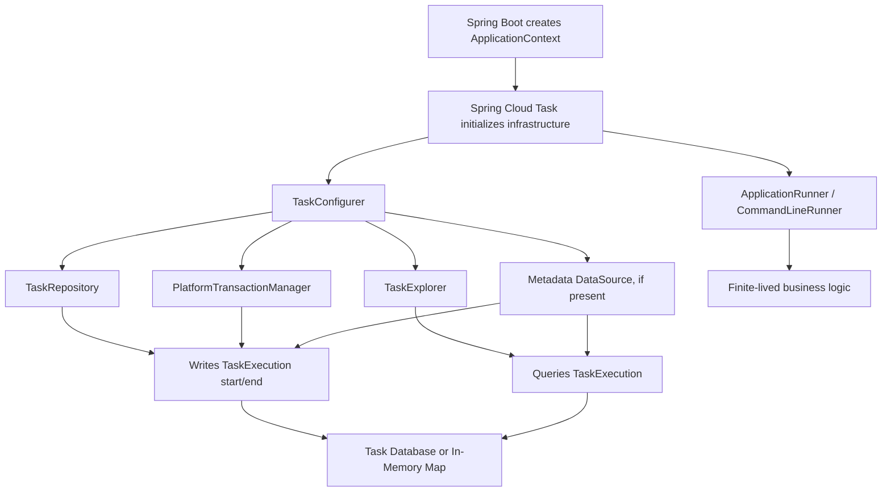
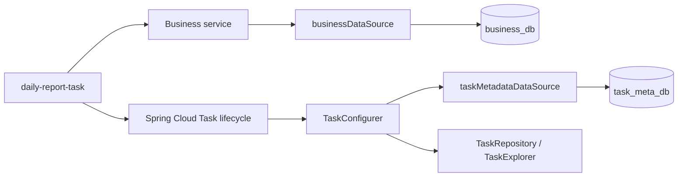
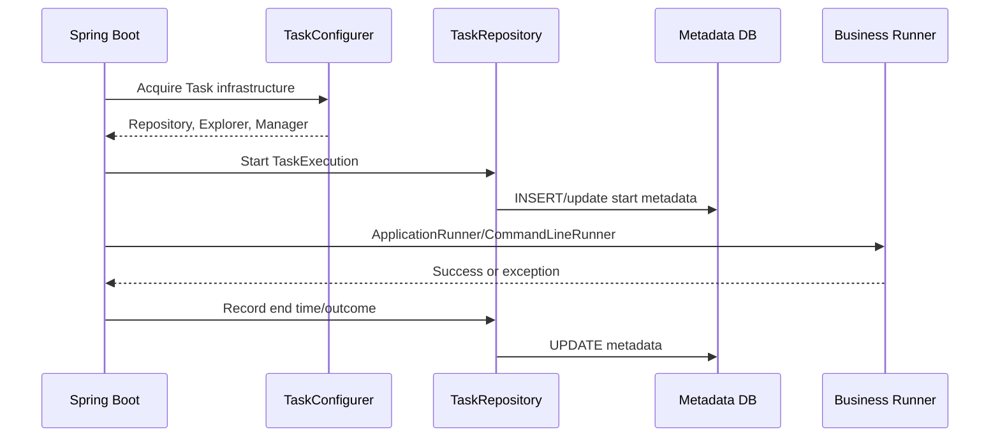

# TaskConfigurer and DefaultTaskConfigurer

## Lesson Objectives

**SPRING_CLOUD_TASK (Spring Cloud Task)** is used to build finite-lived Spring Boot applications: they receive a request or are triggered on a schedule, execute business logic, and exit. The framework records the timing, status, and outcome of each execution in `TaskRepository` so you can monitor runs, analyze failures, and coordinate with Spring Batch when needed.

In the **Advanced Configuration** chapter, `TaskConfigurer` and `DefaultTaskConfigurer` are the two components that determine **how the infrastructure for storing and querying Task execution data is set up**. This lesson helps you:

- Understand the role, methods, and responsibility boundaries of `TaskConfigurer`.
- Know how `DefaultTaskConfigurer` selects a storage mechanism and transaction manager when a `DataSource` is or is not present.
- Distinguish when default configuration suffices from scenarios requiring a custom `TaskConfigurer`.
- Configure a dedicated metadata store when an application has multiple `DataSource` beans, including when business logic uses Spring Batch.
- Align `DataSource`, schema, table prefix, and transaction manager to avoid writing metadata to the wrong place.
- Verify `TaskExecution` recording, handle startup errors, and deploy safely.

## 1. Where Does TaskConfigurer Fit in the Architecture?

A Spring Cloud Task run is typically recorded as follows:



`TaskConfigurer` is a **strategy interface**: it returns the components Spring Cloud Task uses to manage metadata. This interface does **not** directly define the business work to be performed and does **not** determine the Task schedule. The scheduler, request API, or orchestration platform is responsible for launching the process; `ApplicationRunner` or `CommandLineRunner` performs the actual work.

In a typical application with a single valid `DataSource`, Spring Cloud Task can automatically create a `DefaultTaskConfigurer` and record metadata via JDBC. In complex applications with multiple data sources or custom infrastructure requirements, you provide a `TaskConfigurer` bean to specify the exact metadata source and its companion components.

**Distinction:** `TaskConfigurer` configures infrastructure; `TaskRepository` creates/updates executions; `TaskExplorer` queries executions. Do not put report generation, order synchronization, or Batch Job launching inside configurer getters.

## 2. The Four Methods of TaskConfigurer

The interface in package `org.springframework.cloud.task.configuration` declares four main methods:

```java
// Illustrates the TaskConfigurer API signature, not a class you need to create yourself.
public interface TaskConfigurer {
    TaskRepository getTaskRepository();
    TaskExplorer getTaskExplorer();
    PlatformTransactionManager getTransactionManager();
    DataSource getTaskDataSource();
}
```

| Method | Provided object | Purpose |
| --- | --- | --- |
| `getTaskRepository()` | `TaskRepository` | Creates, starts, updates, and completes `TaskExecution`; records execution status. |
| `getTaskExplorer()` | `TaskExplorer` | Reads and searches `TaskExecution` history, such as by ID or Task name. |
| `getTransactionManager()` | `PlatformTransactionManager` | Manages transactions related to updating Task metadata. |
| `getTaskDataSource()` | `DataSource`, which may be `null` in non-JDBC mode | Specifies the connection source used for Task metadata operations. |

The three most frequently mentioned components are `TaskRepository`, `TaskExplorer`, and `PlatformTransactionManager`; the fourth method, `getTaskDataSource()`, is critical in applications with multiple connection sources.

These methods are used by Spring Cloud Task as an **infrastructure provider contract**. The API documentation advises against calling `TaskConfigurer` getters directly from business code, except when using them to expose the corresponding beans. In regular services, inject `TaskRepository`, `TaskExplorer`, or the appropriate business repository directly.

### How Does TaskRepository Differ from TaskExplorer?

For example, suppose an operator needs to inspect yesterday's report export history:

- `TaskRepository` is the framework component used to record execution state transitions. It is not a repository for `ORDERS`, `REPORT`, or business tables.
- `TaskExplorer` is the metadata access point for **reading/querying**, convenient when building dashboards or administrative endpoints.
- Both must reference **the same logical metadata store**. If the repository writes to `task_db_A` while the explorer reads `task_db_B`, the dashboard may report "not found" even though the Task actually ran.

## 3. What Does DefaultTaskConfigurer Provide?

`DefaultTaskConfigurer` is the default `TaskConfigurer` implementation. If no custom `TaskConfigurer` bean exists, Spring Cloud Task uses the default strategy matching the configured components.

| Condition | `TaskRepository` | `TaskExplorer` | Transaction manager |
| --- | --- | --- | --- |
| Metadata `DataSource` present | `SimpleTaskRepository` using JDBC storage, typically `JdbcTaskExecutionDao` | `SimpleTaskExplorer` querying JDBC metadata | Typically `JdbcTransactionManager` in modern versions; may vary by version or JPA integration. |
| No suitable `DataSource` | `SimpleTaskRepository` with a `Map`-based DAO | `SimpleTaskExplorer` querying in-memory data | `ResourcelessTransactionManager`. |

`SimpleTaskRepository` is the **repository layer**; JDBC or Map is the storage strategy handled by the underlying DAO. Therefore, "no DataSource" does not mean a persistent database is automatically used. In-memory Map data is lost when the process exits and must not be used for production Task history.

Spring Cloud Task documentation also describes H2 configuration for quick development setup. If Spring Boot auto-configures an H2 `DataSource` because the driver/dependencies are on the classpath, `DefaultTaskConfigurer` can take the **JDBC branch** using H2; this is different from the **Map branch** when no `DataSource` exists. Do not equate "in-memory H2" with "Map-based repository".

### Constructors to Know

In the Spring Cloud Task 3.0.x API, common constructors are:

```java
new DefaultTaskConfigurer();
new DefaultTaskConfigurer(dataSource);
new DefaultTaskConfigurer(tablePrefix);
new DefaultTaskConfigurer(dataSource, tablePrefix, applicationContext);
```

Their purposes are, respectively: using defaults, selecting a specific `DataSource`, choosing a table prefix, or configuring both `DataSource` and table prefix within the context. **Signatures can change across versions**: check the Javadoc of the release you use before copying multi-argument constructors.

Notably, `DefaultTaskConfigurer` lets you reuse framework-tested defaults. In most cases where customization is needed, **pass the right `DataSource` to `DefaultTaskConfigurer`** instead of rewriting `TaskRepository`, `TaskExplorer`, or the transaction manager from scratch.

## 4. When Is a Custom TaskConfigurer Not Needed?

An application with **one `DataSource`** shared by both Task metadata and business data typically only needs Spring Boot configuration:

```yaml
# application-local.yml — development example with a shared PostgreSQL database
spring:
  application:
    name: daily-report-task
  main:
    web-application-type: none
  datasource:
    url: jdbc:postgresql://localhost:5432/taskdemo
    username: demo
    password: ${LOCAL_DB_PASSWORD}
  cloud:
    task:
      name: daily-report-task
      initialize-enabled: false
```

The example assumes the metadata schema is already installed, hence `initialize-enabled: false`. If the development environment wants the framework to auto-initialize the schema, verify that your database and version support that mechanism. Do not replace production migration management by enabling schema auto-creation on every run.

With a single unambiguous `DataSource` and no custom `TaskConfigurer`, the default configuration is usually sufficient to persist execution history. Adding a `@Bean TaskConfigurer` just to return that same `DataSource` without special requirements increases complexity and can alter auto-configuration behavior.

Choosing **no customization** is appropriate when:

1. Only one data source is used for Task metadata.
2. The schema and permissions are already correct, and metadata is persisted durably.
3. No special table prefix or dedicated transaction manager is required.
4. You have tested that the Task starts, writes outcomes, and can be queried via `TaskExplorer`.

## 5. Important Case: Two Independent DataSources

**Problem:** A task reads orders from the business database `business_db`, but `TaskExecution` history must be stored in the metadata database `task_meta_db`. Both reside on the same or different PostgreSQL servers.

The separation to achieve:



When multiple `DataSource` beans exist, merely naming them `businessDataSource` and `taskMetadataDataSource` is **not enough** for Spring Cloud Task to know which store should hold `TASK_EXECUTION`. You must provide a `TaskConfigurer` bean that routes metadata to the chosen connection source.

### 5.1. Declaring Two Connection Sources

Spring Boot example with JDBC and HikariCP:

```yaml
# application-prod.yml
app:
  datasource:
    business:
      url: ${BUSINESS_DB_URL}
      username: ${BUSINESS_DB_USER}
      password: ${BUSINESS_DB_PASSWORD}
    task:
      url: ${TASK_DB_URL}
      username: ${TASK_DB_USER}
      password: ${TASK_DB_PASSWORD}

spring:
  main:
    web-application-type: none
  cloud:
    task:
      name: daily-report-task
      initialize-enabled: false
```

`BUSINESS_DB_URL` and `TASK_DB_URL` could be `jdbc:postgresql://business-db:5432/orders` and `jdbc:postgresql://metadata-db:5432/taskmeta`, respectively. Both schemas are prepared separately, and passwords are provided via a secret manager or environment variables at deployment time.

Create two `DataSourceProperties` beans and two `DataSource` beans:

```java
package com.example.report.config;

import javax.sql.DataSource;

import com.zaxxer.hikari.HikariDataSource;
import org.springframework.beans.factory.annotation.Qualifier;
import org.springframework.boot.autoconfigure.jdbc.DataSourceProperties;
import org.springframework.boot.context.properties.ConfigurationProperties;
import org.springframework.context.annotation.Bean;
import org.springframework.context.annotation.Configuration;
import org.springframework.context.annotation.Primary;

@Configuration(proxyBeanMethods = false)
public class MultiDataSourceConfiguration {

    @Bean("businessDataSourceProperties")
    @Primary
    @ConfigurationProperties("app.datasource.business")
    DataSourceProperties businessDataSourceProperties() {
        return new DataSourceProperties();
    }

    @Bean("businessDataSource")
    @Primary
    DataSource businessDataSource(
            @Qualifier("businessDataSourceProperties")
            DataSourceProperties properties) {
        return properties.initializeDataSourceBuilder()
                .type(HikariDataSource.class)
                .build();
    }

    @Bean("taskMetadataDataSourceProperties")
    @ConfigurationProperties("app.datasource.task")
    DataSourceProperties taskMetadataDataSourceProperties() {
        return new DataSourceProperties();
    }

    @Bean("taskMetadataDataSource")
    DataSource taskMetadataDataSource(
            @Qualifier("taskMetadataDataSourceProperties")
            DataSourceProperties properties) {
        return properties.initializeDataSourceBuilder()
                .type(HikariDataSource.class)
                .build();
    }
}
```

`@Primary` on the business source gives beans without an explicit qualifier a default choice. It **does not replace** explicitly choosing the Task data source. If the application uses JPA or Spring Batch, `DataSource` and transaction manager selection for those frameworks must also be configured explicitly.

For the snippet to work, the project needs the appropriate dependencies: Spring Cloud Task starter, Spring JDBC, PostgreSQL JDBC driver, and HikariCP connection pool. Spring Boot typically provides HikariCP when using the JDBC starter; verify the dependency tree for your actual release.

### 5.2. Declaring TaskConfigurer to Select the Right DataSource

`DefaultTaskConfigurer(DataSource)` accepts a specific connection source. Create a `TaskConfigurer` bean:

```java
package com.example.report.config;

import javax.sql.DataSource;

import org.springframework.beans.factory.annotation.Qualifier;
import org.springframework.cloud.task.configuration.DefaultTaskConfigurer;
import org.springframework.cloud.task.configuration.TaskConfigurer;
import org.springframework.context.annotation.Bean;
import org.springframework.context.annotation.Configuration;

@Configuration(proxyBeanMethods = false)
public class TaskMetadataConfiguration {

    @Bean
    TaskConfigurer taskConfigurer(
            @Qualifier("taskMetadataDataSource") DataSource taskDataSource) {
        return new DefaultTaskConfigurer(taskDataSource);
    }
}
```

In this example:

- `businessDataSource` serves queries against the `ORDERS` table and business logic.
- `taskMetadataDataSource` is passed into `DefaultTaskConfigurer` to build the `TaskRepository`/`TaskExplorer` metadata infrastructure.
- The application-supplied `TaskConfigurer` bean is an explicit configuration, so the framework does not create another default `DefaultTaskConfigurer`.
- The Spring Cloud Task library still handles creating and updating `TaskExecution` during the application lifecycle.

The example uses the `DefaultTaskConfigurer(DataSource)` constructor present in the referenced API. If your project uses a version with a different signature, adjust according to that version's Javadoc.

### 5.3. Running the Runner Against the Business Repository

Task logic should only use `businessDataSource` (or a business repository configured from that source). Do not call `taskConfigurer.getTaskRepository()` to write report results into metadata:

```java
package com.example.report;

import javax.sql.DataSource;

import org.springframework.beans.factory.annotation.Qualifier;
import org.springframework.boot.ApplicationRunner;
import org.springframework.context.annotation.Bean;
import org.springframework.context.annotation.Configuration;

@Configuration
class ReportRunnerConfiguration {

    @Bean
    ApplicationRunner reportRunner(
            @Qualifier("businessDataSource") DataSource businessDataSource) {
        return arguments -> {
            try (var connection = businessDataSource.getConnection()) {
                // In a real project, move this logic into a service/repository.
                if (!connection.isValid(5)) {
                    throw new IllegalStateException(
                            "Unable to connect to the business database");
                }
            }
        };
    }
}
```

This runner only checks the connection to illustrate **how the two DataSources are wired**, without generating a report yet. When replacing it with export logic, validate per-run arguments, ensure idempotency, and let fatal errors propagate so the framework records a failure outcome.

## 6. Transaction Managers for Metadata and Business Logic

`TaskConfigurer.getTransactionManager()` is dedicated to Task metadata updates. In an application with multiple databases, that transaction manager **must not be confused** with the transaction manager for business repositories or Spring Batch's `JobRepository`.

Task example:

1. Read the list of orders from `business_db`.
2. Export the report to object storage.
3. Spring Cloud Task updates completion time and exit code in `task_meta_db`.

The three operations do not automatically belong to **a single distributed transaction**. A network failure in step 3 can leave the report created while metadata lacks the final result. Conversely, metadata might record an error while business work was only partially executed.

| Transaction | Data to protect | Transaction manager choice |
| --- | --- | --- |
| Task metadata transaction | Task tables such as `TASK_EXECUTION`, `TASK_EXECUTION_PARAMS` | Manager provided by `TaskConfigurer` for `taskMetadataDataSource`. |
| Order transaction | Order/report tables in `business_db` | Dedicated manager for the business data source. |
| Spring Batch transaction, if present | `BATCH_JOB_EXECUTION` metadata and/or business steps as designed | Explicitly configure Batch per the Job/Step `DataSource` and transaction manager. |

In modern Spring Cloud Task versions, `DefaultTaskConfigurer` typically uses `JdbcTransactionManager` when a `DataSource` is present and `ResourcelessTransactionManager` when using a Map; older versions may use `DataSourceTransactionManager`. When EntityManager/JPA and multiple `DataSource` beans are present, verify the exact manager created to avoid accidentally tying Task metadata to the business database's transaction manager.

If a custom manager is needed, you can implement `TaskConfigurer` yourself or extend `DefaultTaskConfigurer` and override `getTransactionManager()`, **but you must verify** that the repository, explorer, and manager all end up pointing to the right resource. Never override a single getter just to rename things without understanding its impact on the remaining components.

**Operational principle:** Do not expect updating `TaskExecution` to automatically roll back all changes from business work. When error handling or reruns are needed, design business keys, checkpoints, upserts, or an appropriate transaction coordination mechanism.

## 7. Table Prefix and Task Schema

By default, Spring Cloud Task uses the `TASK_` table prefix, such as `TASK_EXECUTION` and `TASK_EXECUTION_PARAMS`. If multiple task groups share a database or must query within a specific schema, you can customize the table prefix.

With **default auto-configuration**, Spring Cloud Task supports the property:

```properties
spring.cloud.task.tablePrefix=ARCHIVE_TASK_
```

When using a new prefix, the metadata schema must contain **the exact set of tables and ID-generating objects** matching compatible DDL. Changing the prefix in properties does not automatically create or migrate the tables and sequences. Check database dialect, schema, permissions, and Spring Cloud Task version.

### When You Have Created a Custom TaskConfigurer

An easily overlooked detail: if the application creates its own `TaskConfigurer` bean via the single-argument constructor `new DefaultTaskConfigurer(taskDataSource)`, you should not assume the framework **automatically re-applies** all `spring.cloud.task.*` values to the application-provided configurer.

With an API that provides the full constructor, you can pass the prefix explicitly:

```java
package com.example.report.config;

import javax.sql.DataSource;

import org.springframework.beans.factory.annotation.Qualifier;
import org.springframework.beans.factory.annotation.Value;
import org.springframework.cloud.task.configuration.DefaultTaskConfigurer;
import org.springframework.cloud.task.configuration.TaskConfigurer;
import org.springframework.context.ApplicationContext;
import org.springframework.context.annotation.Bean;
import org.springframework.context.annotation.Configuration;

@Configuration(proxyBeanMethods = false)
class TaskMetadataPrefixConfiguration {

    @Bean
    TaskConfigurer taskConfigurer(
            @Qualifier("taskMetadataDataSource") DataSource dataSource,
            ApplicationContext applicationContext,
            @Value("${app.task.table-prefix:TASK_}") String prefix) {
        return new DefaultTaskConfigurer(
                dataSource, prefix, applicationContext);
    }
}
```

The snippet above is an **alternative** to the `taskConfigurer` bean in Section 5.2; do not declare both in the same application. The `(DataSource, String, ApplicationContext)` constructor is documented in the Spring Cloud Task 3.0.x API; check the signature against your project's version.

Configuration example:

```yaml
app:
  task:
    table-prefix: ARCHIVE_TASK_
```

Use a single consistent configuration source for the prefix, ensure schema migrations create all matching tables, and verify Task queries succeed. If the standard `TASK_` prefix is sufficient, this special configuration is usually unnecessary.

## 8. Schema Initialization and TaskRepository Lifecycle

`DefaultTaskConfigurer` builds metadata access components, but **does not replace schema management**. To write `TaskExecution` via JDBC, the database must have compatible tables/sequences and the connection account must have the required permissions.

In production, common practice is:

1. Choose compatible Spring Boot and Spring Cloud Task versions along with the JDBC driver.
2. Obtain the metadata DDL matching your exact version and RDBMS.
3. Apply migrations before deploying the Task; decide on a fixed schema/table prefix.
4. Set `spring.cloud.task.initialize-enabled=false` to avoid multiple processes racing to create tables.
5. Grant appropriate SELECT/INSERT/UPDATE privileges and restrict DDL privileges for the task runtime account.
6. Run a smoke test and verify the actual record in `TaskRepository`.

A typical Spring Cloud Task run:



Per the Spring Cloud Task lifecycle, infrastructure must initialize successfully before runners execute. If metadata connection or schema fails **right during startup**, no execution record may be written. Use startup logs and scheduler-level process status to supplement `TASK_EXECUTION` data.

## 9. Coordinating with Spring Batch

Spring Cloud Task manages **a single application run**, whereas Spring Batch manages `Job` and `Step` execution for batch processing. When a Spring Cloud Task application uses Spring Batch, there are usually at least two repository concepts:

- `TaskRepository`: stores `TaskExecution` metadata for the entire finite process.
- `JobRepository`: stores `JobInstance`, `JobExecution`, and `StepExecution` metadata for Spring Batch.

The two repositories may share a database or be separated depending on security, availability, and operational requirements. Configuring `TaskConfigurer` to switch `TaskRepository` **does not automatically determine** the database for `JobRepository`. You must explicitly configure Spring Batch according to your version's API, especially when multiple `DataSource` or `PlatformTransactionManager` beans exist.

Example pipeline:

```text
Scheduler
   └─ Spring Cloud Task (TaskExecution ID = 420)
       └─ Spring Batch Job (JobExecution ID = 77)
           ├─ Step 1: read orders from business_db
           └─ Step 2: write report
```

`420` and `77` are two different IDs. A Job failure must be properly reflected out to the Task process, not merely logged at the Batch layer. Likewise, the final statuses of Task and Batch must be reconcilable to detect cases of incomplete metadata updates.

If the application combines Spring Batch with custom runners, verify Spring Boot/Batch's auto-run Job mechanism so the same Job is not launched twice. Configuring a custom TaskConfigurer does not automatically prevent that.

## 10. Environment-Specific Storage and Safe Operations

| Environment | Recommended metadata setup | Purpose |
| --- | --- | --- |
| `local` | H2 or a developer-owned PostgreSQL instance; schema initialization may be allowed in controlled tests. | Development and single-run verification. |
| `test` | Isolated database/schema or containerized PostgreSQL; version-matched migrations. | Real testing of repository operations, transactions, and failures. |
| `staging` | Structure close to production; dedicated secrets, migrated schema. | Testing deployment paths, timeouts, and scheduler integration. |
| `prod` | Persistent metadata store, backups, least privilege, and controlled migrations. | Tracking results across runs; incident handling and reconciliation. |

Keep the same application artifact between staging and production, injecting connection details/secrets from the deployment environment. When using multiple `DataSource` beans, configuration logs should only print **bean identifiers**, environment name, logical schema, and Task name—never passwords or URLs containing credentials.

Schedules via cron, Kubernetes CronJob, or orchestration platforms must launch finite Task processes. `TaskConfigurer` does not create schedules, does not auto-retry, and does not guarantee only one process runs for the same data period. For safety, configure concurrency limits in the scheduler, add business locks/idempotency, and set appropriate timeouts.

## 11. Common Configuration Mistakes

| Symptom | Possible cause | How to diagnose/fix |
| --- | --- | --- |
| Multiple `DataSource` beans and startup fails with ambiguous bean error | Missing `@Qualifier`, `@Primary`, or explicit TaskConfigurer. | Specify the metadata DataSource in the `TaskConfigurer` bean; configure business beans explicitly. |
| Task runs, but `TASK_EXECUTION` is missing from the expected database | Configurer points to a different database or fell back to Map. | Check the configured `getTaskDataSource()`, effective JDBC URL, and schema; query the intended metadata store too. |
| `BadSqlGrammarException` or table-does-not-exist error | Missing DDL or mismatched table prefix/schema. | Check migrations and table names for your version. |
| Insufficient privilege error when writing metadata | DB user only has SELECT or lacks sequence privileges. | Grant least-privilege permissions sufficient for metadata. |
| Repository can read, but cannot write | Inconsistent Repository/Explorer or transaction manager wired to the wrong source. | Verify all four components of the configurer map to the same logical store. |
| Task finishes exporting data, but metadata reports an error | Lost connection to Task DB during completion. | Cross-check business logs, process status, and metadata; handle safe reruns. |
| Added TaskConfigurer, yet table prefix did not change as expected | Custom configurer did not receive the same prefix setting. | Pass the prefix explicitly to a supported constructor or rely on the auto-configuration path. |
| Tests using Map PASS, but production JDBC fails | DDL, permissions, dialect, and real transactions were never tested. | Add integration tests against a real/production-equivalent database. |
| Task transaction manager confused with Batch's manager | Multiple repositories/DataSources lack explicit wiring. | Configure and test Task repository, Batch repository, and business transactions separately. |

**Note:** If an exception occurs inside an `ApplicationRunner`, let critical errors propagate rather than merely logging and returning normally. That gives the orchestration system a clear failure signal; in the specific case where the metadata database itself is down, continue monitoring exit codes and process-level logs.

## 12. Testing the Configuration Path Properly

A real test must verify **where metadata is stored**, not merely that Spring creates a `TaskConfigurer` bean.

### 12.1. Verifying When the Application Runs

Launch with the profile that defines two `DataSource` beans and a sample business parameter:

```bash
java -jar daily-report-task.jar \
  --spring.profiles.active=prod \
  --businessDate=2026-11-23
```

After the Task finishes, query the **metadata database**:

```sql
SELECT TASK_EXECUTION_ID,
       TASK_NAME,
       START_TIME,
       END_TIME,
       EXIT_CODE
FROM TASK_EXECUTION
WHERE TASK_NAME = 'daily-report-task'
ORDER BY TASK_EXECUTION_ID DESC;
```

Note that the SQL uses the default schema and prefix; if `ARCHIVE_TASK_` is used, update the table name accordingly. `TASK_EXECUTION_ID` identifies a single run; `TASK_NAME` repeats across scheduled runs. Confirm the new run appears in **task_meta_db**, not `business_db`.

### 12.2. Using TaskExplorer for Lookups

Code example once the framework provides the `TaskExplorer` bean:

```java
package com.example.report.monitoring;

import org.springframework.cloud.task.repository.TaskExecution;
import org.springframework.cloud.task.repository.TaskExplorer;
import org.springframework.stereotype.Service;

@Service
public class TaskStatusReader {

    private final TaskExplorer taskExplorer;

    public TaskStatusReader(TaskExplorer taskExplorer) {
        this.taskExplorer = taskExplorer;
    }

    public TaskExecution getExecution(long executionId) {
        TaskExecution execution =
                taskExplorer.getTaskExecution(executionId);
        if (execution == null) {
            throw new IllegalArgumentException(
                    "TaskExecution not found: " + executionId);
        }
        return execution;
    }
}
```

This code looks up by real ID in the metadata store without calling `taskConfigurer.getTaskExplorer()` directly. For user-facing status APIs, enforce authorization checks so other teams' executions are not exposed; never return raw stack traces or arguments containing sensitive data.

### 12.3. Test Matrix

| Scenario | Action | Expected result to verify |
| --- | --- | --- |
| Single `DataSource` | Omit custom configurer bean, use default JDBC. | Task writes and queries `TaskExecution`. |
| Two `DataSource` beans, valid | Supply `taskMetadataDataSource` to `DefaultTaskConfigurer`. | Metadata appears only in the chosen Task store. |
| Pointing to wrong database | Intentionally select a DB without Task schema in a test environment. | Startup/lifecycle fails; no false success reported. |
| Schema missing a table | Drop one table in an isolated test database. | Clear SQL error observed; fixed via migration. |
| Custom prefix | Provide a new prefix and matching schema. | Repository/Explorer both read and write tables with the new prefix. |
| Business error | Runner throws an exception after Task starts. | Failure signal emitted; metadata recorded if database is healthy. |
| Metadata connection lost | Disconnect Task DB in a controlled test. | Orchestrator state and logs still reveal the incident. |
| With Spring Batch | Run a short Job alongside the Task. | `TaskExecution` and `JobExecution` land in the right stores with accurate IDs and outcomes. |

Do not auto-create schemas from Java code on every test run just to make tests pass. Prepare migrations ahead of time and keep test results reproducible.

## 13. Comprehensive Practice Exercise

**Scenario:** A company deploys `daily-report-task` to run nightly. Reports read data from `business_db`, while operations needs to inspect failure history and duration in `task_meta_db`. Some large reports use Spring Batch.

1. Create a Spring Boot application with Spring Cloud Task, a runner accepting `--businessDate=yyyy-MM-dd`, and a simulated report export service.
2. Configure two `DataSource` beans and create a `TaskConfigurer` bean returning `new DefaultTaskConfigurer(taskMetadataDataSource)`.
3. Create the metadata schema matching your Spring Cloud Task version in `task_meta_db`, using `initialize-enabled=false` at runtime.
4. Run the Task successfully and query `TASK_EXECUTION` in `task_meta_db`; verify no Task records exist in the business database.
5. Temporarily point the `TaskConfigurer` bean to the wrong source in a test environment to observe the failure; restore the right configuration.
6. Try a variant with a custom table prefix once the schema is prepared, ensuring both writes and lookups work.
7. Add a simple Spring Batch Job; distinguish Task metadata configuration, Batch metadata configuration, and business data transactions.
8. Simulate a runner exception and a metadata connection loss; compare Task records with logs and process status.

**Completion criteria:** you can explain the role of all four `TaskConfigurer` methods; select the right `DataSource` for `DefaultTaskConfigurer`; verify metadata in the intended database; understand multi-source transaction limits; and detect cases where a Task ran without metadata being recorded accurately.

## 14. References

- [Spring Cloud Task — Features, Configuration, and TaskConfigurer](https://docs.spring.io/spring-cloud-task/reference/features.html): guide to default behavior, multiple DataSources, table prefixes, and extending TaskConfigurer.
- [TaskConfigurer — API](https://docs.spring.io/spring-cloud-task/docs/current/apidocs/org/springframework/cloud/task/configuration/TaskConfigurer.html): signatures of the four interface methods.
- [DefaultTaskConfigurer — API](https://docs.spring.io/spring-cloud-task/docs/current/apidocs/org/springframework/cloud/task/configuration/DefaultTaskConfigurer.html): constructors and default getters.

The Java examples here are based on the Spring Cloud Task API found in the references above. Documentation versions and dependency versions may differ; lock down compatibility among Spring Boot, Spring Cloud Task, and Spring Batch before deploying to production.

## Key Takeaways

- `TaskConfigurer` is the **infrastructure configuration extension point** for `TaskRepository`, `TaskExplorer`, `PlatformTransactionManager`, and the metadata `DataSource`.
- `DefaultTaskConfigurer` provides default implementations; **with a DataSource** it typically uses JDBC, while **without a DataSource** it can fall back to an in-memory Map suitable only for short-lived development.
- A single unambiguous `DataSource` usually needs no custom configurer; **with multiple DataSources**, explicitly point to the metadata source via a `TaskConfigurer` bean.
- Table prefix, schema, DB permissions, and transaction manager must **align with the chosen Task store**; repository configuration does not replace migrations.
- Spring Batch, business transactions, and the scheduler each have separate responsibilities. Monitor final outcomes using Task metadata, business outputs, and process exit status together.
