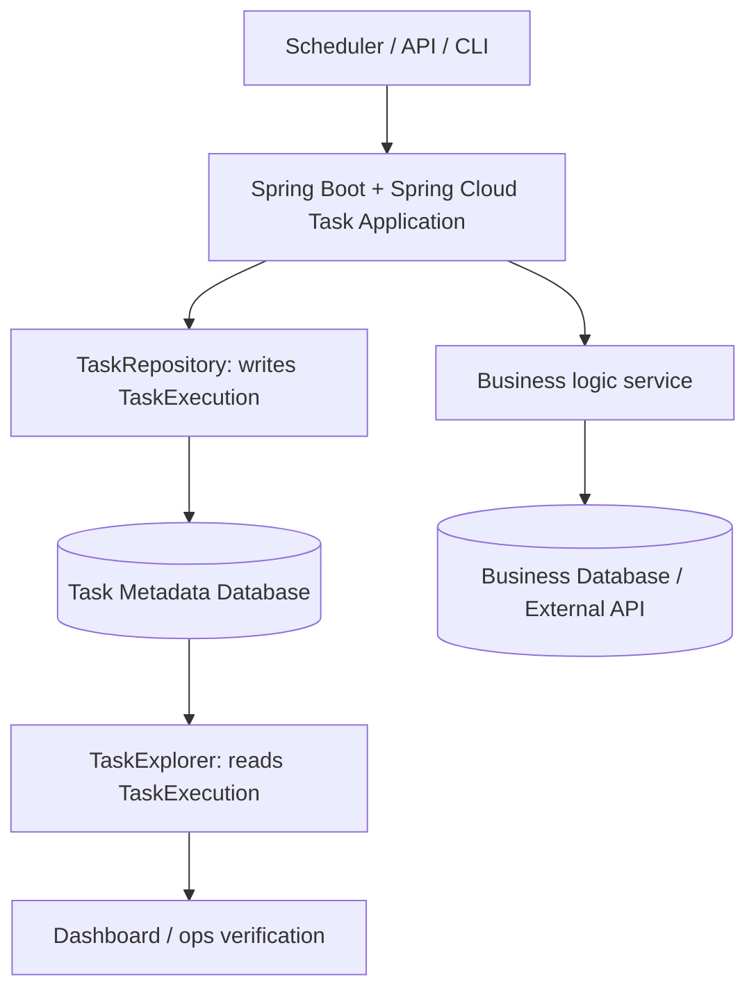
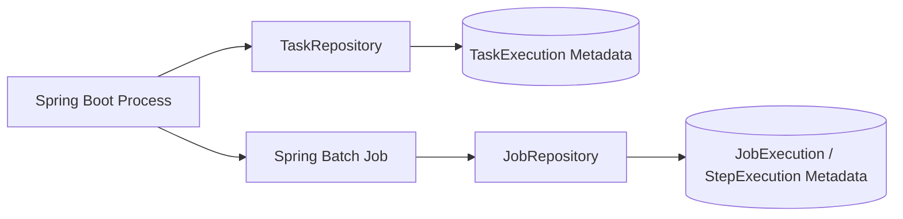

# Customizing TaskRepository and TaskExplorer in Spring Cloud Task

## 1. Goals and Context

In the **Advanced Configuration** chapter, we explore how to change the storage and query mechanisms for **Spring Cloud Task** execution data while preserving the lifecycle of a **finite-lived Spring Boot** application. The goal is not to rewrite every framework component; the goal is to know **which points are configurable, which need extension, and which data contracts must be preserved**.

A scheduled reconciliation task may start from a Kubernetes CronJob, process business data, record results, and exit. Spring Cloud Task uses **TaskRepository** to record runs and **TaskExplorer** to read history. As the application grows, you may need to place metadata in a separate database, change table prefixes, isolate read permissions, integrate dashboards, or extend lookups by time range and orchestrator.

After this lesson, you will be able to:

- Distinguish the write and read responsibilities of `TaskRepository` and `TaskExplorer`.
- Explain when to keep default JDBC configuration and when to use `TaskConfigurer` or a supplementary query layer.
- Route Task metadata to a dedicated datasource and prepare the matching schema.
- Design table prefix changes, parameterized SQL reads, pagination, and secure access control.
- Handle connection errors, transactions, missing query data, retries, and concurrent runs.
- Distinguish Task Repository from `JobRepository` when coordinating with **Spring Batch**.

> **Version note:** Spring Cloud Task, Spring Boot, and Spring Batch evolve across release trains with compatibility constraints. Constructor APIs, configuration properties, and schema auto-initialization mechanisms may vary by version. The illustrative snippets below apply only when your project uses a version providing the corresponding API; verify the dependency and DDL of your deployed version before copying into production.

## 2. Two Interfaces with Different Responsibilities

### `TaskRepository`: Where the Execution Lifecycle Is Written

`TaskRepository` is the contract Spring Cloud Task uses to **create, start, update, and complete** `TaskExecution` metadata. Each application run can receive a `TASK_EXECUTION_ID`, start time, completion outcome, error message, and related fields. When configured for JDBC, these operations map to the metadata schema in the database.

While the task is still running, a row may have `START_TIME` without `END_TIME`. When the framework records completion, the repository updates the data for that same run. Manually altering timestamps or exit codes via SQL outside framework management easily corrupts history.

### `TaskExplorer`: Where History Is Read and Queried

`TaskExplorer` is meant for **viewing** `TaskExecution` records, such as looking up a run by ID or reading runs for a task name. A dashboard can use this data to answer: "Has the 02:00 run finished?", "What was the exit code?", or "Did a retry request create a new run?".

Normally, `TaskExplorer` is a **read API** and does not replace the `TaskRepository` write path. If a dashboard needs a specialized query that the standard interface does not offer, you can build a **dedicated query service** reading from the metadata schema with proper permissions and load limits.

| Aspect | `TaskRepository` | `TaskExplorer` |
| --- | --- | --- |
| Purpose | Manages and updates lifecycle metadata | Reads, filters, and queries executions |
| Typical usage | Framework at task start/end; orchestrators authorized to update links | Dashboards, history inspection CLI, operations support services |
| Risk if customized poorly | Lost records, duplicate IDs, inconsistent outcomes | Missing data, slow queries, information leakage |
| Critical contract | Consistently create and complete a run safely under concurrency | Return accurate data by ID/name without turning reads into writes |
| Related components | `TaskExecution`, lifecycle mechanism, storage transactions | `TaskExecution`, datasource/schema, pagination/queries |

**A datasource holding metadata does not mean all business operations live inside the same transaction.** A task may write to a business database and an independent metadata database; the system must design retries and idempotency around that boundary.

## 3. Default Data Flow and Customization Points



You can modify the architecture at several levels:

1. **Configuration:** change database URL, credentials, connection pool, schema initialization policy, or table prefix without changing Java interfaces.
2. **Datasource/transaction selection:** assign a dedicated data source for Task metadata, especially when the application has multiple datasources.
3. **Specialized read layer:** keep the standard `TaskExplorer` and add a SQL query service with filtering, pagination, and DTO mapping for dashboards.
4. **Custom repository/explorer implementation:** deeply replace the storage mechanism when standard configurations fall short; in doing so you must satisfy lifecycle, concurrency, and consistency contracts.

Most projects should start at **level 1 or 2**. Level 3 fits reporting needs; level 4 is usually reserved for special storage constraints backed by thorough integration tests.

## 4. JDBC Configuration for the Default TaskRepository

### 4.1. Persistent Metadata Database

Example of an application using PostgreSQL to retain history after the task process exits:

```yaml
spring:
  application:
    name: daily-sync-task
  main:
    web-application-type: none
  datasource:
    url: jdbc:postgresql://localhost:5432/task_metadata
    username: task_app
    password: ${TASK_DB_PASSWORD}
  cloud:
    task:
      name: daily-sync
```

You need `spring-cloud-starter-task`, the JDBC driver, compatible Spring Boot/Spring Cloud versions, and the **version-matched Task metadata schema**. Spring Boot configuration can build the datasource from `spring.datasource.*`, and Spring Cloud Task components use the appropriate datasource to persist history.

For local development, an embedded database can be convenient for quick experiments. For operations, an in-memory-only database is usually unsuitable because **history disappears when the task exits**. Use a durable database with backups and a controlled retention policy.

### 4.2. Do Not Treat Auto-Initialized Schemas as a Production Guarantee

Spring Cloud Task provides DDL/schemas for supported databases. How the framework creates tables automatically can depend on the release, database, and configuration flags. In production, manage schemas with versioned migrations, verify privileges, and inspect the DDL from the **exact dependency running in production**.

Typical schema components include the `TASK_EXECUTION` table, execution parameter data, and dialect-specific ID/sequence structures. **Do not assume** sequence names, column names, or SQL types are identical across PostgreSQL, MySQL, Oracle, and H2.

Example history check query with the default-prefix schema:

```sql
SELECT TASK_EXECUTION_ID, TASK_NAME,
       START_TIME, END_TIME, EXIT_CODE
FROM TASK_EXECUTION
ORDER BY TASK_EXECUTION_ID DESC;
```

From the results, a blank `END_TIME` only tells you the framework **has not recorded completion yet**; the task may still be running, may have been forcefully killed, or may have failed to update metadata. Compare with process/container telemetry.

## 5. Changing the Table Prefix and Separating Schemas

When one database holds metadata for multiple applications or environments, you may need tables with a different prefix instead of the default names. Spring Cloud Task provides a **table prefix** configuration mechanism for JDBC metadata in versions supporting that property.

Illustrative example:

```yaml
spring:
  cloud:
    task:
      table-prefix: APP_TASK_
```

When supported by the current version, Task JDBC DAOs access tables and schema objects named with the corresponding prefix. **Changing only the property is not enough**: you must create tables, sequences, or ID-generating structures with matching names using the DDL/migrations of that exact version.

Before putting it into production, check:

- Whether the DDL actually creates all tables, sequences, and supporting objects with the right names after adding the prefix.
- Case conventions, default schema, and how the database resolves object names.
- Permissions of the task account on **every** object requiring read/write access, including ID-generating structures.
- Whether `TaskExplorer` uses the same table prefix and schema as `TaskRepository`.
- Whether dashboards and custom SQL queries have been updated with the new table names or data source.

If isolation is only needed for permissions and backup policies, **separating databases/schemas** can be cleaner than placing multiple prefixes inside the same schema. Choose a strategy based on operational requirements rather than solely on avoiding table name collisions.

Do not alter DDL directly in production while old application versions are still running. Plan migrations, data migration/rollback steps, and a deployment window if the change affects applications with existing Task Execution history.

## 6. Specifying a Dedicated Datasource with `TaskConfigurer`

### 6.1. Why Multiple Datasources Need Explicit Configuration

A service may use:

- **Business datasource:** reads/writes orders, reports, or transactions.
- **Task metadata datasource:** stores only application runs, timestamps, and outcomes.
- **Batch datasource (if present):** stores `JobExecution`/`StepExecution`, which may share or be separated from Task metadata depending on architecture.

When multiple `DataSource` beans exist in the Spring Context, relying solely on Boot's automatic selection can cause metadata to be written to the wrong database. At this customization level, Spring Cloud Task provides the `TaskConfigurer` configuration hook and default implementation `DefaultTaskConfigurer` to wire Task components to the selected datasource.

### 6.2. Configuration Example When Two Datasources Exist

Suppose the project **already declares** two beans, `businessDataSource` and `taskMetadataDataSource`, via Spring Boot datasource configuration. With a Spring Cloud Task version supporting the `DefaultTaskConfigurer(DataSource)` constructor, you can specify the metadata source:

```java
import javax.sql.DataSource;

import org.springframework.beans.factory.annotation.Qualifier;
import org.springframework.cloud.task.configuration.DefaultTaskConfigurer;
import org.springframework.cloud.task.configuration.TaskConfigurer;
import org.springframework.context.annotation.Bean;
import org.springframework.context.annotation.Configuration;

@Configuration(proxyBeanMethods = false)
public class TaskStorageConfiguration {

    @Bean
    TaskConfigurer taskConfigurer(
            @Qualifier("taskMetadataDataSource") DataSource taskDataSource) {
        return new DefaultTaskConfigurer(taskDataSource);
    }
}
```

This is **a partial configuration**, not a complete project: you must actually define both `DataSource` beans, pools, connection URLs, credentials, and migrations. Verify the constructor/`TaskConfigurer` against the API of **your exact version**; if another `TaskConfigurer` already exists, avoid duplicate registration causing ambiguity. When configuring a table prefix, ensure `DefaultTaskConfigurer` and related components use the same prefix strategy compatible with your library version.

Recommended setup sequence:

1. Create the metadata database or schema and run the DDL for your exact Spring Cloud Task version.
2. Declare the metadata datasource with its own pool, credentials, and timeouts.
3. Register the Task configuration so both `TaskRepository` and `TaskExplorer` point to the metadata datasource.
4. Run a short task that succeeds, then run a task that intentionally fails.
5. Verify both records are created, updated, and read from **the same database**; confirm the business database has no unintended metadata tables.

**Transactions:** a dedicated datasource for Task and a separate datasource for business data do not ordinarily form an atomic transaction across both systems. For instance, work may finish writing business data, then lose connection to the metadata repository while writing `END_TIME`; a scheduler might retry even though business changes already occurred. Use business keys, transactions where appropriate, and idempotent processing.

### 6.3. When Do You Need a Deeper `TaskConfigurer` Implementation?

Some systems need to replace `TaskNameResolver`, swap the transaction manager, or control how repository/explorer beans are built for specialized requirements. In that case, implementing `TaskConfigurer` according to your version's contract is the official extension point. However, this is **platform-level** configuration: thoroughly test create → start → end → query flows, including DB failures and concurrent runs.

Do not replace the bean just to add a business column to a dashboard. That need is usually handled much better with a separate audit table linked by `TASK_EXECUTION_ID`.

## 7. Reading TaskExecution with TaskExplorer

### 7.1. Lookup by ID

When `TaskExplorer` is managed by Spring, a service layer can inject it and look up a run by ID. This read pattern fits detail-lookup APIs or incident-debugging tools:

```java
import java.util.NoSuchElementException;

import org.springframework.cloud.task.repository.TaskExecution;
import org.springframework.cloud.task.repository.TaskExplorer;
import org.springframework.stereotype.Service;

@Service
public class TaskHistoryService {
    private final TaskExplorer taskExplorer;

    public TaskHistoryService(TaskExplorer taskExplorer) {
        this.taskExplorer = taskExplorer;
    }

    public TaskExecution getRequiredExecution(long executionId) {
        if (executionId <= 0) {
            throw new IllegalArgumentException("executionId must be positive");
        }

        TaskExecution execution = taskExplorer.getTaskExecution(executionId);
        if (execution == null) {
            throw new NoSuchElementException(
                    "TaskExecution not found: " + executionId);
        }
        return execution;
    }
}
```

Here `executionId` means the **internal ID assigned by TaskRepository**, not the `externalExecutionId` from Kubernetes or a scheduler. If you only have an external system ID, the application must query by the `EXTERNAL_EXECUTION_ID` column or its own mapping table.

### 7.2. Controlling Query Permissions and Returned Data

Do not return the raw `TaskExecution` object unreviewed from a public API. Metadata may contain arguments, task names, error messages, or diagnostic details. Design a DTO returning only the fields actually needed, such as:

```json
{
  "taskExecutionId": 4108,
  "taskName": "daily-sync",
  "startTime": "2026-11-24T02:00:00Z",
  "endTime": "2026-11-24T02:02:10Z",
  "exitCode": 0
}
```

The JSON data is illustrative only. Timestamps, exit codes, timezone formatting, and nullable fields must be mapped from actual metadata. If `END_TIME` is absent, the API should return `null` and clearly indicate *completion not yet recorded*, which alone is not enough to conclude the task is still running.

## 8. Extending Queries When Standard TaskExplorer Is Not Enough

### 8.1. Keep TaskExplorer, Add a Dedicated Read Layer

Suppose a dashboard needs the 50 most recent runs of a task without modifying metadata. Instead of writing an entirely new `TaskExplorer`, you can create a read service using `NamedParameterJdbcTemplate`. The sample below assumes the default JDBC schema with a `TASK_EXECUTION` table and PostgreSQL access:

```java
import java.util.List;
import java.util.Map;

import org.springframework.beans.factory.annotation.Qualifier;
import org.springframework.jdbc.core.namedparam.NamedParameterJdbcTemplate;
import org.springframework.stereotype.Repository;

@Repository
public class TaskHistoryQuery {
    private final NamedParameterJdbcTemplate jdbc;

    public TaskHistoryQuery(
            @Qualifier("taskMetadataJdbc")
            NamedParameterJdbcTemplate jdbc) {
        this.jdbc = jdbc;
    }

    public List<Map<String, Object>> latestByName(String taskName, int limit) {
        if (taskName == null || taskName.isBlank()) {
            throw new IllegalArgumentException("taskName must not be blank");
        }
        if (limit < 1 || limit > 100) {
            throw new IllegalArgumentException("limit must be between 1 and 100");
        }

        String sql = """
            SELECT TASK_EXECUTION_ID, TASK_NAME, START_TIME,
                   END_TIME, EXIT_CODE
            FROM TASK_EXECUTION
            WHERE TASK_NAME = :taskName
            ORDER BY START_TIME DESC, TASK_EXECUTION_ID DESC
            LIMIT :limit
            """;
        return jdbc.queryForList(
                sql, Map.of("taskName", taskName, "limit", limit));
    }
}
```

To create a `NamedParameterJdbcTemplate` bound to the metadata datasource:

```java
import javax.sql.DataSource;
import org.springframework.beans.factory.annotation.Qualifier;
import org.springframework.context.annotation.Bean;
import org.springframework.context.annotation.Configuration;
import org.springframework.jdbc.core.namedparam.NamedParameterJdbcTemplate;

@Configuration(proxyBeanMethods = false)
public class TaskQueryConfiguration {
    @Bean("taskMetadataJdbc")
    NamedParameterJdbcTemplate taskMetadataJdbc(
            @Qualifier("taskMetadataDataSource") DataSource dataSource) {
        return new NamedParameterJdbcTemplate(dataSource);
    }
}
```

These two snippets assume the `taskMetadataDataSource` bean is already configured. They illustrate a **supplementary query layer**, not a replacement registered in place of the standard `TaskExplorer`. If there is only a single datasource, you can use that datasource, provided it is indeed where Spring Cloud Task writes metadata.

**Why use bind parameters:** `:taskName` and `:limit` are passed through the JDBC API to avoid concatenating input strings directly into SQL. If using a configurable table prefix, the table name is a SQL identifier that **cannot be bound like ordinary data**: read it from trusted configuration, validate against an appropriate allowlist before putting it into the SQL string, and never concatenate from user query parameters.

**Why limit row counts:** Task tables can grow rapidly with schedules, retries, and multiple apps. Ordered, bounded queries with appropriate indexes are far more stable than running `SELECT *` and loading entire histories into memory.

### 8.2. Return Types and Stable Pagination

`List<Map<String, Object>>` is convenient for examples, but real APIs should map to strongly typed DTOs, normalize timestamps to `Instant`/UTC, and handle `NULL` values. Large result sets should consider **keyset pagination** (for example, by `(START_TIME, TASK_EXECUTION_ID)`) to reduce drift when new records are inserted during browsing.

When filtering by external ID, for example:

```sql
SELECT TASK_EXECUTION_ID, TASK_NAME, EXTERNAL_EXECUTION_ID,
       START_TIME, END_TIME, EXIT_CODE
FROM TASK_EXECUTION
WHERE EXTERNAL_EXECUTION_ID = :externalId
ORDER BY TASK_EXECUTION_ID DESC;
```

Do not assume `EXTERNAL_EXECUTION_ID` is always unique. An external system may reuse the same Job-level ID across multiple attempts, so results must be cross-checked against attempt, environment, and timestamp.

### 8.3. Indexes and Performance

If queries frequently filter by `TASK_NAME` and timestamp, an index can help. Example PostgreSQL SQL that **must be evaluated before applying**:

```sql
CREATE INDEX idx_task_exec_name_start
    ON TASK_EXECUTION (TASK_NAME, START_TIME DESC);
```

Before adding an index, check existing DDL, query plans, table size, and extra write overhead. A new index is not always necessary. If a dashboard queries a replica, account for **replication lag**: Task Repository may have already updated the primary while the replica does not reflect it immediately.

## 9. When You Must Replace TaskRepository or TaskExplorer

Writing a new implementation changes an **infrastructure contract**, not just a SQL statement. Only consider this when the existing JDBC implementation genuinely cannot fit—for example, when an organization mandates a different storage engine and accepts the testing/integration investment.

A custom implementation must define at least:

| Aspect | Contract to preserve |
| --- | --- |
| Execution creation | Each valid run gets a distinct ID with no collisions under concurrent load. |
| Start and completion | Timestamps, statuses/outcomes, and error messages are recorded consistently with framework events. |
| Read-back | `TaskExplorer` must observe the exact data written by the repository, including ID, name, timestamps, exit code, and parameters. |
| Storage errors | Rules for when to fail, retry, roll back, or reject launch; never silently drop metadata. |
| Concurrency | Do not overwrite metadata when multiple runs share a name or multiple tasks update close together. |
| Transactions | Handle partial writes cleanly and do not promise atomicity beyond storage capabilities. |
| Retention | Policies for retention period, permissions, and handling records left dangling by crashes. |
| Integration | Preserve integration with `TaskExecutionListener`, external execution IDs, or Spring Batch when used. |

Do not write directly to `TASK_EXECUTION` as a shortcut for "customizing TaskRepository" unless you thoroughly understand transactions, ID generation, and the entire schema. An incorrect update to `END_TIME` or `EXIT_CODE` can trick a dashboard into showing the task as finished while the process is still running.

### What If You Need to Store Additional Business Data?

Suppose each run needs to store `tenantId`, `requestId`, reconciled record count, and a report URL. Instead of altering the framework-managed schema, create a dedicated business table linked via `TASK_EXECUTION_ID`, for example:

```sql
CREATE TABLE TASK_AUDIT (
    TASK_EXECUTION_ID BIGINT PRIMARY KEY,
    REQUEST_ID VARCHAR(120) NOT NULL,
    BUSINESS_DATE DATE NOT NULL,
    PROCESSED_COUNT BIGINT,
    REPORT_URI VARCHAR(500)
);
```

This is an **illustrative application-owned table**, not a standard Spring Cloud Task table. Column widths, key types, unique constraints, and delete/foreign-key rules must be designed for your actual DB. In systems that retry by request, `REQUEST_ID` can repeat across multiple `TASK_EXECUTION_ID` values; therefore do not put a unique constraint on the request ID if you want to keep every attempt.

## 10. Transactions, Failures, and Consistency

### 10.1. When the Repository Cannot Write at Startup

If the metadata datasource has bad credentials, missing schema, or an unreachable database, Spring Cloud Task may fail to create the record. The application may fail early before running business logic. Do not claim "no run was requested" just because the dashboard cannot find a `TaskExecution`: the scheduler's history and platform logs can still prove a launch was dispatched.

### 10.2. When Business Work Succeeds but Completion Metadata Fails

Suppose the task sent 10,000 records to an external system, then lost connection to the Task Repository right when writing `END_TIME`. Monitoring may see an unfinished record even though **the business side effects already happened**. If the orchestrator retries the entire task without an idempotency key, data may be duplicated.

Establish clear policies for:

- Business keys by processing date, batch ID, or request ID.
- Retries with backoff and retry caps at the scheduler level.
- Transactions/upserts, unique constraints, or deduplication mechanisms at the target system.
- Checking status in both Task Repository and the orchestration platform before concluding a task is still running.

### 10.3. When Reads Are Excessive or Expose Sensitive Data

Dashboards must not be granted modify/delete privileges on Task tables just to read status. In multi-component deployments, consider a **read-only** database account, scope queries by application/tenant, enforce timeouts, paginate, and audit read access. Launch arguments or error messages can leak sensitive data if developers are careless; filter and control access right at write time.

### 10.4. When Changing Databases or Table Prefixes

Changing datasource/prefix without migrating data makes task history appear to "disappear." Old history remains in the old schema while the new Explorer reads elsewhere. Manage the transition via a deterministic migration: pause or coordinate runs during cutover, back up, migrate data if required, verify IDs/sequences, run reconciliation tests, and update dashboards.

### 10.5. During Concurrent Execution

Two processes with the same `taskName` must be able to record **two distinct runs**. Never use the task name as a primary key in a custom implementation. If business rules require preventing duplicate runs for the same `businessDate`, implement that at the business/orchestration layer; the default Task Repository is a **history store**, not a business locking tool.

## 11. Relationship with Spring Batch

An application can integrate both **Spring Cloud Task** and **Spring Batch**:



The two repositories have distinct responsibilities:

- `TaskRepository` records the finite **application run**.
- `JobRepository` records **JobInstance, JobExecution, StepExecution, and ExecutionContext** for the Batch workflow.
- `TaskExplorer` is used to view Task history; Batch's exploration/query APIs are used to view Job and Step history.

They may share a database if schemas/prefixes, permissions, and transactions are designed properly, or use separate databases when operations require it. Customizing `TaskConfigurer` **does not automatically reconfigure** Batch's `JobRepository`. Conversely, changing the Batch datasource does not automatically move Task metadata to that datasource.

When using an asynchronous Batch launcher, the application's runner must wait for or track the job to its terminal state before ending the Task as business logic requires. If Batch fails but the application swallows the error and exits normally, Task Repository may record success while Job Repository records failure. Propagate outcomes across the two layers according to a clear policy.

## 12. Safe Customization Rollout Process

A verifiable rollout plan:

1. **Clarify requirements:** do you need to change storage location, change prefix, add reporting, or replace the implementation? Document expected outcomes and data boundaries.
2. **Verify versions:** confirm `TaskConfigurer`, `DefaultTaskConfigurer`, table prefix properties, and DDL match your locked dependency versions.
3. **Prepare schema and credentials:** migrate the metadata database, apply least-privilege grants, and keep secrets out of the repository.
4. **Configure datasource/task:** ensure Task Repository and Explorer share the same store; if Batch is used, verify Job Repository separately.
5. **Run a successful task:** confirm a `TASK_EXECUTION_ID` is created with an `END_TIME` and appropriate exit code.
6. **Run an intentionally failing task:** confirm failure is reflected in metadata and process exit code.
7. **Re-run with identical parameters:** confirm runs do not overwrite each other and the business layer enforces deduplication.
8. **Verify dashboards:** test queries by ID, name, timestamp, and external ID; confirm pagination and read permissions work.
9. **Test failure modes:** simulate unreachable repository, killed process, timeout, and concurrent runs.
10. **Observe post-deployment:** monitor query latency, connection pools, metadata write errors, executions missing `END_TIME`, and table growth.

### Quick Decision Table

| Need | Appropriate approach |
| --- | --- |
| Change metadata URL, username, or pool | Datasource config and migrations; keep standard implementation. |
| Use multiple datasources in one application | Explicitly specify the Task datasource, consider `TaskConfigurer`. |
| Avoid table name collisions across applications | Table prefix or separate schema/database, with matching DDL. |
| Dashboard needs extra date-range filtering | Wrap `TaskExplorer` and add a parameterized SQL read service. |
| Need to store `requestId`, record counts, and report links | Separate business audit/metadata table linked via `TASK_EXECUTION_ID`. |
| Need to replace all metadata storage | Implement custom Task Repository/Explorer after defining and testing contracts. |
| Need checkpoints and step restarts for large datasets | Spring Batch and `JobRepository`, rather than forcing it into `TaskRepository`. |

## 13. Self-Check Questions

1. Why shouldn't a read-only dashboard use `TaskRepository` directly to manually edit `EXIT_CODE` or `END_TIME`?
2. When an application has `businessDataSource` and `taskMetadataDataSource`, what risk arises if the framework auto-selects the wrong datasource?
3. Why can changing `spring.cloud.task.table-prefix` without running migrations prevent the Task from starting?
4. An API needs to return the 30 most recent runs for a `taskName`. Should you use standard `TaskExplorer` or add a SQL read service? What limits are needed?
5. Why does using two datasources not guarantee that writing metadata and writing business data are atomic?
6. If a Kubernetes Pod is killed after successfully writing business data, does a blank `END_TIME` mean no business data was written?
7. Why does changing `TaskConfigurer` not automatically change the datasource of Spring Batch's `JobRepository`?
8. When you need to add `tenantId` and `requestId`, what are the advantages of a separate audit table compared to modifying the `TASK_EXECUTION` table directly?

**Key takeaway:** `TaskRepository` maintains consistency for the **TaskExecution write lifecycle**; `TaskExplorer` provides **reading and history traceability**. Prefer datasource configuration, schema/table prefixes, and adding a query layer before replacing core implementations. Every customization must be tested under failure, concurrency, retry, and Spring Batch integration conditions so the Spring Cloud Task application can terminate cleanly and be operated safely.
