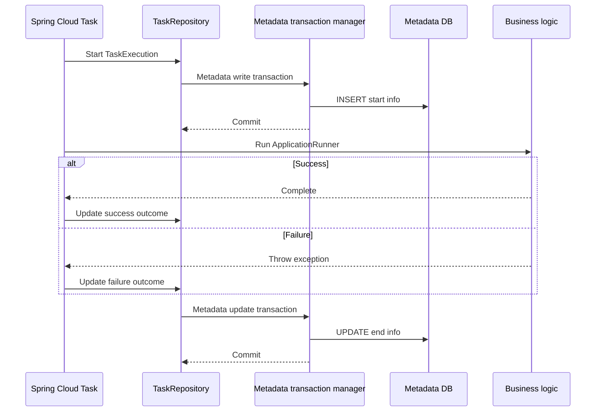
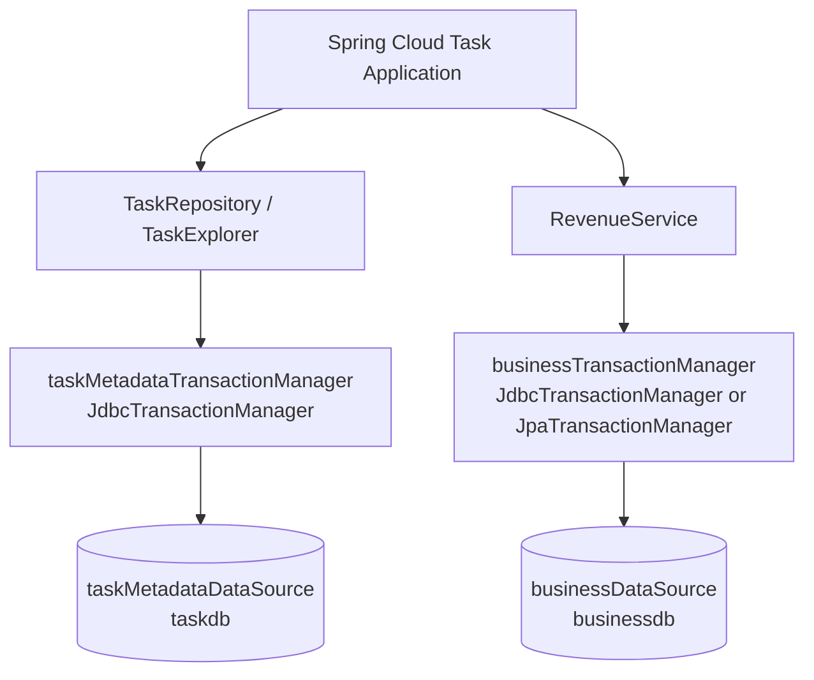

# Choosing `PlatformTransactionManager` for the Execution Repository

In the **Advanced Configuration** chapter of **Spring Cloud Task**, a finite-lived application needs to record the start time, end time, exit code, and status of each run into **`TaskRepository`**. Writing this metadata requires a transaction aligned with the data store. If you pick the wrong transaction manager, the application may process business work yet fail to record status, or write metadata to the wrong database.

**`PlatformTransactionManager`** is Spring's transaction management interface. In Spring Cloud Task, selecting the right manager becomes especially critical when you have **multiple `DataSource` beans**, use JPA for business logic, integrate with Spring Batch, or separate metadata into a dedicated operational database.

After this lesson, you will be able to:

- Explain how the transaction manager participates in the `TaskExecution` lifecycle.
- Identify when `DefaultTaskConfigurer`'s default configuration suffices.
- Select the manager matching the `DataSource` that stores metadata.
- Configure an illustrative two-database setup separating business data and task metadata.
- Distinguish `TaskRepository` transactions, business transactions, and Spring Batch transactions.
- Diagnose commit, rollback, wrong-database, and retry issues.

## 1. Why Does `TaskRepository` Need Transactions?

A Spring Cloud Task execution is represented by **`TaskExecution`**. After `ApplicationContext` initializes successfully, the framework writes start information before running `ApplicationRunner` / `CommandLineRunner`. When the runners complete or raise an error observed by the framework, completion information is updated.

Example rows in the `TASK_EXECUTION` table:

| `TASK_EXECUTION_ID` | `TASK_NAME` | `START_TIME` | `END_TIME` | `EXIT_CODE` |
| ---: | --- | --- | --- | ---: |
| 101 | `daily-reconcile` | 08:00:00 | 08:00:09 | 0 |
| 102 | `daily-reconcile` | 09:00:00 | 09:00:03 | 1 |
| 103 | `daily-reconcile` | 10:00:00 | `NULL` | `NULL` |

Each row records **one run**, not individual business steps. Transactions give metadata update operations proper commit/rollback boundaries, however:

- Successfully recording the start **does not guarantee** subsequent business work will succeed.
- There is no single automatic JDBC transaction spanning from start to finish across **the entire process**.
- If the JVM is killed abruptly, an error occurs before TaskRepository initializes, or the metadata database loses connectivity, the record may be missing or never have `END_TIME` updated.
- A successful metadata transaction does not prove revenue data or business outcomes are correct.



The diagram illustrates the typical execution flow; transaction details depend on version and configuration. Task-level metadata and business data are **two separate scopes of responsibility**.

## 2. Three Components Provided by `TaskConfigurer`

**`TaskConfigurer`** is Spring Cloud Task's extension point for providing:

| Component | Responsibility |
| --- | --- |
| `TaskRepository` | Creates and updates `TaskExecution`, recording history for each run. |
| `TaskExplorer` | Queries stored metadata and execution status. |
| `PlatformTransactionManager` | Manages transactions used when interacting with the execution store. |

The default implementation **`DefaultTaskConfigurer`** makes sensible choices based on the environment:

- **With a `DataSource`:** uses a JDBC repository. Modern Spring Cloud Task versions use **`JdbcTransactionManager`** by default; older version documentation may refer to **`DataSourceTransactionManager`**. Both are JDBC transaction manager options.
- **Without a `DataSource`:** may use an in-memory repository with **`ResourcelessTransactionManager`**. This mode does not provide persistent history after the process exits.
- **Single `DataSource`:** usually left to framework auto-configuration because there is no ambiguity about the data source.
- **Multiple `DataSource` beans:** you must explicitly select the data source for `TaskRepository`. If customizing the manager, you must also specify the matching manager.

**Do not confuse two separate things:** Marking a default transaction manager bean with `@Primary` and choosing **`TaskRepository`'s `DataSource`**. Putting `@Primary` on the business manager alone does not ensure metadata uses the right database. `TaskConfigurer`/`DataSource` selection must be explicit.

### Rules for Choosing the Manager Type

| Metadata storage | Appropriate manager | Notes |
| --- | --- | --- |
| JDBC database | `JdbcTransactionManager` or `DataSourceTransactionManager` depending on version | Bound to **the same datasource** the repository uses. |
| In-memory for demos/tests | `ResourcelessTransactionManager` | Not a JDBC transaction; does not persist history across new runs. |
| Business uses JPA, JDBC metadata in another DB | `JpaTransactionManager` for JPA; `JdbcTransactionManager` for metadata | Two transaction managers managing two distinct resources. |
| Atomic commit required across multiple databases | May consider JTA/XA infrastructure | Requires a transaction coordinator and XA-capable resources; not achieved automatically with two `JdbcTransactionManager` beans. |

The golden rule: **the metadata-writing manager must manage the exact `DataSource` containing the Spring Cloud Task tables**.

## 3. Single-Datasource Case: Prefer Defaults

Suppose a Spring Boot application has only one PostgreSQL database used for both metadata and business data. An illustrative `application.yml`:

```yaml
spring:
  main:
    web-application-type: none
  datasource:
    url: jdbc:postgresql://localhost:5432/taskdb
    username: task_user
    password: ${TASK_DB_PASSWORD}
  cloud:
    task:
      name: dailyReconcile
      initialize-enabled: false
```

With compatible Spring Boot JDBC, Spring Cloud Task, and PostgreSQL driver dependencies:

1. Spring Boot builds one `DataSource` from `spring.datasource.*`.
2. Spring Cloud Task can use that datasource for `TaskRepository` and `TaskExplorer`.
3. `DefaultTaskConfigurer` provides a suitable JDBC transaction manager unless replaced by custom configuration.
4. Each `java -jar` run writes metadata to `taskdb`.

Here `initialize-enabled: false` means **metadata tables must be created beforehand** via version-matched migrations. In practice/lab environments, you may use supported initialization mechanisms; in production, control DDL with Flyway, Liquibase, or an equivalent migration tool.

In this scenario, you typically **do not need** to create a custom `TaskConfigurer` or dedicated metadata manager bean. Customize only if you genuinely need a different datasource, storage mechanism, or specialized transaction policy.

## 4. Two Databases: Separating Metadata and Business Transactions

Consider a reconciliation task:

- **`businessdb`** holds `revenue_day`, sales transactions, and revenue figures.
- **`taskdb`** holds `TASK_EXECUTION` and Spring Cloud Task metadata tables.

The goal is for all `TaskRepository` operations to go to `taskdb` and all `RevenueService` operations to go to `businessdb`.



### 4.1. YAML Configuration

Declare the two data sources:

```yaml
spring:
  main:
    web-application-type: none
  cloud:
    task:
      name: dailyReconcile
      initialize-enabled: false

app:
  datasource:
    business:
      url: jdbc:postgresql://localhost:5432/businessdb
      username: business_user
      password: ${BUSINESS_DB_PASSWORD}
    task:
      url: jdbc:postgresql://localhost:5432/taskdb
      username: task_user
      password: ${TASK_DB_PASSWORD}
```

**`app.datasource.*` is a namespace we chose**; Spring Cloud Task does not read it automatically to build beans. Matching Java configuration is required; declaring YAML alone is not enough. Passwords come from environment variables or a secret manager, never hardcoded.

### 4.2. Defining Two `DataSource` Beans and Two Managers

Spring Boot example with JDBC. Create `TaskDataSourceConfig.java`:

```java
package com.example.task.config;

import javax.sql.DataSource;

import org.springframework.beans.factory.annotation.Qualifier;
import org.springframework.boot.autoconfigure.jdbc.DataSourceProperties;
import org.springframework.boot.context.properties.ConfigurationProperties;
import org.springframework.cloud.task.configuration.DefaultTaskConfigurer;
import org.springframework.cloud.task.configuration.TaskConfigurer;
import org.springframework.context.annotation.Bean;
import org.springframework.context.annotation.Configuration;
import org.springframework.context.annotation.Primary;
import org.springframework.jdbc.support.JdbcTransactionManager;
import org.springframework.transaction.PlatformTransactionManager;

@Configuration(proxyBeanMethods = false)
public class TaskDataSourceConfig {

    @Bean("businessDataSourceProperties")
    @Primary
    @ConfigurationProperties("app.datasource.business")
    DataSourceProperties businessProperties() {
        return new DataSourceProperties();
    }

    @Bean("taskDataSourceProperties")
    @ConfigurationProperties("app.datasource.task")
    DataSourceProperties taskProperties() {
        return new DataSourceProperties();
    }

    @Bean("businessDataSource")
    @Primary
    DataSource businessDataSource(
            @Qualifier("businessDataSourceProperties")
            DataSourceProperties properties) {
        return properties.initializeDataSourceBuilder().build();
    }

    @Bean("taskMetadataDataSource")
    DataSource taskMetadataDataSource(
            @Qualifier("taskDataSourceProperties")
            DataSourceProperties properties) {
        return properties.initializeDataSourceBuilder().build();
    }

    @Bean("businessTransactionManager")
    @Primary
    PlatformTransactionManager businessTransactionManager(
            @Qualifier("businessDataSource") DataSource dataSource) {
        return new JdbcTransactionManager(dataSource);
    }

    @Bean("taskMetadataTransactionManager")
    PlatformTransactionManager taskMetadataTransactionManager(
            @Qualifier("taskMetadataDataSource") DataSource dataSource) {
        return new JdbcTransactionManager(dataSource);
    }

    @Bean
    TaskConfigurer taskConfigurer(
            @Qualifier("taskMetadataDataSource") DataSource dataSource,
            @Qualifier("taskMetadataTransactionManager")
            PlatformTransactionManager metadataManager) {
        return new DefaultTaskConfigurer(dataSource) {
            @Override
            public PlatformTransactionManager getTransactionManager() {
                return metadataManager;
            }
        };
    }
}
```

**Explanation:**

1. Both `DataSourceProperties` beans bind independently from YAML settings. `@Primary` only selects the business side as default when Spring must resolve multiple beans of the same type.
2. `businessTransactionManager` takes **`businessDataSource`**; `taskMetadataTransactionManager` takes **`taskMetadataDataSource`**.
3. `new DefaultTaskConfigurer(dataSource)` constructs the repository/explorer components for the metadata datasource.
4. Overriding `getTransactionManager()` returns the selected manager for metadata. This is the **extension point in `TaskConfigurer`**, rather than guessing whether the framework picks a `@Primary` bean.
5. `@Qualifier` on parameters makes dependencies explicit, preventing wiring mistakes.

The example uses the extension API documented by Spring Cloud Task. **Compile and test against your project's exact Spring Cloud Task/Spring Boot versions**, as APIs and auto-configuration can change across release trains. If you only need to pick the right database and accept the default JDBC manager, the final bean can be simplified:

```java
@Bean
TaskConfigurer taskConfigurer(
        @Qualifier("taskMetadataDataSource") DataSource taskDataSource) {
    return new DefaultTaskConfigurer(taskDataSource);
}
```

This is an **alternative** to the `taskConfigurer` bean in the previous example—do not register both simultaneously. In this form, `DefaultTaskConfigurer` creates a JDBC transaction manager for the supplied datasource automatically.

### 4.3. Selecting the Transaction Manager for Business Services

With two managers, the revenue processing method should explicitly specify the business manager:

```java
package com.example.task.service;

import java.time.LocalDate;
import javax.sql.DataSource;

import org.springframework.beans.factory.annotation.Qualifier;
import org.springframework.jdbc.core.JdbcTemplate;
import org.springframework.stereotype.Service;
import org.springframework.transaction.annotation.Transactional;

@Service
public class RevenueService {
    private final JdbcTemplate businessJdbc;

    public RevenueService(
            @Qualifier("businessDataSource") DataSource businessDataSource) {
        this.businessJdbc = new JdbcTemplate(businessDataSource);
    }

    @Transactional(transactionManager = "businessTransactionManager")
    public void markReconciled(LocalDate businessDate) {
        businessJdbc.update(
            "UPDATE revenue_day SET reconciled = true WHERE business_date = ?",
            java.sql.Date.valueOf(businessDate)
        );
    }
}
```

Assume the business table `revenue_day` already exists. The `markReconciled` transaction manages the connection to `businessdb`. It does **not** automatically wrap metadata writes in `taskdb`. In applications using Spring Data JPA, the business manager is typically `JpaTransactionManager` paired with the appropriate `EntityManagerFactory`; Spring Cloud Task's JDBC transaction manager still needs to match the metadata database.

**Schema note:** When multiple datasources exist, automatic initialization of metadata tables may require separate configuration. The example above uses `initialize-enabled: false` and requires migrations to have created the Spring Cloud Task tables on `taskdb` using the DDL for your deployed version.

## 5. Verifying Whether the Manager Matches the Datasource

Answer these two questions clearly before deploying:

1. **Which `DataSource` does `TaskRepository` actually write to?** Which database/schema contains the `TASK_EXECUTION` tables?
2. **Which manager does `TaskConfigurer#getTransactionManager()` return?** Does that manager govern the metadata datasource itself or a different datasource?

| `TaskRepository` source | Manager used | Assessment |
| --- | --- | --- |
| JDBC `taskdb` | `JdbcTransactionManager(taskMetadataDataSource)` | Suitable for task metadata storage. |
| JDBC `taskdb` | `JdbcTransactionManager(businessDataSource)` | Wrong resource; metadata transactions may not be managed properly. |
| JDBC `taskdb` | `ResourcelessTransactionManager` | Does not provide the required JDBC transactions. |
| In-memory repository | `ResourcelessTransactionManager` | Usable for demos, no persistent history. |
| JDBC `taskdb`, JPA business logic | Business `JpaTransactionManager` | Not a standard choice for JDBC metadata; consider only if you thoroughly understand and test datasource/JPA coordination. |

**Matching bean names do not mean the same datasource.** Nor can you assume two datasources pointing to the same hostname share a transaction: they can be two separate connection pools with independent transactions.

## 6. Commit, Rollback, and Failure Scenarios

Suppose `dailyReconcile` processes date 2026-11-24:

1. Spring Cloud Task creates the initial `TaskExecution` record in `taskdb` and commits the metadata transaction.
2. `RevenueService` opens a business transaction on `businessdb`.
3. The service updates several rows, then hits an exception; the business transaction rolls back according to the configured rollback rules.
4. Spring Cloud Task attempts to write the failure exit code and completion time to `taskdb`.

The outcome can be that **`businessdb` rolls back while `taskdb` retains the failed run record**. That is usually desirable, since failures must also be recorded for investigation.

| Event | Business database | Metadata database |
| --- | --- | --- |
| Task starts | No business impact yet | Writes start metadata. |
| Processing and commit succeed | Writes revenue data | Writes completion result afterward if possible. |
| Processing throws before commit | Can roll back open transaction | Can record error status. |
| Process is killed or OOMs | Previously committed writes may persist | `END_TIME` may remain blank. |
| Metadata DB loses connection at completion | Business work may already be done | Final outcome may not be recorded. |

**Do not open one giant transaction spanning the entire long process** just to "keep everything in sync." For tasks running minutes or hours, overly long JDBC transactions cause locking, timeouts, and resource exhaustion. Instead, keep business transactions short with clear boundaries; use idempotency, checkpoints, and proper retry policies.

Local JDBC transactions across two databases **do not provide cross-database atomic commits**. If you need that property, use a real distributed transaction solution or design eventual consistency / outbox / reconciliation patterns. Sharing a single `PlatformTransactionManager` bean does not magically add distributed capabilities.

## 7. Relationship with Spring Batch

A Spring Cloud Task application may run a **Spring Batch Job**. In that case, three levels exist:

| Scope | Data store | Related transactions |
| --- | --- | --- |
| **Spring Cloud Task** | `TaskRepository` with `TASK_EXECUTION` | Records the lifecycle of **the entire application process**. |
| **Spring Batch** | `JobRepository` with `BATCH_JOB_EXECUTION`, `BATCH_STEP_EXECUTION`, ... | Records Job/Step metadata, checkpoints, and restarts per Batch rules. |
| **Business logic** | Revenue, transaction, report tables, ... | Writes/rolls back data per unit of processing. |

Spring Batch `JobRepository` and Spring Cloud Task `TaskRepository` are **two separate repositories**, even if their tables sit in the same physical database. Managers for Batch metadata, chunks/steps, and Task metadata may need separate configuration depending on datasource layout and framework version.

For example, a Batch Step commits every 500 records. If an error occurs near the end, Spring Batch can use checkpoints/`JobExecution` to restart under configured conditions. Meanwhile, Spring Cloud Task still records whether **the process run** succeeded or failed. Do not assume rolling back a chunk deletes the `TaskExecution` record created at the beginning.

When configuring the integration, check:

- `TaskConfigurer#getTransactionManager()` returns the manager for **Task metadata**.
- Spring Batch `JobRepository` and `Step` instances use managers matching the **Batch schema and step datasource**.
- Business services pick the right manager via `@Qualifier` or `@Transactional(transactionManager = "...")`.

For Spring Batch, parameter names for configuring the transaction manager in `@EnableBatchProcessing`/builders can vary by version; consult the exact API docs before applying.

## 8. Verifying Configuration with a Real Run

### 8.1. Running the Task and Inspecting Data

After creating the metadata tables **matching the version's schema** on `taskdb` and building the executable JAR, run:

```bash
java -jar daily-reconcile.jar --business-date=2026-11-24
```

Connect to `taskdb` and query:

```sql
SELECT
    TASK_EXECUTION_ID,
    TASK_NAME,
    START_TIME,
    END_TIME,
    EXIT_CODE
FROM TASK_EXECUTION
ORDER BY TASK_EXECUTION_ID DESC;
```

Run a second time and verify a new `TaskExecution` appears. Check `businessdb`: metadata tables should exist only in the designated database/scope. If metadata unexpectedly appears in both databases, re-examine `TaskConfigurer`, permissions, and migrations.

### 8.2. Simulating Failure and Checking Rollback

In a test environment, make the business service throw an exception before commit and let the error propagate out of the runner. Verify:

1. The transaction on `businessdb` rolls back per applicable rules.
2. `taskdb` records the exit code/error details if the framework and metadata connection remain healthy.
3. The process exit code reflects failure so the scheduler/launcher detects it.
4. On retry, the same `business-date` does not produce duplicate data writes.

Also test stopping the metadata database in a **test environment**. A task may fail before writing the start record or fail to update completion; `TaskRepository` does not replace logs and container/platform telemetry.

### 8.3. Common Configuration Error Table

| Symptom | Possible cause | How to resolve |
| --- | --- | --- |
| Multiple `DataSource` beans, Spring cannot resolve source | Missing explicit selection | Configure `TaskConfigurer` to accept the metadata datasource via `@Qualifier`. |
| `TaskExecution` is written to the business database | Repository received the wrong `DataSource` | Check `TaskConfigurer` bean, `@Primary`, and datasource URLs. |
| `TASK_EXECUTION` does not exist | Schema not created, wrong DB/schema, or wrong DDL version | Run version-matched migrations, verify permissions. |
| `NoUniqueBeanDefinitionException` for manager | Multiple beans of the same type without qualifiers | Name beans clearly and use `@Qualifier`/`@Primary` intentionally. |
| Business work rolled back yet task metadata still exists | The two transactions have independent boundaries | May be expected; use exit codes and logs to interpret the result. |
| Business work finished yet `END_TIME` is blank | Metadata DB lost connection or process was killed | Cross-check logs, exit code, container status, and DB. |
| `@Transactional` does not roll back as expected | Wrong manager, self-invocation via `this`, swallowed exception, or different rollback rule | Check Spring AOP, manager wiring, and exception handling. |
| Scheduled task runs duplicate work | Scheduler retries or concurrent runs | Idempotency, business locks, retry limits, and concurrency controls. |

## 9. Safe Operations Principles

**Prefer simplicity.** A single suitable datasource usually needs no custom manager. When two or more datasources exist, explicitly define which source the JDBC repository uses and which manager owns its transactions.

**Do not confuse a transaction manager with an orchestrator.** `PlatformTransactionManager` coordinates commits/rollbacks; cron, Kubernetes CronJob, Spring Cloud Data Flow, or another launcher decides when and how many times a task runs. A transaction manager does not schedule runs or block duplicate requests.

**Manage schemas.** Use DDL/migrations for your exact Spring Cloud Task version, restrict database user privileges, tune connection pools, and never manually modify `TASK_EXECUTION` via business SQL.

**Observe from three angles.** Read the process exit code, `TaskExecution` in metadata, and actual data in the business database. Whenever any of the three disagree, investigate commit timing, logs, and infrastructure events before retrying.

**Reduce rerun risk.** Design idempotency by business date/request ID, short business transactions, and bounded retry policies. A retry typically creates a new `TaskExecution` rather than automatically undoing previously committed writes.

## 10. Self-Check Exercises

1. Why does a JDBC-backed `TaskRepository` need an appropriate transaction manager even if the application runs for only a few seconds?
2. In a system with only one `DataSource`, when is `DefaultTaskConfigurer` sufficient? What conditions require custom configuration?
3. With the two databases in the example, which bean manages metadata transactions, which manages business transactions, and which binds `TaskRepository` to `taskdb`?
4. If `businessdb` committed but `taskdb` lost connection while updating `END_TIME`, what can happen? What should you check before retrying?
5. Why is `TaskRepository` not identical to Spring Batch's `JobRepository`?
6. A service throws an exception, catches it internally, and ignores it. Is switching to a different transaction manager the right fix to make the task fail?
7. Two containers reconcile `business-date=2026-11-24` at the same time. Is choosing the right `JdbcTransactionManager` enough to prevent duplicate processing? What measures must be added?

**Key takeaway:** Choosing the right `PlatformTransactionManager` for Spring Cloud Task means ensuring `TaskRepository` uses transactions belonging to **the exact datasource storing metadata**. Keep it distinct from business and Spring Batch transactions, and pair it with retry controls, idempotency, and monitoring to operate finite-lived applications safely.

**References:** [Spring Cloud Task — Features / TaskConfigurer](https://docs.spring.io/spring-cloud-task/reference/features.html) and [Spring Framework — Transaction Management](https://docs.spring.io/spring-framework/reference/data-access/transaction.html). When applying examples, verify the API against the specific version in use.
