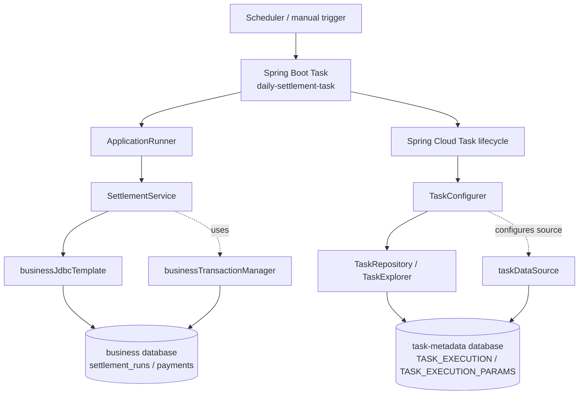
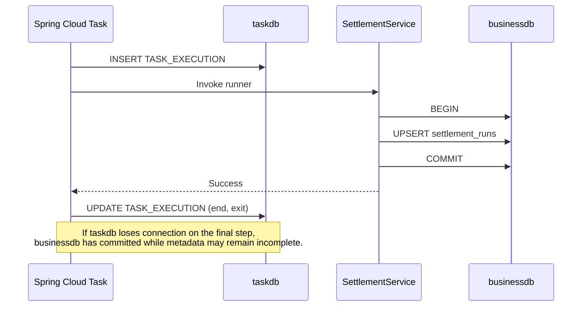

# Separating Business `DataSource` and Task `DataSource`

## Learning Objectives

After this lesson, you will be able to:

- Explain why a **Spring Cloud Task** application needs a `DataSource` for execution metadata and when to separate it from the `DataSource` holding business data.
- Declare two JDBC connection sources in Spring Boot using `DataSourceProperties`, `@Qualifier`, and `@Primary`.
- Use `TaskConfigurer`/`DefaultTaskConfigurer` to specify **exactly** where `TaskRepository` and `TaskExplorer` store and read `TaskExecution` records.
- Distinguish business operation transactions from Task metadata write transactions, and understand why two databases do not automatically form an atomic transaction.
- Operate safely with separate migrations, least-privilege access, failure handling, scheduled or on-demand Task monitoring, and Spring Batch coordination when needed.

> **Context:** This lesson belongs to the **Advanced Configuration** chapter of the **SPRING_CLOUD_TASK** module. A Spring Cloud Task is a Spring Boot application with a finite lifecycle; each run is tracked via `TaskExecution` and metadata in `TaskRepository`. Tasks such as data ingestion, reconciliation, and report generation often must access both business data and execution history. Separating the two data sources helps manage permissions, capacity, and schema lifecycles independently, while also requiring explicit configuration to avoid writing metadata to the wrong place.

## 1. The Problem When One Application Has Two Databases

Suppose the `daily-settlement-task` application runs at 02:00 every day:

1. Read pending reconciliation transactions from the **business** database.
2. Update reconciliation status and create summary records in the **business** database.
3. Write start time, end time, exit code, and run arguments into the **task-metadata** database so operations can query them.
4. Exit the process; when the scheduler triggers again, a new `TaskExecution` is created.

With **one** single `DataSource`, Spring Cloud Task can use that connection source for the default repository. When **multiple** `DataSource` beans exist, you must proactively designate the source for Task infrastructure using `TaskConfigurer`. Simply putting `@Primary` on one `DataSource` or naming a bean `taskDataSource` is not a complete configuration contract for Task across all versions.

| Aspect | `businessDataSource` | `taskDataSource` |
| --- | --- | --- |
| Purpose | Read/write orders, transactions, business records. | Store metadata of Task runs. |
| Typical tables | `settlement_runs`, `payments`, `orders`. | `TASK_EXECUTION`, `TASK_EXECUTION_PARAMS`, `TASK_SEQ` or equivalent ID-generating structures. |
| Accessing objects | Business services, JDBC/JPA repositories. | `TaskRepository`, `TaskExplorer`, lifecycle listeners. |
| Transaction manager | `businessTransactionManager`. | Provided by `TaskConfigurer` for the Task repository. |
| Typical permissions | Only the required business tables. | Only the Task metadata tables and ID-generating structures. |
| Retention and backup | Per business data preservation requirements. | Per monitoring, auditing, and run-history retention requirements. |

Separating `DataSource` beans **does not require two different PostgreSQL servers**. Two `DataSource` beans can point to two databases on the same server, two schemas, two accounts, or two separate clusters. What matters is **the right destination, permissions, and transaction rules**. This lesson illustrates two separate PostgreSQL databases to make verification straightforward.

## 2. Data Flow Diagram



In the diagram:

- `ApplicationRunner` executes business logic through the service.
- `businessJdbcTemplate` and `businessTransactionManager` serve only the business database.
- `TaskConfigurer` builds/configures Task repository components based on `taskDataSource`.
- `TaskExecution` records the lifecycle of **the entire Task process**, not individual payment rows.

The two flows can succeed or fail at different points. For instance, business updates may already commit while connectivity to the metadata database drops when the Task ends. Such cases must be investigated from both sides rather than assuming a shared transaction just because both live in the same application.

## 3. Dependencies and Example Assumptions

The example below uses **Spring Boot 3.x** style syntax, compatible Spring Cloud Task, Spring JDBC, and HikariCP. For Spring Boot 4.x or other releases, verify Java packages and BOM compatibility before using.

In a project `pom.xml` that already has the appropriate Spring Boot parent/BOM and Spring Cloud BOM, the key dependencies are:

```xml
<dependencies>
    <dependency>
        <groupId>org.springframework.cloud</groupId>
        <artifactId>spring-cloud-starter-task</artifactId>
    </dependency>
    <dependency>
        <groupId>org.springframework.boot</groupId>
        <artifactId>spring-boot-starter-jdbc</artifactId>
    </dependency>
    <dependency>
        <groupId>org.postgresql</groupId>
        <artifactId>postgresql</artifactId>
        <scope>runtime</scope>
    </dependency>
</dependencies>
```

`spring-cloud-starter-task` is the starter for Task lifecycle; `spring-boot-starter-jdbc` provides the JDBC and transaction components used in this example; the PostgreSQL driver supports **both** `DataSource` beans. You do not add the driver twice just because the app has two connection sources of the same type.

**Deployment assumptions:**

- Database `businessdb` has the `settlement_runs` table.
- Database `taskdb` has the complete Spring Cloud Task schema for **your exact version**.
- Account `BUSINESS_DB_USER` has only the permissions required on business data.
- Account `TASK_DB_USER` has only the permissions required for the Task repository.
- Migrations run **before** the Task starts; runtime does not auto-create tables.

If you are new to Spring Cloud Task, start with a single `DataSource`, verify the Task lifecycle first, and then move to two sources as shown here. The following example focuses on connection routing rather than building complete reconciliation business logic.

## 4. Declaring Two Property Groups

Create `application.yml`:

```yaml
spring:
  application:
    name: daily-settlement-task
  main:
    web-application-type: none
  cloud:
    task:
      initialize-enabled: false
  sql:
    init:
      mode: never

app:
  datasource:
    business:
      url: jdbc:postgresql://localhost:5432/businessdb
      username: ${BUSINESS_DB_USER}
      password: ${BUSINESS_DB_PASSWORD}
      hikari:
        pool-name: business-pool
        maximum-pool-size: 8
        minimum-idle: 1
    task:
      url: jdbc:postgresql://localhost:5432/taskdb
      username: ${TASK_DB_USER}
      password: ${TASK_DB_PASSWORD}
      hikari:
        pool-name: task-metadata-pool
        maximum-pool-size: 3
        minimum-idle: 1
```

Points to read carefully:

- `app.datasource.business.*` and `app.datasource.task.*` are **application-defined namespaces** that do not create any `DataSource` beans by themselves. Java `@ConfigurationProperties` in the next section is required.
- `spring.cloud.task.initialize-enabled=false` prevents runtime from auto-creating the Task schema; `taskdb` must be fully migrated beforehand.
- `spring.sql.init.mode=never` prevents Spring Boot's generic SQL initialization from accidentally running scripts on the default/primary datasource. Business migrations are run through their own process.
- `spring.main.web-application-type=none` suits finite-lived Task processes that need no web server.
- The two pools have **independent** connection limits. When multiple Pods run concurrently, total connections can equal Pod count multiplied by each pool's size; size limits across both databases accordingly.

Never put real passwords in files committed to Git. Use environment variables, a secret manager, or a controlled secret injection mechanism. If `BUSINESS_DB_*` and `TASK_DB_*` variables are unset, the application can fail during configuration binding.

## 5. Creating Two Explicit `DataSource` Beans

To bind JDBC `url` and HikariCP settings consistently, each source gets one `DataSourceProperties` bean and one `HikariDataSource` bean. The configuration below uses standard Spring Boot 3.x APIs:

```java
package com.example.task.config;

import javax.sql.DataSource;

import com.zaxxer.hikari.HikariDataSource;
import org.springframework.beans.factory.annotation.Qualifier;
import org.springframework.boot.autoconfigure.jdbc.DataSourceProperties;
import org.springframework.boot.context.properties.ConfigurationProperties;
import org.springframework.context.annotation.Bean;
import org.springframework.context.annotation.Configuration;
import org.springframework.context.annotation.Primary;

@Configuration(proxyBeanMethods = false)
public class MultiDataSourceConfiguration {

    @Bean("businessDataSourceProperties")
    @Primary
    @ConfigurationProperties("app.datasource.business")
    DataSourceProperties businessDataSourceProperties() {
        return new DataSourceProperties();
    }

    @Bean("businessDataSource")
    @Primary
    @ConfigurationProperties("app.datasource.business.hikari")
    HikariDataSource businessDataSource(
            @Qualifier("businessDataSourceProperties")
            DataSourceProperties properties) {

        return properties.initializeDataSourceBuilder()
                .type(HikariDataSource.class)
                .build();
    }

    @Bean("taskDataSourceProperties")
    @ConfigurationProperties("app.datasource.task")
    DataSourceProperties taskDataSourceProperties() {
        return new DataSourceProperties();
    }

    @Bean("taskDataSource")
    @ConfigurationProperties("app.datasource.task.hikari")
    HikariDataSource taskDataSource(
            @Qualifier("taskDataSourceProperties")
            DataSourceProperties properties) {

        return properties.initializeDataSourceBuilder()
                .type(HikariDataSource.class)
                .build();
    }
}
```

**Why use these annotations?**

| Mechanism | Effect |
| --- | --- |
| `@ConfigurationProperties("app.datasource.business")` | Binds URL, username, and password for the business source. |
| `@ConfigurationProperties("app.datasource.business.hikari")` | Binds Hikari pool settings for the business source. |
| `@Qualifier("businessDataSourceProperties")` | Picks the matching properties bean, avoiding ambiguity when two beans share the same type. |
| `@Bean("taskDataSource")` | Provides a stable bean name so `TaskConfigurer` receives the exact datasource. |
| `@Primary` on the business source | Gives components injecting `DataSource` only by type a default choice. |
| `DataSourceProperties.initializeDataSourceBuilder()` | Properly translates `url` to `jdbcUrl` when building Hikari. |

`@Primary` **does not mean** Task metadata is written to the business source in the complete configuration: in the next section, `TaskConfigurer` receives `taskDataSource` via `@Qualifier`. That is where the Task write destination is explicitly specified.

Likewise, `@Primary` **does not replace `@Qualifier` in business code** when the system must guarantee the exact data source. If a financial processing service points to the wrong database, results can be wrong even though the application starts cleanly.

## 6. Assigning `taskDataSource` to Spring Cloud Task with `TaskConfigurer`

Spring Cloud Task supports customization through the `TaskConfigurer` interface. The concise approach for standard JDBC setups is returning a `DefaultTaskConfigurer` initialized with the dedicated metadata datasource:

```java
package com.example.task.config;

import javax.sql.DataSource;

import org.springframework.beans.factory.annotation.Qualifier;
import org.springframework.cloud.task.configuration.DefaultTaskConfigurer;
import org.springframework.cloud.task.configuration.TaskConfigurer;
import org.springframework.context.annotation.Bean;
import org.springframework.context.annotation.Configuration;

@Configuration(proxyBeanMethods = false)
public class TaskRepositoryConfiguration {

    @Bean
    TaskConfigurer taskConfigurer(
            @Qualifier("taskDataSource") DataSource taskDataSource) {
        return new DefaultTaskConfigurer(taskDataSource);
    }
}
```

This configuration instructs Spring Cloud Task to use **`taskdb`** via the passed datasource. With a version-appropriate `DefaultTaskConfigurer`, the related components typically include:

- `TaskRepository`: writes and updates `TaskExecution`, parameter metadata, and Task outcomes.
- `TaskExplorer`: queries Task history by ID/name.
- `PlatformTransactionManager` serving Task repository operations.
- `getTaskDataSource()`: returns the datasource currently serving Task when supported by the implementation.

`DefaultTaskConfigurer(DataSource)` is a constructor present in common Spring Cloud Task versions; always check the Javadoc of your actual release when upgrading. If the application also uses JPA/`EntityManager` or defines multiple transaction managers, verify that the transaction manager returned by `TaskConfigurer` actually serves the Task repository. Do not rely on `@Primary` to automatically guarantee the right selection for every customized component.

**Do not register another `TaskRepository` bean alongside `TaskConfigurer`** unless you understand the auto-configuration mechanism. Having two competing configuration sources easily causes writes to one place and `TaskExplorer` reads from another.

### Why Isn't Naming a Bean `taskDataSource` Enough?

In a single-source application, the framework can usually pick the datasource automatically. In a two-source application, auto-configuration simply sees a set of `DataSource` beans and may fall back to default selection rules or require explicit disambiguation. Therefore, express the policy actively:

```text
TaskRepository -> TaskConfigurer -> @Qualifier("taskDataSource") -> taskdb
BusinessService -> @Qualifier("businessJdbcTemplate") -> businessdb
```

The difference here is **an explicit dependency path**. Even if Spring Boot's default bean auto-configuration changes during an upgrade, the application retains a clear control point for where Task metadata is stored.

## 7. Using the Business Source with `JdbcTemplate` and a Dedicated Transaction Manager

Create a `JdbcTemplate` and transaction manager pointing strictly to `businessDataSource`:

```java
package com.example.task.config;

import javax.sql.DataSource;

import org.springframework.beans.factory.annotation.Qualifier;
import org.springframework.context.annotation.Bean;
import org.springframework.context.annotation.Configuration;
import org.springframework.jdbc.core.JdbcTemplate;
import org.springframework.jdbc.support.JdbcTransactionManager;
import org.springframework.transaction.PlatformTransactionManager;

@Configuration(proxyBeanMethods = false)
public class BusinessJdbcConfiguration {

    @Bean("businessJdbcTemplate")
    JdbcTemplate businessJdbcTemplate(
            @Qualifier("businessDataSource") DataSource dataSource) {
        return new JdbcTemplate(dataSource);
    }

    @Bean("businessTransactionManager")
    PlatformTransactionManager businessTransactionManager(
            @Qualifier("businessDataSource") DataSource dataSource) {
        return new JdbcTransactionManager(dataSource);
    }
}
```

`JdbcTransactionManager` fits modern JDBC examples; other releases or configurations may use `DataSourceTransactionManager`. The decisive requirement is that the transaction manager must use **the exact business datasource**.

Assume the business database already has the table:

```sql
CREATE TABLE settlement_runs (
    business_date DATE PRIMARY KEY,
    status        VARCHAR(20) NOT NULL,
    updated_at    TIMESTAMPTZ NOT NULL DEFAULT CURRENT_TIMESTAMP
);
```

Business service:

```java
package com.example.task.business;

import java.time.LocalDate;

import org.springframework.beans.factory.annotation.Qualifier;
import org.springframework.jdbc.core.JdbcTemplate;
import org.springframework.stereotype.Service;
import org.springframework.transaction.annotation.Transactional;

@Service
public class SettlementService {

    private final JdbcTemplate businessJdbcTemplate;

    public SettlementService(
            @Qualifier("businessJdbcTemplate")
            JdbcTemplate businessJdbcTemplate) {
        this.businessJdbcTemplate = businessJdbcTemplate;
    }

    @Transactional(transactionManager = "businessTransactionManager")
    public void settle(LocalDate businessDate) {
        // PostgreSQL: UPSERT by business_date helps avoid duplicate records.
        businessJdbcTemplate.update("""
                INSERT INTO settlement_runs(business_date, status)
                VALUES (?, 'DONE')
                ON CONFLICT (business_date)
                DO UPDATE SET
                    status = EXCLUDED.status,
                    updated_at = CURRENT_TIMESTAMP
                """, businessDate);
    }
}
```

Runner calling the service (in a separate bean so the `@Transactional` interceptor takes effect):

```java
package com.example.task;

import java.time.LocalDate;
import java.util.List;

import com.example.task.business.SettlementService;
import org.springframework.boot.ApplicationArguments;
import org.springframework.boot.ApplicationRunner;
import org.springframework.boot.SpringApplication;
import org.springframework.boot.autoconfigure.SpringBootApplication;
import org.springframework.cloud.task.configuration.EnableTask;
import org.springframework.stereotype.Component;

@SpringBootApplication
@EnableTask
public class DailySettlementTaskApplication {
    public static void main(String[] args) {
        SpringApplication.run(DailySettlementTaskApplication.class, args);
    }
}

@Component
class SettlementRunner implements ApplicationRunner {

    private final SettlementService service;

    SettlementRunner(SettlementService service) {
        this.service = service;
    }

    @Override
    public void run(ApplicationArguments args) {
        List<String> values = args.getOptionValues("business-date");
        if (values == null || values.size() != 1) {
            throw new IllegalArgumentException(
                    "Exactly one --business-date=yyyy-MM-dd is required");
        }

        LocalDate date = LocalDate.parse(values.get(0));
        service.settle(date);
    }
}
```

Flow after successful startup:

1. Spring Cloud Task creates the run in **taskdb**'s repository.
2. `SettlementRunner` reads and validates arguments.
3. `SettlementService` uses `businessJdbcTemplate` and `businessTransactionManager` to write `settlement_runs` in **businessdb**.
4. When the runner returns or throws an exception, Task infrastructure updates completion/failure metadata in **taskdb** if connectivity and repository write capability remain available.
5. The process exits; operational tools read `TASK_EXECUTION` from **taskdb** to inspect the run outcome.

**Example scope limitation:** the `ON CONFLICT` SQL is PostgreSQL syntax; it prevents duplicating the daily **outcome row**, but does not automatically make complex business side effects idempotent. If reconciliation also posts ledger entries, emits events, or calls APIs, design dedicated replay/deduplication controls.

## 8. Are the Two Transaction Managers Independent?

**Yes, in this configuration each data source has its own local transaction manager.** Distinguish three categories of operations:

| Operation type | Data source | Transaction managed by |
| --- | --- | --- |
| `INSERT/UPDATE settlement_runs` | `businessdb` | `SettlementService`'s `businessTransactionManager`. |
| Create/update `TASK_EXECUTION` | `taskdb` | Transaction manager provided by `TaskConfigurer`. |
| External API call or message publish | System outside databases | Not automatically covered by either of these two JDBC transaction managers. |

A transaction on `businessdb` **does not automatically wrap** `TASK_EXECUTION` writes on `taskdb`. For example:



This leads to three important scenarios:

- **Business work succeeds, Task metadata fails:** `settlement_runs` is committed, yet `TASK_EXECUTION` may lack `END_TIME`. Before retrying, check business state by `business_date`; never blindly replay non-idempotent side effects.
- **Business work fails while TaskRepository is healthy:** let the exception propagate so Task and the scheduler recognize the failure instead of falsely recording success.
- **Cannot connect to taskdb when Task starts:** the application may fail before the business runner ever runs; alert infrastructure and check repository connectivity.

If you genuinely need atomicity across **two different databases**, `@Transactional(transactionManager = "businessTransactionManager")` alone is not enough. XA/JTA can be an option on supported stacks, though it increases operational complexity; for finite tasks, prefer **idempotency, controlled retries, clear business states, or an outbox pattern** depending on requirements. Do not introduce distributed transactions solely to force monitoring metadata and business data to commit together.

### Note on `@Transactional` When Multiple Managers Exist

Avoid writing `@Transactional` without specifying a manager in an application with multiple `PlatformTransactionManager` beans unless you have verified default selection. Prefer:

```java
@Transactional(transactionManager = "businessTransactionManager")
public void settle(LocalDate date) {
    // Business logic.
}
```

And if another service writes metadata outside the Task lifecycle, clearly separate the Task manager from business managers. Do not grab the transaction manager from `TaskConfigurer` and apply it arbitrarily to the business database.

## 9. Schemas and Migrations for Each Database

### 9.1. `taskdb`: Spring Cloud Task Schema

With the default prefix, `taskdb` needs Spring Cloud Task's tables and ID-generating structures for your exact release, typically including:

- `TASK_EXECUTION`: each run with `TASK_EXECUTION_ID`, name, timestamps, and result.
- `TASK_EXECUTION_PARAMS`: arguments associated with the run.
- `TASK_TASK_BATCH`: links Task runs to Spring Batch Jobs when integrated.
- ID-generating sequence or table (for example, `TASK_SEQ`), plus additional structures depending on features/version.

Do not create only the first two tables and skip ID-generating structures. Obtain the **official DDL script for your exact release and database**, put it into migrations, and verify before running the Task. Names, column types, and sequences can vary by dialect and version.

### 9.2. `businessdb`: Business Schema

`businessdb` only needs application tables such as `settlement_runs`, `payments`, and `orders`. Create and upgrade them via separate migrations. The Task's runtime account should only access the business tables it actually needs.

You can use Flyway or Liquibase for both databases, but you must configure **two separate migration pipelines** with separate datasources and script locations. If you only declare one default migration bean, do not assume the framework automatically migrates both databases.

### 9.3. Why Disable Auto-Initialization?

When multiple `DataSource` beans exist, automatic schema creation may not know which source to pick or may target Spring Boot's default source. Therefore, in the example:

```properties
spring.cloud.task.initialize-enabled=false
spring.sql.init.mode=never
```

These two properties disable both initialization mechanisms; **they do not create tables themselves**. Before launch, confirm Task migrations ran against `taskdb` and business migrations ran against `businessdb`. If using Spring Batch, also manage the `BATCH_*` schema on the JobRepository's own datasource.

**Do not reuse one `schema.sql` script for both databases** unless intentionally designed that way. When multiple Task replicas run concurrently, separating migrations from startup also prevents processes from racing on DDL.

## 10. Verifying Configuration Writes to the Right Place

Run the application after preparing schemas:

```bash
java -jar daily-settlement-task.jar --business-date=2026-11-24
```

### 10.1. Checking the Task Database

Connect to **taskdb** using a SQL tool and run:

```sql
SELECT TASK_EXECUTION_ID,
       TASK_NAME,
       START_TIME,
       END_TIME,
       EXIT_CODE,
       ERROR_MESSAGE
FROM TASK_EXECUTION
ORDER BY TASK_EXECUTION_ID DESC
LIMIT 10;
```

Expected: a new row corresponding to each run of `daily-settlement-task`. For normally completed Tasks, metadata typically includes `END_TIME` and an exit code reflecting the outcome. If no row appears, check logs, SQL privileges, the datasource received by `TaskConfigurer`, and whether the app failed too early.

Check parameters:

```sql
SELECT TASK_EXECUTION_ID, TASK_PARAM
FROM TASK_EXECUTION_PARAMS
WHERE TASK_EXECUTION_ID = :execution_id;
```

`:execution_id` is an **illustrative named parameter** for query tools or `NamedParameterJdbcTemplate`, not universal direct SQL syntax in every client. Substitute an actual ID or your client's parameter syntax. Never pass passwords/tokens in CLI arguments because metadata can persist them.

### 10.2. Checking the Business Database

Connect to **businessdb**:

```sql
SELECT business_date, status, updated_at
FROM settlement_runs
WHERE business_date = DATE '2026-11-24';
```

Expected: one `DONE` row when processing succeeds. In this example, `business_date` is the primary key and `UPSERT` prevents reruns from creating extra rows for the same day.

### 10.3. Verifying No Cross-Writes

With two separate PostgreSQL databases, you can check for out-of-scope tables:

```sql
-- Run on businessdb: should normally return NULL.
SELECT to_regclass('public.task_execution');

-- Run on taskdb: should normally return NULL.
SELECT to_regclass('public.settlement_runs');
```

These two `to_regclass` queries only check table existence in the specified schema. They do not prove all runtime paths use the right datasource if the app uses other schemas or dynamic config; combine with data queries, connection logs, and strict SQL privilege boundaries for thorough verification.

### 10.4. Testing Failure Paths

For full verification, test in a staging/test environment:

1. Run a valid date and confirm **Task metadata** lands in `taskdb` and the **business record** lands in `businessdb`.
2. Run `--business-date=bad-date` to trigger argument parsing failure; confirm no `DONE` business record is created for the invalid date.
3. Revoke write privilege on the business account to reproduce a `businessdb` error; verify Task records the failure and the process returns a non-zero exit code.
4. Cut connectivity to `taskdb` in an isolated environment to observe Task failure when it cannot write to the repository; do not assume a `TaskExecution` always exists on very early failures.
5. Re-run the same `business_date` and confirm idempotency does not depend on the Task's `executionId`.

**Do not inject intentional failures in production.** Test runs are only meaningful when logs, process exit codes, business data, and Task metadata are all observed together.

## 11. Coordinating with Spring Batch When Multiple Sources Exist

A Spring Cloud Task application may run a Spring Batch Job. Then there are **three data responsibilities** to account for:

| Repository / source | What does it write? | How to route |
| --- | --- | --- |
| `TaskRepository` | `TASK_EXECUTION`, Task parameters, application lifecycle status. | `TaskConfigurer` bound to `taskDataSource`. |
| Spring Batch `JobRepository` | `BATCH_JOB_EXECUTION`, `BATCH_STEP_EXECUTION`, JobParameters, restart state. | Configure datasource/transaction manager **specifically for Batch** per your Spring Boot/Spring Batch release. |
| Business DataSource | Read, transform, write business data. | `@Qualifier` and business transaction manager. |

Spring Batch `JobRepository` **does not automatically switch to `taskdb` just because `TaskConfigurer` uses `taskdb`**. You can store Batch metadata alongside `taskdb` or in a third store, but you must configure `JobRepository` explicitly. Spring Boot offers dedicated Batch source selection mechanisms in certain releases (e.g., `@BatchDataSource`), while transaction and schema configuration must match your version.

The `TASK_TASK_BATCH` table, when `spring-cloud-task-batch` integration is active, links `TASK_EXECUTION_ID` to `JOB_EXECUTION_ID`. If Task and Batch use different databases, creating links and querying them centrally must be tested; **do not assume a cross-database foreign key is enforced**.

For Jobs that may fail, check `BatchStatus`, `TaskExecution.exitCode`, and the process exit code together. Depending on integration config, you may need:

```properties
spring.cloud.task.batch.fail-on-job-failure=true
```

This property only propagates failure state per the supported framework mechanism; you still must ensure the runner waits for the Job to finish and does not swallow exceptions. Schedulers typically judge success/failure from the process exit code.

## 12. Common Errors and Diagnostics

| Symptom | Common cause | Verification and fix |
| --- | --- | --- |
| `NoUniqueBeanDefinitionException` for `DataSource` | Two beans of the same type exist, and injection point lacks `@Qualifier`, `@Primary`, or disambiguation. | Use `@Qualifier` on critical injections; place `@Primary` intentionally. |
| `TASK_EXECUTION` created in `businessdb` | Task defaulted to the primary source or lacks the proper `TaskConfigurer`. | Verify the `TaskConfigurer` bean and `@Qualifier("taskDataSource")`; check runtime connections. |
| Task reports missing `TASK_EXECUTION` table even though schema exists | Task is targeting the wrong database/schema or migrations ran against the wrong target. | Check URL, schema search path, account, and the datasource passed to the configurer. |
| `TaskRepository` cannot generate `executionId` | Missing sequence/ID table, wrong DDL for release, or missing privileges. | Run the complete official script, check privileges on ID-generating structures. |
| Business `JdbcTemplate` reads metadata by mistake | Ambiguous datasource injection or relying solely on primary bean. | Declare `businessJdbcTemplate` from `businessDataSource` and inject by name/qualifier. |
| `@Transactional` uses the wrong source | Multiple managers exist, annotation omits manager name, or self-invocation bypasses proxy. | Specify `transactionManager`; invoke the service through a separate Spring bean. |
| `url` set yet Hikari complains about missing `jdbcUrl` | Incompatible direct property binding or wrong config prefix. | Use `DataSourceProperties.initializeDataSourceBuilder()` and the right prefix. |
| No metadata records visible in `taskdb` | Task crashed before writing, metadata connection failed, or `TaskExplorer` points to wrong DB. | Inspect bootstrap logs, query `taskdb` directly, and check `TaskConfigurer`. |
| Business committed yet Task still has `END_TIME NULL` | Repository failed at completion or process was killed. | Reconcile using business data and logs; retry idempotently. |
| Password leaked in `TASK_EXECUTION_PARAMS` | Secret passed via command-line argument. | Move secrets to a dedicated secret mechanism and restrict metadata query access. |
| Database connections exhausted when scaling Pods | Two connection pools per process add up. | Reduce pool sizes, limit concurrency, and calculate connection budgets. |
| Batch Job writes to wrong repository | `TaskConfigurer` configured, but Spring Batch source left unconfigured. | Configure Batch datasource/transaction manager/schema explicitly; test `JobRepository`. |

## 13. Safe Operations Principles

**Separate privileges:** the business account needs no permissions on `TASK_EXECUTION`; the Task account needs no write permissions on payment tables. Least privilege exposes misrouted connections immediately during testing and limits blast radius.

**Separate migrations:** store versioned scripts for each database. When upgrading Spring Cloud Task or Spring Batch, verify the corresponding DDL before rollout. Historical records in `taskdb` must follow operational backup and retention policies.

**Monitor both sides:** watch `TaskExecution`, timestamps, exit codes, application logs, and Kubernetes Job/CronJob or scheduler status; simultaneously monitor commits and business locks in `businessdb`. Success on one side alone does not prove the entire system achieved the desired outcome.

**Design for recoverability:** keep business operations idempotent by business keys such as reconciliation date and data partition, not by `executionId`. When replaying, clearly identify which effects already completed, which must proceed, and when manual intervention is needed.

**Protect sensitive data:** Task metadata tables can contain command-line arguments and error messages. Avoid placing secrets in args, restrict repository read access, define retention periods, and mask sensitive fields in dashboards/logs.

**Keep configuration verifiable:** safely log pool/destination identifiers at startup (never passwords), keep bean names stable, and write integration tests against two independent databases to catch misrouted sources early.

## 14. Practice Exercises

### Exercise 1 — Verifying Data Routing

Set up `businessdb` with `settlement_runs` and `taskdb` with the Task schema. Using the configuration from Sections 4–7, run:

```bash
java -jar daily-settlement-task.jar --business-date=2026-11-24
```

Query both databases and identify:

- Which table holds the new `TASK_EXECUTION_ID`?
- Which table holds the `settlement_runs` row for that date?
- Why does re-running the same date create a new Task ID while keeping only one business outcome row?

### Exercise 2 — Removing `TaskConfigurer`

In a test environment, temporarily remove the `TaskConfigurer` bean and observe behavior when the application has two sources. Note which source the app picks, whether an ambiguity error or missing-table error occurs. Then restore the configuration and explain why specifying an explicit `taskDataSource` is necessary.

### Exercise 3 — Checking Local Rollback

In `SettlementService.settle(...)`, right after the `UPSERT`, throw an exception just before the transaction ends. Verify whether `businessdb` rolled back the change in that transaction; compare with `TaskExecution` and the process exit code. Explain why a business rollback does not roll back the Task lifecycle metadata record.

### Exercise 4 — TaskRepository Failure at Completion

In an isolated environment, disrupt connectivity to `taskdb` after the runner has committed `settlement_runs`. Observe the missing `END_TIME` state and investigate using logs/scheduler status. Propose a retry policy keyed on `business_date` so duplicate side effects do not occur.

### Exercise 5 — Extending for Spring Batch

If you convert the reconciliation logic into a three-Step Job, where would you place `JobRepository`? Diagram the three data paths (Task, Batch, and business), then explain how to configure transactions, schemas, and the `TASK_TASK_BATCH` table so `JobExecution` can be traced back to the exact Task run.

## Key Takeaways

- Spring Cloud Task uses `TaskRepository` to store the lifecycle of finite-lived processes; when **multiple `DataSource` beans** exist, specify the metadata source with `TaskConfigurer`.
- `DefaultTaskConfigurer(taskDataSource)` is the standard way to direct Task repository and explorer to the chosen metadata database.
- Create `businessDataSource`, `taskDataSource`, `JdbcTemplate`, and transaction managers with **clear names, qualifiers, and responsibilities**.
- Two data sources mean two local JDBC transactions. Do not assume business updates and Task metadata belong to one atomic transaction.
- Use version-matched migration scripts, verify queries across **both databases**, design idempotency, enforce permissions, and monitor errors.
- If using Spring Batch, route **`JobRepository`** separately; configuring `TaskConfigurer` does not configure all of Batch automatically.

## References

- [Spring Cloud Task — Features: DataSource and TaskConfigurer](https://docs.spring.io/spring-cloud-task/reference/features.html)
- [Spring Cloud Task — Task Repository Schema](https://docs.spring.io/spring-cloud-task/docs/current/reference/html/appendix-task-repository-schema.html)
- [Spring Cloud Task — API: DefaultTaskConfigurer](https://docs.spring.io/spring-cloud-task/docs/current/apidocs/org/springframework/cloud/task/configuration/DefaultTaskConfigurer.html)
- [Spring Cloud Task — API: TaskConfigurer](https://docs.spring.io/spring-cloud-task/docs/current/apidocs/org/springframework/cloud/task/configuration/TaskConfigurer.html)
- [Spring Boot — Data Access: Configuring Multiple DataSources](https://docs.spring.io/spring-boot/how-to/data-access.html)
- [Spring Boot — SQL Database Initialization](https://docs.spring.io/spring-boot/how-to/data-initialization.html)
- [Spring Boot — Spring Batch](https://docs.spring.io/spring-boot/reference/io/spring-batch.html)
