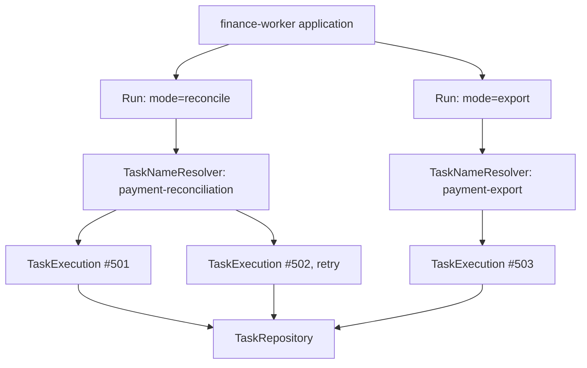
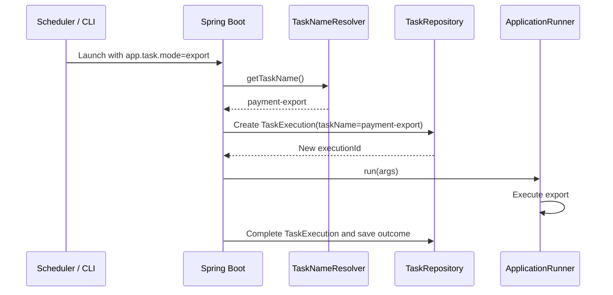

# Customizing Task Name Resolution in Spring Cloud Task

## 1. Problem and Objectives

A **Spring Cloud Task** application performs finite-lived work and then exits. Each run is recorded as a `TaskExecution` in `TaskRepository`, including the task name, start/end timestamps, exit code, and error details. When the same application is launched repeatedly on a schedule or on demand, **the task name** is key to finding runs of the same kind and investigating incidents.

In the **Advanced Configuration** chapter, we examine how Spring Cloud Task determines this name and how to change the rule when one application must serve multiple business modes. This topic is not merely about changing a log label: the name is used to classify execution history and can affect name-based operational policies.

After this lesson, you will be able to:

- Explain the difference between `spring.application.name`, `spring.cloud.task.name`, `TaskExecution.taskName`, and `executionId`.
- State the exact precedence order of the default `SimpleTaskNameResolver`.
- Set the name via YAML, environment variables, or launch arguments without writing custom Java code.
- Write a `TaskNameResolver` bean to map run modes to stable business names.
- Verify the actual recorded name in `TaskRepository` and avoid fragmenting history across retries, schedules, or Spring Batch integrations.

## 2. Where Does the Task Name Fit in the Spring Cloud Task Model?

Suppose we have a program `finance-worker.jar` that accepts one of two modes: `reconcile` or `export`. Both modes share the same JAR file, yet represent two distinct job types that must be tracked separately.

| Concept | Example | Role |
| --- | --- | --- |
| Spring Boot application name | `finance-worker` | Identifies the program or deployment unit via `spring.application.name`. |
| Spring Cloud Task name | `payment-reconciliation` or `payment-export` | Classifies `TaskExecution` records by business workload. |
| Execution identifier | `executionId = 501` | Distinguishes one specific run from all other runs. |
| Business argument | `businessDate=2026-11-23` | Identifies the data scope the run should process. |
| Artifact version | `finance-worker:2.1.0` | Identifies the deployed code version, not the workload type name. |

For example, two reconciliation runs on the same day can share `taskName = payment-reconciliation` and the same `businessDate` parameter, yet **do not share the same `executionId`**. The later run may be a retry and creates a new history record. Do not embed `executionId` or the processing date into the task name just to distinguish individual runs.



The IDs in the diagram are illustrative only. In practice, the task name must be determined **when Spring Cloud Task begins recording metadata**, before runners finish their work; do not wait until the end of a runner to decide the name.

## 3. Default Mechanism: `SimpleTaskNameResolver`

Spring Cloud Task defines the **`TaskNameResolver`** interface in package `org.springframework.cloud.task.repository`. This interface has one core method:

```java
public interface TaskNameResolver {
    String getTaskName();
}
```

By default, the framework provides **`SimpleTaskNameResolver`**. According to the API documentation, it picks the name in this order:

1. If **`spring.cloud.task.name`** is configured, use this value.
2. If no explicit task name is set, use the **`ApplicationContext` ID**; in standard Spring Boot setups, this ID is influenced by `spring.application.name`.

| `spring.application.name` | `spring.cloud.task.name` | Expected task name using the default resolver |
| --- | --- | --- |
| `finance-worker` | `payment-reconciliation` | `payment-reconciliation` |
| `finance-worker` | Not declared | Based on `ApplicationContext` ID, typically tied to `finance-worker` |
| Not declared | `payment-export` | `payment-export` |
| Not declared | Not declared | Based on the context ID set by Spring Boot; do not rely on an unverified default string |

A common point of confusion is that **`spring.application.name` does not automatically take precedence over `spring.cloud.task.name`**. When the Spring Cloud Task property is present, the default resolver prefers it. In addition, a custom `TaskNameResolver` can enforce an entirely different rule; do not assume the default precedence remains in effect once you replace the resolver.

Operationally, the task name should remain stable per *workload type*. It is stored in `TaskExecution`'s `taskName` field, typically corresponding to the `TASK_NAME` column in the `TASK_EXECUTION` table of the JDBC schema.

## 4. Approach 1: Explicit Naming via Configuration

If an application performs only **one type of task**, the simplest approach is declaring `spring.cloud.task.name` instead of implementing a custom resolver.

### 4.1. Configuring `application.yml`

```yaml
spring:
  application:
    name: finance-worker
  main:
    web-application-type: none
  cloud:
    task:
      name: payment-reconciliation
  datasource:
    url: ${TASK_DB_URL}
    username: ${TASK_DB_USER}
    password: ${TASK_DB_PASSWORD}
```

Here `finance-worker` is the Spring Boot application name; `payment-reconciliation` is the Spring Cloud Task name persisted in execution metadata. `DataSource` connects to a database containing the Spring Cloud Task schema, keeping history intact after the program exits.

### 4.2. Overriding at Launch Time

Spring Boot supports supplying configuration via the command line:

```bash
java -jar finance-worker.jar \
  --spring.cloud.task.name=payment-reconciliation \
  --businessDate=2026-11-23
```

Or via an environment variable:

```bash
export SPRING_CLOUD_TASK_NAME=payment-reconciliation
java -jar finance-worker.jar --businessDate=2026-11-23
```

The `--businessDate` part is a business parameter; `--spring.cloud.task.name` is a Spring configuration property. The two serve different purposes. The resolver determines the name from **the effective configuration of the launch**, so control configuration sources and Spring Boot precedence in real environments.

**When should you stop at this approach?** When each deployment represents one stable workload type, or when the orchestrator can pass the task name explicitly per job definition. Writing a custom resolver in that case only adds maintenance cost.

## 5. Approach 2: Defining an Application-Specific `TaskNameResolver`

Suppose an organization wants to use **the same JAR** for two independent workloads: reconciliation and data export. The orchestrator passes `app.task.mode=reconcile` or `app.task.mode=export`; the application must record the matching `taskName` as soon as it starts.

When naming rules require a business mapping, define a bean implementing `TaskNameResolver`. One implementation maps an **allowlisted** list of modes to fixed names:

```java
import java.util.Locale;

import org.springframework.cloud.task.repository.TaskNameResolver;
import org.springframework.context.annotation.Bean;
import org.springframework.context.annotation.Configuration;
import org.springframework.core.env.Environment;

@Configuration(proxyBeanMethods = false)
public class TaskNamingConfiguration {

    @Bean
    TaskNameResolver taskNameResolver(Environment environment) {
        return () -> {
            // Keep an explicit override path so operations can control the name.
            String configured = environment.getProperty("spring.cloud.task.name");
            if (configured != null && !configured.isBlank()) {
                return configured.trim();
            }

            String mode = environment.getProperty("app.task.mode", "reconcile")
                .trim().toLowerCase(Locale.ROOT);

            return switch (mode) {
                case "reconcile" -> "payment-reconciliation";
                case "export" -> "payment-export";
                default -> throw new IllegalArgumentException(
                    "Unsupported task mode: " + mode);
            };
        };
    }
}
```

Here `getTaskName()` is implemented as a lambda because the interface has only one method to implement. The bean is managed by Spring and used by Spring Cloud Task to determine the name when creating `TaskExecution`.

**Characteristics of this example:**

- `spring.cloud.task.name` takes precedence **because our custom code explicitly decided so**; that order is no longer automatically enforced by `SimpleTaskNameResolver`.
- `app.task.mode` is an **application-defined property**, not a standard Spring Cloud Task property.
- The allowed mode list is fixed; an invalid value makes the application fail early rather than creating a confusing history group.
- The returned name is a stable business name; it contains no UUID, timestamp, customer ID, or processing date.
- If you need both configured names and custom mapping, you must explicitly define their precedence order as shown.

When changing how the bean is defined, ensure only **one effective resolver** is picked by Spring Cloud Task. If the application uses multiple custom configurations or other starters that also register a resolver, check bean loading and auto-configuration for your exact library version.

### 5.1. Why Should the Name Be Determined Before Running Business Logic?

During a normal startup, Spring Cloud Task invokes `TaskNameResolver.getTaskName()` when infrastructure begins creating the `TaskExecution` record. This happens before `ApplicationRunner` and `CommandLineRunner` execute the main workload. Therefore:

- You can rely on configuration properties or environment variables loaded when the context is built.
- Do not rely on results only produced **after a runner finishes processing**.
- Do not call unstable APIs or external services just to decide the name; failures at this step can prevent metadata from being created.
- If mode selection affects the name, runner logic must read **the same configuration source** as the resolver to avoid recording one name while performing a different job.



## 6. Keeping the Resolver Synchronized with the Actual Executed Workload

A design bug occurs when the resolver records `payment-reconciliation` while the runner executes `export` mode. Avoid this by having both read `app.task.mode` from the same configuration rather than interpreting it in two places with different logic.

Example runner for a dual-mode application:

```java
import org.springframework.boot.ApplicationRunner;
import org.springframework.boot.SpringApplication;
import org.springframework.boot.autoconfigure.SpringBootApplication;
import org.springframework.cloud.task.configuration.EnableTask;
import org.springframework.context.annotation.Bean;
import org.springframework.core.env.Environment;

@SpringBootApplication
@EnableTask
public class FinanceWorkerApplication {

    public static void main(String[] args) {
        SpringApplication.run(FinanceWorkerApplication.class, args);
    }

    @Bean
    ApplicationRunner financeRunner(Environment environment) {
        return args -> {
            String mode = environment.getProperty("app.task.mode", "reconcile")
                .trim().toLowerCase(java.util.Locale.ROOT);

            switch (mode) {
                case "reconcile" -> {
                    // TODO: invoke reconciliation service and wait for completion.
                    System.out.println("Executing reconciliation");
                }
                case "export" -> {
                    // TODO: invoke export service and wait for export completion.
                    System.out.println("Executing data export");
                }
                default -> throw new IllegalArgumentException(
                    "Invalid mode: " + mode);
            }
        };
    }
}
```

The example shows the seam between **naming** and **workload dispatch**; the `TODO` branches should be replaced with real business processing. In a real application, extract reading/validating `mode` into a shared configuration bean so both resolver and runner use the exact same normalized value. Also ensure the runner waits for work to finish and propagates exceptions on failure; if the runner returns before background work completes, metadata may report completion prematurely.

### 6.1. Launching Both Modes

Run reconciliation:

```bash
java -jar finance-worker.jar \
  --app.task.mode=reconcile \
  --businessDate=2026-11-23
```

Run data export:

```bash
java -jar finance-worker.jar \
  --app.task.mode=export \
  --businessDate=2026-11-23
```

**Example condition:** do not pre-define `spring.cloud.task.name` in `application.yml` if you want the `mode`-based mapping rule to take effect. In the example resolver, an explicit `spring.cloud.task.name` value always takes precedence over `app.task.mode`.

The application also requires the `spring-cloud-starter-task` dependency, a suitable JDBC driver, and the matching Spring Cloud Task schema in the database pointed to by `spring.datasource`. Spring Boot and Spring Cloud versions must align via the BOM; the sample code uses modern Java syntax suitable for Java 17 and above.

## 7. Verifying the Task Name in `TaskRepository`

After launching, **inspect the actual persisted name** rather than relying solely on YAML contents or JAR filenames. In a typical Spring Cloud Task JDBC schema, you can query:

```sql
SELECT TASK_EXECUTION_ID,
       TASK_NAME,
       START_TIME,
       END_TIME,
       EXIT_CODE,
       EXIT_MESSAGE
FROM TASK_EXECUTION
WHERE TASK_NAME IN ('payment-reconciliation', 'payment-export')
ORDER BY TASK_EXECUTION_ID DESC;
```

Check table/column names against your deployed version's schema. You can also use `TaskExplorer` to query history via Java API instead of raw SQL. Hypothetical results:

| `TASK_EXECUTION_ID` | `TASK_NAME` | Input mode | Outcome |
| --- | --- | --- | --- |
| `501` | `payment-reconciliation` | `reconcile` | Succeeded |
| `502` | `payment-reconciliation` | `reconcile` | Failed |
| `503` | `payment-export` | `export` | Succeeded |
| `504` | `payment-reconciliation` | `reconcile` | Succeeded after rerun |

A rerun creates a new `TaskExecution` while keeping the same `TASK_NAME` when it is still the same workload type. This makes it possible to track success rates, retry counts, and duration **by logical name**, while `TASK_EXECUTION_ID` distinguishes individual runs.

If `TASK_NAME` differs from expectations, check in order: whether an external `spring.cloud.task.name` property was passed; whether the custom resolver bean was actually selected; which `app.task.mode` the environment loaded; and whether you are querying **the right metadata database**.

## 8. Safe and Operable Naming Rules

Customizing the resolver is powerful yet easy to misuse. Follow these rules:

| Rule | Recommended example | Error-prone practice |
| --- | --- | --- |
| Reflect the workload type | `payment-reconciliation` | `task-1`, `worker` |
| Keep stable across runs | Same name for every reconciliation run | Appending timestamps or UUIDs to the name |
| Put varying data in arguments | `--businessDate=2026-11-23` | Naming `payment-reconciliation-2026-11-23` |
| Separate deployment identifiers | Image `finance-worker:2.1.0`, task name unchanged | Renaming the task on every image upgrade |
| Follow casing and character conventions | Lowercase, hyphens, concise | Unbounded long names or characters awkward in queries |
| Never expose sensitive data | `payment-export` | Embedding tokens, emails, or personal IDs in the name |

`TASK_NAME` has a schema-defined length limit; in the reference schema it is typically `VARCHAR(100)`, though you must verify your exact **version** and database. A resolver should return a **non-null, non-blank, valid value within length limits**, and reject unsupported modes explicitly.

If the name appears in metric or trace labels, too many distinct names can cause **cardinality** issues in observability systems. Therefore avoid constructing names from user data, event IDs, or timestamps even if the database would accept them.

### 8.1. Should You Include the Environment in the Name?

If `dev`, `staging`, and `prod` have separate `TaskRepository` stores and monitoring systems, you can keep the name `payment-reconciliation` across all environments. If multiple environments share a metadata store, establish a reliable environment isolation convention, such as database/schema partitioning, access controls, or a stable prefix. **Do not rely solely on name prefixes** to satisfy data isolation requirements.

### 8.2. What If There Are Multiple Tenants?

Do not automatically append every `tenantId` to `taskName`. That rapidly inflates the number of names and turns potentially sensitive identifiers into system labels. Store tenant or processing scope in metadata/arguments and properly designed audit mechanisms while keeping the task name focused on workload type. If business requirements mandate per-tenant history separation, design explicit bounds and access controls.

## 9. Impact of Task Names on Scheduling, Retries, and Operations

### 9.1. Scheduled or On-Demand Runs

Spring Cloud Task tracks each run; scheduling is usually handled by cron, Kubernetes CronJob, Spring Cloud Data Flow, or another orchestrator. An orchestrator may invoke the same JAR with different arguments. A resolver maps the invoked definition to the appropriate task name in `TaskRepository`.

For instance, suppose two independent schedules exist: reconciliation at 02:00 and export at 03:00. Naming them `payment-reconciliation` and `payment-export` keeps history clear even with the same image. Do not infer workload type from launch time, since schedules can change, catch up, or be triggered manually.

### 9.2. Retries and Idempotency

If a reconciliation run fails and the orchestrator relaunches `--app.task.mode=reconcile --businessDate=2026-11-23`, the resolver should return the same **`payment-reconciliation`**. The new run receives a new `executionId`. This enables finding all attempts for the same workload type.

Keeping the name consistent **does not guarantee idempotency by itself**. Business outcomes must be protected with appropriate locks, transactions, status checks, and safe rerun logic—for instance, avoiding duplicate reconciliation records for the same date.

### 9.3. Concurrent Execution Limits

Some Spring Cloud Task versions support a single-instance limit by task name via `spring.cloud.task.single-instance-enabled` and its companion dependencies/requirements. When using this feature, **the task name becomes the grouping key for concurrency control**. Changing a resolver from one shared name to two distinct names changes concurrency-limiting behavior. Test against your actual database and library configuration; this mechanism does not replace business-level deduplication locks.

### 9.4. Coordinating with Spring Batch

A Spring Cloud Task application can launch a Spring Batch job. Distinguish the two layers:

- `TaskNameResolver` determines the name of the **application run** in `TaskRepository`.
- Spring Batch's `JobRepository` tracks `JobExecution` and `StepExecution`, with its own `jobName`.
- Changing `taskName` does not automatically rename the Batch job, alter job parameters, or change Batch restartability.

If one JAR can run two Batch jobs, you can pick the task name by mode while still tracking the right `jobName`, job parameters, and processing results. Never equate `TaskExecution.executionId` with `JobExecution`'s ID.

## 10. Common Mistakes When Writing a Custom Resolver

| Symptom | Possible cause | Resolution |
| --- | --- | --- |
| Every run is named `finance-worker` | `spring.cloud.task.name` not loaded; custom resolver not active. | Check effective config, `TaskNameResolver` bean, and context ID fallback. |
| `mode=export` yet `TASK_NAME=payment-reconciliation` | Higher-precedence explicit name set, or inconsistent `mode` reading logic. | Check `spring.cloud.task.name`, resolver, and runner branches. |
| History split into thousands of names | Name built from dates, UUIDs, order IDs, or tenants. | Use a fixed name per workload type; move varying values into proper arguments. |
| Task fails to start on invalid mode | Resolver or runner rejects unsupported mode. | Check input arguments, allowlisted modes, and bootstrap logs. |
| Old history missing after renaming task | Earlier records retain the old `TASK_NAME`. | Document a rename migration plan, query both names during transition, and update dashboards. |
| App logs one name while DB stores another | Logging reads a property instead of the actual resolver, or config differs across runs. | Query `TASK_NAME` in the database; log the resolved name and `executionId` if available. |
| Oversized name causes metadata write failure | Exceeds schema's `TASK_NAME` column length. | Shorten and validate inputs before framework repository writes. |
| Task marked successful before background work finishes | Runner returns before async work completes. | Synchronize completion point and propagate errors to runner; naming does not fix lifecycle bugs. |

One critical trap: if the resolver throws an exception during startup, Spring Cloud Task **may not have created a `TaskExecution` yet**. When troubleshooting, inspect startup logs and process/container status in addition to the metadata store. An empty `endTime` also does not guarantee the process is still running: the JVM may have been killed before the repository was updated.

## 11. Scenario-Based Naming Verification

Before scheduling in production, test several combinations to confirm the exact name recorded:

| Input | Resolver used | Expected `taskName` |
| --- | --- | --- |
| `spring.cloud.task.name=payment-reconciliation` set | `SimpleTaskNameResolver` | `payment-reconciliation` |
| No `spring.cloud.task.name`, `spring.application.name=finance-worker` | `SimpleTaskNameResolver` | Context ID, typically `finance-worker` |
| `app.task.mode=reconcile`, no explicit name | Custom resolver from Section 5 | `payment-reconciliation` |
| `app.task.mode=export`, no explicit name | Custom resolver from Section 5 | `payment-export` |
| `app.task.mode=export`, `spring.cloud.task.name=custom-export` | Custom resolver from Section 5 | `custom-export` because explicit override takes precedence |
| `app.task.mode=unknown`, no explicit name | Custom resolver from Section 5 | Configuration error; no new name created from unknown value |

During integration testing, run the application against a test metadata database and query `TASK_EXECUTION`. Do not merely call `getTaskName()` directly and assume everything works, because issues with bean selection, runtime configuration, schema, or lifecycle often only surface when the real application runs.

### Example SQL to Verify History by Name

```sql
SELECT TASK_NAME,
       COUNT(*) AS EXECUTION_COUNT,
       MIN(START_TIME) AS FIRST_START,
       MAX(START_TIME) AS LAST_START
FROM TASK_EXECUTION
WHERE TASK_NAME IN ('payment-reconciliation', 'payment-export')
GROUP BY TASK_NAME
ORDER BY TASK_NAME;
```

This SQL is an example for common JDBC schemas. Production deployments must use a persistent database and version-matched schema; run arguments, exit codes, and output data should be verified separately.

## 12. Practice Exercise and Self-Check Questions

**Exercise:** Describe how to extend the resolver so an `inventory-worker` application handles three job types—`inventory-import`, `inventory-export`, and `inventory-reconciliation`—from `app.task.mode`. Requirements: keep names stable across reruns of the same mode, reject invalid modes, allow controlled explicit overrides, and make history queryable by `TASK_NAME`.

**Question 1.** In the default resolver, both `spring.cloud.task.name` and `spring.application.name` have values. Which property determines `taskName`?

**Question 2.** Why must `TaskNameResolver` use information already available at application startup instead of waiting for the runner to finish before naming?

**Question 3.** Should two runs with the same `app.task.mode=reconcile` and the same `businessDate` have two different `taskName` values? What distinguishes them?

**Question 4.** Why shouldn't you return `payment-reconciliation-<UUID>` even though that name distinguishes individual runs?

**Question 5.** An application renamed its task, yet the dashboard only queries the new name. How can you still view historical records from before the rename?

**Suggested answers:** (1) `spring.cloud.task.name`; (2) start metadata is created before business logic executes; (3) no, same logical name, different `executionId`; (4) history and metrics fragment and name cardinality explodes; (5) during the transition period, query both old and new names or maintain a controlled mapping.

## 13. Summary and References

**`TaskNameResolver` is the extension point that determines the logical name of a Spring Cloud Task run.** The default resolver (`SimpleTaskNameResolver`) prioritizes `spring.cloud.task.name`, falling back to the `ApplicationContext` ID. Replace the resolver in Java code only when you need to map business rules or run modes to consistent names.

A well-designed resolver always returns a valid name that is stable per workload type and contains no secrets or per-run varying data. Always verify the actual recorded name in `TaskRepository`, maintain clear boundaries with business data, and understand how the task name affects scheduling, retries, concurrency limits, dashboards, and Spring Batch.

Official references:

- [Spring Cloud Task Reference Guide — Task Name](https://docs.spring.io/spring-cloud-task/docs/current/reference/htmlsingle/)
- [Spring Cloud Task API — `TaskNameResolver`](https://docs.spring.io/spring-cloud-task/docs/current/apidocs/org/springframework/cloud/task/repository/TaskNameResolver.html)
- [Spring Cloud Task API — `SimpleTaskNameResolver`](https://docs.spring.io/spring-cloud-task/docs/current/apidocs/org/springframework/cloud/task/repository/support/SimpleTaskNameResolver.html)
- [Spring Boot Reference Guide — Externalized Configuration](https://docs.spring.io/spring-boot/reference/features/external-config.html)
