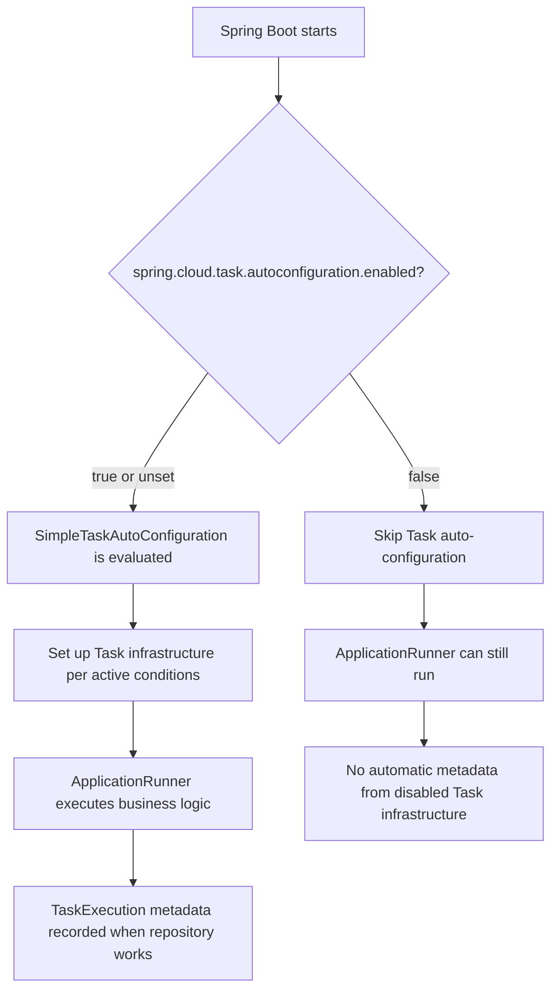
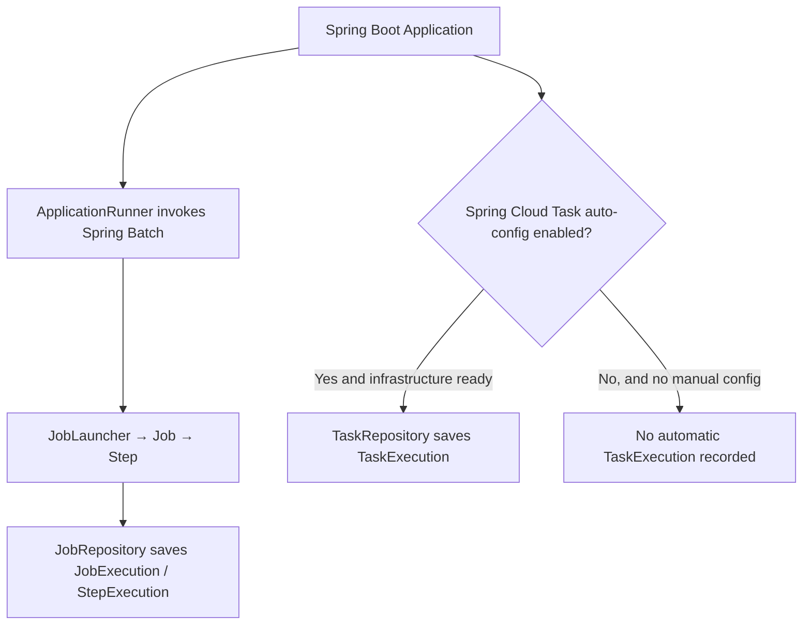
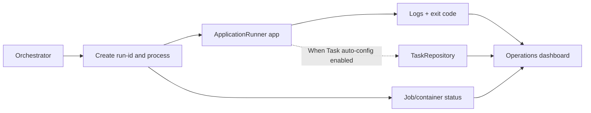

# Intentionally Disabling Spring Cloud Task Auto-Configuration

In the **Advanced Configuration** chapter of the **SPRING_CLOUD_TASK** module, we examine the scenario where a Spring Boot application includes the Spring Cloud Task dependency yet **does not want Spring Cloud Task to automatically create execution-tracking infrastructure** in a particular deployment configuration.

Spring Cloud Task fits finite-lived applications: accept parameters, perform work, record the run with `TaskRepository`, and terminate. When auto-configuration is enabled, the framework can set up a repository, explorer, and lifecycle components to persist task status, timing, and outcomes. However, there are situations where you want to **intentionally disable** that auto-configuration: separating out a simple CLI run mode, testing without metadata, or replacing default infrastructure with custom setup controlled by the engineering team.

This is a decision about **lifecycle and observability**. Disabling auto-configuration without understanding the impact can lead to a scheduler reporting successful process exit while zero `TaskExecution` records appear in the database.

## 1. Learning Objectives

After this lesson, you will be able to:

- State clearly what **disabling Spring Cloud Task auto-configuration** means and does not mean.
- Use the `spring.cloud.task.autoconfiguration.enabled=false` property or exclude `SimpleTaskAutoConfiguration` from Spring Boot auto-configuration.
- Explain the impact on `TaskRepository`, `TaskExplorer`, lifecycle metadata, and extensions that depend on them.
- Distinguish disabling auto-configuration from disabling schema initialization, changing metadata storage, and closing the `ApplicationContext`.
- Build an `ApplicationRunner` that works both when Task auto-configuration is enabled and disabled, then verify the difference on a JDBC database.
- Establish criteria for deciding when to disable it, how to verify safely, and how to re-enable it.

## 2. How Does Spring Cloud Task Auto-Configuration Work?

In a project using compatible Spring Boot and Spring Cloud Task versions, the library provides `SimpleTaskAutoConfiguration` to create standard components. On supported versions, this class is conditioned on the property:

```text
spring.cloud.task.autoconfiguration.enabled
```

When the property is not declared, the auto-configuration condition is **enabled by default**; setting it to `false` causes the condition not to match. Spring Cloud Task components typically auto-configured include:

| Component | Purpose when auto-configuration is enabled |
| --- | --- |
| `TaskRepository` | Creates and updates information for each run, stored in Map/JDBC depending on the data source. |
| `TaskExplorer` | Queries execution information stored in the repository. |
| `TaskNameResolver` | Resolves the task name attached to the execution record. |
| Transaction manager for Task | Serves metadata operations appropriate to the repository configuration. |
| Task schema initializer component | Supports creating metadata tables when using JDBC with initialization enabled. |
| Task lifecycle infrastructure | Records start/end or failure events when enabled and required dependencies are present. |

Bean names and how auto-configuration/lifecycle classes are split may vary by version. The constant takeaway is: **auto-configuration provides the default components so the application records runs; disabling it removes those default guarantees**.



This diagram illustrates the case **with no other manual Task configuration**. Disabling auto-configuration is not a switch that deletes beans registered manually by your application: if you declare your own `TaskRepository` or add `@EnableTask`, actual behavior must be evaluated separately.

## 3. When Should You Disable Auto-Configuration?

### 3.1. CLI Mode That Needs No Task History

The same source code can be packaged to run in two environments:

- **Production environment:** runs end-of-day reconciliation, requiring every `TaskExecution` history entry to be stored in PostgreSQL.
- **Local development environment:** a developer wants to run a command that reads a file and prints output, with no repository and no metadata database.

In the local environment, the team may choose to disable Task auto-configuration. Command results must then be observed via **stdout/stderr and exit codes**, because Spring Cloud Task does not persist history automatically.

### 3.2. Temporarily Replacing Default Infrastructure in an Integrated App

An application with its own repository, custom transaction manager, or specialized execution flow may need tight control over bean creation to avoid conflicts. You can disable auto-configuration and declare the needed components as designed.

**Do not assume** that merely disabling auto-configuration makes a custom `TaskRepository` work on its own. If you still need to record `TaskExecution`, the application must provide the complete infrastructure and lifecycle matching your Spring Cloud Task version, then verify with a real test run.

### 3.3. Controlled Development and Diagnostics

A temporary mode that skips metadata recording can help isolate the effect of Task auto-configuration when diagnosing bean-creation or repository-connection errors. After analysis, clearly establish which configuration is deployed to each environment and restore monitoring if operations require it.

### 3.4. When Should You *Not* Disable It?

Do not use this toggle to mask production configuration errors. For example, if the Task fails to write because the `TASK_EXECUTION` table is missing, disabling auto-configuration can let the business app keep running while **execution history vanishes**. The right fix is correcting the schema, connection, permissions, or repository configuration.

If the system needs run lookups, progress visibility, failure investigation, or Spring Batch coordination, evaluate carefully before removing metadata recording.

## 4. First Approach: Disabling via Configuration Property

The most flexible approach is the official property:

```properties
spring.cloud.task.autoconfiguration.enabled=false
```

Equivalent in `application.yml`:

```yaml
spring:
  cloud:
    task:
      autoconfiguration:
        enabled: false
```

If needed per environment, place this property in a profile file, such as `application-local.yml`:

```yaml
spring:
  cloud:
    task:
      autoconfiguration:
        enabled: false
```

And run the application with the `local` profile:

```bash
java -jar task-demo.jar --spring.profiles.active=local
```

Or disable it for a single run without modifying packaged config:

```bash
java -jar task-demo.jar --spring.cloud.task.autoconfiguration.enabled=false
```

**Note:** Spring Boot command-line options can override config-file values according to configuration precedence; do not pass this option to production commands if you still want metadata recorded.

### 4.1. Scope of the Property

This property controls **Spring Cloud Task auto-configuration**; it is **not** equivalent to:

- Removing the Spring Cloud Task dependency from the classpath.
- Disabling all Spring Boot auto-configuration.
- Stopping `ApplicationRunner`, `CommandLineRunner`, or disabling business code you wrote.
- Turning off JDBC connections or all `DataSource` beans created by Spring Boot.
- Dropping the `TASK_EXECUTION` table or deleting already-saved Task history data.
- Preventing schedulers, Kubernetes Jobs, or external APIs from launching the process.

Therefore, when an application already has Task tables in PostgreSQL, switching to `autoconfiguration.enabled=false` **does not delete old history**. It changes whether the current application instance sets up and uses default Task components; old records remain in the database under normal data management policies.

## 5. Second Approach: Excluding the Auto-Configuration Class via Annotation

If disabling is a permanent architectural choice for an application, you can exclude `SimpleTaskAutoConfiguration` from Spring Boot auto-configuration:

```java
package com.example.task;

import org.springframework.boot.autoconfigure.SpringBootApplication;
import org.springframework.cloud.task.configuration.SimpleTaskAutoConfiguration;

@SpringBootApplication(exclude = SimpleTaskAutoConfiguration.class)
public class StandaloneUtilityApplication {
    public static void main(String[] args) {
        org.springframework.boot.SpringApplication.run(
                StandaloneUtilityApplication.class, args);
    }
}
```

Spring Cloud Task documentation also describes the equivalent via `@EnableAutoConfiguration(exclude = {SimpleTaskAutoConfiguration.class})`. For applications already using `@SpringBootApplication`, setting `exclude` directly on that annotation is usually cleaner.

Comparison:

| Criterion | Property `autoconfiguration.enabled=false` | Annotation `exclude` |
| --- | --- | --- |
| Scope of change | Per environment config or per run | Per configuration/application class |
| Re-enabling temporarily | Easy: switch profile or override property | Must edit code/config, rebuild, and redeploy |
| Best suited for | One artifact with multiple run modes | Apps that intentionally do not use Task auto-config by design |
| Misconfiguration risk | Property overridden by profile, env, or command line | Accidentally excluding config in an app that needs metadata |
| What to verify | Condition evaluation and execution records | Exclusion condition and execution records |

**Do not set both at the same time** in examples. Choose one mechanism as the source of truth so operators can easily see why Task is not auto-configured.

## 6. Complete Example: Same ApplicationRunner, Two Modes

The following example runs finitely under the Spring Cloud Task model. When **auto-configuration is enabled**, it can persist history into a file-backed H2 database. When **auto-configuration is disabled**, the runner still prints output and exits, while the default infrastructure for creating `TaskExecution` records is not activated.

### 6.1. Project and Dependencies

Assume the project uses Spring Boot with a **Boot-compatible** Spring Cloud release train and Maven. Required dependencies in `pom.xml`:

```xml
<dependencies>
    <dependency>
        <groupId>org.springframework.boot</groupId>
        <artifactId>spring-boot-starter</artifactId>
    </dependency>
    <dependency>
        <groupId>org.springframework.cloud</groupId>
        <artifactId>spring-cloud-starter-task</artifactId>
    </dependency>
    <dependency>
        <groupId>org.springframework.boot</groupId>
        <artifactId>spring-boot-starter-jdbc</artifactId>
    </dependency>
    <dependency>
        <groupId>com.h2database</groupId>
        <artifactId>h2</artifactId>
        <scope>runtime</scope>
    </dependency>
</dependencies>
```

Manage versions with the appropriate Spring Boot parent/BOM and Spring Cloud BOM. To package an executable JAR runnable with `java -jar`, include the Spring Boot plugin in `build`:

```xml
<build>
    <plugins>
        <plugin>
            <groupId>org.springframework.boot</groupId>
            <artifactId>spring-boot-maven-plugin</artifactId>
        </plugin>
    </plugins>
</build>
```

In this example we **do not add `@EnableTask`** and do not declare manual repository or task lifecycle beans. That lets us compare auto-configuration behavior directly without manual configuration masking the outcome.

### 6.2. Java Application

Create `src/main/java/com/example/task/TaskAutoConfigDemoApplication.java`:

```java
package com.example.task;

import java.util.List;

import org.springframework.boot.ApplicationArguments;
import org.springframework.boot.ApplicationRunner;
import org.springframework.boot.SpringApplication;
import org.springframework.boot.autoconfigure.SpringBootApplication;
import org.springframework.context.ConfigurableApplicationContext;
import org.springframework.context.annotation.Bean;

@SpringBootApplication
public class TaskAutoConfigDemoApplication {

    public static void main(String[] args) {
        ConfigurableApplicationContext context =
                SpringApplication.run(TaskAutoConfigDemoApplication.class, args);

        int exitCode = SpringApplication.exit(context);
        System.exit(exitCode);
    }

    @Bean
    ApplicationRunner greetingRunner() {
        return args -> {
            String name = parseName(args);
            System.out.println("Hello, " + name + "!");
        };
    }

    private static String parseName(ApplicationArguments args) {
        if (!args.containsOption("name")) {
            return "World";
        }

        List<String> values = args.getOptionValues("name");
        if (values == null || values.size() != 1
                || values.get(0).isBlank()) {
            throw new IllegalArgumentException(
                    "Exactly one --name=<non-blank name> must be passed");
        }

        return values.get(0).trim();
    }
}
```

`ApplicationRunner` runs the logic **once**, validates options with `ApplicationArguments`, and exits. `SpringApplication.exit(context)` closes context-managed resources; `System.exit(exitCode)` returns the exit code to the OS. Note that if `SpringApplication.run` throws an exception (e.g., runner failure), the lines below do not run; Spring Boot handles the startup error and the process typically exits with a non-zero code.

### 6.3. Shared Configuration

Create `src/main/resources/application.yml`:

```yaml
spring:
  application:
    name: task-autoconfig-demo

  main:
    web-application-type: none

  datasource:
    url: jdbc:h2:file:./task-history
    driver-class-name: org.h2.Driver
    username: sa
    password: ""

  cloud:
    task:
      name: task-autoconfig-demo
      initialize-enabled: true
      autoconfiguration:
        enabled: true
```

Because it uses `jdbc:h2:file:./task-history`, H2 data is stored in **a file on disk** under the working directory; after the JVM exits, the file can still be reopened. This is convenient for comparing two local runs. Unlike `jdbc:h2:mem:taskdb`, the `file:` URL persists history after the JVM closes.

`initialize-enabled: true` is solely to help create the schema in this lab exercise for your Spring Cloud Task version. In production, use an appropriate database and migrations rather than letting each process auto-create DDL.

### 6.4. Running with Auto-Configuration Enabled

Package the application:

```bash
./mvnw clean package
```

On Windows PowerShell, use `.\mvnw.cmd clean package`. Then run (the JAR name below assumes `artifactId` and `version` match the example):

```bash
java -jar target/task-autoconfig-demo-0.0.1-SNAPSHOT.jar --name=Lan
```

Expected business output:

```text
Hello, Lan!
```

With standard configuration and a working database/schema, Spring Cloud Task creates and updates a `TaskExecution`. Wait for the process to exit, then connect with a SQL client to H2 **using the same file path** to inspect data. Do not open H2 from two processes concurrently without configuring proper access mode.

Query using the default schema:

```sql
SELECT TASK_EXECUTION_ID,
       TASK_NAME,
       START_TIME,
       END_TIME,
       EXIT_CODE
FROM TASK_EXECUTION
ORDER BY TASK_EXECUTION_ID DESC;
```

Note the row count and highest `TASK_EXECUTION_ID`. If the `TASK_EXECUTION` table does not exist, inspect auto-configuration and schema initialization before concluding the experiment succeeded.

### 6.5. Running with Auto-Configuration Disabled

Keep the same JAR and disable auto-configuration only for the next run:

```bash
java -jar target/task-autoconfig-demo-0.0.1-SNAPSHOT.jar   --spring.cloud.task.autoconfiguration.enabled=false --name=Mai
```

The command above uses POSIX line continuation conventions; in PowerShell, enter the full command on a single line or use the appropriate line continuation syntax.

Business output is still:

```text
Hello, Mai!
```

However, given the example's setup (no manual Task beans or `@EnableTask`), `SimpleTaskAutoConfiguration` is skipped. Therefore this run **does not automatically record a new `TaskExecution` via default Task infrastructure**. Run the SQL above again: the Task row count does not increase because it was disabled for this run, even though the greeting and runner exit code show business code completed.

**How to read results carefully:** the old record from the previous run **still exists**. Do not verify by requiring the table to be completely empty; compare **the row count before and after** and check for a record matching the new run.

### 6.6. Re-Enabling

Run once more **without** the disable option:

```bash
java -jar target/task-autoconfig-demo-0.0.1-SNAPSHOT.jar --name=Binh
```

If the database is healthy, a new `TaskExecution` is created again. The experiment demonstrates that **the same runner can run in both modes**, while the tracking provided by Spring Cloud Task depends on configuration.

| Run | Task auto-config state | Console output | New Task record |
| --- | --- | --- | --- |
| 1 | Enabled | `Hello, Lan!` | Yes, when JDBC/repository works |
| 2 | Disabled | `Hello, Mai!` | None from default auto-configuration |
| 3 | Re-enabled | `Hello, Binh!` | Yes, when JDBC/repository works |

These values are **expected outcomes** of the lab exercise, not measurements observed from a real production system in this article.

## 7. Do Not Confuse with Other Configuration Switches

The properties below serve different purposes:

| Configuration | Primary effect | Disables Task auto-configuration? |
| --- | --- | --- |
| `spring.cloud.task.autoconfiguration.enabled=false` | Does not apply `SimpleTaskAutoConfiguration` | **Yes** |
| Excluding `SimpleTaskAutoConfiguration.class` via `exclude` | Excludes Task auto-configuration class from Spring Boot | **Yes** |
| `spring.cloud.task.initialize-enabled=false` | Does not auto-initialize Task schema tables | **No** |
| `spring.cloud.task.closecontextEnabled=true` | Requests closing `ApplicationContext` after Task completes | **No** |
| `spring.main.web-application-type=none` | Does not start a web application context | **No** |
| `spring.cloud.task.name=...` | Sets the name for the execution when Task is active | **No** |
| Changing `spring.datasource.*` | Changes JDBC connection; may change where metadata is stored | **No** |
| Removing `@EnableTask` annotation | Removes one way of manually enabling lifecycle | **Not equivalent**, depends on active auto-config infrastructure |

Two pairs of settings that cause the most confusion:

```yaml
spring:
  cloud:
    task:
      initialize-enabled: false
      autoconfiguration:
        enabled: true
```

This case **still auto-configures Spring Cloud Task**, but does not auto-create tables. If the right schema already exists, the JDBC repository can still write metadata.

Conversely:

```yaml
spring:
  cloud:
    task:
      initialize-enabled: true
      autoconfiguration:
        enabled: false
```

This case has **disabled Task auto-configuration infrastructure**. Leaving `initialize-enabled: true` will not make a `TaskRepository` reappear on its own.

## 8. `@EnableTask` and Manual Configuration: Area Requiring Caution

`@EnableTask` is a Spring Cloud Task annotation used to activate parts of the lifecycle infrastructure, especially in applications configuring Task manually. In versions providing `TaskLifecycleConfiguration`, the annotation may import this lifecycle configuration.

Therefore, to demonstrate the effect of `autoconfiguration.enabled=false`, **do not disable auto-configuration while also adding `@EnableTask` to the example without controlling its dependencies**. Otherwise observed behavior can differ:

- Listener components requiring `TaskRepository` or related beans may appear while those beans are no longer auto-created, causing startup errors.
- If the project already declares manual repository/lifecycle beans, it may still write metadata even though `SimpleTaskAutoConfiguration` was excluded.
- Another library or application config may explicitly create Task beans that the property does not remove.

If the intent is **not using Spring Cloud Task**, inspect and remove both auto-configured Task components **and** unneeded manual configuration. If the intent is **customizing Spring Cloud Task**, identify every bean that must be supplied and properly configure `TaskConfigurer`, `TaskRepository`, `TaskExplorer`, transaction manager, and lifecycle for your version.

Never apply a "disable Task to avoid initialization errors" workaround when the business still requires execution history. Design must satisfy operational requirements first.

## 9. Impact When Coordinating with Spring Batch

Spring Cloud Task and Spring Batch manage **two kinds of metadata**:

- **`TaskExecution`** describes the task application lifecycle.
- **`JobExecution` / `StepExecution`** describe Spring Batch jobs/steps; this data is managed by Batch's `JobRepository`.

Suppose an `ApplicationRunner` calls `JobLauncher` to run a Batch job while Spring Cloud Task auto-configuration is disabled.

- The runner can still be invoked by Spring Boot if the application is properly configured.
- Spring Batch infrastructure may still auto-configure and record `JobExecution`, depending on Batch dependencies and settings.
- **There is no reason to expect `TaskExecution` to appear automatically** just because a Batch job ran.
- Task–Batch integration features must be verified specifically for your version and configuration.



This is a classic illustration that **disabling auto-configuration for one library does not disable every other library**. If both monitoring layers are needed, configure Task and Batch accordingly.

## 10. Operating When Intentionally Skipping TaskExecution Recording

For scheduled or on-demand applications, disabling Task auto-configuration removes a default lifecycle data source. Therefore, before deciding to disable it, identify **alternative sources** to answer:

1. Who requested the run? When, and with what parameters?
2. Did the scheduler successfully launch the process/container?
3. Is the process still running or has it exited?
4. If exited, what are the exit code and failure reason?
5. Were business outcomes written completely, without duplicates, and recoverably?
6. On retry, how do you avoid running the same work twice?

An orchestration system such as Kubernetes Job/CronJob, an external scheduler, or a task-launching service can track `run-id`, process status, start/end timestamps, retry count, and logs. This data lives **outside** Spring Cloud Task and remains useful even if the app crashes before `ApplicationContext` finishes initializing.

### Illustrative Observability Path



When there is no automatic `TaskRepository`, the dashboard must explicitly specify the alternative data source; never display a run as "successful" simply because no error metadata was found.

### Security and Existing Data

Disabling auto-configuration **does not delete historical records** in existing databases, does not automatically clear logs, and does not stop command-line argument passing. Never pass passwords, tokens, or sensitive customer data in `--parameter=value` because those arguments can still appear in scheduler history, OS process listings, and console logs.

If auditability requires persisted run states, keep a durable `TaskRepository` or design an alternative store with equal durability guarantees; unstructured log lines are rarely sufficient for reconciliation.

## 11. Verifying Whether Auto-Configuration Is Actually Disabled

Do not infer it merely from **not seeing Spring Cloud Task logs**. Different logging levels can suppress messages. More reliable verification uses two sources:

### 11.1. Inspecting the Condition Evaluation Report

Spring Boot can print the auto-configuration report when run with the debug flag:

```bash
java -jar target/task-autoconfig-demo-0.0.1-SNAPSHOT.jar   --debug --spring.cloud.task.autoconfiguration.enabled=false
```

In the report, look for `SimpleTaskAutoConfiguration`. With the property set to `false`, the `@ConditionalOnProperty` condition on that class does not match. Exact wording can vary by Boot/Task version.

### 11.2. Checking Records Before and After

When using a **persistent** database:

1. Record the `TASK_EXECUTION` row count before the run.
2. Run the same artifact with `autoconfiguration.enabled=false`.
3. Verify the runner still executes business work and the process exits.
4. Re-query the table; in a setup relying solely on this lesson's auto-config, **no new record is added**.
5. Re-enable auto-config, run again, and confirm the record count increases when the repository works.

**Distinguish "no record written" from "failed to write record":** if a run with auto-config enabled also fails to write a record, the cause may lie in schema/JDBC setup. In that state, row-count differences cannot prove the toggle works properly.

### 11.3. Testing Beans at the Test Level

In test suites, you can use `ApplicationContextRunner` or Spring Boot startup tests to assert Task bean conditions. A meaningful test compares whether `TaskRepository`/`TaskExplorer` beans exist across the two configurations when **no manual Task beans are declared**. Do not write a test that only checks a property string with `equals("false")`; that proves nothing about auto-configuration behavior.

## 12. Common Mistakes

| Symptom | Cause to check | Action |
| --- | --- | --- |
| Runner runs, yet no `TaskExecution` appears | Auto-config was disabled; or JDBC/schema error | Check properties, condition report, and database |
| Set `initialize-enabled=false`, yet records still appear | Property only stops table creation, not Task itself | To disable Task, use the autoconfiguration property |
| Set `autoconfiguration.enabled=false`, yet Task listeners still run | `@EnableTask` or other manual config exists | Check lifecycle beans and configuration imports |
| App fails due to missing `TaskRepository` after disabling | Manual config/other beans still depend on repository | Remove unneeded dependencies or supply full custom infrastructure |
| Disabled auto-config, yet JDBC still connects | Spring Boot auto-configures `DataSource` independently | Determine whether datasource is still needed for business/Batch |
| Batch still runs and writes `JobExecution` | Batch auto-configures separately | Distinguish Batch repository from Task repository |
| Re-enabled, yet no new records appear | Wrong schema, DB privileges, URL, profile, or task name | Check Task logs, condition evaluation, DB connectivity |
| Cannot re-enable via CLI option | `exclude` annotation remains hardcoded in Java | Remove `exclude` and rebuild, or use property instead |
| After disabling, scheduler assumes task succeeded | Exit code is 0, yet no metadata remains to verify | Add business-level verification and runtime observability |

## 13. Pre-Deployment Checklist

- [ ] Clear rationale exists for **disabling** Task auto-configuration in this environment.
- [ ] Clear understanding of which modes require `TaskExecution` for monitoring, auditing, or retries.
- [ ] **One** control mechanism chosen: property/profile or annotation exclude.
- [ ] Checked for `@EnableTask`, manual lifecycle config, `TaskRepository`, and `TaskConfigurer` declarations.
- [ ] Verified the app still executes runners and exits with codes matching business outcomes.
- [ ] If history is required, durable JDBC repository/schema is configured and auto-configuration is not accidentally disabled.
- [ ] If Task metadata is skipped, scheduler/container provides reliable run-tracking data.
- [ ] For Spring Batch, `JobRepository`, `JobExecution`, and restart policies are verified separately.
- [ ] Re-enabling path and smoke test exist to confirm new records are created when Task mode is active.

## 14. Practice Exercises

**Exercise 1 — Comparing two runs.** Use the `ApplicationRunner` example with file-backed H2. Run once with Task auto-config enabled, and once with `--spring.cloud.task.autoconfiguration.enabled=false`. Compare console greeting, exit code, `TASK_EXECUTION` row count, and the condition report.

**Exercise 2 — Diagnosing configuration.** Keep `spring.cloud.task.initialize-enabled=false` while setting `autoconfiguration.enabled=true`, running against a database that **already has** the proper schema. Explain why metadata can still be persisted.

**Exercise 3 — Disabling via annotation.** Create a separate test branch using `@SpringBootApplication(exclude = SimpleTaskAutoConfiguration.class)`. Try overriding with the property set to `true` on the command line and explain why `exclude` still takes effect.

**Exercise 4 — Evaluating a real scenario.** A nightly Spring Batch application writes both `JobExecution` and `TaskExecution`. Developers propose disabling Task auto-config because they only care about Batch checkpoints. List what information is lost, alternative observability sources, and acceptance criteria for the change.

**Exercise 5 — Rollback plan.** Write a verification checklist for re-enabling Task auto-config: check schema, DB privileges, beans, Task listeners, new records, exit code, and history queries.

### Self-Check Questions

1. What is the exact property to disable Spring Cloud Task auto-configuration? What does its default value mean when omitted?
2. Why does disabling Task auto-configuration not stop `ApplicationRunner` from running?
3. How does `spring.cloud.task.initialize-enabled=false` differ from `spring.cloud.task.autoconfiguration.enabled=false`?
4. Why can adding `@EnableTask` to the example invalidate a conclusion that "Task is disabled"?
5. If the `TASK_EXECUTION` table already holds 100 records, does disabling auto-config delete those 100 records?
6. In an application integrating Spring Batch, does the absence of `TaskExecution` imply the absence of `JobExecution`?
7. What evidence would you use to prove the application truly did not auto-configure Task?

## 15. Key Takeaways

- **`spring.cloud.task.autoconfiguration.enabled=false`** is the official configuration way to disable Spring Cloud Task auto-configuration per environment or per run.
- Alternatively, **exclude `SimpleTaskAutoConfiguration`** from Spring Boot auto-configuration if the application requires a fixed choice.
- Disabling auto-configuration **does not disable the application or runners**, **does not delete existing tables/history**, and **does not automatically disable Spring Batch or JDBC**.
- Without manual Task configuration, the system **stops automatically creating and updating `TaskExecution`** in the disabled mode; provide alternative monitoring if the workload is operated in production.
- Distinguish the auto-config switch from **`initialize-enabled`**, **`closecontextEnabled`**, `web-application-type`, and `DataSource` settings.
- Verify every change using the **Condition Evaluation Report**, business output, exit codes, and before/after records in a durable repository.

## References

- [Spring Cloud Task Reference — Features](https://docs.spring.io/spring-cloud-task/reference/features.html), *Disabling Spring Cloud Task Auto Configuration* and *Configuration* sections.
- [API: SimpleTaskAutoConfiguration](https://docs.spring.io/spring-cloud-task/docs/current/apidocs/org/springframework/cloud/task/configuration/SimpleTaskAutoConfiguration.html), describing the `spring.cloud.task.autoconfiguration.enabled` condition and default beans.
- [API: EnableTask](https://docs.spring.io/spring-cloud-task/docs/current/apidocs/org/springframework/cloud/task/configuration/EnableTask.html), describing how lifecycle is activated during manual configuration.

When applying this to real projects, consult the documentation and API matching the exact Spring Cloud Task version compatible with your application's Spring Boot version.
