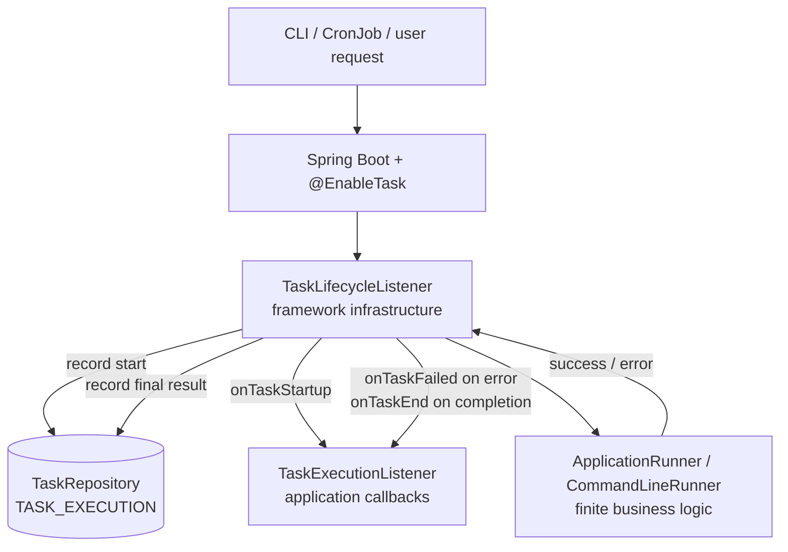
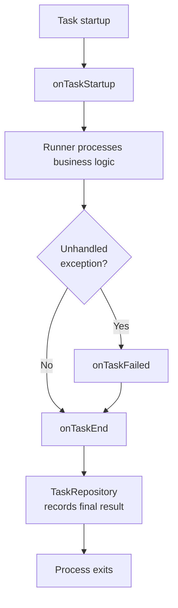
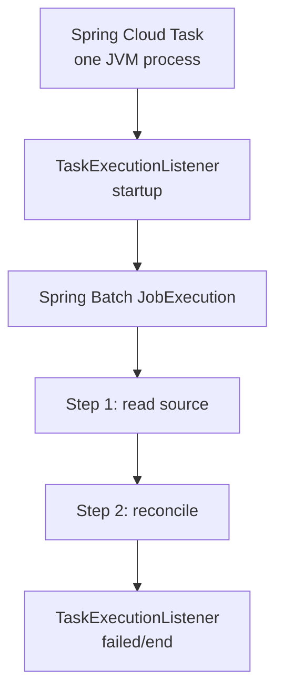

# TaskExecutionListener and Lifecycle Extension Points

## Lesson Objectives

In the **Listener** chapter of the **Spring Cloud Task** module, we will attach custom behavior to the lifecycle of a **short-lived** Spring Boot application. Spring Cloud Task tracks each run through `TaskRepository`; listeners help the application write structured logs, attach exit messages, react to failures, and add observability.

After this lesson, you will be able to:

- Distinguish the framework's **`TaskLifecycleListener`** from the application's **`TaskExecutionListener`**.
- Write `onTaskStartup`, `onTaskFailed`, and `onTaskEnd` callbacks with the correct signatures, and understand the timing and flow of each event.
- Choose between implementing the interface and using the `@BeforeTask`, `@FailedTask`, and `@AfterTask` annotations.
- Know how to write `exitMessage` and read `exitCode`/`errorMessage`, while preserving the meaning of the execution outcome.
- Handle exceptions thrown by listeners, understand conditions under which callbacks do not run, and design retry-safe supplementary logic.
- Combine listeners with Spring Batch, schedulers, metrics, and on-demand task operations.

## 1. The Problem: Once the Job Finishes, How Do You Know What Happened?

A nightly transaction import application receives `--businessDate=2026-11-23`, performs reconciliation, saves a report, and exits. Spring Cloud Task's `TaskRepository` can already persist a `TaskExecution` with `executionId`, `taskName`, `startTime`, `endTime`, `exitCode`, and errors. However, the operations team needs additional behavior:

1. When the task starts, log a message with `executionId` to locate the exact run.
2. When an exception occurs, attach a clear business-friendly message.
3. Upon completion, log a summary line to link logs with metadata.
4. Do not disrupt the main task just because an external notification system is temporarily failing.

**`TaskExecutionListener`** is the extension point provided for these exact needs. It allows reacting to the Task lifecycle without embedding the same "log start/end" snippet into every `ApplicationRunner`.

An important point is that **a listener does not schedule runs by itself**. Cron, Kubernetes CronJob, CLI, a user request, or an orchestration platform triggers the process. `ApplicationRunner`/`CommandLineRunner` executes the business logic. `TaskExecutionListener` only receives callbacks within a single run of that process.

## 2. Distinguishing Two Similarly Named Listeners

In Spring Cloud Task, the following two names are often mistaken for the same interface:

| Component | Who Uses It? | Responsibility |
| --- | --- | --- |
| `TaskLifecycleListener` | **Spring Cloud Task infrastructure** | Listens to Spring Boot events, records start/end via `TaskRepository`, and dispatches callbacks to application listeners |
| `TaskExecutionListener` | **Application code** | Handles startup, failure, and end callbacks; adds logging, messages, metrics, or custom behavior |

`TaskLifecycleListener` is a framework component related to `ApplicationReadyEvent`, `ApplicationFailedEvent`, and `SmartLifecycle`. Normally, you enable the Task lifecycle with `@EnableTask` and let Spring manage it.

Conversely, you **implement `TaskExecutionListener` yourself** (or declare listener-annotated methods) to add behavior. You do not need to manually instantiate `TaskLifecycleListener` or call `TaskRepository.completeTaskExecution(...)` inside application callbacks.



The diagram shows the **high-level logical** order. Exact details of when callbacks run relative to repository commits may vary by version; do not use a listener in place of an atomic business transaction.

## 3. The Three Key Callbacks of `TaskExecutionListener`

The interface resides in the `org.springframework.cloud.task.listener` package. The Java signatures:

```java
void onTaskStartup(TaskExecution taskExecution);

void onTaskFailed(TaskExecution taskExecution, Throwable throwable);

void onTaskEnd(TaskExecution taskExecution);
```

These are **method signatures**, not a standalone compilable Java class. In modern branches (for example, Javadoc 3.0.4), the interface provides **empty default implementations**, so you can override only the methods you need. In older branches (for example, 2.3.x), the methods may be abstract; to illustrate broad compatibility, the full example below still overrides all three.

| Callback | When Does It Occur? | Should Do | Should Not Do |
| --- | --- | --- | --- |
| `onTaskStartup(TaskExecution)` | During the Task **startup** phase, before runners execute | Log the ID, prepare lightweight observability info, initialize correlation IDs | Create a second TaskExecution yourself or strictly rely on commit state |
| `onTaskFailed(TaskExecution, Throwable)` | When the framework catches an **unhandled** error during Task execution; before the end callback | Log structured errors, describe the cause appropriately | Swallow the error to make the Task look successful, or perform uncontrolled retries |
| `onTaskEnd(TaskExecution)` | During the **end** phase, before final metadata is updated | Log a summary, set `exitMessage` | Assume every completion is a success; alter the ID or fake the exit code |

### 3.1. A Detail About `onTaskStartup` Timing

The Features documentation of some branches states that the callback occurs **before recording** the `TaskExecution` in the repository. However, the `TaskExecutionListener` 3.0.4 Javadoc and the `TaskLifecycleListener` execution path in current source code show that `onTaskStartup` is invoked **after creating/starting** the `TaskExecution`. Therefore, the safe usage pattern is: the callback belongs to the **startup phase** and receives the `TaskExecution` object to read information, but **do not assume it is a pre-INSERT hook or guarantee that the transaction has already committed**. If your application depends on exact write timing, verify the API and source code of the **exact version** you are running.

The remaining two callbacks are consistent in order: on the framework-recorded failure path, `onTaskFailed` runs **before** `onTaskEnd`; updating the final result in the repository happens after the end callback phase.

### 3.2. Success and Failure Do Not Share the Same Callback Chain



*Note:* This is the **normal** flow once Spring Boot has reached the Task-managed phase. If the JVM is terminated with `SIGKILL`, loses power, suffers severe out-of-memory errors, or fails context initialization very early, there is no guarantee that the end callbacks will be invoked.

## 4. Example 1: Implementing the Interface Directly

Suppose a reconciliation task needs consistent logging by `executionId`. Create a Spring bean implementing the interface:

```java
package com.example.reconciliation;

import org.slf4j.Logger;
import org.slf4j.LoggerFactory;
import org.springframework.cloud.task.listener.TaskExecutionListener;
import org.springframework.cloud.task.repository.TaskExecution;
import org.springframework.stereotype.Component;

@Component
public class ReconciliationAuditListener implements TaskExecutionListener {

    private static final Logger log =
            LoggerFactory.getLogger(ReconciliationAuditListener.class);

    @Override
    public void onTaskStartup(TaskExecution taskExecution) {
        log.info("Task started: id={}, name={}",
                taskExecution.getExecutionId(),
                taskExecution.getTaskName());
    }

    @Override
    public void onTaskFailed(TaskExecution taskExecution, Throwable error) {
        log.error("Task failed: id={}, errorType={}",
                taskExecution.getExecutionId(),
                error.getClass().getSimpleName(), error);
    }

    @Override
    public void onTaskEnd(TaskExecution taskExecution) {
        Integer exitCode = taskExecution.getExitCode();
        boolean success = Integer.valueOf(0).equals(exitCode);

        log.info("Task ended: id={}, exitCode={}",
                taskExecution.getExecutionId(), exitCode);

        if (taskExecution.getExitMessage() == null) {
            taskExecution.setExitMessage(
                success ? "Processing completed" : "Processing failed"
            );
        }
    }
}
```

Here:

1. `@Component` enables Spring to detect the listener when scanning the application package.
2. `onTaskStartup` only logs; it does not launch business logic or insert a new Task record.
3. `onTaskFailed` leaves the exception intact for the framework to continue handling; it logs the error type and stack trace internally.
4. `onTaskEnd` reads `exitCode` as a potentially `null` `Integer`; only `0` is considered successful in this illustrative logic.
5. `setExitMessage(...)` sets a **short message containing no sensitive data** for the repository to store in the final metadata.

Listeners can be used to distinguish operational errors from business errors at the logging/observability level. However, **never write passwords, tokens, customer data, or sensitive content into `exitMessage`**, because it is stored in the database and may be displayed through lookup systems.

### 4.1. Why Not Call `TaskRepository` Inside a Callback?

At end/fail time, the framework already manages updating the final result. A listener calling `completeTaskExecution(...)` on its own can create contention or inconsistent completion data. To store an **exit description**, use `taskExecution.setExitMessage(...)` as documented officially. If you need to store detailed reconciliation results, use a separate business service/table rather than stuffing large content into `EXIT_MESSAGE`.

### 4.2. `exitMessage` vs. `errorMessage`

| Property | Meaning | Who Should Set It? |
| --- | --- | --- |
| `exitCode` | Execution result code determined by Spring Boot/Task | Framework together with the application's exit code mechanism |
| `exitMessage` | Short descriptive string that the application can attach | Listener, e.g., `setExitMessage(...)` |
| `errorMessage` | Exception/stack trace details when an error occurs | Framework based on the recorded exception |

A run with `exitMessage="Report generated"` **does not prove the report data is valid** if the business logic did not verify it. Conversely, a listener setting `exitMessage` to `"Success"` should never be used to mask `exitCode != 0`.

### 4.3. Precedence Rules for `exitMessage`

When multiple listener phases set a message, the Spring Cloud Task documentation describes the precedence:

1. `onTaskEnd` (highest).
2. `onTaskFailed`.
3. `onTaskStartup`.

For example, `onTaskStartup` sets `"Running"`; if an error occurs, `onTaskFailed` sets `"Invalid data"`; if `onTaskEnd` goes on to set `"Checked"`, the message from end can overwrite the earlier error. Therefore, **do not overwrite blindly in `onTaskEnd`**; inspect the existing value and execution result first.

Note that multiple **listeners running in the same phase** can also mutate the same `exitMessage`; designate a single clear component responsible for setting the exit message, avoiding reliance on unguaranteed bean ordering for business semantics.

## 5. Example 2: Using Method-Level Annotations

Spring Cloud Task also supports declaring callbacks on **methods of a Spring bean**. The three corresponding annotations:

- `@BeforeTask` → startup callback.
- `@FailedTask` → failure callback.
- `@AfterTask` → end callback.

An example independent from the listener class in section 4:

```java
package com.example.reconciliation;

import org.slf4j.Logger;
import org.slf4j.LoggerFactory;
import org.springframework.cloud.task.listener.annotation.AfterTask;
import org.springframework.cloud.task.listener.annotation.BeforeTask;
import org.springframework.cloud.task.listener.annotation.FailedTask;
import org.springframework.cloud.task.repository.TaskExecution;
import org.springframework.stereotype.Component;

@Component
public class AnnotatedTaskHooks {

    private static final Logger log =
            LoggerFactory.getLogger(AnnotatedTaskHooks.class);

    @BeforeTask
    public void before(TaskExecution execution) {
        log.info("Preparing task {}", execution.getExecutionId());
    }

    @FailedTask
    public void failed(TaskExecution execution, Throwable failure) {
        log.warn("Task {} encountered error {}", execution.getExecutionId(),
                 failure.getClass().getSimpleName());
        execution.setExitMessage("Business or system error");
    }

    @AfterTask
    public void after(TaskExecution execution) {
        log.info("Task {} ended", execution.getExecutionId());
        // Do not overwrite an exitMessage already set by the failure phase.
    }
}
```

**Pick one approach for a given responsibility.** If you both register an interface listener and add annotated methods for the very same event, callbacks may be invoked multiple times through different registration paths. Only combine them when you genuinely need separate independent tasks and have verified execution order and side effects.

The annotations **do not require** placing `@EnableTask` on every bean: `@EnableTask` belongs on the startup configuration class to enable the Task lifecycle; `@BeforeTask`/`@AfterTask`/`@FailedTask` belong on the beans that the application wants to receive callbacks.

### 5.1. When to Choose Which Approach?

| Criterion | `TaskExecutionListener` | Method-Level Annotations |
| --- | --- | --- |
| One class handles all three callbacks | Well suited | Possible, but easily scattered |
| Only need a single callback in a service | Can implement one method with modern interface | Put `@AfterTask` or `@FailedTask` directly on the bean |
| Need centralized observability logic in one place | Clear | Requires keeping methods aligned in purpose |
| Code must run on older Spring Cloud Task branches | Check the interface; may need to implement all three methods | Verify annotation names and APIs for the target branch |

In the 3.x branch, `TaskExecutionListenerSupport` has been **deprecated** because the interface now has default methods. For new code, prefer implementing the interface directly or using annotations instead of extending the deprecated support class.

## 6. Wiring Listeners into a Finite Task Application

Suppose you create a project via [Spring Initializr](https://start.spring.io/) with Spring Boot, **Task (Spring Cloud)**, H2 Database, and a compatible Spring Boot/Spring Cloud version set. The Maven project dependencies will contain equivalent entries:

```xml
<dependencies>
    <dependency>
        <groupId>org.springframework.cloud</groupId>
        <artifactId>spring-cloud-starter-task</artifactId>
    </dependency>
    <dependency>
        <groupId>com.h2database</groupId>
        <artifactId>h2</artifactId>
        <scope>runtime</scope>
    </dependency>
</dependencies>
```

These are only the dependencies, **not a complete `pom.xml`**. Keep the Spring Boot parent/BOM generated by the initializer and let the Spring Cloud release train manage the starter version.

Application class:

```java
package com.example.reconciliation;

import java.time.LocalDate;
import java.util.List;

import org.springframework.boot.ApplicationArguments;
import org.springframework.boot.ApplicationRunner;
import org.springframework.boot.SpringApplication;
import org.springframework.boot.autoconfigure.SpringBootApplication;
import org.springframework.cloud.task.configuration.EnableTask;
import org.springframework.context.annotation.Bean;

@SpringBootApplication
@EnableTask
public class ReconciliationTaskApplication {

    public static void main(String[] args) {
        SpringApplication.run(ReconciliationTaskApplication.class, args);
    }

    @Bean
    ApplicationRunner reconciliationRunner() {
        return (ApplicationArguments args) -> {
            List<String> dates = args.getOptionValues("businessDate");
            if (dates == null || dates.size() != 1) {
                throw new IllegalArgumentException(
                    "Must pass --businessDate=yyyy-MM-dd"
                );
            }

            LocalDate date = LocalDate.parse(dates.get(0));
            System.out.println("Reconciling date " + date);

            if (args.containsOption("simulateFailure")) {
                throw new IllegalStateException("Simulated reconciliation failure");
            }

            // Call reconciliation service and persist business data here.
            System.out.println("Reconciliation completed");
        };
    }
}
```

Place the two listener classes from sections 4 and 5 in the same `com.example.reconciliation` package or a subpackage so Spring scans them. When practicing, you should **keep only one of the two listener examples** to clearly observe the callback invocation count.

### 6.1. Sample Data Configuration

File `src/main/resources/application.yml`:

```yaml
spring:
  application:
    name: daily-reconciliation
  main:
    web-application-type: none
  datasource:
    url: jdbc:h2:file:./data/task-metadata
    driver-class-name: org.h2.Driver
    username: sa
    password: ""
  cloud:
    task:
      closecontext-enabled: true
```

File-based H2 retains metadata across restarts in the same working directory; in-memory H2 and Map repository are unsuitable for querying history after the JVM exits. The default Task name is typically derived from the application name (or configured via `spring.cloud.task.name`). For operational environments, you need a persistent datasource and the Task schema matching your version.

`closecontext-enabled: true` requests closing the context once runners finish and the Task result has been updated; it does **not** replace resource cleanup logic or the orchestrator's timeout policies.

### 6.2. Running the Success Case

Build the application with the Maven wrapper:

```bash
./mvnw package
java -jar target/daily-reconciliation-0.0.1-SNAPSHOT.jar --businessDate=2026-11-23
```

Replace the JAR name with the actual `artifactId`/`version` from your project. With the interface listener from section 4, expected logs will contain output equivalent to:

```text
Task started: id=101, name=daily-reconciliation
Reconciling date 2026-11-23
Reconciliation completed
Task ended: id=101, exitCode=0
```

`101` is only an illustrative ID, not a fixed value. After the JVM exits, query `TASK_EXECUTION`:

```sql
SELECT
    TASK_EXECUTION_ID,
    TASK_NAME,
    START_TIME,
    END_TIME,
    EXIT_CODE,
    EXIT_MESSAGE,
    ERROR_MESSAGE
FROM TASK_EXECUTION
ORDER BY TASK_EXECUTION_ID DESC;
```

A successful run typically has `EXIT_CODE = 0`, `END_TIME`, and `EXIT_MESSAGE` matching what the listener set.

### 6.3. Running the Failure Case

```bash
java -jar target/daily-reconciliation-0.0.1-SNAPSHOT.jar \
  --businessDate=2026-11-23 --simulateFailure
```

On Windows PowerShell, enter the command on **a single line** or use PowerShell's valid line-continuation character (such as a backtick). The `\` in the example is Bash shell line-continuation syntax.

The application throws `IllegalStateException` inside the runner. Along the failure path recorded by Spring Boot/Task, the logical callback sequence is:

1. `onTaskStartup` at startup.
2. The runner executes, then throws the exception.
3. `onTaskFailed` receives the error's `Throwable`.
4. `onTaskEnd` handles completion.
5. The repository saves the final state; the orchestrator receives the process exit code.

When inspecting results, cross-check **logs**, `EXIT_CODE`, `ERROR_MESSAGE`, and `EXIT_MESSAGE`. Do not rely on `EXIT_MESSAGE` alone to determine success or failure.

## 7. What Happens If a Listener Throws an Exception?

A callback is **part of the Task lifecycle execution path**, not an external hook guaranteed to be "safe even if it fails." Official documentation states:

- If a callback throws an exception, execution of **the remaining listeners for that same event** stops; therefore, ordering and impact on other listeners can matter.
- Other phases may still run to complete the Task, depending on where the failure occurred and framework state.
- If the error occurs in `onTaskStartup`, the application may never reach the runner, and the exit code is recorded as a failure (documentation notes code `1`).
- If `onTaskEnd` or `onTaskFailed` throws an exception, the final status and exit code are affected by the framework's error-handling mechanism; verify against the exact deployed version.
- Documentation also notes that `ExitCodeExceptionMapper` **cannot be used to arbitrarily override** exit codes caused by listener exceptions.

Unsafe design example:

```java
@AfterTask
public void notifyExternalSystem(TaskExecution execution) {
    // If HTTP times out, the callback may throw an error and affect the Task outcome.
    externalNotificationClient.send(execution);
}
```

If the goal is simply **sending a notification that is non-critical to reconciliation**, you should not let a notification service network outage decide the business outcome. You can:

1. Write a notification event into the application's **durable outbox** within an appropriate transaction, for another component to dispatch.
2. Have the orchestration system observe the Task status and send notifications **after** confirming the DB/process state.
3. For purely observational logs/metrics, catch **expected** exceptions from auxiliary operations, log concisely, and finish the callback instead of letting observability errors overshadow business errors.

**Do not apply "always catch and ignore every exception"**: severe system failures or mandatory audit policies may require the Task to fail. Clearly define which effects are **mandatory success conditions** and which are merely supplementary observability.

### 7.1. Do Listeners Run When the JVM Is Killed?

There is no guarantee that end callbacks will be invoked if the process is abruptly killed, crashes, hits severe OOM, loses power, or fails before context initialization completes. In those cases, a Task record may appear without an `END_TIME`, or no record may exist at all.

Therefore, tasks requiring safe operations must also be monitored via the **actual process exit code**, pod/job/cron status, timeouts, and logs outside `TaskRepository`. If an action must reliably happen even when a machine dies, do not place the entire responsibility inside `onTaskEnd`.

### 7.2. What Not to Do Inside Callbacks

| Risky Practice | Why It Is Inappropriate | Alternative |
| --- | --- | --- |
| Registering another `TaskExecution` from `onTaskStartup` | Easily creates records that do not match the process | Let `TaskLifecycleListener` manage the repository |
| Setting `exitCode=0` in `onTaskEnd` when the runner failed | Can mask business errors and corrupt status | Keep standard exception/exit code mechanisms |
| Making unbounded slow external API calls | Delays Task termination or introduces secondary errors | Short timeouts, asynchronous dispatch, or outbox |
| Logging raw arguments/exceptions to public systems | May leak tokens or sensitive data | Minimize and mask data; enforce access control |
| Storing per-run state in mutable fields of a singleton listener | Risks state leaks or conflicts in complex contexts | Use `TaskExecution`, execution keys, context, or dedicated storage |
| Treating `onTaskFailed` as an automatic retry mechanism | The callback only receives error details; it does not manage retries | Use a scheduler, Spring Batch, or business-layer retry |

## 8. Relationship with Other Extension Points

`TaskExecutionListener` is only one part of Spring Cloud Task's extension ecosystem:

| Extension Point | What Is It For? | How Does It Differ from a Task Listener? |
| --- | --- | --- |
| `TaskNameResolver` | Determines the run's `taskName` | Affects the Task name, not lifecycle callbacks |
| `TaskConfigurer` | Selects `TaskRepository`, `TaskExplorer`, transaction manager, datasource | Configures infrastructure, does not run per-Task startup/end logic |
| `ExitCodeExceptionMapper` and `ExitCodeGenerator` | Maps errors to exit codes for Spring Boot | Determines the exit code value; listeners usually only observe |
| Spring Boot `ApplicationListener<ApplicationReadyEvent>` | Listens to general application ready events | Broader Spring Boot event scope than Task; ordering with `TaskLifecycleListener` must be considered |
| Spring Batch `JobExecutionListener` | Tracks **JobExecution** before/after a Batch Job | Job level; one Task can run multiple Batch Jobs |
| Spring Batch `StepExecutionListener` | Tracks each data-processing **Step** | Step-level detail, checkpoints, batch metrics |
| Micrometer Observation | Records metrics/tracing for runners and Task when enabled | Collects telemetry, does not replace business lifecycle callbacks |

### 8.1. Do Not Confuse Task Listeners with Batch Listeners

For example, a Task invokes a Spring Batch Job to process one million transactions:



In this case, the Task listener wraps **the entire process**; `JobExecutionListener` tracks the Job, while `StepExecutionListener` tracks each Step. These layers do not replace one another. If you need to restart from a failed chunk/step, use Spring Batch rather than writing manual checkpoints inside `onTaskEnd`.

Additionally, if a Batch Job reports `FAILED` but the runner does not throw an error or the exit code does not reflect the Job failure, the Task may be recorded differently than expected. Configure/map Batch status to the Task outcome according to the version in use.

### 8.2. When to Use `ApplicationReadyEvent` Separately?

For **general Spring Boot events**, `ApplicationListener` can be used. However, Spring Cloud Task documentation warns that scheduling an `ApplicationListener` to run too early relative to `TaskLifecycleListener` can cause unexpected side effects. When you only need to react to the **Task lifecycle**, use `TaskExecutionListener` to avoid depending on Spring Boot event ordering.

In Spring Cloud Task versions supporting observation, you can enable `spring.cloud.task.observation.enabled=true` to integrate with Micrometer for `ApplicationRunner`/`CommandLineRunner`. This feature requires appropriate observation dependencies such as Spring Boot Actuator and the corresponding registry/tracing; it **supplements**, rather than replaces, business callbacks.

## 9. Operational Checklist for Listeners

When building listeners for scheduled or on-demand Tasks, verify:

1. **A listener bean is properly registered:** the package is scanned, annotated with `@Component` or configured as `@Bean`; the application has `@EnableTask`.
2. **Logs carry correlation identifiers:** include `taskName`, `executionId`, timestamp, and result code; avoid logging raw arguments containing secrets.
3. **Callbacks are short and error-controlled:** set timeouts for external I/O, and clearly decide which callbacks are allowed to fail the Task.
4. **Concise `exitMessage`:** record useful status information, never long stack traces or sensitive data.
5. **Do not expect exactly-once callbacks:** if the process dies, callbacks might not be called; on retry, a new run gets a new `executionId`.
6. **Separate business logic and metadata:** transactions, idempotency, and data outputs must be designed separately.
7. **Check your version:** method signatures, default methods, and timing may differ, especially when upgrading from older branches.
8. **Cross-check externally:** if `END_TIME` remains null for too long, inspect scheduler/container status rather than treating the repository as the sole source of truth.

## 10. Self-Assessment Questions

**1. Are `TaskLifecycleListener` and `TaskExecutionListener` the same thing?**

> No. The first is Spring Cloud Task infrastructure that manages the lifecycle and repository; the second is an extension point for applications to react during startup, failure, and end phases.

**2. Which callbacks are normally called during a successful run?**

> `onTaskStartup`, followed by `onTaskEnd`. `onTaskFailed` only belongs to the framework-recorded failure path.

**3. If a runner throws an unhandled exception, which callback runs first: `onTaskFailed` or `onTaskEnd`?**

> `onTaskFailed` is called before `onTaskEnd` when the Task goes through the normal error-handling path.

**4. Should you send a critical HTTP request in `@AfterTask` and assume the callback is guaranteed to run?**

> No. The JVM can crash before the callback; HTTP can time out and disrupt termination. For reliable delivery requirements, consider a durable outbox or out-of-process orchestration.

**5. Can `setExitMessage(...)` be used to record the generated report filename?**

> Yes, provided the string is short and contains no sensitive information. However, `exitMessage` does not replace business data or verify the correctness of the report.

**6. Why can setting an exit message in `@AfterTask` hide an error message set in `@FailedTask`?**

> Because the documentation defines higher precedence for `onTaskEnd` than for `onTaskFailed`. You should preserve or combine the existing message instead of overwriting it without checking status.

## Key Takeaways

- **`TaskExecutionListener` provides application callbacks**, distinct from `TaskLifecycleListener` which manages the framework's lifecycle.
- **`onTaskStartup` → runner → [`onTaskFailed` on error] → `onTaskEnd`** is the typical logical flow once the Task has initialized.
- You can use the interface or **`@BeforeTask`, `@FailedTask`, `@AfterTask`**, while paying attention to bean registration.
- **`exitMessage` can be populated from a listener**, but `exitCode` and `errorMessage` must accurately reflect the execution outcome.
- Callbacks **can fail or not be called at all** if the process dies abnormally; safe operations require out-of-process monitoring, a durable DB, and idempotency.

## References

1. [Spring Cloud Task 3.3 — Features: Task Execution Listener, exceptions, exit messages](https://docs.spring.io/spring-cloud-task/reference/3.3/features.html)
2. [`TaskExecutionListener` Javadoc (3.0.4) — signatures and callback timing](https://docs.spring.io/spring-cloud-task/docs/current/apidocs/org/springframework/cloud/task/listener/TaskExecutionListener.html)
3. [`TaskExecution` Javadoc — metadata fields and `setExitMessage`](https://docs.spring.io/spring-cloud-task/docs/current/apidocs/org/springframework/cloud/task/repository/TaskExecution.html)
4. [`FailedTask` Javadoc — annotation and method signature](https://docs.spring.io/spring-cloud-task/docs/current/apidocs/org/springframework/cloud/task/listener/annotation/FailedTask.html)
5. [Spring Cloud Task — Getting Started](https://docs.spring.io/spring-cloud-task/reference/getting-started.html)
6. [`TaskLifecycleListener` source code — update and listener invocation order](https://github.com/spring-cloud/spring-cloud-task/blob/main/spring-cloud-task-core/src/main/java/org/springframework/cloud/task/listener/TaskLifecycleListener.java)
7. [`TaskExecutionListenerSupport` Javadoc — deprecated since 3.0](https://docs.spring.io/spring-cloud-task/docs/current/apidocs/org/springframework/cloud/task/listener/TaskExecutionListenerSupport.html)
