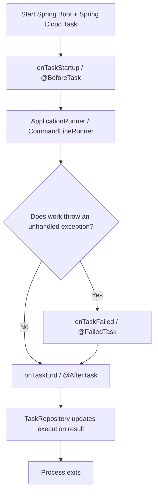

# Registering Listeners Using Beans and Annotations

## 1. What Problem Do Listeners Solve in Spring Cloud Task?

**Spring Cloud Task** builds on Spring Boot to run jobs with a finite execution duration, such as daily data imports, report generation, file synchronization, or on-demand processing. A task run can succeed, fail, or be interrupted. The framework uses **`TaskRepository`** to persist metadata for the run (`TaskExecution`), including task name, start/end timestamps, exit code, and error details.

In operations, an application often needs to perform extra work **tied to the task lifecycle**: logging at startup, tracking execution duration, adding an `exitMessage`, emitting observability signals, or recording the failure cause. Putting all of that inside `ApplicationRunner` or business services mixes core processing logic with lifecycle monitoring.

A **task execution listener** lets you handle the events of a single run in one dedicated place. Spring Cloud Task provides **two primary registration approaches**:

1. Registering a **Spring bean implementing the `TaskExecutionListener` interface**, via `@Bean` or `@Component`.
2. Registering a **Spring bean with methods annotated** using `@BeforeTask`, `@AfterTask`, and `@FailedTask`; no interface implementation is required.

Both approaches share the same lifecycle events. The main difference lies in how the Java code is organized and how callbacks are declared.

### Listeners Do Not Replace Business Logic

| Component | Primary Responsibility |
| --- | --- |
| `ApplicationRunner` / `CommandLineRunner` | Receives arguments and triggers a use case when the application starts |
| Business service | Executes business rules, transactions, and saves work outputs |
| `TaskRepository` | Persists metadata for each `TaskExecution` |
| `TaskExecutionListener` or annotated methods | Reacts to startup, failure, and end events of a run |
| Scheduler / orchestrator | Decides when to launch the process, retries, concurrency limits, and alerts |

Listeners are suitable for short tasks aimed at observability and enriching metadata. You should not place heavy data processing, full-job retries, mandatory emails, or long business transactions inside a listener: a small error in a listener can affect the task lifecycle itself.

## 2. Three Callbacks and Their Execution Order

The interface resides in the `org.springframework.cloud.task.listener.TaskExecutionListener` package. The corresponding methods are:

| Interface Method | Corresponding Annotation | Invocation Condition | Parameters |
| --- | --- | --- | --- |
| `onTaskStartup` | `@BeforeTask` | When the task starts its execution lifecycle, before the main work runs | `TaskExecution` |
| `onTaskFailed` | `@FailedTask` | When an unhandled exception causes a failure during the run | `TaskExecution`, `Throwable` |
| `onTaskEnd` | `@AfterTask` | When the task lifecycle completes normally through the framework, including after the error-handling path | `TaskExecution` |

One point must be understood accurately: **`@AfterTask` is not only for successful runs**. If a task encounters an unhandled exception, Spring Cloud Task invokes the failure callback first, and then invokes the end callback within the framework-managed error-handling flow. If the process receives `kill -9`, loses power, or the JVM is forcibly terminated, there is no guarantee that end or failure listeners will be called.



The diagram illustrates the **conceptual callback order**. The exact timing of the initial metadata write to `TaskRepository` may be described differently across documentation/Javadoc versions. Therefore, do not write logic that assumes the first record is already committed and queryable from a separate connection inside `@BeforeTask`. If you need to guarantee that an action occurs after a specific transaction, design synchronization/transactions explicitly within your application.

### Distinguishing from Other Listener Types

- `ApplicationListener<ApplicationReadyEvent>` or Spring Boot lifecycle callbacks receive **Spring application** events, not Spring Cloud Task's dedicated listener API.
- Spring Batch has `JobExecutionListener`, `StepExecutionListener`, and chunk/item listeners. They track **jobs, steps, or items**, and do not replace `TaskExecutionListener`.
- `@BeforeTask` does not run before **every** service method; it is tied to **a single task execution**.

## 3. Preparing the Sample Application

The following example uses a simulated data-import task that exits when finished. We will register listeners under **two different profiles** so you can run the same JAR to observe the difference without activating both approaches simultaneously.

### 3.1. Dependencies and Configuration

In a Maven project already managing compatible **Spring Boot and Spring Cloud** versions with an appropriate BOM, use these dependencies:

```xml
<dependencies>
    <dependency>
        <groupId>org.springframework.cloud</groupId>
        <artifactId>spring-cloud-starter-task</artifactId>
    </dependency>
    <dependency>
        <groupId>com.h2database</groupId>
        <artifactId>h2</artifactId>
        <scope>runtime</scope>
    </dependency>
</dependencies>
```

The examples are placed in package `com.example.taskdemo`. Java files go under `src/main/java/com/example/taskdemo/`. Configuration in `src/main/resources/application.yml`:

```yaml
spring:
  application:
    name: listener-demo
  main:
    web-application-type: none
  datasource:
    driver-class-name: org.h2.Driver
    url: jdbc:h2:file:./data/listener-demo;DB_CLOSE_ON_EXIT=FALSE
    username: sa
    password: ""
  cloud:
    task:
      name: listener-demo
      initialize-enabled: true
```

`web-application-type: none` runs the application as a finite process. File-based H2 preserves metadata across multiple runs **from the same working directory**. `initialize-enabled: true` is only appropriate for learning when schema initialization is supported by your Spring Cloud Task version. In production, use a durable database, least-privilege permissions, and controlled schema migrations.

Create `ListenerDemoApplication.java`:

```java
package com.example.taskdemo;

import org.springframework.boot.ApplicationRunner;
import org.springframework.boot.SpringApplication;
import org.springframework.boot.autoconfigure.SpringBootApplication;
import org.springframework.context.annotation.Bean;

@SpringBootApplication
public class ListenerDemoApplication {

    public static void main(String[] args) {
        SpringApplication.run(ListenerDemoApplication.class, args);
    }

    @Bean
    ApplicationRunner runImport() {
        return args -> {
            System.out.println("BUSINESS: starting data import");

            if (args.containsOption("fail")) {
                throw new IllegalStateException("Simulated error in runner");
            }

            // A real application would call the business service here.
            System.out.println("BUSINESS: data import succeeded");
        };
    }
}
```

Here, `--fail` raises an **unhandled** error to demonstrate the failure callback. Do not write a `try/catch` that merely prints the error and returns normally, because the framework may then record the task as successful even though the business operation failed.

> The example shows the complete source code of the relevant classes, assuming the project is configured to build an executable JAR. Replace `target/listener-demo.jar` in the commands below with your actual JAR filename.

## 4. First Approach: Registering a Spring Bean Implementing `TaskExecutionListener`

### 4.1. Writing the Interface Implementation Class

Create `AuditTaskListener.java`:

```java
package com.example.taskdemo;

import org.slf4j.Logger;
import org.slf4j.LoggerFactory;
import org.springframework.cloud.task.listener.TaskExecutionListener;
import org.springframework.cloud.task.repository.TaskExecution;

public class AuditTaskListener implements TaskExecutionListener {

    private static final Logger log =
            LoggerFactory.getLogger(AuditTaskListener.class);

    @Override
    public void onTaskStartup(TaskExecution execution) {
        log.info("BEAN_START task={} executionId={}",
                execution.getTaskName(), execution.getExecutionId());
    }

    @Override
    public void onTaskFailed(TaskExecution execution, Throwable error) {
        log.error("BEAN_FAILED task={} executionId={} errorType={}",
                execution.getTaskName(), execution.getExecutionId(),
                error.getClass().getSimpleName());
    }

    @Override
    public void onTaskEnd(TaskExecution execution) {
        log.info("BEAN_END task={} executionId={} exitCode={}",
                execution.getTaskName(), execution.getExecutionId(),
                execution.getExitCode());
    }
}
```

`TaskExecution` exposes the name, ID, timestamps, and status fields of the run. `Throwable` in `onTaskFailed` is the unhandled error at the moment of the failure callback. The log pattern records only the error type; when stack traces are needed, use a logging pipeline with sensitive-data controls and avoid writing passwords, tokens, or customer payloads into metadata or logs.

In newer versions, the interface may provide default methods; the example still overrides all three methods to present a clear, maintainable contract.

### 4.2. Registering with `@Bean`

The `AuditTaskListener` class above is a plain Java class. For Spring Cloud Task to see the listener, expose an instance of it in the **Spring application context** via a `@Bean` method:

```java
package com.example.taskdemo;

import org.springframework.cloud.task.listener.TaskExecutionListener;
import org.springframework.context.annotation.Bean;
import org.springframework.context.annotation.Configuration;
import org.springframework.context.annotation.Profile;

@Configuration(proxyBeanMethods = false)
@Profile("listener-bean")
public class BeanListenerConfiguration {

    @Bean
    TaskExecutionListener auditTaskListener() {
        return new AuditTaskListener();
    }
}
```

Because the bean has type `TaskExecutionListener`, the task configuration collects and invokes it during the execution lifecycle. `@Profile("listener-bean")` enables this example when running with that profile; it is not a Spring Cloud Task requirement.

Advantages of `@Bean`: you can instantiate the listener in a `@Configuration` class, easily pass dependencies through the constructor, apply conditional configuration, or reuse a listener from a separate library.

### 4.3. Variant: Registering with `@Component`

If you want Spring to discover it automatically through component scanning, you can **replace** the `@Bean` approach with `@Component` on the implementation class:

```java
@Component
public class AuditTaskListener implements TaskExecutionListener {
    // Implement the three callbacks as in the example above.
}
```

This is an **illustrative alternative declaration**, not a second class to copy verbatim alongside the first. If you choose `@Component`, remove `@Bean auditTaskListener()` and make sure the class is inside a package scanned by Spring. If you keep both `@Component` and a `@Bean` method returning a new instance, you can register **two listeners with identical behavior** and end up with duplicated logs or side effects.

**Core rule:** having a class `implements TaskExecutionListener` **is not enough**; an instance must actually be registered as a Spring bean in the active context.

## 5. Second Approach: Registering Listeners Using Method Annotations

Spring Cloud Task also supports three annotations in the `org.springframework.cloud.task.listener.annotation` package:

- `@BeforeTask` corresponds to `onTaskStartup(TaskExecution)`.
- `@AfterTask` corresponds to `onTaskEnd(TaskExecution)`.
- `@FailedTask` corresponds to `onTaskFailed(TaskExecution, Throwable)`.

A bean containing methods with these annotations **does not need `implements TaskExecutionListener`**. Spring Cloud Task discovers matching methods on Spring beans and uses the framework's listener execution mechanism to invoke them on the corresponding events.

Create `AnnotatedAuditHooks.java`:

```java
package com.example.taskdemo;

import org.slf4j.Logger;
import org.slf4j.LoggerFactory;
import org.springframework.cloud.task.listener.annotation.AfterTask;
import org.springframework.cloud.task.listener.annotation.BeforeTask;
import org.springframework.cloud.task.listener.annotation.FailedTask;
import org.springframework.cloud.task.repository.TaskExecution;
import org.springframework.context.annotation.Profile;
import org.springframework.stereotype.Component;

@Component
@Profile("listener-annotation")
public class AnnotatedAuditHooks {

    private static final Logger log =
            LoggerFactory.getLogger(AnnotatedAuditHooks.class);

    @BeforeTask
    public void before(TaskExecution execution) {
        log.info("ANNOTATION_START task={} executionId={}",
                execution.getTaskName(), execution.getExecutionId());
    }

    @FailedTask
    public void failed(TaskExecution execution, Throwable error) {
        log.error("ANNOTATION_FAILED task={} executionId={} errorType={}",
                execution.getTaskName(), execution.getExecutionId(),
                error.getClass().getSimpleName());
    }

    @AfterTask
    public void after(TaskExecution execution) {
        log.info("ANNOTATION_END task={} executionId={} exitCode={}",
                execution.getTaskName(), execution.getExecutionId(),
                execution.getExitCode());
    }
}
```

`@Component` registers the class as a bean; `@Profile("listener-annotation")` ensures it is only active when that profile is selected. Method names (`before`, `failed`, `after`) can be chosen to fit your application; what matters is that the **annotation and parameter signature** match the event.

If you prefer not to use `@Component`, you can expose **a bean of type `AnnotatedAuditHooks` via `@Bean`** in a configuration class; the requirement remains that the object lives in the Spring application context and is recognized by the annotation processor.

### Common Mistakes When Using Annotations

| Issue | Why It Does Not Work Properly | How to Fix |
| --- | --- | --- |
| Putting `@BeforeTask` on a plain class that is not a Spring bean | The framework scans callbacks from context beans, not arbitrary objects created with `new` | Add `@Component` in a scanned package or register via `@Bean` |
| Confusing `@BeforeTask` with AOP's `@Before` | The two APIs serve completely different purposes | Import the right `org.springframework.cloud.task.listener.annotation.BeforeTask` |
| Writing `@FailedTask` taking only `Exception` or swapping parameter order | Callback signatures must match the event contract | Use `(TaskExecution execution, Throwable error)` |
| Putting heavy side effects in a callback | Callbacks run in the lifecycle flow; errors can affect task completion | Keep them short, recording only essential data/metrics; move reliable work to a service or outbox |
| Enabling both bean and annotation listeners at once, producing duplicate logs | Both beans/mechanisms are registered simultaneously | Check profiles, component scanning, and registered listeners |

## 6. Comparing Bean Listeners and Annotation Listeners

| Criterion | `TaskExecutionListener` Bean | Method-Level Annotations |
| --- | --- | --- |
| Declaration | Class `implements TaskExecutionListener` | Bean class with `@BeforeTask`, `@AfterTask`, `@FailedTask` |
| Number of callbacks to write | Can override only needed methods depending on interface version; example overrides all three | Annotate only the methods you want to handle |
| Bean registration | `@Bean` or `@Component` | `@Component` or return the object from `@Bean` |
| Code organization | Fits a dedicated listener managing multiple events | Fits when an event only needs a concise method on a related bean |
| Dependency injection | Constructor injection on the class or factory method | Constructor injection on the registered bean |
| Testability | Can directly call `onTaskStartup`, `onTaskEnd`, `onTaskFailed` | Can call methods directly; needs integration test to verify annotation wiring |
| Common pitfalls | Forgetting to register as a bean, accidentally creating two instances | Wrong annotation import, wrong callback signature, class not scanned |

Neither approach is universally better for every project. If you want to group audit logic into a single component with an explicit contract, the interface listener fits well. If you only need one or two brief hooks, annotations can be more concise. For the same purpose, pick one approach to avoid logging, incrementing metrics, or sending signals twice.

## 7. Testing Both Registration Styles and Inspecting `TaskRepository`

After building the executable JAR and creating a `data` directory in the working directory, run each command in turn:

```bash
mkdir data

# Approach 1: bean implementing the interface, successful run
java -jar target/listener-demo.jar --spring.profiles.active=listener-bean

# Approach 1: bean implementing the interface, simulated failure
java -jar target/listener-demo.jar --spring.profiles.active=listener-bean --fail

# Approach 2: bean with annotated methods, successful run
java -jar target/listener-demo.jar --spring.profiles.active=listener-annotation

# Approach 2: bean with annotated methods, simulated failure
java -jar target/listener-demo.jar --spring.profiles.active=listener-annotation --fail
```

These commands use Bash/Linux syntax as examples. Because a `--fail` run returns a non-zero exit code, a shell configured with `set -e` would stop a script; in the lab, run **each command independently**. The application uses the same JDBC URL to retain the history of completed runs.

### 7.1. Expected Log Order

With the `listener-bean` profile, a successful run typically produces a meaningful sequence like:

```text
BEAN_START  ...
BUSINESS: starting data import
BUSINESS: data import succeeded
BEAN_END    ...
```

With `--fail`, the expected callback order is:

```text
BEAN_START  ...
BUSINESS: starting data import
BEAN_FAILED ...
BEAN_END    ...
```

Running `listener-annotation` follows the same structure, differing only by the `ANNOTATION_` prefix. The example lines omit Spring startup logs; never treat execution order between **different** listeners as a guarantee unless explicitly configured and tested.

### 7.2. Inspecting the Persisted Metadata

After the process exits, open H2 Shell or a database client with JDBC URL `jdbc:h2:file:./data/listener-demo;IFEXISTS=TRUE` from **the same working directory**. Query:

```sql
SELECT TASK_EXECUTION_ID,
       TASK_NAME,
       START_TIME,
       END_TIME,
       EXIT_CODE,
       EXIT_MESSAGE,
       ERROR_MESSAGE
FROM TASK_EXECUTION
ORDER BY TASK_EXECUTION_ID DESC;
```

`TaskRepository` stores metadata about each run. `TASK_EXECUTION_ID` differs across runs, while `TASK_NAME` typically remains `listener-demo`. When the runner fails and the framework handles the error event, `EXIT_CODE`/`ERROR_MESSAGE` reflect the actual state depending on version and configuration; also cross-check the process exit status and logs. If `END_TIME` remains empty after the process was forcibly terminated, you cannot conclude from a single metadata row alone that it is still running.

**Timing note:** `@AfterTask` / `onTaskEnd` is called before the final update to the repository, so logs emitted inside the callback may observe status fields that do not yet match the final committed DB row. To inspect final state, query **after the process has stopped**.

## 8. Setting `exitMessage` in a Controlled Manner

`TaskExecution` exposes `setExitMessage(String)`. A listener can attach summary information to the run, helping operators understand the outcome without reading the full logs.

Example of a dedicated `@AfterTask` callback that **adds a message only on success**:

```java
@AfterTask
public void annotateSuccess(TaskExecution execution) {
    if (Integer.valueOf(0).equals(execution.getExitCode())) {
        execution.setExitMessage("Job processing completed");
    }
}
```

This is an **extension snippet** meant to be placed inside an already-registered annotation listener Spring bean (such as `AnnotatedAuditHooks`); it is not a standalone function executed automatically by Java. Checking `Integer.valueOf(0).equals(...)` prevents a `NullPointerException` if `exitCode` is not yet populated at callback time.

According to the documentation, when multiple hooks set `exitMessage`, the value from the end callback takes precedence over the failure callback, and the failure callback takes precedence over the startup callback. Therefore, **never set an unconditional success message in `@AfterTask`**: it can overwrite a useful error message from `@FailedTask`.

`exitMessage` is only supplementary information; never use it to replace process failure reporting, business transactions, or retry policies. Never write tokens, passwords, personal data, or stack traces containing secrets into a message displayed to operators.

## 9. How Do Listener Errors Affect the Task?

Listeners run inside the framework-managed lifecycle. If a callback **throws an exception**, processing of subsequent listeners for that same event may halt, and other listeners for that event may no longer be called. The framework has error-handling logic for subsequent phases, but that **does not guarantee all remaining hooks will run** in every scenario.

Spring Cloud Task documentation specifies particular exit-code rules when callbacks throw exceptions; mapping via `ExitCodeExceptionMapper` has limitations in this case. Thus, the final exit code must be verified against your framework version, configuration, and actual failure case rather than assuming listener exceptions are harmless.

Key scenarios to distinguish:

| Scenario | What Can Happen | Design Guidance |
| --- | --- | --- |
| Runner throws an unhandled exception | Framework runs the failure callback and then the end callback when still handleable | Do not swallow the error; let the scheduler detect failure and record `TaskExecution` |
| Startup listener throws an exception | Task startup can fail; remaining listeners for the same event are skipped | Do only fast work; avoid mandatory network calls or heavy SQL |
| Failure listener throws another exception | Can complicate recording the original cause and exit code | Ensure log/metric error handling inside the callback is simple with minimal side effects |
| End listener throws an exception | Can affect final status updates and final error reporting | Do not put long mandatory operations or hard-to-retry work in `@AfterTask` |
| JVM forcibly killed / power loss | End or failure callbacks may never be called | Use out-of-process monitoring, timeouts, and detection of unfinished records |

If sending a message to a message broker is a mandatory business requirement, consider a **transactional outbox, a job status table, or a reliable mechanism in the service**. A listener sending a message directly does not inherently provide delivery guarantees or exactly-once semantics. Business data and metadata in `TaskRepository` do not automatically share a single atomic transaction either.

### Should You Add Multiple Listeners?

Spring can register multiple `TaskExecutionListener` beans and multiple annotated methods. However, **ordering among independent listeners should not be relied upon as a business rule**. If step B must run after step A, combine them into a service/orchestration flow with explicit ordering, or use an ordering mechanism supported and tested on your framework version. Never rely merely on bean names or class order in source code.

## 10. Combining with Scheduled Runs and Spring Batch

For a task running nightly via cron, Kubernetes CronJob, or an orchestration platform, **each Spring Cloud Task process** typically creates one `TaskExecution`. Listeners react to that process's lifecycle regardless of whether the task was started manually or on a schedule.

When a task launches a **Spring Batch job**, distinguish between:

- Spring Cloud Task's `TaskExecutionListener`: observes **the entire task application run**.
- Spring Batch's `JobExecutionListener`: observes **a single Batch job execution**.
- `StepExecutionListener` and item/chunk listeners: observe **processing steps inside the Batch job**.

A task can launch multiple Batch jobs, or one Batch job can have multiple steps; an `@AfterTask` callback does not replace completion callbacks for individual jobs or steps. Task metadata (`TASK_*`) and Batch metadata (`BATCH_*`) also require matching schemas, data stores, and permissions for their respective versions.

When a task is automatically retried after a timeout, listeners may run again under **a new `TaskExecution`**. Therefore, never use a callback as the place to guarantee that an email, a payment transaction, or a business record is processed only once. For operations with side effects, use a `requestId`, idempotency key, unique constraints, and retry policies in the service/orchestrator.

## 11. Lab Exercises and Self-Check Questions

1. Register `AuditTaskListener` using `@Bean` and run with the `listener-bean` profile. Identify the three callback methods and their order when the runner succeeds.
2. Run again with `--fail`. Observe `onTaskFailed` running before `onTaskEnd`. Query `TASK_EXECUTION` and compare `EXIT_CODE` and `ERROR_MESSAGE` with the logs.
3. Remove the bean listener and switch to `AnnotatedAuditHooks` with the `listener-annotation` profile. Why does the annotated class still require `@Component` or `@Bean`?
4. Intentionally import the wrong annotation or omit `@Component`; identify why the callback is not invoked. Then fix it and run again.
5. Choose one registration approach and add `setExitMessage` on success. Re-run both success and failure paths; ensure the end callback does not overwrite the failure message.
6. Simulate an error inside a callback **in a lab environment only**. Observe how many hooks run, the error logs, and the actual exit code. Why should callbacks not make mandatory network calls in production?
7. Propose a way to monitor a task that was forcibly terminated without `@AfterTask`, and explain how to distinguish `TaskExecutionListener` from Spring Batch listeners.

After this lesson, you should understand how to **register listeners using beans and annotations**, the signatures of the three callbacks, lifecycle ordering, how to inspect metadata in `TaskRepository`, how to set `exitMessage` appropriately, and the caveats for safely running tasks on a schedule, on demand, or together with Spring Batch.

## 12. References

- [Spring Cloud Task Reference — Features, Task Execution Listener](https://docs.spring.io/spring-cloud-task/reference/features.html): events, annotations, exception handling, and exit messages.
- [`TaskExecutionListener` Javadoc](https://docs.spring.io/spring-cloud-task/docs/current/apidocs/org/springframework/cloud/task/listener/TaskExecutionListener.html): interface and callback signatures.
- [`TaskListenerExecutor` Javadoc](https://docs.spring.io/spring-cloud-task/docs/current/apidocs/org/springframework/cloud/task/listener/annotation/TaskListenerExecutor.html): execution mechanism for annotated callbacks.
- [`TaskExecution` Javadoc](https://docs.spring.io/spring-cloud-task/docs/current/apidocs/org/springframework/cloud/task/repository/TaskExecution.html): metadata fields, `getExitCode()`, and `setExitMessage()`.

When implementing in a real project, check the Javadoc and configuration for the **exact version of Spring Cloud Task you are running**, because exact ordering details and lifecycle error handling can vary across release lines.
