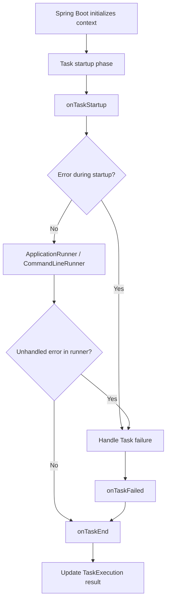

# Listener Ordering and the Impact of Listener Exceptions in Spring Cloud Task

## 1. Context and Objectives

**Spring Cloud Task** helps build Spring Boot applications with a finite runtime: start up, perform a job, record the execution result, and terminate. Each run is tracked by `TaskRepository` via `TaskExecution`. These processes can be triggered via CLI commands, schedules, or orchestrators; some also invoke Spring Batch for batch data processing.

`TaskExecutionListener` is the extension point for adding behavior at key lifecycle milestones: preparing before work, recording outcomes, or handling a failed run. When **multiple listeners** exist, invocation order becomes important. If one listener **throws an exception**, remaining callbacks may not run, while metadata and exit codes may differ from initial expectations.

Suppose an order-import Task has three auxiliary activities:

- Validating permission to access a customer namespace and input parameters.
- Recording metrics/tracing at startup and completion.
- Setting `exitMessage` so operators can read the status.

If the input-validation listener throws an error before the runner starts, business processing may be skipped. If the metrics listener throws an error when the Task ends, part of the business result **has already been committed**, yet the completion reporting may be affected. That is why you must understand both **callback ordering** and **error-handling policies**.

After this lesson, you will be able to:

1. Distinguish `onTaskStartup`, `onTaskFailed`, and `onTaskEnd`.
2. Use `@Order` to clarify ordering across listener beans while recognizing the reversed vs. forward traversal directions at startup vs. end.
3. Predict the impact of exceptions thrown in each callback on other listeners, runners, `TaskRepository`, and `exitCode`.
4. Write safe listeners that avoid overwriting error messages, hiding root exceptions, or introducing non-idempotent side effects.
5. Design verification steps on the exact Spring Cloud Task version your project uses.

## 2. Which Lifecycle Do the Callbacks Belong To?

The `org.springframework.cloud.task.listener.TaskExecutionListener` interface defines three primary methods:

| Callback | When Is It Called? | Appropriate Work |
| --- | --- | --- |
| `onTaskStartup(TaskExecution)` | During the Task startup phase, before `ApplicationRunner` / `CommandLineRunner` beans | Mark startup, validate early preconditions, initialize observability context |
| `onTaskFailed(TaskExecution, Throwable)` | When the Task encounters an unhandled error and the framework receives the failure event | Classify errors, generate reason codes, record failure metrics |
| `onTaskEnd(TaskExecution)` | During the completion phase, before final Task status is updated in the repository | Set completion summary, finalize metrics, release auxiliary resources |

`onTaskFailed` does not replace `onTaskEnd`. In the failure flow handled by Spring Cloud Task, `onTaskFailed` runs **before** `onTaskEnd`. On normal success, `onTaskFailed` is not called.



The diagram shows the **logical flow**. Whether callbacks are invoked when an error happens very early, during bootstrap, or when the process is forcibly terminated depends on whether Spring Cloud Task has initialized and received the lifecycle events. If the `ApplicationContext` fails before the Task is created, `TaskRepository` may have **no record** of the run.

### One `TaskExecution`, Multiple Milestones

`TaskExecution` typically contains `executionId`, `taskName`, `startTime`, `endTime`, `exitCode`, `exitMessage`, and `errorMessage`. During startup, many result fields do not yet have final values; when the Task fails, the root exception is passed to `onTaskFailed`; when it ends, `onTaskEnd` can inspect the outcome determined by the framework.

Do not treat listeners as sharing a single transaction with all business logic. Listeners may run before or after actual service transactions; an HTTP call or file write inside a listener will not automatically roll back when business data fails.

## 3. "Ordering" Has Two Distinct Meanings

Two kinds of ordering must be distinguished:

1. **Ordering across phases:** startup runs before the runner; when a Task fails, failed runs before end.
2. **Ordering across listeners within the same phase:** if A, B, and C all implement `TaskExecutionListener`, they are invoked according to the order of the listener bean collection used by Spring Cloud Task.

Spring provides `@Order` (or the `Ordered` interface) to sort beans injected into a collection. **Lower numbers have higher priority** in a Spring-sorted list.

In the current `TaskLifecycleListener` implementation checked against Spring Cloud Task source code:

- `TaskExecutionListener` beans are collected into a list (in addition to the executor for annotated methods).
- **`onTaskStartup` iterates over a copy of the list in reverse order**.
- **`onTaskFailed` and `onTaskEnd` iterate in the original list order**.

This can be surprising:

| Listener Bean | `@Order` | Startup (reverse order) | Failed / End (original order) |
| --- | ---: | ---: | ---: |
| `AuditListener` | `10` | Called later | Called earlier |
| `GuardListener` | `20` | Called earlier | Called later |

If Spring orders the list as `AuditListener` followed by `GuardListener`, the error-free flow is:

```text
STARTUP: GuardListener(20) -> AuditListener(10)
RUNNER : process workload
END    : AuditListener(10) -> GuardListener(20)
```

When the runner fails:

```text
STARTUP: GuardListener(20) -> AuditListener(10)
RUNNER : throws exception
FAILED : AuditListener(10) -> GuardListener(20)
END    : AuditListener(10) -> GuardListener(20)
```

**Version note:** reverse order at startup is an implementation detail observed in the `TaskLifecycleListener` source referenced at the end of this lesson. `@Order` and bean ordering can also be affected by configuration, proxies, and annotation processors. Do not treat every callback ordering detail as an immutable contract across all versions; if business logic genuinely depends on order, verify it on the exact version pinned by your project's BOM.

### Interface Listeners vs. Annotation Listeners

Beyond the interface, Spring Cloud Task supports:

| Annotation | Corresponding Callback |
| --- | --- |
| `@BeforeTask` | `onTaskStartup` |
| `@FailedTask` | `onTaskFailed` |
| `@AfterTask` | `onTaskEnd` |

Short example:

```java
import org.springframework.cloud.task.listener.annotation.BeforeTask;
import org.springframework.cloud.task.listener.annotation.AfterTask;
import org.springframework.cloud.task.listener.annotation.FailedTask;
import org.springframework.cloud.task.repository.TaskExecution;
import org.springframework.stereotype.Component;

@Component
public class SimpleLifecycleHooks {
    @BeforeTask
    public void before(TaskExecution execution) {
        System.out.println("Before: " + execution.getExecutionId());
    }

    @FailedTask
    public void failed(TaskExecution execution, Throwable error) {
        System.out.println("Failed: " + error.getClass().getSimpleName());
    }

    @AfterTask
    public void after(TaskExecution execution) {
        System.out.println("After: " + execution.getExecutionId());
    }
}
```

Annotated methods are invoked via `TaskListenerExecutor`. If there are multiple `@BeforeTask` methods in a single bean or across multiple beans, do not guess their detailed invocation order. For a true dependency chain, consolidate them into one explicit coordinator or use separate, ordered, and tested listener beans.

## 4. Complete Example: Two `@Order` Listeners and a Failure-Simulating Task

The example uses Java 17+, `spring-cloud-starter-task`, and compatible Spring Boot and Spring Cloud versions. Ensure `TaskRepository` has a properly configured datasource and schema. The three classes below reside in the same package `com.example.listenerdemo`.

### 4.1. Application Running a Finite Workload

`TaskOrderDemoApplication.java`:

```java
package com.example.listenerdemo;

import java.util.Arrays;

import org.springframework.boot.ApplicationRunner;
import org.springframework.boot.SpringApplication;
import org.springframework.boot.autoconfigure.SpringBootApplication;
import org.springframework.cloud.task.configuration.EnableTask;
import org.springframework.context.annotation.Bean;

@SpringBootApplication
@EnableTask
public class TaskOrderDemoApplication {

    public static void main(String[] args) {
        SpringApplication.run(TaskOrderDemoApplication.class, args);
    }

    @Bean
    ApplicationRunner runImport() {
        return arguments -> {
            System.out.println("RUNNER: starting data processing");

            if (Arrays.asList(arguments.getSourceArgs())
                      .contains("--demo.fail-runner=true")) {
                throw new IllegalStateException(
                    "Simulated error in business logic"
                );
            }

            System.out.println("RUNNER: data processing completed");
        };
    }
}
```

`getSourceArgs()` is used here solely to match the **exact simulation flag**. In a real application, use a validating argument parser and never print all command-line arguments since they may contain sensitive data.

### 4.2. `AuditListener` with Order 10

`AuditListener.java`:

```java
package com.example.listenerdemo;

import org.springframework.cloud.task.listener.TaskExecutionListener;
import org.springframework.cloud.task.repository.TaskExecution;
import org.springframework.core.annotation.Order;
import org.springframework.stereotype.Component;

@Component
@Order(10)
public class AuditListener implements TaskExecutionListener {

    @Override
    public void onTaskStartup(TaskExecution execution) {
        System.out.println("AUDIT: START");
    }

    @Override
    public void onTaskFailed(
            TaskExecution execution, Throwable throwable) {
        System.out.println("AUDIT: FAILED");

        if (execution.getArguments()
                     .contains("--demo.fail-in-failed=true")) {
            throw new IllegalStateException(
                "Simulated error in AuditListener.onTaskFailed"
            );
        }
    }

    @Override
    public void onTaskEnd(TaskExecution execution) {
        System.out.println("AUDIT: END");

        if (execution.getArguments()
                     .contains("--demo.fail-in-end=true")) {
            throw new IllegalStateException(
                "Simulated error in AuditListener.onTaskEnd"
            );
        }

        // Set success summary when the Task has no errors.
        if (Integer.valueOf(0).equals(execution.getExitCode())
                && execution.getErrorMessage() == null) {
            execution.setExitMessage("IMPORT_COMPLETED");
        }
    }
}
```

### 4.3. `GuardListener` with Order 20

`GuardListener.java`:

```java
package com.example.listenerdemo;

import org.springframework.cloud.task.listener.TaskExecutionListener;
import org.springframework.cloud.task.repository.TaskExecution;
import org.springframework.core.annotation.Order;
import org.springframework.stereotype.Component;

@Component
@Order(20)
public class GuardListener implements TaskExecutionListener {

    @Override
    public void onTaskStartup(TaskExecution execution) {
        System.out.println("GUARD: START");

        if (execution.getArguments()
                     .contains("--demo.fail-startup=true")) {
            throw new IllegalArgumentException(
                "Simulated input failed startup preconditions"
            );
        }
    }

    @Override
    public void onTaskFailed(
            TaskExecution execution, Throwable throwable) {
        System.out.println("GUARD: FAILED");
        execution.setExitMessage(
            "IMPORT_FAILED; reason=TASK_EXCEPTION"
        );
    }

    @Override
    public void onTaskEnd(TaskExecution execution) {
        System.out.println("GUARD: END");
    }
}
```

Both listeners are registered via `@Component`. Because orders 10 and 20 differ, they have distinct positions in Spring's listener collection; startup iteration reverses the list as explained earlier. The `demo.*` flags are solely for this lesson, not Spring Cloud Task configuration properties.

### 4.4. Running and Predicting Order

Suppose the application is packaged as `task-order-demo.jar`:

```bash
# Success
java -jar task-order-demo.jar

# Runner throws an exception
java -jar task-order-demo.jar --demo.fail-runner=true

# GuardListener throws an exception at startup
java -jar task-order-demo.jar --demo.fail-startup=true

# Runner fails, AuditListener throws another error while handling failed
java -jar task-order-demo.jar \
  --demo.fail-runner=true \
  --demo.fail-in-failed=true

# Runner succeeds, AuditListener throws an error in end
java -jar task-order-demo.jar --demo.fail-in-end=true
```

Log lines printed by the example itself, omitting Spring startup logs:

| Scenario | Expected Example Log Sequence | Key Notes |
| --- | --- | --- |
| No error flags | `GUARD START → AUDIT START → RUNNER → AUDIT END → GUARD END` | Both startup and end complete fully |
| `fail-runner` | `GUARD START → AUDIT START → RUNNER → AUDIT FAILED → GUARD FAILED → AUDIT END → GUARD END` | Failed runs before End |
| `fail-startup` | `GUARD START → AUDIT FAILED → GUARD FAILED → AUDIT END → GUARD END` | Audit startup and runner are skipped |
| `fail-runner` + `fail-in-failed` | `GUARD START → AUDIT START → RUNNER → AUDIT FAILED → AUDIT END → GUARD END` | Guard failed is skipped when Audit failed throws |
| `fail-in-end` | `GUARD START → AUDIT START → RUNNER → AUDIT END` | Guard end is skipped when Audit end throws |

This is the **expected order according to the listener traversal mechanism described in this lesson**, not an execution transcript from a specific project. To verify, run and compare logs in the exact Spring Cloud Task version you use.

## 5. How Do Exceptions in Each Callback Affect Execution?

Spring Cloud Task documentation highlights an important rule: **if a listener callback throws an exception, invocation of the remaining listeners of that same callback type stops**. Other callback types are still processed along the failure/end flow as long as the framework remains operational.

| Where Exception Is Thrown | Immediate Effect | Typical Subsequent Steps | Operational Risk |
| --- | --- | --- | --- |
| `onTaskStartup` | Stops remaining `onTaskStartup` listeners; skips runner | Triggers failure handling, `onTaskFailed` then `onTaskEnd` | Aborts before business logic; cleanup listeners must tolerate partial initialization |
| Runner (not a listener) | Interrupts work at the throw site | `onTaskFailed` then `onTaskEnd` | Partial business data may already be persisted |
| `onTaskFailed` | Stops remaining `onTaskFailed` listeners | `onTaskEnd` may still run | Supplementary metrics/error messages may be lost; root cause can be obscured |
| `onTaskEnd` | Stops remaining `onTaskEnd` listeners | Framework proceeds with completion if possible | Subsequent cleanup/metrics skip; exit code must be verified per version |

### 5.1. Errors in `onTaskStartup`

Suppose `GuardListener.onTaskStartup` checks permissions or environment configuration and throws `IllegalArgumentException`. Because startup iterates in reverse in the inspected implementation, `AuditListener.onTaskStartup` may not have run yet. The runner is not invoked.

Along the corresponding handling path, Spring Cloud Task transitions to failure and termination. Official documentation states that **an error thrown from `onTaskStartup` causes the application to exit with code 1**. Do not attempt to map startup listener errors to a custom code via `ExitCodeExceptionMapper`; the documentation explicitly notes that this mapper does not override exit codes produced by exceptions thrown from listener callbacks.

When a startup callback fails, some beans or application resources may already have been created; `onTaskFailed` and `onTaskEnd` must tolerate incomplete initialization state. For instance, an end listener must not assume a temporary file exists if file creation happened in a skipped startup listener.

### 5.2. Errors in `onTaskFailed`

`onTaskFailed` already runs when the Task **has failed**. If one error-handling listener throws an exception, subsequent `onTaskFailed` listeners are not called in that run, reducing observability.

For example, if `AuditListener.onTaskFailed` (order 10) throws an error, `GuardListener.onTaskFailed` (order 20) does not run. Consequently, the `IMPORT_FAILED; reason=TASK_EXCEPTION` message that Guard would have placed into `exitMessage` might **never be recorded**.

Spring Cloud Task implementations attempt to capture errors arising inside listeners, but you should never rely on every message or status remaining intact when error-reporting logic itself breaks. Inspect **both the original exception and the listener exception** in the logs; do not replace root-cause details with an error thrown while sending a metric or notification.

### 5.3. Errors in `onTaskEnd`

This is the most easily underestimated case: **business work may already have succeeded**, and then a webhook/metrics listener throws an exception inside `onTaskEnd`.

In the example, `AuditListener.onTaskEnd` throws an error, so `GuardListener.onTaskEnd` does not run. If notification logic lives in Guard's end callback, the notification may be lost even though data import succeeded.

Reference documentation describes exit code rules involving `ExitCodeEvent`, `ExitCodeGenerator`, and defaults when a listener throws an error. However, **exact exit code calculation and exception-catching timing in the end callback are implementation details that can vary across versions**. Never assume every Spring Cloud Task version turns an `onTaskEnd` error into exit code `1`. Test this scenario on your target version, checking the process exit code, `TASK_EXECUTION.EXIT_CODE`, `ERROR_MESSAGE`, and scheduler logs together.

Practical design rule: use `onTaskEnd` for **best-effort** observational/auxiliary actions; if sending a notification is mandatory and affects business correctness, place it inside the business flow with a transaction/outbox and dedicated retry mechanism, rather than expecting an exception thrown in an end listener to roll everything back.

### 5.4. Do Not Use `ExitCodeExceptionMapper` as a "Safety Net" for Failing Callbacks

Spring Boot's `ExitCodeExceptionMapper` can map application exceptions to exit codes. However, Spring Cloud Task documentation states that exceptions from `onTaskStartup`, `onTaskFailed`, or `onTaskEnd` **cannot be arbitrarily overridden with `ExitCodeExceptionMapper`**. For listener errors, how the framework evaluates `ExitCodeEvent` or `ExitCodeGenerator` and persists final results must be verified on your specific version.

If you need a specific exit code for **invalid input parameters before processing**, validate inside the runner/service and throw an application exception with a well-defined mapping. If you must fail fast inside a startup listener, accept the lifecycle callback's specific behavior and verify the resulting outcome.

## 6. `exitMessage` Precedence Differs from Listener Order

`TaskExecution.exitMessage` is a short message a listener can assign via `setExitMessage(...)`. It is **not** the exit code, and is not synonymous with `errorMessage` (which typically stores exception details when a Task fails).

Spring Cloud Task documentation describes the precedence among **phases writing the message**:

| Phase | Message Precedence |
| --- | ---: |
| `onTaskEnd` | Highest |
| `onTaskFailed` | Medium |
| `onTaskStartup` | Lowest |

For example, if `onTaskStartup` sets `"STARTED"` and on error `onTaskFailed` sets `"VALIDATION_FAILED"`, the failure outcome normally preserves the message from failed. However, if `onTaskEnd` subsequently **sets a non-null string**, it can **overwrite** the failure message.

**Safety rule:** only write `"COMPLETED"` in `onTaskEnd` when the Task genuinely succeeded; use `exitCode`/`errorMessage` and appropriate business status to decide. Never unconditionally assign `"SUCCESS"` in a catch-all end listener.

Example:

```java
@Override
public void onTaskEnd(TaskExecution execution) {
    if (Integer.valueOf(0).equals(execution.getExitCode())
            && execution.getErrorMessage() == null) {
        execution.setExitMessage("COMPLETED");
    }
    // On failure: keep the exitMessage created by onTaskFailed.
}
```

Within **the same callback type**, if multiple listeners assign `exitMessage` on the passed object, the final value depends on invocation order; do not let two listeners both "own" the same result field unless an explicit policy is defined.

Source code also shows the framework may pass a **copy of `TaskExecution`** to listeners and only transfer supported fields back to the primary instance upon completion. Therefore, do not call `setExitCode`, alter IDs, or mutate other fields inside a listener expecting them to be persisted as desired. Use the official exit-code APIs/mechanisms and query the repository afterward to confirm.

## 7. Designing Reliable Listeners

### 7.1. Classifying Behavior by Criticality

| Behavior | Where Should It Live? | Strategy on Failure |
| --- | --- | --- |
| Validating mandatory pre-run conditions | Parser/service, or startup listener only if truly needed | Fail fast with a clear reason code |
| Processing data and persisting outputs | `ApplicationRunner` / business service; Spring Batch if needed | Transactions, idempotency, exception propagation |
| Recording metrics and traces | Listener; appropriate observation/metrics library | Catch observability errors to avoid breaking the Task |
| Sending non-mandatory notifications | Listener or asynchronous queue | Catch and log safely; retry independently |
| Publishing business-critical exactly-once events | Outbox/transaction or explicit business step | Never trust a cleanup callback for guarantees |
| Cleaning up auxiliary resources | `try/finally` or application resource-closing hooks | Ensure safe cleanup even on partial initialization or abnormal close |

**Error-handling pattern for observability-only listeners:**

```java
@Override
public void onTaskEnd(TaskExecution execution) {
    try {
        metricsPublisher.publishTaskCompletion(
            execution.getExecutionId(),
            execution.getExitCode()
        );
    } catch (RuntimeException metricError) {
        logger.warn(
            "Failed to send metric for TaskExecution {}",
            execution.getExecutionId(),
            metricError
        );
        // Do not rethrow: a metric failure must not change the business outcome.
    }
}
```

This is a **snippet inside a listener**, assuming `metricsPublisher` and `logger` are injected; it is not a complete Java class. Apply this only when losing a metric is acceptable. For mandatory events, design a resilient retry/outbox mechanism.

### 7.2. Never Hide the Original Exception

In `onTaskFailed(TaskExecution execution, Throwable throwable)`, `throwable` represents the error that triggered the failure path. Avoid any action that risks completely replacing the root-cause trail:

```java
@Override
public void onTaskFailed(
        TaskExecution execution, Throwable throwable) {
    String reason = classify(throwable); // Example: INPUT, STORAGE, UNKNOWN.
    execution.setExitMessage("TASK_FAILED; reason=" + reason);

    try {
        alertPublisher.notifyFailure(execution.getExecutionId(), reason);
    } catch (RuntimeException notificationError) {
        logger.warn("Failed to send auxiliary alert", notificationError);
    }
}
```

`classify` should return a stable error code and never put passwords/tokens or customer data into `exitMessage`. `alertPublisher` and `logger` are hypothetical dependencies. If failed alerts must be recoverable, handle them with a separate job or queue; never catch `Throwable` broadly and ignore fatal JVM errors.

### 7.3. Coordinating Multi-Step Interdependent Listeners

If listener A creates a resource that listener B strictly requires, that dependency must be made explicit. Relying on class names or Spring component-scan order is insufficient. Options include:

- Combine both steps into **one service** with explicit methods called sequentially from the runner.
- If listeners are still needed, assign distinct `@Order` values and test callback ordering on your exact Spring Cloud Task version.
- Design the downstream listener to tolerate the upstream callback being skipped or throwing an error; never assume intermediate objects are always initialized.
- Avoid mixing multiple annotation listeners with multiple interface listeners in the same dependency chain without verifying overall order.

### 7.4. Coordinating with Spring Batch

Spring Cloud Task tracks **process runs**, while Spring Batch tracks **`JobExecution`** and **`StepExecution`**. A Task can run a Batch Job, and then Task listeners receive process-level completion events. If the Batch Job fails but the runner catches the error and finishes normally, Spring Cloud Task may still treat the Task as successful.

Therefore, deliberately propagate necessary failure status from the Batch Job into the Task flow. Do not rely on `onTaskFailed` as the sole place to detect every `BatchStatus.FAILED`; that callback only triggers when the Task lifecycle enters the failure branch.

## 8. Verifying Ordering and Exception Handling

Do not simply look for an `"Application started"` log line and conclude every listener ran. When verifying, inspect **callback order, process exit code, and persisted metadata**.

### Test Matrix

| Case | How to Trigger | What to Verify |
| --- | --- | --- |
| A — normal | No error flags | Reverse Startup, forward End; runner runs once; success `exitCode` |
| B — runner fails | `--demo.fail-runner=true` | Failed runs before End; repository records error |
| C — startup listener fails | `--demo.fail-startup=true` | Startup listeners after failure point skip; runner skips; Failed and End run if context remains active |
| D — failed listener fails | `--demo.fail-runner=true --demo.fail-in-failed=true` | Failed listeners after failure point skip; locate both root exception and listener exception |
| E — end listener fails | `--demo.fail-in-end=true` | End listeners after failure point skip; verify actual exit code and metadata |
| F — multiple listeners set messages | Add `setExitMessage` in two places | Verify final message and non-overwriting error policy |

### SQL to Inspect `TaskRepository`

With the standard Spring Cloud Task schema, query the latest records:

```sql
SELECT
    TASK_EXECUTION_ID,
    TASK_NAME,
    START_TIME,
    END_TIME,
    EXIT_CODE,
    EXIT_MESSAGE,
    CASE WHEN ERROR_MESSAGE IS NULL THEN 'NO' ELSE 'YES' END
        AS HAS_ERROR_MESSAGE
FROM TASK_EXECUTION
ORDER BY TASK_EXECUTION_ID DESC;
```

If `TASK_EXECUTION` uses a custom prefix or separate schema, adjust the query to match your `TaskRepository` configuration. Correlate `TASK_EXECUTION_ID` and timestamps with scheduler/container logs. Never expose the entire `ERROR_MESSAGE` on public dashboards because it may be a stack trace containing sensitive details.

When testing:

1. Run each case on the Spring Boot/Spring Cloud versions managed by your project's BOM, recording the process exit code as well.
2. Read logs to confirm **which callbacks ran and which did not**, especially in startup-failure cases.
3. Query the repository to inspect `endTime`, `exitCode`, `exitMessage`, and the presence of `errorMessage`.
4. If results differ from documentation, check the source code and initialization conditions of **that exact version**; distinguish Task, listener, database, and scheduler failures.
5. Test restart/retry: a rerun may create a new `TaskExecution`, and business logic must ensure idempotency where required.

**Practical warning:** if the process receives `SIGKILL`, loses power, or fails to initialize the `ApplicationContext`, some callbacks may never execute and final data may never be written. Never rely on listeners as an absolute guarantee across every termination mode.

## 9. Hands-On Exercises

**Exercise 1 — Predict order:** Given three listeners `A(order=5)`, `B(order=15)`, and `C(order=25)`. Using the traversal mechanism described, write out the invocation order at startup, failed, and end. Then have B throw an error at startup. Which callbacks are skipped? Does the runner execute?

**Exercise 2 — Resolve message overwriting:** Listener X sets `exitMessage="VALIDATION_FAILED"` in failed. Listener Y unconditionally sets `exitMessage="DONE"` in end. Explain the final message and fix Y to write `DONE` only on a successful run.

**Exercise 3 — Data already written when end listener fails:** The runner committed 1,000 records to the database, and then the metrics listener throws an exception. Propose how to handle retries, idempotency, and alerting so those 1,000 records are not duplicated.

**Exercise 4 — Secondary failure while reporting an error:** A listener sends an HTTP alert inside `onTaskFailed`. The HTTP service is temporarily unreachable. Fix the listener to protect the Task's root cause and retry alerts via a separate mechanism.

**Exercise 5 — Batch Job case:** A `JobExecution` has a failed status while `TaskExecution.exitCode` is `0`. Explain possible causes and where to fix the failure-propagation logic.

### Self-Assessment Questions

- Why does `@Order(10)` not necessarily mean that listener runs before `@Order(20)` in every callback?
- Why can an `onTaskFailed` listener run even though its own `onTaskStartup` was never called?
- If listener A throws an error inside `onTaskEnd`, how can listener B be affected?
- Why must you inspect both `exitCode` **and** `exitMessage` instead of reading only one field?
- When should you throw an exception to block the Task, and when should you catch secondary metric/notification errors?

**Completion criteria:** You can trace the callback flow on both success and failure branches; explain ordering across multiple listeners and short-circuiting on exceptions; recognize `ExitCodeExceptionMapper`'s limitations for listener errors; and verify via logs and the repository that your target version's behavior matches your operational design.

## Official References

- [Spring Cloud Task — Features: Task Execution Listener, Exceptions, Exit Messages](https://docs.spring.io/spring-cloud-task/reference/features.html): callbacks, behavior when listeners throw exceptions, and message precedence.
- [Spring Cloud Task — `TaskLifecycleListener` (source code)](https://github.com/spring-cloud/spring-cloud-task/blob/main/spring-cloud-task-core/src/main/java/org/springframework/cloud/task/listener/TaskLifecycleListener.java): listener traversal in each phase; always cross-check the source branch matching your project version.
- [Spring Cloud Task — `TaskExecutionListener` API](https://docs.spring.io/spring-cloud-task/docs/current/apidocs/org/springframework/cloud/task/listener/TaskExecutionListener.html).
- [Spring Framework — Using `@Order`](https://docs.spring.io/spring-framework/reference/core/beans/annotation-config/standard-annotations.html): bean ordering in collections and scope of applicability.
- [Spring Batch — Reference Documentation](https://docs.spring.io/spring-batch/reference/): `JobExecution`/`StepExecution` lifecycle and Batch status.
