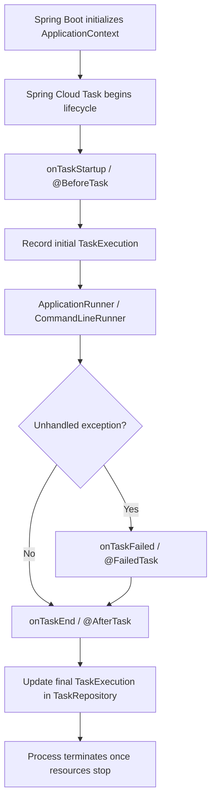
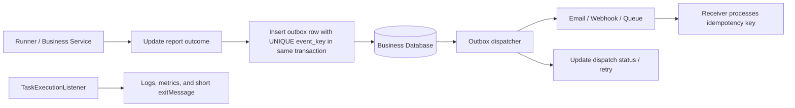

# Keeping Listeners Lean, Handling Errors, and Avoiding Duplicate Side Effects

## Objectives

**SPRING_CLOUD_TASK (Spring Cloud Task)** is used to build Spring Boot applications that execute **finite-duration** jobs, such as exporting reports, importing data, or synchronizing orders. Each run can be tracked in a database through `TaskRepository` and `TaskExecution` records: start time, end time, exit code, and error details. Tasks can run on a schedule, on demand, or alongside Spring Batch.

In the **Listener** chapter, this lesson addresses a practical operational requirement: **keeping listeners short and predictable, handling errors according to criticality, and avoiding duplicate side effects during retries or reruns**.

After this lesson, you will be able to:

- Distinguish Task lifecycle callbacks from `ApplicationRunner`, `CommandLineRunner`, and Spring Batch listeners.
- Use `TaskExecutionListener` or `@BeforeTask`, `@FailedTask`, and `@AfterTask` for their intended purposes.
- Explain what happens when a listener callback throws an exception, including impacts on other listeners and exit codes.
- Decide which operations belong in a listener and which must move to business logic or asynchronous processors.
- Design idempotency keys, outboxes, and state-reconciliation mechanisms to prevent duplicate events, emails, or data writes.
- Inspect Task metadata, logs, and orchestrator status together when failures occur.

## 1. Listeners in the Spring Cloud Task Lifecycle

Spring Cloud Task provides the `org.springframework.cloud.task.listener.TaskExecutionListener` interface so applications can register callbacks at three points:

| Callback | Corresponding Annotation | When Is It Called? | Appropriate Purpose |
| --- | --- | --- | --- |
| `onTaskStartup(TaskExecution)` | `@BeforeTask` | Around the start of a Task run, before business runners | Log run identifiers, initialize lightweight diagnostic context |
| `onTaskFailed(TaskExecution, Throwable)` | `@FailedTask` | When the task encounters an unhandled exception; this callback runs **before** `onTaskEnd` | Record error summary, add diagnostic context |
| `onTaskEnd(TaskExecution)` | `@AfterTask` | Before the repository updates the final Task status. Can run on both success and failure paths | Log completion, attach a short exit message when appropriate |

**Note on metadata write timing:** Official documentation versions describe `onTaskStartup` near the `TaskExecution` creation step; reference guides and Javadocs across versions phrase "before" vs. "after" the initial save differently. Therefore, do not build business logic assuming the record has already committed and is immediately visible to another process inside `@BeforeTask`. Check your exact library version and test in a staging environment if strict consistency is required.

The logical flow is typically represented as follows:



The diagram emphasizes **processing order**, not that every JDBC call or transaction commit occurs at the exact same instant across all releases. Errors occurring too early during `ApplicationContext` startup may happen before Task listeners are invoked; abrupt JVM termination may also prevent end callbacks from running.

A Spring Cloud Task listener tracks **a single application run**. It does not replace business logic in runners and is not a delivery-once notification guarantee.

## 2. Responsibility Boundaries: Listeners Should Do Very Little

Listeners are part of Task status recording. Long-running work or external service dependencies increase runtime, introduce extra failure points, and can obstruct final status persistence.

| Action | Where Should It Live? | Why? |
| --- | --- | --- |
| Logging Task name, execution ID, callback timestamp | Listener | Fast, low coupling, aids observability |
| Adding a concise, non-sensitive `exitMessage` | Listener | Metadata field designed for completion context |
| Recording lightweight counters or observability spans | Listener or framework observability mechanism | Acceptable, provided errors and duration are bounded |
| Validating and processing business arguments | Runner/service | Part of the run's contract and needs clear failures |
| Exporting reports, calling payment APIs, updating orders | Business service | Requires dedicated transactions, retries, and idempotency |
| Sending emails, webhooks, or external notifications | Outbox + dedicated worker/dispatcher | Network calls can time out even after the receiver processed them |
| Confirming Task outcome committed in repository | Post-commit monitoring/reconciliation component | `@AfterTask` runs **before** the completion update; not yet proof of persisted outcome |
| Recomputing business outcomes on retry | Runner/service with restart strategy | Listeners lack full checkpoints and data-correctness awareness |

Design rule: listeners should **observe and enrich context**, whereas business decisions and data mutations must reside where transactions, errors, and reruns can be controlled.

### Lean Means More Than Few Lines of Code

A three-line `@AfterTask` method that makes a synchronous external API call with a 60-second timeout is still a "heavy" listener. Conversely, a 15-line method that merely normalizes metric tags and writes internal logs is easy to control. Judge by **execution time, side effects, number of dependencies, and failure behavior**.

Never hold locks for long, spawn unbounded waiting threads, wait for user input, or call `System.exit(…)` from a listener. Those actions can prevent Spring Cloud Task from finishing metadata updates or shutting down cleanly.

## 3. Registering Listeners via the Interface

In Spring Cloud Task 3.x, `TaskExecutionListener` methods have default implementations so a class only needs to override the callbacks it cares about. Creating a Spring bean with `@Component` is the standard approach:

```java
package com.example.report.listener;

import org.slf4j.Logger;
import org.slf4j.LoggerFactory;
import org.springframework.cloud.task.listener.TaskExecutionListener;
import org.springframework.cloud.task.repository.TaskExecution;
import org.springframework.stereotype.Component;

@Component
public class TaskLogListener implements TaskExecutionListener {

    private static final Logger log =
            LoggerFactory.getLogger(TaskLogListener.class);

    @Override
    public void onTaskStartup(TaskExecution execution) {
        log.info("Task started: name={}, executionId={}",
                execution.getTaskName(), execution.getExecutionId());
    }

    @Override
    public void onTaskFailed(TaskExecution execution, Throwable error) {
        String errorType = error == null
                ? "Unknown" : error.getClass().getSimpleName();
        log.error("Task failed: name={}, executionId={}, type={}",
                execution.getTaskName(), execution.getExecutionId(),
                errorType);
    }

    @Override
    public void onTaskEnd(TaskExecution execution) {
        log.info("Task reached end milestone: name={}, executionId={}",
                execution.getTaskName(), execution.getExecutionId());
    }
}
```

This sample **only logs**—it sends no notifications, reruns no business logic, and executes no manual SQL against `TASK_EXECUTION`. `onTaskEnd` logs only "reached end milestone": at callback time, the repository may **not yet** have updated `END_TIME` and the final exit code.

When stack traces are needed in logs, pass the exception to the logger in a secured logging system governed by data-masking rules. Never concatenate full stack traces or user arguments into `exitMessage`, emails, or webhooks, because those values may contain secrets.

### Using Annotations Instead of the Interface

Spring Cloud Task also supports annotations in `org.springframework.cloud.task.listener.annotation`. This is an **alternative** to the interface above:

```java
package com.example.report.listener;

import org.slf4j.Logger;
import org.slf4j.LoggerFactory;
import org.springframework.cloud.task.listener.annotation.AfterTask;
import org.springframework.cloud.task.listener.annotation.BeforeTask;
import org.springframework.cloud.task.listener.annotation.FailedTask;
import org.springframework.cloud.task.repository.TaskExecution;
import org.springframework.stereotype.Component;

@Component
public class AnnotatedTaskLogListener {

    private static final Logger log =
            LoggerFactory.getLogger(AnnotatedTaskLogListener.class);

    @BeforeTask
    public void before(TaskExecution execution) {
        log.info("beforeTask executionId={}", execution.getExecutionId());
    }

    @FailedTask
    public void failed(TaskExecution execution, Throwable error) {
        log.warn("failedTask executionId={}, errorType={}",
                execution.getExecutionId(),
                error == null ? "Unknown"
                        : error.getClass().getSimpleName());
    }

    @AfterTask
    public void after(TaskExecution execution) {
        log.info("afterTask executionId={}", execution.getExecutionId());
    }
}
```

Register **only one** of the two examples above if the goal is logging each milestone once. Registering both may produce two log lines per milestone; that is the result of two distinct listeners firing, not a framework bug.

The examples assume the application declares the Spring Cloud Task starter and configures `@EnableTask` (or version-appropriate auto-configuration), along with a `DataSource` and matching schema for JDBC metadata persistence.

## 4. Relationship with `ApplicationRunner` and Execution Data

Example of a daily report generation task:

```java
package com.example.report;

import java.time.LocalDate;
import java.util.List;
import org.springframework.boot.ApplicationRunner;
import org.springframework.boot.SpringApplication;
import org.springframework.boot.autoconfigure.SpringBootApplication;
import org.springframework.cloud.task.configuration.EnableTask;
import org.springframework.context.annotation.Bean;

@SpringBootApplication
@EnableTask
public class DailyReportTaskApplication {

    public static void main(String[] args) {
        SpringApplication.run(DailyReportTaskApplication.class, args);
    }

    @Bean
    ApplicationRunner reportRunner(ReportService reportService) {
        return args -> {
            List<String> dates = args.getOptionValues("businessDate");
            if (dates == null || dates.size() != 1) {
                throw new IllegalArgumentException(
                        "Exactly one --businessDate=yyyy-MM-dd is required");
            }
            LocalDate businessDate = LocalDate.parse(dates.get(0));
            reportService.generate(businessDate);
        };
    }
}
```

`ReportService` is a project-supplied business service; the snippet shows the **orchestration entry point** without the service's report generation and persistence internals. Desired flow:

1. Listeners log execution identifiers lightly.
2. The runner validates `businessDate` and calls the service.
3. The service executes within transactions using business keys so reruns do not duplicate data.
4. If the service throws an unhandled exception, Spring Cloud Task invokes `onTaskFailed` then `onTaskEnd` and attempts to record the final status.
5. The orchestrator reads exit codes and metadata to decide whether to retry or alert operators.

Never "recover" from errors in a listener by calling `reportService.generate(…)` inside `@FailedTask`. That causes execution inside the termination callback, risking additional side effects outside controlled retry logic.

## 5. What Happens When a Listener Itself Throws an Error?

Spring Cloud Task has specific exception-handling rules for listeners; it does not simply "skip and call all remaining callbacks."

| Where Error Occurs | Notable Impact | Recommendation |
| --- | --- | --- |
| `onTaskStartup` / `@BeforeTask` | An error in the first callback can stop remaining startup listeners from **running**; the app enters Task startup failure. | Avoid synchronous network calls; throw only if violating a mandatory precondition for a valid run. |
| `onTaskFailed` / `@FailedTask` | Occurs directly on the failure path; a second exception complicates diagnosis and affects exit codes. | Keep diagnostic callbacks simple, catch auxiliary observability errors, and never hide the primary cause. |
| `onTaskEnd` / `@AfterTask` | Subsequent end callbacks may not run; exceptions can affect termination and return status. | Perform no irreversible side effects; strictly avoid failable business flows here. |
| Runner/service | Unhandled exceptions route the Task through `onTaskFailed` and `onTaskEnd` and record failure. | Let critical errors propagate; recover only when genuine success criteria are met. |

According to Spring Cloud Task guidelines, **a callback throwing an error for an event type may stop remaining listeners for that same event type**. Other callback types (`onTaskFailed`/`onTaskEnd`) still participate in the completion flow as appropriate; nevertheless, never rely on multi-listener ordering as a guaranteed business protocol.

Regarding **exit codes**, Spring Cloud Task documentation specifies listener-error behavior:

- If `onTaskStartup` throws an error, the application receives exit code `1`.
- For errors in `onTaskEnd` or `onTaskFailed`, rules may rely on `ExitCodeEvent`, `ExitCodeGenerator`, and default to `1` if no appropriate configuration/exit-code source exists.
- `ExitCodeExceptionMapper` **cannot override** exit codes for exceptions thrown inside these listener callbacks under documented behavior.

Because these rules depend on the failure path and version, verify the real exit code produced by your artifact. Never override `TaskExecution.exitCode` manually inside a listener to mark "success" and mask another exception.

### Classifying Errors by Responsibility

**Critical (mandatory) errors:** e.g., invalid output configuration or insufficient permissions to execute the job. Validate these **explicitly in the runner/service** so the task fails with a traceable cause without executing uncontrolled business work.

**Best-effort (auxiliary) errors:** e.g., an unavailable metrics endpoint or secondary diagnostic sink. If business correctness does not depend on metrics, callbacks should not fail the Task merely because an auxiliary diagnostic channel is temporarily down.

Example isolating auxiliary failures for an optional observability service:

```java
@FailedTask
public void reportFailure(TaskExecution taskExecution, Throwable cause) {
    try {
        diagnosticRecorder.recordFailure(
                taskExecution.getExecutionId(),
                cause == null ? "Unknown"
                        : cause.getClass().getSimpleName());
    } catch (RuntimeException monitoringError) {
        log.warn("Failed to record diagnostics for executionId={}",
                taskExecution.getExecutionId(), monitoringError);
    }
}
```

In this snippet, `diagnosticRecorder` and `log` are injected and configured bean dependencies on the listener. Never blindly apply a catch-all `Exception` pattern to business logic: **suppressing propagation** here is valid solely because diagnostics are **auxiliary**. If auditing is strictly required before completion counts as valid, design auditing as a business step with its own transaction and retry strategy.

## 6. Why Do Side Effects Inside Listeners Easily Duplicate?

Suppose `@AfterTask` sends a "Report completed" email immediately after the runner finishes:

```java
// Not recommended: illustrates a listener with a network side effect.
@AfterTask
public void after(TaskExecution taskExecution) {
    mailClient.sendReportFinished(taskExecution.getExecutionId());
}
```

Risks include:

1. The mail server accepts the message, but the HTTP/SMTP response times out. The listener assumes failure and infrastructure retries; the recipient may receive the email twice.
2. The listener sends the email successfully, but the repository fails to update `TaskExecution` afterward. The DB final state does not confirm success even though the email was already sent.
3. The scheduler retries the task after a timeout, or an operator manually reruns the same day; the new run gets a new `TASK_EXECUTION_ID` and the listener sends the notification again.
4. Two Task instances may run concurrently for the same `businessDate` if the platform does not restrict concurrency; checking a boolean flag in JVM memory does not prevent duplicates across processes.
5. The process receives `kill -9` before `@AfterTask` runs; the notification may **never be sent at all**.

Therefore, lifecycle callbacks **do not** provide "exactly-once" guarantees for external side effects. To achieve effective once-per-business-outcome semantics, design durable state persistence and idempotency on the data and receiver side.

### Distinguishing Two Kinds of Duplication

| Goal | Sample Idempotency Key | When to Use? |
| --- | --- | --- |
| One notification **per run** | `task:8421:finished` | When each `TaskExecution` should emit its own outcome, even on same-day reruns |
| One outcome **per business date** | `daily-report:2026-11-23:ready` | When only one official report should be produced for that date across multiple reruns |
| One specific business action | `invoice:INV-2901:issued` | Never send the same invoice twice |

`executionId` distinguishes **each run**. It does not replace `businessDate` or a business key when the requirement is "one report per day."

Define your idempotency key before designing callbacks to specify exact desired semantics. Otherwise, "deduplicating by `executionId`" only prevents repeats within the **same run** while still duplicating when the scheduler starts a new run.

## 7. Solution: Persist Outcomes Durably and Emit Events Afterward

For side effects destined for external systems, move notification dispatch to a **transactional outbox** or dedicated orchestration service:



In this design, listeners remain lean: they observe Task state, while the **business service** persists the result and pending event in the same transaction. A separate worker reads the outbox, dispatches events, and manages retries.

PostgreSQL example for storing pending events:

```sql
CREATE TABLE report_outbox (
    event_key VARCHAR(160) PRIMARY KEY,
    event_type VARCHAR(40) NOT NULL,
    payload_json TEXT NOT NULL,
    created_at TIMESTAMP NOT NULL DEFAULT CURRENT_TIMESTAMP,
    dispatched_at TIMESTAMP NULL
);

-- Executed in the same transaction as persisting the successful report.
INSERT INTO report_outbox(event_key, event_type, payload_json)
VALUES (
    'daily-report:2026-11-23:ready',
    'REPORT_READY',
    '{"businessDate":"2026-11-23"}'
)
ON CONFLICT (event_key) DO NOTHING;
```

`ON CONFLICT` is PostgreSQL syntax; for other databases, use the corresponding upsert or unique-constraint mechanism. `event_key` must be derived from trusted business keys—never concatenate unvalidated input directly into SQL.

Benefits:

- If the business transaction rolls back, both the report and the pending outbox event roll back together.
- If the Task retries for the same date, the `PRIMARY KEY` constraint prevents creating duplicate events for the same intent.
- The dispatcher worker can retry safely when external services are temporarily unreachable.
- A failure while Spring Cloud Task writes final metadata does not emit a duplicate "success" notification merely because callbacks re-fire.

**Limitation:** an outbox prevents duplicate **event rows per key**, but does not by itself guarantee the external service executes only once. A worker might deliver successfully and crash before updating `dispatched_at`. Always forward `event_key` to the receiver and require idempotent processing or an API supporting idempotency keys.

If notifications must reflect the **final committed outcome in `TaskRepository`**, have a monitoring/reconciliation service inspect status after metadata commit and then enqueue the outbox event. **Never** send "Task recorded as succeeded" inside `@AfterTask`, because that callback runs before the final update.

## 8. Exit Message: Useful Yet Easy to Overwrite by Mistake

`TaskExecution` provides `exitMessage` for short outcome summaries alongside `errorMessage` for framework-captured exception details.

Spring Cloud Task allows listeners to call:

```java
@FailedTask
public void failed(TaskExecution taskExecution, Throwable error) {
    taskExecution.setExitMessage(
            "REPORT_FAILED: check logs by executionId="
                    + taskExecution.getExecutionId());
}
```

This example records only a brief message without stack traces, passwords, or user data. In production systems, messages must reflect actual failures and never assert success without verification.

The **`exitMessage` precedence order** documented by Spring Cloud Task is:

1. `onTaskEnd` / `@AfterTask`.
2. `onTaskFailed` / `@FailedTask`.
3. `onTaskStartup` / `@BeforeTask`.

Consequently, an `@AfterTask` unconditionally calling `setExitMessage("SUCCESS")` can **overwrite a failure message** previously set by `@FailedTask`. That is why only one component should own the message content, or an explicit precedence policy based on actual status must be enforced.

A common safe practice is **not setting an exit message in `@AfterTask`** unless truly needed: let the framework record error details while listeners log milestones. When business messages are required, use values confirmed by the business service and verify after Task completion.

Never mutate `TaskExecution.exitCode` merely to alter status without addressing the root cause. Process exit codes, metadata exit codes, and business outcomes must all be tracked; they can diverge if an error occurs while writing final metadata.

## 9. Multiple Listeners and Execution Order

An application can define multiple `TaskExecutionListener` beans—for instance, one for logging, one for metrics, and one for setting `exitMessage`. When coordinating multiple listeners:

- Never assume "listener A always runs before listener B" to manage transactions, lock resources, or pass business state.
- If one listener for an event throws an exception, remaining listeners for that event may not be invoked.
- If one listener performs a side effect, running before or after another listener **does not create a shared transaction** with external systems.
- Avoid registering duplicate logic across both interface and annotation forms, or exposing two beans from the same object.
- If multiple listeners write `exitMessage`, outcomes become unpredictable; assign a single owner for its value.

When strict sequencing of business steps is required, implement it in a **single coordinating service** with explicit transactional boundaries; listeners should only observe that service. Spring's `@Order` can adjust the ordering of certain beans/callbacks, but cannot replace durable business orchestration.

Do not register an `ApplicationListener` that runs earlier than `TaskLifecycleListener` unless you understand the event sequence; Spring Cloud Task documentation warns that placing listeners too early in the application event chain can lead to unexpected behavior.

## 10. Combining Tasks with Spring Batch

When a Spring Cloud Task runs a Spring Batch Job, two lifecycle layers exist:

| Layer | Typical Listeners | Tracks |
| --- | --- | --- |
| Spring Cloud Task | `TaskExecutionListener`, `@BeforeTask`, `@AfterTask`, `@FailedTask` | One finite **application** execution |
| Spring Batch | `JobExecutionListener`, `StepExecutionListener`, and item/chunk listeners as needed | A `JobExecution`, `StepExecution`, or data-processing stage |

One `TaskExecution` may relate to one or more `JobExecution` instances; their execution IDs are distinct. To log overall "process started/ended," use Task listeners. To verify a Batch Step's result or update checkpoints, use the appropriate Batch listeners.

Pay special attention: a Batch Job ending with `FAILED` status does not automatically become an unhandled exception at the application layer. If the application merely logs Batch status and the runner exits normally, `@FailedTask` may **not run**, and the Task may appear technically successful. Inspect and map Batch outcomes to Task failure signals according to your operational contract rather than expecting Task listeners to detect Batch failures automatically.

If a Batch step is restarted, `JobExecutionListener` may be invoked again for the new Batch attempt; `TaskExecutionListener` likewise binds to a new Task process run. For emails or external status updates, define idempotency keys by **business outcome** or **execution attempt** as required—not merely by callback count.

## 11. Observability and Incident Investigation

Useful observability fields include Task name, `TASK_EXECUTION_ID`, business date, correlation ID, error category, duration, and exit code. Avoid logging full arguments if they can contain sensitive values; note that Spring Cloud Task may also persist arguments into `TASK_EXECUTION_PARAMS`.

Query metadata after Task termination using default table names:

```sql
SELECT TASK_EXECUTION_ID,
       TASK_NAME,
       START_TIME,
       END_TIME,
       EXIT_CODE,
       EXIT_MESSAGE
FROM TASK_EXECUTION
WHERE TASK_NAME = 'daily-report-task'
ORDER BY TASK_EXECUTION_ID DESC;
```

Note that `EXIT_MESSAGE` and actual table names depend on your Spring Cloud Task version's schema and table prefix. If the Task is abruptly killed, loses database connectivity, or fails during context startup, records may be missing or lack `END_TIME`; never assume `@AfterTask` ran.

Sample clean log output:

```text
02:00:01 INFO  task-start  taskName=daily-report-task executionId=8421
02:00:01 INFO  report-run  businessDate=2026-11-23 requestId=req-736
02:00:04 INFO  report-run  businessDate=2026-11-23 rows=156
02:00:04 INFO  task-end    taskName=daily-report-task executionId=8421
```

This is an **illustrative application-designed log**, not a mandatory framework format. When investigating failures:

1. Inspect scheduler logs and process/Job status.
2. Look up `TaskExecution` by execution ID to see how far metadata was updated.
3. Cross-check business outputs, idempotency keys, and the outbox table to see whether side effects already occurred.
4. Retry only after verifying whether a previous run is still active or already finished; prevent parallel runs if they could conflict on shared data.

## 12. Essential Test Matrix

| Scenario | How to Test in an Isolated Environment | Expected Outcome |
| --- | --- | --- |
| Success | Runner finishes normally | Startup and end callbacks run; failed callback does not run; metadata records appropriate outcome |
| Business error | Runner throws an unhandled exception | Failed callback runs before end callback; failure status is persisted if repository is reachable |
| Runner catches and swallows error | Runner catches exception and returns normally | `@FailedTask` may not run; test exposes a "false success" to fix |
| Startup listener throws error | Configure a test listener throwing in `onTaskStartup` | Run fails; subsequent startup listeners may skip; no business side effects occur |
| End listener throws error | Configure a test listener throwing in `onTaskEnd` | Error signal follows framework rules; verify actual exit code and metadata |
| Metrics sink disconnected | Make diagnostic sink throw, as best-effort | Business Task still succeeds; warning logged; no unnecessary business retries |
| Duplicate event insert | Insert into outbox twice with the same `event_key` | Only one record exists due to unique constraint |
| Same-day retry | Run two `TaskExecution` instances with the same `businessDate` | Two executions exist for audit, while only one official business outcome exists if required |
| Dispatcher sends then times out | Simulate receiver succeeding before returning timeout | Receiver honors idempotency key; no duplicate effect after retry |
| Abrupt termination | Force-kill process in test environment | Verify end callback may skip; scheduler and metadata reconciliation handles it |
| Spring Batch failure | Batch Job returns FAILED status without throwing | Runner maps it to Task failure per requirements, not relying solely on Task listeners |

Never write a test that merely counts listener method calls inside one JVM and concludes "exactly once." Deduplication must be verified **across separate runs, transaction rollbacks, network timeouts, and multiple processes** where required.

## 13. Comprehensive Hands-On Lab

**Scenario:** `daily-report-task` is triggered daily at 02:00 by a Kubernetes CronJob. The Task can also be rerun manually; upon report success, it must send a webhook to a downstream reporting system while producing **only one official report** per day.

1. Create a Spring Boot Task with an `ApplicationRunner` accepting `--businessDate=yyyy-MM-dd` and invoking a simulated `ReportService`.
2. Add a `TaskExecutionListener` bean or annotation-based listener to log the execution ID at startup, failure, and end. Keep report-generation logic out of the listener.
3. Run a successful execution, query `TASK_EXECUTION`, and confirm callback log order.
4. Have the runner throw an exception; observe `@FailedTask` and `@AfterTask`, and inspect the exit code and error fields. Ensure no unconditional `"SUCCESS"` message is recorded on failure.
5. Create an outbox table keyed by `daily-report:<businessDate>:ready`; when the report commits successfully, write the event to the outbox **in the same transaction**.
6. Use a separate dispatcher to send the webhook, passing `event_key` as the idempotency key. Simulate the webhook processing successfully before timing out.
7. Rerun the Task with the same `businessDate` and a new execution ID; verify history shows multiple executions, while the report and outbox are not duplicated.
8. Simulate losing metadata DB connectivity at process end; reconcile process status, report output, and outbox rows to decide whether recovery is needed.

**Completion criteria:** lean listeners with no hard-to-recover side effects; business errors fail the Task cleanly; auxiliary observability failures do not break business processing; retries do not duplicate reports or webhooks; operators can inspect execution records and true business state.

## 14. References

- [Spring Cloud Task — Features: Task Execution Listener](https://docs.spring.io/spring-cloud-task/reference/features.html): the three callbacks, corresponding annotations, listener exceptions, and exit messages.
- [`TaskExecutionListener` API](https://docs.spring.io/spring-cloud-task/docs/current/apidocs/org/springframework/cloud/task/listener/TaskExecutionListener.html): callback signatures and Javadoc invocation timing details.
- [`BeforeTask` API](https://docs.spring.io/spring-cloud-task/docs/current/apidocs/org/springframework/cloud/task/listener/annotation/BeforeTask.html), [`AfterTask` API](https://docs.spring.io/spring-cloud-task/docs/current/apidocs/org/springframework/cloud/task/listener/annotation/AfterTask.html), [`FailedTask` API](https://docs.spring.io/spring-cloud-task/docs/current/apidocs/org/springframework/cloud/task/listener/annotation/FailedTask.html): annotation declarations.
- [Spring Cloud Task Reference Guide](https://docs.spring.io/spring-cloud-task/docs/current/reference/html/): Task lifecycle, metadata, exit codes, and Spring Batch integration.

Examples follow common API patterns in Spring Cloud Task 3.x. Verify the exact Spring Cloud Task, Spring Boot, and Spring Batch versions in your project before deploying to production.

## Key Takeaways

- `TaskExecutionListener` is a **lifecycle hook**, suited for observability and enriching context; business logic and transactions belong in runners and services.
- `@FailedTask` precedes `@AfterTask` on unhandled exceptions; `@AfterTask` does not mean "success" or "final metadata already committed."
- A listener throwing an error can halt subsequent listeners for that event, affect exit codes, and mask the root cause. Keep callbacks short and separate mandatory errors from auxiliary observability failures.
- **Execution ID** distinguishes each run; **business keys** prevent duplicate outputs on reruns. Never use in-JVM variables for cross-process deduplication.
- Use transactions, unique keys, outboxes, and idempotent receivers for external side effects; always cross-check scheduler status, Task metadata, and business outcomes during incidents.
