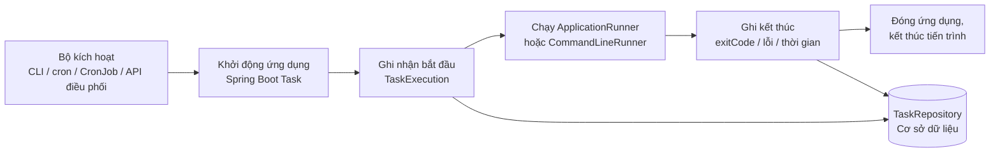

# Spring Cloud Task là gì và bài toán tác vụ hữu hạn

## Mục tiêu bài học

Sau bài học này, bạn có thể:

- Giải thích **tác vụ hữu hạn** (finite, short-lived task) khác gì với ứng dụng dịch vụ chạy liên tục.
- Nêu đúng trách nhiệm của **Spring Cloud Task**: ghi nhận vòng đời và kết quả của **mỗi lần chạy** ứng dụng Spring Boot.
- Phân biệt `TaskExecution`, `TaskRepository`, `TaskExplorer`, `TaskConfigurer` và phần xử lý nghiệp vụ.
- Tạo một ứng dụng Task tối thiểu, truyền tham số đầu vào, kiểm tra bản ghi thực thi và nhận diện trường hợp lỗi.
- Biết khi nào cần kết hợp Spring Batch, bộ lập lịch hoặc nền tảng điều phối; nhận diện những điều Spring Cloud Task không tự đảm nhiệm.

## 1. Bài toán: có công việc cần hoàn tất rồi thoát

Giả sử một hệ thống quản lý cho thuê cần **đối soát giao dịch của ngày hôm trước**. Mỗi đêm, hệ thống phải đọc dữ liệu thanh toán, kiểm tra chênh lệch, ghi kết quả đối soát và kết thúc. Người vận hành cần trả lời được:

1. Tác vụ đã bắt đầu lúc nào, đã kết thúc chưa?
2. Lần chạy ngày 24/11 thành công hay thất bại?
3. Khi chạy lại cùng ngày, hệ thống có thể làm trùng dữ liệu hay không?
4. Nếu tiến trình đã dừng, còn nơi nào lưu thông tin kết quả để tra cứu?

Viết một ứng dụng Spring Boot với `CommandLineRunner` hoặc `ApplicationRunner` là đủ để **chạy công việc**. Nhưng chỉ in log rồi thoát chưa giải quyết trọn vẹn nhu cầu **theo dõi lịch sử thực thi**. Log có thể nằm ở máy đã bị hủy, mỗi lượt chạy có PID khác nhau và không có bản ghi thống nhất để truy vấn.

**Spring Cloud Task** bổ sung phần ghi nhận vòng đời cho những ứng dụng Spring Boot có điểm bắt đầu và điểm kết thúc. Sau khi công việc hoàn tất, tiến trình có thể thoát bình thường. Một lần chạy mới sẽ có một bản ghi thực thi mới, dù cùng mã ứng dụng và cùng tên tác vụ.

Các tình huống điển hình:

| Tình huống | Điểm kết thúc rõ ràng |
| --- | --- |
| Nhập một tệp CSV từ đối tác | Tệp đã được xử lý và kết quả đã được ghi |
| Tạo báo cáo cuối ngày | Báo cáo đã được lưu hoặc phát hành |
| Đồng bộ dữ liệu theo yêu cầu | Tập dữ liệu trong phạm vi yêu cầu đã đồng bộ |
| Di chuyển dữ liệu một lần | Các bước chuyển đổi và xác minh đã hoàn tất |
| Đối soát thanh toán | Đã xác định, lưu và tổng hợp các chênh lệch |

Một tác vụ hữu hạn **không nhất thiết chạy nhanh**: có thể mất vài giây hoặc nhiều giờ. Điểm chính là công việc **được kỳ vọng sẽ kết thúc**, khác với API server, consumer hoặc dịch vụ nền được kỳ vọng hoạt động liên tục.

## 2. Spring Cloud Task thực sự làm gì?

Spring Cloud Task là dự án trong hệ sinh thái Spring Cloud, giúp xây dựng và theo dõi các **tiến trình Spring Boot có vòng đời hữu hạn**. Nó sử dụng cấu trúc quen thuộc của Spring Boot để khởi tạo ứng dụng, chạy logic nghiệp vụ, sau đó ghi lại kết quả thực thi.

Mô hình tổng quát:



**Trách nhiệm của Spring Cloud Task** là tạo và cập nhật bản ghi cho mỗi lượt chạy, cung cấp API để truy vấn lịch sử và các điểm mở rộng quanh vòng đời. **Trách nhiệm của mã nghiệp vụ** là thực hiện nhập liệu, đối soát, gửi kết quả... và quyết định khi nào phải báo lỗi.

Spring Cloud Task **không tự cung cấp** bộ lập lịch cron, cơ chế checkpoint cho từng bản ghi dữ liệu, đảm bảo chạy đúng một lần, cơ chế retry toàn hệ thống hay giới hạn thời gian chạy. Các nhu cầu đó phải được thiết kế bằng ứng dụng, Spring Batch hoặc nền tảng điều phối thích hợp.

### Phân biệt các khái niệm cốt lõi

| Thành phần | Vai trò |
| --- | --- |
| `TaskExecution` | Một **lần chạy vật lý** của ứng dụng Task: ID, tên, thời điểm bắt đầu/kết thúc, mã kết quả, thông báo lỗi, đối số... |
| `TaskRepository` | Nơi **tạo và cập nhật** các bản ghi `TaskExecution`; thường lưu bằng cơ sở dữ liệu quan hệ |
| `TaskExplorer` | API **đọc/tra cứu** thông tin thực thi đã lưu |
| `TaskLifecycleListener` | Thành phần hạ tầng theo dõi sự kiện bắt đầu/kết thúc của Task để cập nhật repository |
| `TaskExecutionListener` | Điểm mở rộng để ứng dụng phản ứng với sự kiện bắt đầu, thành công/kết thúc hoặc thất bại |
| `TaskConfigurer` | Chiến lược cấu hình repository, explorer và transaction manager; mặc định có `DefaultTaskConfigurer` |
| `ApplicationRunner` / `CommandLineRunner` | Nơi khởi chạy **logic nghiệp vụ** sau khi Spring Boot khởi tạo ứng dụng |

Một `TaskExecution` không phải là định nghĩa công việc hay lịch biểu. Ví dụ, tác vụ có `taskName = "daily-reconciliation"` chạy hai lần sẽ tạo **hai `executionId` khác nhau**; cả hai vẫn thuộc cùng tên tác vụ. Đối số đầu vào như `--businessDate=2026-11-24` mô tả lượt chạy cụ thể, nhưng **không tự biến nó thành một lần chạy duy nhất**.

## 3. Vòng đời một lượt chạy

1. **Khởi động:** một hệ thống bên ngoài hoặc người dùng chạy ứng dụng Spring Boot. Framework khởi tạo `ApplicationContext`.
2. **Ghi bắt đầu:** sau khi context được dựng thành công, trước khi các `ApplicationRunner`/`CommandLineRunner` chạy, Spring Cloud Task tạo bản ghi `TaskExecution` trong `TaskRepository`.
3. **Thực thi:** mã trong các runner chạy với tham số của tiến trình. Ứng dụng có thể truy cập dịch vụ nghiệp vụ, transaction, cơ sở dữ liệu hoặc hệ thống bên ngoài.
4. **Hoàn thành hoặc lỗi:** khi các runner hoàn thành hoặc xảy ra lỗi được framework ghi nhận, thông tin kết thúc và exit code được cập nhật vào bản ghi.
5. **Kết thúc tiến trình:** ứng dụng cần giải phóng tài nguyên và thoát khi công việc đã xong. Có thể cấu hình đóng `ApplicationContext` sau Task bằng `spring.cloud.task.closecontext-enabled=true`.

Ví dụ dữ liệu **minh họa** của một bản ghi:

| Thuộc tính | Giá trị ví dụ | Cách đọc |
| --- | --- | --- |
| `executionId` | `157` | ID phân biệt lượt chạy này với lượt khác |
| `taskName` | `daily-reconciliation` | Tên tác vụ |
| `startTime` | `2026-11-24 02:00:01` | Thời điểm bắt đầu |
| `endTime` | `2026-11-24 02:01:08` | Thời điểm hoàn tất |
| `exitCode` | `0` | Thành công theo quy ước mã thoát |
| `arguments` | `[--businessDate=2026-11-23]` | Các đối số đã truyền khi chạy |

Thông thường, `exitCode = null` khi Task **đang chạy**, `0` biểu thị thành công và mã khác `0` biểu thị lỗi. Không nên coi mọi bản ghi có `endTime = null` đều đang hoạt động: tiến trình có thể đã bị dừng cưỡng bức hoặc máy chủ gặp sự cố trước khi cập nhật kết quả.

Hai giới hạn cần hiểu đúng:

- Nếu `ApplicationContext` **không khởi tạo được**, Spring Cloud Task có thể chưa kịp ghi bất kỳ `TaskExecution` nào. Do đó, vẫn cần giám sát log, mã thoát tiến trình và trạng thái của hệ thống chạy tác vụ.
- Nếu JVM bị hủy đột ngột, chẳng hạn bằng `SIGKILL`, bản ghi có thể còn thiếu thời điểm kết thúc. Việc dọn các bản ghi treo phải dựa vào dữ liệu điều phối và chính sách vận hành, không được tự suy diễn là tác vụ đã thành công.

## 4. Ví dụ: ứng dụng Spring Cloud Task tối thiểu

Ví dụ sau nhận tham số ngày nghiệp vụ, giả lập một lượt đối soát và kết thúc. Đây là bài thực hành **minh họa vòng đời**; hai câu lệnh in ra màn hình phải được thay bằng xử lý đối soát thực tế khi xây dựng sản phẩm.

### 4.1. Khởi tạo dự án

Tạo dự án Spring Boot bằng [Spring Initializr](https://start.spring.io/) với Java 17 trở lên và một cặp phiên bản Spring Boot/Spring Cloud Task **tương thích**. Chọn dependencies:

- **Task** (starter `org.springframework.cloud:spring-cloud-starter-task`).
- **H2 Database** để thử nghiệm tại máy cá nhân.

Nếu khai báo bằng Maven, phần dependencies tương ứng là:

```xml
<dependencies>
    <dependency>
        <groupId>org.springframework.cloud</groupId>
        <artifactId>spring-cloud-starter-task</artifactId>
    </dependency>
    <dependency>
        <groupId>com.h2database</groupId>
        <artifactId>h2</artifactId>
        <scope>runtime</scope>
    </dependency>
</dependencies>
```

Ví dụ trên là **đoạn dependencies**, không phải toàn bộ `pom.xml`: giữ cấu hình Spring Boot parent và quản lý phiên bản Spring Cloud tương thích do Spring Initializr tạo ra. Không tự chọn ngẫu nhiên phiên bản starter khác với BOM của dự án.

### 4.2. Viết mã chạy một lần

```java
package com.example.reconciliation;

import java.time.LocalDate;
import java.util.List;

import org.springframework.boot.ApplicationRunner;
import org.springframework.boot.SpringApplication;
import org.springframework.boot.autoconfigure.SpringBootApplication;
import org.springframework.cloud.task.configuration.EnableTask;
import org.springframework.context.annotation.Bean;

@SpringBootApplication
@EnableTask
public class ReconciliationTaskApplication {

    public static void main(String[] args) {
        SpringApplication.run(ReconciliationTaskApplication.class, args);
    }

    @Bean
    ApplicationRunner reconcileRunner() {
        return arguments -> {
            List<String> dates = arguments.getOptionValues("businessDate");
            if (dates == null || dates.size() != 1) {
                throw new IllegalArgumentException(
                    "Cần đúng một tham số --businessDate=yyyy-MM-dd"
                );
            }

            LocalDate businessDate = LocalDate.parse(dates.get(0));
            System.out.println("Bắt đầu đối soát ngày " + businessDate);

            // Trong ứng dụng thật: gọi service đối soát, ghi kết quả vào DB.
            // Service phải xử lý an toàn khi cùng businessDate được chạy lại.

            System.out.println("Đối soát hoàn tất");
        };
    }
}
```

Ở đây:

- `@SpringBootApplication` khởi tạo ứng dụng Spring Boot; `@EnableTask` bật cấu hình Task theo ví dụ trong tài liệu chính thức.
- `ApplicationRunner` chạy sau khi context được tạo; `ApplicationArguments` cung cấp các lựa chọn truyền từ dòng lệnh.
- Nếu thiếu hoặc nhập sai `businessDate`, code ném exception. Spring Cloud Task ghi nhận lỗi khi vòng đời đã bắt đầu, thay vì đánh dấu một lượt chạy thành công.
- Runner **chạy xong là hết phần việc nghiệp vụ**; một Task đơn giản không cần mở HTTP endpoint hay duy trì consumer chạy mãi.

### 4.3. Cấu hình cho demo

Tạo `src/main/resources/application.yml`:

```yaml
spring:
  application:
    name: daily-reconciliation
  main:
    web-application-type: none
  datasource:
    url: jdbc:h2:mem:taskdb
    driver-class-name: org.h2.Driver
    username: sa
    password: ""
  cloud:
    task:
      closecontext-enabled: true
```

`spring.application.name` được dùng làm tên Task mặc định. `web-application-type: none` giúp ứng dụng không khởi tạo web server không cần thiết. `closecontext-enabled: true` yêu cầu đóng context khi Task đã hoàn tất.

**Lưu ý về H2 in-memory:** dữ liệu repository ở ví dụ này mất khi JVM thoát; nó chỉ phù hợp để quan sát nhanh trong log hoặc thử nghiệm. Muốn kiểm tra lịch sử **sau** khi tác vụ kết thúc, hãy dùng cơ sở dữ liệu có lưu trữ bền vững như PostgreSQL, MySQL hoặc H2 dạng file trong môi trường phát triển.

Đóng gói rồi chạy:

```bash
./mvnw package
java -jar target/reconciliation-task-0.0.1-SNAPSHOT.jar --businessDate=2026-11-23
```

Tên JAR phải thay theo `artifactId` và `version` thực tế mà dự án tạo ra. Khi chạy thành công, log nghiệp vụ dự kiến có hai dòng:

```text
Bắt đầu đối soát ngày 2026-11-23
Đối soát hoàn tất
```

Đồng thời, Spring Cloud Task ghi thông tin lượt chạy vào `TaskRepository`. Để quan sát bằng log khi học, có thể thêm `logging.level.org.springframework.cloud.task: DEBUG`; không bật DEBUG kéo dài trong môi trường production.

### 4.4. Tra cứu lịch sử bằng cơ sở dữ liệu bền vững

Khi kết nối một cơ sở dữ liệu quan hệ có các bảng Task (thay cho H2 in-memory), truy vấn minh họa:

```sql
SELECT
    TASK_EXECUTION_ID,
    TASK_NAME,
    START_TIME,
    END_TIME,
    EXIT_CODE,
    ERROR_MESSAGE
FROM TASK_EXECUTION
ORDER BY TASK_EXECUTION_ID DESC;
```

`TASK_EXECUTION` là bảng metadata mặc định, không phải bảng lưu các dòng giao dịch đã đối soát. Bảng `TASK_EXECUTION_PARAMS` chứa tham số thực thi, còn dữ liệu nghiệp vụ cần bảng riêng của ứng dụng. Tiền tố bảng mặc định là `TASK_` và có thể tùy chỉnh qua cấu hình của Spring Cloud Task.

Trong môi trường production, cấu hình một `DataSource` bền vững và quản lý schema bằng migration/script DDL phù hợp hệ quản trị cơ sở dữ liệu. Khi tổ chức tự quản lý DDL, có thể đặt `spring.cloud.task.initialize-enabled=false` **sau khi** đã triển khai đầy đủ bảng repository. Nếu ứng dụng có nhiều `DataSource`, cần chỉ định datasource dành cho Task qua `TaskConfigurer`.

## 5. Hiểu đúng thành công, thất bại và chạy lại

| Tình huống | Dấu hiệu quan sát | Điều phải lưu ý |
| --- | --- | --- |
| Runner hoàn thành bình thường | Có `endTime`; thông thường `exitCode=0` | Thành công kỹ thuật chưa chắc đồng nghĩa dữ liệu nghiệp vụ hợp lệ |
| Runner ném exception | Có thông tin lỗi và mã thoát khác `0` nếu lỗi được ghi nhận | Cần lưu log và đủ ngữ cảnh để điều tra |
| Khởi tạo ứng dụng thất bại rất sớm | Có thể **không có** `TaskExecution` | Kiểm tra cả log JVM và trạng thái của bộ điều phối |
| JVM bị hủy đột ngột | Bản ghi có thể chưa được cập nhật `endTime` | Không được mặc định coi là thành công hoặc đang chạy mãi |
| Cùng tham số được chạy lần thứ hai | Sinh `executionId` mới | Task không tự ngăn trùng tác động nghiệp vụ |

Ví dụ: đối soát ngày `2026-11-23` ghi xong 70% rồi tiến trình chết. Lúc chạy lại, hệ thống có thể xử lý lặp 70% này. **Spring Cloud Task chỉ ghi lịch sử các lượt chạy; nó không tự đảm bảo tính idempotent** (gọi lại nhiều lần nhưng kết quả cuối cùng không bị nhân đôi).

Với dữ liệu có tác động thực tế, hãy thiết kế thêm:

1. **Business key** xác định phạm vi: ví dụ `(partnerId, businessDate)`.
2. **Idempotency/unique constraint** trên dữ liệu đích hoặc trạng thái xử lý tương ứng.
3. **Transaction và điểm khôi phục** để không lưu nửa chừng ở trạng thái không nhất quán.
4. **Chính sách retry** với phân biệt lỗi tạm thời (mất kết nối) và lỗi dữ liệu (ngày không hợp lệ).
5. **Giới hạn đồng thời** nếu hai lượt đối soát cùng phạm vi có thể va chạm.

Spring Cloud Task có tùy chọn `spring.cloud.task.single-instance-enabled=true` để ngăn hai Task **cùng tên** chạy đồng thời; tính năng này cần các dependency Spring Integration theo tài liệu. Nó không thay thế cơ chế khóa nghiệp vụ theo `businessDate`, cũng không tự bảo đảm exactly-once ở hệ thống ngoài.

## 6. Task, Batch, scheduler và dịch vụ lâu dài khác nhau thế nào?

| Công cụ/cách triển khai | Giải quyết vấn đề chính | Khi nào chọn |
| --- | --- | --- |
| **Spring Cloud Task** | Theo dõi **một lần chạy** ứng dụng hữu hạn: lúc bắt đầu, kết thúc, mã lỗi, tham số | Muốn các tác vụ Spring Boot có lịch sử thực thi tập trung |
| **Spring Batch** | Xử lý dữ liệu theo `Job` / `Step`, chunk, transaction, retry, restart và trạng thái chi tiết | Nhập/biến đổi khối lượng lớn, cần checkpoint hoặc khởi động lại có kiểm soát |
| **`@Scheduled` trong Spring** | Kích hoạt phương thức theo lịch **trong tiến trình đang chạy** | Phù hợp tác vụ nhẹ trong một dịch vụ đang tồn tại |
| **Cron / Kubernetes CronJob / bộ điều phối** | Quyết định **khi nào, ở đâu** và với chính sách gì để khởi chạy tiến trình | Cần chạy theo lịch, chạy theo yêu cầu hoặc quản lý tài nguyên, timeout, retry của tiến trình |
| **Spring Cloud Data Flow** | Điều phối và quản lý triển khai/khởi chạy ứng dụng dữ liệu, task, batch trên nền tảng hỗ trợ | Cần quản lý nhiều tác vụ và quy trình ở mức hệ thống |

Spring Cloud Task và Spring Batch **bổ trợ nhau**. Ví dụ, một Task có thể khởi chạy một Spring Batch Job; Task theo dõi **toàn bộ tiến trình**, còn Batch theo dõi **JobExecution/StepExecution** và checkpoint bên trong. Khi thêm mô-đun `spring-cloud-task-batch`, `TaskBatchExecutionListener` có thể liên kết `JobExecution` với `TaskExecution`.

Một lưu ý quan trọng: lỗi của Spring Batch Job **không phải lúc nào cũng tự biến thành exit code khác 0 của tiến trình Task**. Tài liệu Spring Cloud Task nêu cấu hình `spring.cloud.task.batch.fail-on-job-failure=true` để coi Batch Job thất bại là thất bại của Task; cần kiểm tra chính sách exit code và hệ thống điều phối khi triển khai.

## 7. Lựa chọn kiến trúc và vận hành an toàn

Để triển khai tác vụ hữu hạn ngoài môi trường thử nghiệm, nên kiểm tra những điểm sau:

**Lưu metadata lâu dài.** `TaskRepository` cần datasource bền vững, quyền truy cập đúng phạm vi, backup và cơ chế migration schema. Không dùng H2 in-memory cho nhu cầu audit sau khi tiến trình kết thúc. Dữ liệu `TASK_EXECUTION` là metadata; không nhầm với bảng nghiệp vụ hoặc coi nó là hệ thống giám sát duy nhất.

**Giữ bí mật đầu vào.** Các đối số dòng lệnh có thể được ghi vào metadata Task; tránh đưa mật khẩu, token hoặc khóa truy cập vào `--arguments`. Dùng cơ chế cấp bí mật của môi trường chạy và không ghi thông tin nhạy cảm vào log hoặc `errorMessage`.

**Định nghĩa kết quả nghiệp vụ.** `exitCode=0` chỉ khẳng định tiến trình cho biết nó hoàn thành thành công. Nếu báo cáo được tạo nhưng số dòng thiếu, ứng dụng vẫn cần kiểm tra điều kiện nghiệp vụ và chủ động báo lỗi. Cần có metrics như số bản ghi xử lý, tổng sai lệch, số lỗi và mã tương quan với lượt chạy.

**Đảm bảo kết thúc có kiểm soát.** Không giữ web server, thread nền hoặc kết nối không cần thiết; xử lý tín hiệu dừng, timeout, giải phóng tài nguyên và giám sát tiến trình từ bộ điều phối. Một bản ghi chưa có `endTime` không đủ để khẳng định tiến trình còn sống.

**Thiết kế chạy lại an toàn.** Sử dụng khóa nghiệp vụ, constraint và cơ chế lưu tiến độ phù hợp; không dùng `executionId` làm cách duy nhất chống xử lý lặp. Nếu cần checkpoint từng bước hoặc restart chi tiết, cân nhắc Spring Batch.

**Làm rõ đơn vị quan sát.** Trong một hệ thống thực tế, nên liên kết `taskName`, `executionId`, `businessDate`, ID job của scheduler/container và correlation ID trong log. Nhờ đó khi có một báo cáo bị thiếu, có thể đi từ yêu cầu nghiệp vụ đến đúng lượt chạy và lỗi tương ứng.

## 8. Áp dụng: thiết kế tác vụ đối soát hằng ngày

Một phương án hợp lý cho yêu cầu đầu bài:

1. **Kubernetes CronJob** (hoặc cron/bộ điều phối tương đương) chạy ứng dụng vào 02:00, truyền `--businessDate`.
2. **Spring Cloud Task** ghi một `TaskExecution` cho mỗi lần gọi.
3. **Ứng dụng nghiệp vụ** kiểm tra tham số, đọc giao dịch, đối soát và lưu trạng thái theo khóa `(partnerId, businessDate)`.
4. **Spring Batch** được bổ sung nếu số giao dịch lớn và cần chunk, retry, restart theo `Step`.
5. **Giám sát** kết hợp exit code tiến trình, lịch sử `TaskExecution` và kết quả nghiệp vụ; cảnh báo nếu không xuất hiện lượt chạy hoặc có bản ghi treo quá ngưỡng.

Tình huống kiểm tra kiến thức: nếu cùng một cron vô tình kích hoạt **hai lần** với `--businessDate=2026-11-23`, Spring Cloud Task sẽ tạo hai bản ghi lịch sử riêng. Muốn tránh tạo hai báo cáo giống nhau, giải pháp nằm ở **idempotency và điều phối đồng thời** của ứng dụng, chứ không phải ở việc tái sử dụng cùng một `executionId`.

### Ghi nhớ

- **Spring Cloud Task = vòng đời và metadata của một tiến trình Spring Boot chạy hữu hạn**.
- **`TaskExecution` = một lần chạy**, còn `taskName` = tên chung của tác vụ.
- **`TaskRepository` lưu kết quả thực thi**, `TaskExplorer` hỗ trợ tra cứu; logic nghiệp vụ vẫn do ứng dụng chịu trách nhiệm.
- **Spring Batch xử lý dữ liệu chi tiết, scheduler khởi chạy theo lịch**; có thể kết hợp cả ba với Spring Cloud Task.
- Muốn vận hành an toàn cần cơ sở dữ liệu bền vững, phát hiện lỗi ngoài repository, exit code đáng tin cậy và thiết kế chạy lại không gây trùng dữ liệu.

## Tài liệu tham khảo

- [Spring Cloud Task — Getting started](https://docs.spring.io/spring-cloud-task/reference/getting-started.html)
- [Spring Cloud Task — Features: lifecycle, repository, configuration](https://docs.spring.io/spring-cloud-task/reference/features.html)
- [Spring Cloud Task — Batch integration](https://docs.spring.io/spring-cloud-task/reference/batch.html)
