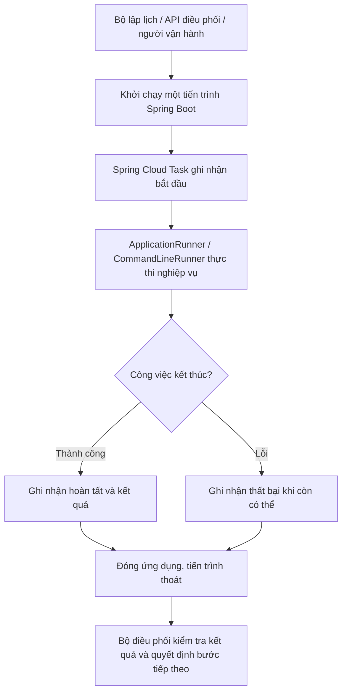
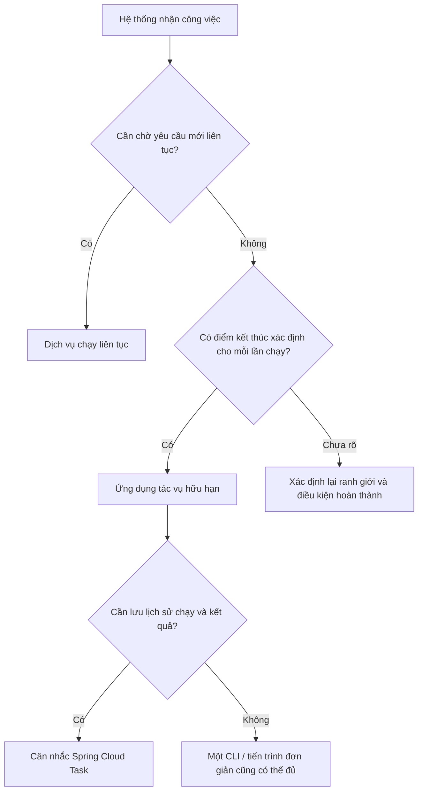

# Tiến trình ngắn hạn và dịch vụ chạy liên tục

Trong hệ sinh thái Spring, không phải mọi ứng dụng đều cần chạy suốt ngày đêm. Một dịch vụ nhận yêu cầu HTTP hoặc tiêu thụ thông điệp thường phải duy trì hoạt động; ngược lại, một chương trình xuất báo cáo cuối ngày có thể khởi động, làm xong việc rồi thoát. **Spring Cloud Task** được thiết kế cho kiểu ứng dụng thứ hai: ứng dụng Spring Boot có thời gian chạy hữu hạn, đồng thời ghi nhận thông tin về mỗi lần thực thi để có thể theo dõi và vận hành.

Bài học thuộc chương **Tổng quan** của module **SPRING_CLOUD_TASK**. Việc phân biệt hai mô hình chạy là nền tảng để hiểu vì sao Spring Cloud Task cần `TaskRepository`, cách xử lý tham số và lỗi, cách kích hoạt theo lịch hoặc theo yêu cầu, cũng như khi nào cần kết hợp với Spring Batch.

## Mục tiêu học tập

Sau bài này, bạn có thể:

- Giải thích được vòng đời và sự khác nhau giữa **tiến trình ngắn hạn** (*finite/short-lived process*) và **dịch vụ chạy liên tục** (*long-running service*).
- Chọn mô hình phù hợp cho các yêu cầu thực tế như API, xử lý hàng đợi, báo cáo định kỳ và tác vụ theo yêu cầu.
- Mô tả vai trò của Spring Cloud Task trong việc ghi nhận từng lần thực thi, thay vì nhầm nó với công cụ lên lịch.
- Phác thảo cách xây dựng, chạy, quan sát và xử lý lỗi cho một tác vụ Spring Boot có điểm kết thúc rõ ràng.

## 1. Hai kiểu vòng đời ứng dụng

### 1.1. Tiến trình ngắn hạn: có điểm bắt đầu và kết thúc

Một **tiến trình ngắn hạn** là tiến trình được tạo ra để thực hiện một khối công việc hữu hạn. Khi công việc hoàn thành hoặc không thể tiếp tục vì lỗi, tiến trình kết thúc và trả quyền điều khiển cho môi trường đã khởi chạy nó. “Ngắn hạn” nói về **vòng đời có giới hạn**, không nhất thiết là chạy vài giây: một lần nhập dữ liệu kéo dài hai giờ vẫn thuộc mô hình này nếu nó có điều kiện kết thúc xác định.

Ví dụ: vào 01:00 mỗi ngày, hệ thống chạy một chương trình tổng hợp giao dịch của ngày hôm trước. Chương trình đọc ngày cần xử lý, truy vấn dữ liệu, ghi báo cáo, lưu kết quả rồi thoát. Ngày hôm sau, bộ điều phối tạo **một lần chạy mới**, có mã thực thi và kết quả riêng.

Một lần chạy điển hình có các bước:

1. **Kích hoạt:** bộ lập lịch, người vận hành hoặc hệ thống khác yêu cầu chạy tác vụ.
2. **Khởi tạo:** tạo tiến trình, nạp cấu hình, kết nối đến các tài nguyên cần dùng.
3. **Thực thi:** xác thực tham số và xử lý khối công việc đã giao.
4. **Kết thúc:** ghi nhận thành công/thất bại, đóng tài nguyên và dừng tiến trình.

Điểm quan trọng là **mỗi lần chạy là một sự kiện có thể quan sát độc lập**: chạy khi nào, với tham số gì, kết quả ra sao, mất bao lâu và có cần chạy lại hay không.

### 1.2. Dịch vụ chạy liên tục: luôn sẵn sàng phục vụ

Một **dịch vụ chạy liên tục** được thiết kế để tồn tại cho đến khi bị dừng theo kế hoạch, được triển khai lại hoặc gặp sự cố. Công việc của nó thường xuất hiện không giới hạn theo thời gian, chẳng hạn:

- REST API luôn lắng nghe yêu cầu từ ứng dụng khách.
- Consumer liên tục nhận và xử lý thông điệp từ hàng đợi.
- WebSocket server duy trì kết nối với nhiều người dùng.
- Bộ điều phối cần hoạt động liên tục để tiếp nhận và giao tác vụ cho các tiến trình khác.

Một yêu cầu HTTP có thể hoàn thành trong 200 ms, nhưng điều đó **không biến toàn bộ API server thành tiến trình ngắn hạn**: tiến trình server vẫn tiếp tục lắng nghe yêu cầu kế tiếp. Tương tự, một consumer xử lý xong từng thông điệp nhưng không thoát sau mỗi thông điệp vẫn là dịch vụ chạy liên tục.

### 1.3. Bảng so sánh

| Tiêu chí | Tiến trình ngắn hạn | Dịch vụ chạy liên tục |
| --- | --- | --- |
| Mục đích | Hoàn thành một khối công việc xác định | Luôn sẵn sàng tiếp nhận và xử lý công việc mới |
| Vòng đời | Khởi động → thực hiện → kết thúc | Khởi động → lắng nghe/xử lý lặp lại → dừng khi cần |
| Cách kích hoạt | Lịch, sự kiện, thao tác thủ công, lời gọi từ hệ thống khác | Thường chạy khi triển khai và duy trì số lượng instance mong muốn |
| Tín hiệu thành công | Kết quả và mã thoát của **lần chạy** | Sức khỏe, độ sẵn sàng và chất lượng phục vụ theo thời gian |
| Theo dõi | Thời điểm bắt đầu/kết thúc, tham số, lỗi, số lần chạy lại | Uptime, lưu lượng, độ trễ, tỷ lệ lỗi, trạng thái kết nối |
| Mở rộng | Chạy nhiều phiên thực thi độc lập, có kiểm soát trùng lặp | Tăng/giảm số instance đang phục vụ |
| Ví dụ | Xuất CSV mỗi đêm, đối soát, dọn dữ liệu, di chuyển dữ liệu một lần | API đặt hàng, dịch vụ xác thực, consumer Kafka chạy thường trực |

**Không phải thời lượng xử lý quyết định mô hình.** Câu hỏi quyết định là: *sau khi hoàn thành khối công việc hiện tại, tiến trình có lý do gì để tiếp tục chờ công việc kế tiếp không?*

## 2. Spring Cloud Task đứng ở đâu?

Spring Cloud Task bổ sung cơ chế quản lý **vòng đời thực thi** cho ứng dụng Spring Boot có điểm kết thúc. Trong cách dùng phổ biến, tác vụ được triển khai thành ứng dụng không khởi chạy web server, thực hiện nghiệp vụ qua `ApplicationRunner` hoặc `CommandLineRunner`, rồi thoát.

Spring Cloud Task ghi nhận metadata về lần chạy thông qua các thành phần như:

| Khái niệm | Vai trò |
| --- | --- |
| `TaskExecution` | Biểu diễn một lần chạy: tên tác vụ, định danh thực thi, thời điểm bắt đầu/kết thúc, mã thoát, thông báo lỗi và thông tin liên quan. |
| `TaskRepository` | Tạo/cập nhật bản ghi thực thi; khi cấu hình nguồn dữ liệu và schema phù hợp, metadata có thể lưu bền vững trong cơ sở dữ liệu. |
| `TaskExplorer` | Tra cứu lịch sử và thông tin các lần thực thi đã được lưu. |
| `TaskExecutionListener` | Điểm mở rộng để phản ứng với các sự kiện vòng đời tác vụ khi có nhu cầu tùy biến. |

Một lần chạy mới thường tạo một bản ghi `TaskExecution` mới. Nhờ đó, hai lần xuất báo cáo cùng tên nhưng chạy vào hai ngày khác nhau vẫn phân biệt được. **Metadata thực thi không thay thế dữ liệu nghiệp vụ**: file báo cáo, dữ liệu đã đối soát hay các bản ghi được cập nhật vẫn phải được lưu trong hệ thống nghiệp vụ hoặc nơi lưu trữ thích hợp.



Sơ đồ thể hiện đường đi bình thường. Nếu tiến trình bị **kill cưỡng bức**, mất điện hoặc không còn kết nối cơ sở dữ liệu, bản ghi thực thi có thể chưa có thời gian kết thúc dù tiến trình thực tế đã dừng. Vì thế, hệ thống vận hành cần đối chiếu cả trạng thái tiến trình bên ngoài với metadata trong `TaskRepository`.

### Spring Cloud Task không phải bộ lập lịch

Spring Cloud Task giúp **ghi nhận và quản lý thông tin một lần chạy**. Nó không tự quyết định tác vụ phải chạy lúc 01:00, không tự tạo các lần chạy lặp lại và không mặc nhiên quản lý retry. Có thể dùng cron, Kubernetes `CronJob`, một hệ thống điều phối công việc hoặc một dịch vụ khác để **khởi tạo tiến trình mới** cho từng lần thực thi.

Đặt `@Scheduled` trong một Spring Boot service chạy mãi là mô hình hợp lệ cho nhiều bài toán, nhưng các lần gọi phương thức định kỳ ấy vẫn thuộc **cùng một tiến trình đang sống**. Chúng không tự động trở thành các lần thực thi Spring Cloud Task tách biệt. Nếu mục tiêu là quản lý độc lập từng lần chạy, cần thiết kế ranh giới khởi chạy và kết thúc tương ứng.

## 3. Chọn mô hình theo yêu cầu thực tế

Hãy xem bốn tình huống:

1. **API tra cứu đơn hàng:** phải luôn nhận yêu cầu mới → dịch vụ chạy liên tục.
2. **Tổng hợp doanh thu lúc 01:00:** xử lý xong bộ dữ liệu của một ngày rồi dừng → tiến trình ngắn hạn; phù hợp Spring Cloud Task.
3. **Consumer xử lý đơn hàng từ Kafka:** mỗi sự kiện xử lý nhanh nhưng consumer phải chờ sự kiện tiếp theo → dịch vụ chạy liên tục.
4. **Người dùng bấm “Xuất báo cáo lớn”:** API nhận yêu cầu và giao cho bộ điều phối khởi chạy một tiến trình riêng; API vẫn hoạt động, còn tiến trình tạo báo cáo kết thúc sau khi xử lý → **kết hợp cả hai mô hình**.

Có thể áp dụng chuỗi câu hỏi sau:



Ví dụ “xuất báo cáo theo yêu cầu” còn cho thấy **cách công việc được kích hoạt không quyết định loại ứng dụng**. Một yêu cầu HTTP có thể kích hoạt một tác vụ hữu hạn; ngược lại, công việc chạy mỗi phút có thể được thực hiện bằng một dịch vụ thường trực nếu yêu cầu triển khai phù hợp.

## 4. Phác thảo một ứng dụng Spring Cloud Task

Đoạn mã sau minh họa ứng dụng Spring Boot không cung cấp API, nhận một tham số ngày và thực hiện một lần xử lý. Giả sử dự án đã khai báo các dependency Spring Boot và Spring Cloud Task tương thích với nhau. Phần `System.out.println` đại diện cho nghiệp vụ tạo báo cáo và cần được thay bằng service thực tế.

```java
import java.time.LocalDate;
import java.util.List;

import org.springframework.boot.ApplicationRunner;
import org.springframework.boot.SpringApplication;
import org.springframework.boot.autoconfigure.SpringBootApplication;
import org.springframework.cloud.task.configuration.EnableTask;
import org.springframework.context.ConfigurableApplicationContext;
import org.springframework.context.annotation.Bean;

@SpringBootApplication
@EnableTask
public class DailyReportTaskApplication {

    public static void main(String[] args) {
        ConfigurableApplicationContext context =
                SpringApplication.run(DailyReportTaskApplication.class, args);
        int exitCode = SpringApplication.exit(context);
        System.exit(exitCode);
    }

    @Bean
    ApplicationRunner generateDailyReport() {
        return arguments -> {
            List<String> values = arguments.getOptionValues("businessDate");
            if (values == null || values.size() != 1) {
                throw new IllegalArgumentException(
                        "Cần truyền đúng một --businessDate=YYYY-MM-DD");
            }

            LocalDate businessDate = LocalDate.parse(values.get(0));
            // Thay bằng xử lý nghiệp vụ thật: đọc dữ liệu, tạo báo cáo, lưu kết quả.
            System.out.println("Đã xử lý báo cáo cho ngày " + businessDate);
        };
    }
}
```

Ví dụ cấu hình `application.yml`:

```yaml
spring:
  application:
    name: daily-report
  main:
    web-application-type: none
  cloud:
    task:
      name: daily-report
```

Chạy bản JAR đã đóng gói:

```bash
java -jar daily-report.jar --businessDate=2026-11-24
```

Diễn giải luồng chạy:

1. Spring Boot khởi động ứng dụng ở chế độ không có web server.
2. Spring Cloud Task tham gia vào vòng đời ứng dụng để ghi nhận lần chạy.
3. `ApplicationRunner` nhận `businessDate`, kiểm tra định dạng và thực hiện công việc **một lần**.
4. Khi runner hoàn tất, ứng dụng đóng context và trả mã thoát của tiến trình. Nếu runner phát sinh lỗi, quá trình khởi động/thực thi thất bại và cần được môi trường chạy ghi nhận, xử lý thích hợp.

Trong môi trường cần truy vấn lịch sử chạy **qua các lần khởi động khác nhau**, phải cấu hình `DataSource` đến cơ sở dữ liệu phù hợp và chuẩn bị schema metadata của Spring Cloud Task theo phiên bản đang dùng; ở production nên quản lý schema bằng quy trình migration có kiểm soát. Chỉ thêm `@EnableTask` mà không thiết lập lưu trữ bền vững thì **không nên mặc định** rằng lịch sử đã được giữ lại trong cơ sở dữ liệu sau khi tiến trình thoát.

> **Lưu ý về ví dụ:** Một chương trình chạy được chưa đồng nghĩa với tác vụ vận hành an toàn. Bản triển khai thực tế cần ghi log có ngữ cảnh, xử lý giao dịch và tài nguyên, xác định cơ chế retry, cùng chiến lược tránh xử lý lặp lại.

## 5. Theo dõi kết quả: phân biệt ba lớp trạng thái

Với tiến trình hữu hạn, có ít nhất ba câu hỏi khác nhau:

| Lớp trạng thái | Câu hỏi | Ví dụ |
| --- | --- | --- |
| **Tiến trình** | Process còn chạy hay đã thoát? Mã thoát hệ điều hành là gì? | Container kết thúc với exit code `0` hoặc một mã lỗi. |
| **Thực thi tác vụ** | Spring Cloud Task ghi nhận lần chạy nào, bắt đầu/kết thúc khi nào và kết quả gì? | `TaskExecution` có định danh, thời gian, exit code, thông điệp liên quan. |
| **Nghiệp vụ** | Dữ liệu cần xử lý đã đạt kết quả mong muốn chưa? | Báo cáo được lưu đủ, đúng ngày và không trùng bản ghi. |

Ba lớp này thường liên quan nhưng **không hoàn toàn tương đương**. Một tiến trình có thể thoát thành công nhưng báo cáo bị thiếu vì logic nghiệp vụ bỏ qua kiểm tra; cũng có thể báo cáo đã ghi xong nhưng tiến trình chết trước khi cập nhật metadata cuối cùng. Vì vậy, để xác nhận hoàn thành, hãy kết hợp mã thoát, bản ghi Spring Cloud Task và điều kiện thành công của nghiệp vụ.

Khi xử lý lỗi, tránh viết mã kiểu `catch (Exception e) { log.error(...); }` rồi kết thúc bình thường nếu công việc thực tế đã thất bại. Nếu bắt lỗi để bổ sung ngữ cảnh, cần phát lại lỗi hoặc báo trạng thái thất bại bằng cơ chế thích hợp, để bộ điều phối không hiểu nhầm là đã hoàn thành.

## 6. Lên lịch, chạy theo yêu cầu và tránh chạy chồng

Spring Cloud Task có thể được kích hoạt bằng nhiều nguồn, nhưng mỗi lần kích hoạt nên tạo **ranh giới thực thi rõ ràng**:

| Nhu cầu | Cách triển khai điển hình | Điều cần kiểm soát |
| --- | --- | --- |
| Chạy mỗi đêm | Cron, Kubernetes `CronJob` hoặc scheduler bên ngoài tạo process/container mới | Múi giờ, ngày nghiệp vụ, chạy bù, chạy chồng |
| Chạy thủ công | Người vận hành gọi lệnh với tham số rõ ràng | Phân quyền, kiểm tra tham số, ghi vết ai đã yêu cầu |
| Chạy sau sự kiện | Dịch vụ nhận sự kiện giao việc cho hệ thống khởi chạy task | Khởi chạy trùng, giới hạn đồng thời, xác nhận đã giao việc |
| Chạy theo yêu cầu từ API | API tiếp nhận yêu cầu và gọi bộ điều phối chạy task riêng | Không giữ kết nối HTTP chờ toàn bộ công việc; cung cấp mã để tra cứu kết quả |

Ví dụ, lịch chạy báo cáo lúc 01:00 không tự bảo đảm rằng một tác vụ ngày trước đã kết thúc. Nếu hai lần chạy cùng sửa một bộ dữ liệu, có nguy cơ phát sinh báo cáo trùng hoặc ghi đè kết quả. Hãy chọn chính sách rõ ràng: không cho chạy chồng, dùng khóa theo ngày nghiệp vụ, hoặc cho phép song song khi các lần chạy được phân vùng dữ liệu độc lập.

Để chạy lại an toàn, thiết kế tác vụ có tính **idempotent** trong phạm vi có thể: chạy cùng đầu vào nhiều lần không tạo thêm kết quả sai. Ví dụ, báo cáo theo `businessDate` có khóa duy nhất theo ngày và loại báo cáo, sử dụng cơ chế cập nhật có kiểm soát thay vì luôn chèn một bản mới.

## 7. Khi nào kết hợp với Spring Batch?

Spring Cloud Task và Spring Batch giải quyết hai mức bài toán khác nhau:

- **Spring Cloud Task** tập trung vào *lần thực thi ứng dụng* có điểm kết thúc: khi nào bắt đầu, khi nào dừng, thoát với kết quả nào.
- **Spring Batch** tập trung vào *quy trình xử lý dữ liệu theo lô*: `Job`, `Step`, đọc/xử lý/ghi dữ liệu, checkpoint, skip/retry và khả năng khởi động lại theo cấu hình của job.

Một ứng dụng có thể dùng **cả hai**: Spring Cloud Task ghi nhận lần chạy ứng dụng, trong khi Spring Batch quản lý các bước của quá trình nhập một triệu dòng dữ liệu. Không cần Spring Batch nếu tác vụ chỉ gọi một API hoặc chạy một thao tác đơn giản; ngược lại, với tác vụ xử lý dữ liệu theo nhiều bước, cần checkpoint và restart, Spring Batch là lựa chọn nên cân nhắc.

Đừng nhầm “chạy lại tiến trình” với “khôi phục từ vị trí đã xử lý”. Chạy lại toàn bộ một Spring Cloud Task **không tự động** biết dòng dữ liệu cuối cùng được xử lý thành công. Khả năng tiếp tục theo checkpoint cần được thiết kế ở lớp nghiệp vụ hoặc bằng cơ chế phù hợp của Spring Batch.

## 8. Những nguyên tắc vận hành an toàn

Khi đưa tác vụ hữu hạn lên môi trường dùng thật, hãy trả lời được các câu hỏi sau:

1. **Đầu vào xác định:** dùng tham số hợp lệ, version cấu hình và ngày nghiệp vụ rõ ràng. Tránh đưa mật khẩu/token vào tham số dòng lệnh hoặc log vì chúng có thể xuất hiện trong công cụ giám sát và metadata.
2. **Kết thúc xác định:** không vô tình khởi tạo web server, vòng lặp vô hạn, consumer thường trực hoặc luồng nền khiến tiến trình không thoát.
3. **Thất bại quan sát được:** báo lỗi đúng, không nuốt exception; bên điều phối kiểm tra exit code và thời hạn hoàn thành thay vì chỉ kiểm tra process đã từng khởi động.
4. **Retry có giới hạn:** đặt số lần thử lại, khoảng chờ và điều kiện có thể thử lại. Phân biệt lỗi tạm thời với dữ liệu đầu vào không hợp lệ.
5. **Tránh chạy trùng:** xác định khóa nghiệp vụ, giới hạn số tác vụ đồng thời và bảo đảm cập nhật dữ liệu có tính nhất quán.
6. **Tài nguyên và thời gian:** đặt timeout, giới hạn CPU/bộ nhớ, đóng kết nối và có chính sách xử lý khi nhận tín hiệu dừng.
7. **Theo dõi lịch sử:** lưu metadata trong cơ sở dữ liệu phù hợp, gắn mã thực thi vào log, theo dõi số lần thất bại và các lần chạy quá hạn.
8. **Đối soát bất thường:** phát hiện bản ghi thực thi chưa kết thúc khi container/process thực tế đã chết; không phụ thuộc hoàn toàn vào một nguồn trạng thái.

**Ví dụ sự cố:** bộ điều phối không thấy báo cáo ngày 24/11, lập tức khởi chạy lại cùng tham số. Nếu lần chạy đầu đã ghi file thành công nhưng chết trước khi cập nhật trạng thái, lần chạy mới có thể ghi trùng. Thiết kế tốt sẽ kiểm tra đầu ra theo khóa nghiệp vụ, quyết định tiếp tục, ghi đè có kiểm soát hay bỏ qua, và ghi nhận kết quả tương ứng.

## 9. Tự kiểm tra kiến thức

**Tình huống A.** Một ứng dụng Spring Boot có `@Scheduled(fixedDelay = 60000)` và luôn chạy để kiểm tra dữ liệu. Nó có phải là một Spring Cloud Task độc lập cho mỗi phút không?

**Gợi ý:** Không. Các lần gọi định kỳ diễn ra trong cùng một process. Muốn theo dõi từng lần chạy hữu hạn, cần tổ chức lại vòng đời của tiến trình hoặc cơ chế ghi nhận riêng cho mỗi lần xử lý.

**Tình huống B.** Một job nhập dữ liệu chạy ba giờ rồi thoát. Có phải nó quá dài để dùng Spring Cloud Task?

**Gợi ý:** Không. Tiêu chí quan trọng là công việc có điểm kết thúc xác định; thời gian chạy dài đặt thêm yêu cầu về timeout, tài nguyên, checkpoint và phục hồi.

**Tình huống C.** Một hệ thống có mã thoát `0`, nhưng thiếu 20% bản ghi báo cáo. Có nên coi tác vụ thành công?

**Gợi ý:** Không chỉ dựa vào exit code. Cần điều kiện xác nhận kết quả nghiệp vụ như số bản ghi mong đợi, checksum hoặc trạng thái hoàn tất đã kiểm tra.

**Bài tập thiết kế.** Hãy phác thảo chức năng xuất báo cáo theo ngày với API tiếp nhận yêu cầu, một process Spring Cloud Task tạo file, database lưu `TaskExecution` và hệ thống lưu file. Xác định: tham số bắt buộc, khóa tránh tạo báo cáo trùng, cách người dùng tra cứu kết quả, điều kiện retry và cách phát hiện tác vụ chạy quá thời hạn.

## 10. Ghi nhớ

- **Dịch vụ chạy liên tục** phù hợp với việc luôn chờ và phục vụ yêu cầu mới; **tiến trình ngắn hạn** phù hợp với công việc có ranh giới bắt đầu và kết thúc.
- **Spring Cloud Task** bổ sung cơ chế ghi nhận lịch sử thực thi cho ứng dụng Spring Boot hữu hạn thông qua `TaskExecution`, `TaskRepository` và các thành phần liên quan.
- **Bộ lập lịch hoặc hệ thống điều phối** quyết định thời điểm tạo lần chạy mới; Spring Cloud Task không thay thế chúng.
- Một lần chạy thành công về kỹ thuật phải được đối chiếu với **kết quả nghiệp vụ**; chạy lại cần cơ chế tránh trùng lặp và kiểm soát lỗi.
- Khi cần xử lý dữ liệu theo lô với các bước, checkpoint và restart, hãy đánh giá việc **kết hợp Spring Cloud Task với Spring Batch**.
