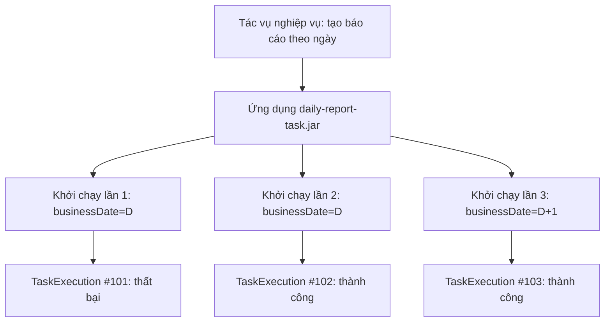
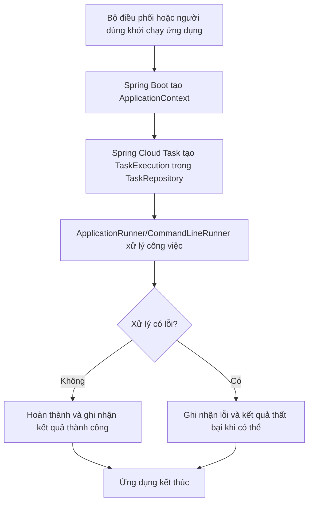

# Tác vụ, ứng dụng và một lần thực thi trong Spring Cloud Task

## 1. Vì sao cần phân biệt ba khái niệm?

Một chương trình Spring Boot thông thường có thể chạy liên tục để nhận HTTP request. Ngược lại, **Spring Cloud Task** được thiết kế cho những chương trình có công việc hữu hạn: được khởi chạy, xử lý một lượng việc xác định rồi kết thúc. Ví dụ: đối soát giao dịch cuối ngày, đồng bộ dữ liệu một lần, tạo báo cáo định kỳ hoặc nhập một tệp dữ liệu.

Để thiết kế và vận hành đúng kiểu chương trình này, cần phân biệt **tác vụ** (*task*), **ứng dụng tác vụ** (*task application*) và **một lần thực thi tác vụ** (*task execution*). Chúng có quan hệ với nhau nhưng không đồng nghĩa.

| Khái niệm | Trả lời câu hỏi | Ví dụ với báo cáo doanh thu |
| --- | --- | --- |
| **Tác vụ** | *Cần làm công việc gì?* | Tổng hợp doanh thu của một ngày kinh doanh. |
| **Ứng dụng tác vụ** | *Chương trình nào thực hiện công việc đó?* | Tệp `revenue-report-task.jar`, gồm mã Java, cấu hình, thư viện và logic tổng hợp. |
| **Một lần thực thi** | *Lần chạy cụ thể nào đã xảy ra và kết quả ra sao?* | Lần chạy lúc 01:00 ngày 24/11 bị lỗi; lần chạy lại lúc 01:15 thành công. |

Trong Spring Cloud Task, một lần chạy được biểu diễn bằng đối tượng **`TaskExecution`** và thông tin của nó được lưu bằng **`TaskRepository`**. Đây là phần quan trọng giúp hệ thống trả lời câu hỏi "tác vụ đã chạy chưa, khi nào chạy, có hoàn tất không?" ngay cả khi tiến trình Java đã kết thúc.

## 2. Tác vụ: đơn vị công việc có điểm kết thúc

**Tác vụ** là khái niệm nghiệp vụ hoặc kỹ thuật mô tả một công việc có điều kiện bắt đầu và kết thúc rõ ràng. Nó có thể là "tạo báo cáo cho ngày D", "đọc tệp F và ghi dữ liệu hợp lệ" hoặc "gửi yêu cầu đồng bộ cho đối tác P".

Một tác vụ thường có:

- **Đầu vào**: ngày xử lý, mã khách hàng, đường dẫn tệp hoặc định danh lô dữ liệu.
- **Các bước xử lý**: đọc dữ liệu, kiểm tra, biến đổi, ghi kết quả, gọi dịch vụ khác.
- **Điều kiện hoàn thành**: công việc đã xử lý hết và kết quả được xác nhận.
- **Quy tắc khi lỗi hoặc chạy lại**: dừng, ghi nhận lỗi, thử lại an toàn hoặc tiếp tục từ điểm kiểm soát.

Ví dụ, tác vụ `generate-daily-report` nhận `businessDate=2026-11-23`. Công việc của nó là lấy dữ liệu của đúng ngày này, tính số liệu và lưu báo cáo. Tên tác vụ mô tả **loại công việc**; tham số xác định **bộ dữ liệu cần xử lý**.

Không phải mỗi bước nhỏ đều cần là một Spring Cloud Task riêng. Một lần chạy có thể thực hiện nhiều bước xử lý liên tiếp. Cách chia tác vụ phụ thuộc vào ranh giới vận hành: khi nào cần khởi chạy riêng, theo dõi riêng, thử lại riêng và xác định thành công hoặc thất bại.

## 3. Ứng dụng tác vụ: mã nguồn và tiến trình thực hiện

**Ứng dụng tác vụ** là ứng dụng Spring Boot được cấu hình để chạy công việc hữu hạn. Nó có thể được đóng gói dưới dạng JAR hoặc container image, triển khai tại máy chủ, Kubernetes hay một nền tảng điều phối khác.

Một ứng dụng Spring Cloud Task thường có các thành phần sau:

| Thành phần | Vai trò |
| --- | --- |
| `@SpringBootApplication` | Khởi tạo ứng dụng Spring Boot và các bean cần thiết. |
| `@EnableTask` | Bật hạ tầng vòng đời Spring Cloud Task. |
| `ApplicationRunner` hoặc `CommandLineRunner` | Chứa điểm vào thực hiện logic sau khi ứng dụng được khởi tạo. |
| `DataSource` và `TaskRepository` | Ghi nhận thông tin từng lần chạy vào cơ sở dữ liệu. |
| Cơ chế khởi chạy bên ngoài | Quyết định *khi nào* chạy JAR/container và truyền tham số. |

Một **bản ứng dụng** có thể được khởi chạy nhiều lần mà không cần xây dựng lại mã nguồn. Mỗi lần khởi chạy bình thường của ứng dụng đã bật Spring Cloud Task tương ứng với một bản ghi `TaskExecution` riêng, có định danh riêng. Khi muốn xử lý nhiều loại công việc khác nhau trong cùng một ứng dụng, có thể chọn nhánh logic bằng tham số; tuy nhiên nên xác định ranh giới tác vụ rõ ràng để việc theo dõi không trở nên mơ hồ.



Sơ đồ trên minh họa ba lần khởi chạy từ **cùng một ứng dụng**. Hai lần đầu dùng cùng tham số nghiệp vụ nhưng vẫn là **hai lần thực thi khác nhau**. Các mã `#101`, `#102`, `#103` chỉ là dữ liệu minh họa.

## 4. Một lần thực thi: dấu vết của một lần chạy cụ thể

**`TaskExecution`** là mô hình ghi nhận vòng đời của **một lần khởi chạy**, không phải mô tả cố định của công việc và cũng không phải bản thân tệp JAR. Mỗi bản ghi thường giúp xác định:

- **`executionId`**: định danh duy nhất của lần thực thi trong kho lưu trữ.
- **`taskName`**: tên được dùng để phân loại tác vụ; nhiều lần chạy có thể có cùng tên.
- **`startTime`, `endTime`**: mốc thời gian bắt đầu và kết thúc được ghi nhận.
- **`exitCode`, `exitMessage`**: kết quả kết thúc và thông tin hỗ trợ chẩn đoán.
- **Đối số khởi chạy**: đầu vào truyền cho lần chạy, nếu được ghi nhận theo cấu hình.

Các trường chính xác và các bảng phụ thuộc vào phiên bản lược đồ Spring Cloud Task đang sử dụng. Với cách cấu hình JDBC phổ biến, bảng `TASK_EXECUTION` giữ thông tin vòng đời, còn bảng như `TASK_EXECUTION_PARAMS` giữ tham số khởi chạy. **`TaskRepository`** đảm nhiệm việc ghi và cập nhật các bản ghi này; **`TaskExplorer`** hỗ trợ truy vấn lịch sử thực thi.

Ví dụ về một lịch sử *giả định*:

| `executionId` | `taskName` | Tham số nghiệp vụ | Bắt đầu | Kết thúc | Kết quả |
| --- | --- | --- | --- | --- | --- |
| `101` | `daily-report-task` | `businessDate=2026-11-23` | 01:00 | 01:02 | Lỗi, mã thoát khác 0 |
| `102` | `daily-report-task` | `businessDate=2026-11-23` | 01:15 | 01:18 | Thành công, mã thoát 0 |
| `103` | `daily-report-task` | `businessDate=2026-11-24` | 01:00 ngày sau | 01:03 ngày sau | Thành công, mã thoát 0 |

Từ bảng này có thể rút ra:

1. `101` và `102` **không phải cùng một lần thực thi**. Lần chạy sau là một nỗ lực mới dù cùng tên và cùng tham số.
2. Một `taskName` có thể gắn với nhiều bản ghi lịch sử.
3. Có một bản ghi `TaskExecution` không có nghĩa dữ liệu nghiệp vụ đã được xử lý đúng. Vẫn phải kiểm tra kết quả thực tế của công việc.

Một tiến trình bị dừng đột ngột, mất kết nối cơ sở dữ liệu hoặc bị buộc kết thúc có thể **không kịp cập nhật** `endTime` và kết quả cuối. Vì vậy, bản ghi chưa có thời gian kết thúc không tự động chứng minh tiến trình vẫn đang chạy. Hệ thống giám sát cần đối chiếu thêm trạng thái container/tiến trình và cơ chế điều phối.

## 5. Vòng đời của một lần chạy

Luồng cơ bản khi khởi chạy ứng dụng Spring Cloud Task là:



Cần hiểu một vài điểm trong sơ đồ:

**Lúc bắt đầu:** Hạ tầng Spring Cloud Task tạo đối tượng thực thi và lưu thông tin khởi đầu thông qua `TaskRepository`. Nếu khởi tạo ứng dụng hoặc kết nối kho lưu trữ thất bại quá sớm, bản ghi có thể chưa được tạo.

**Trong lúc chạy:** `ApplicationRunner` hoặc `CommandLineRunner` làm công việc. Dù có thể ghi log và dữ liệu nghiệp vụ trong quá trình này, Spring Cloud Task không tự suy ra tiến độ hoàn thành từng bản ghi hoặc từng bước của thuật toán.

**Lúc kết thúc:** Hạ tầng cập nhật thông tin kết thúc khi vòng đời ứng dụng diễn ra bình thường. Lỗi không được xử lý trong runner có thể khiến lần chạy thất bại và được ghi nhận nếu hạ tầng còn hoạt động. Mã thoát của tiến trình Java, mã thoát được lưu trong `TaskExecution` và kết quả của bộ điều phối cần được cấu hình/đối chiếu nhất quán, đặc biệt khi ứng dụng tự ánh xạ lỗi thành mã thoát.

**Khi tiến trình đã tắt:** Có thể tra cứu lại lịch sử từ cơ sở dữ liệu, thay vì phải giữ tiến trình Java tồn tại để biết kết quả.

## 6. Ví dụ: một ứng dụng Spring Cloud Task tối thiểu

Giả sử cần tạo báo cáo doanh thu cho một ngày được truyền khi khởi chạy. Ứng dụng nhận tham số `--businessDate`, kiểm tra định dạng và thực hiện công việc. Ví dụ dưới đây trình bày rõ vị trí logic xử lý; phần truy vấn và lưu báo cáo thực tế sẽ được bổ sung trong dịch vụ nghiệp vụ.

```java
import java.time.LocalDate;
import java.util.List;

import org.springframework.boot.ApplicationRunner;
import org.springframework.boot.SpringApplication;
import org.springframework.boot.autoconfigure.SpringBootApplication;
import org.springframework.cloud.task.configuration.EnableTask;
import org.springframework.context.annotation.Bean;

@SpringBootApplication
@EnableTask
public class DailyReportTaskApplication {

    public static void main(String[] args) {
        SpringApplication.run(DailyReportTaskApplication.class, args);
    }

    @Bean
    ApplicationRunner generateReport() {
        return arguments -> {
            List<String> values = arguments.getOptionValues("businessDate");
            if (values == null || values.size() != 1) {
                throw new IllegalArgumentException(
                    "Cần truyền đúng một --businessDate=yyyy-MM-dd"
                );
            }

            LocalDate businessDate = LocalDate.parse(values.get(0));
            System.out.println("Bắt đầu tạo báo cáo cho " + businessDate);

            // TODO: gọi dịch vụ nghiệp vụ để tổng hợp và lưu báo cáo.
            // Nếu xử lý thất bại, ném ngoại lệ để ghi nhận lỗi.

            System.out.println("Đã hoàn thành báo cáo cho " + businessDate);
        };
    }
}
```

Trong dự án thực tế, cần khai báo **Spring Cloud Task starter** (`spring-cloud-starter-task`), driver JDBC thích hợp và các phụ thuộc Spring Boot cần thiết. Phiên bản Spring Cloud phải tương thích với phiên bản Spring Boot; sử dụng BOM quản lý phiên bản được công bố cho cặp phiên bản đó.

Ví dụ cấu hình khi dùng PostgreSQL làm nơi lưu lịch sử thực thi:

```yaml
spring:
  application:
    name: daily-report-task
  main:
    web-application-type: none
  cloud:
    task:
      name: daily-report-task
  datasource:
    url: ${TASK_DB_URL}
    username: ${TASK_DB_USER}
    password: ${TASK_DB_PASSWORD}
```

Ứng dụng được khởi chạy, chẳng hạn:

```bash
java -jar daily-report-task.jar --businessDate=2026-11-23
```

Để ví dụ chạy với PostgreSQL, cần cung cấp các biến môi trường `TASK_DB_URL`, `TASK_DB_USER`, `TASK_DB_PASSWORD`, tài khoản có quyền cần thiết và **lược đồ bảng Spring Cloud Task đúng phiên bản**. Trong môi trường thật, nên quản lý việc tạo/cập nhật lược đồ bằng migration có kiểm soát, thay vì mặc định ứng dụng được quyền tự tạo bảng trên mỗi lần chạy.

Nếu thực thi lại câu lệnh trên, ứng dụng xử lý **cùng ngày kinh doanh** nhưng Spring Cloud Task sẽ ghi nhận **lần chạy mới**. Nó không tự từ chối lần chạy lặp và cũng không tự bảo đảm chỉ một báo cáo được ghi trong bảng nghiệp vụ.

### Phân biệt ba loại dữ liệu

| Dữ liệu | Nơi thường lưu | Mục đích |
| --- | --- | --- |
| Cấu hình ứng dụng và tham số | File cấu hình, biến môi trường, đối số dòng lệnh | Quy định ứng dụng *sẽ làm gì* trong lần khởi chạy. |
| Lịch sử `TaskExecution` | Cơ sở dữ liệu của `TaskRepository` | Cho biết lần chạy *đã diễn ra như thế nào*. |
| Kết quả nghiệp vụ | Bảng báo cáo, tệp xuất, object storage, API đích | Lưu *sản phẩm thực tế* mà tác vụ tạo ra. |

Việc `TaskRepository` ghi nhận thành công không thay thế các kiểm tra dữ liệu nghiệp vụ, transaction, đối soát và các bước xác nhận kết quả.

## 7. Tên tác vụ, tham số và chạy lại

Khi một ứng dụng có thể chạy nhiều lần, **tên tác vụ** và **tham số nghiệp vụ** cần có vai trò riêng:

- `taskName`, ví dụ `daily-report-task`, là nhãn ổn định để tìm các lần thực thi cùng loại.
- `businessDate`, ví dụ `2026-11-23`, chọn phạm vi dữ liệu mà lần thực thi phải xử lý.
- `executionId` xác định **một lần chạy cụ thể** do kho lưu trữ gán; không nên dùng làm khóa nghiệp vụ của báo cáo.

Nếu lịch chạy tự động khởi chạy lại sau lỗi, sẽ có thêm một `TaskExecution`. Do đó, nghiệp vụ cần tự định nghĩa **idempotency** (khả năng chạy lại cùng đầu vào mà không gây kết quả trùng hoặc sai). Ví dụ có thể dùng khóa duy nhất `(report_type, business_date)` và chiến lược `upsert`, hoặc ghi vào vùng tạm rồi thay thế kết quả sau khi kiểm tra thành công.

Ngoài chạy lặp, còn cần cân nhắc **chạy đồng thời**. Hai tiến trình có thể cùng nhận `businessDate=2026-11-23`. Việc lịch sử ghi nhận hai `executionId` không ngăn hai tiến trình tranh chấp dữ liệu. Nếu nghiệp vụ chỉ cho phép một lần xử lý tại một thời điểm, cần sử dụng khóa, ràng buộc duy nhất, cơ chế điều phối hoặc chức năng giới hạn phiên chạy phù hợp, và phải kiểm tra cách chúng hoạt động trong môi trường triển khai.

Không truyền mật khẩu, token hoặc dữ liệu nhạy cảm trong đối số nếu chúng có thể bị ghi vào `TaskExecution`, log hoặc hiển thị qua công cụ quản trị. Sử dụng secret manager hoặc biến môi trường có kiểm soát khi phù hợp.

## 8. Ai quyết định thời điểm chạy?

Spring Cloud Task chủ yếu quản lý **vòng đời và lịch sử của lần thực thi**; việc lên lịch hoặc kích hoạt thường nằm ngoài ứng dụng:

| Cách kích hoạt | Ví dụ | Điều cần chú ý |
| --- | --- | --- |
| Theo yêu cầu | Nhân viên vận hành chạy JAR với tham số cụ thể. | Ghi lại người/yêu cầu kích hoạt ở hệ thống điều phối nếu cần truy vết. |
| Theo lịch | Cron, Kubernetes CronJob hoặc scheduler của nền tảng. | Kiểm soát retry, chạy trùng lịch và giới hạn đồng thời. |
| Theo sự kiện | Một dịch vụ phát hiện tệp mới rồi yêu cầu chạy container tác vụ. | Định danh đầu vào, xác thực sự kiện và xử lý sự kiện gửi lặp. |
| Theo luồng công việc | Bộ điều phối chạy tác vụ B sau khi A thành công. | Phân biệt trạng thái thực thi với kết quả nghiệp vụ cần làm điều kiện. |

Một tiến trình thực thi hữu hạn nên kết thúc sau khi hoàn thành công việc; không nên giữ ứng dụng chạy vô hạn chỉ để đợi đến lịch tiếp theo. Bộ điều phối có thể dùng mã thoát tiến trình để quyết định thử lại, cảnh báo hoặc chạy bước kế tiếp, đồng thời dùng `TaskExplorer`/kho dữ liệu lịch sử để tra cứu chi tiết.

## 9. Quan hệ với Spring Batch

Spring Cloud Task và Spring Batch có thể phối hợp nhưng có **phạm vi theo dõi khác nhau**.

| Spring Cloud Task | Spring Batch |
| --- | --- |
| Theo dõi **một lần chạy của ứng dụng tác vụ** qua `TaskExecution`. | Theo dõi **một lần chạy job xử lý dữ liệu** qua `JobExecution`, các `StepExecution` và trạng thái batch. |
| Phù hợp với nhiều công việc hữu hạn, kể cả tác vụ không chia chunk. | Có cơ chế job/step, chunk, checkpoint, restart và xử lý lượng dữ liệu lớn. |
| Quan tâm ứng dụng khởi chạy, kết thúc và kết quả thực thi. | Quan tâm tiến độ, lỗi và khả năng chạy lại ở mức job/step/item. |

Ví dụ một ứng dụng Spring Cloud Task có thể khởi chạy Spring Batch job nhập 100.000 dòng. **`TaskExecution`** ghi nhận lần chạy ứng dụng chứa job; **`JobExecution`** và **`StepExecution`** ghi nhận tình trạng xử lý của Spring Batch. Khi tích hợp phù hợp, có thể liên kết các định danh để truy vết từ lần chạy ứng dụng sang job batch. Không được nhầm `executionId` của Task với `jobExecutionId` của Batch hoặc mặc định chúng có cùng trạng thái.

## 10. Tình huống vận hành từ đầu đến cuối

Một đội vận hành cần đối soát thanh toán cho ngày `2026-11-23` lúc 02:00:

1. Scheduler khởi chạy image chứa ứng dụng `payment-reconciliation-task`, truyền `--businessDate=2026-11-23`.
2. Spring Cloud Task ghi một `TaskExecution` mới. Ứng dụng đọc giao dịch và đối chiếu số liệu với đối tác.
3. Đối tác trả lỗi tạm thời. Runner báo lỗi; nếu vòng đời và kết nối cơ sở dữ liệu còn hoạt động, lần thực thi được kết thúc với thông tin thất bại.
4. Bộ điều phối dựa vào chính sách retry để khởi chạy lại. Lần chạy lại có `executionId` mới nhưng dùng cùng `businessDate`.
5. Ứng dụng xử lý theo quy tắc idempotency, tránh ghi trùng kết quả đã hoàn thành một phần. Khi kết thúc thành công, kết quả đối soát nằm trong kho dữ liệu nghiệp vụ và lịch sử lần chạy nằm trong `TaskRepository`.

Trong tình huống này, ba câu hỏi khác nhau dẫn đến ba nơi cần xem:

- **"Cần đối soát những gì?"** → Định nghĩa tác vụ và tham số `businessDate`.
- **"Mã nào đang được triển khai?"** → Phiên bản ứng dụng JAR/image và cấu hình runtime.
- **"Lần chạy lúc 02:00 bị gì?"** → `TaskExecution`, log, dấu vết từ bộ điều phối và kết quả nghiệp vụ liên quan.

## 11. Những nhầm lẫn thường gặp

**"Tác vụ chạy thất bại thì lần retry sẽ sửa bản ghi cũ."** Không đúng trong mô hình khởi chạy thông thường. Lần retry là một **lần thực thi mới**; bản ghi cũ vẫn hữu ích để phân tích lịch sử và sự cố.

**"TaskRepository chứa toàn bộ dữ liệu kết quả."** Không đúng. Nó lưu metadata vòng đời; kết quả nghiệp vụ phải có nơi lưu và cách xác nhận riêng.

**"Có `TaskExecution` với `endTime` rỗng tức là còn chạy."** Chưa chắc. Tiến trình có thể đã bị kill hoặc mất kết nối trước khi cập nhật bản ghi.

**"Gắn `@EnableTask` là có lịch chạy tự động."** Không đúng. Lịch chạy, kích hoạt theo sự kiện và chính sách retry cần được cung cấp qua bộ điều phối hoặc thiết kế riêng.

**"Cùng tham số thì chỉ chạy một lần."** Không đúng. Các lần khởi chạy độc lập có thể nhận cùng tham số; bảo đảm không trùng dữ liệu là trách nhiệm của thiết kế nghiệp vụ và điều phối.

## 12. Ghi nhớ và tự kiểm tra

Một cách nhớ nhanh: **task** là *việc cần làm*; **task application** là *chương trình làm việc đó*; **task execution** là *bằng chứng của một lần chương trình được chạy*. Spring Cloud Task hỗ trợ ghi nhận bằng `TaskRepository`, còn lập lịch, dữ liệu đầu ra, an toàn khi chạy lại và giám sát toàn hệ thống cần có thiết kế bổ sung.

Hãy tự trả lời ba câu sau:

1. Cùng một JAR chạy hai lần với cùng `--businessDate`, sẽ có mấy lần thực thi và vì sao?
2. Vì sao không thể chỉ nhìn `exitCode` để kết luận bản báo cáo nghiệp vụ hoàn toàn đúng?
3. Nếu tiến trình bị dừng bằng tín hiệu cưỡng bức, cần dựa vào nguồn thông tin nào ngoài `TaskRepository` để xác định trạng thái thật?

**Đáp án định hướng:** (1) Thông thường có hai `TaskExecution` khác nhau; (2) metadata kết thúc không thay thế kiểm tra chất lượng và tính nhất quán của dữ liệu đầu ra; (3) đối chiếu trạng thái tiến trình/container, log, bộ điều phối và dữ liệu nghiệp vụ.
