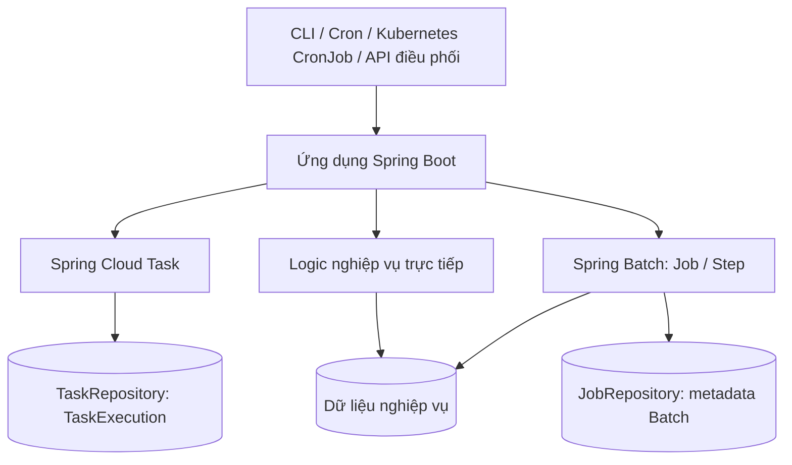
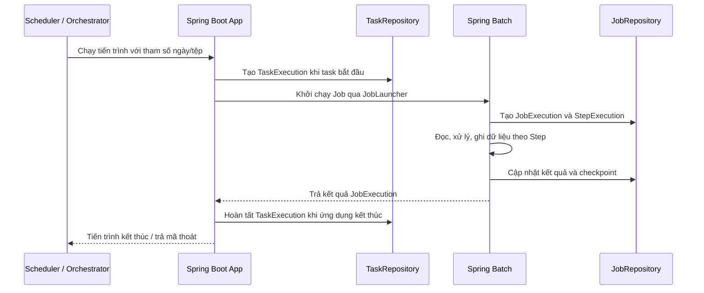
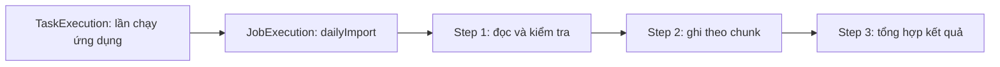

# Quan hệ giữa Spring Boot, Spring Cloud Task và Spring Batch

## Mục tiêu bài học

Khi xây dựng một chương trình chỉ chạy trong một khoảng thời gian hữu hạn, chẳng hạn đồng bộ dữ liệu hằng đêm, xuất báo cáo theo yêu cầu hoặc đối soát giao dịch cuối ngày, ba tên gọi **Spring Boot**, **Spring Cloud Task** và **Spring Batch** thường xuất hiện cùng nhau. Chúng thuộc những tầng trách nhiệm khác nhau và có thể được dùng độc lập hoặc kết hợp.

Sau bài học, bạn có thể:

- Phân biệt vai trò của Spring Boot, Spring Cloud Task và Spring Batch.
- Mô tả vòng đời một lần chạy task và nơi lưu trạng thái/kết quả thực thi.
- Giải thích sự khác nhau giữa `TaskRepository` và `JobRepository`, giữa `TaskExecution` và `JobExecution`.
- Chọn kiến trúc phù hợp cho tác vụ đơn giản, xử lý dữ liệu theo lô hoặc xử lý theo lịch/yêu cầu.
- Nhận biết các điểm cần xử lý khi task thất bại, chạy lại và được triển khai trong môi trường thực tế.

## 1. Ba công nghệ giải quyết ba nhóm vấn đề

### Spring Boot: nền tảng chạy ứng dụng

**Spring Boot** cung cấp cơ chế khởi động ứng dụng Spring, quản lý bean, cấu hình, dependency, kết nối cơ sở dữ liệu và tích hợp với hệ sinh thái Spring. Ứng dụng Boot có thể là một dịch vụ HTTP chạy lâu dài, nhưng cũng có thể là **tiến trình chạy một lần rồi kết thúc**.

Với ứng dụng không phục vụ HTTP, logic có thể chạy qua `ApplicationRunner` hoặc `CommandLineRunner` sau khi Application Context được khởi tạo. Spring Boot tự nó không cung cấp mô hình theo dõi lịch sử các lần chạy task trong `TaskRepository` hay các bước xử lý theo lô trong `JobRepository`.

### Spring Cloud Task: quản lý vòng đời một lần chạy hữu hạn

**Spring Cloud Task** xây dựng trên Spring Boot để quản lý một ứng dụng có điểm bắt đầu và điểm kết thúc rõ ràng. Mỗi lần khởi chạy tạo ra một thực thể **`TaskExecution`**, ghi nhận các thông tin như thời điểm bắt đầu, kết thúc, trạng thái/kết quả và mã thoát theo khả năng cấu hình của phiên bản đang sử dụng. Metadata được lưu thông qua **`TaskRepository`**, thường sử dụng cơ sở dữ liệu quan hệ.

Điểm cần hiểu là **một `TaskExecution` đại diện cho một lần chạy ứng dụng task**, dù bên trong ứng dụng chỉ thực hiện một lời gọi API, xử lý một tệp, hay điều phối nhiều công việc. Spring Cloud Task giúp trả lời “Ứng dụng tác vụ nào đã chạy, khi nào, kết thúc thế nào?”.

Spring Cloud Task **không tự trở thành bộ lập lịch**: việc yêu cầu một tiến trình chạy vào 1 giờ sáng hay khi người dùng nhấn nút vẫn do cron, Kubernetes CronJob, một hệ thống điều phối hoặc dịch vụ khác đảm nhận.

### Spring Batch: tổ chức xử lý dữ liệu theo lô

**Spring Batch** tập trung vào nghiệp vụ cần xử lý một lượng dữ liệu lớn hoặc một quy trình nhiều bước. Một `Job` có thể gồm nhiều `Step`; mỗi `Step` có thể chạy theo kiểu tasklet hoặc xử lý theo chunk với các thành phần `ItemReader`, `ItemProcessor`, `ItemWriter`.

Spring Batch hỗ trợ các khái niệm như tham số job, checkpoint/trạng thái bước, transaction, retry/skip theo chính sách, và restart khi phù hợp. **`JobRepository`** lưu metadata của `JobInstance`, `JobExecution`, `StepExecution` và `ExecutionContext` để biết job nào đã chạy và phần nào có thể tiếp tục.

Spring Batch không yêu cầu Spring Cloud Task để hoạt động. Một job Batch vẫn có thể chạy trong ứng dụng Spring Boot, qua lịch nội bộ hoặc được kích hoạt từ một tiến trình/dịch vụ khác.

| Câu hỏi | Spring Boot | Spring Cloud Task | Spring Batch |
| --- | --- | --- | --- |
| Vai trò chính | Khởi động và cấu hình ứng dụng | Theo dõi vòng đời **một lần chạy ứng dụng** | Tổ chức **job/step xử lý theo lô** |
| Đơn vị thực thi cần quan sát | Application Context/tiến trình | `TaskExecution` | `JobInstance`, `JobExecution`, `StepExecution` |
| Metadata lịch sử chuyên biệt | Không có sẵn cho task | `TaskRepository` | `JobRepository` |
| Cơ chế xử lý theo chunk, retry, skip, restart | Không tích hợp như Batch | Không thay thế Batch | Có, theo cấu hình job/step |
| Cách khởi chạy | CLI, server, container, dịch vụ khác | Khởi chạy ứng dụng Boot có tích hợp Task | `JobLauncher`, cơ chế auto-run hoặc bộ điều phối |
| Có thể dùng độc lập? | Có | Cần ứng dụng Spring Boot | Có thể dùng cùng Spring Boot mà không cần Task |

## 2. Quan hệ kiến trúc: Boot là nền, Task và Batch là hai khả năng bổ sung



Sơ đồ thể hiện **các lựa chọn có thể kết hợp**, không có nghĩa ứng dụng phải sử dụng mọi thành phần. Cả logic trực tiếp lẫn job Spring Batch đều chạy bên trong ứng dụng Boot. Nếu bật Spring Cloud Task, vòng đời của ứng dụng được ghi lại ở cấp task. Nếu có Spring Batch, chi tiết công việc theo từng job/step được quản lý ở cấp Batch.

Ba cách tổ hợp phổ biến:

1. **Spring Boot đơn thuần:** tác vụ rất ngắn, ít yêu cầu truy vết chuyên biệt, có thể chạy qua `ApplicationRunner`.
2. **Spring Boot + Spring Cloud Task:** cần ghi lịch sử từng lần chạy ứng dụng trong database, trong khi xử lý nghiệp vụ tương đối đơn giản.
3. **Spring Boot + Spring Cloud Task + Spring Batch:** cần cả lịch sử lần chạy ứng dụng và cơ chế điều phối, theo dõi, khôi phục công việc xử lý theo lô.

Ngoài ra, **Spring Boot + Spring Batch** cũng là kiến trúc hợp lệ khi chỉ cần metadata job/step, không cần metadata vòng đời task.

## 3. Một lần chạy thực sự diễn ra như thế nào?

Giả sử hệ thống cần nhập dữ liệu giao dịch mỗi đêm. Trình tự điển hình khi dùng cả ba công nghệ:



Đây là vòng đời **logic**. Thứ tự callback, cách ứng dụng đóng context, tính đồng bộ của `JobLauncher` và việc ánh xạ mã thoát thực tế phụ thuộc phiên bản/cấu hình. Ví dụ, nếu `JobLauncher` chạy bất đồng bộ, việc gọi `run()` trả về chưa có nghĩa job đã hoàn tất; task cần có cơ chế chờ/kết hợp trạng thái phù hợp trước khi kết thúc.

Hai câu hỏi vận hành có câu trả lời khác nhau:

- **“Lần chạy ứng dụng 02:00 sáng nay có thành công không?”** Tra cứu `TaskExecution` qua `TaskRepository` và kết hợp mã thoát của tiến trình.
- **“Bước ghi dữ liệu của job nhập giao dịch đã xử lý tới đâu, có thể restart không?”** Tra cứu `JobExecution`, `StepExecution`, `ExecutionContext` qua `JobRepository`.

Khi tích hợp Task và Batch, metadata có thể ghi nhận **mối liên hệ giữa lần chạy task và lần chạy job** để truy vết từ ứng dụng tới công việc bên trong. Đây là quan hệ tham chiếu giữa hai loại thực thi, không phải việc hợp nhất hai repository thành một. Một lần chạy task có thể không khởi chạy job nào hoặc có thể khởi chạy nhiều job; không nên giả định luôn có quan hệ một-một.

## 4. `TaskRepository` khác `JobRepository` ra sao?

### `TaskRepository`: quan sát cấp ứng dụng

Mỗi lần ứng dụng Task khởi chạy được nhận diện bằng `TaskExecution` riêng. Thông tin thường dùng khi vận hành gồm tên task, thời gian bắt đầu/kết thúc, mã thoát và thông tin lỗi/kết quả tùy phiên bản. Nếu một tác vụ được gọi lại nhiều lần trong ngày, mỗi lần chạy có lịch sử riêng để kiểm tra.

`TaskRepository` không nắm checkpoint từng bản ghi dữ liệu và không thể chỉ bằng metadata task mà biết cần tiếp tục từ chunk nào. Nếu task thất bại giữa tệp 1 triệu dòng, người phát triển phải tự thiết kế khả năng chạy lại hoặc sử dụng cơ chế của Spring Batch.

### `JobRepository`: quan sát và phục hồi cấp job/step

Spring Batch phân biệt ba khái niệm dễ nhầm:

- **`JobInstance`:** danh tính logic của job, thông thường được xác định bởi *tên job và các `JobParameters` mang tính định danh*.
- **`JobExecution`:** một lần thử chạy của `JobInstance`; một instance có thể có nhiều execution khi thực hiện restart hợp lệ sau thất bại.
- **`StepExecution`:** một lần thực thi step trong job; lưu số lượng đọc/ghi, trạng thái, lỗi và ngữ cảnh phục vụ kiểm soát hoặc restart.

Ví dụ job `dailyImport` với tham số định danh `businessDate=2026-11-24` tương ứng một công việc logic của ngày đó. Chạy lại cùng tham số sau lỗi có thể tạo một `JobExecution` mới cho cùng `JobInstance`, nếu job được cấu hình restartable và trạng thái cho phép. Nếu instance đã hoàn thành, Spring Batch thường không cho chạy lại cùng instance như một job mới; cần chủ động lựa chọn tham số định danh hoặc chính sách xử lý lại, tránh thêm một giá trị ngẫu nhiên chỉ để né kiểm tra trùng lặp.

**Lưu ý dữ liệu:** hai repository có trách nhiệm và schema metadata khác nhau. Chúng có thể dùng chung một database nếu cấu hình phù hợp, hoặc dùng nguồn dữ liệu riêng tùy thiết kế. Việc cấp quyền, khởi tạo/migrate bảng, tính tương thích schema và giao dịch cần được kiểm soát theo phiên bản Spring Boot/Spring Cloud Task/Spring Batch đang triển khai.

## 5. Ví dụ 1: Spring Boot + Spring Cloud Task cho tác vụ đơn giản

Một yêu cầu xuất báo cáo theo ngày không cần chia chunk hoặc restart từng step. Ứng dụng Boot nhận tham số từ dòng lệnh, gọi service và kết thúc. Khi thêm Spring Cloud Task, hệ thống có thêm lịch sử lần chạy.

Các dependency tiêu biểu (phiên bản được quản lý qua Spring Boot và Spring Cloud BOM tương thích với nhau):

```xml
<dependency>
    <groupId>org.springframework.boot</groupId>
    <artifactId>spring-boot-starter</artifactId>
</dependency>
<dependency>
    <groupId>org.springframework.cloud</groupId>
    <artifactId>spring-cloud-starter-task</artifactId>
</dependency>
<!-- Thêm JDBC driver và dependency truy cập database phù hợp với dự án. -->
```

Ví dụ lớp khởi động, trong đó `ReportService` là bean nghiệp vụ do dự án tự định nghĩa:

```java
import java.time.LocalDate;
import java.util.List;

import org.springframework.boot.ApplicationRunner;
import org.springframework.boot.SpringApplication;
import org.springframework.boot.autoconfigure.SpringBootApplication;
import org.springframework.cloud.task.configuration.EnableTask;
import org.springframework.context.annotation.Bean;

@SpringBootApplication
@EnableTask
public class DailyReportTaskApplication {

    public static void main(String[] args) {
        SpringApplication.run(DailyReportTaskApplication.class, args);
    }

    @Bean
    ApplicationRunner generateReport(ReportService reportService) {
        return args -> {
            List<String> values = args.getOptionValues("report-date");
            if (values == null || values.size() != 1) {
                throw new IllegalArgumentException("Cần đúng một --report-date=yyyy-MM-dd");
            }
            LocalDate date = LocalDate.parse(values.get(0));
            reportService.generateFor(date);
        };
    }
}
```

Với cấu hình không chạy HTTP server:

```yaml
spring:
  main:
    web-application-type: none
  datasource:
    url: jdbc:postgresql://db.example.internal:5432/taskdb
    username: task_app
    password: ${TASK_DB_PASSWORD}
```

Ví dụ lời gọi từ scheduler hoặc CLI:

```bash
java -jar daily-report-task.jar --report-date=2026-11-24
```

Ở ví dụ này, Spring Boot phụ trách tạo Application Context và chạy `ApplicationRunner`; Spring Cloud Task phụ trách metadata của lần chạy. Dịch vụ `ReportService` quyết định nghiệp vụ. Cần chuẩn bị schema `TaskRepository` theo tài liệu đúng phiên bản trước khi chạy production. Ứng dụng phải kết thúc sau khi xử lý; web server hoặc các luồng chạy mãi sẽ khiến tiến trình không còn là task hữu hạn như mong muốn.

Khi có lỗi, đừng chỉ `catch` rồi ghi log và trả về bình thường. Nếu lỗi thực sự làm task thất bại, hãy để nó được biểu diễn trong trạng thái task và mã thoát tiến trình theo cơ chế `ExitCodeGenerator`/`SpringApplication.exit` hoặc chính sách xử lý lỗi thích hợp. **Mã thoát hệ điều hành, trạng thái task và trạng thái job Batch là ba thông tin cần kiểm tra riêng**, không mặc nhiên luôn được đồng bộ theo mong muốn.

## 6. Ví dụ 2: Kết hợp thêm Spring Batch khi nhập dữ liệu lớn

Với tệp hàng triệu giao dịch, một bước đọc/biến đổi/ghi có thể cần transaction theo chunk, thống kê số dòng và khả năng restart từ trạng thái đã lưu. Khi đó, Spring Batch phù hợp cho phần **xử lý bên trong**, còn Spring Cloud Task quản lý **lần chạy ứng dụng chứa job**.

Bổ sung dependency Boot starter cho Batch:

```xml
<dependency>
    <groupId>org.springframework.boot</groupId>
    <artifactId>spring-boot-starter-batch</artifactId>
</dependency>
```

Giả sử dự án đã định nghĩa bean `Job dailyImportJob` gồm các step đọc tệp, kiểm tra dữ liệu và ghi vào database. Một cách chủ động khởi chạy job trong task là gọi `JobLauncher` với tham số nghiệp vụ:

```java
import java.util.List;

import org.springframework.batch.core.BatchStatus;
import org.springframework.batch.core.Job;
import org.springframework.batch.core.JobExecution;
import org.springframework.batch.core.JobParameters;
import org.springframework.batch.core.JobParametersBuilder;
import org.springframework.batch.core.launch.JobLauncher;
import org.springframework.boot.ApplicationRunner;
import org.springframework.context.annotation.Bean;

@Bean
ApplicationRunner runDailyImport(JobLauncher jobLauncher, Job dailyImportJob) {
    return args -> {
        List<String> dates = args.getOptionValues("business-date");
        if (dates == null || dates.size() != 1) {
            throw new IllegalArgumentException("Thiếu --business-date=yyyy-MM-dd");
        }

        JobParameters parameters = new JobParametersBuilder()
                .addString("businessDate", dates.get(0))
                .toJobParameters();

        JobExecution execution = jobLauncher.run(dailyImportJob, parameters);
        if (execution.getStatus() != BatchStatus.COMPLETED) {
            throw new IllegalStateException(
                    "Job dailyImport chưa hoàn tất: " + execution.getStatus());
        }
    };
}
```

Đây là **đoạn cấu hình bean minh họa**, đặt trong lớp `@Configuration` hoặc lớp `@SpringBootApplication` của dự án. Ví dụ giả sử `JobLauncher` **chạy đồng bộ**; với launcher bất đồng bộ, cần đợi hoặc theo dõi kết quả cuối cùng trước khi kết luận. Khi đã tự gọi job bằng runner, cần tránh cơ chế tự động khởi chạy cùng job của Boot (chẳng hạn cấu hình `spring.batch.job.enabled=false` ở các phiên bản hỗ trợ) để không chạy trùng.

Chuỗi xử lý có thể được biểu diễn như sau:



Nếu bước ghi thất bại ở giữa:

1. `JobRepository` lưu trạng thái job/step bị lỗi và ngữ cảnh thích hợp để restart theo cấu hình của step.
2. Lần chạy ứng dụng hiện tại kết thúc với kết quả thất bại nếu ứng dụng truyền lỗi ra ngoài và cập nhật kết quả task đúng cách.
3. Scheduler có thể chạy lại ứng dụng, tạo **`TaskExecution` mới**. Việc job có tiếp tục được từ checkpoint hay không lại phụ thuộc **`JobInstance`/`JobParameters` và chính sách restart** của Spring Batch.

Vì vậy, **chạy lại task** và **restart Batch job** không phải một thao tác duy nhất. Một task chạy lại có thể tạo execution mới cho cùng Batch instance, hoặc khởi tạo một instance Batch khác nếu tham số định danh thay đổi.

## 7. Chọn công nghệ theo tình huống

| Tình huống | Lựa chọn gợi ý | Lý do |
| --- | --- | --- |
| Chương trình nhỏ chạy một lần, không cần lịch sử trong database | Spring Boot | `ApplicationRunner`/`CommandLineRunner` thường đủ. |
| Xuất báo cáo hoặc gọi API một lần và phải lưu lịch sử lần chạy | Spring Boot + Spring Cloud Task | Có `TaskExecution`, thời gian và kết quả ở cấp ứng dụng. |
| Nhập tệp lớn, có nhiều step, chunk và restart theo checkpoint | Spring Boot + Spring Batch | `JobRepository` quản lý chi tiết job/step. |
| Nhập dữ liệu lớn theo lịch, cần đối chiếu trạng thái tiến trình và từng step | Spring Boot + Spring Cloud Task + Spring Batch | Quan sát cả vòng đời task lẫn tiến độ Batch. |
| Cần chạy tự động 2 giờ sáng mỗi ngày | Một trong các tổ hợp trên **cùng scheduler bên ngoài** | Cron/CronJob/điều phối quyết định thời điểm kích hoạt; Task không thay scheduler. |
| Cần endpoint HTTP chạy liên tục và thỉnh thoảng kích hoạt job | Spring Boot service + Spring Batch, cân nhắc tách worker task | HTTP service và tiến trình hữu hạn có vòng đời vận hành khác nhau. |

Không nên thêm Spring Batch chỉ vì ứng dụng được gọi là “task”. Nếu công việc chỉ là một thao tác tương đối nhỏ, Batch có thể tạo ra độ phức tạp không cần thiết. Ngược lại, chỉ có TaskRepository sẽ không đủ để xử lý restart từng step cho một pipeline dữ liệu lớn.

## 8. Các ranh giới quan trọng trong vận hành

### Lịch chạy và kích hoạt theo yêu cầu

Spring Cloud Task ghi nhận **lần chạy**, không tạo lịch cron. Tùy nền tảng, có thể dùng cron, Kubernetes CronJob, hệ thống điều phối hoặc một dịch vụ API để tạo tiến trình task. Trong môi trường container, nên ưu tiên mô hình **một lần kích hoạt tạo một tiến trình/container có thể kết thúc**, và để bộ điều phối đọc mã thoát, giới hạn thời gian, số lần retry và tài nguyên.

### Tham số và tính định danh

Phân biệt **tham số ứng dụng** như `--business-date`, `--input-file` với **`JobParameters`** của Batch. Ứng dụng phải truyền các giá trị cần thiết vào job một cách rõ ràng; không có bảo đảm mọi tham số CLI tự trở thành tham số Batch đúng ý nghĩa định danh. Với công việc có thể retry, nên dùng khóa nghiệp vụ ổn định (ngày đối soát, mã yêu cầu, mã lô), xác định giá trị nào nhận diện `JobInstance`.

### Thất bại, retry và idempotency

Lặp lại một task không tự đảm bảo an toàn dữ liệu. Nếu một lần chạy đã ghi 70% dữ liệu rồi bị ngắt, lần chạy tiếp theo có thể ghi trùng khi nghiệp vụ không có khóa duy nhất, upsert, transaction hoặc cơ chế chống lặp. Với Batch, checkpoint giúp biết vị trí xử lý khi các reader/writer và step được cấu hình phù hợp; vẫn phải thiết kế nghiệp vụ **idempotent** khi có retry hoặc chạy lại từ đầu.

Các cơ chế có phạm vi khác nhau: Spring Batch có thể retry một thao tác trong step; scheduler có thể chạy lại cả container; Spring Cloud Task ghi nhận lần chạy mới. Hãy quy định rõ tác nhân nào được retry, số lần retry và điều kiện cho phép.

### Trạng thái Batch không tự bảo đảm mã thoát task

Một `JobExecution` kết thúc với `FAILED` nhưng code gọi job lại bắt lỗi và trả về bình thường có thể khiến scheduler hiểu sai rằng tiến trình thành công. Khi tích hợp, phải truyền kết quả thất bại tới cấp ứng dụng và tới hệ thống gọi bằng một chính sách rõ ràng, rồi kiểm thử trường hợp job thất bại thật. Với launcher bất đồng bộ, cần tránh kết thúc task trong khi Batch job vẫn đang chạy.

### Repository, schema và giám sát

Trong production, dùng database bền vững và schema có version tương thích cho metadata Task/Batch; quản lý migration, backup, quyền truy cập và dọn lịch sử theo chính sách. Không nên dựa vào database nhúng chỉ tồn tại trong bộ nhớ nếu cần truy vết sau khi container kết thúc. Cần giám sát cả **trạng thái tiến trình** (exit code, thời gian chạy, timeout) lẫn **metadata nghiệp vụ** (`TaskExecution`, `JobExecution`, số bản ghi lỗi và checkpoint).

### Chạy đồng thời và giới hạn tài nguyên

Hai yêu cầu khởi chạy cùng một ngày nghiệp vụ có thể đến gần như đồng thời. Hãy định nghĩa chính sách khóa/khử trùng lặp ở tầng điều phối hoặc nghiệp vụ; với Batch, kiểm tra cơ chế nhận diện `JobInstance` và trạng thái execution đang chạy. Giới hạn bộ nhớ, số kết nối database, kích thước chunk và số worker để tiến trình hữu hạn không làm quá tải hệ thống dùng chung.

## 9. Đọc một tình huống từ đầu đến cuối

Một hệ thống thương mại điện tử cần đối soát đơn hàng ngày `2026-11-24`:

1. **Scheduler** kích hoạt một container vào 02:00 và truyền `--business-date=2026-11-24`.
2. **Spring Boot** khởi tạo dependency, kết nối database và chạy code khởi động tác vụ.
3. **Spring Cloud Task** ghi `TaskExecution` cho lần chạy này, ví dụ dùng để trả lời “container đối soát đã khởi chạy và kết thúc lúc nào?”.
4. **Spring Batch** thực hiện `dailyReconciliationJob`, gồm step nạp đơn hàng, so sánh giao dịch thanh toán và ghi sai lệch; `JobRepository` ghi nhận từng execution và các step.
5. Nếu job lỗi, ứng dụng biểu diễn thất bại ở cấp task và trả mã thoát phù hợp; scheduler quyết định retry theo chính sách.
6. Khi chạy lại cùng ngày với tham số định danh ổn định, Spring Batch quyết định khả năng restart dựa trên trạng thái job/step, còn Spring Cloud Task ghi nhận một lần chạy ứng dụng mới.

Từ tình huống này, người vận hành truy vấn **TaskRepository** để biết *lịch sử từng lượt chạy của ứng dụng*, còn người phân tích lỗi truy vấn **JobRepository** để biết *step nào thất bại và có thể xử lý tiếp từ đâu*.

## 10. Câu hỏi tự kiểm tra

1. Một ứng dụng Boot chạy `ApplicationRunner` rồi thoát có bắt buộc cần Spring Cloud Task không? Nếu không, thêm Task giải quyết nhu cầu gì?
2. Vì sao `TaskExecution` không thay thế được `StepExecution` khi xử lý tệp dữ liệu lớn?
3. Khi scheduler retry toàn bộ container, vì sao thường có `TaskExecution` mới nhưng chưa chắc có `JobInstance` Batch mới?
4. Nếu Batch job thất bại mà tiến trình trả exit code `0`, hệ thống vận hành có thể hiểu sai điều gì?
5. Một công việc cần chạy lúc 02:00 hằng ngày nhưng không cần chunk. Bạn chọn những thành phần nào và ai chịu trách nhiệm lập lịch?

**Ghi nhớ:** Spring Boot cung cấp môi trường chạy; Spring Cloud Task ghi nhận vòng đời ứng dụng hữu hạn qua `TaskRepository`; Spring Batch cung cấp mô hình job/step và cơ chế xử lý theo lô qua `JobRepository`. Chúng bổ sung cho nhau theo yêu cầu, không phải ba tên gọi cho cùng một chức năng.
