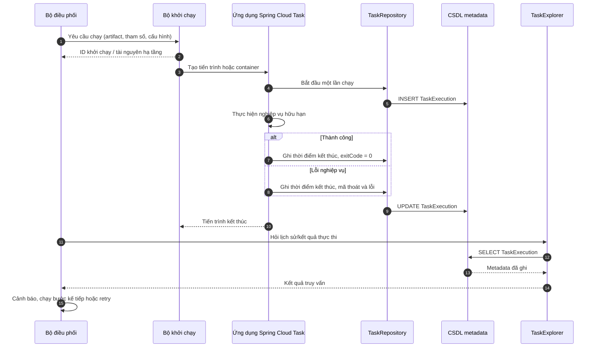

# Vai trò của kho thực thi, bộ khởi chạy và bộ điều phối

Một ứng dụng **Spring Cloud Task** thực hiện công việc có điểm bắt đầu và kết thúc rõ ràng: đối soát giao dịch, nhập dữ liệu, tạo báo cáo, dọn dẹp tài nguyên hoặc chạy một quy trình xử lý theo yêu cầu. Sau khi hoàn thành, tiến trình dừng lại. Trong môi trường thực tế, chỉ viết phần xử lý nghiệp vụ là chưa đủ: hệ thống còn cần biết **lần chạy nào đã diễn ra, ai khởi chạy, kết quả ra sao và khi nào cần chạy tiếp**.

Ba vai trò giải quyết những nhu cầu khác nhau:

- **Kho thực thi (TaskRepository):** ghi nhận vòng đời và kết quả của từng lần chạy vào cơ sở dữ liệu.
- **Bộ khởi chạy (launcher):** tạo một lần thực thi ứng dụng mới trên môi trường chạy, ví dụ một tiến trình Java hoặc một Kubernetes Job.
- **Bộ điều phối (orchestrator):** quyết định *khi nào, với tham số nào, theo thứ tự và chính sách nào* thì các tác vụ được khởi chạy, theo dõi và xử lý tiếp.

Đây là các **vai trò kiến trúc**, không nhất thiết là ba thành phần Java cùng nằm trong một ứng dụng. Spring Cloud Task trực tiếp cung cấp cơ chế ghi nhận vòng đời tác vụ; cơ chế triển khai, khởi chạy từ xa và điều phối thường do nền tảng bên ngoài đảm nhiệm.

## 1. TaskRepository: ghi lại sự thật về một lần chạy

**`TaskRepository`** là thành phần của Spring Cloud Task chịu trách nhiệm lưu thông tin thực thi. Khi ứng dụng được cấu hình với Spring Cloud Task và nguồn dữ liệu phù hợp, cơ chế vòng đời tác vụ tạo một bản ghi `TaskExecution` khi tác vụ bắt đầu và cập nhật bản ghi khi tác vụ kết thúc.

Mỗi **`TaskExecution`** mô tả *một lần chạy*, không phải định nghĩa của tác vụ. Hai lần chạy cùng tên `dailyReconcile` vẫn có hai mã thực thi riêng. Tùy phiên bản và cấu hình, metadata thường bao gồm:

| Thông tin | Ý nghĩa |
| --- | --- |
| Mã thực thi (`executionId`) | Định danh một lần chạy trong kho thực thi. |
| Tên tác vụ (`taskName`) | Nhóm các lần chạy cùng loại công việc. |
| Thời điểm bắt đầu/kết thúc | Phục vụ theo dõi thời lượng, lịch sử và chẩn đoán. |
| Mã thoát (`exitCode`) | Cho biết kết quả kết thúc của tiến trình; quy ước phổ biến: `0` là thành công, giá trị khác `0` là lỗi. |
| Thông báo kết thúc/lỗi | Hỗ trợ tìm nguyên nhân thất bại; không thay thế log chi tiết. |
| Tham số chạy | Giúp truy vết tác vụ được yêu cầu xử lý dữ liệu nào. |

Các bảng lưu metadata của Spring Cloud Task, chẳng hạn `TASK_EXECUTION` và bảng tham số liên quan, cần tồn tại trong cơ sở dữ liệu theo **schema tương thích với phiên bản thư viện đang triển khai**. Trong hệ thống sản xuất, nên quản lý schema bằng quy trình migration và phân quyền truy cập phù hợp.

<svg xmlns="http://www.w3.org/2000/svg" width="640" height="170" viewBox="0 0 640 170" role="img" aria-label="Ba lần chạy cùng tên tác vụ được lưu dưới dạng ba bản ghi TaskExecution độc lập">
  <rect x="6" y="8" width="628" height="154" rx="14" fill="#f7f9fc" stroke="#c6d3e3"/>
  <text x="25" y="35" font-size="17" font-weight="600" fill="#20344f">Một taskName: dailyReconcile</text>
  <g font-size="14" fill="#20344f">
    <rect x="24" y="51" width="187" height="91" rx="9" fill="#e6f4ea" stroke="#8fcba0"/>
    <text x="37" y="77" font-weight="600">TaskExecution #101</text>
    <text x="37" y="100">Kết thúc</text>
    <text x="37" y="122">exitCode = 0</text>
    <rect x="227" y="51" width="187" height="91" rx="9" fill="#fff2da" stroke="#e8b75d"/>
    <text x="240" y="77" font-weight="600">TaskExecution #102</text>
    <text x="240" y="100">Kết thúc có lỗi</text>
    <text x="240" y="122">exitCode = 1</text>
    <rect x="430" y="51" width="187" height="91" rx="9" fill="#e6f4ea" stroke="#8fcba0"/>
    <text x="443" y="77" font-weight="600">TaskExecution #103</text>
    <text x="443" y="100">Chạy lại thành công</text>
    <text x="443" y="122">exitCode = 0</text>
  </g>
</svg>

### Ghi dữ liệu và đọc dữ liệu là hai nhiệm vụ khác nhau

- **`TaskRepository`** chủ yếu cung cấp thao tác quản lý bản ghi thực thi, bao gồm khởi tạo và cập nhật metadata vòng đời.
- **`TaskExplorer`** cung cấp giao diện truy vấn lịch sử và trạng thái những lần thực thi đã được ghi nhận. Dashboard, trang quản trị hoặc logic giám sát có thể dùng nó để tìm lần chạy và xem kết quả.

Không nên dùng các bảng metadata như một hàng đợi công việc. Việc có bản ghi `TaskExecution` **không** tự tạo ra tiến trình mới; việc sửa một hàng trong bảng **không** thay thế thao tác khởi chạy. Đồng thời, `TaskRepository` ghi lại trạng thái thực thi, không bảo đảm nghiệp vụ chỉ xử lý một lần, không thực hiện phân tán tác vụ và không tự tổ chức lịch chạy.

> **Giới hạn cần biết:** Nếu container hoặc máy chủ dừng đột ngột, hay ứng dụng gặp lỗi trước lúc kết nối được cơ sở dữ liệu, bản ghi có thể thiếu hoặc chưa được cập nhật thời điểm kết thúc. Vì thế, cần đối chiếu metadata với trạng thái tiến trình/container, log và hệ thống giám sát.

## 2. Bộ khởi chạy: biến yêu cầu thành một tiến trình thực thi

**Launcher** nhận yêu cầu chạy một ứng dụng và thực hiện hành động cụ thể trên hạ tầng: khởi tạo tiến trình `java -jar`, gửi yêu cầu tạo Kubernetes Job, hoặc dùng API triển khai của nền tảng đám mây. Nó phải chuyển được các đầu vào cần thiết như artifact/image, tham số dòng lệnh, biến môi trường, cấu hình tài nguyên và thông tin kết nối.

Có hai cách hiểu thường gặp cần phân biệt:

1. Ở mức **khái niệm**, launcher là bất kỳ cơ chế nào làm ứng dụng tác vụ thực sự bắt đầu: shell script, pipeline CI, Kubernetes Job controller hoặc một dịch vụ riêng.
2. Trong hệ sinh thái Spring, giao diện **`TaskLauncher` của Spring Cloud Deployer** được các hệ thống như **Spring Cloud Data Flow** sử dụng để yêu cầu nền tảng chạy ứng dụng tác vụ. Nó thuộc lớp triển khai/khởi chạy, **không phải** `TaskRepository` của Spring Cloud Task và cũng không phải `JobLauncher` dùng để chạy Spring Batch Job bên trong ứng dụng.

Một launcher có thể biết **đã gửi yêu cầu tạo tiến trình hay chưa**, mã triển khai/ID bên ngoài và trạng thái hạ tầng; nhưng điều đó chưa đủ để kết luận nghiệp vụ đã thành công. Ví dụ, Kubernetes Job được tạo thành công chỉ có nghĩa là yêu cầu triển khai được chấp nhận. Ứng dụng vẫn có thể khởi động lỗi, mất kết nối cơ sở dữ liệu hoặc thất bại giữa chừng.

Vì vậy cần phân biệt:

| Mã/trạng thái | Do đâu tạo ra? | Trả lời câu hỏi nào? |
| --- | --- | --- |
| ID lần khởi chạy/ID tài nguyên hạ tầng | Launcher hoặc nền tảng chạy | Tiến trình/container nào được tạo, đang ở trạng thái nào? |
| `TaskExecution.executionId` | `TaskRepository` trong ứng dụng | Lần chạy nghiệp vụ nào được ghi nhận và đã kết thúc ra sao? |
| ID yêu cầu nghiệp vụ (nếu có) | Hệ thống gọi/điều phối | Yêu cầu đối soát hoặc kỳ dữ liệu nào đang được xử lý? |

Ba ID có thể khác nhau. Nếu cần truy vết đầu cuối, hãy thiết kế một **correlation ID** được truyền qua tham số hoặc metadata và ghi vào log/giám sát. Không giả định framework tự động đồng nhất mọi ID này.

## 3. Bộ điều phối: quyết định chạy cái gì, khi nào và làm gì tiếp

**Orchestrator** quản lý chính sách vận hành qua nhiều lần chạy. Nhiệm vụ điển hình là:

- Nhận lệnh chạy thủ công, từ API, sự kiện hoặc lịch định kỳ.
- Quyết định thứ tự thực hiện, ví dụ chỉ tổng hợp báo cáo sau khi nạp dữ liệu xong.
- Chọn phiên bản ứng dụng, tham số, thời điểm, hạ tầng chạy và mức song song.
- Theo dõi trạng thái khởi chạy lẫn kết quả `TaskExecution`; áp dụng timeout, cảnh báo hoặc chạy lại theo chính sách.
- Lưu dấu vết yêu cầu, phân quyền khởi chạy và kiểm soát không tạo các lần chạy trùng ngoài ý muốn.

Ví dụ các cấp độ điều phối:

| Nhu cầu | Cách triển khai thường dùng | Phần chịu trách nhiệm |
| --- | --- | --- |
| Chạy một lần do người vận hành yêu cầu | Shell/CLI, pipeline hoặc API tạo Job | Lệnh gọi đóng vai trò khởi chạy; người vận hành quyết định thời điểm. |
| Chạy hằng ngày, các lần độc lập | Kubernetes CronJob hoặc scheduler tạo tiến trình | Lịch và tạo tiến trình do nền tảng đảm nhiệm; ứng dụng ghi `TaskExecution`. |
| Chuỗi tác vụ có phụ thuộc, quản lý nhiều ứng dụng | Spring Cloud Data Flow hoặc workflow orchestrator khác | Điều phối chuỗi chạy và gọi launcher trên hạ tầng đích. |
| Xử lý nhiều bước *trong cùng một ứng dụng* | Spring Batch với `Job`/`Step` | Spring Batch điều phối các bước xử lý nội bộ; Spring Cloud Task ghi vòng đời ứng dụng bao ngoài. |

Chỉ đặt `@Scheduled` trong một dịch vụ web chạy liên tục **không tự biến mỗi lần kích hoạt thành một Spring Cloud Task**. Nếu cần bản ghi thực thi riêng và tiến trình kết thúc sau xử lý, bộ lập lịch nên khởi chạy một ứng dụng tác vụ hữu hạn hoặc phải chủ động thiết kế cơ chế ghi nhận tương ứng.

## 4. Luồng phối hợp từ lúc yêu cầu đến khi có kết quả

Sơ đồ dưới mô tả trường hợp bộ điều phối gọi launcher để tạo ứng dụng tác vụ mới. Kho metadata nằm trong cơ sở dữ liệu riêng hoặc chung, tùy cách triển khai:



Các hệ thống thực có thể đảo thứ tự một vài sự kiện hoặc lấy trạng thái qua API nền tảng thay cho truy vấn trực tiếp. Sơ đồ nhấn mạnh **hai lớp quan sát**: launcher/nền tảng biết tiến trình đang sống hay không; kho Spring Cloud Task biết metadata ứng dụng đã kịp ghi nhận.

### Ví dụ: đối soát doanh thu cuối ngày

Giả sử một hệ thống cần chạy tác vụ `reconcileDailyRevenue` cho ngày `2026-11-24`:

1. Lúc 01:00, orchestrator tạo yêu cầu với `businessDate=2026-11-24` và mã yêu cầu riêng, ví dụ `reconcile-20261124`.
2. Launcher tạo Kubernetes Job với image của ứng dụng và chuyển các tham số cần thiết.
3. Ứng dụng khởi động, Spring Cloud Task tạo bản ghi `TaskExecution`; phần nghiệp vụ đọc ngày cần đối soát và cập nhật dữ liệu.
4. Khi xử lý xong, ứng dụng đóng tiến trình và ghi kết quả vào metadata. Orchestrator có thể đối chiếu trạng thái Job với lịch sử `TaskExecution`, sau đó kích hoạt bước phát hành báo cáo hoặc gửi cảnh báo.
5. Nếu lần chạy thất bại và được khởi chạy lại, **một `TaskExecution` mới** xuất hiện. Nghiệp vụ cần chống xử lý trùng cùng `businessDate`, thay vì dựa vào việc TaskRepository đã lưu bản ghi lần trước.

Thông tin `businessDate` là đầu vào nghiệp vụ; nó không mặc nhiên là khóa duy nhất của `TaskExecution`. Có thể dùng khóa nghiệp vụ, kiểm soát đồng thời, upsert/transaction hoặc cơ chế idempotency phù hợp để tránh ghi nhận doanh thu hai lần.

Một lệnh khởi chạy thủ công minh họa:

```bash
java -jar revenue-reconciliation-task.jar \
  --spring.cloud.task.name=reconcileDailyRevenue \
  --businessDate=2026-11-24 \
  --requestId=reconcile-20261124
```

Đây chỉ là **cách truyền tham số khi chạy ứng dụng**. Việc cấp cơ sở dữ liệu, tạo bảng metadata, cài thư viện Spring Cloud Task và xử lý các tham số vẫn phải được cấu hình trong ứng dụng. Khi chạy trên container, cần bảo đảm tiến trình thực sự thoát sau khi hoàn thành và trả về mã thoát đúng cho nền tảng.

## 5. Phân định trách nhiệm khi có lỗi

| Tình huống | Cần kiểm tra ở đâu? | Hướng xử lý |
| --- | --- | --- |
| Launcher không tạo được Job/container | Trạng thái launcher, API nền tảng, quyền và quota | Sửa cấu hình/quyền/tài nguyên; chưa thể kết luận có `TaskExecution`. |
| Container tạo được nhưng ứng dụng không kết nối được CSDL metadata | Log khởi động, kết nối và schema `TaskRepository` | Khôi phục CSDL/cấu hình; metadata có thể chưa được tạo. |
| Tác vụ đang xử lý thì bị kill/OOM | Trạng thái tiến trình, sự kiện Kubernetes, log và bản ghi task | Xử lý nguyên nhân hạ tầng, phát hiện bản ghi thiếu thời gian kết thúc. |
| Nghiệp vụ ném ngoại lệ | Log nghiệp vụ, mã thoát, `TaskExecution` | Ghi lỗi đủ ngữ cảnh; để lỗi phản ánh đúng mã thoát và chính sách retry. |
| Orchestrator hết thời gian chờ nhưng task vẫn chạy | Trạng thái nền tảng và `TaskExecution` | Xác định task còn sống trước khi chạy lại để tránh hai lần đồng thời. |
| Retry tạo kết quả trùng | Dữ liệu nghiệp vụ và khóa yêu cầu | Bổ sung idempotency và kiểm soát song song; metadata không ngăn ghi trùng. |

Không nên suy ra rằng “launcher báo thành công” có nghĩa là “nghiệp vụ hoàn tất thành công”. Ngược lại, nếu ứng dụng xử lý xong nhưng chưa cập nhật được metadata thì các nguồn quan sát có thể không nhất quán; hệ thống điều phối phải có chính sách hòa giải trạng thái.

## 6. Những nguyên tắc thiết kế để vận hành an toàn

**Ranh giới trách nhiệm rõ ràng.** Code nghiệp vụ tập trung xử lý một đơn vị công việc hữu hạn; `TaskRepository` quản lý lịch sử thực thi; launcher quản lý tài nguyên khởi chạy; orchestrator quản lý lịch, phụ thuộc và chính sách chạy tiếp. Không đưa toàn bộ logic lập lịch vào ứng dụng tác vụ nếu hạ tầng đã có scheduler.

**Đầu vào có thể truy vết.** Ghi tên tác vụ, mã yêu cầu, kỳ dữ liệu và phiên bản triển khai vào log hoặc metadata thích hợp. Tránh ghi mật khẩu, token hoặc dữ liệu nhạy cảm vào tham số dòng lệnh hay bảng metadata.

**Kết thúc minh bạch.** Ứng dụng phải thực sự dừng khi công việc xong; lỗi cần tạo kết quả không thành công thay vì bị bắt và bỏ qua. Orchestrator nên kiểm tra cả mã thoát của tiến trình lẫn metadata tác vụ khi khả dụng.

**Retry có kiểm soát.** Một lần retry là một lần chạy mới; không coi đó là việc “tiếp tục” bản ghi `TaskExecution` cũ. Chỉ retry theo chính sách rõ ràng, có giới hạn, backoff và biện pháp tránh trùng dữ liệu.

**Cơ sở dữ liệu metadata đáng tin cậy.** Chuẩn bị schema đúng phiên bản, cấu hình connection pool phù hợp với số task chạy đồng thời, quyền tối thiểu và quy trình backup/migration. Không thay đổi thủ công các bản ghi đang hoạt động.

**Giám sát từ nhiều nguồn.** Theo dõi số lần thành công/thất bại, thời lượng, task chạy quá lâu, trạng thái tài nguyên và log. Đối chiếu `TaskExecution` với thông tin hạ tầng khi có bản ghi bị bỏ dở.

## 7. Liên hệ với Spring Batch

Spring Cloud Task và Spring Batch có thể bổ sung cho nhau:

- **Spring Cloud Task** mô tả vòng đời **ứng dụng chạy hữu hạn**, từ khi tiến trình bắt đầu đến khi kết thúc.
- **Spring Batch** mô tả vòng đời **Job/Step xử lý theo lô** trong ứng dụng, có `JobRepository` riêng để lưu trạng thái job, step và checkpoint.
- Một ứng dụng Spring Cloud Task có thể khởi chạy một Spring Batch Job; khi đó, thông tin `TaskExecution` và `JobExecution` thuộc **hai mô hình thực thi khác nhau**. Spring Cloud Task có cơ chế liên kết metadata task và batch trong các cấu hình tích hợp phù hợp, nhưng không nên giả định hai execution ID bằng nhau.
- **Spring Batch `JobLauncher`** khởi chạy batch job trong bối cảnh Spring Batch; **Spring Cloud Deployer `TaskLauncher`** khởi chạy *ứng dụng* trên hạ tầng. Chọn sai lớp khởi chạy sẽ dẫn đến nhầm lẫn khi triển khai và xử lý lỗi.

Khi xây hệ thống theo lịch, theo yêu cầu hoặc nhiều bước xử lý, hãy xác định trước: **ai ra quyết định chạy, ai tạo tiến trình, ai ghi lại kết quả và ai quyết định hành động tiếp theo**. Bốn câu trả lời này sẽ giúp đặt đúng trách nhiệm cho orchestrator, launcher, `TaskRepository`/`TaskExplorer` và phần nghiệp vụ của ứng dụng Spring Cloud Task.
