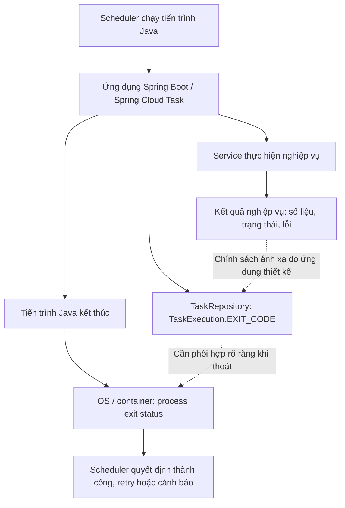
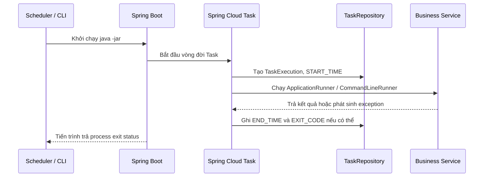
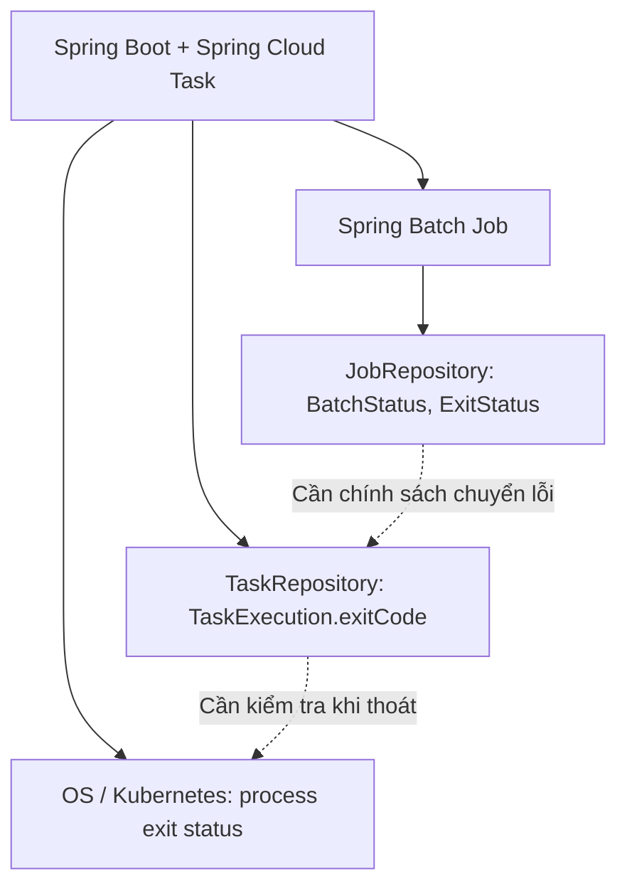

# Phân biệt kết quả nghiệp vụ, mã thoát Task và mã thoát tiến trình

## 1. Vấn đề: ba kết quả có thể không giống nhau

Trong chương **Kết quả và mã thoát** của **Spring Cloud Task**, chúng ta cần phân biệt ba lớp thông tin khi một ứng dụng **Spring Boot có thời gian chạy hữu hạn** hoàn tất: **kết quả nghiệp vụ**, **mã thoát được ghi trong `TaskExecution`** và **mã thoát của tiến trình Java do hệ điều hành nhìn thấy**. Sự phân biệt này rất quan trọng khi tác vụ được chạy theo lịch, được kích hoạt theo yêu cầu, kết hợp với **Spring Batch**, hoặc được một scheduler tự động chạy lại sau lỗi.

Giả sử ứng dụng đồng bộ 1.000 đơn hàng. Chương trình đã ghi thành công 950 đơn nhưng 50 đơn bị từ chối, sau đó in `Finished` và kết thúc. Hệ thống có thể quan sát ba thông tin khác nhau:

- **Kết quả nghiệp vụ:** 950 thành công, 50 bị từ chối; trạng thái tùy chính sách có thể là *thành công một phần* hoặc *thất bại*.
- **Mã thoát Task:** một số nguyên trong `TaskExecution.exitCode`, thường được lưu ở cột `TASK_EXECUTION.EXIT_CODE` của **TaskRepository**.
- **Mã thoát tiến trình:** mã trạng thái hệ điều hành nhận từ tiến trình Java; shell, Kubernetes Job hoặc scheduler có thể dùng nó để xác định thành công và quyết định retry.

Nếu code chỉ ghi log về 50 đơn lỗi rồi trả về bình thường, `EXIT_CODE` có thể là `0` và tiến trình cũng có thể trả `0`. Điều này **không chứng minh** đã hoàn thành đủ 1.000 đơn. Ngược lại, dữ liệu nghiệp vụ có thể đã ghi thành công nhưng tiến trình bị kill trước khi cập nhật TaskRepository, khiến scheduler báo lỗi mà metadata Task chưa phản ánh kết quả cuối cùng.

Sau bài học, bạn có thể:

1. Diễn giải riêng rẽ ba lớp kết quả và nhận diện những trường hợp lệch nhau.
2. Hiểu cách Spring Cloud Task ghi `EXIT_CODE`, `EXIT_MESSAGE` và `ERROR_MESSAGE` vào `TaskRepository`.
3. Ánh xạ lỗi thành mã thoát với `ExitCodeExceptionMapper` và hiểu giới hạn của `ExitCodeGenerator` / `SpringApplication.exit()`.
4. Thiết kế chính sách mã thoát phù hợp cho scheduler, container và tác vụ có retry.
5. Truy vấn metadata Task, kiểm tra mã thoát tiến trình và đối chiếu `BatchStatus` / `ExitStatus` khi dùng Spring Batch.

## 2. Ba lớp kết quả và chủ sở hữu của chúng

| Lớp kết quả | Ai quyết định? | Thông tin điển hình | Mục đích |
| --- | --- | --- | --- |
| **Kết quả nghiệp vụ** | Service nghiệp vụ và quy tắc sản phẩm | `SUCCESS`, `PARTIAL`, `FAILED`, `NO_WORK`; số dòng thành công/thất bại, mã yêu cầu | Biết yêu cầu đã xử lý đúng và đủ chưa |
| **Mã thoát Task** | Cơ chế vòng đời Spring Cloud Task kết hợp xử lý lỗi/mapping Spring Boot | `TaskExecution.exitCode` / `TASK_EXECUTION.EXIT_CODE`; `EXIT_MESSAGE`, `ERROR_MESSAGE` | Theo dõi lịch sử **một lần chạy ứng dụng** trong database |
| **Mã thoát tiến trình** | JVM/ứng dụng và hệ điều hành/container runtime | OS exit status mà `java -jar`, shell, Kubernetes Pod hoặc scheduler báo | Tín hiệu hạ tầng để đánh dấu hoàn thành/thất bại, giám sát và retry |

Ba lớp có quan hệ nhưng **không tự động đồng nhất**:



**Kết quả nghiệp vụ** có thể là object nhiều trường hoặc bản ghi domain database, trong khi hai mã thoát chủ yếu là **số nguyên**. Vì vậy không thể chuyển mọi chi tiết nghiệp vụ thành một số duy nhất mà không làm mất thông tin. Hãy lưu chi tiết nghiệp vụ ở hệ thống phù hợp, dùng mã thoát để truyền tín hiệu tổng quát có quy ước rõ ràng.

### Một quy ước thường dùng

Nhiều scheduler coi **exit status 0** là thành công và **khác 0** là thất bại. Tuy nhiên, ý nghĩa chi tiết của các mã khác 0 do ứng dụng và hệ thống điều phối quy định. Một quy ước nội bộ có thể là:

| Mã minh họa | Ý nghĩa do nhóm tự quy định | Scheduler nên làm gì? |
| --- | --- | --- |
| `0` | Yêu cầu đạt tiêu chí hoàn tất, kể cả trường hợp `NO_WORK` hợp lệ | Đánh dấu thành công |
| `2` | Input không hợp lệ hoặc thiếu tham số bắt buộc | Không retry nguyên trạng; cần sửa input |
| `10` | Lỗi tạm thời như timeout tới dịch vụ ngoài | Retry có giới hạn và backoff |
| `20` | Kết quả nghiệp vụ không chấp nhận được, cần xử lý thủ công | Cảnh báo/điều tra, tránh retry mù quáng |
| `30` | Thành công một phần nhưng hợp đồng yêu cầu xử lý đầy đủ | Ghi nhận phần đã xong và áp dụng chính sách bù/khôi phục |

Đây là **quy ước ví dụ**, không phải các mã chuẩn do Spring Cloud Task cấp. Một hệ thống có thể dùng mã khác. Khi chạy trên Unix/Linux, nhiều shell chỉ giữ phần thấp của mã thoát tiến trình (thường phạm vi 0–255); tránh tùy tiện thiết kế mã quá lớn. Không dựa vào việc mã khác 0 để suy ra lỗi có thể retry.

## 3. Khi nào Spring Cloud Task ghi `EXIT_CODE`?

Spring Cloud Task tạo metadata cho một lượt chạy trong `TaskRepository` khi ứng dụng Spring Boot đã khởi tạo context tới pha vòng đời phù hợp, trước khi các `ApplicationRunner` / `CommandLineRunner` thực hiện logic. Khi các runner hoàn tất hoặc framework quan sát được một lỗi khởi động/thực thi theo cơ chế sự kiện, nó cập nhật metadata của lần chạy.

Trong schema JDBC thông dụng:

- `TASK_EXECUTION_ID` là ID của **một lượt chạy Task**, không phải ID nghiệp vụ.
- `START_TIME` là mốc framework bắt đầu theo dõi Task.
- `END_TIME` được cập nhật khi framework ghi nhận kết thúc thành công hoặc thất bại.
- `EXIT_CODE` thường còn **`NULL` khi đang chạy** và được điền khi có kết quả cuối; trong hành vi mặc định được tài liệu hóa, thành công là `0`, lỗi `ApplicationFailedEvent` không có mapping khác là `1`.
- `EXIT_MESSAGE` là thông điệp mô tả kết thúc có thể được đặt qua `TaskExecutionListener`.
- `ERROR_MESSAGE` có thể chứa thông tin lỗi/stack trace nếu có exception được framework ghi nhận.

Lỗi xảy ra **trước khi TaskExecution được tạo**, mất kết nối repository hoặc JVM bị kill đột ngột có thể khiến metadata **không tồn tại hoặc chưa được cập nhật hoàn chỉnh**. Vì thế, `END_TIME IS NULL` không khẳng định tiến trình còn chạy và `EXIT_CODE IS NULL` không nên tự diễn giải thành thất bại.



Mỗi tầng có **thời điểm ghi và phạm vi giao dịch riêng**. Một thao tác nghiệp vụ đã commit không nhất thiết rollback chỉ vì cập nhật TaskRepository ở bước sau bị lỗi.

### `EXIT_CODE` là trạng thái kỹ thuật ở cấp lần chạy

Không nên dùng mã thoát Task như một bảng kết quả nghiệp vụ đầy đủ. Chẳng hạn, `EXIT_CODE=0` chứng minh rằng **theo cơ chế xử lý lỗi và mapping hiện tại**, framework ghi nhận một lượt chạy thành công. Nó không chứng minh rằng:

- số lượng bản ghi xử lý bằng tổng số bản ghi yêu cầu;
- bên ngoài đã nhận thành công mọi request bất đồng bộ;
- không có bản ghi bị bỏ qua theo chính sách nghiệp vụ;
- dữ liệu không bị ghi trùng khi retry;
- container và scheduler cũng kết thúc thành công.

Để kết luận nghiệp vụ thành công, cần kết hợp thêm outcome do domain service định nghĩa và bằng chứng lưu trữ tương ứng.

## 4. Những tình huống lệch nhau trong thực tế

| Tình huống | Kết quả nghiệp vụ | `TaskExecution.EXIT_CODE` | Process exit status | Nguyên nhân/điểm cần xem |
| --- | --- | --- | --- | --- |
| Tất cả bản ghi xử lý xong, ứng dụng kết thúc bình thường | Thành công | Thường `0` | Thường `0` | Luồng chuẩn nếu cả repository và quá trình thoát hoạt động |
| Một số bản ghi thất bại nhưng code chỉ ghi log | Thành công một phần/thất bại | Có thể `0` | Có thể `0` | Exception bị nuốt; thiếu ánh xạ kết quả nghiệp vụ |
| Runner ném exception không xử lý | Thất bại | Thường khác `0` nếu được ghi lại | Thường khác `0` nếu Boot/launcher truyền lỗi | Phụ thuộc xử lý lỗi và lúc exception xảy ra |
| Nghiệp vụ hoàn tất, mất DB metadata trước khi cập nhật kết thúc | Có thể đã thành công | Có thể `NULL` hoặc không đầy đủ | Có thể khác `0` | Metadata lỗi không chứng minh dữ liệu nghiệp vụ chưa ghi |
| JVM bị kill / OOM trước khi hoàn tất | Chưa xác định hoặc hoàn thành một phần | Có thể `NULL` | Thường khác `0` theo runtime | Callback và ghi kết thúc có thể không chạy |
| Batch job `FAILED` nhưng runner không truyền lỗi ra cấp Task | Thất bại Batch | Có thể `0` | Có thể `0` | Cần chính sách ánh xạ Batch → Task → OS |
| Mã Task được ghi khác `0` nhưng lớp launcher/wrapper trả `0` | Task báo lỗi | Khác `0` | `0` | Quy trình thoát tiến trình đã che dấu hoặc bỏ qua mã lỗi |
| Task ghi `0` nhưng lệnh shell/step tiếp theo của wrapper thất bại | Task được ghi thành công | `0` | Wrapper/scheduler có thể báo lỗi | Mã của script bao ngoài không nhất thiết là mã Java |

Các giá trị `có thể` và `thường` trong bảng là có chủ đích: cơ chế đóng ứng dụng, phiên bản Boot/Cloud Task, event và môi trường điều phối quyết định kết quả thực tế. Khi điều tra sự cố, cần lấy **cả ba nguồn** thay vì tự suy diễn chỉ từ một cột.

## 5. Thiết kế kết quả nghiệp vụ trước khi chọn mã thoát

Hãy định nghĩa **điều kiện thành công** cho mỗi task thay vì mặc định không có exception là thành công.

Ví dụ công việc gửi báo cáo có thể cho phép 3 người nhận thiếu email hợp lệ mà vẫn coi là `SUCCESS_WITH_WARNINGS`; công việc chuyển tiền có thể yêu cầu **100% giao dịch thành công** hoặc bị đánh dấu thất bại. Hai nghiệp vụ cùng có 3 lỗi dữ liệu nhưng không thể dùng cùng một quyết định.

Một cách thiết kế là trả từ service một đối tượng kết quả có cấu trúc:

```java
public record BusinessResult(
        int requested,
        int succeeded,
        int rejected,
        boolean retryable,
        String summary) {

    public boolean fullyCompleted() {
        return succeeded == requested && rejected == 0;
    }
}
```

Sau đó, tầng điều phối nghiệp vụ quyết định:

1. **Hoàn tất:** ghi kết quả và để runner trả về bình thường.
2. **Không có việc hợp lệ:** ghi outcome `NO_WORK`; chỉ coi thành công khi chính sách cho phép.
3. **Thành công một phần được chấp nhận:** lưu số liệu chi tiết; có thể cho phép Task kết thúc với `0` nhưng phải báo cáo rõ warning.
4. **Thành công một phần không được chấp nhận:** lưu phần đã hoàn tất, phát tín hiệu lỗi có mã riêng để scheduler/người vận hành xử lý.
5. **Lỗi có thể retry:** thông báo loại lỗi cho hệ thống điều phối; bảo đảm lần chạy sau không tạo tác dụng phụ trùng.
6. **Input không hợp lệ:** báo mã lỗi không nên retry nguyên trạng.

Một trường `EXIT_CODE` không thể chứa đủ tất cả `requested`, `succeeded` và `rejected`. Nếu dữ liệu cần tra cứu dài hạn, hãy lưu kết quả nghiệp vụ trong bảng audit/domain riêng với `requestId` và khóa liên kết `TASK_EXECUTION_ID` khi phù hợp. `EXIT_MESSAGE` chỉ nên là **tóm tắt ngắn, không chứa bí mật**, không phải kho dữ liệu kết quả.

## 6. Ví dụ: ánh xạ lỗi nghiệp vụ sang mã thoát Task

Giả sử ứng dụng xử lý theo bốn tình huống có thể mô phỏng bằng `--scenario=success|partial|transient|invalid`. Ví dụ dưới đây đặt mã cụ thể cho exception bằng `ExitCodeExceptionMapper`; trong hệ thống thật, service xử lý và lưu kết quả nghiệp vụ sẽ thay thế phần mô phỏng.

Các dependency cần có gồm `spring-boot-starter`, `spring-cloud-starter-task` và JDBC driver cho `TaskRepository` bền vững; phải dùng các phiên bản Spring Boot/Spring Cloud tương thích. Đặt application ở chế độ không-web:

```yaml
spring:
  application:
    name: results-demo
  main:
    web-application-type: none
  datasource:
    url: jdbc:postgresql://localhost:5432/task_demo
    username: task_user
  cloud:
    task:
      name: results-demo
```

Ví dụ cấu hình trên giả định database và schema metadata đã được chuẩn bị và mật khẩu được cung cấp qua nguồn cấu hình an toàn như biến môi trường `SPRING_DATASOURCE_PASSWORD`. DDL và việc tự khởi tạo bảng phải được kiểm tra theo bản Spring Cloud Task đang dùng.

### 6.1. Lớp khởi động và kịch bản nghiệp vụ

```java
package com.example.results;

import java.util.List;

import org.slf4j.Logger;
import org.slf4j.LoggerFactory;
import org.springframework.boot.ApplicationRunner;
import org.springframework.boot.ExitCodeExceptionMapper;
import org.springframework.boot.SpringApplication;
import org.springframework.boot.autoconfigure.SpringBootApplication;
import org.springframework.cloud.task.configuration.EnableTask;
import org.springframework.context.annotation.Bean;

@SpringBootApplication
@EnableTask
public class ResultsTaskApplication {
    private static final Logger log =
            LoggerFactory.getLogger(ResultsTaskApplication.class);

    public static void main(String[] args) {
        SpringApplication.run(ResultsTaskApplication.class, args);
    }

    @Bean
    ApplicationRunner runBusinessTask() {
        return args -> {
            List<String> values = args.getOptionValues("scenario");
            if (values == null || values.size() != 1) {
                throw new ValidationFailure(
                        "Cần đúng một --scenario=success|partial|transient|invalid");
            }

            String scenario = values.get(0);
            switch (scenario) {
                case "success" -> {
                    BusinessResult result =
                            new BusinessResult(100, 100, 0);
                    log.info("BusinessResult={}", result);
                }
                case "partial" -> {
                    BusinessResult result =
                            new BusinessResult(100, 95, 5);
                    log.warn("BusinessResult={}", result);
                    // Giả sử nghiệp vụ yêu cầu đủ 100/100.
                    throw new PartialBusinessFailure(
                            "Có 5 bản ghi bị từ chối");
                }
                case "transient" -> throw new RetryableFailure(
                        "Dịch vụ đích tạm thời không phản hồi");
                case "invalid" -> throw new ValidationFailure(
                        "Tham số hoặc dữ liệu đầu vào không hợp lệ");
                default -> throw new ValidationFailure(
                        "Tình huống không hỗ trợ: " + scenario);
            }
        };
    }

    @Bean
    ExitCodeExceptionMapper exitCodeExceptionMapper() {
        return exception -> {
            // Framework có thể bọc exception: dò chuỗi cause.
            for (Throwable cause = exception; cause != null;
                    cause = cause.getCause()) {
                if (cause instanceof ValidationFailure) {
                    return 2;
                }
                if (cause instanceof RetryableFailure) {
                    return 10;
                }
                if (cause instanceof PartialBusinessFailure) {
                    return 30;
                }
            }
            return 1; // Lỗi không phân loại.
        };
    }

    record BusinessResult(int requested, int succeeded, int rejected) {}

    static class ValidationFailure extends RuntimeException {
        ValidationFailure(String message) {
            super(message);
        }
    }

    static class RetryableFailure extends RuntimeException {
        RetryableFailure(String message) {
            super(message);
        }
    }

    static class PartialBusinessFailure extends RuntimeException {
        PartialBusinessFailure(String message) {
            super(message);
        }
    }
}
```

Đây là **ví dụ một file Java** dùng cú pháp Java hiện đại (switch expression style/record phù hợp với Java 17 trở lên). Bean `ExitCodeExceptionMapper` dùng API của Spring Boot để ánh xạ exception **không được xử lý** thành mã thoát. Spring Cloud Task có thể ghi lại mã đó vào `TaskExecution` khi nhận được sự kiện lỗi và repository cập nhật thành công.

Điều quan trọng là code `partial` **đã tạo một kết quả nghiệp vụ có 95 thành công**, sau đó chủ động xem nó là *lỗi* vì hợp đồng yêu cầu 100/100. Trong production, ghi `BusinessResult` vào nơi lưu bền vững trước khi ném lỗi nếu cần tra cứu; không dựa hoàn toàn vào log hoặc message của exception.

### 6.2. Chạy từng kịch bản

```bash
java -jar results-demo.jar --scenario=success
java -jar results-demo.jar --scenario=partial
java -jar results-demo.jar --scenario=transient
java -jar results-demo.jar --scenario=invalid
```

Trong cấu hình phù hợp, kết quả Task dự kiến theo chính sách ví dụ là `0`, `30`, `10` và `2` tương ứng. **Phải kiểm tra thực tế** ở database và process exit status; không coi việc khai báo mapper là đủ để bảo đảm hai giá trị luôn bằng nhau trong mọi luồng lỗi hoặc mọi cách chạy.

Nếu bạn bắt các exception đó trong runner rồi chỉ ghi `log.error(...)` và return, `ExitCodeExceptionMapper` sẽ **không được gọi cho exception đã bị nuốt**; task có thể ghi `0` dù nghiệp vụ vừa thất bại.

### 6.3. Đặt exit message có chủ đích

`ExitCodeExceptionMapper` quyết định **số nguyên**; `TaskExecutionListener` có thể bổ sung một câu mô tả **ngắn**:

```java
import org.springframework.cloud.task.listener.TaskExecutionListener;
import org.springframework.cloud.task.repository.TaskExecution;
import org.springframework.stereotype.Component;

@Component
public class TaskResultListener implements TaskExecutionListener {
    @Override
    public void onTaskStartup(TaskExecution execution) {
        // Có thể ghi log bắt đầu nếu cần.
    }

    @Override
    public void onTaskEnd(TaskExecution execution) {
        // Không tự ép "SUCCESS" nếu kết quả thực tế chưa được xác nhận.
    }

    @Override
    public void onTaskFailed(TaskExecution execution, Throwable cause) {
        execution.setExitMessage(
                "Task failed: " + cause.getClass().getSimpleName());
    }
}
```

Listener chạy tại các mốc vòng đời, không bảo đảm được gọi khi tiến trình chết cưỡng bức. `EXIT_MESSAGE` dùng cho thông điệp gọn; `ERROR_MESSAGE` thường phục vụ chi tiết exception do framework ghi nhận. Không ghi password, token, thông tin khách hàng hoặc toàn bộ payload vào các trường này. Nếu nhiều listener cùng đặt exit message, thứ tự/độ ưu tiên giữa callback cần được hiểu theo tài liệu phiên bản đang dùng.

## 7. Mã thoát tiến trình: điều Spring Boot và OS thật sự trả về

Một tiến trình Java có thể kết thúc tự nhiên sau khi phương thức `main` hoàn tất, hoặc chủ động gọi `System.exit(int)`. `SpringApplication.exit(context)` là API của Spring Boot để **đóng context và lấy mã thoát theo cơ chế `ExitCodeGenerator`**; giá trị trả về từ API này **chưa phải mã thoát của OS** cho đến khi nó được truyền tới `System.exit(...)` hoặc được launcher áp dụng.

Ví dụ Boot minh họa cách chuyển mã khi application đã khởi động và chạy hoàn tất:

```java
import org.springframework.boot.SpringApplication;
import org.springframework.context.ConfigurableApplicationContext;

public static void main(String[] args) {
    ConfigurableApplicationContext context =
            SpringApplication.run(ResultsTaskApplication.class, args);
    int exitCode = SpringApplication.exit(context);
    System.exit(exitCode);
}
```

Đoạn trên là **phương án thay thế cho phương thức `main`** ở mục 6, không phải code cần thêm vào bên cạnh. Nó minh họa việc trả exit code khi `SpringApplication.run` đã trả về context. Nếu lỗi xảy ra **trong startup hoặc runner**, `SpringApplication.run` có thể ném exception trước khi trả context: đoạn `SpringApplication.exit(context)` sẽ không chạy theo nhánh thành công này. Khi đó Spring Boot xử lý failure event/exit code theo cơ chế riêng; cần kiểm thử thay vì giả định rằng mã OS luôn bằng `EXIT_CODE`.

Spring Boot còn hỗ trợ:

- **`ExitCodeExceptionMapper`:** ánh xạ exception thành mã khi xảy ra lỗi; phù hợp ví dụ phân loại input, lỗi tạm thời và thất bại nghiệp vụ.
- **`ExitCodeGenerator`:** bean hoặc exception có thể cung cấp exit code cho quá trình thoát Boot; `SpringApplication.exit(context)` có thể đọc các generator đã đăng ký.
- **`System.exit(int)`:** cách JVM trả trực tiếp trạng thái cho hệ điều hành; gọi quá sớm có thể bỏ qua shutdown/mốc ghi Task nếu thiết kế không đúng.

Ví dụ một bean `ExitCodeGenerator` **chỉ để minh họa**:

```java
@Bean
ExitCodeGenerator maintenanceExitCode() {
    return () -> 15;
}
```

Nếu bean này luôn trả `15`, nó có thể làm lượt chạy thành công nhận exit code khác 0 khi được Spring Boot lấy mã; vì vậy **không nên đăng ký bean trả mã lỗi cố định** cho production. Mã phải phản ánh kết quả cuối của chính lượt chạy và phải thống nhất với chính sách nghiệp vụ.

### Kiểm tra từ shell

Trong bash/zsh trên Linux hoặc macOS, chạy **một lệnh Java** rồi đọc status **ngay sau đó**:

```bash
java -jar results-demo.jar --scenario=transient
echo $?
```

Trong PowerShell:

```powershell
java -jar results-demo.jar --scenario=transient
$LASTEXITCODE
```

`$?` trong bash và `$LASTEXITCODE` trong PowerShell ở hai ví dụ trên là **kết quả mà shell quan sát từ tiến trình**, không đọc trực tiếp cột `TASK_EXECUTION.EXIT_CODE`. Nếu chạy bằng `mvn spring-boot:run` hoặc `gradle bootRun`, shell thường nhận exit status của **công cụ build**, có thể khác cách trình bày hoặc mã thoát Java. Kiểm tra `java -jar` khi cần biết tín hiệu mà container thực sự nhận.

Trong một shell script có nhiều lệnh, mã thoát cuối cùng có thể bị thay bởi lệnh tiếp theo. Chẳng hạn script chạy Java thất bại rồi thực hiện `echo "done"` thành công có thể trả mã `0` nếu không chủ động bảo toàn exit status. Một wrapper đúng cần thu mã Java và truyền nó về bộ điều phối theo chính sách nhóm.

## 8. Kiểm tra metadata Task trong database

Với schema JDBC thông dụng của Spring Cloud Task trên PostgreSQL, kiểm tra các lượt chạy mới nhất:

```sql
SELECT TASK_EXECUTION_ID,
       TASK_NAME,
       START_TIME,
       END_TIME,
       EXIT_CODE,
       EXIT_MESSAGE,
       ERROR_MESSAGE
FROM TASK_EXECUTION
ORDER BY TASK_EXECUTION_ID DESC
LIMIT 20;
```

Nếu cần phân loại để hiển thị dashboard, một truy vấn đọc có thể là:

```sql
SELECT TASK_EXECUTION_ID,
       TASK_NAME,
       CASE
           WHEN END_TIME IS NULL THEN 'NOT_RECORDED_AS_ENDED'
           WHEN EXIT_CODE IS NULL THEN 'EXIT_CODE_UNKNOWN'
           WHEN EXIT_CODE = 0 THEN 'TASK_RECORDED_SUCCESS'
           ELSE 'TASK_RECORDED_FAILURE'
       END AS DISPLAY_STATE,
       EXIT_CODE
FROM TASK_EXECUTION
ORDER BY TASK_EXECUTION_ID DESC
LIMIT 20;
```

Các trạng thái trong `DISPLAY_STATE` là **nhãn suy diễn của ứng dụng**, không phải enum chính thức của Spring Cloud Task. Khi `END_TIME IS NULL`, cần hỏi thêm hệ thống điều phối xem tiến trình đang chạy, đã bị kill hay metadata bị kẹt. Khi `EXIT_CODE=0`, cần tra cứu kết quả nghiệp vụ nếu quyết định có tác động đến dữ liệu hoặc tiền.

Nếu schema được tùy chỉnh bằng prefix/schema riêng, điều chỉnh tên bảng và quyền đọc. Tài khoản dashboard chỉ cần quyền phù hợp cho truy vấn, không cần quyền tự sửa `EXIT_CODE` hoặc `END_TIME`. Đừng làm mất chứng cứ sự cố bằng cách thủ công cập nhật những bản ghi chưa hoàn tất.

## 9. Khi chạy Spring Batch bên trong Spring Cloud Task

**Spring Batch** có **`BatchStatus`** và **`ExitStatus`** riêng:

- `BatchStatus` mô tả trạng thái thực thi của Job/Step ở tầng Batch, ví dụ `COMPLETED` hoặc `FAILED`.
- `ExitStatus` cung cấp mã **chuỗi** và mô tả ở tầng Batch, như `COMPLETED`, `FAILED` hoặc mã tùy chỉnh.
- `TaskExecution.exitCode` của Cloud Task là **số nguyên** trong metadata của một lần chạy ứng dụng.
- Process exit status là **số nguyên** do hệ điều hành/container thu nhận.



Một tình huống dễ gặp: Batch job kết thúc với `BatchStatus.FAILED` nhưng runner của Boot vẫn hoàn tất bình thường, do đó **Task có thể trả `0`**. Theo tài liệu Spring Cloud Task, khi dùng cơ chế Batch/Boot phù hợp, bạn có thể bật:

```yaml
spring:
  cloud:
    task:
      batch:
        fail-on-job-failure: true
```

Thuộc tính này giúp ánh xạ Batch job `FAILED` thành mã lỗi của Task (mặc định có thể là `1`, hoặc mã tùy chỉnh theo cơ chế hỗ trợ), **trong cấu hình và phiên bản tích hợp tương ứng**. Nếu ứng dụng tự gọi Batch bằng runner riêng, cấu hình chạy bất đồng bộ hoặc áp dụng chính sách tùy chỉnh, phải xác nhận property có áp dụng đúng luồng của mình; khi cần, tự chờ `JobExecution` kết thúc và truyền trạng thái thất bại lên Task.

Ví dụ xử lý kết quả khi **`JobLauncher` chạy đồng bộ**:

```java
JobExecution execution = jobLauncher.run(job, jobParameters);
if (execution.getStatus() != BatchStatus.COMPLETED) {
    throw new IllegalStateException(
            "Batch job chưa hoàn tất: " + execution.getStatus());
}
```

Đây là đoạn logic đặt trong một bean runner/service đã được inject `jobLauncher`, `job` và `jobParameters`, không phải toàn bộ chương trình. Nếu launcher chạy **bất đồng bộ**, một lần gọi `run` trả về **không chứng minh job đã đến trạng thái cuối**; cần chờ/giám sát trước khi quyết định kết quả Task.

Không chuyển trực tiếp chuỗi `"FAILED"` của Batch thành số nguyên một cách tùy tiện. Hãy đặt chính sách ánh xạ rõ ràng và kiểm thử trường hợp **Batch failed → Task nonzero → process nonzero → scheduler nhận lỗi**, đồng thời lưu kết quả chi tiết ở `JobRepository`.

## 10. Trường hợp tín hiệu hệ điều hành và sự cố hạ tầng

Scheduler và container runtime có thể kết thúc một task theo cách mà Spring Cloud Task **không kiểm soát toàn bộ**:

| Sự kiện | Điều có thể quan sát | Nguyên tắc xử lý |
| --- | --- | --- |
| Task hoàn tất và JVM tự thoát đúng quy trình | Task có `END_TIME`, `EXIT_CODE`; process có status | Đối chiếu với kết quả nghiệp vụ |
| `SIGTERM` và tiến trình shutdown có trật tự | Có thể chạy shutdown hook nhưng không bảo đảm mọi xử lý/ghi metadata hoàn tất | Cấu hình grace period, timeout, kiểm thử tín hiệu |
| `SIGKILL` hoặc kill cưỡng bức | Không có callback Java; `END_TIME` có thể trống; runtime báo mã lỗi/signal | Tra cứu container log, lý do dừng, dữ liệu đã commit |
| OOMKilled | Container runtime có thể báo lý do OOM và exit status khác 0 | Kiểm tra memory limit, heap, metric và dữ liệu nghiệp vụ |
| Mất kết nối TaskRepository lúc kết thúc | Task có thể xử lý xong nhưng thiếu exit code hoặc end time | Điều tra kết nối, transaction, không retry khi chưa đánh giá idempotency |
| Script bao ngoài nuốt lỗi | Java fail nhưng script/step trả `0` | Sửa wrapper để bảo toàn exit status |

Trên một số môi trường Unix/container, mã `137` thường xuất hiện khi tiến trình bị `SIGKILL`, nhưng không được coi đó là quy tắc đủ để kết luận nguyên nhân **OOM**. Cần kiểm tra lý do từ nền tảng (ví dụ Pod/container status) và log/metrics; mã thoát đơn lẻ không nói chắc được tác nhân gây kill.

Một điểm vận hành quan trọng: **TaskRepository lưu lịch sử do framework ghi nhận, còn Kubernetes Job/CronJob hoặc scheduler theo dõi đời sống tiến trình**. Tác vụ bị dừng đột ngột có thể để lại Task Execution chưa kết thúc trong khi hạ tầng đã đánh dấu attempt là failed. Dashboard nên hợp nhất hai nguồn dữ liệu thay vì xem một nguồn là chân lý duy nhất.

## 11. Thiết kế retry dựa trên lỗi và trạng thái dữ liệu

Ví dụ đồng bộ dữ liệu có ba nhóm lỗi:

1. **Không thể retry nguyên trạng:** file thiếu cột bắt buộc, tham số ngày sai; cần sửa input.
2. **Có thể retry nếu an toàn:** timeout dịch vụ bên ngoài, kết nối database tạm gián đoạn; cần backoff, giới hạn số lần và idempotency key.
3. **Phải điều tra/bù trừ:** đã ghi một phần hoặc có giao dịch vượt phạm vi của transaction; cần kiểm tra tác động trước khi chạy lại.

Mã thoát giúp phân loại **tín hiệu tổng quát**, còn quyết định retry phải kiểm tra thêm `requestId`, ngày nghiệp vụ, metadata Task và trạng thái thật tại hệ thống đích. **Mỗi lượt retry có thể tạo một `TaskExecution` mới**, nhưng Spring Cloud Task không tự khử trùng lặp side effect nghiệp vụ.

Trước khi bật retry tự động, hãy thiết kế:

- Khóa nghiệp vụ và quy ước idempotency, ví dụ `requestId` hoặc `businessDate + tenantId`.
- Số lần retry tối đa, backoff và timeout ở scheduler.
- Khả năng truy vấn kết quả từng attempt, kể cả khi `TaskRepository` không có bản ghi do lỗi khởi động sớm.
- Chính sách xử lý partial success: bỏ qua, bổ sung phần thiếu, rollback hoặc bù trừ.
- Cơ chế cảnh báo khi mã Task và mã tiến trình khác nhau hoặc khi Task không có `END_TIME` quá lâu.
- Quy tắc ưu tiên nguồn dữ liệu khi Batch, Task và scheduler báo các trạng thái khác nhau.

**Không retry chỉ vì `EXIT_CODE != 0`.** Một lỗi validation có thể luôn thất bại cho tới khi con người hoặc hệ thống nguồn sửa dữ liệu. Ngược lại, một `EXIT_CODE=0` cũng không đủ để bỏ qua một cảnh báo nghiệp vụ nghiêm trọng.

## 12. Bài thực hành đối chiếu đủ ba lớp

Sử dụng ứng dụng mẫu ở mục 6 với một PostgreSQL metadata đã được chuẩn bị:

1. Chạy `--scenario=success`. Ghi lại số liệu nghiệp vụ, `TASK_EXECUTION_ID`, `EXIT_CODE`, process exit status.
2. Chạy `--scenario=partial`. Xác nhận đã mô phỏng 95 bản ghi thành công và 5 bản ghi lỗi; kiểm tra mã mapped `30` của Task nếu được ghi và mã tiến trình thực tế.
3. Chạy `--scenario=transient` và `--scenario=invalid`. So sánh mã được ánh xạ và quyết định **lỗi nào nên retry**.
4. Tạm sửa runner để bắt `PartialBusinessFailure` nhưng **chỉ ghi log rồi return**; chạy lại để quan sát nguy cơ thành công giả. Sau đó khôi phục code.
5. Chạy một lệnh qua shell hoặc wrapper rồi đọc exit status; thử thêm bước shell thành công phía sau để hiểu vì sao mã của wrapper có thể không còn là mã Java.
6. Trong điều kiện kiểm thử có kiểm soát, dừng cưỡng bức một tiến trình đang xử lý; kiểm tra metadata Task và trạng thái runtime. Không tự điền `END_TIME` để giả vờ hoàn tất.
7. Nếu dự án có Spring Batch, tạo trường hợp `BatchStatus.FAILED`, kiểm tra Task/OS trước và sau khi bật chính sách ánh xạ thất bại Batch phù hợp.

### Câu hỏi tự kiểm tra

1. Một task xử lý 1.000 dòng, 50 dòng bị từ chối, nhưng `EXIT_CODE=0`. Có thể khẳng định thành công về mặt nghiệp vụ không? Cần nguồn thông tin nào?
2. Vì sao `TaskExecution.exitCode` và process exit status đều là số nguyên nhưng vẫn có thể khác nhau?
3. Khi `END_TIME` và `EXIT_CODE` còn `NULL` nhưng Kubernetes đã đánh dấu Pod failed, bạn sẽ kiểm tra những gì trước khi retry?
4. `ExitCodeExceptionMapper` khác `ExitCodeGenerator` thế nào? Cơ chế nào chuyển mã từ Spring Boot thành mã của OS?
5. `BatchStatus.FAILED` và `ExitStatus.FAILED` khác `EXIT_CODE` của Task ở điểm nào?
6. Nếu service đã commit dữ liệu nghiệp vụ nhưng repository mất kết nối tại lúc cập nhật mã thoát, vì sao retry cả task có thể nguy hiểm?
7. Tại sao lỗi validation không nên được retry giống lỗi timeout?
8. Vì sao một script gọi Java có thể trả `0` dù Java vừa thất bại?

## 13. Tài liệu tham khảo

- [Spring Cloud Task — Features: The TaskExecution, Mapping Exit Codes, Task Execution Listener](https://docs.spring.io/spring-cloud-task/reference/features.html).
- [Spring Cloud Task — Batch Job Exit Codes](https://docs.spring.io/spring-cloud-task/reference/batch.html).
- [Spring Boot — SpringApplication: Application Exit](https://docs.spring.io/spring-boot/reference/features/spring-application.html).

**Ghi nhớ:** **Kết quả nghiệp vụ** trả lời *đã làm đúng và đủ việc chưa?*; **mã thoát Task** trả lời *Spring Cloud Task đã ghi nhận lần chạy kết thúc thế nào?*; **mã thoát tiến trình** trả lời *hệ điều hành hoặc scheduler đã nhận tín hiệu gì?* Thiết kế ánh xạ và kiểm chứng cả ba lớp giúp tránh thành công giả, retry nhầm và mất dấu tác động nghiệp vụ khi một tiến trình hữu hạn thất bại.
