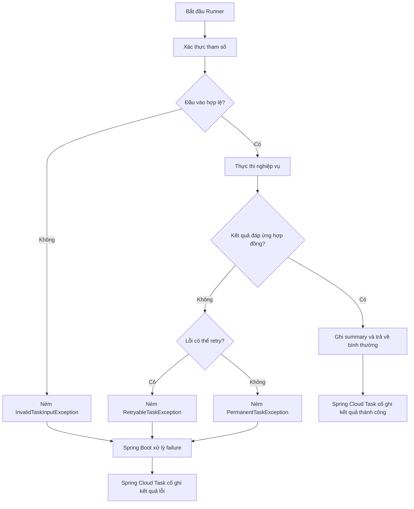
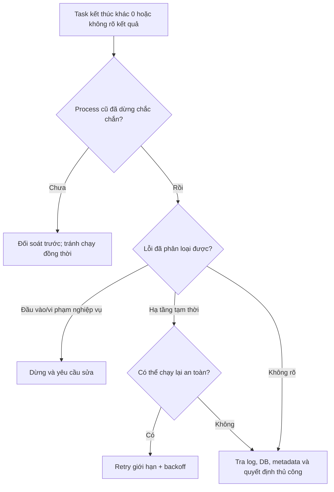

# Quy ước thành công, thất bại và lỗi không được xử lý

## 1. Vì sao một Task cần quy ước kết quả rõ ràng?

**Spring Cloud Task** hỗ trợ xây dựng ứng dụng Spring Boot có thời gian chạy hữu hạn: ứng dụng khởi động, nhận tham số, thực thi một công việc, ghi nhận vòng đời qua `TaskRepository` và kết thúc. Các Task thường chạy theo lịch, theo yêu cầu, trong Kubernetes Job hoặc như một bước của quy trình xử lý dữ liệu. Khi tiến trình dừng, hệ thống điều phối cần biết có nên **đánh dấu hoàn tất**, **chạy lại** hay **yêu cầu can thiệp**.

Tình huống thực tế: Task nhập 1.000 bản ghi, xử lý được 950, bỏ qua 30 bản ghi trùng và phát hiện 20 bản ghi không hợp lệ. Tiến trình không ném exception thì có được coi là thành công không? Câu trả lời phụ thuộc **hợp đồng nghiệp vụ**: nếu 20 bản ghi không hợp lệ được phép bỏ qua, Task có thể thành công kèm thống kê; nếu bắt buộc xử lý đủ 1.000 bản ghi, Task phải báo thất bại. Spring Cloud Task không thể tự suy ra quy định này từ số lượng bản ghi đã xử lý.

Một tình huống khác: Task đã ghi dữ liệu thành công nhưng bị dừng đột ngột trước khi cập nhật thông tin kết thúc trong database. Khi đó, dữ liệu nghiệp vụ và metadata theo dõi Task có thể khác nhau. Vì vậy cần phân biệt **kết quả nghiệp vụ**, **kết quả do TaskRepository ghi** và **mã thoát của process**.

Sau bài học, bạn có thể:

- Định nghĩa thế nào là thành công, thất bại tạm thời và thất bại vĩnh viễn.
- Phân biệt ngoại lệ đã xử lý hợp lệ với lỗi không được xử lý trong `ApplicationRunner`.
- Hiểu cách Spring Boot và Spring Cloud Task phản ánh kết quả bằng exception, exit code và `TaskExecution`.
- Ánh xạ nguyên nhân lỗi thành tín hiệu thích hợp cho scheduler mà không làm mất stack trace.
- Xác định khi nào cần retry và cách tránh xử lý trùng sau một lần chạy không chắc chắn.

## 2. Ba góc nhìn khác nhau về cùng một lần thực thi

| Góc nhìn | Nguồn thông tin | Ý nghĩa | Giới hạn |
| --- | --- | --- | --- |
| **Nghiệp vụ** | Database ứng dụng, báo cáo kết quả, checkpoint | Công việc có đáp ứng tiêu chí chấp nhận? | Không tự cho biết JVM kết thúc thế nào |
| **Spring Cloud Task** | `TaskExecution` trong `TaskRepository` | Framework ghi nhận lần chạy và mã kết thúc ra sao? | Có thể không ghi được nếu khởi tạo lỗi hoặc tiến trình bị kill |
| **Tiến trình** | Exit code OS, trạng thái Job/Pod, log | Hệ điều phối thấy process thành công hay lỗi? | Exit code không cho biết chính xác những dữ liệu đã commit |

Với một Task thông dụng, `TaskRepository` lưu `TaskExecution` theo từng lần chạy. Các thuộc tính cần quan tâm:

| Thuộc tính | Mục đích |
| --- | --- |
| `executionId` / `TASK_EXECUTION_ID` | ID của một lần thực thi; một lần retry thường có ID mới |
| `taskName` / `TASK_NAME` | Tên logic của Task |
| `startTime` / `START_TIME` | Thời điểm bắt đầu được framework ghi nhận |
| `endTime` / `END_TIME` | Thời điểm kết thúc, nếu cập nhật được |
| `exitCode` / `EXIT_CODE` | Mã kết quả được lưu ở cấp Spring Cloud Task |
| `exitMessage` / `EXIT_MESSAGE` | Thông điệp tóm tắt kết quả, nếu có |
| `errorMessage` / `ERROR_MESSAGE` | Thông tin lỗi được ghi nhận, nếu có |

Tên cột mang tính minh họa theo schema JDBC thông dụng; luôn đối chiếu DDL của phiên bản Spring Cloud Task và loại database đang dùng.

**Điểm mấu chốt:** `EXIT_CODE` trong repository và **exit code của process** là hai giá trị có liên quan nhưng không đồng nhất trong mọi tình huống. Một process có thể chết trước khi ghi `EXIT_CODE`, hoặc logic ứng dụng có thể tùy biến cách tạo mã. Đừng chỉ xem một giá trị rồi kết luận kết quả nghiệp vụ.

## 3. Xây dựng hợp đồng kết quả trước khi viết Runner

### 3.1. Thành công là một điều kiện nghiệp vụ

Với Task xuất báo cáo, có thể coi thành công khi file đã được tạo, dữ liệu đầy đủ và kết quả được lưu ở nơi truy cập được. Với Task đồng bộ đơn hàng, thành công có thể yêu cầu tất cả bản ghi hợp lệ đã được xử lý và những bản ghi trùng đã được bỏ qua đúng quy tắc.

Hợp đồng kết quả nên chỉ rõ:

1. **Điều kiện bắt buộc:** những bước hoặc ràng buộc nào phải hoàn tất.
2. **Trường hợp được chấp nhận:** ví dụ không có dữ liệu, bản ghi đã xử lý từ lần trước, một số bản ghi bị bỏ qua theo chính sách.
3. **Trường hợp không thể chấp nhận:** ví dụ thiếu đầu vào bắt buộc, dữ liệu sai cấu trúc, ghi thiếu dữ liệu quan trọng.
4. **Khả năng thử lại:** nguyên nhân nào có thể tự hết khi chạy lại; nguyên nhân nào chỉ hết sau khi sửa dữ liệu/cấu hình.
5. **Cách báo hiệu:** exception, exit code, log/metric và trạng thái lưu trong repository.

Một bảng quy ước tham khảo:

| Kết quả nghiệp vụ | Phân loại | Runner cần làm gì? | Hướng xử lý bên ngoài |
| --- | --- | --- | --- |
| Xử lý hoàn tất | **Thành công** | Trả về bình thường | Kết thúc |
| Không có bản ghi cần làm | **Thành công**, nếu hợp đồng cho phép | Trả về bình thường, ghi số lượng 0 | Kết thúc |
| Bản ghi trùng đã xử lý trước đó | **Thành công/idempotent skip**, nếu hợp đồng cho phép | Trả về bình thường, ghi số bỏ qua | Kết thúc |
| Một số bản ghi không hợp lệ nhưng được phép bỏ qua | **Thành công có cảnh báo**, nếu có ngưỡng rõ | Ghi thống kê và kết thúc bình thường | Giám sát cảnh báo |
| Sai tham số bắt buộc | **Thất bại do đầu vào** | Ném exception mô tả lỗi | Sửa lệnh/cấu hình trước khi thử lại |
| Dữ liệu không đạt ràng buộc cốt lõi | **Thất bại nghiệp vụ** | Ném exception hoặc phát tín hiệu thất bại được hỗ trợ | Sửa dữ liệu/quy tắc |
| Dịch vụ phụ thuộc không sẵn sàng tạm thời | **Thất bại có thể retry** | Để exception phù hợp thoát lên | Retry có giới hạn và backoff |
| Tiến trình bị kill, chưa xác định commit | **Không rõ kết quả** | Không có bảo đảm callback cuối được gọi | Đối soát và kiểm tra idempotency trước khi retry |

Đừng gộp mọi tình huống khác `0` vào một chính sách “retry ngay”. Retry lỗi cú pháp lệnh lặp vô hạn không khắc phục được nguyên nhân; ngược lại, lỗi kết nối tạm thời có thể được khôi phục nếu dữ liệu được xử lý idempotent.

### 3.2. Thành công có cảnh báo có phải là thất bại?

Không có quy tắc toàn cục bắt buộc. Ví dụ, nhập 1.000 dòng và bỏ qua 10 dòng trùng có thể hoàn toàn hợp lệ. Nhưng nếu bỏ qua 10 dòng do lỗi định dạng mà hợp đồng yêu cầu nhập đủ, kết thúc thành công sẽ che giấu dữ liệu mất.

Một kiểu trả kết quả nghiệp vụ:

```java
record ImportSummary(
        long imported,
        long skippedAsDuplicate,
        long invalid) {

    boolean satisfiesPolicy() {
        // Quy ước minh họa: không chấp nhận bản ghi không hợp lệ.
        return invalid == 0;
    }
}
```

Runner chịu trách nhiệm chuyển `ImportSummary` thành **kết quả cuối**; Spring Cloud Task không tự suy ra rằng `invalid > 0` là lỗi. Có thể chấp nhận một ngưỡng khác, nhưng ngưỡng cần được công bố rõ và kiểm thử.

## 4. Kết thúc bình thường và ý nghĩa của exception

### 4.1. Runner trả về bình thường

Spring Boot gọi `ApplicationRunner` hoặc `CommandLineRunner` sau khi khởi tạo ứng dụng. Nếu `run(...)` trả về và không có phần việc bắt buộc chưa hoàn thành, Spring Cloud Task thường có thể ghi nhận lần thực thi thành công; mã kết quả mặc định trong trường hợp thành công thường là `0`.

```java
@Bean
ApplicationRunner successfulRunner(ImportService service) {
    return args -> {
        ImportSummary summary = service.importData();
        if (!summary.satisfiesPolicy()) {
            throw new IllegalStateException(
                    "Có dữ liệu không hợp lệ: " + summary.invalid());
        }
        System.out.printf(
                "Thành công: imported=%d, skipped=%d%n",
                summary.imported(),
                summary.skippedAsDuplicate());
    };
}
```

Đoạn trên minh họa **phần khai báo bean trong một lớp cấu hình Spring**; `ImportService` cần được cài đặt theo nghiệp vụ. Nếu `invalid` khác 0, Runner không được phép trả về bình thường vì chính hợp đồng của ví dụ không chấp nhận dữ liệu không hợp lệ.

### 4.2. Ngoại lệ không được xử lý là gì?

Trong ngữ cảnh này, **unhandled exception** là lỗi thoát khỏi `run(...)` vì không được bắt, hoặc được bắt để bổ sung ngữ cảnh rồi ném lại. Ví dụ:

```java
@Bean
ApplicationRunner failingRunner(ImportService service) {
    return args -> {
        service.importData(); // Có thể ném IllegalStateException.
    };
}
```

Nếu exception thoát khỏi Runner, Spring Boot xử lý quá trình chạy ứng dụng thất bại. Khi hạ tầng Spring Cloud Task đã sẵn sàng, framework cố lưu kết quả lỗi và thông tin exception trong `TaskRepository`. Tiến trình thường kết thúc khác `0`, nhưng không nên suy đoán **con số cụ thể** nếu chưa kiểm tra cách ánh xạ exit code, đường khởi chạy và phiên bản framework.

Trong các trường hợp lỗi rất sớm (tạo bean, mở `DataSource`, đọc cấu hình, tạo bảng Task), `TaskRepository` có thể chưa hoạt động. Khi đó có thể có **exit code lỗi của process nhưng không có `TaskExecution` tương ứng**.

### 4.3. Bắt lỗi rồi bỏ qua dễ khiến Task báo thành công giả

```java
@Bean
ApplicationRunner unsafeRunner(ImportService service) {
    return args -> {
        try {
            service.importData();
        } catch (RuntimeException ex) {
            System.err.println("Lỗi: " + ex.getMessage());
            // Không ném tiếp: Runner có thể kết thúc bình thường.
        }
    };
}
```

Nếu mọi bản ghi đều bắt buộc phải xử lý, ví dụ trên tạo **false success**: Task có thể nhận kết quả thành công dù phần việc đã lỗi. Cách sửa:

```java
@Bean
ApplicationRunner safeRunner(ImportService service) {
    return args -> {
        try {
            service.importData();
        } catch (RuntimeException ex) {
            System.err.println("Import thất bại: " + ex.getMessage());
            throw ex;
        }
    };
}
```

Nếu chỉ cần bổ sung log mà không chuyển đổi exception, có thể để lỗi tự lan lên và dùng cơ chế logging chung. Đừng ghi cùng stack trace lặp lại ở quá nhiều tầng. Chỉ bắt và bỏ qua **loại lỗi được hợp đồng cho phép bỏ qua** rồi ghi nhận số liệu tương ứng.

### 4.4. Bất đồng bộ làm thay đổi thời điểm kết thúc

Runner tạo một `CompletableFuture` hoặc tác vụ nền rồi trả về ngay có thể được ghi nhận thành công **trước khi việc nền hoàn tất**. Với tác vụ hữu hạn, phải chờ những phần việc bắt buộc và để lỗi của chúng được truyền về đường thực thi Task:

```java
CompletableFuture<Void> pending =
        CompletableFuture.runAsync(() -> performImport());
pending.join(); // Nếu tác vụ nền lỗi, join ném CompletionException.
```

Ví dụ giả định `performImport()` là phương thức nghiệp vụ đã được định nghĩa. Trong production, quản lý executor, timeout và shutdown rõ ràng; `join()` không thay thế giới hạn thời gian hay cơ chế hủy an toàn.

## 5. Quy ước exit code cho Spring Cloud Task

### 5.1. Phân biệt ba khái niệm

| Khái niệm | Nơi quan sát | Dùng vào việc gì? |
| --- | --- | --- |
| `TaskExecution.exitCode` | `TASK_EXECUTION.EXIT_CODE` | Lịch sử kết quả Task trong repository |
| Exit code process | Shell, scheduler, Kubernetes Job/Pod | Quyết định process thành công/thất bại và chính sách retry |
| Kết quả nghiệp vụ | Bảng nghiệp vụ, summary, file báo cáo | Kiểm tra tác vụ đã đáp ứng điều kiện chấp nhận |

Khi không có tùy biến hoặc sự cố, cả metadata Task và process thường phản ánh cùng hướng thành công/thất bại. Tuy nhiên, cần kiểm chứng **hai mã** trong kiểm thử tích hợp. Nếu process bị dừng cưỡng bức, repository có thể không ghi được thời điểm và mã kết thúc.

### 5.2. Bảng mã đề xuất của một ứng dụng

Spring Cloud Task **không bắt buộc** mọi ứng dụng dùng cùng bộ mã có ý nghĩa chi tiết như dưới đây. Đây là **quy ước nhóm tự định nghĩa** để hệ điều phối ra quyết định:

| Exit code | Ý nghĩa đề xuất | Retry tự động? |
| --- | --- | --- |
| `0` | Hoàn thành theo hợp đồng, kể cả bỏ qua hợp lệ | Không |
| `1` | Lỗi chưa phân loại hoặc lỗi phần mềm | Cần phân tích; không retry vô hạn |
| `2` | Tham số thiếu/sai cú pháp/sai miền giá trị | Không; sửa đầu vào |
| `3` | Lỗi hạ tầng tạm thời đã được phân loại | Có giới hạn, backoff và điều kiện idempotency |
| `4` | Vi phạm dữ liệu/quy tắc nghiệp vụ không thể tự phục hồi | Không; cần can thiệp |

Các số `2`, `3`, `4` chỉ có ý nghĩa nếu ứng dụng và scheduler **cùng thống nhất hợp đồng**. Một số nền tảng điều phối chỉ phân biệt `0` với **khác 0**, khi đó cần thêm log/metric hoặc bộ điều khiển ngoài để biết lỗi nào retry được. Mã số không thay thế thông tin lỗi có cấu trúc.

### 5.3. Ánh xạ ngoại lệ bằng Spring Boot

Spring Boot cung cấp `ExitCodeExceptionMapper` để ánh xạ exception thành exit code. Một vấn đề thực tế là framework có thể **bọc** exception gốc khi Runner thất bại. Do đó, mapper nên kiểm tra chuỗi nguyên nhân nếu muốn phân loại theo exception do ứng dụng phát ra:

```java
import org.springframework.boot.ExitCodeExceptionMapper;
import org.springframework.context.annotation.Bean;
import org.springframework.context.annotation.Configuration;

@Configuration
class TaskExitCodeConfiguration {

    @Bean
    ExitCodeExceptionMapper taskExitCodeMapper() {
        return exception -> {
            for (Throwable cause = exception;
                    cause != null;
                    cause = cause.getCause()) {

                if (cause instanceof InvalidTaskInputException) {
                    return 2;
                }
                if (cause instanceof RetryableTaskException) {
                    return 3;
                }
                if (cause instanceof PermanentTaskException) {
                    return 4;
                }
            }
            return 1;
        };
    }
}
```

Ba exception ở ví dụ có thể định nghĩa thành các lớp runtime tùy chỉnh:

```java
class InvalidTaskInputException extends RuntimeException {
    InvalidTaskInputException(String message) {
        super(message);
    }
}

class RetryableTaskException extends RuntimeException {
    RetryableTaskException(String message) {
        super(message);
    }
}

class PermanentTaskException extends RuntimeException {
    PermanentTaskException(String message) {
        super(message);
    }
}
```

Trong dự án thực tế, nên để chúng trong package lỗi riêng và bổ sung constructor nhận `Throwable cause` nếu cần giữ nguyên nguyên nhân gốc. Chỉ ném `RetryableTaskException` khi lỗi **thực sự có khả năng phục hồi**; không gom mọi `SQLException` hoặc lỗi dữ liệu vào nhóm retryable.

**Cần phân biệt vai trò mapper:** `ExitCodeExceptionMapper` tham gia cơ chế exit code của **Spring Boot**. Việc mã đó được phản ánh vào `TaskExecution` và mã thoát OS như thế nào cần được xác minh với phiên bản, cơ chế khởi chạy và cấu hình Spring Cloud Task hiện dùng. Đừng mặc định chỉ đăng ký mapper là mọi nguồn trạng thái sẽ luôn đồng nhất.

### 5.4. Tránh gọi System.exit trong Runner

`System.exit(...)` gọi trực tiếp từ business logic có thể chặn đường hoàn tất thông thường, làm framework không kịp cập nhật repository hoặc đóng tài nguyên. Ví dụ **không nên làm**:

```java
if (invalidInput) {
    System.exit(2); // Thoát đột ngột từ bên trong Runner.
}
```

Thay bằng:

```java
if (invalidInput) {
    throw new InvalidTaskInputException(
            "Thiếu --source=<tên nguồn>");
}
```

Spring Boot có cả cơ chế `ExitCodeGenerator` và `SpringApplication.exit(...)` để điều khiển mã kết thúc ở lớp vòng đời ứng dụng. Khi dùng những cơ chế đó, cần kiểm tra cách đóng context và mã OS trả về trên nền tảng triển khai. Không dùng `System.exit(0)` để che giấu ngoại lệ vì có thể khiến scheduler coi lần chạy lỗi là thành công.

## 6. Ví dụ thực hành: Task phân loại kết quả

Ta xây dựng ứng dụng Spring Cloud Task nhận `--import-id` và tham số thử nghiệm `--simulate-error`. Ứng dụng dùng PostgreSQL và Spring JDBC để ghi một khóa import duy nhất. Mục đích là quan sát:

- Lần chạy đầu: thêm khóa và kết thúc thành công.
- Lần chạy lại: phát hiện khóa đã tồn tại, bỏ qua hợp lệ và kết thúc thành công.
- Lỗi tạm thời mô phỏng: exception thoát khỏi Runner, transaction rollback.
- Lỗi nghiệp vụ mô phỏng: exception được phân loại không nên retry nguyên lệnh.
- Đầu vào sai: fail ngay trong Runner, chưa ghi dữ liệu nghiệp vụ.

### 6.1. Chuẩn bị database

Trên PostgreSQL, tạo bảng nghiệp vụ:

```sql
CREATE TABLE imported_items (
    import_id VARCHAR(80) PRIMARY KEY,
    created_at TIMESTAMPTZ NOT NULL DEFAULT CURRENT_TIMESTAMP
);
```

Ứng dụng cần các dependency tương thích: Spring Boot, Spring Cloud Task starter, Spring JDBC và PostgreSQL JDBC driver. Các bảng metadata `TASK_*` của Spring Cloud Task phải được tạo bằng DDL đúng phiên bản/database, ví dụ thông qua Flyway/Liquibase, trước khi chạy.

Ví dụ cấu hình `application.yml`:

```yaml
spring:
  application:
    name: import-results-task
  main:
    web-application-type: none
  datasource:
    url: ${TASK_DB_URL:jdbc:postgresql://localhost:5432/taskdb}
    username: ${TASK_DB_USER:task_user}
    password: ${TASK_DB_PASSWORD}
  cloud:
    task:
      initialize-enabled: false
      closecontextEnabled: true
```

`initialize-enabled: false` nghĩa là đã có bước migration chuẩn bị bảng Task. Mật khẩu phải được đưa qua biến môi trường/secret manager thay vì tham số dòng lệnh, vì tham số có thể bị ghi vào log hoặc metadata.

### 6.2. Service: giao dịch và thao tác chạy lại an toàn

```java
import org.springframework.jdbc.core.JdbcTemplate;
import org.springframework.stereotype.Service;
import org.springframework.transaction.annotation.Transactional;

record ImportResult(boolean inserted) {}

@Service
public class ImportService {
    private final JdbcTemplate jdbc;

    public ImportService(JdbcTemplate jdbc) {
        this.jdbc = jdbc;
    }

    @Transactional
    public ImportResult importOne(String importId, String failureMode) {
        int inserted = jdbc.update(
                """
                INSERT INTO imported_items (import_id)
                VALUES (?)
                ON CONFLICT (import_id) DO NOTHING
                """,
                importId);

        if ("temporary".equals(failureMode)) {
            throw new RetryableTaskException(
                    "Mô phỏng lỗi tạm thời trước khi commit");
        }
        if ("permanent".equals(failureMode)) {
            throw new PermanentTaskException(
                    "Mô phỏng vi phạm nghiệp vụ trước khi commit");
        }

        return new ImportResult(inserted == 1);
    }
}
```

`ON CONFLICT ... DO NOTHING` là cú pháp **PostgreSQL**. Trong ứng dụng thật, cần thiết kế khóa idempotency theo ý nghĩa nghiệp vụ; không phải mọi loại thao tác đều có thể dùng cách này. Nếu exception runtime thoát khỏi phương thức `@Transactional` được gọi qua Spring proxy, câu lệnh `INSERT` của lần chạy đó sẽ rollback theo quy tắc mặc định.

### 6.3. Runner xác thực đầu vào và báo kết quả

```java
import java.util.List;
import org.springframework.boot.ApplicationArguments;
import org.springframework.boot.ApplicationRunner;
import org.springframework.boot.SpringApplication;
import org.springframework.boot.autoconfigure.SpringBootApplication;
import org.springframework.cloud.task.configuration.EnableTask;
import org.springframework.context.annotation.Bean;

@SpringBootApplication
@EnableTask
public class ImportResultsTaskApplication {

    public static void main(String[] args) {
        SpringApplication.run(ImportResultsTaskApplication.class, args);
    }

    @Bean
    ApplicationRunner importRunner(ImportService service) {
        return args -> {
            String importId = requiredSingle(args, "import-id");
            String failureMode =
                    optionalSingle(args, "simulate-error", "none");

            if (!List.of("none", "temporary", "permanent")
                    .contains(failureMode)) {
                throw new InvalidTaskInputException(
                        "--simulate-error chỉ nhận none, temporary, permanent");
            }

            ImportResult result = service.importOne(importId, failureMode);
            if (result.inserted()) {
                System.out.println("Thành công: đã nhập " + importId);
            } else {
                System.out.println(
                        "Thành công: đã tồn tại, bỏ qua " + importId);
            }
        };
    }

    private static String requiredSingle(
            ApplicationArguments args, String name) {
        List<String> values = args.getOptionValues(name);
        if (values == null || values.size() != 1
                || values.get(0).isBlank()) {
            throw new InvalidTaskInputException(
                    "Cần đúng một --" + name + "=<giá trị>");
        }
        return values.get(0);
    }

    private static String optionalSingle(
            ApplicationArguments args, String name, String fallback) {
        if (!args.containsOption(name)) {
            return fallback;
        }
        return requiredSingle(args, name);
    }
}
```

Các lớp `InvalidTaskInputException`, `RetryableTaskException`, `PermanentTaskException` và mapper ở phần 5.3 cần được đặt cùng package hoặc import tương ứng. Đây là ứng dụng minh họa có thể xây dựng khi dự án đã cấu hình đúng dependency, database và DDL của Spring Cloud Task. Trong thực tế, **không để tham số `--simulate-error` trong bản production**: nó chỉ phục vụ kiểm thử.

### 6.4. Các lệnh chạy và kết quả kỳ vọng

Giả sử tên JAR sau khi build là `target/import-results-task.jar` (cần thay bằng tên file thực tế):

| Lệnh chạy | Kết quả nghiệp vụ | Kết quả Task/process thông thường |
| --- | --- | --- |
| `--import-id=A1` | Thêm `A1` | Thành công |
| `--import-id=A1` lần hai | Không thêm trùng, bỏ qua hợp lệ | Thành công và có lần `TaskExecution` mới |
| `--import-id=B2 --simulate-error=temporary` | `B2` bị rollback | Thất bại; có thể retry |
| `--import-id=C3 --simulate-error=permanent` | `C3` bị rollback | Thất bại; không nên retry y nguyên |
| `--import-id=` | Không ghi dữ liệu | Thất bại do đầu vào |

Chạy lần đầu:

```bash
java -jar target/import-results-task.jar --import-id=A1
```

Chạy lần hai với cùng khóa:

```bash
java -jar target/import-results-task.jar --import-id=A1
```

Chạy đường lỗi:

```bash
java -jar target/import-results-task.jar --import-id=B2 --simulate-error=temporary
```

Để kiểm tra mã thoát trên **Bash**, chạy `echo $?` ngay sau lệnh `java`. Trong **PowerShell**, đọc `$LASTEXITCODE` ngay sau lệnh Java. Mã thoát cụ thể của ví dụ phải được xác minh với bản Spring Boot/Task đang dùng và cách process được khởi chạy; không chỉ dựa vào mapper ở phần 5.

Kiểm tra dữ liệu:

```sql
SELECT import_id, created_at
FROM imported_items
ORDER BY import_id;
```

Sau các lần chạy nêu trên, dự kiến chỉ có `A1`, do hai đường lỗi mô phỏng xảy ra **trước commit**. Nếu Task thất bại sau một transaction đã commit, kết quả có thể khác.

### 6.5. Kiểm tra repository

Trên schema JDBC thông dụng:

```sql
SELECT TASK_EXECUTION_ID,
       TASK_NAME,
       START_TIME,
       END_TIME,
       EXIT_CODE,
       EXIT_MESSAGE,
       ERROR_MESSAGE
FROM TASK_EXECUTION
ORDER BY TASK_EXECUTION_ID DESC;
```

Khi repository hoạt động, thường có một dòng metadata **cho mỗi lần khởi chạy**, kể cả chạy lại cùng `--import-id=A1`. Với lần kết thúc lỗi, framework sẽ cố cập nhật thông tin lỗi. Nhưng không bảo đảm mọi lỗi đều tạo được bản ghi nếu việc khởi tạo hoặc ghi cuối bị thất bại.

Không kỳ vọng mọi `ERROR_MESSAGE` là văn bản cố định hay luôn chứa đầy đủ stack trace. Cần đọc log ứng dụng để thấy nguyên nhân và đối chiếu với mã thoát process.

## 7. Lỗi đã xử lý và lỗi không được xử lý: ranh giới quan trọng

### 7.1. Bắt lỗi ở đúng tầng

Một lỗi có thể được xử lý trong service nếu hợp đồng nghiệp vụ **cho phép khôi phục ngay**. Ví dụ, một bản ghi bị trùng có thể được tính vào `skippedAsDuplicate` rồi tiếp tục. Khi ấy không cần ném exception cuối cùng nếu toàn bộ kết quả vẫn đạt tiêu chí chấp nhận.

Ngược lại, lỗi làm công việc không thể đạt tiêu chí thành công phải được truyền đến Runner qua exception, kết quả có kiểu rõ ràng hoặc cơ chế failure được thiết kế. Không biến lỗi thực sự thành thành công chỉ vì đã gọi `catch`.



Điểm quan trọng của sơ đồ: **exception là tín hiệu**, không phải dữ liệu nghiệp vụ tự giải thích. Lớp nghiệp vụ phải quy định khi nào một exception được phép bỏ qua và khi nào phải phát lỗi cuối cùng.

### 7.2. Exception và transaction

Với `@Transactional` mặc định, một `RuntimeException` hoặc `Error` thoát khỏi phương thức Spring quản lý thường dẫn tới rollback transaction. **Checked exception** không tự rollback theo cấu hình mặc định phổ biến, trừ khi có `rollbackFor` hoặc quy tắc rollback toàn cục phù hợp.

```java
import java.io.IOException;
import org.springframework.transaction.annotation.Transactional;

@Transactional(rollbackFor = IOException.class)
public void importFromFile() throws IOException {
    // Ghi SQL và đọc file.
    // IOException thoát ra sẽ kích hoạt rollback.
}
```

Đây là minh họa **một phương thức nằm trong Spring bean** được gọi qua proxy; không phải Java class độc lập. Cơ chế rollback chỉ áp dụng cho tài nguyên tham gia transaction. Các bước đã commit trước đó hoặc lời gọi HTTP sang hệ thống ngoài **không tự được hoàn tác** chỉ vì Task cuối cùng thất bại.

### 7.3. Vì sao cần thông tin lỗi nguyên gốc?

Nếu chuyển mọi lỗi thành `new RuntimeException("Task thất bại")` mà bỏ nguyên nhân gốc, log sẽ thiếu thông tin về SQL, kết nối hoặc dữ liệu đầu vào. Khi cần bổ sung ngữ cảnh:

```java
try {
    callExternalDependency();
} catch (TemporaryDependencyException ex) {
    throw new RetryableTaskException(
            "Dịch vụ phụ thuộc tạm thời không phản hồi", ex);
}
```

Đoạn trên minh họa cơ chế; cần định nghĩa `TemporaryDependencyException` theo client đang dùng và thêm constructor `RetryableTaskException(String, Throwable)`. Việc **phân loại là tạm thời** phải dựa trên đặc tính lỗi thực tế, ví dụ lỗi timeout được nhà cung cấp xác nhận có thể retry; không nên tự động phân loại mọi lỗi HTTP thành có thể retry.

## 8. Khi Task kết thúc không theo đường lỗi thông thường

### 8.1. Lỗi rất sớm

Nếu sai JDBC URL, thiếu dependency, bean không tạo được hoặc bảng `TASK_*` chưa tồn tại, Runner có thể **chưa chạy**. `TaskRepository` có thể chưa đủ điều kiện ghi `TaskExecution`. Process vẫn có thể kết thúc lỗi và scheduler vẫn nhận tín hiệu thất bại.

Vì vậy, **không thấy `TaskExecution` không có nghĩa chương trình chưa được khởi chạy**. Cần đối chiếu log startup, trạng thái scheduler/Pod và metric triển khai.

### 8.2. Kill, hết thời gian hoặc crash

Nếu process bị `kill -9`, container bị cưỡng bức dừng hoặc host mất điện, không có bảo đảm code `finally`, `TaskExecutionListener` hay callback đóng context được chạy. Khi đó:

- `START_TIME` có thể đã được lưu.
- `END_TIME` và `EXIT_CODE` có thể chưa được cập nhật.
- Một số transaction nghiệp vụ đã commit vẫn được giữ.
- Transaction chưa commit thường bị database rollback khi kết nối bị cắt.

**Trạng thái chưa rõ không nên được chuyển thành “thất bại có thể retry ngay” chỉ từ một bản ghi thiếu `END_TIME`.** Trước hết kiểm tra process cũ còn sống không, khóa nghiệp vụ và những phần công việc đã hoàn thành.

### 8.3. Kết thúc có kiểm soát

Nếu hệ điều phối gửi tín hiệu dừng và cho ứng dụng thời gian, Task nên ngừng khởi tạo thêm công việc, chờ tác vụ đang chạy đến ranh giới commit an toàn, giải phóng connection/executor và để framework cố lưu kết quả cuối. Không dựa hoàn toàn vào graceful shutdown vì timeout của container có thể kết thúc JVM trước khi việc dọn dẹp hoàn thành.

## 9. Giám sát và đối soát kết quả

### 9.1. Truy vấn những lần chạy mới nhất

```sql
SELECT TASK_EXECUTION_ID,
       TASK_NAME,
       START_TIME,
       END_TIME,
       EXIT_CODE,
       ERROR_MESSAGE
FROM TASK_EXECUTION
ORDER BY TASK_EXECUTION_ID DESC
LIMIT 20;
```

Truy vấn này minh họa PostgreSQL và schema không đổi prefix. Trong một số database, cú pháp giới hạn dòng khác `LIMIT`. Ngoài metadata, cần theo dõi thời lượng Task, số bản ghi thành công/bỏ qua/thất bại và trạng thái các dependency quan trọng.

### 9.2. Tìm những bản ghi thiếu thời điểm kết thúc

```sql
SELECT TASK_EXECUTION_ID,
       TASK_NAME,
       START_TIME,
       EXIT_CODE
FROM TASK_EXECUTION
WHERE END_TIME IS NULL
ORDER BY START_TIME;
```

Không coi mọi dòng trả về là thất bại: một Task có thể **đang chạy hợp lệ** hoặc **đã bị gián đoạn**. Phải tra thêm trạng thái process, lịch chạy, heartbeat (nếu có) và deadline nghiệp vụ.

### 9.3. Kết hợp nhiều nguồn tín hiệu

| Nguồn | Nên ghi gì? | Dùng để làm gì? |
| --- | --- | --- |
| Log ứng dụng | Tên Task, định danh lần chạy, lỗi có ngữ cảnh, số liệu xử lý | Điều tra nguyên nhân |
| `TaskRepository` | `TaskExecution`, start/end time, exit code | Lịch sử thực thi |
| Database nghiệp vụ | Khóa idempotency, checkpoint, kết quả cuối | Đối soát dữ liệu thực tế |
| Scheduler/Kubernetes Job | Số lần thử, exit code process, timeout, lý do kết thúc | Tự động hóa retry/cảnh báo |
| Metric/cảnh báo | Tỷ lệ thành công, thời lượng, lỗi liên tục, bản ghi bị bỏ qua | Phát hiện bất thường sớm |

Không ghi password, token hay dữ liệu nhạy cảm vào tham số CLI, `exitMessage` hoặc log. Dòng lệnh có thể hiển thị trong công cụ quản lý process và một phần tham số có thể được lưu vào metadata Task.

## 10. Retry: có điều kiện, có giới hạn và an toàn

### 10.1. Quyết định retry



Một chính sách retry tốt quy định **số lần tối đa, khoảng chờ, backoff, timeout và cảnh báo khi hết lượt**. Cũng cần xác định liệu lỗi có nguy cơ lặp vô hạn (ví dụ sai schema) hay không.

### 10.2. Idempotency là điều kiện nền tảng

Giả sử Task đã commit 90 đơn hàng rồi mất điện. Scheduler chỉ thấy process lỗi hoặc không có mã kết thúc, sau đó chạy lại toàn bộ. Nếu ứng dụng chỉ chèn bản ghi mà không có khóa nghiệp vụ, 90 đơn hàng có thể bị xử lý trùng.

Cách giảm rủi ro:

- Dùng khóa nghiệp vụ và ràng buộc unique trong database.
- Chỉ chuyển trạng thái hợp lệ, ví dụ `PENDING → PROCESSED` bằng câu `UPDATE ... WHERE state = 'PENDING'`.
- Ghi checkpoint hoặc dấu đã xử lý, có giao dịch bao quanh phần cần nhất quán.
- Khi gọi API/hệ thống ngoài, dùng idempotency key hoặc outbox phù hợp.

`TaskRepository` ghi lại việc Task đã chạy; nó **không tự bảo đảm exactly-once** cho mọi thao tác nghiệp vụ. Một lần chạy lại có thể tạo `TaskExecution` mới ngay cả khi mọi bản ghi nghiệp vụ được bỏ qua đúng cách.

### 10.3. Scheduler quyết định thế nào?

Với cron, Kubernetes Job/CronJob hoặc bộ điều phối khác, cần cấu hình logic sử dụng **exit code process** và thông tin lỗi. Nhiều scheduler chỉ hiểu thành công (`0`) và thất bại (khác `0`), nên chúng có thể retry cả lỗi do tham số không hợp lệ nếu không có policy bổ sung.

Đừng giả định khi có `ExitCodeExceptionMapper`, Kubernetes sẽ tự hiểu mã `3` là retryable và mã `4` là permanent. Mức độ phân loại phải được **thể hiện trong hệ thống điều phối** hoặc một lớp controller kiểm tra tín hiệu có cấu trúc.

## 11. Spring Cloud Task phối hợp với Spring Batch

Nếu một Task gọi Spring Batch Job, có ít nhất hai loại metadata:

| Lớp | Metadata | Theo dõi |
| --- | --- | --- |
| Spring Cloud Task | `TaskExecution` trong `TASK_*` | Một lần chạy tiến trình Task |
| Spring Batch | `JobExecution` và `StepExecution` trong `BATCH_*` | Một Job và các Step thực thi |

`BatchStatus.FAILED` của `JobExecution` không thể được dùng thay thế hoàn toàn cho exit code của process trong mọi kiến trúc. Đặc biệt, nếu Runner tự gọi `JobLauncher`, nhận `JobExecution` có trạng thái lỗi rồi chỉ log và trả về, tầng Task có thể bị đánh dấu hoàn thành bình thường.

Ví dụ **minh họa logic phân loại** sau khi chạy Job:

```java
JobExecution execution = jobLauncher.run(job, jobParameters);

if (execution.getStatus() != BatchStatus.COMPLETED) {
    throw new PermanentTaskException(
            "Batch Job không hoàn tất: " + execution.getStatus());
}
```

Đoạn này giả định biến `jobLauncher`, `job` và `jobParameters` đã được khởi tạo, đồng thời import `JobExecution`, `BatchStatus` và các API Spring Batch cần thiết. Trong ứng dụng thật, đừng mặc định **mọi** trạng thái Batch khác `COMPLETED` đều là lỗi vĩnh viễn: phân loại theo `ExitStatus`, nguyên nhân Step lỗi và chính sách restart. Spring Batch hỗ trợ cơ chế restart riêng theo `JobParameters`; retry cả Task mà không xét trạng thái `JobRepository` có thể dẫn đến hành vi ngoài ý muốn.

Nếu dùng tích hợp Task–Batch tự động, hãy kiểm tra cơ chế đồng bộ exit code của phiên bản đang triển khai thay vì áp dụng đoạn logic thủ công một cách trùng lặp.

## 12. Các lỗi thường gặp

| Hiện tượng | Nguyên nhân có thể | Hướng xử lý |
| --- | --- | --- |
| Task báo thành công dù dữ liệu xử lý thiếu | Runner bắt exception rồi không ném tiếp; không kiểm tra summary | Định nghĩa hợp đồng thành công và bảo toàn tín hiệu lỗi |
| Exit code process khác giá trị mong đợi | Exception bị wrap, mapper chưa hoạt động theo đường khởi chạy | Kiểm tra chuỗi cause, cách gọi `SpringApplication` và thực tế shell/Job |
| `TaskExecution` không tồn tại | Khởi tạo context/repository thất bại trước khi ghi metadata | Xem log startup, schema, `DataSource` và process |
| `END_TIME` rỗng lâu | Task còn chạy hoặc bị gián đoạn | Đối chiếu scheduler, process, timeout và dữ liệu |
| Lỗi tạm thời bị retry mãi | Không có số lần tối đa, không có backoff | Thêm retry budget, phân loại lỗi và cảnh báo |
| Lỗi cấu hình bị retry | Chỉ phân biệt `0`/khác `0` | Tách lỗi đầu vào/vĩnh viễn khỏi lỗi có thể phục hồi |
| Task retry làm trùng dữ liệu | Thiếu khóa nghiệp vụ và checkpoint | Bổ sung idempotency, transaction phù hợp |
| Spring Batch thất bại nhưng Task thành công | Runner bỏ qua `JobExecution` hoặc `ExitStatus` | Ánh xạ kết quả Batch theo chính sách |
| Process thoát thành công quá sớm | Runner không chờ công việc bất đồng bộ | Chờ kết quả Future, kiểm tra exception và timeout |
| Lộ thông tin nhạy cảm trong metadata/log | Đưa token/password vào CLI hoặc message | Dùng secret manager; giới hạn nội dung log/metadata |

## 13. Bài tập và câu hỏi vận dụng

**Bài tập 1 — Định nghĩa thành công.** Một Task nhập 1.000 dòng, thành công 980, bỏ qua hợp lệ 10 dòng và phát hiện 10 dòng không hợp lệ. Viết hai hợp đồng kết quả khác nhau (cho phép và không cho phép các dòng không hợp lệ) rồi xác định trạng thái Task trong mỗi trường hợp.

**Bài tập 2 — Ngoại lệ bị nuốt.** Cho một Runner bắt `DataAccessException` rồi chỉ in log. Giải thích vì sao Task có thể báo thành công. Sửa Runner để bảo toàn nguyên nhân lỗi và báo thất bại.

**Bài tập 3 — Ánh xạ exit code.** Thêm `InvalidTaskInputException`, `RetryableTaskException` và `PermanentTaskException` cho Task mẫu; kiểm tra exit code process trên môi trường chạy thực tế, kể cả khi exception bị Spring Boot bọc.

**Bài tập 4 — Rollback.** Chạy `--import-id=B2 --simulate-error=temporary`, đối chiếu bảng nghiệp vụ và `TASK_EXECUTION`. Giải thích vì sao dữ liệu `B2` có thể đã rollback trong khi metadata lỗi vẫn tồn tại.

**Bài tập 5 — Dừng cưỡng bức.** Trong môi trường thử nghiệm, kill một Task đang thực hiện nhiều transaction. Tìm những lần chạy chưa có `END_TIME` và xác định thông tin nào cần bổ sung trước khi retry.

**Bài tập 6 — Scheduler.** Thiết kế chính sách với tối đa 3 lần retry, exponential backoff và cảnh báo. Chỉ rõ nhóm lỗi được retry, nhóm lỗi phải sửa đầu vào và cách ngăn chạy song song cùng một `import-id`.

**Bài tập 7 — Spring Batch.** Một `JobExecution` trả `FAILED` nhưng Runner kết thúc bình thường. Mô tả cách chuyển kết quả Batch thành tín hiệu Task và lúc nào nên dùng cơ chế restart của Batch.

## 14. Tiêu chí tự đánh giá

Bạn hiểu chủ đề khi có thể giải thích và áp dụng các nguyên tắc sau:

1. **Thành công** phải dựa trên điều kiện nghiệp vụ rõ ràng, không chỉ vì phương thức trả về.
2. **Lỗi không được xử lý** đi ra khỏi Runner giúp framework có cơ hội ghi thất bại, nhưng việc ghi metadata phụ thuộc tình trạng hệ thống.
3. **Exit code của Task, exit code của process và kết quả nghiệp vụ** là các tín hiệu khác nhau, cần đối chiếu.
4. **Exception đã bắt** chỉ nên bị bỏ qua khi được hợp đồng nghiệp vụ cho phép và có thống kê đầy đủ.
5. **Rollback transaction** không đảo ngược các phần công việc đã commit trước đó hoặc thao tác bên ngoài database.
6. **Retry** cần phân loại lỗi, giới hạn số lần và thiết kế idempotency để tránh xử lý trùng.
7. Khi tích hợp **Spring Batch**, phải đánh giá kết quả `JobExecution` và quyết định rõ cách truyền thất bại lên tầng Task.

## Tài liệu tham khảo

- [Spring Cloud Task Reference](https://docs.spring.io/spring-cloud-task/reference/): cơ chế vòng đời Task, repository, kết quả và khả năng vận hành.
- [Spring Cloud Task — Features](https://docs.spring.io/spring-cloud-task/reference/features.html): `TaskExecution`, mã kết thúc và cơ chế callback.
- [Spring Boot — SpringApplication](https://docs.spring.io/spring-boot/reference/features/spring-application.html): `ApplicationRunner`, `CommandLineRunner` và exit codes.
- [Spring Boot API — ExitCodeExceptionMapper](https://docs.spring.io/spring-boot/api/java/org/springframework/boot/ExitCodeExceptionMapper.html): hợp đồng chuyển exception thành mã thoát.
- [Spring Framework — Transaction Rollback](https://docs.spring.io/spring-framework/reference/data-access/transaction/declarative/rolling-back.html): quy tắc rollback mặc định và `rollbackFor`.
- [Spring Batch Reference](https://docs.spring.io/spring-batch/reference/): `JobExecution`, `StepExecution`, `ExitStatus` và xử lý restart.
