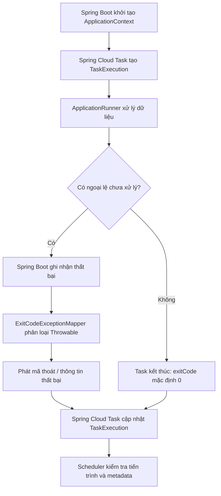
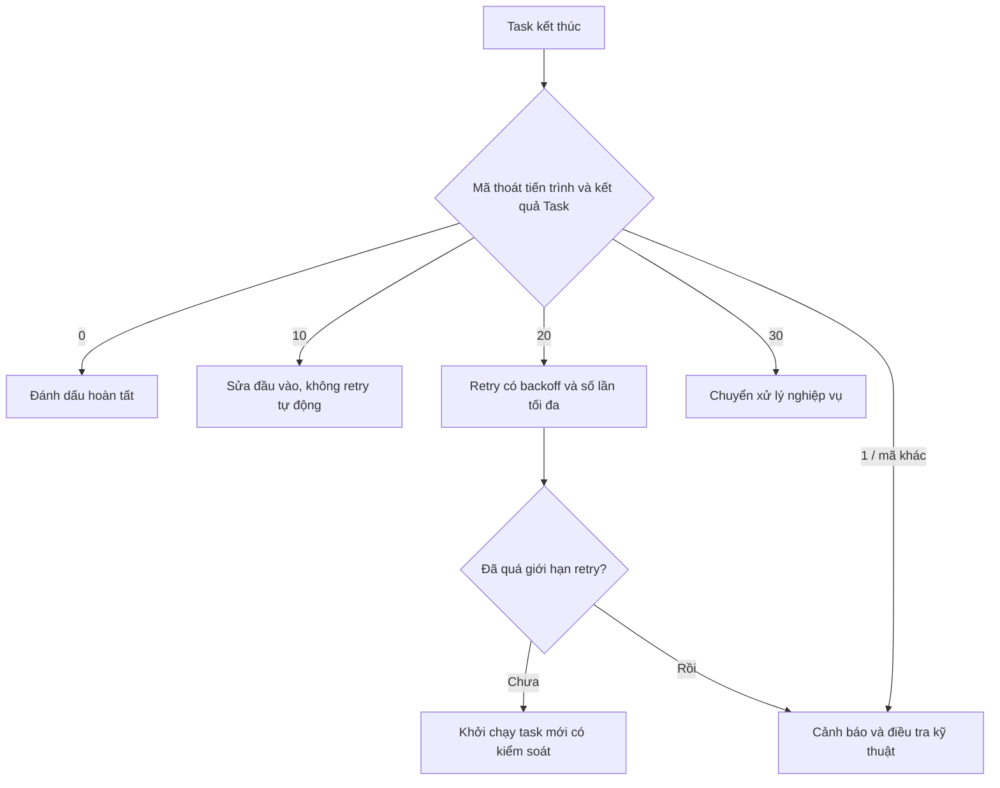

# Ánh xạ ngoại lệ bằng `ExitCodeExceptionMapper`

## Mục tiêu của bài

Một ứng dụng **Spring Cloud Task** được tạo để chạy trong thời gian hữu hạn: xử lý dữ liệu, ghi lại kết quả trong `TaskRepository` rồi kết thúc. Khi chạy theo lịch hoặc theo yêu cầu, hệ thống điều phối cần phân biệt lỗi đầu vào, lỗi kết nối tạm thời và lỗi nghiệp vụ không thể tự khắc phục. Nếu mọi thất bại đều trả về cùng một mã, người vận hành khó xác định có nên thử lại hay chuyển sang điều tra.

**`ExitCodeExceptionMapper`** là giao diện do **Spring Boot** cung cấp để chuyển ngoại lệ không được xử lý thành một **mã thoát số nguyên**. **Spring Cloud Task** sử dụng kết quả này trong metadata của lần chạy khi lifecycle cho phép ghi nhận lỗi. Mã thoát hỗ trợ hệ thống điều phối ra quyết định, nhưng không thay thế log, thông điệp lỗi hay trạng thái nghiệp vụ.

Sau bài này, bạn sẽ:

- Hiểu vì sao cần phân loại mã thoát và cách Spring Boot gọi `ExitCodeExceptionMapper`.
- Tạo một bean mapper cho các ngoại lệ nghiệp vụ và kiểm tra chuỗi nguyên nhân (`cause chain`).
- Phân biệt mã thoát trong `TaskExecution`, mã kết thúc của tiến trình và `exitMessage` / `errorMessage`.
- Nhận biết trường hợp mapper **không hoạt động như dự kiến**, đặc biệt là lỗi listener, lỗi xảy ra trước khi context được tạo hoặc tiến trình bị kill.
- Xây kịch bản thử nghiệm và chính sách retry an toàn cho task theo lịch, cũng như cho task chạy cùng Spring Batch.

## 1. Mã thoát giúp giải quyết vấn đề gì?

Giả sử một ứng dụng `invoice-import-task` được gọi mỗi đêm để nhập hóa đơn. Có bốn kết quả có thể xảy ra:

| Kết quả thực thi | Mã thoát đề xuất | Hành động của hệ thống điều phối |
| --- | ---: | --- |
| Nhập thành công | `0` | Đánh dấu hoàn tất; không retry |
| Đối số `--business-date` thiếu hoặc sai dạng | `10` | Từ chối yêu cầu; sửa đầu vào |
| Dịch vụ đối tác tạm thời không phản hồi | `20` | Có thể retry với backoff và giới hạn số lần |
| Hóa đơn bị từ chối bởi quy tắc nghiệp vụ | `30` | Không tự retry; chuyển xử lý nghiệp vụ |
| Ngoại lệ ngoài dự kiến | `1` | Cảnh báo kỹ thuật; kiểm tra log |

**Bảng mã trên là quy ước của ứng dụng**, không phải danh sách mã chuẩn do Spring Cloud Task quy định. Theo quy ước thông dụng, `0` là thành công, mã khác `0` thể hiện thất bại hoặc tình trạng cần xử lý. Khi tự đặt mã, phải ghi rõ ý nghĩa và bảo đảm tất cả bộ phận (scheduler, pipeline, dashboard, người vận hành) dùng cùng hợp đồng.

Tại sao không bắt mọi ngoại lệ rồi trả về một chuỗi `"FAILED"`? Vì một tiến trình có thể kết thúc bình thường từ góc nhìn framework nếu ứng dụng **nuốt ngoại lệ**. Khi đó `TaskExecution.exitCode` có thể là `0` và hệ thống điều phối không biết rằng nghiệp vụ thất bại. Nếu lỗi phải làm thất bại lần chạy, hãy để ngoại lệ phù hợp được truyền lên hoặc chủ động sử dụng một cơ chế báo kết quả được framework hỗ trợ.

## 2. Giao diện `ExitCodeExceptionMapper` và vòng đời Task

Spring Boot định nghĩa một giao diện hàm (`functional interface`):

```java
package org.springframework.boot;

@FunctionalInterface
public interface ExitCodeExceptionMapper {
    int getExitCode(Throwable exception);
}
```

Đây là **chữ ký API rút gọn để giải thích**, không phải mã nguồn đầy đủ của Spring Boot. Phương thức nhận `Throwable` gây thất bại và trả về `int`. Vì là functional interface, ta có thể đăng ký bằng `@Bean` trả về lambda hoặc viết một lớp `implements ExitCodeExceptionMapper`.

Luồng thông thường khi một `ApplicationRunner` ném ngoại lệ:



Các điểm quan trọng:

1. Spring Cloud Task ghi nhận việc bắt đầu sau khi `ApplicationContext` đã bootstrap đủ để có hạ tầng Task, và **trước khi các `ApplicationRunner`/`CommandLineRunner` chạy**.
2. Khi task đang chạy, `TaskExecution.exitCode` thường là `null` (SQL `NULL`); đó là trạng thái **chưa có kết quả cuối**, không phải thành công.
3. Khi các runner hoàn tất mà không lỗi, mã mặc định được ghi là `0`. Khi có `ApplicationFailedEvent` nhưng không có mã được tạo, mã thông thường là `1`. Khi `ExitCodeExceptionMapper` được gọi và trả về mã phù hợp, Spring Cloud Task có thể ghi mã ấy vào `TaskExecution`.
4. Một lỗi quá sớm khiến `ApplicationContext` không khởi tạo được có thể khiến **không có `TaskExecution` nào được tạo**. Việc mapper có tồn tại trong mã nguồn cũng không bảo đảm bean mapper đã kịp được khởi tạo.
5. Bản ghi `exitCode = NULL` tồn tại quá lâu **không chứng minh task vẫn còn chạy**: tiến trình có thể bị kill hoặc mất khả năng cập nhật repository.

Hai thành phần giữ vai trò khác nhau: Spring Boot cung cấp chiến lược ánh xạ ngoại lệ; Spring Cloud Task giữ **lịch sử lần thực thi** trong `TaskRepository`. Tham khảo [Spring Cloud Task – Features](https://docs.spring.io/spring-cloud-task/reference/features.html) và [Spring Boot – `ExitCodeExceptionMapper` API](https://docs.spring.io/spring-boot/api/java/org/springframework/boot/ExitCodeExceptionMapper.html).

## 3. Ví dụ xuyên suốt: ánh xạ bốn nhóm ngoại lệ

Bài thực hành xây một task nhận `--business-date=YYYY-MM-DD` và tùy chọn `--simulate=...` để chủ động thử các đường lỗi. Dự án dùng một bộ phiên bản **Java, Spring Boot và Spring Cloud tương thích**, có dependency `spring-cloud-starter-task` và driver H2 cho thử nghiệm. Nếu dự án đã có `TaskRepository` bền vững, giữ cấu hình DB hiện hữu.

Các phụ thuộc Maven cần thiết (Spring Cloud BOM của dự án quản lý phiên bản starter):

```xml
<dependencies>
    <dependency>
        <groupId>org.springframework.cloud</groupId>
        <artifactId>spring-cloud-starter-task</artifactId>
    </dependency>
    <dependency>
        <groupId>com.h2database</groupId>
        <artifactId>h2</artifactId>
        <scope>runtime</scope>
    </dependency>
</dependencies>
```

Spring Cloud BOM phải được import trong `dependencyManagement` của POM; Spring Boot parent/BOM phải thuộc dòng tương thích. Không tự đặt phiên bản `spring-cloud-starter-task` trái với BOM. Mẫu này chỉ là **đoạn phụ thuộc**, được ghép vào một `pom.xml` Spring Boot hợp lệ.

### 3.1. Khai báo loại lỗi riêng

Ba ngoại lệ biểu thị ba quyết định xử lý độc lập:

- `InvalidTaskInputException`: người gọi cung cấp đầu vào sai; nên sửa đầu vào.
- `TemporaryPartnerException`: lỗi ngoại vi có khả năng hồi phục; có thể thử lại theo chính sách.
- `BusinessRejectedException`: dữ liệu vi phạm quy tắc; cần can thiệp hoặc sửa dữ liệu.

Các loại lỗi này không nhất thiết phải là `ExitCodeGenerator`. Ta sử dụng một bean mapper tập trung để giữ bảng mã dễ tra cứu.

### 3.2. Viết ứng dụng và đăng ký mapper

Tạo file `src/main/java/com/example/task/InvoiceImportTaskApplication.java`:

```java
package com.example.task;

import java.time.LocalDate;
import java.time.format.DateTimeParseException;
import java.util.List;

import org.springframework.boot.ApplicationRunner;
import org.springframework.boot.ExitCodeExceptionMapper;
import org.springframework.boot.SpringApplication;
import org.springframework.boot.autoconfigure.SpringBootApplication;
import org.springframework.cloud.task.configuration.EnableTask;
import org.springframework.context.annotation.Bean;

@SpringBootApplication
@EnableTask
public class InvoiceImportTaskApplication {

    public static void main(String[] args) {
        SpringApplication.run(InvoiceImportTaskApplication.class, args);
    }

    @Bean
    ApplicationRunner importInvoices() {
        return args -> {
            List<String> dates = args.getOptionValues("business-date");

            if (dates == null || dates.size() != 1
                    || dates.get(0).isBlank()) {
                throw new InvalidTaskInputException(
                        "Cần đúng một --business-date=YYYY-MM-DD");
            }

            LocalDate businessDate;
            try {
                businessDate = LocalDate.parse(dates.get(0));
            } catch (DateTimeParseException ex) {
                throw new InvalidTaskInputException(
                        "business-date phải theo định dạng YYYY-MM-DD", ex);
            }

            String mode = "none";
            List<String> simulated = args.getOptionValues("simulate");
            if (simulated != null) {
                if (simulated.size() != 1 || simulated.get(0).isBlank()) {
                    throw new InvalidTaskInputException(
                            "--simulate phải có đúng một giá trị");
                }
                mode = simulated.get(0);
            }

            switch (mode) {
                case "none" -> System.out.println(
                        "Đã nhập hóa đơn cho ngày " + businessDate);
                case "retryable" -> throw new TemporaryPartnerException(
                        "Dịch vụ đối tác đang tạm thời không khả dụng");
                case "rejected" -> throw new BusinessRejectedException(
                        "Quy tắc nghiệp vụ từ chối dữ liệu");
                case "unexpected" -> throw new IllegalStateException(
                        "Lỗi không được phân loại");
                default -> throw new InvalidTaskInputException(
                        "Giá trị --simulate không hợp lệ: " + mode);
            }
        };
    }

    @Bean
    ExitCodeExceptionMapper invoiceImportExitCodeMapper() {
        return error -> {
            // Ngoại lệ ở runner có thể được Boot bọc trong ngoại lệ khác.
            // Tìm theo cause chain để không phụ thuộc lớp wrapper cụ thể.
            for (Throwable current = error;
                    current != null; current = current.getCause()) {

                if (current instanceof InvalidTaskInputException) {
                    return 10;
                }
                if (current instanceof TemporaryPartnerException) {
                    return 20;
                }
                if (current instanceof BusinessRejectedException) {
                    return 30;
                }
            }

            return 1; // Mọi lỗi khác đều là thất bại ngoài dự kiến.
        };
    }

    static final class InvalidTaskInputException extends RuntimeException {
        InvalidTaskInputException(String message) {
            super(message);
        }
        InvalidTaskInputException(String message, Throwable cause) {
            super(message, cause);
        }
    }

    static final class TemporaryPartnerException extends RuntimeException {
        TemporaryPartnerException(String message) {
            super(message);
        }
    }

    static final class BusinessRejectedException extends RuntimeException {
        BusinessRejectedException(String message) {
            super(message);
        }
    }
}
```

**Phần nào thực sự tạo ánh xạ?** Đó là bean `invoiceImportExitCodeMapper()` trả về một `ExitCodeExceptionMapper`. Spring Boot có thể tìm bean này trong ngữ cảnh ứng dụng và gọi `getExitCode(Throwable)` khi xử lý đường thất bại thích hợp. Ta không cần tự gọi phương thức ánh xạ trong `ApplicationRunner`.

Vòng `for` đi theo `getCause()` để tìm nguyên nhân gốc. Khi một runner ném ngoại lệ, framework hoặc thư viện có thể thêm wrapper trước khi sự kiện lỗi được xử lý. Nếu chỉ kiểm tra `error instanceof TemporaryPartnerException` ngay lớp ngoài cùng, mã `20` có thể không bao giờ được chọn. Tuy nhiên, việc duyệt chuỗi nguyên nhân cần có giới hạn thiết kế: chỉ ánh xạ **những loại ngoại lệ thực sự do ứng dụng làm chủ**, tránh bắt một ngoại lệ tổng quát như `RuntimeException` trước các loại cụ thể.

**Lưu ý:** `return 1` ở cuối là fallback cố ý cho mọi ngoại lệ không biết, không phải hành vi bắt buộc của giao diện. Một triển khai trả `0` cho ngoại lệ có thể khiến bộ điều phối hiểu nhầm lần chạy là thành công; không nên làm vậy nếu vẫn muốn coi đây là thất bại.

### 3.3. Cấu hình chạy thử

Tạo `src/main/resources/application.yml`:

```yaml
spring:
  application:
    name: invoice-import-task
  main:
    web-application-type: none
  datasource:
    url: jdbc:h2:mem:invoice_task;DB_CLOSE_DELAY=-1
    username: sa
    password: ""
  cloud:
    task:
      initialize-enabled: true

logging:
  level:
    org.springframework.cloud.task: DEBUG
```

Với `web-application-type: none`, ứng dụng không dựng HTTP server; một task đơn giản có thể kết thúc sau khi runner và vòng đời framework hoàn tất. H2 trong bộ nhớ chỉ phục vụ thí nghiệm; lịch sử sẽ mất khi JVM thoát. Để xem nhiều lần chạy từ một hệ thống giám sát riêng, hãy kết nối PostgreSQL hoặc cơ sở dữ liệu được hỗ trợ, tạo schema Task đúng phiên bản và quản lý migration, quyền truy cập và thông tin xác thực.

Build và chạy JAR thực tế; tên file dưới đây chỉ là ví dụ và cần đổi theo `artifactId` của dự án:

```bash
./mvnw clean package

# Thành công.
java -jar target/invoice-import-task.jar --business-date=2026-11-23

# Đầu vào không hợp lệ.
java -jar target/invoice-import-task.jar --business-date=wrong-date

# Lỗi dịch vụ tạm thời.
java -jar target/invoice-import-task.jar \
  --business-date=2026-11-23 --simulate=retryable

# Bị từ chối bởi nghiệp vụ.
java -jar target/invoice-import-task.jar \
  --business-date=2026-11-23 --simulate=rejected

# Lỗi ngoài dự kiến.
java -jar target/invoice-import-task.jar \
  --business-date=2026-11-23 --simulate=unexpected
```

Trên Windows, dùng `mvnw.cmd` thay cho `./mvnw`. Nếu chạy cùng một shell Linux/macOS, dùng `echo $?` **ngay sau** lệnh `java -jar` để đọc process exit code, trước khi chạy lệnh khác. Trong PowerShell, dùng `$LASTEXITCODE` ngay sau lệnh:

```powershell
java -jar target/invoice-import-task.jar --business-date=wrong-date
$LASTEXITCODE
```

Không dùng `mvn spring-boot:run` để kiểm chứng mã thoát của **JAR** một cách trực tiếp: lệnh này có thêm Maven và plugin làm lớp trung gian. Trong CI/scheduler, nên chạy artifact đóng gói bằng đúng cơ chế sẽ dùng ở production.

### 3.4. Kết quả kỳ vọng

| Lệnh thử | Ngoại lệ cuối cùng (nếu có) | Mã mapper đề xuất |
| --- | --- | ---: |
| `--business-date=2026-11-23` | Không có | `0` (thành công theo mặc định) |
| `--business-date=wrong-date` | `InvalidTaskInputException` | `10` |
| `--business-date=2026-11-23 --simulate=retryable` | `TemporaryPartnerException` | `20` |
| `--business-date=2026-11-23 --simulate=rejected` | `BusinessRejectedException` | `30` |
| `--business-date=2026-11-23 --simulate=unexpected` | `IllegalStateException` | `1` |
| Thiếu `--business-date` | `InvalidTaskInputException` | `10` |

Đây là **kết quả dự kiến của ví dụ**, cần xác minh trên phiên bản Boot/Cloud và phương thức launcher cụ thể. Lỗi kết nối DB, lỗi parse cấu hình hoặc lỗi bootstrap trước khi mapper bean được tạo có thể đi theo đường khác. Không khẳng định mọi thất bại trong JVM đều chắc chắn nhận đúng mã ở bảng.

## 4. Kết quả trong `TaskRepository` so với mã thoát tiến trình

Với Spring Cloud Task, `TaskExecution` thường lưu các trường sau:

| Trường | Công dụng |
| --- | --- |
| `executionId` | Nhận diện duy nhất một lần chạy vật lý |
| `taskName` | Tên task; thường gắn với `spring.application.name` |
| `startTime` và `endTime` | Thời điểm bắt đầu và kết thúc được framework ghi nhận |
| `exitCode` | Kết quả số: `null` khi chưa chốt; `0` hoặc mã khác khi đã hoàn tất |
| `exitMessage` | Thông điệp tóm tắt do ứng dụng có thể ghi qua `TaskExecutionListener` |
| `errorMessage` | Thông tin lỗi do framework ghi khi có đường thất bại tương ứng |
| `arguments` | Danh sách argument truyền vào tiến trình |

Với database bền vững và schema mặc định, có thể truy vấn:

```sql
SELECT
    TASK_EXECUTION_ID,
    TASK_NAME,
    START_TIME,
    END_TIME,
    EXIT_CODE,
    EXIT_MESSAGE
FROM TASK_EXECUTION
WHERE TASK_NAME = 'invoice-import-task'
ORDER BY TASK_EXECUTION_ID DESC;
```

Để tìm những lần chưa có mã cuối:

```sql
SELECT TASK_EXECUTION_ID, START_TIME, END_TIME
FROM TASK_EXECUTION
WHERE TASK_NAME = 'invoice-import-task'
  AND EXIT_CODE IS NULL
ORDER BY START_TIME;
```

SQL phải dùng `IS NULL`, không viết `EXIT_CODE = NULL`. Cần phân biệt `NULL` với `0`: `NULL` là **chưa có mã được lưu**, `0` là **mã kết thúc thành công theo quy ước**. Nếu một bản ghi còn `NULL` quá lâu, kiểm tra process/container và log để xác định nó còn chạy hay đã bị kill; đừng mặc định rằng nó vẫn hoạt động.

**Process exit code** là trạng thái mà hệ điều hành, container runtime hoặc scheduler nhìn thấy; **`TaskExecution.exitCode`** là metadata Spring Cloud Task đã lưu vào DB. Trong đường đi bình thường hai phía thường tương ứng, nhưng vẫn có ngoại lệ: JVM bị kill đột ngột; lỗi mạng khi cập nhật repository; mapper bean chưa được khởi tạo; launcher hoặc script shell che mã trả về. Vì thế phải kiểm tra **cả hai** nếu mã được dùng để quyết định retry và cảnh báo.

Ví dụ: scheduler thấy container bị hệ thống OOM-kill, nhưng `TaskExecution.exitCode` vẫn là `NULL` vì Spring không còn cơ hội ghi kết quả. Đây không phải lỗi của bảng ánh xạ ngoại lệ, và cũng không nên sửa SQL bằng tay để “đồng bộ” thành công hay thất bại.

## 5. Khi nào `ExitCodeExceptionMapper` không được áp dụng?

| Tình huống | Điều cần hiểu | Hành động phù hợp |
| --- | --- | --- |
| `ApplicationRunner` ném ngoại lệ chưa xử lý | Đường lỗi đi qua cơ chế xử lý thất bại của Boot/Task; mapper là công cụ phù hợp | Ánh xạ ngoại lệ cụ thể và kiểm tra mã cuối |
| Runner `try/catch` rồi chỉ log và trả về bình thường | Framework có thể coi task thành công; mapper không thấy ngoại lệ | Ném lại ngoại lệ hoặc báo thất bại qua cơ chế chính thức |
| Ứng dụng khởi động lỗi trước khi có context/mapper bean | Không chắc mapper đã được tạo; không chắc có bản ghi Task | Giám sát process exit, log bootstrap và cấu hình |
| Ngoại lệ trong `onTaskStartup`/`onTaskEnd`/`onTaskFailed` của `TaskExecutionListener` | Spring Cloud Task có quy tắc mã thoát riêng; **không thể ép mã bằng `ExitCodeExceptionMapper`** cho những lỗi listener này | Kiểm tra `ExitCodeEvent`, `ExitCodeGenerator` và mặc định của Task; sửa listener |
| Tiến trình bị `SIGKILL` / OOM-kill | JVM không có dịp chạy toàn bộ callback | Kết hợp trạng thái scheduler/container và metadata |
| Lỗi ở công việc chạy bất đồng bộ sau khi runner trả về | Task có thể đã được chốt trước khi lỗi async được phản ánh | Chờ future/job hoàn tất hoặc thiết kế đồng bộ hóa rõ ràng |
| Spring Batch Job trả `BatchStatus.FAILED` nhưng runner Boot không phát lỗi | Task có thể vẫn nhận mã `0` theo cấu hình Batch/Boot mặc định | Bật cơ chế truyền thất bại Job lên Task và kiểm thử |

### Ngoại lệ trong listener là trường hợp đặc biệt

Tài liệu Spring Cloud Task nêu rõ: khi handler `onTaskStartup`, `onTaskEnd` hoặc `onTaskFailed` ném ngoại lệ, **`ExitCodeExceptionMapper` không thể ghi đè mã của tình huống đó**. Hệ thống xem xét `ExitCodeEvent` đã phát, hoặc `ExitCodeGenerator` trên ngoại lệ nếu có, rồi tới mã mặc định. Với lỗi khởi động từ `onTaskStartup`, mã ứng dụng là `1` theo quy tắc được tài liệu mô tả. Do đó không nên dùng mapper để sửa lỗi logic trong listener hoặc dùng listener như nơi chạy nghiệp vụ lớn.

Cần phân biệt đây là cơ chế **xử lý lỗi phát sinh trong listener**, khác với việc bean listener được gọi để ghi `exitMessage` của lỗi nghiệp vụ.

### `ExitCodeGenerator` khác `ExitCodeExceptionMapper` thế nào?

- `ExitCodeExceptionMapper`: một **chiến lược nhận `Throwable`** và ánh xạ sang mã; phù hợp khi muốn có một chính sách phân loại nhiều exception class.
- `ExitCodeGenerator`: một đối tượng hoặc ngoại lệ tự trả mã qua `getExitCode()`. Spring Boot có thể lấy mã từ generator khi thực hiện luồng kết thúc phù hợp.
- `ExitCodeEvent`: sự kiện công bố mã thoát đã được xác định; listener có thể quan sát để ghi nhận hoặc tích hợp.

Không nên triển khai đồng thời nhiều cơ chế trả các mã mâu thuẫn mà không có quy ước kiểm tra. Trong một ứng dụng lớn, chọn **một nơi quản lý bảng mã** và kiểm thử đường đi cuối để biết framework đã lấy mã từ đâu. Tham khảo [Spring Boot – Application Exit](https://docs.spring.io/spring-boot/reference/features/spring-application.html#features.spring-application.application-exit) và [Spring Cloud Task – Task Execution Listener](https://docs.spring.io/spring-cloud-task/reference/features.html#task-execution-listener).

## 6. Mẫu unit test cho logic ánh xạ

Phần ánh xạ là một hàm thuần (nhận ngoại lệ, trả số) nên nên kiểm tra nó độc lập trước khi thử end-to-end. Với **JUnit 5**, có thể viết kiểm thử một bean mapper đã khởi tạo:

```java
package com.example.task;

import static org.junit.jupiter.api.Assertions.assertEquals;

import org.junit.jupiter.api.Test;
import org.springframework.boot.ExitCodeExceptionMapper;

class InvoiceImportExitCodeMapperTest {

    private final ExitCodeExceptionMapper mapper =
            new InvoiceImportTaskApplication().invoiceImportExitCodeMapper();

    @Test
    void mapsKnownErrorsEvenWhenWrapped() {
        Throwable nested = new IllegalStateException(
                "runner failed",
                new InvoiceImportTaskApplication.TemporaryPartnerException(
                        "remote service unavailable"));

        assertEquals(20, mapper.getExitCode(nested));
    }

    @Test
    void mapsUnknownErrorToOne() {
        assertEquals(1, mapper.getExitCode(
                new IllegalStateException("unexpected")));
    }

    @Test
    void mapsBadInputToTen() {
        assertEquals(10, mapper.getExitCode(
                new InvoiceImportTaskApplication.InvalidTaskInputException(
                        "missing date")));
    }
}
```

Để chạy kiểm thử cần dependency JUnit/Jupiter và plugin kiểm thử phù hợp (thường có trong `spring-boot-starter-test`). Unit test này xác minh **logic mapping và duyệt cause chain**, chưa xác minh Spring Boot đã đăng ký bean hoặc Spring Cloud Task đã ghi đúng mã vào DB. Với yêu cầu vận hành, cần thêm **kiểm thử tích hợp bằng cách chạy JAR thật**, đọc process exit code và truy vấn `TaskRepository`.

Lưu ý: vì đây là bài hướng dẫn, code mẫu được cung cấp để tích hợp vào một project có sẵn build hợp lệ; nó không thay thế toàn bộ file `pom.xml` hoặc quy trình dựng database production.

## 7. Ánh xạ mã để retry và xử lý lỗi có kiểm soát

Mã thoát chỉ có ích khi scheduler hiểu ý nghĩa và quản lý retry. Ví dụ quy ước:



Các điểm cần làm trước khi bật auto-retry:

1. **Idempotency:** task nhập hóa đơn có thể đã lưu 60% bản ghi trước khi lỗi mạng. Khi retry, cần một khóa nghiệp vụ như `tenantId + businessDate + importId`, unique constraint hoặc cơ chế upsert/checkpoint để tránh nhập trùng.
2. **Transaction và side effects:** rollback một transaction database không tự rollback email hoặc lời gọi API ra ngoài. Thiết kế outbox, deduplication hoặc cơ chế bù nếu cần.
3. **Giới hạn retry:** mã `20` chỉ thể hiện lỗi *có khả năng phục hồi*, không bảo đảm lần retry tiếp theo sẽ thành công. Dùng exponential backoff, jitter, timeout và hạn mức.
4. **Thất bại của chính hạ tầng Task:** nếu DB lưu `TaskExecution` không khả dụng, process exit code và log của scheduler trở thành nguồn dữ liệu thiết yếu.
5. **Thông điệp an toàn:** không đưa password, token hoặc dữ liệu cá nhân vào exception message, `exitMessage`, `errorMessage` hay argument dòng lệnh; những trường này có thể được lưu hoặc phát tới log tập trung.

Chọn mã khác `0` cho lỗi retryable, nhưng đừng để một job scheduler mặc định **retry mọi mã khác `0`**. Quy tắc tự động cần đọc hợp đồng bảng mã và trạng thái hệ thống.

## 8. Kết hợp với Spring Batch

Spring Cloud Task ghi một `TaskExecution` cho **tiến trình ứng dụng**; Spring Batch ghi `JobExecution` và `StepExecution` cho **job và các bước xử lý**. Một Job có thể `FAILED` nhưng ứng dụng Spring Boot vẫn kết thúc bình thường; khi đó Task có thể có mã `0` nếu không cấu hình truyền thất bại Batch lên Task.

Theo tài liệu Spring Cloud Task, nếu dự án có tích hợp Spring Batch và muốn báo mã thất bại khi một Batch Job có `BatchStatus.FAILED`, có thể sử dụng:

```yaml
spring:
  cloud:
    task:
      batch:
        fail-on-job-failure: true
```

Tùy phiên bản, cách tích hợp có thể sử dụng một runner thay thế và `ExitCodeGenerator` để đưa kết quả Job lên Task. Không dựa riêng vào `ExitCodeExceptionMapper` để tự suy ra Batch Job `FAILED`: mapper chỉ xử lý **ngoại lệ** trên đường thất bại, còn `BatchStatus` và `ExitStatus` của Job là các cấu trúc kết quả riêng. Kiểm tra đồng thời `JobExecution`, `TaskExecution` và process exit code sau khi tích hợp. Xem [Spring Cloud Task – Batch Job Exit Codes](https://docs.spring.io/spring-cloud-task/reference/batch.html).

## 9. Bốn tình huống cần suy luận

**Tình huống A — Runner bắt lỗi rồi tiếp tục:** Lời gọi đối tác ném `TemporaryPartnerException`. Runner bắt lỗi, ghi log, sau đó trở về bình thường. Mã nào có thể được lưu? Vì sao?

**Gợi ý:** Framework có thể ghi `0` vì không có ngoại lệ thất bại được truyền lên. Bean mapper không nhận lỗi đó. Nếu nghiệp vụ phải thất bại, đừng nuốt ngoại lệ; xử lý/đóng tài nguyên rồi ném lại theo hợp đồng.

**Tình huống B — Ngoại lệ bị wrapper:** Runner ném `InvalidTaskInputException` nhưng Spring Boot truyền `IllegalStateException` chứa nguyên nhân bên trong cho mapper. Nếu chỉ dùng `instanceof InvalidTaskInputException` ngay `Throwable` ngoài cùng thì kết quả ra sao?

**Gợi ý:** Có thể nhận fallback `1` thay vì `10`. Duyệt `getCause()` theo mẫu giúp nhận diện lỗi do ứng dụng làm chủ.

**Tình huống C — Listener ném lỗi:** Một `@AfterTask` listener ném `RuntimeException` và bean mapper muốn trả về `30`. Có chắc mã `30` được sử dụng không?

**Gợi ý:** Không. Lỗi do `TaskExecutionListener` có quy tắc riêng và tài liệu Spring Cloud Task nói `ExitCodeExceptionMapper` không thể ghi đè các lỗi listener đó. Sửa listener, kiểm tra event/generator và mã thực tế.

**Tình huống D — Repository chưa chốt:** Scheduler thấy container chết, DB lưu `EXIT_CODE IS NULL`. Có nên gọi đây là thành công và cập nhật thẳng cột thành `0`?

**Gợi ý:** Không. Cần đối chiếu log, process/container exit, kết quả nghiệp vụ và sự cố repository. Một lần chạy có thể xử lý dở trước khi JVM bị kill; sửa bản ghi tùy tiện làm sai lịch sử và có thể che nguy cơ xử lý trùng khi retry.

## 10. Checklist trước khi triển khai

- [ ] Có bảng mã thoát được các hệ thống gọi task cùng hiểu; `0` chỉ dùng cho thành công.
- [ ] `ExitCodeExceptionMapper` được đăng ký thành bean trong `ApplicationContext` của task và có fallback khác `0`.
- [ ] Mapper duyệt đúng `cause chain` khi runner có thể bị framework bao ngoại lệ, nhưng chỉ ánh xạ các loại do ứng dụng kiểm soát.
- [ ] Các lỗi nghiệp vụ quan trọng không bị `catch` rồi bỏ qua nếu cần đánh dấu task thất bại.
- [ ] Có kiểm thử đơn vị cho từng nhóm lỗi, thử nghiệm chạy JAR thật và đối chiếu process exit code với `TaskRepository`.
- [ ] Giám sát cả tình huống không có bản ghi Task, `EXIT_CODE IS NULL` quá lâu và lỗi khởi động trước khi context sẵn sàng.
- [ ] Listener không chứa nghiệp vụ phức tạp có thể ném lỗi; biết rõ quy tắc riêng khi lỗi phát sinh trong listener.
- [ ] Scheduler retry có điều kiện, giới hạn số lần và idempotency key, không tự retry mọi lỗi.
- [ ] Có lưu metadata/task correlation ID để tra log và thời điểm chạy; che thông tin nhạy cảm trong arguments và error messages.
- [ ] Nếu dùng Spring Batch, kiểm tra `BatchStatus`/`ExitStatus` và cấu hình `fail-on-job-failure` thay vì mặc định rằng Job thất bại luôn tạo ngoại lệ cho mapper.

## Câu hỏi ôn tập

1. `ExitCodeExceptionMapper` do Spring Boot hay Spring Cloud Task định nghĩa? Spring Cloud Task dùng kết quả thế nào?
2. Vì sao một ngoại lệ bị `catch` và bỏ qua có thể khiến mã cuối là `0`?
3. Tại sao nên kiểm tra `getCause()` khi ánh xạ ngoại lệ từ runner?
4. Khi `TaskExecution.exitCode` là `null`, có thể khẳng định task đang chạy không?
5. Ngoại lệ trong `TaskExecutionListener` có luôn đi qua mapper không?
6. Spring Batch Job có `BatchStatus.FAILED` thì Task có chắc nhận mã khác `0` không?
7. Khi scheduler quyết định retry theo mã `20`, cần điều kiện gì để tránh tác động dữ liệu lặp lại?

**Đáp án ngắn:** (1) Spring Boot định nghĩa; Task lưu mã trong metadata khi cập nhật kết quả; (2) framework thấy runner hoàn tất bình thường; (3) lỗi có thể nằm trong wrapper; (4) không, metadata có thể chưa chốt hoặc bị treo; (5) không, listener có quy tắc riêng; (6) không mặc định, cần cấu hình/kiểm thử tích hợp; (7) idempotency, retry limit, backoff và kiểm tra side effects.

## Tài liệu chính thức

1. [Spring Boot – `ExitCodeExceptionMapper` API](https://docs.spring.io/spring-boot/api/java/org/springframework/boot/ExitCodeExceptionMapper.html) — chữ ký `getExitCode(Throwable)` và vai trò ánh xạ.
2. [Spring Boot – SpringApplication / Application Exit](https://docs.spring.io/spring-boot/reference/features/spring-application.html) — `ApplicationRunner`, `ExitCodeGenerator` và đường kết thúc ứng dụng.
3. [Spring Cloud Task – Features](https://docs.spring.io/spring-cloud-task/reference/features.html) — `TaskExecution.exitCode`, ánh xạ ngoại lệ và giới hạn với `TaskExecutionListener`.
4. [Spring Cloud Task – Getting Started](https://docs.spring.io/spring-cloud-task/reference/getting-started.html) — khởi tạo Task, runner và log thay đổi từ `exitCode=null` đến kết quả cuối.
5. [Spring Cloud Task – Batch](https://docs.spring.io/spring-cloud-task/reference/batch.html) — liên kết với Spring Batch và cấu hình `fail-on-job-failure`.

**Nguyên tắc ghi nhớ:** `ExitCodeExceptionMapper` chuyển **ngoại lệ chưa được xử lý** thành một **mã số có ý nghĩa vận hành**. Một task đáng tin cậy cần kết hợp đúng cách ánh xạ mã, dữ liệu `TaskRepository`, process exit code, log và chính sách retry an toàn.
