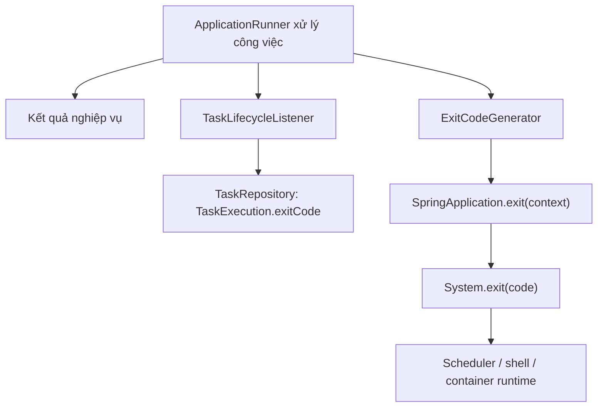
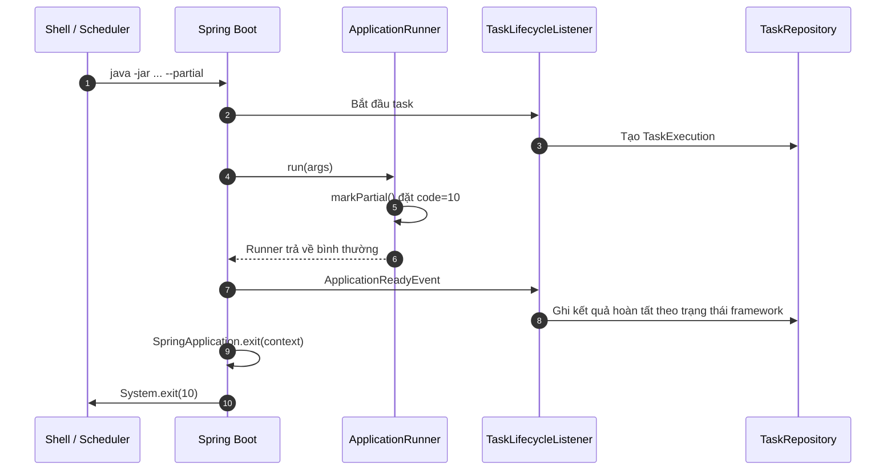

# Cung cấp mã thoát qua `ExitCodeGenerator` trong Spring Cloud Task

## 1. Vì sao một tác vụ cần mã thoát?

Ứng dụng **Spring Cloud Task** thực hiện một công việc hữu hạn rồi kết thúc: nhập dữ liệu, đối soát thanh toán, tạo báo cáo hoặc thực hiện một bước của quy trình xử lý theo lịch. Khi tác vụ dừng, hệ thống bên ngoài cần một tín hiệu ngắn gọn để biết có nên chạy bước tiếp theo, cảnh báo hay thử lại. **Mã thoát** (*exit code*) phục vụ nhu cầu này.

Ví dụ, một ứng dụng `daily-settlement` xử lý giao dịch cho ngày `2026-11-23` có thể kết thúc với:

| Mã minh họa | Ý nghĩa do ứng dụng quy định | Hướng xử lý dự kiến |
| --- | --- | --- |
| `0` | Hoàn thành bình thường | Cho phép bước phụ thuộc tiếp tục. |
| `10` | Hoàn thành một phần, còn bản ghi cần đối soát | Gửi cảnh báo và xử lý các bản ghi tồn. |
| `20` | Đầu vào không hợp lệ | Kiểm tra tham số, không retry y nguyên. |
| `30` | Dịch vụ phụ thuộc tạm thời không khả dụng | Cân nhắc retry có giới hạn và backoff. |

Các mã `10`, `20`, `30` là **quy ước ví dụ**, không phải bộ mã lỗi được Spring Cloud Task định nghĩa sẵn. Bộ điều phối phải hiểu quy ước đó trước khi quyết định retry hoặc cảnh báo. Tùy môi trường, hệ điều hành/container cũng có thể gán mã riêng khi tiến trình bị dừng bởi tín hiệu.

Bài thuộc chương **Kết quả và mã thoát** tập trung vào interface `ExitCodeGenerator` của Spring Boot và cách nó liên quan đến thông tin thực thi mà Spring Cloud Task lưu trong `TaskRepository`. Sau bài này, bạn có thể:

- Cung cấp mã thoát có chủ đích bằng `ExitCodeGenerator`.
- Dùng `SpringApplication.exit(...)` và `System.exit(...)` để chuyển mã ra hệ điều hành.
- Phân biệt mã thoát của **tiến trình** với `TaskExecution.exitCode` được lưu trong **cơ sở dữ liệu**.
- Ánh xạ lỗi nghiệp vụ thành mã thích hợp; hiểu vai trò của `ExitCodeEvent` và `ExitCodeExceptionMapper`.
- Kiểm chứng hành vi thực tế khi tác vụ thành công, có cảnh báo, lỗi hoặc bị dừng bất thường.

## 2. Ba tầng kết quả cần phân biệt

Trong một ứng dụng có Spring Cloud Task, cùng từ “mã thoát” có thể xuất hiện ở những nơi khác nhau:

| Tầng | Đối tượng / nơi lưu | Ai sử dụng? |
| --- | --- | --- |
| **Kết quả nghiệp vụ** | Dữ liệu giao dịch, báo cáo, bảng lỗi hoặc tệp đầu ra | Người dùng và hệ thống nghiệp vụ kiểm tra nội dung đã xử lý. |
| **Mã thoát trong metadata** | `TaskExecution.exitCode`, thường là cột `EXIT_CODE` của `TASK_EXECUTION` | `TaskRepository`, `TaskExplorer`, màn hình lịch sử và công cụ giám sát. |
| **Mã thoát tiến trình** | Trạng thái tiến trình trả về hệ điều hành khi JVM kết thúc | Shell, Kubernetes Job/CronJob, scheduler và bộ điều phối. |

Ba tầng liên quan nhưng **không tự động đồng nhất trong mọi cách viết chương trình**. Một báo cáo có thể ghi xong nhưng chứa số liệu thiếu; tiến trình trả về `0` không thay thế kiểm tra dữ liệu nghiệp vụ. Ngược lại, nếu mã thoát được tính **sau** khi Spring Cloud Task đã hoàn tất metadata, kết quả trong database có thể khác mã hệ điều hành.



Sơ đồ mô tả **các trách nhiệm**, không khẳng định tất cả các nhánh xảy ra cùng lúc. Thời điểm tính mã và thời điểm Spring Cloud Task cập nhật bản ghi rất quan trọng.

## 3. `ExitCodeGenerator` là gì?

**`ExitCodeGenerator`** là interface do Spring Boot cung cấp trong package `org.springframework.boot`:

```java
package org.springframework.boot;

public interface ExitCodeGenerator {
    int getExitCode();
}
```

Khi `SpringApplication.exit(context)` được gọi, Spring Boot có thể lấy mã từ các bean triển khai interface này. Mã nhận được là một số nguyên Java; trên thực tế nên chọn các mã **dương, nhỏ, ổn định** và được bộ điều phối hỗ trợ. `0` thông thường biểu thị kết thúc thành công, còn mã khác `0` báo trạng thái cần chú ý theo quy ước của ứng dụng.

Phân biệt các thành phần dễ nhầm:

| API | Nơi định nghĩa | Trách nhiệm |
| --- | --- | --- |
| `ExitCodeGenerator` | Spring Boot | Tính mã thoát từ trạng thái của một bean hoặc exception. |
| `SpringApplication.exit(context)` | Spring Boot | Tính mã thoát cho việc đóng ứng dụng theo cơ chế của Boot và đóng context. |
| `System.exit(code)` | Java | Kết thúc JVM và trả mã thoát cho tiến trình gọi. |
| `ExitCodeEvent` | Spring Boot | Thông báo một mã thoát đã được xác định. |
| `ExitCodeExceptionMapper` | Spring Boot | Ánh xạ `Throwable` thành mã thoát ở đường xử lý lỗi. |
| `TaskLifecycleListener` | Spring Cloud Task | Cập nhật metadata bắt đầu và kết thúc `TaskExecution` theo vòng đời ứng dụng. |
| `TaskRepository` | Spring Cloud Task | Lưu kết quả thực thi, bao gồm `exitCode`, vào database. |

**Điểm mấu chốt:** chỉ thêm một bean `ExitCodeGenerator` không có nghĩa JVM sẽ tự gọi `System.exit(...)` với mã của bean đó, và cũng không bảo đảm `TaskExecution.exitCode` sẽ nhận cùng mã. Các bước này cần được thiết kế và kiểm tra riêng.

## 4. Cách cơ bản: trả mã từ một bean `ExitCodeGenerator`

Ví dụ ngắn nhất: ứng dụng có một bean trả mã `10` và hàm `main` chuyển mã đó cho hệ điều hành.

```java
import org.springframework.boot.ExitCodeGenerator;
import org.springframework.boot.SpringApplication;
import org.springframework.boot.autoconfigure.SpringBootApplication;
import org.springframework.cloud.task.configuration.EnableTask;
import org.springframework.context.ConfigurableApplicationContext;
import org.springframework.context.annotation.Bean;

@SpringBootApplication
@EnableTask
public class SampleTaskApplication {

    public static void main(String[] args) {
        ConfigurableApplicationContext context =
            SpringApplication.run(SampleTaskApplication.class, args);
        int code = SpringApplication.exit(context);
        System.exit(code);
    }

    @Bean
    ExitCodeGenerator exitCodeGenerator() {
        return () -> 10;
    }
}
```

Trong trường hợp ứng dụng khởi động thành công, `SpringApplication.exit(...)` tính mã từ bean; `System.exit(...)` đưa mã đó về shell. Ví dụ cố tình trả `10` để minh họa đường đi, **không nên trả một mã khác `0` cố định** cho mọi lần chạy trong ứng dụng thật.

Chú ý thêm hai điều:

1. Nếu chỉ gọi `SpringApplication.run(...)` rồi để `main` kết thúc, mã từ bean không mặc nhiên được dùng làm mã của JVM. Ví dụ trên gọi rõ `SpringApplication.exit(...)` và `System.exit(...)` để thể hiện ý đồ.
2. Spring Cloud Task thường ghi thông tin hoàn tất khi nhận `ApplicationReadyEvent`, sau khi runner đồng bộ kết thúc. Đến lúc hàm `main` gọi `SpringApplication.exit(context)`, metadata có thể **đã được hoàn tất**. Vì vậy, dù shell nhận `10`, **không nên giả định** cột `TASK_EXECUTION.EXIT_CODE` cũng đã trở thành `10` chỉ nhờ bean trên.

Khi có nhiều bean `ExitCodeGenerator`, Spring Boot xét các generator theo thứ tự được quản lý và sử dụng **mã khác `0` đầu tiên**; có thể dùng `Ordered` hoặc `@Order` để làm rõ ưu tiên. Dù vậy, một ứng dụng task nên có một chiến lược mã thoát thống nhất để tránh tranh chấp giữa nhiều bean.

## 5. Ví dụ thực tế: mã thoát thay đổi theo kết quả nghiệp vụ

Trong bài toán đối soát, một lần chạy có thể thành công hoàn toàn hoặc hoàn thành một phần. Ta dùng một bean giữ trạng thái kết quả và triển khai `ExitCodeGenerator`. Runner cập nhật trạng thái, còn `main` trả mã về hệ điều hành.

### 5.1. Bean chứa kết quả

```java
import org.springframework.boot.ExitCodeGenerator;
import org.springframework.stereotype.Component;

@Component
public class SettlementOutcome implements ExitCodeGenerator {

    private int exitCode = 0;

    public void markPartial() {
        this.exitCode = 10;
    }

    @Override
    public int getExitCode() {
        return exitCode;
    }
}
```

Ở ví dụ này, `0` là trạng thái mặc định khi công việc chưa phát hiện vấn đề; `markPartial()` đặt mã `10` khi còn giao dịch chưa xử lý hoàn toàn. Vì runner ví dụ chạy đồng bộ trên một luồng, cách giữ trạng thái đơn giản là đủ để minh họa. Nếu nhiều luồng cùng cập nhật kết quả, cần thiết kế đồng bộ hoặc dùng cấu trúc dữ liệu an toàn luồng.

### 5.2. Ứng dụng thực thi hữu hạn

```java
import org.springframework.boot.ApplicationRunner;
import org.springframework.boot.SpringApplication;
import org.springframework.boot.autoconfigure.SpringBootApplication;
import org.springframework.cloud.task.configuration.EnableTask;
import org.springframework.context.ConfigurableApplicationContext;
import org.springframework.context.annotation.Bean;

@SpringBootApplication
@EnableTask
public class SettlementTaskApplication {

    public static void main(String[] args) {
        ConfigurableApplicationContext context =
            SpringApplication.run(SettlementTaskApplication.class, args);
        System.exit(SpringApplication.exit(context));
    }

    @Bean
    ApplicationRunner settlementRunner(SettlementOutcome outcome) {
        return arguments -> {
            // TODO: thay bằng xử lý đối soát thực tế và kiểm tra kết quả.
            boolean hasUnresolvedItems = arguments.containsOption("partial");

            if (hasUnresolvedItems) {
                outcome.markPartial();
                System.out.println("Đối soát còn giao dịch chưa hoàn tất");
            } else {
                System.out.println("Đối soát hoàn tất");
            }
        };
    }
}
```

Chạy thành công:

```bash
java -jar settlement-task.jar
```

Chạy trường hợp hoàn thành một phần:

```bash
java -jar settlement-task.jar --partial
```

Sau khi runner kết thúc, `SettlementOutcome.getExitCode()` trả `0` hoặc `10`; `SpringApplication.exit(context)` sử dụng giá trị này và `System.exit(code)` chuyển mã cho hệ điều hành. Đây là **ví dụ về mã thoát tiến trình**. Để dùng mã này cho dashboard dựa trên `TaskExecution`, cần hiểu và kiểm chứng cơ chế ghi metadata ở phần tiếp theo.

### 5.3. Cấu hình metadata cho Spring Cloud Task

```yaml
spring:
  application:
    name: settlement-worker
  main:
    web-application-type: none
  cloud:
    task:
      name: daily-settlement
  datasource:
    url: ${TASK_DB_URL}
    username: ${TASK_DB_USER}
    password: ${TASK_DB_PASSWORD}
```

Để chạy được ví dụ, cần dependency `spring-cloud-starter-task`, driver JDBC phù hợp, schema metadata Spring Cloud Task đúng phiên bản và database có thể kết nối. Phiên bản Spring Boot, Spring Cloud và JDK phải tương thích. Ví dụ trên sử dụng một ứng dụng không cần HTTP server; nguồn dữ liệu lưu metadata giúp kiểm tra các lần chạy sau khi JVM đã thoát.

## 6. Vì sao mã tiến trình và mã lưu trong `TaskExecution` có thể khác nhau?

Spring Cloud Task theo dõi vòng đời ứng dụng bằng `TaskLifecycleListener`. Thông thường framework tạo metadata khi context khởi động và cập nhật kết quả khi các `ApplicationRunner`/`CommandLineRunner` đồng bộ hoàn tất, thông qua `ApplicationReadyEvent` hoặc đường xử lý thất bại.

Đối với ví dụ `SettlementOutcome`, hãy hình dung thứ tự sau:



`TaskLifecycleListener` không mặc nhiên lấy lại giá trị từ mọi bean `ExitCodeGenerator` **sau khi** bản ghi đã được hoàn tất. Trong triển khai Spring Cloud Task, mã lưu trong `TaskExecution` chịu ảnh hưởng của các sự kiện `ExitCodeEvent` đã nhận và đường xử lý lỗi. Vì vậy, trường hợp runner **trả về bình thường** nhưng bean chỉ cung cấp mã `10` ở `SpringApplication.exit(...)` có thể dẫn đến **mã tiến trình `10`, metadata `0`**.

Đây không phải lý do bỏ `ExitCodeGenerator`, mà là lý do xác định rõ hệ thống nào sẽ quyết định kết quả và **kiểm thử cả hai nguồn**. Đặc biệt, nếu bộ điều phối đọc mã tiến trình để quyết định retry nhưng dashboard đọc `TASK_EXECUTION.EXIT_CODE`, hai hệ thống phải có quy tắc nhất quán hoặc ghi rõ sự khác biệt có chủ đích.

## 7. Nếu cần ghi mã riêng vào metadata: `ExitCodeEvent`

Spring Boot cung cấp sự kiện `ExitCodeEvent`, mang mã thoát đã được xác định. Trong các phiên bản Spring Cloud Task hỗ trợ lắng nghe sự kiện này, `TaskLifecycleListener` có thể dùng mã từ **sự kiện đã nhận trước khi hoàn tất task**.

Ta có thể bổ sung vào runner ở mục 5 một cơ chế phát sự kiện tại thời điểm đã biết kết quả, **trước khi runner trả về**:

```java
import org.springframework.boot.ApplicationRunner;
import org.springframework.boot.ExitCodeEvent;
import org.springframework.context.ApplicationEventPublisher;
import org.springframework.context.annotation.Bean;

@Bean
ApplicationRunner settlementRunner(SettlementOutcome outcome,
                                   ApplicationEventPublisher events) {
    return arguments -> {
        boolean hasUnresolvedItems = arguments.containsOption("partial");

        if (hasUnresolvedItems) {
            outcome.markPartial();
            // Thông báo code=10 khi TaskExecution chưa được hoàn tất.
            events.publishEvent(new ExitCodeEvent(this, outcome.getExitCode()));
        }
    };
}
```

Đoạn trên là **phiên bản thay thế** của bean `settlementRunner` ở mục 5.2, không đăng ký đồng thời cả hai bean runner trong cùng một thực hành. Mục tiêu là minh họa thời điểm phát sự kiện; phần làm việc thực tế cần được chờ hoàn tất trước khi phát kết quả.

Với luồng đồng bộ và listener hoạt động bình thường, mã `10` đã có khi `ApplicationReadyEvent` được phát. Khi đó Spring Cloud Task có thể lưu mã này vào `TaskExecution`, trong khi `SpringApplication.exit(...)` tiếp tục lấy mã `10` từ `SettlementOutcome` để trả cho hệ điều hành.

Lưu ý trước khi dùng cách này trong sản xuất:

- `ExitCodeEvent` là sự kiện hạ tầng; việc phát thủ công phải được kiểm soát, tránh nhiều nơi gửi các mã khác nhau.
- Phải đối chiếu hành vi của **phiên bản Spring Cloud Task/Spring Boot đang dùng**, vì thứ tự sự kiện và lifecycle quyết định mã nào được lưu.
- Nếu một tiến trình đã thất bại và không thể ghi repository, việc phát sự kiện không tự bảo đảm bản ghi được cập nhật.
- Nên thống nhất một lớp xác định kết quả, rồi sử dụng cùng kết quả cho metadata và mã tiến trình.

Nếu chỉ cần mã thoát tiến trình để scheduler xử lý, ví dụ `ExitCodeGenerator` ở mục 5 đã thể hiện cơ chế chính. Chỉ thêm phối hợp sự kiện khi yêu cầu vận hành thực sự cần trạng thái lưu trong repository nhất quán ở các trường hợp không ném ngoại lệ.

## 8. Ánh xạ exception thành mã thoát

Ngoài bean thông thường, **exception có thể triển khai `ExitCodeGenerator`**. Điều này thích hợp khi công việc không thể hoàn tất và cần chỉ rõ loại lỗi.

```java
import org.springframework.boot.ExitCodeGenerator;

public class InvalidInputException extends RuntimeException
        implements ExitCodeGenerator {

    public InvalidInputException(String message) {
        super(message);
    }

    @Override
    public int getExitCode() {
        return 20;
    }
}
```

Trong runner:

```java
@Bean
ApplicationRunner validateInput() {
    return args -> {
        if (!args.containsOption("businessDate")) {
            throw new InvalidInputException("Thiếu --businessDate");
        }
        // TODO: kiểm tra ngày xử lý và thực hiện nghiệp vụ.
    };
}
```

Spring Boot hỗ trợ suy ra mã thoát từ exception triển khai `ExitCodeGenerator` trên đường xử lý lỗi; Spring Cloud Task có thể nhận `ExitCodeEvent` do Boot phát và ghi mã tương ứng khi kết thúc bằng lỗi. Nếu không có mã được cung cấp, đường thất bại thông thường của Task có thể dùng mã `1`.

**Giới hạn cần nhớ:** một exception chưa được xử lý có thể làm `SpringApplication.run(...)` ném lỗi trước khi chương trình đi đến dòng `System.exit(SpringApplication.exit(context))`. Vì vậy, việc ghi được mã `20` vào metadata **không tự bảo đảm** shell cũng nhận đúng `20`; phải kiểm thử mã của tiến trình thực tế và, nếu cần, bổ sung chiến lược xử lý lỗi ở điểm vào ứng dụng. Không nên nuốt exception chỉ để ép chương trình báo thành công.

### 8.1. `ExitCodeExceptionMapper` dùng khi nào?

Khi không muốn thay đổi lớp exception để triển khai interface, có thể dùng `ExitCodeExceptionMapper` của Spring Boot:

```java
import org.springframework.boot.ExitCodeExceptionMapper;
import org.springframework.context.annotation.Bean;

@Bean
ExitCodeExceptionMapper exitCodeExceptionMapper() {
    return exception -> {
        if (exception instanceof IllegalArgumentException) {
            return 20;
        }
        return 1;
    };
}
```

Ví dụ này phân loại lỗi đầu vào với lỗi còn lại. Trong các luồng thực tế, ngoại lệ có thể được framework bọc qua nhiều lớp; cần xem `cause` có kiểm soát để nhận đúng loại gốc, tránh ánh xạ nhầm tất cả thành `1`.

`ExitCodeExceptionMapper` và `ExitCodeGenerator` giải quyết hai kiểu cung cấp mã: một bên **ánh xạ lỗi chưa xử lý**, một bên **tự trả về mã từ bean hoặc exception**. Các callback lỗi của `TaskExecutionListener` trong Spring Cloud Task có quy tắc riêng; không mặc định mapper sẽ ghi đè mã của mọi lỗi sinh ra trong callback đó.

## 9. Ý nghĩa của `0`, mã khác `0` và lỗi dừng bất thường

Trong hệ điều phối, thường dùng `0` là thành công và mã khác `0` là cần xử lý. Tuy nhiên, **ý nghĩa của từng mã không tự có sẵn**: ứng dụng và hệ thống vận hành phải cùng thống nhất.

Một hợp đồng mã thoát có thể dùng:

| Mã | Loại kết quả | Nên retry tự động? |
| --- | --- | --- |
| `0` | Hoàn tất thành công | Không cần. |
| `10` | Hoàn tất một phần và cần can thiệp | Tùy trạng thái dữ liệu và quy tắc nghiệp vụ. |
| `20` | Tham số/đầu vào không hợp lệ | Thường không retry với đầu vào không đổi. |
| `30` | Sự cố tạm thời của dịch vụ phụ thuộc | Có thể retry có giới hạn, backoff và idempotency. |

Hãy chọn mã tránh xung đột với quy ước của container runtime, nền tảng điều phối và shell. Trên nhiều hệ Unix, chỉ 8 bit thấp của mã tiến trình được phản ánh trong shell, nên không nên chọn các giá trị âm hoặc quá lớn rồi giả định chúng được giữ nguyên. Mã liên quan tín hiệu hệ điều hành có thể được nền tảng báo khác nhau; **không sử dụng mã tín hiệu làm kết luận duy nhất về logic nghiệp vụ**.

Khi JVM bị `kill -9`, máy chủ mất nguồn hoặc container bị cưỡng bức dừng, Spring Cloud Task có thể **không nhận được cơ hội cập nhật** `endTime`/`exitCode`. Khi ấy trạng thái container, scheduler và log là nguồn đối chiếu quan trọng, còn metadata có thể vẫn mang giá trị `null` hoặc chưa hoàn chỉnh.

## 10. Đo mã tiến trình và mã trong database

Để tránh nhầm, hãy kiểm tra **cả mã trả về shell** và **mã trong `TaskRepository`** sau mỗi tình huống.

### 10.1. Kiểm tra bằng shell

Trên Linux hoặc macOS:

```bash
java -jar settlement-task.jar --partial
code=$?
printf 'Process exit code: %s\n' "$code"
```

Trong Windows PowerShell:

```powershell
java -jar settlement-task.jar --partial
$code = $LASTEXITCODE
Write-Output "Process exit code: $code"
```

Ghi nhận trạng thái **ngay sau lệnh Java**, trước khi chạy các lệnh khác có thể làm thay đổi biến mã thoát.

### 10.2. Tra cứu metadata trong database

Với schema JDBC Spring Cloud Task thường gặp, có thể dùng SQL tham khảo:

```sql
SELECT TASK_EXECUTION_ID,
       TASK_NAME,
       START_TIME,
       END_TIME,
       EXIT_CODE,
       EXIT_MESSAGE,
       ERROR_MESSAGE
FROM TASK_EXECUTION
WHERE TASK_NAME = 'daily-settlement'
ORDER BY TASK_EXECUTION_ID DESC;
```

Tên bảng/cột cần đối chiếu với schema của đúng phiên bản và DBMS đang dùng. `TaskExplorer` là API khác để tra cứu lịch sử. Khi tác vụ **đang chạy**, `exitCode` thường chưa có giá trị; sau khi Task hoàn tất và repository cập nhật thành công, mã mới có ý nghĩa kết thúc.

### 10.3. Ma trận kiểm chứng

| Kịch bản | Mã tiến trình dự kiến | Điều cần kiểm tra trong `TaskExecution` |
| --- | --- | --- |
| Runner thành công, generator trả `0` | `0` | Đã có `endTime` và mã hoàn tất thích hợp. |
| Runner trả bình thường, generator trả `10` trong `SpringApplication.exit` | `10` | **Có thể vẫn là `0`** nếu Task đã hoàn tất trước lúc Boot tính mã. |
| Runner gửi `ExitCodeEvent(10)` trước khi hoàn tất, generator cũng trả `10` | `10` | Kiểm chứng bản ghi đã nhận `10` ở phiên bản thực tế. |
| Runner ném exception có mã `20` | Không giả định nếu chưa kiểm thử điểm vào ứng dụng | Xem có `ExitCodeEvent`, `ApplicationFailedEvent`, `exitCode` và `errorMessage`. |
| DB metadata không truy cập được | Phụ thuộc lỗi lúc khởi động/kết thúc | Có thể không có bản ghi hoặc bản ghi chưa hoàn tất. |
| Tiến trình bị dừng cưỡng bức | Mã do môi trường điều phối xác định | `endTime`/`exitCode` có thể không được cập nhật. |

Lần chạy thử bằng H2 in-memory chỉ kiểm chứng được hành vi trong một tiến trình; nếu muốn so sánh nhiều lần chạy, nên dùng database bền vững như PostgreSQL hoặc một kho lưu metadata thích hợp.

## 11. Lỗi thường gặp khi cung cấp mã thoát

| Triệu chứng | Nguyên nhân phổ biến | Cách xử lý |
| --- | --- | --- |
| Đã viết `ExitCodeGenerator` nhưng shell luôn báo `0` | Ứng dụng không chuyển mã sang `System.exit(...)`. | Tính mã qua `SpringApplication.exit(context)` rồi trả mã cho JVM theo điểm vào đã thiết kế. |
| Shell nhận `10` nhưng `TASK_EXECUTION.EXIT_CODE` là `0` | Task hoàn tất trước khi `SpringApplication.exit(...)` đánh giá bean. | Kiểm tra thời điểm sự kiện và cơ chế ghi metadata; dùng cách phối hợp phù hợp nếu cần đồng bộ. |
| Mọi lần chạy đều báo cùng một mã khác `0` | Generator trả hằng số hoặc trạng thái không được cập nhật. | Tính mã từ kết quả công việc thật; thử đủ các nhánh. |
| Lỗi đầu vào trở thành thành công | Runner bắt và log exception rồi trả về bình thường. | Ném lỗi phù hợp, hoặc đánh dấu kết quả và cung cấp mã thoát nhất quán. |
| Truy vấn không thấy `TaskExecution` | Context không khởi tạo hoặc kết nối `TaskRepository` sai. | Kiểm tra log, database, schema và bộ điều phối trước khi kết luận task chưa chạy. |
| `exitCode` vẫn `null` rất lâu | Tiến trình chưa hoàn tất hoặc đã bị dừng mà không cập nhật repository. | Đối chiếu trạng thái tiến trình/container, log và thời gian bắt đầu. |
| Spring Batch báo job thất bại nhưng shell báo `0` | Trạng thái Batch chưa được ánh xạ thành mã thoát ứng dụng. | Xác định chính sách chuyển trạng thái `JobExecution`/`ExitStatus` sang kết quả Spring Boot và Task. |
| Scheduler retry liên tục lỗi đầu vào | Coi mọi mã khác `0` là lỗi tạm thời. | Phân biệt lỗi cần sửa dữ liệu với lỗi có thể retry; giới hạn lần thử. |

Đặc biệt, **không gọi `System.exit(...)` ngay giữa runner** chỉ để trả mã lỗi. Thoát JVM đột ngột có thể ngăn Spring Cloud Task hoàn tất cập nhật `TaskExecution`, bỏ qua cleanup, shutdown hook hoặc tài nguyên cần giải phóng. Nên để vòng đời công việc kết thúc có kiểm soát trước khi trả mã cho hệ điều hành.

## 12. Quan hệ với chạy theo lịch, retry và Spring Batch

### 12.1. Scheduler dùng mã tiến trình để ra quyết định

Một lịch chạy hoặc bộ điều phối thường quan sát process exit code. Nó có thể thử lại với mã `30`, dừng ngay khi nhận `20` hoặc tạo cảnh báo với `10`. Quy tắc này thuộc **bộ điều phối và hợp đồng vận hành**, Spring Cloud Task không tự lên lịch hoặc tự quyết định toàn bộ chính sách retry.

Để retry an toàn, công việc cần **idempotency**: chạy lại cùng ngày xử lý không được ghi kết quả trùng hoặc gây sai số. Mỗi lần chạy lại thông thường có `TaskExecution.executionId` mới, dù `taskName` và tham số nghiệp vụ giống nhau.

### 12.2. Spring Batch có trạng thái riêng

Khi một ứng dụng Spring Cloud Task chạy Spring Batch, có ba kết quả cần theo dõi:

| Kết quả | Mô hình | Mục đích |
| --- | --- | --- |
| Job/step Batch | `JobExecution`, `BatchStatus`, `ExitStatus` | Diễn tả trạng thái xử lý của job và các step. |
| Task Spring Cloud Task | `TaskExecution.exitCode` | Ghi mã kết thúc lần chạy ứng dụng. |
| Tiến trình JVM | OS exit code | Báo kết quả cho scheduler hoặc container runtime. |

Một job Batch thất bại **không tự chứng minh** hai mã còn lại đã được ánh xạ chính xác theo yêu cầu. Nếu ứng dụng bắt lỗi Batch, log rồi trả về bình thường, Task có thể ghi thành công. Ngược lại, một lỗi khởi động khiến không có bản ghi Task dù scheduler thấy tiến trình thất bại.

Khi phối hợp với Spring Batch, hãy xác định rõ trạng thái job nào sẽ ánh xạ thành mã `0`, `10`, `20` hay mã khác, và kiểm thử cả ba tầng. Một số phiên bản hoặc cấu hình tích hợp có sẵn generator cho Batch; vẫn cần đối chiếu với cách cấu hình và điểm kết thúc của ứng dụng thật.

## 13. Quy ước triển khai và an toàn vận hành

Một hợp đồng mã thoát tốt thường đáp ứng các yêu cầu sau:

1. **Ổn định:** cùng một loại kết quả luôn trả cùng mã trong các phiên bản ứng dụng tương thích.
2. **Đủ phân biệt:** tách lỗi không thể retry (đầu vào sai) khỏi lỗi tạm thời (dịch vụ ngoài gián đoạn).
3. **Đúng thời điểm:** quyết định mã khi đã biết kết quả nghiệp vụ; runner không trả về trước khi việc chính thực sự hoàn tất.
4. **Dễ quan sát:** log ngắn gọn lý do và mã thoát; đồng thời kiểm chứng kết quả trong `TaskRepository` và nơi lưu nghiệp vụ.
5. **Không chứa bí mật:** mã là số định danh trạng thái, thông báo lỗi không được làm lộ token hoặc dữ liệu nhạy cảm.
6. **Phù hợp bộ điều phối:** chỉ dùng mã nằm trong phạm vi môi trường hỗ trợ, đặt chính sách retry/alert nhất quán.
7. **Khôi phục an toàn:** khi metadata không hoàn tất do JVM/DB gặp sự cố, có quy trình đối chiếu trạng thái và chống chạy trùng.

Ví dụ với hệ thống đối soát, dù có `exitCode=0`, vẫn cần kiểm tra số lượng bản ghi đã đối soát, chênh lệch và dữ liệu đầu ra. Khi có `exitCode=30`, không nên retry vô hạn nếu đối tác có thể đã nhận một phần yêu cầu trước lúc kết nối bị cắt.

## 14. Tự kiểm tra

**Câu 1.** Interface `ExitCodeGenerator` do Spring Boot hay Spring Cloud Task cung cấp? Phương thức quan trọng của nó là gì?

**Câu 2.** Vì sao có bean trả `10` nhưng shell vẫn thấy `0` nếu ứng dụng chỉ gọi `SpringApplication.run(...)` rồi kết thúc?

**Câu 3.** Tại sao shell có thể nhận `10` nhưng cột `TASK_EXECUTION.EXIT_CODE` là `0` sau khi runner thành công?

**Câu 4.** Có nên gọi `System.exit(20)` ngay trong `ApplicationRunner` khi phát hiện lỗi dữ liệu? Vì sao?

**Câu 5.** Làm thế nào để phân biệt một lỗi dữ liệu không cần retry với một lỗi mạng nên thử lại có giới hạn?

**Câu 6.** Trong ứng dụng tích hợp Spring Batch, `JobExecution.ExitStatus`, `TaskExecution.exitCode` và mã tiến trình có phải một giá trị duy nhất không?

**Gợi ý trả lời:** (1) Spring Boot, `int getExitCode()`; (2) chưa có bước tính và chuyển mã ra hệ điều hành; (3) metadata có thể hoàn tất ở `ApplicationReadyEvent` trước khi `SpringApplication.exit(...)` đánh giá bean; (4) không nên vì có thể bỏ qua bước hoàn tất repository và cleanup; (5) định nghĩa mã riêng và chính sách retry của scheduler; (6) không, cần cơ chế ánh xạ và xác minh theo từng tầng.

## 15. Kết luận

**`ExitCodeGenerator` giúp ứng dụng Spring Boot trả mã thoát có ý nghĩa cho hệ điều hành**, đặc biệt hữu ích với ứng dụng Spring Cloud Task có thời gian chạy hữu hạn. Với đường kết thúc thông thường, `SpringApplication.exit(context)` tính mã và `System.exit(code)` chuyển mã cho scheduler hoặc shell. Khi có lỗi, exception triển khai `ExitCodeGenerator` hoặc `ExitCodeExceptionMapper` có thể diễn đạt loại thất bại rõ hơn.

Điều quan trọng là **`TaskExecution.exitCode` và mã thoát tiến trình được xác định ở những thời điểm khác nhau**. Hãy kiểm tra cả hai; nếu cần thống nhất các mã ở đường hoàn thành không ném lỗi, phải thiết kế thời điểm thông báo kết quả phù hợp. Kết hợp mã thoát với log, dữ liệu nghiệp vụ, `TaskRepository`, chính sách retry và trạng thái Spring Batch sẽ giúp hệ thống theo dõi, xử lý lỗi và vận hành an toàn.

**Tài liệu tham khảo chính thức:**

- [Spring Boot — SpringApplication: Application Exit](https://docs.spring.io/spring-boot/reference/features/spring-application.html)
- [Spring Cloud Task — Features: TaskExecution và Mapping Exit Codes](https://docs.spring.io/spring-cloud-task/docs/current/reference/html/features.html)
- [Spring Boot — ExitCodeEvent API](https://docs.spring.io/spring-boot/api/java/org/springframework/boot/ExitCodeEvent.html)
- [Spring Cloud Task — Reference Guide](https://docs.spring.io/spring-cloud-task/reference/)
